# מספרים ממשיים ופונקציות {chapter="1"}

## מערכות המספרים: מהטבעיים אל הממשיים


מי שלומד מדעי הנתונים צריך לדעת למדל נתונים. בדרך כלל מייצגים את הנתונים כמספרים (למשל בגיליון Excel), והמספרים מתארים כמויות שסופרים ותכונות שמודדים. כלומר, צריך לדעת **לספור** ו**למדוד**. נבדוק שאנחנו יודעים לעשות את שני הדברים. אם כן, הקורס הזה מיותר: אתם כבר יודעים את החומר, ואפשר ללכת הביתה.

### ספירה: המספרים הטבעיים, השלמים והרציונליים {.unnumbered}

::: {#box-def-naturals .thmdef title="המספרים הטבעיים"}
[**המספרים הטבעיים**]{.term} הם המספרים שבהם אנחנו סופרים: $$.\mathbb{N} = \{1, 2, 3, 4, \dots\}$$
:::

מה עוד אפשר לעשות עם מספרים טבעיים? אפשר לחבר אותם: אם בכיס אחד יש לי $3$ שקלים ובכיס השני $5$, אז בשני הכיסים יחד יש לי $3 + 5 = 8$ שקלים.

לפעמים צריך גם לחסר, כדי למצוא את אחד המחוברים: אם בשני הכיסים יחד יש $8$ שקלים, ובכיס אחד יש $5$, אז בכיס השני יש $8 - 5 = 3$ שקלים. אבל לא כל שני מספרים טבעיים אפשר לחסר זה מזה: למשל, $3 - 5$ אינו מספר טבעי. מצד שני, למי שיש יתרה שלילית בבנק **חסר** כסף. כדי לתאר "חוב" או "חסר" צריך את **המספרים השליליים** $.{-}1, -2, -3, \dots$

::: {#box-def-integers .thmdef title="המספרים השלמים"}
המספרים הטבעיים, המספרים השליליים ו-$0$ יחד הם [**המספרים השלמים**]{.term}: $$.\mathbb{Z} = \{\dots, -3, -2, -1, 0, 1, 2, 3, \dots\}$$
:::

מספרים שלמים אפשר גם לכפול. ומה עם חילוק?

::: {#box-exm-gift .thmexm title="מתנה לחבר"}
$8$ ילדים קונים מתנה לחבר שלהם.

:::: fill
**(א)** כל אחד נותן $2$ שקלים. המתנה עולה [$16$]{.blank ans="16"} שקלים.

::: explain
כופלים: $.2 \cdot 8 = 16$ התשובה היא מספר שלם.
:::
::::

:::: fill
**(ב)** המתנה עולה $20$ שקלים. כל אחד צריך לתת [$2.5$]{.blank ans="2.5"} שקלים.

::: explain
הפעם צריך לחלק: $$.\frac{20}{8} = 2.5$$ וזה **אינו** מספר שלם. שוב צריך מספרים חדשים: **השברים**.
:::
::::
:::

::: {#box-def-rationals .thmdef title="המספרים הרציונליים"}
[**המספרים הרציונליים**]{.term} הם כל המספרים שאפשר לכתוב כשבר $,\frac{m}{n}$ כאשר $m$ ו-$n$ מספרים שלמים ו-$.n \neq 0$ את אוסף המספרים הרציונליים מסמנים $.\mathbb{Q}$ למשל $\frac{3}{4}$, $-\frac{5}{2}$ ו-$.7 = \frac{7}{1}$
:::

את התשובה בדוגמת המתנה כתבנו כ-$,2.5$ בכתיבה עשרונית. זו דרך נוספת לכתוב שברים:

::: {#box-def-decimal .thmdef title="שבר עשרוני"}
בכתיבה עשרונית, הספרות שאחרי הנקודה סופרות חלקים של $:1$ הספרה הראשונה סופרת **עשיריות** ($\frac{1}{10}$), השנייה **מאיות** ($\frac{1}{100}$), השלישית **אלפיות** ($\frac{1}{1000}$), וכן הלאה. מספר שכתוב כך נקרא [**שבר עשרוני**]{.term}. למשל: $$\begin{aligned} 2.5 &= 2 + \frac{5}{10} = \frac{5}{2} \\ 0.25 &= \frac{25}{100} = \frac{1}{4} \\ 1.125 &= 1 + \frac{125}{1000} = \frac{9}{8} \end{aligned}$$
:::

לכן כל שבר עשרוני שנגמר הוא מספר רציונלי: אפשר לכתוב אותו כשבר שהמכנה שלו $10$, $100$, $1000$ וכן הלאה. הכיוון ההפוך לא תמיד נותן שבר עשרוני שנגמר: למשל $\frac{1}{3} = 0.333\ldots$, והספרה $3$ חוזרת בלי סוף.

מה בדיוק הוספנו? מתברר שחילוק אינו פעולה חדשה: הוא כפל במספר מתאים.

::: {#box-def-reciprocal .thmdef title="המספר ההופכי"}
יהי $a \neq 0$. [**המספר ההופכי**]{.term} ל-$,a$ שמסומן $,a^{-1}$ הוא המספר שמקיים $$.a \cdot a^{-1} = 1$$ כלומר $.a^{-1} = \frac{1}{a}$
:::

::: {#box-exm-reciprocal .thmexm title="מהו ההופכי?"}
מצאו את ההופכי של כל מספר, ובדקו שהמכפלה של המספר וההופכי שלו היא $.1$

:::: fill
**(א)** $2^{-1} =$ [$\frac{1}{2}$]{.blank ans="1/2"}

**(ב)** $\left(\frac{3}{4}\right)^{-1} =$ [$\frac{4}{3}$]{.blank ans="4/3"}

**(ג)** $(-5)^{-1} =$ [$-\frac{1}{5}$]{.blank ans="-1/5"}

::: explain
**(א)** $,2^{-1} = \frac{1}{2}$ ובאמת $.2 \cdot \frac{1}{2} = 1$

**(ב)** $.\left(\frac{3}{4}\right)^{-1} = \frac{4}{3}$ בדיקה: $$\begin{aligned} \frac{3}{4} \cdot \frac{4}{3} &= \frac{12}{12} \\ &= 1. \end{aligned}$$

**(ג)** $,(-5)^{-1} = -\frac{1}{5}$ כי $.(-5) \cdot \left(-\frac{1}{5}\right) = 1$ (מינוס כפול מינוס נותן פלוס.)
:::
::::
:::

::: {.thmkey icon="rule" title="חילוק הוא כפל בהופכי"}
לכל $b$ ולכל $a \neq 0$: $$.\frac{b}{a} = b \cdot a^{-1}$$ למשל: $$\begin{aligned} \frac{6}{3} &= 6 \cdot 3^{-1} \\ &= 6 \cdot \frac{1}{3} \\ &= 2. \end{aligned}$$
:::

עכשיו אפשר לנסח מה חסר בשלמים: ההופכי של $3$ הוא $,\frac{1}{3}$ והוא אינו שלם. ברציונליים, לעומת זאת, לכל מספר ששונה מאפס יש הופכי, ולכן אפשר לחלק בכל מספר ששונה מאפס.

::: {#box-warn-zero-division .thmwarn title="אסור לחלק באפס"}
ל-$0$ **אין** הופכי: אין מספר שכפול $0$ נותן $,1$ כי $0 \cdot c = 0$ לכל $.c$ לכן ביטויים כמו $\frac{5}{0}$ או $\frac{0}{0}$ **אינם מוגדרים**, ואינם מספרים בכלל. זו גם הסיבה שבהגדרה של שבר דרשנו $.n \neq 0$ בכל פעם שמופיע שבר, צריך לבדוק שהמכנה אינו אפס.
:::

:::: {.thmchk}
**(א)** האם הביטוי $\frac{0}{7}$ מוגדר?

::: {.quiz options="כן|לא" answer="כן"}
כן. המכנה הוא $,7$ ולא $,0$ ולכן מותר לחלק: $.\frac{0}{7} = 0$ אפס יכול להופיע במונה; הוא אסור רק במכנה.
:::

**(ב)** האם הביטוי $\frac{7}{0}$ מוגדר?

::: {.quiz options="כן|לא" answer="לא"}
לא. המכנה הוא $,0$ ול-$0$ אין הופכי.
:::
::::

אז לספור אנחנו יודעים: המספרים הרציונליים מספיקים לכל פעולות החשבון, חיבור, חיסור, כפל וחילוק (לא באפס). הבעיות מתחילות כשמנסים **למדוד** דברים, למשל אורכים.

### מדידה: המספרים האי-רציונליים {.unnumbered}

**נחשו:** האם כל אורך אפשר לבטא כ-$q$ מטרים, כאשר $q$ מספר רציונלי?

::: {.quiz options="כן|לא" answer="לא"}
לא! יש אורכים פשוטים מאוד שאי אפשר למדוד כך. הנה אחד מהם.
:::

::: {#box-exm-hypotenuse .thmexm title="היתר של משולש"}
נתבונן במשולש ישר-זווית שאורך כל אחד מהניצבים שלו הוא $1$ מטר. מה אורך היתר $c$?

::::: {.content-visible when-format="html"}
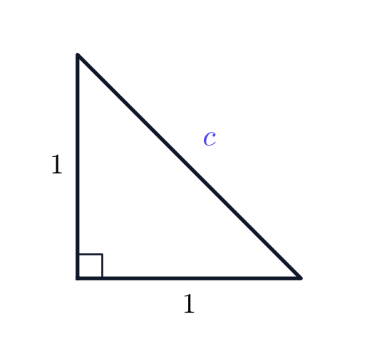{fig-alt="משולש ישר זווית עם שני ניצבים באורך אחת ויתר שמסומן c" width="30%" fig-align="center"}
:::::

::::: {.content-visible when-format="pdf"}
```{=latex}
\par\medskip
\noindent\beginL\hbox to \linewidth{\hss\includegraphics[width=0.3\linewidth]{figures/triangle-1m.png}\hss}\endL\par
\medskip
```
:::::

:::: {.lecture-answer}
לפי משפט פיתגורס, $,a^2 + b^2 = c^2$ כאשר $a$ ו-$b$ הם אורכי הניצבים ו-$c$ הוא אורך היתר. לכן $$\begin{aligned} c &= \sqrt{a^2 + b^2} \\ &= \sqrt{1^2 + 1^2} \\ &= \sqrt{2} \end{aligned}$$ מטרים.
::::
:::

מקרה נפוץ נוסף: מעגל שרדיוסו $.1$ ההיקף שלו הוא $,2\pi$ והשטח שלו הוא $.\pi$

::: {.content-visible when-format="html"}
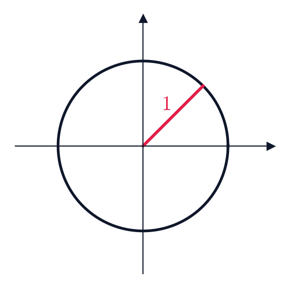{fig-alt="מעגל שמרכזו בראשית ורדיוס באורך אחת מסומן באדום" width="30%" fig-align="center"}
:::

::: {.content-visible when-format="pdf"}
```{=latex}
\par\medskip
\noindent\beginL\hbox to \linewidth{\hss\includegraphics[width=0.3\linewidth]{figures/circle-r1.png}\hss}\endL\par
\medskip
```
:::

::: {#box-thm-irrational .thmthm title="יש מספרים שאינם רציונליים"}
המספרים $\sqrt{2}$ ו-$\pi$ **אינם רציונליים**: אין שבר $\frac{m}{n}$ ששווה להם בדיוק. מספר שאינו רציונלי נקרא [**אי-רציונלי**]{.term}.
:::

לגבי $,\sqrt{2}$ פירוש הדבר שאין מספרים שלמים $m$ ו-$n$ כך ש-$.2 = \frac{m^2}{n^2} = \frac{m}{n} \cdot \frac{m}{n}$ כלומר: יש אורכים, כמו היתר שלמעלה, שאי אפשר למדוד במספר רציונלי של מטרים.

::::::: {.optional title="קריאת רשות: למה $\sqrt{2}$ אינו רציונלי?"}
:::::: {.thmproof}
**הרעיון.** נניח לרגע ש-$\sqrt{2}$ **כן** רציונלי, ונמשיך לחשוב מתוך ההנחה הזו עד שנגיע למשהו שלא ייתכן. אם הנחה מובילה לדבר בלתי אפשרי, ההנחה עצמה שגויה. לדרך הזו קוראים **הוכחה בדרך השלילה**. נתקדם צעד אחר צעד.

::::: {.solve}
::: step
**ההנחה.** נניח ש-$\sqrt{2}$ הוא שבר: $,\sqrt{2} = \frac{m}{n}$ כאשר $m$ ו-$n$ מספרים טבעיים. (מכיוון ש-$\sqrt{2}$ חיובי, אפשר לבחור את המונה ואת המכנה חיוביים.)
:::
::: step
**מצמצמים.** כל שבר אפשר לצמצם עד שלמונה ולמכנה אין גורם משותף, למשל $.\frac{6}{4} = \frac{3}{2}$ נניח שכבר צמצמנו את $.\frac{m}{n}$ מכל מה שנובע מזה, נשתמש רק בדבר אחד: [**$m$ ו-$n$ אינם שניהם זוגיים**]{.key-rule}, כי אחרת היה אפשר לצמצם עוד פעם ב-$.2$ כדאי לזכור את המשפט הזה: איתו נגיע לסתירה.
:::
::: step
**נפטרים מהשורש.** עם שורש קשה לעבוד, ולכן נעלה את שני האגפים בריבוע, ואז נכפול ב-$:n^2$ $$\begin{aligned} \sqrt{2} &= \frac{m}{n} \\ 2 &= \frac{m^2}{n^2} \\ 2n^2 &= m^2 \end{aligned}$$ במשוואה $m^2 = 2n^2$ יש רק מספרים טבעיים. היא אומרת ש-$m^2$ הוא פעמיים מספר טבעי, כלומר $m^2$ **זוגי**.
:::
::: step
**אם $m^2$ זוגי, גם $m$ זוגי.** נבדוק מה קורה לריבוע של מספר אי-זוגי: $,3^2 = 9$ $,5^2 = 25$ $.7^2 = 49$ תמיד יוצא אי-זוגי. הסיבה: מספר אי-זוגי הוא מספר זוגי ועוד $,1$ כלומר $,2j + 1$ ו-$$\begin{aligned} (2j + 1)^2 &= 4j^2 + 4j + 1 \\ &= 2(2j^2 + 2j) + 1 \end{aligned}$$ שוב מספר זוגי ועוד $.1$ לכן אילו $m$ היה אי-זוגי, גם $m^2$ היה אי-זוגי. אבל $m^2$ זוגי, ולכן $m$ זוגי: $m = 2k$ עבור מספר טבעי $.k$
:::
::: step
**עכשיו תורו של $n$.** נציב $m = 2k$ במשוואה $:2n^2 = m^2$ $$\begin{aligned} 2n^2 &= (2k)^2 \\ 2n^2 &= 4k^2 \\ n^2 &= 2k^2 \end{aligned}$$ זו בדיוק אותה תמונה כמו בצעד 3, רק עם $n$ במקום $m$: $n^2$ הוא פעמיים מספר טבעי, ולכן זוגי. לפי הצעד הקודם, גם $n$ זוגי.
:::
::: step
**הסתירה.** גילינו ש-$m$ ו-$n$ **שניהם** זוגיים. אבל בצעד 2 צמצמנו את השבר, כך שהם **אינם** שניהם זוגיים. שני הדברים לא יכולים להיות נכונים יחד. מה השתבש? כל צעד בדרך היה חישוב נכון, והדבר היחיד שהנחנו בלי לבדוק הוא ש-$\sqrt{2}$ רציונלי. לכן ההנחה הזו שגויה: $\sqrt{2}$ **אינו** רציונלי.
:::
:::::

**לחשוב:** אם נחליף בהוכחה את $2$ ב-$,4$ האם נקבל ש-$\sqrt{4}$ אי-רציונלי?

::::: {.quiz options="כן|לא" answer="לא"}
לא, וטוב שכך, כי $.\sqrt{4} = 2 = \frac{2}{1}$ ההוכחה נשברת בצעד 5: מ-$m^2 = 4n^2$ ו-$m = 2k$ מקבלים $,4k^2 = 4n^2$ כלומר $.k^2 = n^2$ מזה לא נובע ש-$n$ זוגי, ולכן אין סתירה. ההוכחה עבור $\sqrt{2}$ משתמשת בכך ש-$2$ מופיע **פעם אחת** בצד של $:n^2$ אחרי הצמצום ב-$2$ נשאר $,n^2 = 2k^2$ וזה מכריח את $n$ להיות זוגי.
:::::
::::::
:::::::

$\sqrt{2}$ אינו מקרה יוצא דופן. הכלל הבא נותן אינסוף דוגמאות נוספות:

::: {#box-thm-irrational-roots .thmthm title="שורשים אי-רציונליים"}
יהיו $n$ ו-$k \ge 2$ מספרים טבעיים. אם אין מספר טבעי $m$ שמקיים $,m^k = n$ אז $\sqrt[k]{n}$ אי-רציונלי.
:::

במילים: [**אם השורש של מספר טבעי אינו יוצא מספר טבעי, הוא בכלל לא יוצא שבר.**]{.key-rule}

:::::: {#box-exm-roots .thmexm title="רציונלי או אי-רציונלי?"}
בכל סעיף, קבעו אם המספר רציונלי. אם כן, כתבו כמה הוא שווה.

**(א)** $\sqrt{3}$

::: {.quiz options="רציונלי|אי-רציונלי" answer="אי-רציונלי"}
אי-רציונלי. $1^2 = 1$ ו-$,2^2 = 4$ ולכן אין מספר טבעי שהריבוע שלו הוא $.3$ לפי הכלל, $\sqrt{3}$ אי-רציונלי.
:::

**(ב)** $\sqrt{9}$

::::: {.quiz options="רציונלי|אי-רציונלי" answer="רציונלי"}
רציונלי, ואפילו טבעי. כמה הוא שווה?

:::: fill
$\sqrt{9} =$ [$3$]{.blank ans="3"}

::: explain
$,3^2 = 9$ ולכן $.\sqrt{9} = 3$
:::
::::
:::::


**(ג)** $\sqrt{7}$

::: {.quiz options="רציונלי|אי-רציונלי" answer="אי-רציונלי"}
אי-רציונלי. $2^2 = 4$ ו-$,3^2 = 9$ ו-$7$ נמצא ביניהם, ולכן אין מספר טבעי שהריבוע שלו הוא $.7$
:::

**(ד)** $\sqrt[3]{2}$

::: {.quiz options="רציונלי|אי-רציונלי" answer="אי-רציונלי"}
אי-רציונלי. אין מספר טבעי שהחזקה השלישית שלו היא $2$: $1^3 = 1$ ו-$,2^3 = 8$ ובין $1$ ל-$2$ אין מספר טבעי.
:::

**(ה)** $\sqrt{10}$

::: {.quiz options="רציונלי|אי-רציונלי" answer="אי-רציונלי"}
אי-רציונלי. $3^2 = 9$ ו-$,4^2 = 16$ ולכן אין מספר טבעי שהריבוע שלו הוא $.10$
:::

**(ו)** $\sqrt[3]{8}$

::::: {.quiz options="רציונלי|אי-רציונלי" answer="רציונלי"}
רציונלי, ואפילו טבעי. כמה הוא שווה?

:::: fill
$\sqrt[3]{8} =$ [$2$]{.blank ans="2"}

::: explain
$,2^3 = 8$ ולכן $.\sqrt[3]{8} = 2$
:::
::::
:::::
::::::

::: {#box-def-reals .thmdef title="המספרים הממשיים"}
המספרים הרציונליים והאי-רציונליים יחד הם [**המספרים הממשיים**]{.term}, שמסומנים $.\mathbb{R}$
:::

קיבלנו שרשרת של מערכות מספרים, שכל אחת מכילה את הקודמת: כל מספר טבעי הוא גם מספר שלם, כל מספר שלם הוא גם מספר רציונלי, וכל מספר רציונלי הוא גם מספר ממשי.

### הישר הממשי {.unnumbered}

איך אפשר "לראות" את המספרים הממשיים? נדמיין ישר אינסופי בשני הכיוונים. נבחר עליו נקודה ונקרא לה $,0$ ונבחר נקודה מימין ל-$0$ ונקרא לה $.1$

- כל מספר הוא נקודה על הישר.
- מספרים שמימין ל-$0$ נקראים [**חיוביים**]{.term}, ומספרים שמשמאל ל-$0$ נקראים [**שליליים**]{.term}.
- "קפיצות" באורך $1$ מ-$0$ מגיעות אל המספרים השלמים.
- "קפיצות" באורך $,\frac{1}{n}$ עבור $n$ טבעי, מגיעות אל המספרים הרציונליים.
- שאר הנקודות הן המספרים האי-רציונליים.

כל הנקודות על הישר יחד הן המספרים הממשיים, ולכן הישר נקרא [**הישר הממשי**]{.term}.

::: {.content-visible when-format="html"}
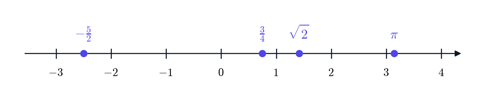{fig-alt="הישר הממשי ועליו מסומנים מינוס חמש חצאים, שלושה רבעים, שורש שתיים ופאי" width="85%" fig-align="center"}
:::

::: {.content-visible when-format="pdf"}
```{=latex}
\par\medskip
\noindent\beginL\hbox to \linewidth{\hss\includegraphics[width=0.85\linewidth]{figures/real-line.png}\hss}\endL\par
\medskip
```
:::

גם $\sqrt{2}$ הוא נקודה על הישר. נניח ריבוע שאורך צלעו $1$ כך שהצלע התחתונה שלו מחברת את $0$ ל-$,1$ ונסובב את האלכסון שלו, שאורכו $,\sqrt{2}$ סביב הנקודה $0$ עד שהוא שוכב על הישר. הקצה שלו יסמן את המקום של $.\sqrt{2}$ אם נסמן על הישר רק את המספרים הרציונליים, יישאר בו "חור" בדיוק במקום הזה. המספרים הממשיים ממלאים את כל החורים.

::: {.content-visible when-format="html"}
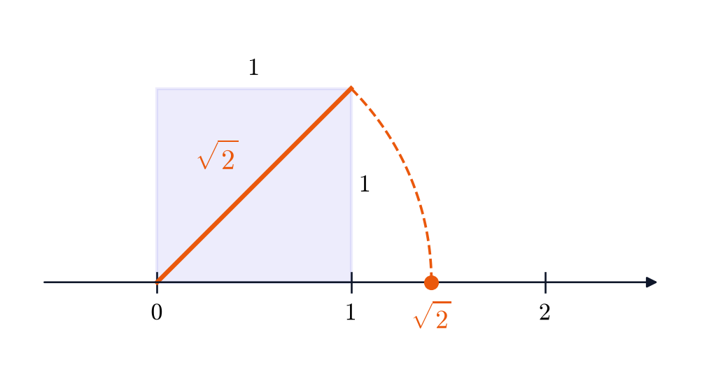{fig-alt="ריבוע שאורך צלעו אחת ואלכסון באורך שורש שתיים, וקשת שמעבירה את האלכסון לישר" width="60%" fig-align="center"}
:::

::: {.content-visible when-format="pdf"}
```{=latex}
\par\medskip
\noindent\beginL\hbox to \linewidth{\hss\includegraphics[width=0.6\linewidth]{figures/sqrt2.png}\hss}\endL\par
\medskip
```
:::

על הישר קל להשוות מספרים: מי שמימין גדול יותר.

::: {#box-def-order .thmdef title="סדר"}
יהיו $x$ ו-$y$ מספרים ממשיים. אם הנקודה $x$ נמצאת מימין לנקודה $,y$ נאמר ש-$x$ [**גדול**]{.term} מ-$,y$ ונסמן $.x > y$ במקרה כזה נאמר גם ש-$y$ [**קטן**]{.term} מ-$,x$ ונסמן $.y < x$

אם $x > y$ או $,x = y$ נסמן $,x \ge y$ ובאופן דומה $.y \le x$
:::

::: {#box-term-strict .thmterm title="אי־שוויון חזק וחלש"}
**אי־שוויון חזק** ($<$ או $>$) אינו כולל שוויון. **אי־שוויון חלש** ($\le$ או $\ge$) כולל גם שוויון. למשל, $3 < 3$ אינו נכון, אבל $3 \le 3$ נכון.
:::

::: {#box-exm-order .thmexm title="מי מימין?"}
השוו בין המספרים, וקבעו אם האי־שוויונים נכונים.

**(א)** $5$ לעומת $2$

:::: {.quiz options="$5$|$2$" answer="$5$"}
$,5 > 2$ כי $5$ מימין ל-$.2$
::::

**(ב)** $-1$ לעומת $-3$

:::: {.quiz options="$-3$|$-1$" answer="$-1$"}
$,-1 > -3$ כי $-1$ מימין למספר $.{-}3$ בין שני מספרים שליליים, הגדול הוא זה שקרוב יותר ל-$.0$
::::

**(ג)** $1$ לעומת $0.5$

:::: {.quiz options="$0.5$|$1$" answer="$1$"}
$,1 > 0.5$ כי $1$ מימין ל-$.0.5$
::::

**(ד)** $4 \ge 4$

:::: {.quiz answer="נכון"}
נכון: $4 \ge 4$ פירושו $4 > 4$ **או** $,4 = 4$ והשוויון מתקיים.
::::

**(ה)** $4 > 4$

:::: {.quiz answer="לא נכון"}
לא נכון: מספר אינו מימין לעצמו.
::::
:::

::::: {#box-exm-order-letters .thmexm title="סדר בלי ערכים מספריים"}
האותיות בציור מסמנות מספרים על הישר הממשי. כתבו אותן מהקטן לגדול, עם הסימן $<$ ביניהן.

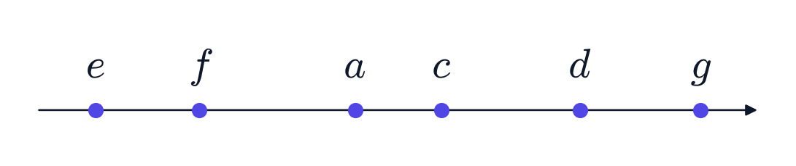{fig-alt="על ישר אופקי מסומנות שש נקודות. משמאל לימין: e, f, a, c, d, g." width="85%" fig-align="center"}

:::: fill
[$e < f < a < c < d < g$]{.blank ans="e<f<a<c<d<g" kind="letter-order" w="26"}

::: hint
התחילו בנקודה השמאלית ביותר, והתקדמו ימינה.
:::

::: explain
ככל שמתקדמים ימינה על הישר, המספרים גדלים. לכן $.e < f < a < c < d < g$
:::
::::
:::::

::: {.thmsummary}
- הטבעיים $\mathbb{N}$ משמשים לספירה. השלמים $\mathbb{Z}$ מוסיפים את $0$ ואת השליליים. הרציונליים $\mathbb{Q}$ הם השברים $\frac{m}{n}$ עם $.n \neq 0$
- חילוק הוא כפל בהופכי. **אסור לחלק באפס.**
- יש אורכים שאינם רציונליים, כמו $\sqrt{2}$ ו-$.\pi$ אם השורש של מספר טבעי אינו יוצא טבעי, הוא אי-רציונלי.
- הממשיים $\mathbb{R}$ הם כל הנקודות על הישר הממשי, ו-$x > y$ פירושו ש-$x$ מימין ל-$.y$
:::

### תרגילים {.unnumbered}

:::::: {#box-q-rational .thmqst title="רציונלי? ואם כן, איזה שבר?"}
קבעו אם כל מספר רציונלי. את המספרים הרציונליים כתבו כשבר מצומצם (מספר שלם אפשר לכתוב כמו שהוא).

**(א)** $1.25$

::::: {.quiz options="רציונלי|אי-רציונלי" answer="רציונלי"}
רציונלי. כתבו אותו כשבר:

:::: fill
$1.25 =$ [$\frac{5}{4}$]{.blank ans="5/4" form="frac"}

::: hint
שתי ספרות אחרי הנקודה הן מאיות: $.1.25 = \frac{125}{100}$ עכשיו צמצמו.
:::
::: explain
$$.1.25 = \frac{125}{100} = \frac{5}{4}$$ (צמצמנו ב-$25$.)
:::
::::
:::::

**(ב)** $\sqrt{9}$

::::: {.quiz options="רציונלי|אי-רציונלי" answer="רציונלי"}
רציונלי, ואפילו טבעי. כמה הוא שווה?

:::: fill
$\sqrt{9} =$ [$3$]{.blank ans="3" form="frac"}

::: explain
$,3^2 = 9$ ולכן $,\sqrt{9} = 3$ ו-$.3 = \frac{3}{1}$
:::
::::
:::::

**(ג)** $\sqrt{7}$

::::: {.quiz options="רציונלי|אי-רציונלי" answer="אי-רציונלי"}
אי-רציונלי: אין מספר טבעי שהריבוע שלו הוא $7$ (כי $2^2 = 4$ ו-$3^2 = 9$), ולכן לפי [](#box-thm-irrational-roots) $\sqrt{7}$ אי-רציונלי.
:::::

**(ד)** $-\frac{6}{3}$

::::: {.quiz options="רציונלי|אי-רציונלי" answer="רציונלי"}
רציונלי, כי הוא כתוב כשבר של שני שלמים. כתבו אותו בצורה מצומצמת:

:::: fill
$-\frac{6}{3} =$ [$-2$]{.blank ans="-2" form="frac"}

::: explain
$.{-}\frac{6}{3} = -\frac{2 \cdot 3}{3} = -2$
:::
::::
:::::
::::::

:::::: {#box-q-order-numbers .thmqst title="מהקטן אל הגדול"}
סדרו את המספרים מהקטן אל הגדול.

::::: order
::: step
$-3$
:::
::: step
$-1.5$
:::
::: step
$-\frac{1}{2}$
:::
::: step
$0$
:::
::: step
$0.4$
:::
::: step
$\frac{3}{4}$
:::
::: step
$2$
:::
::: after
על הישר הממשי המספרים מופיעים בדיוק בסדר הזה, משמאל לימין. בין שני מספרים שליליים, הקטן הוא זה שרחוק יותר מ-$:0$ $.{-}3 < -1.5 < -\frac{1}{2}$ ובין החיוביים: $,0.4 < \frac{3}{4}$ כי $.\frac{3}{4} = 0.75$
:::
:::::
::::::

::::: {#box-q-reciprocals .thmqst title="הופכיים"}
חשבו.

:::: fill
**(א)** $(0.2)^{-1} =$ [$5$]{.blank ans="5"}

**(ב)** $\left(-\frac{2}{7}\right)^{-1} =$ [$-\frac{7}{2}$]{.blank ans="-7/2"}

**(ג)** $1^{-1} =$ [$1$]{.blank ans="1"}

**(ד)** $\left(\frac{1}{9}\right)^{-1} =$ [$9$]{.blank ans="9"}

::: hint
כתבו כל מספר כשבר, והפכו את המונה והמכנה. למשל $.0.2 = \frac{2}{10} = \frac{1}{5}$
:::
::: explain
**(א)** $,0.2 = \frac{1}{5}$ ולכן ההופכי הוא $,5$ ובאמת $.0.2 \cdot 5 = 1$

**(ב)** הופכים את השבר, והסימן נשאר: $,-\frac{7}{2}$ כי $.\left(-\frac{2}{7}\right) \cdot \left(-\frac{7}{2}\right) = 1$

**(ג)** $,1 \cdot 1 = 1$ ולכן $1$ הוא ההופכי של עצמו.

**(ד)** $,\frac{1}{9} \cdot 9 = 1$ ולכן ההופכי הוא $.9$
:::
::::
:::::

::::: {#box-q-divide .thmqst title="חילוק בעזרת הופכי"}
חשבו בעזרת הכלל "חילוק הוא כפל בהופכי".

:::: fill
**(א)** $\frac{3}{4} : \frac{2}{5} =$ [$\frac{15}{8}$]{.blank ans="15/8"}

**(ב)** $6 : \frac{1}{3} =$ [$18$]{.blank ans="18"}

**(ג)** $\frac{1}{2} : 4 =$ [$\frac{1}{8}$]{.blank ans="1/8"}

::: explain
**(א)** ההופכי של $\frac{2}{5}$ הוא $,\frac{5}{2}$ ולכן $$\begin{aligned} \frac{3}{4} : \frac{2}{5} &= \frac{3}{4} \cdot \frac{5}{2} \\ &= \frac{15}{8}. \end{aligned}$$

**(ב)** $.6 \cdot 3 = 18$ (בכל שקל יש שלושה "שלישים של שקל", ובשישה שקלים יש $18$.)

**(ג)** ההופכי של $4$ הוא $,\frac{1}{4}$ ולכן התוצאה היא $.\frac{1}{2} \cdot \frac{1}{4} = \frac{1}{8}$
:::
::::
:::::

::::: {#box-q-decimal-fraction .thmqst title="משבר עשרוני לשבר"}
כתבו כל מספר כשבר מצומצם.

:::: fill
**(א)** $0.75 =$ [$\frac{3}{4}$]{.blank ans="3/4" form="frac"}

**(ב)** $2.4 =$ [$\frac{12}{5}$]{.blank ans="12/5" form="frac"}

**(ג)** $-0.125 =$ [$-\frac{1}{8}$]{.blank ans="-1/8" form="frac"}

::: hint
ספרה אחת אחרי הנקודה היא עשיריות, שתיים מאיות ושלוש אלפיות. אחר כך מצמצמים.
:::
::: explain
**(א)** שתי ספרות אחרי הנקודה הן מאיות: $$\begin{aligned} 0.75 &= \frac{75}{100} \\ &= \frac{3}{4} \end{aligned}$$ צמצמנו ב-$.25$

**(ב)** ספרה אחת אחרי הנקודה היא עשיריות: $$\begin{aligned} 2.4 &= \frac{24}{10} \\ &= \frac{12}{5} \end{aligned}$$ צמצמנו ב-$.2$

**(ג)** שלוש ספרות אחרי הנקודה הן אלפיות: $$\begin{aligned} -0.125 &= -\frac{125}{1000} \\ &= -\frac{1}{8} \end{aligned}$$ צמצמנו ב-$.125$
:::
::::
:::::

::::: {#box-q-which-rational .thmqst title="רציונלי או לא?"}
**(א)** $\sqrt{16}$

::::: {.quiz options="רציונלי|אי-רציונלי" answer="רציונלי"}
רציונלי, ואפילו טבעי. כמה הוא שווה?

:::: fill
$\sqrt{16} =$ [$4$]{.blank ans="4"}

::: explain
$.4^2 = 16$
:::
::::
:::::

**(ב)** $\sqrt{12}$

::: {.quiz options="רציונלי|אי-רציונלי" answer="אי-רציונלי"}
$3^2 = 9$ ו-$,4^2 = 16$ ולכן אין מספר טבעי שהריבוע שלו $.12$ לפי [](#box-thm-irrational-roots) $\sqrt{12}$ אי-רציונלי.
:::

**(ג)** $\sqrt[3]{27}$

::::: {.quiz options="רציונלי|אי-רציונלי" answer="רציונלי"}
רציונלי, ואפילו טבעי. כמה הוא שווה?

:::: fill
$\sqrt[3]{27} =$ [$3$]{.blank ans="3"}

::: explain
$.3^3 = 27$
:::
::::
:::::

**(ד)** $\sqrt[3]{20}$

::: {.quiz options="רציונלי|אי-רציונלי" answer="אי-רציונלי"}
$2^3 = 8$ ו-$,3^3 = 27$ ולכן אין מספר טבעי שהחזקה השלישית שלו היא $.20$ השורש אי-רציונלי.
:::

**(ה)** $\sqrt{\frac{1}{4}}$

::::: {.quiz options="רציונלי|אי-רציונלי" answer="רציונלי"}
רציונלי. הכלל על שורשים מדבר רק על שורשים של מספרים **טבעיים**, ו-$\frac{1}{4}$ אינו טבעי. כמה הוא שווה?

:::: fill
$\sqrt{\frac{1}{4}} =$ [$\frac{1}{2}$]{.blank ans="1/2"}

::: explain
$,\frac{1}{2} \cdot \frac{1}{2} = \frac{1}{4}$ ולכן $,\sqrt{\frac{1}{4}} = \frac{1}{2}$ וזה שבר.
:::
::::
:::::
:::::

::::: {#box-q-defined .thmqst title="מוגדר או לא?"}
**(א)** $\frac{0}{5}$

::::: {.quiz options="מוגדר|לא מוגדר" answer="מוגדר"}
מוגדר: המכנה הוא $,5$ ולכן מותר לחלק. כמה הוא שווה?

:::: fill
$\frac{0}{5} =$ [$0$]{.blank ans="0"}

::: explain
$,5 \cdot 0 = 0$ ולכן $.\frac{0}{5} = 0$
:::
::::
:::::

**(ב)** $\frac{3 - 3}{2 - 2}$

::: {.quiz options="מוגדר|לא מוגדר" answer="לא מוגדר"}
המכנה הוא $,2 - 2 = 0$ ולכן הביטוי אינו מוגדר. זה $,\frac{0}{0}$ ואינו מספר.
:::

**(ג)** $\frac{2 - 2}{3}$

::::: {.quiz options="מוגדר|לא מוגדר" answer="מוגדר"}
מוגדר: המכנה הוא $,3$ ולא $.0$ כמה הוא שווה?

:::: fill
$\frac{2 - 2}{3} =$ [$0$]{.blank ans="0"}

::: explain
המונה הוא $,2 - 2 = 0$ ולכן $.\frac{0}{3} = 0$
:::
::::
:::::
:::::

## קבוצות וקטעים


::: {#box-def-set .thmdef title="קבוצה"}
אוסף של אובייקטים מתמטיים נקרא [**קבוצה**]{.term}, והאובייקטים שבה נקראים [**האיברים**]{.term} של הקבוצה.
:::

::: {.thmanalogy icon="idea" title="קבוצה היא קצת כמו קופסה"}
אפשר לחשוב על קבוצה כעל **קופסה** שיש בה פריטים: הפריטים שבקופסה הם האיברים של הקבוצה.
:::

כבר פגשנו ארבע קבוצות של מספרים: $\mathbb{N}$ (הטבעיים), $\mathbb{Z}$ (השלמים), $\mathbb{Q}$ (הרציונליים) ו-$\mathbb{R}$ (הממשיים). נצטרך קבוצות גם כדי לתאר אוספים אחרים של מספרים, למשל את כל הפתרונות של אי-שוויון, או את כל המספרים שבהם נוסחה מוגדרת.

::: {#box-def-membership .thmdef title="שייכות"}
אם $x$ הוא איבר של הקבוצה $,A$ אומרים ש-$x$ [**שייך**]{.term} ל-$A$ ומסמנים $.x \in A$ אחרת, אומרים ש-$x$ אינו שייך ל-$A$ ומסמנים $.x \notin A$
:::

:::: {#box-exm-membership .thmexm title="נכון או לא נכון?"}
**(א)** $2 \in \mathbb{N}$

::: {.quiz answer="נכון"}
נכון, כי $2$ הוא מספר טבעי.
:::

**(ב)** $-3 \in \mathbb{N}$

::: {.quiz answer="לא נכון"}
לא נכון, כי $-3$ אינו מספר טבעי. לכן $.{-}3 \notin \mathbb{N}$
:::

**(ג)** $\sqrt{2} \in \mathbb{Q}$

::: {.quiz answer="לא נכון"}
לא נכון, כי $\sqrt{2}$ אינו רציונלי. לכן $.\sqrt{2} \notin \mathbb{Q}$
:::

**(ד)** $4 \in \mathbb{Q}$

::: {.quiz answer="נכון"}
נכון, כי $4$ שלם, וכל מספר שלם הוא רציונלי.
:::

**(ה)** $\mathbb{N} \in \mathbb{Z}$

::: {.quiz answer="לא נכון"}
לא נכון. $\mathbb{N}$ הוא אוסף של מספרים ולא מספר בעצמו, ולכן הוא אינו איבר של קבוצת המספרים השלמים.
:::
::::

### רישום של קבוצות {.unnumbered}

::: {#box-def-set-notation .thmdef title="רישום של קבוצות"}
- **רשימה**: רושמים את האיברים בתוך סוגריים מסולסלים. למשל, $\{1, 3, 5\}$ היא הקבוצה שהאיברים שלה הם $1$, $3$ ו-$.5$
- **תנאי**: כאשר הקבוצה גדולה או אינסופית, רושמים אותה בעזרת תנאי: $\{x \mid P(x)\}$ היא קבוצת כל ה-$x$ שמקיימים את התנאי $,P(x)$ שכתוב אחרי הקו. את הקו האנכי קוראים "כך ש". לרישום כזה קוראים [**שיטת השומר**]{.term}.
:::

אפשר לדמיין שומר בכניסה לקבוצה: הוא בודק כל מועמד $x$ מול התנאי, ומכניס רק את מי שעומד בו.

::: {#box-exm-set-notation .thmexm title="שיטת השומר"}
**(א)** איך קוראים את הקבוצה $\{x \in \mathbb{R} \mid x > 0\}$? אילו מספרים יש בה?

:::: {.lecture-answer title="תשובה לסעיף (א)"}
קוראים: "קבוצת כל ה-$x$ הממשיים כך ש-$x$ גדול מ-$0$". זו קבוצת המספרים הממשיים החיוביים.
::::

**(ב)** רשמו בשיטת השומר את קבוצת המספרים הטבעיים שגדולים מ-$3$ וקטנים מ-$.1000$

:::: {.lecture-answer title="תשובה לסעיף (ב)"}
$$.\{n \in \mathbb{N} \mid 3 < n < 1000\}$$ לרשום את כל $995$ האיברים ברשימה היה ארוך מאוד; התנאי עושה את זה בשורה אחת.
::::

**(ג)** רשמו את הקבוצה כרשימה.

:::: fill
$\{x \in \mathbb{Z} \mid 0 < x < 4\} =$ [$\{1, 2, 3\}$]{.blank ans="{1,2,3}"}

::: explain
אלה המספרים השלמים שגדולים מ-$0$ וקטנים מ-$,4$ כלומר $1$, $2$ ו-$.3$
:::
::::
:::

### שוויון קבוצות {.unnumbered}

::: {#box-def-set-equality .thmdef title="שוויון קבוצות"}
שתי קבוצות $A$ ו-$B$ [**שוות**]{.term}, ומסמנים $,A = B$ אם יש להן בדיוק אותם איברים.
:::

::: {.thmkey icon="rule" title="סדר וכפילויות אינם משנים"}
**הסדר** שבו רושמים את האיברים, ו**מספר הפעמים** שרושמים כל איבר, אינם משנים את הקבוצה: $$.\{1, 2, 3\} = \{3, 1, 2\} = \{1, 1, 2, 3, 3, 3\}$$
:::

בשתי הקבוצות שבציור יש אותו איבר: שקל. רישום שלו עשר פעמים לא הופך אותו לעשרה שקלים (לצערנו).

::: {.content-visible when-format="html"}
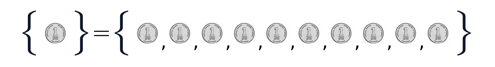{fig-alt="סוגריים מסולסלים ובהם מטבע אחד של שקל, סימן שוויון, וסוגריים ובהם עשרה מטבעות" width="90%" fig-align="center"}
:::

::: {.content-visible when-format="pdf"}
```{=latex}
\par\medskip
\noindent\beginL\hbox to \linewidth{\hss\includegraphics[width=0.9\linewidth]{figures/coin-sets.png}\hss}\endL\par
\medskip
```
:::

::: {.thmwarn title="קופסאות קסם"}
הדימוי של קופסה שימושי, אבל לקופסאות האלה יש שני כוחות קסם:

- **כל פריט נספר פעם אחת.** אם מכניסים שוב את אותו פריט, מספר האיברים בקבוצה לא גדל.
- **אותו פריט יכול להיות בכמה קופסאות בו־זמנית.** למשל, המספר $2$ שייך גם ל-$\mathbb{N}$ וגם ל-$\mathbb{Z}$.
:::

::: {.thmwarn title="הקופסה אינה הפריט"}
קופסה שיש בה פריט אינה הפריט עצמו. לכן $:\{3\} \neq 3$ מצד אחד יש לנו את המספר $,3$ ומצד שני קבוצה שהאיבר היחיד שלה הוא $.3$ זה מקור נפוץ לבלבול.
:::

:::: {.thmchk}
**(א)** $\{1, 2\} = \{2, 1, 1\}$

::: {.quiz answer="נכון"}
נכון. בשתי הקבוצות יש בדיוק אותם איברים, $1$ ו-$,2$ והסדר והכפילויות אינם משנים.
:::

**(ב)** $\{1, 2\} = \{1, 2, 3\}$

::: {.quiz answer="לא נכון"}
לא נכון. $3$ שייך לקבוצה השנייה ואינו שייך לראשונה. מספיק איבר אחד כזה כדי שהקבוצות לא יהיו שוות.
:::
::::

### הכלה {.unnumbered}

::: {#box-def-subset .thmdef title="הכלה"}
אומרים שהקבוצה $A$ [**מוכלת**]{.term} בקבוצה $B$ אם כל איבר של $A$ הוא גם איבר של $,B$ ומסמנים $.A \subseteq B$ אם $A$ אינה מוכלת ב-$,B$ מסמנים $.A \nsubseteq B$

אם $A \subseteq B$ ויש ב-$B$ איברים שאינם ב-$,A$ אומרים ש-$A$ [**מוכלת ממש**]{.term} ב-$B$ ומסמנים $.A \subset B$
:::

בשפה של קופסאות: $A \subseteq B$ אם כל פריט שבקופסה $A$ נמצא גם בקופסה $.B$

::: {.content-visible when-format="html"}
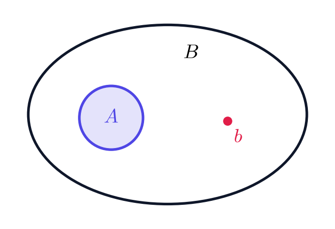{fig-alt="אליפסה B ובתוכה עיגול A ונקודה b מחוץ לעיגול" width="40%" fig-align="center"}
:::

::: {.content-visible when-format="pdf"}
```{=latex}
\par\medskip
\noindent\beginL\hbox to \linewidth{\hss\includegraphics[width=0.4\linewidth]{figures/subset-venn.png}\hss}\endL\par
\medskip
```
:::

למשל, כל מספר טבעי הוא שלם, כל מספר שלם הוא רציונלי וכל מספר רציונלי הוא ממשי. בסימן $\subseteq$ אפשר לכתוב את זה בקצרה: $$.\mathbb{N} \subseteq \mathbb{Z} \subseteq \mathbb{Q} \subseteq \mathbb{R}$$

::: {#box-rem-subset .thmrem title="שימו לב"}
- $,\mathbb{N} \subseteq \mathbb{Z}$ ואפילו $.\mathbb{N} \subset \mathbb{Z}$
- אם $,A \subset B$ אז גם $.A \subseteq B$ הכיוון ההפוך אינו נכון בהכרח.
- כל קבוצה מוכלת בעצמה: $.\mathbb{Z} \subseteq \mathbb{Z}$ אבל $,\mathbb{Z} \not\subset \mathbb{Z}$ כי אין ב-$\mathbb{Z}$ איבר שאינו ב-$.\mathbb{Z}$
:::

:::: {#box-exm-subset .thmexm title="הכלה"}
נניח $$.B = \{1, 3, 5\}, \qquad A = \{1, 3\}, \qquad C = \{2, 3\}$$ נכון או לא נכון?

**(א)** $A \subseteq B$

::: {.quiz answer="נכון"}
נכון, כי כל איבר של $A$ הוא איבר של $.B$
:::

**(ב)** $C \subseteq B$

::: {.quiz answer="לא נכון"}
לא נכון: $,C \nsubseteq B$ כי $2$ הוא איבר של $C$ שאינו איבר של $.B$
:::

**(ג)** $B \subseteq B$

::: {.quiz answer="נכון"}
נכון, כי כל קבוצה מוכלת בעצמה.
:::

**(ד)** $A \subset B$

::: {.quiz answer="נכון"}
נכון, כי $A \subseteq B$ ויש ב-$B$ איבר, $,5$ שאינו ב-$.A$
:::

**(ה)** $B \subset B$

::: {.quiz answer="לא נכון"}
לא נכון: $,B \not\subset B$ כי אין ב-$B$ איבר שאינו ב-$.B$
:::
::::

::: {#box-def-empty-set .thmdef title="הקבוצה הריקה"}
הקבוצה שאין בה איברים נקראת [**הקבוצה הריקה**]{.term}, ומסומנת $.\emptyset$ אפשר לכתוב אותה גם כ-$\{\,\}$ (קופסה ריקה), אם כי הסימון $\emptyset$ נפוץ יותר.
:::

::: {.thmwarn title="מוכל או שייך"}
חשוב לא לבלבל: **מוכל** ($\subseteq$) הוא יחס בין **שתי קבוצות**, ו**שייך** ($\in$) הוא יחס בין **איבר לקבוצה**. למשל:

- $3 \in \mathbb{N}$ **נכון**: $3$ הוא איבר של $.\mathbb{N}$
- $3 \subseteq \mathbb{N}$ **שגוי**: $3$ הוא מספר ולא קבוצה, ולכן אין משמעות לשאלה אם הוא "מוכל". זו טעות נפוצה.
- $\{3\} \subseteq \mathbb{N}$ **נכון**: הקבוצה שהאיבר היחיד שלה הוא $3$ היא חלק מ-$.\mathbb{N}$
- $\{3\} \notin \{1, 2, 3\}$: האיברים של $\{1, 2, 3\}$ הם $1$, $2$ ו-$,3$ ואף אחד מהם אינו הקבוצה $.\{3\}$ לעומת זאת, $.\{3\} \subseteq \{1, 2, 3\}$
- $A \subseteq B$ אינו אומר ש-$.A \in B$
:::

::: {#box-exm-in-and-subset .thmexm title="גם שייך וגם מוכל"}
נניח $$.A = \{3\}, \qquad B = \{3, \{3\}\}$$ האם $A \in B$? והאם $?A \subseteq B$

:::: {.lecture-answer}
שניהם נכונים!

- $,A \in B$ כי $\{3\}$ הוא אחד האיברים של $.B$
- $,A \subseteq B$ כי האיבר היחיד של $,A$ המספר $,3$ שייך ל-$.B$
::::
:::

### פעולות על קבוצות {.unnumbered}

::: {#box-term-conditions .thmterm title="תנאי חזק יותר"}
תנאי הוא **חזק יותר** מתנאי אחר אם הוא מבטיח שגם האחר מתקיים, אבל לא להפך. למשל, $x > 3$ חזק יותר מ-$x > 1$: כל מספר שגדול מ-$3$ גדול גם מ-$1$, אבל $2$ מקיים רק את התנאי השני. זה שימוש אחר במילה ״חזק״ מזה של ״אי־שוויון חזק״.
:::

::: {#box-def-union .thmdef title="איחוד"}
יהיו $A$ ו-$B$ קבוצות. [**האיחוד**]{.term} של $A$ ו-$,B$ שמסומן $A \cup B$ (קוראים "$A$ איחוד $B$"), הוא קבוצת כל האיברים ששייכים ל-$A$ **או** ל-$B$ (או לשתיהן).
:::

בשפה של קופסאות: איחוד הוא כמו לפתוח את שתי הקופסאות $A$ ו-$B$ ולשפוך את כל התוכן שלהן לקופסה שלישית. פריט שהיה בשתי הקופסאות מופיע בקופסה החדשה פעם אחת בלבד, כי בקופסה של קבוצה אין שני פריטים זהים.

::: {.content-visible when-format="html"}
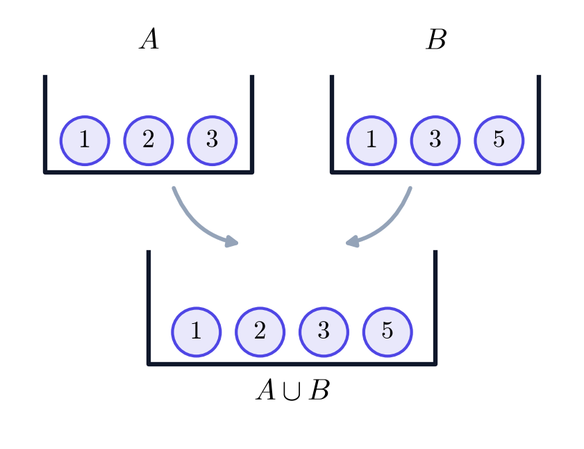{fig-alt="שתי קופסאות עם כדורים ממוספרים שנשפכות לקופסה שלישית" width="55%" fig-align="center"}
:::

::: {.content-visible when-format="pdf"}
```{=latex}
\par\medskip
\noindent\beginL\hbox to \linewidth{\hss\includegraphics[width=0.55\linewidth]{figures/union-boxes.png}\hss}\endL\par
\medskip
```
:::

::: {#box-exm-union .thmexm title="איחוד"}
נניח $A = \{1, 2, 3\}$ ו-$.B = \{1, 3, 5\}$ מהו $?A \cup B$

:::: fill
$A \cup B =$ [$\{1, 2, 3, 5\}$]{.blank ans="{1,2,3,5}"}

::: explain
שופכים את שתי הקופסאות לקופסה אחת. אפשר גם לרשום $,A \cup B = \{1, 3, 5, 1, 2, 3\}$ וזו אותה קבוצה, כי הסדר והכפילויות אינם משנים.
:::
::::
:::

::: {#box-def-intersection .thmdef title="חיתוך"}
יהיו $A$ ו-$B$ קבוצות. [**החיתוך**]{.term} של $A$ ו-$,B$ שמסומן $,A \cap B$ הוא קבוצת כל האיברים ששייכים **גם** ל-$A$ **וגם** ל-$.B$
:::

את החיתוך נוח יותר לצייר כשני אזורים שחופפים זה לזה: כל קבוצה היא אזור, והחיתוך הוא החלק המשותף לשני האזורים.

::: {.content-visible when-format="html"}
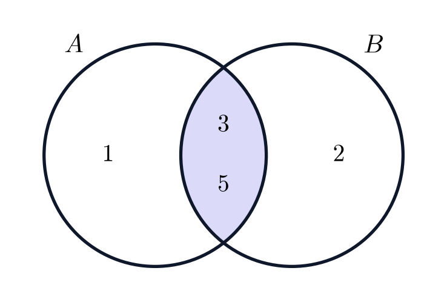{fig-alt="שני עיגולים חופפים; באזור המשותף המספרים שלוש וחמש" width="45%" fig-align="center"}
:::

::: {.content-visible when-format="pdf"}
```{=latex}
\par\medskip
\noindent\beginL\hbox to \linewidth{\hss\includegraphics[width=0.45\linewidth]{figures/intersection-venn.png}\hss}\endL\par
\medskip
```
:::

::: {#box-exm-sets .thmexm title="איחוד וחיתוך"}
נניח $$.A = \{1, 3, 5\}, \qquad B = \{2, 3, 5\}, \qquad C = \{2, 4\}$$ חשבו.

:::: fill
- $A \cap B =$ [$\{3, 5\}$]{.blank ans="{3,5}"}
- $A \cup B =$ [$\{1, 2, 3, 5\}$]{.blank ans="{1,2,3,5}"}
- $A \cap C =$ [$\emptyset$]{.blank ans="{}"}
- $A \cup C =$ [$\{1, 2, 3, 4, 5\}$]{.blank ans="{1,2,3,4,5}"}
- $B \cap C =$ [$\{2\}$]{.blank ans="{2}"}
- $B \cup C =$ [$\{2, 3, 4, 5\}$]{.blank ans="{2,3,4,5}"}

::: explain
ל-$A$ ול-$C$ אין אף איבר משותף, ולכן החיתוך שלהן ריק: $.A \cap C = \{\,\} = \emptyset$ בכל האיחודים, איבר שמופיע בשתי הקבוצות נרשם פעם אחת.
:::
::::
:::

:::: {.thmchk}
מהו $?\{1, 2\} \cap \{3, 4\}$

::: {.quiz options="$\emptyset$|$\{0\}$|$\{1, 2, 3, 4\}$" answer="$\emptyset$"}
אין איבר ששייך לשתי הקבוצות, ולכן החיתוך הוא הקבוצה הריקה. שימו לב: $\{0\}$ **אינה** ריקה, יש בה איבר אחד, המספר $.0$ והקבוצה $\{1, 2, 3, 4\}$ היא האיחוד, לא החיתוך.
:::
::::

::: {#box-def-set-difference .thmdef title="הפרש קבוצות"}
[**ההפרש**]{.term} $A\setminus B$ (קוראים ״$A$ פחות $B$״) הוא קבוצת האיברים ששייכים ל-$A$ **ואינם** שייכים ל-$.B$ מתחילים באיברים של $A$ ומוציאים מהם את אלה שנמצאים גם ב-$.B$
:::

::::: {#box-exm-set-difference .thmexm title="מה נשאר?"}
נניח $A=\{1,2,3\}$ ו-$.B=\{2,4\}$ חשבו את ההפרש בשני הכיוונים.

:::: fill
**(א)** $A\setminus B=$ [$\{1,3\}$]{.blank ans="{1,3}"}

**(ב)** $B\setminus A=$ [$\{4\}$]{.blank ans="{4}"}

::: hint
בכל סעיף מתחילים בקבוצה שמשמאל לסימן $\setminus$, ובודקים אילו מאיבריה נמצאים גם בקבוצה שמימין.
:::
::: explain
**(א)** מתחילים ב-$\{1,2,3\}$. מוציאים את $2$, כי הוא נמצא גם ב-$B$. נשארים $1$ ו-$3$. המספר $4$ לא היה ב-$A$ מלכתחילה, ולכן אין מה להוציא בגללו.

**(ב)** מתחילים ב-$\{2,4\}$. מוציאים את $2$, כי הוא נמצא גם ב-$A$. נשאר רק $4$. התוצאה שונה מזו שבסעיף (א): סדר הקבוצות משנה.
:::
::::
:::::

:::: {.thmchk}
עבור הקבוצות שבדוגמה:

**(א)** $2$ שייך ל-$A\setminus B$, כי הוא שייך לשתי הקבוצות.

::: {.quiz answer="לא נכון"}
לא נכון. דווקא מפני ש-$2$ נמצא גם ב-$B$, מוציאים אותו מ-$A$. בחיתוך שומרים את האיברים המשותפים; בהפרש מוציאים אותם מהקבוצה הראשונה.
:::

**(ב)** $4$ שייך ל-$A\setminus B$, כי הוא מופיע רק באחת הקבוצות.

::: {.quiz answer="לא נכון"}
לא נכון. כדי להישאר ב-$A\setminus B$ צריך קודם להיות ב-$A$. המספר $4$ נמצא רק ב-$B$, ולכן הוא שייך דווקא ל-$.B\setminus A$
:::
::::

::::: {#box-q-set-difference-basics .thmqst title="תרגול קצר: הפרש קבוצות"}
כתבו את הקבוצה שנשארת בכל סעיף.

:::: fill
**(א)** $\{0,2,5\}\setminus\{2,9\}=$ [$\{0,5\}$]{.blank ans="{0,5}"}

**(ב)** $\{4,6\}\setminus\{1,3\}=$ [$\{4,6\}$]{.blank ans="{4,6}"}

**(ג)** $\{1,3\}\setminus\{1,3\}=$ [$\emptyset$]{.blank ans="{}"}

**(ד)** $\{1,3\}\setminus\emptyset=$ [$\{1,3\}$]{.blank ans="{1,3}"}

::: hint
עוברים על האיברים של הקבוצה הראשונה בלבד. כל איבר שנמצא גם בשנייה יוצא; כל האחרים נשארים.
:::
::: explain
**(א)** מוציאים את $2$; $0$ ו-$5$ נשארים. המספר $9$ אינו בקבוצה הראשונה, ולכן אינו משנה את התוצאה.

**(ב)** אין איברים משותפים, ולכן לא מוציאים דבר. זו פעולת הפרש בין קבוצות, לא חיסור של המספרים זה מזה.

**(ג)** שני האיברים מופיעים גם בקבוצה השנייה. מוציאים את שניהם ונשארת הקבוצה הריקה.

**(ד)** בקבוצה הריקה אין איברים שצריך להוציא, ולכן הקבוצה הראשונה נשארת כפי שהיא.
:::
::::
:::::

### קטעים וקרניים {.unnumbered}

קטעים וקרניים הם קבוצות של מספרים ממשיים שנשתמש בהן הרבה בקורס.

::: {#box-def-interval .thmdef title="קטעים וקרניים"}
יהיו $a<b$ מספרים ממשיים. [**קטע**]{.term} כולל את כל המספרים שבין שני קצוות, עם הקצוות או בלעדיהם. [**קרן**]{.term} כוללת את כל המספרים הגדולים מקצה מסוים, או את כל הקטנים ממנו, עם הקצה או בלעדיו. נגדיר את הסימונים:

| סימון | הקבוצה | שם |
|:--:|:--:|:--|
| $(a,b)$ | $\{x\in\mathbb{R}\mid a<x<b\}$ | קטע פתוח |
| $[a,b]$ | $\{x\in\mathbb{R}\mid a\le x\le b\}$ | קטע סגור |
| $[a,b)$ | $\{x\in\mathbb{R}\mid a\le x<b\}$ | קטע חצי-פתוח |
| $(a,b]$ | $\{x\in\mathbb{R}\mid a<x\le b\}$ | קטע חצי-פתוח |
| $(a,\infty)$ | $\{x\in\mathbb{R}\mid x>a\}$ | קרן פתוחה |
| $[a,\infty)$ | $\{x\in\mathbb{R}\mid x\ge a\}$ | קרן סגורה |
| $(-\infty,b)$ | $\{x\in\mathbb{R}\mid x<b\}$ | קרן פתוחה |
| $(-\infty,b]$ | $\{x\in\mathbb{R}\mid x\le b\}$ | קרן סגורה |

**סוגר מרובע** ליד קצה אומר שהוא שייך לקבוצה; **סוגר עגול** אומר שאינו שייך. הסימנים $\infty$ ו-$-\infty$ מציינים שאין גבול בכיוון החיובי או השלילי. כל הישר נכתב גם כך: $.\mathbb{R}=(-\infty,\infty)$
:::

::: {.thmwarn title="אינסוף אינו מספר"}
אי אפשר להגיע ל-$\infty$ או ל-$-\infty$ ולכלול אותם בקבוצה כמו נקודת קצה. לכן לידם הסוגר תמיד **עגול**: כותבים $[2,\infty)$ ולא $.[2,\infty]$
:::

### סרטוט קבוצות על הישר {.unnumbered}

#### הקבוצה הריקה {.unnumbered}

הישר הדק והאפור משמש רק כרקע. כשלא מדגישים שום נקודה ושום חלק ממנו, מציגים את **הקבוצה הריקה**: אין בה אף מספר.

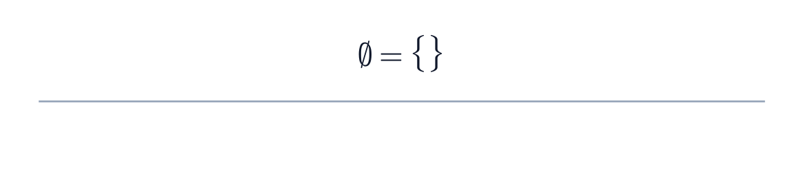{fig-alt="ישר אפור ללא נקודות מלאות וללא חלקים מודגשים, ולידו הסימון של הקבוצה הריקה." width="85%" fig-align="center"}

:::: {.thmchk}
האם $0$ שייך לקבוצה שבציור רק מפני שהישר האפור עובר גם דרכו?

::: {.quiz options="כן|לא" answer="לא"}
לא. הישר האפור הוא רק רקע לסרטוט. לא הדגשנו עליו שום חלק ולא הוספנו נקודות מלאות, ולכן הקבוצה ריקה.
:::
::::

#### נקודה בודדת {.unnumbered}

**עיגול מלא** מסמן מספר ששייך לקבוצה. למשל, כדי לצייר את $\{2\}$ מסמנים עיגול מלא ב-$2$, וזה הכול. לא מדגישים קו מסביבו: בקבוצה הזאת יש רק את המספר $.2$

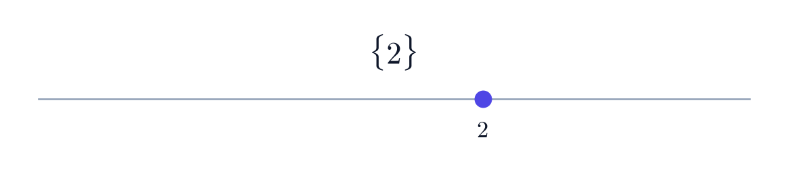{fig-alt="עיגול מלא בשתיים על הישר, ולידו הקבוצה {2}." width="85%" fig-align="center"}

:::: {.thmchk}
האם יש בקבוצה $\{2\}$ גם את $1$? בכל זאת, הוא בדרך מ-$0$ ל-$.2$

::: {.quiz options="כן|לא" answer="לא"}
לא. סימנו רק את $2$. זו קבוצה של מספרים, לא מסלול שצריך לעבור כדי להגיע אליהם.
:::
::::

:::: {#box-exm-draw-finite-points .thmexm title="שלוש נקודות"}
איזו קבוצה מתוארת בסרטוט?

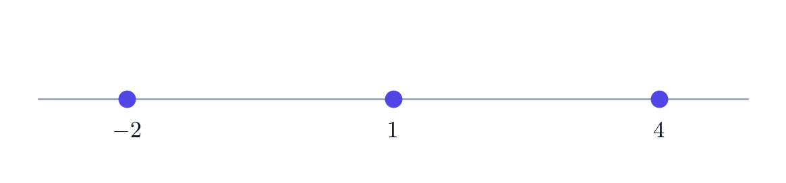{fig-alt="עיגולים מלאים במינוס שתיים, אחת וארבע. ביניהם יש רק ישר רקע אפור, ללא קו מודגש." width="85%" fig-align="center"}

::: fill
הקבוצה היא [$\{-2,1,4\}$]{.blank ans="{-2,1,4}" kind="set"}.

::: explain
רק שלושת המספרים המסומנים בעיגולים מלאים שייכים לקבוצה. הקו האפור שביניהם אינו חלק ממנה.
:::
:::

האם $1$ שייך לקבוצה?

::: {.quiz options="כן|לא" answer="כן"}
כן. מסומן בו עיגול מלא.
:::

האם גם $0$ ו-$\frac{1}{2}$ שייכים, כי הם נמצאים בין שתי הנקודות הראשונות?

::: {.quiz options="כן|לא" answer="לא"}
לא. בין הנקודות אין קו מודגש. אלו שלוש נקודות בודדות, ולא קטע שמכיל את כל מה שביניהן.
:::
::::

#### כל הישר {.unnumbered}

כדי לסמן את כל $\mathbb{R}$ מדגישים את **כל הישר**. **קו מודגש** אומר שכל המספרים שעליו שייכים לקבוצה. **החצים** בשני הצדדים אומרים שממשיכים בלי סוף, גם מעבר למה שנכנס לציור.

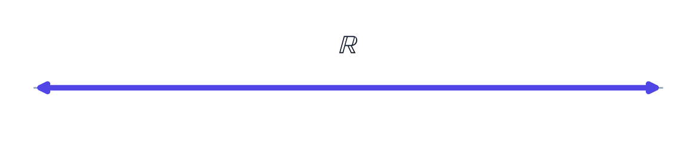{fig-alt="ישר מודגש עם חץ בכל צד, המייצג את כל R." width="85%" fig-align="center"}

:::: {.thmchk}
האם גם $\frac{1}{2}$ ו-$100$ שייכים לקבוצה שבציור, אף שלא סומנו בהם עיגולים מלאים?

::: {.quiz options="כן|לא" answer="כן"}
כן. הקו המודגש כולל את כל המספרים הממשיים, והחצים אומרים שהוא ממשיך גם מעבר לציור. אין צורך לסמן עיגול מלא בכל נקודה על הקו.
:::
::::

#### מוציאים נקודה {.unnumbered}

**עיגול ריק** אומר שהמספר בנקודה הזאת **אינו שייך** לקבוצה. למשל, עיגול ריק ב-$2$ על הישר המודגש מוציא רק את $2$. כל יתר המספרים נשארים, ולכן זו הקבוצה $.\mathbb{R}\setminus\{2\}$

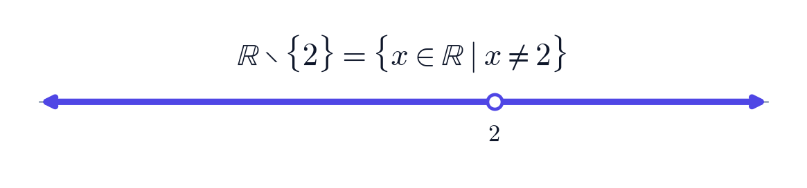{fig-alt="כל הישר מודגש פרט לעיגול ריק בשתיים; הקבוצה היא כל הממשיים מלבד שתיים." width="85%" fig-align="center"}

:::: {.thmchk}
העיגול הריק מוציא גם את $1.99$ ואת $2.01$, כי הם קרובים אליו.

::: {.quiz answer="לא נכון"}
לא נכון. העיגול מציין מספר אחד בדיוק, לא אזור סביבו. רק $2$ יצא; השכנים נשארים.
:::
::::

:::: {#box-exm-draw-missing-points .thmexm title="שלושה חורים"}
איזו קבוצה מתוארת בסרטוט? אפשר לכתוב אותה כהפרש של קבוצות.

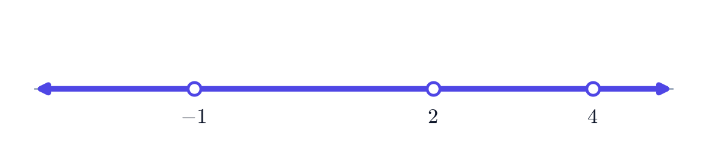{fig-alt="כל הישר מודגש בשני הכיוונים, פרט לעיגולים ריקים במינוס אחת, שתיים וארבע." width="85%" fig-align="center"}

::: fill
הקבוצה היא [$\mathbb{R}\setminus\{-1,2,4\}$]{.blank ans="R-{-1,2,4}" kind="set"}.

::: explain
הקו המודגש ממשיך בשני הכיוונים. רק שלושת המספרים המסומנים בעיגולים ריקים אינם שייכים לקבוצה.
:::
:::

האם $2$ שייך לקבוצה?

::: {.quiz options="כן|לא" answer="לא"}
לא. העיגול הריק מוציא את $2$ מהקבוצה.
:::

האם $0$ שייך לקבוצה, אף שאין בו עיגול מלא?

::: {.quiz options="כן|לא" answer="כן"}
כן. הוא נמצא על הקו המודגש, ואין בו חור. לא צריך לסמן עיגול מלא בכל מספר ששייך לקו.
:::
::::

:::: {.thmchk}
**(א)** למעלה יש שלושה עיגולים ריקים על ישר הרקע, ולמטה אין עיגולים כלל. האם הסרטוטים מתארים קבוצות שונות?

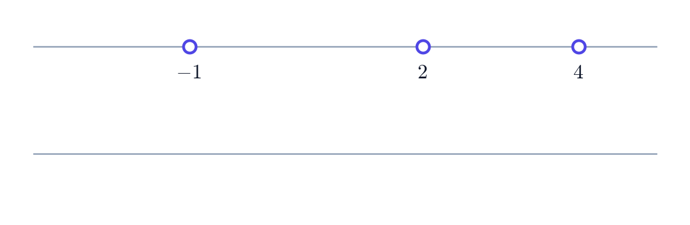{fig-alt="למעלה: ישר אפור עם עיגולים ריקים במינוס אחת, שתיים וארבע. למטה: ישר אפור בלבד. בשני הסרטוטים אין קו מודגש ואין נקודות מלאות." width="85%" fig-align="center"}

::: {.quiz options="כן|לא" answer="לא"}
לא. שניהם מתארים את הקבוצה הריקה: אין קו מודגש ואין נקודות מלאות. שלושת המספרים כבר אינם שייכים לקבוצה, ולכן העיגולים הריקים אינם משנים דבר.
:::

**(ב)** כעת כל הישר מודגש. למעלה נוספו לו שלושה עיגולים מלאים, ולמטה אין עיגולים. האם הפעם הסרטוטים מתארים קבוצות שונות?

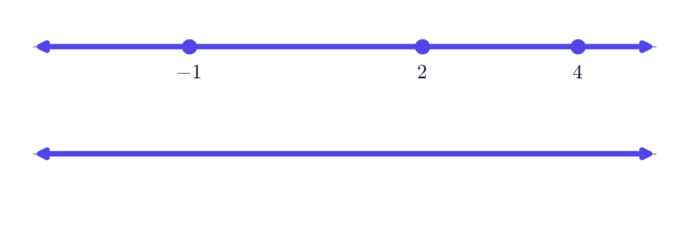{fig-alt="שני ישרים מודגשים עם חצים בשני הכיוונים. בישר העליון יש גם עיגולים מלאים במינוס אחת, שתיים וארבע; בתחתון אין עיגולים." width="85%" fig-align="center"}

::: {.quiz options="כן|לא" answer="לא"}
לא. שניהם מתארים את $\mathbb{R}$. הקו המודגש כבר כולל כל מספר ממשי, ולכן העיגולים המלאים אינם מוסיפים איברים.
:::
::::

בדרך כלל משמיטים **סימונים שאינם מוסיפים מידע**: עיגול ריק במקום שממילא אינו בקבוצה, או עיגול מלא באמצע קו מודגש. לעומת זאת, עיגול ריק על קו מודגש מציין חור, ועיגול מלא מחוץ לקו מוסיף איבר.

:::: {.thmchk}
הקבוצה $A$ מסורטטת למעלה, והקבוצה $B$ למטה. איך נראה סרטוט האיחוד $?A\cup B$ מה קורה לשלושת החורים?

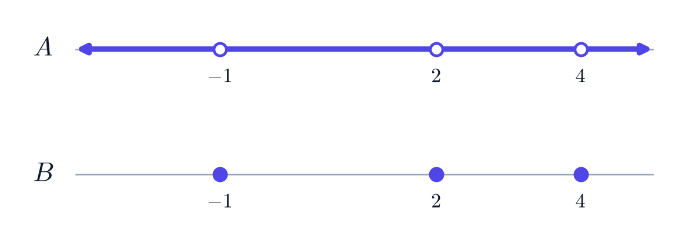{fig-alt="למעלה A: ישר מודגש בשני הכיוונים עם עיגולים ריקים במינוס אחת, שתיים וארבע. למטה B: רק שלוש נקודות מלאות באותם מקומות, על ישר רקע אפור." width="85%" fig-align="center"}

::: {.lecture-answer title="הצגת סרטוט האיחוד"}
{fig-alt="האיחוד הוא כל הישר הממשי. למעלה ישר מודגש עם נקודות מלאות במקום החורים, ולמטה ישר מודגש ללא עיגולים." width="85%" fig-align="center"}

שלוש הנקודות שב-$B$ ממלאות את החורים שב-$A$, ולכן מתקבל כל הישר. אפשר להחליף את העיגולים הריקים במלאים, או להשמיט אותם ולצייר קו רצוף. שתי הדרכים נכונות.
:::
::::

#### קרניים {.unnumbered}

כדי לסרטט קרן, מסמנים עיגול בקצה וקו מודגש עם חץ בכיוון שבו ממשיכים. בקרן סגורה הקצה שייך, ולכן העיגול מלא; בקרן פתוחה הוא אינו שייך, ולכן העיגול ריק.

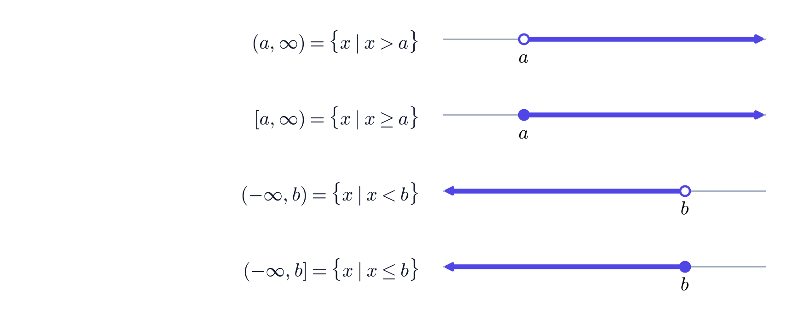{fig-alt="קרן פתוחה וסגורה ימינה, וקרן פתוחה וסגורה שמאלה. ליד כל סרטוט כתובים סימון הקרן ותנאי השייכות." width="100%" fig-align="center"}

::: {#box-exm-rays .thmexm title="קרניים"}
אילו מהקרניים הבאות פתוחות, ואילו סגורות? $$\begin{aligned} (3, \infty) &= \{x \mid x > 3\}, & [8, \infty) &= \{x \mid x \ge 8\}, \\ (-\infty, 4) &= \{x \mid x < 4\}, & (-\infty, 15] &= \{x \mid x \le 15\}. \end{aligned}$$

:::: {.lecture-answer}
הקרניים $(3, \infty)$ ו-$(-\infty, 4)$ פתוחות: הן אינן מכילות את הקצה. הקרניים $[8, \infty)$ ו-$(-\infty, 15]$ סגורות: הן מכילות את הקצה.

::::: {.content-visible when-format="html"}
![הקצה $3$ אינו שייך לקרן $(3, \infty)$, ולכן מסומן בעיגול ריק. הקצה $15$ שייך לקרן $(-\infty, 15]$, ולכן מסומן בעיגול מלא.](figures/rays.png){fig-alt="שני ישרים: קרן ימינה מ-3 עם עיגול ריק, וקרן שמאלה מ-15 עם עיגול מלא" width="70%" fig-align="center"}
:::::

::::: {.content-visible when-format="pdf"}
```{=latex}
\par\medskip
\noindent\beginL\hbox to \linewidth{\hss\includegraphics[width=0.7\linewidth]{figures/rays.png}\hss}\endL\par
\medskip
```
:::::
::::
:::

#### קטעים {.unnumbered}

כדי לסרטט קטע, מדגישים את הקו שבין שני הקצוות. בכל קצה מסמנים עיגול מלא אם הוא שייך לקטע, ועיגול ריק אם אינו שייך. כך מתקבלים ארבעת הצירופים:

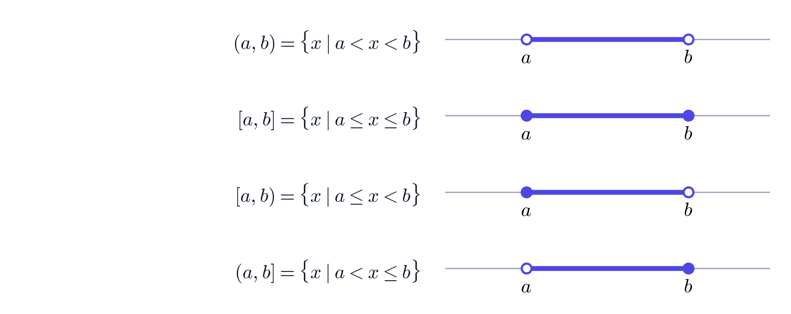{fig-alt="ארבעת צירופי הקצוות של קטע בין a ל-b, עם סימון הקטע ותנאי השייכות בשיטת השומר." width="100%" fig-align="center"}

המספרים שבכתיב $[a,b)$ הם **קצוות**, לא רשימת איברים: כל מספר ביניהם שייך לקטע. למשל, $2$ כבר שייך ל-$[0,4]$, ולכן הוספת עיגול מלא ב-$2$ אינה משנה את הקבוצה. עיגול ריק באותו מקום מוציא אותו ומשאיר חור.

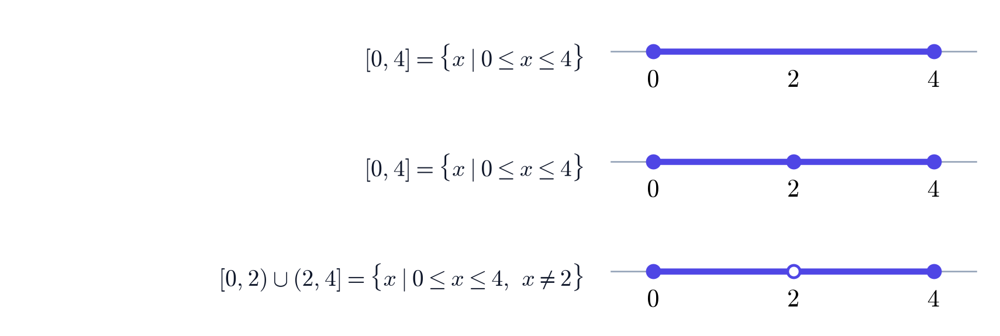{fig-alt="הקטע הסגור מאפס עד ארבע; אותו קטע עם נקודה מלאה בשתיים; ואותו קטע עם חור בשתיים. ליד כל סרטוט כתובה הקבוצה." width="100%" fig-align="center"}

::: {#box-exm-draw-half-open .thmexm title="סרטוט קטע חצי-פתוח"}
סרטטו את הקטע החצי-פתוח $$.[-1, 3) = \{x \mid -1 \le x < 3\}$$ באיזה קצה העיגול מלא, ובאיזה ריק?

:::: {.lecture-answer}
- הקצה $-1$ **שייך** לקטע, כי $,-1 \le x$ ולכן מסמנים אותו בעיגול **מלא**.
- הקצה $3$ **אינו שייך** לקטע, כי $,x < 3$ ולכן מסמנים אותו בעיגול **ריק**.
- כל הנקודות שביניהם שייכות לקטע, ולכן מדגישים את כל הקו שבין שני העיגולים.

::::: {.content-visible when-format="html"}
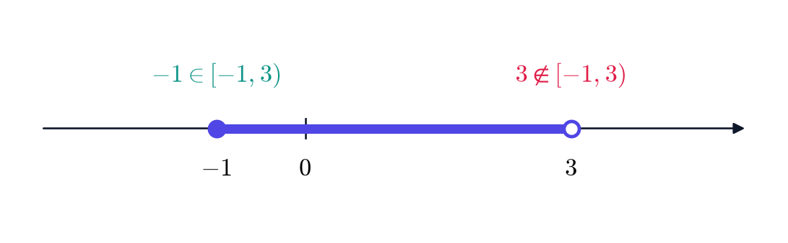{fig-alt="קטע מודגש מ-מינוס אחת עד שלוש, עם עיגול מלא במינוס אחת ועיגול ריק בשלוש" width="65%" fig-align="center"}
:::::

::::: {.content-visible when-format="pdf"}
```{=latex}
\par\medskip
\noindent\beginL\hbox to \linewidth{\hss\includegraphics[width=0.65\linewidth]{figures/half-open-interval.png}\hss}\endL\par
\medskip
```
:::::
::::
:::

:::: {.thmchk}
**(א)** האם $?3 \in [-1, 3)$

::: {.quiz options="כן|לא" answer="לא"}
לא. הסוגר ליד $3$ עגול, כלומר התנאי הוא $,x < 3$ ו-$3 < 3$ אינו נכון. בציור: עיגול ריק.
:::

**(ב)** האם $?{-}1 \in [-1, 3)$

::: {.quiz options="כן|לא" answer="כן"}
כן. הסוגר ליד $-1$ מרובע, כלומר התנאי הוא $,-1 \le x$ והאי-שוויון $-1 \le -1$ נכון. בציור: עיגול מלא.
:::

**(ג)** האם $?0 \in [-1,3)$

::: {.quiz options="כן|לא" answer="כן"}
כן, כי $.{-}1 \le 0 < 3$ כל המספרים שבין הקצוות שייכים, גם אם לא ציירנו עיגול ליד כל אחד מהם.
:::

**(ד)** האם גם $?\frac{1}{2} \in [-1,3)$

::: {.quiz options="כן|לא" answer="כן"}
כן. בקטע נמצאים כל המספרים הממשיים שמקיימים את התנאי, לא רק השלמים. כאן $.{-}1 \le \frac{1}{2} < 3$
:::

**(ה)** הקבוצות $[-1,3)$ ו-$\{-1,3\}$ הן אותה קבוצה: בשתיהן כתובים אותם שני מספרים.

::: {.quiz answer="לא נכון"}
לא נכון. ב-$\{-1,3\}$ יש רק שני איברים. בקטע $[-1,3)$ יש גם $,0$ $\frac{1}{2}$ ועוד אינסוף מספרים, ואילו $3$ דווקא אינו שייך לו. בכתיב של קטע, המספרים מציינים קצוות, לא רשימת איברים.
:::

**(ו)** הוספת עיגול מלא ב-$0$ בסרטוט של $[-1,3)$ אינה משנה את הקבוצה.

::: {.quiz answer="נכון"}
נכון. $0$ כבר שייך לקבוצה. העיגול רק מדגיש זאת.
:::

**(ז)** עיגול ריק ב-$0$ בתוך $[-1,3)$ מוציא גם את כל המספרים שמשמאל ל-$0$.

::: {.quiz answer="לא נכון"}
לא נכון. מוציאים רק את $.0$ העיגול הריק אינו שואב את השכנים: למשל, $-\frac{1}{2}$ ו-$\frac{1}{2}$ עדיין שייכים.
:::
::::

#### כלי הסרטוט {.unnumbered}

בכלי שלפניכם בוחרים **קו** או **נקודה**. לקו בוחרים כל צד בנפרד: עיגול מלא, עיגול ריק או חץ. שני עיגולים נותנים קטע, עיגול וחץ נותנים קרן, ושני חצים נותנים את כל הישר. מתחת לכל עיגול כותבים את המספר שלו, למשל מספר שלם, שבר או מספר עשרוני. לחצו **הנחה על הישר** כדי להוסיף את הקו לסרטוט. כשמוסיפים כמה קווים, מתקבל **האיחוד** שלהם: מספר ששייך לפחות לאחד מהם שייך לסרטוט.

כדי להוסיף נקודה בודדת או לעשות חור בקו, בחרו **נקודה**, את סוג העיגול ואת המספר. עיגול מלא מוסיף את המספר לקבוצה; עיגול ריק מוציא אותו, גם אם כמה קווים עוברים דרכו. אם הנקודה כבר שייכת, אין צורך להוסיף אותה שוב; אם היא כבר בחוץ, אין מה להוציא. **מחיקה** מאפשרת להסיר קו או נקודה שהוספתם: לחצו עליהם בסרטוט או בחרו ברשימה. מחיקת חור מחזירה את הנקודה לקו. **ביטול** מחזיר צעד אחד לאחור. **בדיקת הסרטוט** בודקת את הקבוצה שציירתם, ו-**הצגת הסרטוט** מציגה תשובה בלי למחוק את העבודה שלכם.

:::::: {#box-exm-drawing-tool .thmexm title="מתנסים בכלי הסרטוט"}
בכל מקרה, סרטטו לפי ההנחיות וכתבו את אותה קבוצה **בשתי דרכים**: בסימון של קטעים או קרניים (ובנקודות בודדות — כרשימת איברים), ובשיטת השומר, בעזרת תנאים על $x$. כשיש כמה אפשרויות, חברו ביניהן באמצעות **או**. הכפתור **בדיקה** בודק את שני הניסוחים ואת הסרטוט.

::::: {.set-cases navigation="steps"}
:::: {.case data-title="קטע סגור"}
בחרו שני עיגולים מלאים, סמנו את הקצוות $2$ ו-$7$ והניחו את הקו על הישר.

::: {.fill plot-notation="off"}
בסימון של קטע: [$[2,7]$]{.blank ans="[2,7]" form="interval"}

בשיטת השומר: [$\{x\in\mathbb{R}\mid 2\le x\le7\}$]{.blank ans="[2,7]" form="builder" w="26" plot="1,2,3,4,5,6,7,8"}
:::
::::

:::: {.case data-title="פותחים קצה"}
סרטטו קטע מ-$2$ עד $7$, עם עיגול מלא משמאל ועיגול ריק מימין. אפשר גם להתחיל בשני עיגולים מלאים, ואז לבחור ״נקודה״ ולהוציא את $7$ בעזרת עיגול ריק.

::: {.fill plot-notation="off"}
בסימון של קטע: [$[2,7)$]{.blank ans="[2,7)" form="interval"}

בשיטת השומר: [$\{x\in\mathbb{R}\mid 2\le x<7\}$]{.blank ans="[2,7)" form="builder" w="26" plot="1,2,3,4,5,6,7,8"}
:::
::::

:::: {.case data-title="קרן"}
בחרו חץ משמאל ועיגול מלא מימין. סמנו את הקצה ב-$-4$ והניחו את הקרן.

::: {.fill plot-notation="off"}
בסימון של קרן: [$(-\infty,-4]$]{.blank ans="(-inf,-4]" form="interval"}

בשיטת השומר: [$\{x\in\mathbb{R}\mid x\le-4\}$]{.blank ans="(-inf,-4]" form="builder" w="26" plot="-7,-6,-5,-4,-3,-2,-1"}
:::
::::

:::: {.case data-title="כל הישר"}
בחרו חץ בכל צד והניחו את הקו. אין כאן קצוות שצריך לסמן במספרים.

::: {.fill plot-notation="off"}
בסימון של קטע לא חסום: [$(-\infty,\infty)$]{.blank ans="R" kind="set" form="interval"}

בשיטת השומר: [$\{x\in\mathbb{R}\}$]{.blank ans="R" kind="set" form="builder" w="26" plot="-3,-2,-1,0,1,2,3"}
:::
::::

:::: {.case data-title="נקודות בודדות"}
בחרו ״נקודה״ ועיגול מלא. הניחו נקודה ב-$-4$ ועוד נקודה ב-$6$, בלי קו ביניהן.

::: {.fill plot-notation="off"}
ברשימת איברים: [$\{-4,6\}$]{.blank ans="{-4,6}" form="finite"}

בשיטת השומר: [$\{x\in\mathbb{R}\mid x=-4\text{ או }x=6\}$]{.blank ans="{-4,6}" form="builder" w="26" plot="-4,-2,0,2,4,6"}
:::
::::

:::: {.case data-title="חור בתוך קטע"}
סרטטו קטע סגור מ-$2$ עד $7$. עברו ל״נקודה״, בחרו עיגול ריק והניחו אותו ב-$5$. כתבו את הקבוצה כאיחוד של שני קטעים.

::: {.fill plot-notation="off"}
כאיחוד קטעים: [$[2,5)\cup(5,7]$]{.blank ans="[2,5)U(5,7]" form="interval"}

בשיטת השומר: [$\{x\in\mathbb{R}\mid 2\le x<5\text{ או }5<x\le7\}$]{.blank ans="[2,5)U(5,7]" form="builder" w="26" plot="1,2,3,4,5,6,7,8"}
:::
::::
:::::
::::::

::: {.thmkey icon="calc" title="חיתוך ואיחוד של קטעים"}
1. כותבים את התנאי של כל קטע כאי-שוויונים. למשל, $x \in [1, 5]$ פירושו $.1 \le x \le 5$
2. **חיתוך**: $x$ צריך לקיים את **כל** התנאים. לכן הקצה השמאלי של החיתוך הוא **הגדול** מבין הקצוות השמאליים, והקצה הימני הוא **הקטן** מבין הקצוות הימניים. אם הקצה השמאלי שהתקבל גדול מהימני, החיתוך ריק.
3. **איחוד**: $x$ צריך לקיים **לפחות אחד** מהתנאים.
4. בכל נקודת קצה בודקים בנפרד אם היא שייכת לתוצאה. כדאי לצייר את הקטעים על אותו ישר, זה מעל זה.
:::

::: {#box-exm-intervals .thmexm title="קטעים, איחודים וחיתוכים"}
**(א)** רשמו את הקבוצה $\{x \mid -1 \le x < 4\}$ כקטע.

:::: fill
$\{x \mid -1 \le x < 4\} =$ [$[-1, 4)$]{.blank ans="[-1,4)" form="interval"}

::: explain
הנקודה $-1$ שייכת (כי $\le$), ולכן הסוגר משמאל מרובע. הנקודה $4$ אינה שייכת (כי $<$), ולכן הסוגר מימין עגול.
:::
::::

**(ב)** האם הקבוצה $(-\infty, 0] \cup (2, 6)$ היא קטע אחד?

:::: {.lecture-answer title="תשובה לסעיף (ב)"}
לא. זו קבוצת כל ה-$x$ שמקיימים $x \le 0$ **או** $.2 < x < 6$ יש בה "רווח" בין $0$ ל-$.2$ למשל $-5$ ו-$3$ שייכים אליה, ו-$1$ אינו שייך.
::::

**(ג)** חשבו את $.[1, 5] \cap (3, 8)$

:::: fill
$[1, 5] \cap (3, 8) =$ [$(3, 5]$]{.blank ans="(3,5]"}

::: hint
כתבו את שני התנאים כאי-שוויונים, וטפלו בנפרד בקצה השמאלי ובקצה הימני.
:::
::: explain
צריך $1 \le x \le 5$ (כדי להיות בקטע הראשון) **וגם** $3 < x < 8$ (כדי להיות בשני).

- **הקצה השמאלי**: צריך גם $x \ge 1$ וגם $.x > 3$ התנאי $x > 3$ חזק יותר: כל $x$ שגדול מ-$3$ גדול גם מ-$1$. לכן נשאר $.x > 3$
- **הקצה הימני**: צריך גם $x \le 5$ וגם $.x < 8$ התנאי $x \le 5$ חזק יותר, ולכן נשאר $.x \le 5$

יחד: $,3 < x \le 5$ כלומר הקטע $.(3, 5]$
:::
::::

**(ד)** חשבו את $.[0, 1] \cap [2, 3]$

:::: fill
$[0, 1] \cap [2, 3] =$ [$\emptyset$]{.blank ans="{}"}

::: explain
צריך $x \le 1$ (מהקטע הראשון) וגם $x \ge 2$ (מהשני). אין מספר שמקיים את שניהם, ולכן החיתוך ריק.
:::
::::
:::

::: {.thmsummary}
- קבוצה היא "קופסה" של איברים. $x \in A$: $x$ הוא איבר של $.A$ סדר וכפילויות אינם משנים קבוצה, ו-$.\{3\} \neq 3$
- $A \subseteq B$: כל איבר של $A$ נמצא גם ב-$.B$ סימן $\in$ הוא בין איבר לקבוצה, וסימן $\subseteq$ הוא בין שתי קבוצות.
- איחוד ($\cup$): לפחות באחת הקבוצות. חיתוך ($\cap$): בשתיהן. הפרש ($A\setminus B$): ב-$A$ ולא ב-$B$.
- קטע: סוגר מרובע ועיגול מלא, הקצה שייך. סוגר עגול ועיגול ריק, הקצה אינו שייך. ליד $\infty$ הסוגר תמיד עגול.
:::

### תרגילים {.unnumbered}

::::: {#box-q-intervals .thmqst}
חשבו וסרטטו את הקבוצות שקיבלתם.

:::: fill
**(א)** $[-3, 2) \cap (0, 5] =$ [$(0, 2)$]{.blank ans="(0,2)" plot="-3,-2,-1,0,1,2,3,4,5" plot-a="[-3,2)" plot-b="(0,5]"}

**(ב)** $(-\infty, 1) \cup [1, 4] =$ [$(-\infty, 4]$]{.blank ans="(-inf,4]" plot="-2,-1,0,1,2,3,4,5" plot-a="(-inf,1)" plot-b="[1,4]"}

::: hint
ציירו את שני הקטעים על אותו ישר, זה מעל זה. בחיתוך מחפשים את החלק המשותף, ובאיחוד את כל מה שמכוסה.
:::
::: explain
**(א)** צריך $-3 \le x < 2$ **וגם** $.0 < x \le 5$

- **הקצה השמאלי**: צריך $x \ge -3$ וגם $.x > 0$ התנאי $x > 0$ חזק יותר, ולכן נשאר $.x > 0$ (הנקודה $0$ אינה שייכת לקטע השני, ולכן גם לא לחיתוך.)
- **הקצה הימני**: צריך $x < 2$ וגם $.x \le 5$ התנאי $x < 2$ חזק יותר, ולכן נשאר $.x < 2$ (הנקודה $2$ אינה שייכת לקטע הראשון.)

יחד: $,0 < x < 2$ כלומר הקטע $.(0, 2)$

**(ב)** צריך $x < 1$ **או** $.1 \le x \le 4$ כל $x < 1$ מקיים את התנאי הראשון. כל $x$ שמקיים $1 \le x \le 4$ מקיים את השני; בפרט הנקודה $,1$ שחסרה בקטע הראשון, שייכת לשני. מספר $x > 4$ אינו מקיים אף אחד מהתנאים. לכן האיחוד הוא $.(-\infty, 4]$
:::
::::
:::::

::::: {#box-q-set-lists .thmqst title="מהשומר לרשימה"}
רשמו כל קבוצה כרשימה וסמנו את איבריה על הישר.

:::: fill
**(א)** $\{n \in \mathbb{N} \mid n^2 < 20\} =$ [$\{1, 2, 3, 4\}$]{.blank ans="{1,2,3,4}" plot="0,1,2,3,4,5"}

**(ב)** $\{x \in \mathbb{Z} \mid -2 \le x < 2\} =$ [$\{-2, -1, 0, 1\}$]{.blank ans="{-2,-1,0,1}" plot="-3,-2,-1,0,1,2,3"}

**(ג)** $\{x \in \mathbb{R} \mid x^2 = 9\} =$ [$\{-3, 3\}$]{.blank ans="{-3,3}" plot="-4,-3,-2,-1,0,1,2,3,4"}

::: hint
השומר בודק כל מועמד מול התנאי. ב-(א) המועמדים הם $,1, 2, 3, \dots$ וב-(ב) הם מספרים שלמים.
:::
::: explain
**(א)** $1^2 = 1$, $2^2 = 4$, $3^2 = 9$ ו-$4^2 = 16$ קטנים מ-$,20$ אבל $.5^2 = 25 > 20$ גם כל מספר טבעי גדול מ-$5$ נותן ריבוע גדול מ-$.20$

**(ב)** השלמים מהמספר $-2$ (כולל) ועד $2$ (לא כולל): $.{-}2, -1, 0, 1$

**(ג)** יש שני מספרים שהריבוע שלהם $9$: $3$ ו-$.{-}3$
:::
::::
:::::

::::: {#box-q-set-ops .thmqst title="פעולות על קבוצות"}
נניח $$.A = \{1, 2, 3, 4\}, \qquad B = \{2, 4, 6\}, \qquad C = \{3, 4, 5\}$$ חשבו.

:::: fill
- $A \cap B =$ [$\{2, 4\}$]{.blank ans="{2,4}"}
- $A \cup B =$ [$\{1, 2, 3, 4, 6\}$]{.blank ans="{1,2,3,4,6}"}
- $B \cap C =$ [$\{4\}$]{.blank ans="{4}"}
- $(A \cap B) \cup C =$ [$\{2, 3, 4, 5\}$]{.blank ans="{2,3,4,5}"}
- $A \cap B \cap C =$ [$\{4\}$]{.blank ans="{4}"}

::: hint
בביטוי עם סוגריים מחשבים קודם את מה שבתוך הסוגריים.
:::
::: explain
$,A \cap B = \{2, 4\}$ ולכן $.(A \cap B) \cup C = \{2, 4\} \cup \{3, 4, 5\} = \{2, 3, 4, 5\}$ האיבר היחיד ששייך לשלוש הקבוצות הוא $.4$
:::
::::
:::::

::::: {#box-q-as-interval .thmqst title="מתנאי לקטע"}
רשמו כל קבוצה בסימון של קטע או קרן וסרטטו אותה.

:::: fill
**(א)** $\{x \mid -2 < x \le 5\} =$ [$(-2, 5]$]{.blank ans="(-2,5]" form="interval" plot="-3,-2,-1,0,1,2,3,4,5,6"}

**(ב)** $\{x \mid x \ge -1\} =$ [$[-1, \infty)$]{.blank ans="[-1,inf)" form="interval" plot="-3,-2,-1,0,1,2,3"}

**(ג)** $\{x \mid x < 0\} =$ [$(-\infty, 0)$]{.blank ans="(-inf,0)" form="interval" plot="-3,-2,-1,0,1,2,3"}

::: hint
סימן $\le$ או $\ge$ נותן סוגר מרובע, וסימן $<$ או $>$ נותן סוגר עגול. ליד $\infty$ וליד $-\infty$ הסוגר תמיד עגול.
:::
::: explain
**(א)** הקצה $-2$ אינו בקבוצה (הסימן הוא $<$), ולכן הסוגר שלו עגול. הקצה $5$ בקבוצה (הסימן הוא $\le$), ולכן הסוגר שלו מרובע.

**(ב)** הקצה $-1$ בקבוצה (הסימן הוא $\ge$), ולכן הסוגר שלו מרובע. מימין אין קצה: הקטע ממשיך עד $,\infty$ וליד $\infty$ הסוגר תמיד עגול.

**(ג)** הקצה $0$ אינו בקבוצה (הסימן הוא $<$), ולכן הסוגר שלו עגול. משמאל הקטע מתחיל ב-$,-\infty$ וגם שם הסוגר עגול.
:::
::::
:::::

::::: {#box-q-interval-ops .thmqst title="עוד חיתוכים ואיחודים"}
חשבו וסרטטו את הקבוצות שקיבלתם.

:::: fill
**(א)** $(-\infty, 3] \cap [1, \infty) =$ [$[1, 3]$]{.blank ans="[1,3]" plot="-1,0,1,2,3,4,5" plot-a="(-inf,3]" plot-b="[1,inf)"}

**(ב)** $(-2, 0) \cup [0, 4) =$ [$(-2, 4)$]{.blank ans="(-2,4)" plot="-3,-2,-1,0,1,2,3,4,5" plot-a="(-2,0)" plot-b="[0,4)"}

**(ג)** $(0, 2) \cap [2, 5] =$ [$\emptyset$]{.blank ans="{}" plot="-1,0,1,2,3,4,5,6" plot-a="(0,2)" plot-b="[2,5]"}

**(ד)** $[-5, -1] \cup [1, 5] =$ [$[-5, -1] \cup [1, 5]$]{.blank ans="[-5,-1]U[1,5]" w="16" plot="-5,-4,-3,-2,-1,0,1,2,3,4,5" plot-a="[-5,-1]" plot-b="[1,5]"}

::: hint
ציירו את הקטעים זה מעל זה. ב-(ד), האם יש "רווח" בין שני הקטעים?
:::
::: explain
**(א)** צריך $x \le 3$ וגם $,x \ge 1$ כלומר $.1 \le x \le 3$

**(ב)** הנקודה $,0$ שחסרה בקטע הראשון, שייכת לשני. לכן האיחוד הוא קטע אחד, בלי "חור".

**(ג)** בקטע הראשון $,x < 2$ ובשני $.x \ge 2$ אין מספר שמקיים את שניהם.

**(ד)** בין $-1$ ל-$1$ יש רווח: למשל $0$ אינו באף אחד מהקטעים. לכן האיחוד אינו קטע אחד, ונשאר כאיחוד של שני קטעים.
:::
::::
:::::

::::: {#box-q-in-or-not .thmqst title="שייך או לא?"}
**(א)** $3 \in (-\infty, 3)$

::: {.quiz answer="לא נכון"}
לא נכון: ליד $3$ הסוגר עגול, כלומר התנאי הוא $,x < 3$ ו-$3 < 3$ אינו נכון.
:::

**(ב)** $0 \in [0, 1)$

::: {.quiz answer="נכון"}
נכון: ליד $0$ הסוגר מרובע, והתנאי $0 \le 0$ נכון.
:::

**(ג)** $[1, 2] \subseteq (0, 3)$

::: {.quiz answer="נכון"}
נכון: כל $x$ שמקיים $1 \le x \le 2$ מקיים גם $.0 < x < 3$
:::

**(ד)** $\{2\} \in \{1, 2, 3\}$

::: {.quiz answer="לא נכון"}
לא נכון. האיברים של $\{1, 2, 3\}$ הם מספרים, והקבוצה $\{2\}$ אינה אחד מהם. נכון לכתוב $2 \in \{1, 2, 3\}$ או $.\{2\} \subseteq \{1, 2, 3\}$
:::
:::::

::::: {#box-q-draw-union .thmqst title="מקטע לשומר ולסרטוט"}
כתבו כל קבוצה בשיטת השומר וסרטטו אותה.

:::: fill
**(א)** $[-2,3) =$ [$\{x \mid -2 \le x < 3\}$]{.blank ans="[-2,3)" kind="set" form="builder" w="26" plot="-3,-2,-1,0,1,2,3,4"}

**(ב)** $(-\infty,-1] \cup (2,4) =$ [$\{x \mid x \le -1 \text{ או } 2 < x < 4\}$]{.blank ans="(-inf,-1]U(2,4)" kind="set" form="builder" w="32" plot="-2,-1,0,1,2,3,4,5"}

::: hint
בשיטת השומר כותבים תנאי לשייכות. באיחוד מספיק לקיים אחד משני התנאים: מחברים אותם באמצעות ״או״.
:::
::::
:::::

::::: {#box-q-set-difference .thmqst title="מה נשאר אחרי שמוציאים?"}
כתבו וסרטטו את הקבוצה שמתקבלת בכל הפרש.

:::: fill
**(א)** $[-2,4] \setminus (0,2) =$ [$[-2,0] \cup [2,4]$]{.blank ans="[-2,0]U[2,4]" plot="-3,-2,-1,0,1,2,3,4,5" plot-a="[-2,4]" plot-b="(0,2)"}

**(ב)** $[-2,4] \setminus \{1\} =$ [$[-2,1) \cup (1,4]$]{.blank ans="[-2,1)U(1,4]" plot="-3,-2,-1,0,1,2,3,4,5" plot-a="[-2,4]" plot-b="{1}"}

::: hint
משאירים רק את המספרים ששייכים לקבוצה הראשונה ואינם שייכים לשנייה. בדקו אם נקודות הקצה עצמן הוצאו.
:::
::::
:::::

:::::: {#box-sim-set-workspace .thmsim title="כל האפשרויות על הישר"}
כתבו וסרטטו בכל מקרה. אפשר לעבור בין המקרים ולחזור לסרטוטים שכבר הכנתם.

במקרי החיתוך והאיחוד, שני הקטעים מוצגים זה מעל זה. **בחיתוך** נשאר החלק המשותף, ששניהם מכסים. **באיחוד** מאחדים את כל מה שלפחות אחד מהם מכסה.

::::: {.set-cases}

:::: {.case data-title="קטע פתוח"}
**קטע פתוח**

::: fill
$\{x \mid -1 < x < 3\} =$ [$(-1,3)$]{.blank ans="(-1,3)" form="interval" plot="-2,-1,0,1,2,3,4"}
:::
::::

:::: {.case data-title="קטע סגור"}
**קטע סגור**

::: fill
$\{x \mid -1 \le x \le 3\} =$ [$[-1,3]$]{.blank ans="[-1,3]" form="interval" plot="-2,-1,0,1,2,3,4"}
:::
::::

:::: {.case data-title="סגור משמאל, פתוח מימין"}
**סגור משמאל, פתוח מימין**

::: fill
$\{x \mid -1 \le x < 3\} =$ [$[-1,3)$]{.blank ans="[-1,3)" form="interval" plot="-2,-1,0,1,2,3,4"}
:::
::::

:::: {.case data-title="פתוח משמאל, סגור מימין"}
**פתוח משמאל, סגור מימין**

::: fill
$\{x \mid -1 < x \le 3\} =$ [$(-1,3]$]{.blank ans="(-1,3]" form="interval" plot="-2,-1,0,1,2,3,4"}
:::
::::

:::: {.case data-title="קרן פתוחה ימינה"}
**קרן פתוחה ימינה**

::: fill
$\{x \mid x > 1\} =$ [$(1,\infty)$]{.blank ans="(1,inf)" form="interval" plot="-2,-1,0,1,2,3,4"}
:::
::::

:::: {.case data-title="קרן סגורה ימינה"}
**קרן סגורה ימינה**

::: fill
$\{x \mid x \ge 1\} =$ [$[1,\infty)$]{.blank ans="[1,inf)" form="interval" plot="-2,-1,0,1,2,3,4"}
:::
::::

:::: {.case data-title="קרן פתוחה שמאלה"}
**קרן פתוחה שמאלה**

::: fill
$\{x \mid x < 1\} =$ [$(-\infty,1)$]{.blank ans="(-inf,1)" form="interval" plot="-2,-1,0,1,2,3,4"}
:::
::::

:::: {.case data-title="קרן סגורה שמאלה"}
**קרן סגורה שמאלה**

::: fill
$\{x \mid x \le 1\} =$ [$(-\infty,1]$]{.blank ans="(-inf,1]" form="interval" plot="-2,-1,0,1,2,3,4"}
:::
::::

:::: {.case data-title="קטעים זרים"}
**קטעים זרים**: $A=[-2,0]$ ו-$.B=[1,3]$

::: fill
**(א)** $A\cap B =$ [$\emptyset$]{.blank ans="{}" plot="-3,-2,-1,0,1,2,3,4" plot-a="[-2,0]" plot-b="[1,3]"}

**(ב)** $A\cup B =$ [$[-2,0]\cup[1,3]$]{.blank ans="[-2,0]U[1,3]" plot="-3,-2,-1,0,1,2,3,4" plot-a="[-2,0]" plot-b="[1,3]"}
:::
::::

:::: {.case data-title="נפגשים בקצה ששייך לשניהם"}
**נפגשים בקצה ששייך לשניהם**: $A=[-2,1]$ ו-$.B=[1,3]$

::: fill
**(א)** $A\cap B =$ [$\{1\}$]{.blank ans="{1}" plot="-3,-2,-1,0,1,2,3,4" plot-a="[-2,1]" plot-b="[1,3]"}

**(ב)** $A\cup B =$ [$[-2,3]$]{.blank ans="[-2,3]" plot="-3,-2,-1,0,1,2,3,4" plot-a="[-2,1]" plot-b="[1,3]"}
:::
::::

:::: {.case data-title="הקצה שייך רק לאחד"}
**הקצה שייך רק לאחד**: $A=[-2,1)$ ו-$.B=[1,3]$

::: fill
**(א)** $A\cap B =$ [$\emptyset$]{.blank ans="{}" plot="-3,-2,-1,0,1,2,3,4" plot-a="[-2,1)" plot-b="[1,3]"}

**(ב)** $A\cup B =$ [$[-2,3]$]{.blank ans="[-2,3]" plot="-3,-2,-1,0,1,2,3,4" plot-a="[-2,1)" plot-b="[1,3]"}
:::
::::

:::: {.case data-title="הקצה אינו שייך לאף אחד"}
**הקצה אינו שייך לאף אחד**: $A=[-2,1)$ ו-$.B=(1,3]$

::: fill
**(א)** $A\cap B =$ [$\emptyset$]{.blank ans="{}" plot="-3,-2,-1,0,1,2,3,4" plot-a="[-2,1)" plot-b="(1,3]"}

**(ב)** $A\cup B =$ [$[-2,1)\cup(1,3]$]{.blank ans="[-2,1)U(1,3]" plot="-3,-2,-1,0,1,2,3,4" plot-a="[-2,1)" plot-b="(1,3]"}
:::
::::

:::: {.case data-title="קטעים חופפים"}
**קטעים חופפים**: $A=[-2,2)$ ו-$.B=(0,3]$

::: fill
**(א)** $A\cap B =$ [$(0,2)$]{.blank ans="(0,2)" plot="-3,-2,-1,0,1,2,3,4" plot-a="[-2,2)" plot-b="(0,3]"}

**(ב)** $A\cup B =$ [$[-2,3]$]{.blank ans="[-2,3]" plot="-3,-2,-1,0,1,2,3,4" plot-a="[-2,2)" plot-b="(0,3]"}
:::
::::

:::: {.case data-title="קטע בתוך קטע"}
**קטע בתוך קטע**: $A=[-2,3]$ ו-$.B=(0,2)$

::: fill
**(א)** $A\cap B =$ [$(0,2)$]{.blank ans="(0,2)" plot="-3,-2,-1,0,1,2,3,4" plot-a="[-2,3]" plot-b="(0,2)"}

**(ב)** $A\cup B =$ [$[-2,3]$]{.blank ans="[-2,3]" plot="-3,-2,-1,0,1,2,3,4" plot-a="[-2,3]" plot-b="(0,2)"}
:::
::::

:::: {.case data-title="אותו קטע"}
**אותו קטע**: $A=(-2,3]$ ו-$.B=(-2,3]$

::: fill
**(א)** $A\cap B =$ [$(-2,3]$]{.blank ans="(-2,3]" plot="-3,-2,-1,0,1,2,3,4" plot-a="(-2,3]" plot-b="(-2,3]"}

**(ב)** $A\cup B =$ [$(-2,3]$]{.blank ans="(-2,3]" plot="-3,-2,-1,0,1,2,3,4" plot-a="(-2,3]" plot-b="(-2,3]"}
:::
::::

:::::
::::::

## אי־שוויונות וערך מוחלט {#ערך-מוחלט}


אם אנחנו חושבים על מספרים ממשיים כעל נקודות על ישר, טבעי לשאול: איך מודדים **מרחק** בין שתי נקודות? הכלי לכך הוא הערך המוחלט. יתברר בהמשך שזה מושג מרכזי באנליזה, ושלמעשה הכל נבנה סביבו.

::: {#box-def-abs .thmdef title="ערך מוחלט"}
[**הערך המוחלט**]{.term} של מספר ממשי $a$ הוא $$.|a| = \begin{cases} a & a \ge 0 \\ -a & a < 0 \end{cases}$$
:::

במילים: מספר אי-שלילי נשאר כמו שהוא, ולמספר שלילי "מורידים את המינוס".

::: {#box-exm-abs .thmexm title="מחשבים ערך מוחלט"}
חשבו את $|5|$ ואת $.|{-}5|$

:::: fill
$|5| =$ [$5$]{.blank ans="5"} ו-$|{-}5| =$ [$5$]{.blank ans="5"}

::: explain
$|5| = 5$ כי $.5 \ge 0$ ובמספר השלילי $-5$ משתמשים בשורה השנייה של ההגדרה: $$\begin{aligned} |{-}5| &= -(-5) \\ &= 5. \end{aligned}$$
:::
::::
:::

::: {.thmkey title="הערך המוחלט אינו שלילי"}
הערך המוחלט של מספר הוא תמיד **אי-שלילי** (אפס או חיובי): $|a| \ge 0$ לכל $.a$ כאשר $a$ שלילי, $-a$ חיובי.
:::

::: {.thmkey icon="idea" title="ערך מוחלט הוא מרחק"}
$|a|$ הוא המרחק של $a$ מ-$0$ על הישר, ו-$|a - b|$ הוא **המרחק בין $a$ ל-$b$**. למשל: $$,|7 - 3| = |4| = 4 \qquad |3 - 7| = |{-}4| = 4$$ והמרחק בין $3$ ל-$7$ הוא אכן $4$, בלי קשר לסדר. באופן דומה, $|x - 2|$ הוא המרחק של $x$ מ-$.2$
:::

::: {#box-thm-abs-props .thmthm title="תכונות הערך המוחלט"}
לכל $a, b$ ממשיים:

(א) $.|ab| = |a| \cdot |b|$ ובפרט $.|{-}a| = |a|$

(ב) $.\sqrt{a^2} = |a|$

(ג) [**אי-שוויון המשולש**]{.term}: $.|a + b| \le |a| + |b|$
:::

(א) אומר שאפשר לחשב את הגודל של מכפלה מהגדלים של הגורמים. (ב) אומר שהשורש מחזיר תמיד את הפתרון **האי-שלילי**. (ג) אומר שאם הולכים מ-$0$ ל-$a$, ואחר כך מוסיפים את $b$ ומגיעים ל-$a+b$, המרחק מההתחלה אינו גדול מסכום אורכי הצעדים, $|a|+|b|$. אם הצעדים בכיוונים מנוגדים, הם "מבטלים" זה את זה בחלקם.

::: {#box-exm-triangle-ineq .thmexm title="אי-שוויון המשולש במספרים"}
בכל סעיף, חשבו את $|a + b|$ ואת $,|a| + |b|$ והשוו.

**(א)** $a = 2$ ו-$b = 5$ (אותו סימן).

:::: fill
$|a + b| =$ [$7$]{.blank ans="7"} ו-$|a| + |b| =$ [$7$]{.blank ans="7"}

::: explain
$$|2 + 5| = |7| = 7, \qquad |2| + |5| = 2 + 5 = 7$$ ומתקבל שוויון.
:::
::::

**(ב)** $a = -2$ ו-$b = 5$ (סימנים שונים).

:::: fill
$|a + b| =$ [$3$]{.blank ans="3"} ו-$|a| + |b| =$ [$7$]{.blank ans="7"}

::: explain
$$|(-2) + 5| = |3| = 3, \qquad |{-}2| + |5| = 2 + 5 = 7$$ ומתקבל אי-שוויון חזק: $.3 < 7$ הצעדים בכיוונים מנוגדים "ביטלו" זה את זה בחלקם.
:::
::::
:::

::: {.thmkey icon="rule" title="מתי יש שוויון"}
אם ל-$a$ ול-$b$ אותו סימן (או שאחד מהם הוא $0$), אז $.|a + b| = |a| + |b|$ אחרת, $.|a + b| < |a| + |b|$
:::

:::: {#box-sim-triangle-ineq .thmsim title="שני צעדים על הישר"}
נסמן את נקודת ההתחלה ב-$A$, את הנקודה אחרי הצעד הראשון ב-$B$ ואת נקודת הסיום ב-$.C$ זהו הקשר למשולש המוכר מהגאומטריה: אורך הצלע $AC$ אינו גדול מסכום אורכי הצלעות $AB$ ו-$.BC$ כאן שלוש הנקודות על ישר אחד, כך שמתקבל ״משולש שטוח״.

שנו את $a$ ואת $b$. נסו לקבל שוויון, ואז לחזור לנקודת ההתחלה בשני צעדים שאינם אפס.

```{=html}
<iframe class="widget-frame" src="widgets/ch01/triangle-inequality.html" loading="lazy" title="אי-שוויון המשולש: שני צעדים על הישר" data-min-height="0" style="height: 320px"></iframe>
```
::::

::: {#box-thm-reverse-triangle .thmthm title="אי-שוויון המשולש ההפוך"}
לכל $a,b$ ממשיים:
$$.\bigl||a|-|b|\bigr| \le |a-b|$$
ההפרש בין המרחקים של שני מספרים מאפס אינו גדול מהמרחק ביניהם. למשל, עבור $a=-3$ ו-$,b=5$ ההפרש בין המרחקים מאפס הוא $|3-5|=2$, והמרחק בין המספרים הוא $.|{-3}-5|=8$

עבור סכום, שני אי-השוויונים נותנים יחד:
$$.\bigl||a|-|b|\bigr| \le |a+b| \le |a|+|b|$$
:::

:::: {.thmchk}
ידוע ש-$|a|=7$ ו-$.|b|=2$ האם ייתכן ש-$?|a+b|=3$

::: {.quiz options="כן|לא" answer="לא"}
לא. לפי אי-שוויון המשולש ההפוך, $.|a+b|\ge \bigl||a|-|b|\bigr|=|7-2|=5$
:::
::::

::: {.thmwarn title="טעויות נפוצות"}
- $\sqrt{x^2} \ne x$ באופן כללי. למשל, עבור $x = -4$: $$.\sqrt{(-4)^2} = \sqrt{16} = 4 = |{-}4| \neq -4$$
- $|a + b| \ne |a| + |b|$ באופן כללי. למשל, עבור $a = 2$ ו-$b = -7$: $$|a + b| = |2 + (-7)| = |{-}5| = 5, \qquad |a| + |b| = |2| + |{-}7| = 2 + 7 = 9$$ זו בדיוק הסיבה שאי-שוויון המשולש הוא **אי-שוויון** ולא שוויון.
:::

:::: {.thmchk}
מהו $?\sqrt{(-3)^2}$

::: {.quiz options="$3$|$-3$" answer="$3$"}
$,(-3)^2 = 9$ ו-$.\sqrt{9} = 3$ השורש תמיד אי-שלילי, ולכן $.\sqrt{(-3)^2} = |{-}3| = 3$
:::
::::

### כללי אי-שוויונים {.unnumbered}

כדי לפתור משוואות ואי-שוויונים עם ערך מוחלט, נצטרך לעבוד עם אי-שוויונים. נזכיר את הכללים.

::: {#box-thm-inequalities .thmthm title="כללי אי-שוויונים"}
יהיו $a < b$ מספרים ממשיים. אז:

(א) **חיבור**: לכל $,c$ מתקיים $.a + c < b + c$ (וכך גם בחיסור.) למשל, מ-$-2 < 3$ נובע $-2 + x < 3 + x$ לכל $.x$

(ב) **כפל בחיובי**: אם $,c > 0$ אז $.ac < bc$ הכיוון נשמר. למשל, מ-$-2 < 3$ נובע $.4 \cdot (-2) < 4 \cdot 3$

(ג) **כפל בשלילי**: אם $,c < 0$ אז $.ac > bc$ **הכיוון מתהפך**. (וכך גם בחילוק.)

(ד) **הופכיים**: אם $a$ ו-$b$ **שניהם חיוביים** (או שניהם שליליים), אז $.\frac{1}{a} > \frac{1}{b}$ הכיוון מתהפך.

(ה) **ריבוע**: אם $,0 \le a < b$ אז $.a^2 < b^2$

(ו) **שרשור**: אם $a < b$ ו-$,b < c$ אז $.a < c$
:::

כל הכללים נכונים גם עבור $\le$ במקום $.<$

::: {.thmwarn title="איפה הכללים נשברים"}
- **כפל בשלילי הופך את הכיוון**: $2 < 3$, אבל אחרי כפל ב-$-1$ מתקבל $.{-}2 > -3$
- **כפל בביטוי שהסימן שלו לא ידוע**, כמו $x$: מותר, אבל צריך לבדוק בנפרד את המקרה שבו הביטוי חיובי (הכיוון נשמר) ואת המקרה שבו הוא שלילי (הכיוון מתהפך).
- **הופכיים עם סימנים שונים**: $,-1 < 2$ ו-$,\frac{1}{-1} = -1 < \frac{1}{2}$ כלומר הכיוון **לא** התהפך. כלל (ד) דורש סימנים זהים.
- **ריבוע של שליליים**: $,-3 < 2$ אבל $.(-3)^2 = 9 > 4 = 2^2$ כלל (ה) דורש מספרים אי-שליליים.
:::

:::: {.thmchk}
ידוע ש-$.{-}x < 5$ מה נכון?

::: {.quiz options="$x < -5$|$x > -5$" answer="$x > -5$"}
כופלים את שני האגפים ב-$,-1$ שהוא מספר שלילי, ולכן **הכיוון מתהפך**: $.x > -5$
:::
::::

::: {.thmkey icon="calc" title="פתרון אי-שוויון"}
המטרה היא **לבודד את $x$**: להשאיר אותו לבד באחד האגפים. עושים זאת צעד אחר צעד בעזרת [](#box-thm-inequalities), ובכל צעד בודקים איזה כלל מפעילים, ובמיוחד אם **הכיוון מתהפך**.
:::

::: {#box-exm-linear-ineq .thmexm title="פתרון אי-שוויון לינארי"}
פתרו את $.3 - 2x < 7$

::::: {.derive start="3-2x<7"}
::: {.step line="-2x<[4]"}
מחסירים $3$ משני האגפים ([כלל (א)](#box-thm-inequalities)).
:::
::: {.step line="x [>] [-2]"}
מחלקים את שני האגפים ב-$,-2$ מספר שלילי ([כלל (ג)](#box-thm-inequalities)).
:::
::: hint
מה מפריע ל-$x$ להיות לבד? קודם ה-$,3$ ואחר כך הכפל ב-$.{-}2$
:::
::: hint
אחרי שנשאר $,-2x < 4$ מחלקים ב-$.{-}2$ מה קורה לכיוון של אי-השוויון?
:::
:::::

:::: fill
קבוצת הפתרונות היא [$(-2, \infty)$]{.blank ans="(-2,inf)" solution-plot="true"}

::: explain
**בדיקה:** עבור $x = 0$ (שגדול מ-$-2$) מתקבל $,3 < 7$ נכון. עבור $x = -5$ (שקטן מ-$-2$) מתקבל $,3 + 10 = 13 < 7$ לא נכון, כמו שציפינו. הפתרון הוא הקרן $.(-2, \infty)$
:::
::::
:::

::: {#box-exm-cases-ineq .thmexm title="כפל בביטוי שהסימן שלו לא ידוע"}
פתרו את $.\frac{1}{x} < 2$

::::: {.derive start="1/x<2"}
::: {.step line="x>0 וגם 1<2x או x<0 וגם 1>2x"}
כאן $.x\ne0$ מפצלים לפי הסימן: עבור $x>0$ הכפל ב-$x$ שומר על הכיוון; עבור $x<0$ הוא הופך אותו. בכל מקרה שומרים גם את התנאי על הסימן של $.x$
:::
::: {.step line="x>0 וגם x>1/2 או x<0 וגם x<1/2"}
מחלקים ב-$2$ בכל אחד מהמקרים.
:::
::: {.step line="x>1/2 או x<0"}
במקרה הראשון, $x>\frac12$ מבטיח גם $.x>0$ במקרה השני, כל $x<0$ מקיים גם $.x<\frac12$ מאחדים את שני המקרים.
:::
::: hint
כדי להיפטר מהשבר נרצה לכפול ב-$,x$ אבל הכיוון תלוי בסימן של $.x$ פצלו למקרים, וחברו כל תנאי על הסימן לאי-השוויון המתאים בעזרת "וגם".
:::
:::::

:::: fill
קבוצת הפתרונות היא [$(-\infty, 0) \cup \left(\frac{1}{2}, \infty\right)$]{.blank ans="(-inf,0)U(1/2,inf)" w="16" solution-plot="true"}

::: explain
איחוד שני המקרים: מקרה 1 נותן את $,x > \frac{1}{2}$ ומקרה 2 נותן את כל $.x < 0$

**בדיקה:** עבור $x=-1$ מתקבל $,-1<2$ נכון. עבור $x=\frac14$ מתקבל $,4<2$ לא נכון, ואכן $\frac14$ אינו פתרון.
:::
::::
:::

### ערך מוחלט, מרחק וקטעים {.unnumbered}

::: {#box-term-iff .thmterm title="אם ורק אם"}
**אם ורק אם**, או בקיצור **אמ״מ**, אומר ששני התנאים שקולים: בכל פעם שאחד מתקיים, גם השני מתקיים. מסמנים זאת ב-$\iff$. למשל, $|x| < 2$ אם ורק אם $-2 < x < 2$.
:::

:::: {#box-rule-abs-distance .thmrule icon="rule" title="ערך מוחלט ומרחק על הישר"}
נניח ש-$.r>0$ הביטוי $|x-a|$ הוא המרחק של $x$ מ-$.a$ שתי הנקודות $a-r$ ו-$a+r$ נמצאות במרחק $r$ מ-$,a$ אחת מכל צד.

**מרחק קטן מ-$r$: בין הקצוות.** הנקודה $x$ צריכה להיות מימין ל-$a-r$ **וגם** משמאל ל-$.a+r$

::: {.eqline dir="ltr"}
$|x-a|<r \iff x>a-r$ [וגם]{.ix-or dir="rtl"} $x<a+r$
:::

זהו הקטע הפתוח $,(a-r,a+r)$ ואפשר לכתוב את שני התנאים יחד: $.a-r<x<a+r$

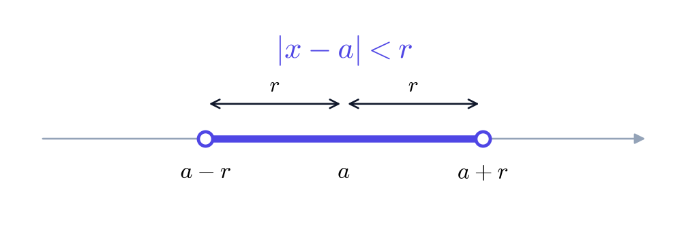{fig-alt="הכותרת: ערך מוחלט של x פחות a קטן מ-r. קטע פתוח בין a פחות r ל-a ועוד r; שני הקצוות ריקים, וביניהם הקו צבוע." width="460" fig-align="center"}

**מרחק גדול מ-$r$: מעבר לאחד הקצוות.** הנקודה $x$ צריכה להיות משמאל ל-$a-r$ **או** מימין ל-$.a+r$

::: {.eqline dir="ltr"}
$|x-a|>r \iff x<a-r$ [או]{.ix-or dir="rtl"} $x>a+r$
:::

זהו איחוד שתי הקרניים $.(-\infty,a-r)\cup(a+r,\infty)$

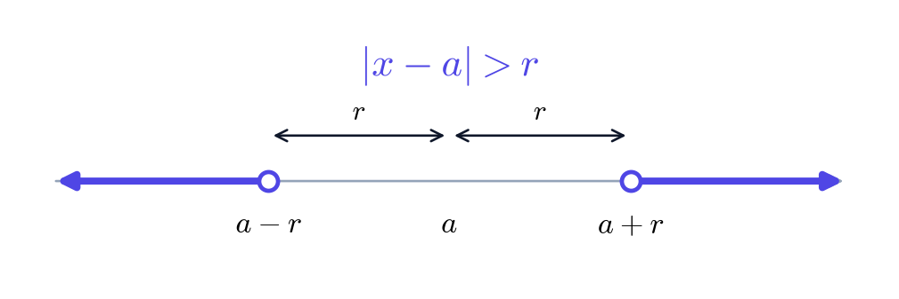{fig-alt="הכותרת: ערך מוחלט של x פחות a גדול מ-r. שתי קרניים פתוחות, משמאל ל-a פחות r ומימין ל-a ועוד r; בין הקצוות אין קו צבוע." width="460" fig-align="center"}

**מרחק שווה ל-$r$: שתי נקודות הקצה.** הנקודה $x$ נמצאת בדיוק $r$ יחידות משמאל ל-$a$ **או** מימינו.

::: {.eqline dir="ltr"}
$|x-a|=r \iff x=a-r$ [או]{.ix-or dir="rtl"} $x=a+r$
:::

זו הקבוצה $.\{a-r,a+r\}$ מסמנים שתי נקודות מלאות, בלי קו צבוע ביניהן.

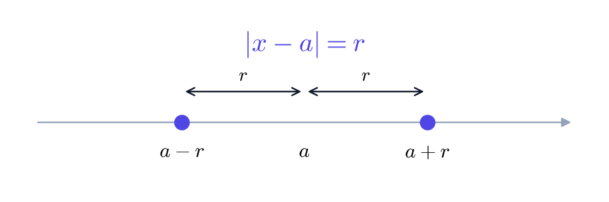{fig-alt="הכותרת: ערך מוחלט של x פחות a שווה ל-r. שתי נקודות מלאות בלבד, a פחות r ו-a ועוד r, כל אחת במרחק r מ-a." width="460" fig-align="center"}

באי-שוויון עם $\le$ או $\ge$ מוסיפים את הקצוות לסרטוט המתאים, ומסמנים אותם בעיגולים מלאים.
::::

:::: {#box-key-abs-solving .thmmethod icon="calc" title="משוואות ואי-שוויונים עם ערך מוחלט"}
1. **מבודדים את הערך המוחלט:** משאירים אותו לבדו באחד האגפים, ומספר באגף השני.
2. **מפרקים לפי המרחק מאפס**, כמו ב-[](#box-rule-abs-distance). עובדים עם כל הביטוי שבתוך הקווים. הנה שלוש אפשרויות עם המספר $4$:

   - **שווה ל-$4$:** הביטוי יכול להיות $4$ או $,-4$ כי שניהם במרחק $4$ מאפס.

     ::: {.eqline dir="ltr"}
     $|x+1|=4 \iff x+1=4$ [או]{.ix-or dir="rtl"} $x+1=-4$
     :::

   - **קטן מ-$4$:** הביטוי צריך להיות בין $-4$ ל-$.4$ שני הגבולות צריכים להתקיים **יחד**.

     ::: {.eqline dir="ltr"}
     $|x+1|<4 \iff x+1>-4$ [וגם]{.ix-or dir="rtl"} $x+1<4$
     :::

   - **גדול מ-$4$:** הביטוי צריך להיות קטן מ-$-4$ או גדול מ-$.4$ מספיק שתתקיים **אחת** האפשרויות.

     ::: {.eqline dir="ltr"}
     $|x+1|>4 \iff x+1<-4$ [או]{.ix-or dir="rtl"} $x+1>4$
     :::

   אם יש $\le$ או $,\ge$ כוללים גם שוויון בכל אחד מהתנאים שהתקבלו.
3. **פותרים את התנאים שהתקבלו** בעזרת [](#box-thm-inequalities). ב״וגם״ לוקחים את **חיתוך** הפתרונות; ב״או״ לוקחים את **איחודם**. לבסוף מסמנים את קבוצת הפתרונות על הישר.

**אם המספר באגף השני הוא אפס או שלילי**, זוכרים שערך מוחלט אינו שלילי, ושהוא שווה לאפס רק כשהביטוי שבתוכו שווה לאפס. למשל, $|x+1|=0$ דורש $,x+1=0$ ואילו ל-$|x+1|=-4$ אין פתרון. בכל שלב שומרים גם על תחום ההגדרה של הביטוי.
::::

::: {#box-exm-abs-solve .thmexm title="משוואות ואי-שוויונים"}
**(א)** פתרו את $.|2x - 3| = 5$

::::: {.derive start="|2x-3|=5"}
::: {.step line="2x-3=[5] או 2x-3=[-5]"}
מפרקים את הערך המוחלט לשתי אפשרויות.
:::
::: {.step line="2x=[8] או 2x=[-2]"}
מוסיפים $3$ לשני האגפים, בשתי האפשרויות.
:::
::: {.step line="x=[4] או x=[-1]"}
מחלקים ב-$2$ בכל מקרה. איחוד הפתרונות נותן $x=4$ או $.x=-1$
:::
::: hint
כדי שהערך המוחלט יהיה $,5$ הביטוי $2x-3$ יכול להיות $5$ או $.{-}5$
:::
::: hint
בכל אחת מהאפשרויות פותרים משוואה לינארית רגילה.
:::
:::::

:::: fill
קבוצת הפתרונות: [$\{-1, 4\}$]{.blank ans="{4,-1}"}

::: explain
יש שני פתרונות: $x = 4$ ו-$.x = -1$ בדיקה: $|2 \cdot 4 - 3| = |5| = 5$ ו-$.|2 \cdot (-1) - 3| = |{-}5| = 5$
:::
::::

**(ב)** פתרו את $.|x - 4| < 3$

::::: {.derive start="|x-4|<3"}
::: {.step line="[-3]<x-4<[3]"}
המרחק של $x-4$ מאפס קטן מ-$,3$ ולכן הביטוי נמצא בין $-3$ ל-$.3$
:::
::: {.step line="[1]<x<[7]"}
מוסיפים $4$ לכל שלושת החלקים.
:::
::: hint
במילים: המרחק של $x$ מ-$4$ קטן מ-$.3$ אילו נקודות נמצאות במרחק קטן מ-$3$ משני צדדיו של $?4$
:::
:::::

:::: fill
קבוצת הפתרונות היא [$(1, 7)$]{.blank ans="(1,7)"}

::: explain
הקטע $,(1, 7)$ כלומר הנקודות שמרחקן מ-$4$ קטן מ-$.3$
:::
::::

**(ג)** פתרו את $.|2x + 1| \ge 3$

::::: {.derive start="|2x+1|>=3"}
::: {.step line="2x+1>=[3] או 2x+1 [<=] [-3]"}
מפרקים את הערך המוחלט לשתי אפשרויות. שימו לב לכיוון באפשרות השנייה.
:::
::: {.step line="2x>=[2] או 2x<=[-4]"}
מחסירים $1$ משני האגפים.
:::
::: {.step line="x>=[1] או x<=[-2]"}
מחלקים ב-$2$ (חיובי, ולכן הכיוון נשמר).
:::
::: hint
לפי השיטה יש שתי אפשרויות: $2x + 1 \ge 3$ או $.2x + 1 \le -3$ שימו לב שבאפשרות השנייה הכיוון מתהפך.
:::
:::::

:::: fill
קבוצת הפתרונות היא [$(-\infty, -2] \cup [1, \infty)$]{.blank ans="(-inf,-2]U[1,inf)" w="16"}

::: explain
ה-$x$ שמקיים **אחת** מהאפשרויות הוא פתרון, ולכן הפתרון הוא האיחוד $.(-\infty, -2] \cup [1, \infty)$ בדיקה: עבור $x = 0$ (שאינו בפתרון) מתקבל $,|1| = 1 \ge 3$ לא נכון.
:::
::::

**(ד)** פתרו את $.|x - 2| = -1$

:::: fill
קבוצת הפתרונות: [$\emptyset$]{.blank ans="{}"}

::: explain
אין פתרון: ערך מוחלט לעולם אינו שלילי.
:::
::::
:::

:::: {.thmchk}
כמה פתרונות יש למשוואה $?|x - 1| = 0$

::: {.quiz options="אין פתרון|פתרון אחד|שני פתרונות" answer="פתרון אחד"}
המרחק של $x$ מ-$1$ הוא $0$ רק כאשר $x$ הוא $1$ עצמו. לכן יש פתרון אחד: $.x=1$ אין כאן שתי אפשרויות שונות: המספר הנגדי של $0$ הוא שוב $.0$
:::
::::

::: {.thmsummary}
- $|a|$ הוא המרחק של $a$ מ-$,0$ ו-$|a - b|$ הוא המרחק בין $a$ ל-$.b$ ערך מוחלט אף פעם אינו שלילי.
- $,\sqrt{a^2} = |a|$ ו-$.|a + b| \le |a| + |b|$
- פותרים אי-שוויון על ידי בידוד $.x$ כפל או חילוק במספר שלילי **הופכים את הכיוון**. אם הסימן לא ידוע, מפצלים למקרים.
- עבור $,r>0$ התנאי $|x-a|<r$ נותן את הקטע הפתוח $,(a-r,a+r)$ והתנאי $|x-a|>r$ נותן שתי קרניים: $x<a-r$ או $.x>a+r$ בשניהם הקצוות אינם כלולים.
:::

### תרגילים {.unnumbered}

::::: {#box-q-abs-compute .thmqst title="מחשבים ערך מוחלט"}
:::: fill
**(א)** $|{-}7| + |3| =$ [$10$]{.blank ans="10"}

**(ב)** $|3 - 8| =$ [$5$]{.blank ans="5"}

**(ג)** $|{-}2| \cdot |{-}4| =$ [$8$]{.blank ans="8"}

**(ד)** $\big||{-}3| - 5\big| =$ [$2$]{.blank ans="2"}

**(ה)** $|\pi - 4| =$ [$4 - \pi$]{.blank ans="4-pi" allow-expression="true" form="simple"}

::: hint
ב-(ה): האם $\pi - 4$ חיובי או שלילי? ($\pi \approx 3.14$.) כתבו תשובה מדויקת, עם $\pi$.
:::
::: explain
**(ב)** $$\begin{aligned} |3 - 8| &= |{-}5| \\ &= 5 \end{aligned}$$

**(ד)** מחשבים מבפנים החוצה: $.\big||{-}3| - 5\big| = |3 - 5| = |{-}2| = 2$

**(ה)** $,\pi < 4$ ולכן $\pi - 4$ שלילי, ומורידים את המינוס: $.|\pi - 4| = -(\pi - 4) = 4 - \pi$
:::
::::
:::::

::::: {#box-q-distance .thmqst title="מרחקים על הישר"}
:::: fill
**(א)** המרחק בין $-2$ ל-$5$ הוא [$7$]{.blank ans="7"}

**(ב)** המרחק בין $-6$ לבין $-1$ הוא [$5$]{.blank ans="5"}

**(ג)** המרחק בין $\frac{1}{2}$ לבין $-\frac{1}{2}$ הוא [$1$]{.blank ans="1"}

::: hint
המרחק בין $a$ ל-$b$ הוא $.|a - b|$
:::
::: explain
**(א)** $$\begin{aligned} |{-}2 - 5| &= |{-}7| \\ &= 7 \end{aligned}$$

**(ב)** $$\begin{aligned} |{-}6 - (-1)| &= |{-}6 + 1| \\ &= |{-}5| \\ &= 5 \end{aligned}$$

**(ג)** $$\begin{aligned} \left|\tfrac{1}{2} - \left(-\tfrac{1}{2}\right)\right| &= \left|\tfrac{1}{2} + \tfrac{1}{2}\right| \\ &= |1| \\ &= 1 \end{aligned}$$
:::
::::
:::::

::::: {#box-q-ineq-steps-1 .thmqst title="אי-שוויון, צעד אחר צעד"}
פתרו את $.5x - 4 \le 2x + 8$

:::: {.derive start="5x-4<=2x+8"}
::: {.step line="3x-4<=[8]"}
מחסירים $2x$ משני האגפים.
:::
::: {.step line="3x<=[12]"}
מוסיפים $.4$
:::
::: {.step line="x [<=] [4]"}
מחלקים ב-$.3$
:::
::: hint
קודם אספו את כל האיברים עם $x$ באגף אחד ואת המספרים באגף השני.
:::
::::

:::: fill
כתבו וסרטטו את קבוצת הפתרונות: [$(-\infty, 4]$]{.blank ans="(-inf,4]" plot="-2,0,2,4,6"}
::::
:::::

::::: {#box-q-ineq-steps-2 .thmqst title="שוב כיוון מתהפך"}
פתרו את $.4 - 3x \ge 10$

:::: {.derive start="4-3x>=10"}
::: {.step line="-3x>=[6]"}
מחסירים $.4$
:::
::: {.step line="x [<=] [-2]"}
מחלקים ב-$.{-}3$
:::
::: hint
אחרי שתחסרו $,4$ תצטרכו לחלק במספר שלילי.
:::
::::

:::: fill
כתבו וסרטטו את קבוצת הפתרונות: [$(-\infty, -2]$]{.blank ans="(-inf,-2]" plot="-4,-3,-2,-1,0,1,2"}
::::
:::::

::::: {#box-q-ineq-steps-3 .thmqst title="אי-שוויון כפול"}
פתרו את $.{-}1 < 2x - 5 < 7$ כל פעולה מפעילים על שלושת החלקים יחד.

:::: {.derive start="-1<2x-5<7"}
::: {.step line="[4]<2x<[12]"}
מוסיפים $5$ לכל שלושת החלקים.
:::
::: {.step line="[2]<x<[6]"}
מחלקים את שלושת החלקים ב-$.2$
:::
::: hint
הוסיפו $5$ לכל שלושת החלקים, ואחר כך חלקו את שלושתם ב-$.2$
:::
::::

:::: fill
כתבו וסרטטו את קבוצת הפתרונות: [$(2, 6)$]{.blank ans="(2,6)" plot="0,1,2,3,4,5,6,7"}
::::
:::::

::::: {#box-q-abs .thmqst title="משוואות ואי-שוויונים עם ערך מוחלט"}
פתרו כל סעיף בעזרת [](#box-key-abs-solving).

**(א)** $|x + 2| \le 4$

:::: {.derive start="|x+2|<=4"}
::: {.step line="[-4]<=x+2<=[4]"}
מפרקים את הערך המוחלט.
:::
::: {.step line="[-6]<=x<=[2]"}
מחסירים $2$ מכל שלושת החלקים. אלה הנקודות שמרחקן מ-$-2$ הוא לכל היותר $.4$
:::
::::

:::: fill
כתבו וסרטטו את קבוצת הפתרונות: [$[-6, 2]$]{.blank ans="[-6,2]" plot="-8,-6,-4,-2,0,2,4"}
::::

**(ב)** $|3x - 1| > 2$

:::: {.derive start="|3x-1|>2"}
::: {.step line="3x-1>[2] או 3x-1 [<] [-2]"}
מפרקים את הערך המוחלט לשתי אפשרויות.
:::
::: {.step line="3x>[3] או 3x<[-1]"}
מוסיפים $1$ לשני האגפים.
:::
::: {.step line="x>[1] או x<[-1/3]"}
מחלקים ב-$.3$
:::
::: hint
כאן יש שתי אפשרויות: $3x - 1 > 2$ או $.3x - 1 < -2$
:::
::::

:::: fill
כתבו וסרטטו את קבוצת הפתרונות: [$\left(-\infty, -\frac{1}{3}\right) \cup (1, \infty)$]{.blank ans="(-inf,-1/3)U(1,inf)" w="16" plot="-2,-1,0,1,2"}
::::

**(ג)** $|x + 1| = 4$

:::: {.derive start="|x+1|=4"}
::: {.step line="x+1=[4] או x+1=[-4]"}
מפרקים את הערך המוחלט לשתי אפשרויות.
:::
::: {.step line="x=[3] או x=[-5]"}
מחסירים $.1$
:::
::::

:::: fill
כתבו וסרטטו את קבוצת הפתרונות: [$\{-5, 3\}$]{.blank ans="{3,-5}" plot="-6,-5,-4,-3,-2,-1,0,1,2,3,4"}
::::

**(ד)** $|3x - 2| < 4$

:::: {.derive start="|3x-2|<4"}
::: {.step line="[-4]<3x-2<[4]"}
מפרקים את הערך המוחלט.
:::
::: {.step line="[-2]<3x<[6]"}
מוסיפים $2$ לכל שלושת החלקים.
:::
::: {.step line="[-2/3]<x<[2]"}
מחלקים את שלושת החלקים ב-$.3$
:::
::::

:::: fill
כתבו וסרטטו את קבוצת הפתרונות: [$\left(-\frac{2}{3}, 2\right)$]{.blank ans="(-2/3,2)" plot="-2,-1,0,1,2,3"}
::::

**(ה)** $|2x + 3| = 0$

:::: {.derive start="|2x+3|=0"}
::: {.step line="2x+3=[0]"}
ערך מוחלט שווה $0$ רק כשמה שבתוכו שווה $,0$ ולכן יש כאן אפשרות אחת.
:::
::: {.step line="2x=[-3]"}
מחסירים $.3$
:::
::: {.step line="x=[-3/2]"}
מחלקים ב-$.2$
:::
::: hint
ערך מוחלט הוא $0$ רק כשמה שבתוכו הוא $,0$ ולכן כאן יש אפשרות אחת בלבד.
:::
::::

:::: fill
כתבו וסרטטו את קבוצת הפתרונות: [$\left\{-\frac{3}{2}\right\}$]{.blank ans="{-3/2}" plot="-3,-2,-1,0,1"}
::::
:::::

::::: {#box-q-abs-write .thmqst title="מקטע לערך מוחלט"}
כתבו כל קטע בצורה $|x - a| < r$ או $.|x - a| \le r$ (מצאו את האמצע ואת חצי האורך.)

:::: fill
**(א)** $(2, 8)$: [$|x - 5| < 3$]{.blank ans="(2,8)" form="abs" w="10"}

**(ב)** $[-1, 7]$: [$|x - 3| \le 4$]{.blank ans="[-1,7]" form="abs" w="10"}

::: hint
האמצע של $(2, 8)$ הוא $,\frac{2 + 8}{2} = 5$ והמרחק ממנו לכל קצה הוא $.3$
:::
::: explain
**(א)** הנקודות שמרחקן מ-$5$ קטן מ-$:3$ $.|x - 5| < 3$

**(ב)** האמצע הוא $,\frac{-1 + 7}{2} = 3$ וחצי האורך הוא $.4$ הקצוות שייכים, ולכן $.|x - 3| \le 4$
:::
::::
:::::

::::: {#box-q-abs-rewrite .thmqst title="להוריד את הערך המוחלט"}
**(א)** אם $,x < 2$ אז $|x - 2|$ שווה:

::: {.quiz options="$x - 2$|$2 - x$" answer="$2 - x$"}
כאשר $,x < 2$ הביטוי $x - 2$ שלילי, ולכן מורידים את המינוס: $.|x - 2| = -(x - 2) = 2 - x$ למשל, עבור $x = 0$ מתקבל $.|{-}2| = 2 = 2 - 0$
:::

**(ב)** אם $,x \ge 5$ אז $|5 - x|$ שווה:

::: {.quiz options="$5 - x$|$x - 5$" answer="$x - 5$"}
כאשר $,x \ge 5$ הביטוי $5 - x$ אינו חיובי, ולכן $.|5 - x| = -(5 - x) = x - 5$
:::
:::::

::::: {#box-q-reciprocal-ineq .thmqst title="שוב מקרים"}
פתרו את $.\frac{2}{x} < 1$

:::: {.solve}
::: hint
כמו ב-[](#box-exm-cases-ineq): $,x \neq 0$ ומפצלים לפי הסימן של $.x$
:::
::: step
**מקרה 1: $x > 0$.** הכפל ב-$x$ שומר על הכיוון: $,2 < x$ כלומר $.x > 2$
:::
::: step
**מקרה 2: $x < 0$.** הכפל ב-$x$ הופך את הכיוון: $.2 > x$ כל $x < 0$ מקיים זאת, ולכן כל $x < 0$ הוא פתרון. (וגם ישירות: $\frac{2}{x}$ שלילי, ולכן קטן מ-$1$.)
:::
::::

:::: fill
קבוצת הפתרונות היא [$(-\infty, 0) \cup (2, \infty)$]{.blank ans="(-inf,0)U(2,inf)" w="16"}
::::
:::::

## פונקציות וגרפים


רוב הקורס עוסק ב**פונקציות**: כללים שמקבלים מספר ומחזירים מספר. הדרישה החשובה ביותר היא שהכלל יהיה **חד-משמעי**: כל קלט נותן תשובה אחת, ורק אחת.

::: {.thmkey icon="idea" title="פונקציה היא מכונה"}
אפשר לחשוב על פונקציה כעל מכונה: מכניסים לה מספר $,x$ והיא מוציאה מספר $.f(x)$ מכונה טובה עקבית: אם נכניס לה את אותו $x$ פעמיים, נקבל את אותה תשובה בשתי הפעמים.
:::

::: {#box-def-function .thmdef title="פונקציה"}
יהיו $A$ ו-$B$ קבוצות. [**פונקציה**]{.term} $f : A \to B$ היא כלל שמתאים **לכל** $x \in A$ איבר **יחיד** $.f(x) \in B$

- הקבוצה $A$ נקראת [**תחום ההגדרה**]{.term} של $.f$
- הקבוצה $B$ נקראת [**הטווח**]{.term} של $.f$
- קבוצת כל הערכים שהפונקציה מקבלת בפועל, $,\{f(x) \mid x \in A\}$ נקראת [**התמונה**]{.term} של $.f$
:::

התמונה יכולה להיות קטנה מהטווח. למשל, עבור $f : \mathbb{R} \to \mathbb{R}$ שמוגדרת על ידי $,f(x) = x^2$ הטווח הוא $,\mathbb{R}$ אבל התמונה היא רק $,[0, \infty)$ כי ריבוע אינו שלילי.

::: {.thmkey icon="calc" title="מציאת התמונה"}
כדי לבדוק אם מספר $y$ נמצא בתמונה של $,f$ פותרים את המשוואה $f(x) = y$ עבור $.x$ אם יש לה פתרון בתחום ההגדרה, $y$ בתמונה. אם אין לה פתרון, $y$ אינו בתמונה.
:::

::: {#box-exm-functions .thmexm title="פונקציות פשוטות"}
בכל סעיף, חשבו כמה ערכים של הפונקציה ומצאו את התמונה שלה.

**(א)** $f(x) = 3x + 1$ (מוגדרת לכל $x$ ממשי).

:::: fill
$f(0) =$ [$1$]{.blank ans="1"}, $f(2) =$ [$7$]{.blank ans="7"}, $f(-1) =$ [$-2$]{.blank ans="-2"} והתמונה היא [$\mathbb{R}$]{.blank ans="R"}.

::: {.explain}
נחשב: $$f(0) = 3 \cdot 0 + 1 = 1, \qquad f(2) = 3 \cdot 2 + 1 = 7, \qquad f(-1) = 3 \cdot (-1) + 1 = -2$$ **התמונה היא כל $\mathbb{R}$.** נבדוק לפי השיטה: יהי $y$ מספר ממשי כלשהו. נפתור את המשוואה $:f(x) = y$ $$\begin{aligned} 3x + 1 &= y \\ 3x &= y - 1 \\ x &= \frac{y - 1}{3} \end{aligned}$$ לכל $y$ יש פתרון, ולכן כל $y$ ממשי נמצא בתמונה. למשל, עבור $y = 10$ נקבל $,x = 3$ ואכן $.f(3) = 10$
:::
::::

**(ב)** $f(x) = x^2$ (מוגדרת לכל $x$ ממשי).

:::: fill
$f(3) =$ [$9$]{.blank ans="9"}, $f(-3) =$ [$9$]{.blank ans="9"}, $f(0) =$ [$0$]{.blank ans="0"} והתמונה היא [$[0, \infty)$]{.blank ans="[0,inf)"}

::: explain
נחשב: $$f(3) = 9, \qquad f(-3) = (-3)^2 = 9, \qquad f(0) = 0$$ שני קלטים שונים, $3$ ו-$,-3$ נותנים אותו פלט. זה מותר: ההגדרה דורשת שלכל **קלט** יהיה פלט יחיד, ולא להפך.

**התמונה היא $[0, \infty)$**: מצד אחד, $x^2 \ge 0$ לכל $,x$ ולכן אין בתמונה מספרים שליליים. מצד שני, לכל $y \ge 0$ המשוואה $x^2 = y$ פתירה, למשל על ידי $,x = \sqrt{y}$ ולכן כל $y \ge 0$ בתמונה.
:::
::::

**(ג)** $f(x) = |x|$

:::: fill
$f(2) =$ [$2$]{.blank ans="2"}, $f(-2) =$ [$2$]{.blank ans="2"} והתמונה היא [$[0, \infty)$]{.blank ans="[0,inf)"}

::: explain
הפונקציה מוגדרת "בחלקים": $f(x) = x$ עבור $x \ge 0$ ו-$f(x) = -x$ עבור $.x < 0$ מאותה סיבה כמו ב-(ב), התמונה היא $.[0, \infty)$
:::
::::

**(ד)** $$f(x) = \begin{cases} x + 1 & x < 0 \\ x^2 & x \ge 0 \end{cases}$$

:::: fill
$f(-2) =$ [$-1$]{.blank ans="-1"}, $f(0) =$ [$0$]{.blank ans="0"}, $f(3) =$ [$9$]{.blank ans="9"} והתמונה היא [$\mathbb{R}$]{.blank ans="R"}

::: explain
גם הכלל הזה הוא פונקציה: לכל $x$ יש בדיוק שורה אחת שמתאימה לו, וכל שורה נותנת ערך אחד. נחשב: $$\begin{aligned} f(-2) &= -2 + 1 = -1 \\ f(0) &= 0^2 = 0 \\ f(3) &= 3^2 = 9 \end{aligned}$$ עבור $-2$ השתמשנו בשורה הראשונה, כי $,-2 < 0$ ועבור $0$ ו-$3$ בשורה השנייה, כי הם $.\ge 0$

**התמונה.** עבור $x < 0$ הערכים $x + 1$ ממלאים את הקרן $,(-\infty, 1)$ ועבור $x \ge 0$ הערכים $x^2$ ממלאים את $.[0, \infty)$ האיחוד של שתי הקרניים הוא כל $.\mathbb{R}$
:::
::::
:::

:::: {.thmchk}
**(א)** האם $5$ נמצא בתמונה של $?f(x) = x^2$

::: {.quiz options="כן|לא" answer="כן"}
כן. למשוואה $x^2 = 5$ יש פתרון, למשל $,x = \sqrt{5}$ ואכן $.f(\sqrt{5}) = 5$
:::

**(ב)** האם $-1$ נמצא בתמונה של $?f(x) = x^2$

::: {.quiz options="כן|לא" answer="לא"}
לא. למשוואה $x^2 = -1$ אין פתרון ממשי, כי ריבוע אינו שלילי.
:::
::::

### המישור: מכפלה קרטזית {.unnumbered}

כדי להבין פונקציה, נרצה לצייר אותה. כמו שמספרים ממשיים מתארים נקודות על ישר אינסופי, איך נתאר נקודות על מישור, או חלקים ממנו? נצייר במישור שני עותקים של הישר הממשי, מאונכים זה לזה, שנחתכים בנקודה $0$ של שניהם: ישר אופקי, שנקרא [**ציר $x$**]{.term}, וישר אנכי, שנקרא [**ציר $y$**]{.term}. נקודת החיתוך שלהם נקראת [**הראשית**]{.term}.

עכשיו לכל נקודה במישור מתאימים **שני** מספרים: כמה היא ימינה (או שמאלה) מהראשית, לאורך ציר $,x$ וכמה היא למעלה (או למטה), לאורך ציר $.y$ שני המספרים האלה נקראים [**הקואורדינטות**]{.term} (או **השיעורים**) של הנקודה, ואת הנקודה כותבים כזוג $.(x, y)$ זוג כזה נקרא [**זוג סדור**]{.term}, כי יש חשיבות לסדר: המספר הראשון הוא תמיד שיעור ה-$x$.

הסימון $(a,b)$ משמש גם לקטע פתוח; ההקשר מבהיר אם מדובר בזוג סדור או בקטע.

::: {.content-visible when-format="html"}
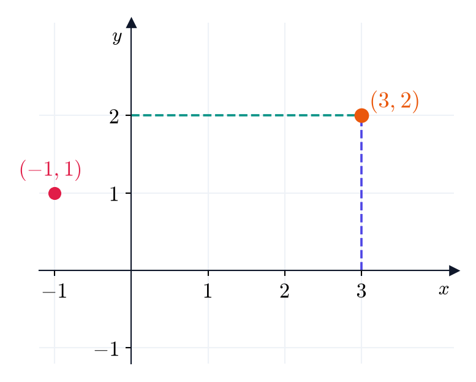{fig-alt="מערכת צירים ובה הנקודות שלוש שתיים ומינוס אחת אחת, עם קווים מקווקווים אל הצירים" width="45%" fig-align="center"}
:::

::: {.content-visible when-format="pdf"}
```{=latex}
\par\medskip
\noindent\beginL\hbox to \linewidth{\hss\includegraphics[width=0.45\linewidth]{figures/plane-point.png}\hss}\endL\par
\medskip
```
:::

::: {#box-def-cartesian .thmdef title="מכפלה קרטזית"}
[**המכפלה הקרטזית**]{.term} של הקבוצות $A$ ו-$B$ היא קבוצת כל הזוגות הסדורים שהאיבר הראשון שלהם מ-$A$ והשני מ-$B$: $$.A \times B = \{ (a, b) \mid a \in A, \ b \in B \}$$ בפרט, [**המישור**]{.term} הוא $,\mathbb{R}^2 = \mathbb{R} \times \mathbb{R}$ קבוצת כל הזוגות של מספרים ממשיים.
:::

::: {#box-exm-cartesian .thmexm title="מכפלות קרטזיות"}
**(א)** כמה איברים יש ב-$?\{0, 1\} \times \{a, b, c\}$ רשמו אותם.

:::: fill
מספר האיברים: [$6$]{.blank ans="6"}

::: explain
$$.\{0, 1\} \times \{a, b, c\} = \{(0, a), (0, b), (0, c), (1, a), (1, b), (1, c)\}$$ לכל אחת משתי האפשרויות לאיבר הראשון יש שלוש אפשרויות לאיבר השני, ולכן יש $2 \cdot 3 = 6$ זוגות.
:::
::::

**(ב)** איך נראית הקבוצה $[1, 3] \times [0, 2]$ במישור?

:::: {.lecture-answer title="תשובה לסעיף (ב)"}
זו קבוצת כל הנקודות $(x, y)$ במישור שבהן $1 \le x \le 3$ ו-$.0 \le y \le 2$ זהו ריבוע.

::::: {.content-visible when-format="html"}
![הריבוע $[1,3] \times [0,2]$, ובו הנקודה $(2, 1.5)$.](figures/cartesian-square.png){fig-alt="ריבוע צבוע במישור בין x שווה 1 ל-3 ובין y שווה 0 ל-2" width="45%" fig-align="center"}
:::::

::::: {.content-visible when-format="pdf"}
```{=latex}
\par\medskip
\noindent\beginL\hbox to \linewidth{\hss\includegraphics[width=0.45\linewidth]{figures/cartesian-square.png}\hss}\endL\par
\medskip
```
:::::
::::
:::

::: {.thmwarn title="הסדר חשוב"}
בזוג סדור יש חשיבות לסדר: $.(1, 2) \neq (2, 1)$ הנקודה הראשונה נמצאת מעל $,x = 1$ והשנייה מעל $.x = 2$ לכן גם $A \times B \neq B \times A$ באופן כללי. למשל, $[1, 3] \times [0, 2]$ ו-$[0, 2] \times [1, 3]$ הם שני ריבועים שונים במישור.
:::

::: {#box-q-cartesian .thmqst}
אילו מהנקודות $(1, 2)$, $(2, 0)$, $(0, 3)$ ו-$(3, 1)$ שייכות ל-$?[0, 2] \times [1, 3]$
:::

::: {.thmsol .foldable}
נקודה $(x, y)$ שייכת ל-$[0, 2] \times [1, 3]$ אם $0 \le x \le 2$ **וגם** $.1 \le y \le 3$ נבדוק כל נקודה:

- $(1, 2)$: $0 \le 1 \le 2$ ו-$.1 \le 2 \le 3$ **שייכת**.
- $(2, 0)$: $0 \le 2 \le 2$, אבל $.0 < 1$ **אינה שייכת**.
- $(0, 3)$: $0 \le 0 \le 2$ ו-$.1 \le 3 \le 3$ **שייכת** (נקודות הקצה שייכות, כי הקטעים סגורים).
- $(3, 1)$: $.3 > 2$ **אינה שייכת**.
:::

### הגרף של פונקציה {.unnumbered}

::: {#box-def-graph .thmdef title="הגרף של פונקציה"}
[**הגרף**]{.term} של פונקציה $f : A \to \mathbb{R}$ הוא קבוצת הנקודות במישור $$.\{ (x, f(x)) \mid x \in A \} \subseteq \mathbb{R}^2$$ כלומר, מעל כל $x$ בתחום ההגדרה מסמנים נקודה בגובה $.f(x)$
:::

::: {.thmkey icon="rule" title="נקודה על הגרף"}
הנקודה $(a, b)$ נמצאת על הגרף של $f$ **אם ורק אם** $.f(a) = b$ למשל, עבור $:f(x) = x^2 + 1$

- הנקודה $(2, 5)$ על הגרף, כי $.f(2) = 2^2 + 1 = 5$
- הנקודה $(1, 3)$ אינה על הגרף, כי $.f(1) = 1^2 + 1 = 2 \neq 3$
:::

:::: {.thmchk}
האם הנקודה $(-2, 5)$ נמצאת על הגרף של $?f(x) = x^2 + 1$

::: {.quiz options="כן|לא" answer="כן"}
כן: $.f(-2) = (-2)^2 + 1 = 4 + 1 = 5$
:::
::::

איך משרטטים גרף ביד? מחשבים את הפונקציה בכמה נקודות, מסמנים את הנקודות $(x, f(x))$ ומחברים ביניהן לפי צורת הפונקציה, בקטעים שבהם היא רציפה — כלומר, בלי קפיצות או חורים. מוסיפים נקודות היכן שצריך כדי לראות את הצורה טוב יותר. בסימולציה הבאה רואים את התהליך עבור $.f(x) = x^2$

:::::: {#box-sim-parabola .thmsim title="מנקודות לגרף: הפרבולה"}
::: {.content-visible when-format="html"}
```{=html}
<iframe class="widget-frame" src="widgets/ch01/parabola-points.html" loading="lazy" title="מנקודות לגרף: הפרבולה"></iframe>
```
:::

::: {.content-visible when-format="pdf"}
```{=latex}
\par\medskip
\noindent\beginL\hbox to \linewidth{\hss\includegraphics[width=0.95\linewidth]{figures/parabola-points.png}\hss}\endL\par
\medskip
```

*הסימולציה האינטראקטיבית זמינה בגרסה המקוונת.*
:::

עם $5$ נקודות מתקבל קו שבור עם "פינות". עם $9$ נקודות הפינות כבר קטנות, ועם $41$ נקודות הקו השבור כמעט אינו נבדל מהפרבולה. הגרף של $x^2$ הוא העקומה החלקה שהקווים השבורים האלה מתקרבים אליה.
::::::

הנה הגרפים של הפונקציות מ-[](#box-exm-functions), ובהם מסומנות הנקודות שחישבנו:

::: {.content-visible when-format="html"}
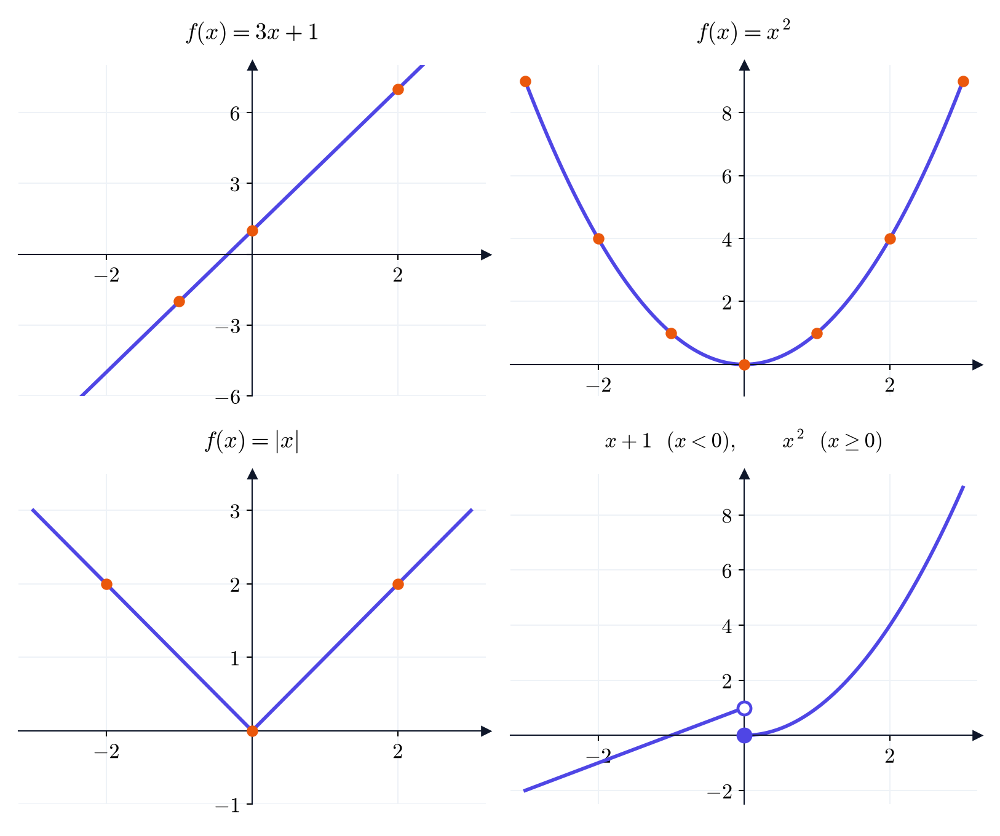{fig-alt="ארבעה גרפים: ישר, פרבולה, צורת V, ופונקציה עם קפיצה באפס" width="85%" fig-align="center"}
:::

::: {.content-visible when-format="pdf"}
```{=latex}
\par\medskip
\noindent\beginL\hbox to \linewidth{\hss\includegraphics[width=0.85\linewidth]{figures/function-examples.png}\hss}\endL\par
\medskip
```
:::

::: {.thmterm title="עלייה וירידה"}
פונקציה **עולה ממש** בקטע אם ככל ש-$x$ גדל, $f(x)$ גדל; היא **יורדת ממש** אם $f(x)$ קטן. למשל, $x^2$ יורדת ממש עד $0$ ועולה ממש מ-$0$ והלאה. בתיאורי הגרפים בפרק נקצר ונאמר ״עולה״ או ״יורדת״. כשמתירים גם שוויון בין ערכים, אומרים ״עולה במובן החלש״ או ״יורדת במובן החלש״.
:::

::: {.thmterm title="איכותי וכמותי"}
ציור של גרף הוא בדרך כלל **לא מדויק**. הוא נותן לנו בעיקר מידע **איכותי**: איפה הפונקציה עולה ואיפה היא יורדת, איפה היא חותכת את הצירים, ואיך היא מתנהגת בקצוות. בשביל מידע **כמותי**, כמו ערך מדויק בנקודה, מחשבים מהנוסחה. שימו לב גם שקנה המידה על ציר $x$ ועל ציר $y$ **לא חייב להיות זהה**: למשל, בגרף של $3x + 1$ למעלה, יחידה על ציר $y$ קצרה יותר מיחידה על ציר $.x$ בוחרים קנה מידה שבו רואים היטב את מה שמעניין.
:::

### פונקציית הסימן והערך השלם {.unnumbered}

שתי פונקציות פשוטות נוספות, שמוגדרות בעזרת כלל ולא בעזרת נוסחה אחת.

::: {#box-def-sgn .thmdef title="פונקציית הסימן"}
[**פונקציית הסימן**]{.term} היא $$.\operatorname{sgn}(x) = \begin{cases} 1 & x > 0 \\ 0 & x = 0 \\ -1 & x < 0 \end{cases}$$
:::

במילים: הפונקציה "שוכחת" את הגודל של המספר, ומשאירה רק את הסימן שלו.

::: {#box-exm-sgn .thmexm title="פונקציית הסימן"}
**(א)** חשבו.

:::: fill
$\operatorname{sgn}(-3.7) =$ [$-1$]{.blank ans="-1"} ו-$\operatorname{sgn}(\pi) =$ [$1$]{.blank ans="1"}

::: explain
$\operatorname{sgn}(-3.7) = -1$ כי $,-3.7 < 0$ ו-$\operatorname{sgn}(\pi) = 1$ כי $.\pi > 0$
:::
::::

**(ב)** מהי התמונה של פונקציית הסימן?

:::: fill
התמונה: [$\{-1, 0, 1\}$]{.blank ans="{-1,0,1}"}

::: explain
הפונקציה מקבלת רק שלושה ערכים, ולכן התמונה היא קבוצה של שלושה מספרים.
:::
::::

**(ג)** בדקו ש-$|x| = x \cdot \operatorname{sgn}(x)$ עבור $.x = -3$

:::: {.lecture-answer title="תשובה לסעיף (ג)"}
$$\begin{aligned} (-3) \cdot \operatorname{sgn}(-3) &= (-3) \cdot (-1) \\ &= 3 \\ &= |{-}3|. \end{aligned}$$
::::
:::

::: {#box-def-floor .thmdef title="הערך השלם (רצפה)"}
[**הערך השלם**]{.term} של $,x$ שמסומן $,\lfloor x \rfloor$ הוא המספר השלם הגדול ביותר שקטן או שווה ל-$.x$
:::

על הישר: מתחילים ב-$x$ והולכים **שמאלה** עד שפוגשים את המספר השלם הראשון (או נשארים במקום, אם $x$ עצמו שלם).

::: {#box-exm-floor .thmexm title="ערך שלם"}
חשבו:

:::: fill
**(א)** $\lfloor 2.7 \rfloor =$ [$2$]{.blank ans="2"}

**(ב)** $\lfloor 5 \rfloor =$ [$5$]{.blank ans="5"}

**(ג)** $\lfloor -1.2 \rfloor =$ [$-2$]{.blank ans="-2" miss="-1 :: זו מחיקת הספרות שאחרי הנקודה. אבל $-1$ נמצא מימין למספר $-1.2$, כלומר גדול ממנו, ואנחנו מחפשים שלם שקטן או שווה למספר $-1.2$."}

::: explain
**(א)** השלמים שקטנים או שווים ל-$2.7$ הם $\dots, 0, 1, 2$, והגדול שבהם הוא $.2$

**(ב)** $5$ עצמו שלם.

**(ג)** השלמים שקטנים או שווים ל-$-1.2$ הם $\dots, -4, -3, -2$, והגדול שבהם הוא $.{-}2$
:::
::::
:::

התמונה של פונקציית הערך השלם היא $.\mathbb{Z}$

::: {.thmwarn title="ערך שלם של מספר שלילי"}
עבור מספרים שליליים, הערך השלם **אינו** "מחיקת הספרות שאחרי הנקודה": $,\lfloor -1.2 \rfloor = -2$ ולא $,-1$ כי $-1 > -1.2$ ואנחנו מחפשים שלם שקטן או שווה ל-$.{-}1.2$
:::

:::: {.thmchk}
מהו $?\lfloor -3.5 \rfloor$

::: {.quiz options="$-3$|$-4$" answer="$-4$"}
מתחילים במספר $-3.5$ והולכים שמאלה עד המספר השלם הראשון: $.{-}4$ המספר $-3$ נמצא **מימין** ל-$,-3.5$ כלומר הוא גדול ממנו, ולכן אינו מתאים.
:::
::::

בגרפים של שתי הפונקציות יש **קפיצות**.

::: {.content-visible when-format="html"}
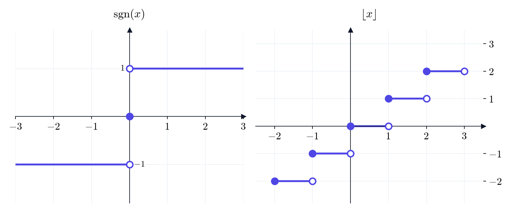{fig-alt="גרף פונקציית הסימן עם קפיצה באפס, וגרף מדרגות של פונקציית הערך השלם" width="85%" fig-align="center"}
:::

::: {.content-visible when-format="pdf"}
```{=latex}
\par\medskip
\noindent\beginL\hbox to \linewidth{\hss\includegraphics[width=0.85\linewidth]{figures/sgn-floor.png}\hss}\endL\par
\medskip
```
:::

### מה אינו פונקציה {.unnumbered}

כדי להבין את ההגדרה, כדאי לראות דוגמאות שאינן עומדות בה. ההגדרה דורשת שלכל $x$ יהיה ערך **יחיד**. בגרף, פירוש הדבר הוא שכל קו אנכי פוגש את הגרף לכל היותר פעם אחת.

::: {.thmkey icon="rule" title="מבחן הקו האנכי"}
עקומה במישור היא גרף של פונקציה אם ורק אם **כל קו אנכי** חותך אותה **לכל היותר בנקודה אחת**.
:::

::: {#box-exm-circle .thmexm title="מעגל"}
האם המעגל $x^2 + y^2 = 4$ (מרכזו בראשית ורדיוסו $2$) הוא גרף של פונקציה? רמז: נסו את הקו האנכי $.x = 1$

:::: {.lecture-answer}
**לא.** נציב $:x = 1$ $$\begin{aligned} 1^2 + y^2 &= 4 \\ y^2 &= 3 \\ y &= \pm\sqrt{3} \end{aligned}$$ הקו האנכי $x = 1$ חותך את המעגל בשתי נקודות, $(1, \sqrt{3})$ ו-$.(1, -\sqrt{3})$
::::
:::

::: {#box-exm-ellipse .thmexm title="אליפסה"}
[**האליפסה**]{.term} $$\frac{x^2}{9} + \frac{y^2}{4} = 1$$ היא מעגל "מתוח". מצאו את נקודות החיתוך שלה עם הצירים. האם היא גרף של פונקציה?

:::: fill
- חיתוך עם ציר $x$ (שם $y = 0$): $x \in$ [$\{-3, 3\}$]{.blank ans="{3,-3}"}
- חיתוך עם ציר $y$ (שם $x = 0$): $y \in$ [$\{-2, 2\}$]{.blank ans="{2,-2}"}

::: explain
- **עם ציר $x$** ($y = 0$): $,\frac{x^2}{9} = 1$ כלומר $,x^2 = 9$ ולכן $.x = \pm 3$ הנקודות: $.(\pm 3, 0)$
- **עם ציר $y$** ($x = 0$): $,\frac{y^2}{4} = 1$ כלומר $,y^2 = 4$ ולכן $.y = \pm 2$ הנקודות: $.(0, \pm 2)$

האליפסה אינה גרף של פונקציה: למשל, הקו $x = 0$ חותך אותה בשתי הנקודות $.(0, \pm 2)$
:::
::::

באופן כללי, האליפסה $\frac{x^2}{a^2} + \frac{y^2}{b^2} = 1$ חותכת את הצירים בנקודות $(\pm a, 0)$ ו-$.(0, \pm b)$ כאשר $a = b$ מתקבל מעגל.
:::

::: {#box-exm-hyperbola .thmexm title="היפרבולה"}
[**ההיפרבולה**]{.term} $$\frac{x^2}{4} - y^2 = 1$$ בנויה משני "ענפים". מצאו את נקודות החיתוך שלה עם הצירים.

:::: fill
- חיתוך עם ציר $x$: $x \in$ [$\{-2, 2\}$]{.blank ans="{2,-2}"}
- חיתוך עם ציר $y$: $y \in$ [$\emptyset$]{.blank ans="{}"}

::: explain
- **עם ציר $x$** ($y = 0$): $,\frac{x^2}{4} = 1$ כלומר $,x^2 = 4$ ולכן $.x = \pm 2$ הנקודות $(\pm 2, 0)$ נקראות **הקודקודים**.
- **עם ציר $y$** ($x = 0$): $,-y^2 = 1$ כלומר $,y^2 = -1$ ולמשוואה הזו אין פתרון. ההיפרבולה אינה חותכת את ציר $.y$
:::
::::

כאשר $x$ גדול, הענפים מתקרבים לישרים $y = \frac{1}{2}x$ ו-$,y = -\frac{1}{2}x$ שנקראים [**האסימפטוטות**]{.term} של ההיפרבולה. גם ההיפרבולה אינה גרף של פונקציה: הקו $x = 3$ חותך אותה בשתי נקודות.

באופן כללי, להיפרבולה $\frac{x^2}{a^2} - \frac{y^2}{b^2} = 1$ יש קודקודים $(\pm a, 0)$ ואסימפטוטות $.y = \pm \frac{b}{a} x$
:::

::: {#box-exm-sideways-parabola .thmexm title="פרבולה שוכבת"}
העקומה $x = y^2$ היא פרבולה "שוכבת", שנפתחת ימינה. האם היא גרף של פונקציה? רמז: נסו את $.x = 4$

:::: {.lecture-answer}
**לא.** נציב $:x = 4$ $$,4 = y^2$$ ולכן $y = 2$ או $:y = -2$ שתי נקודות על אותו קו אנכי.
::::
:::

::: {.content-visible when-format="html"}
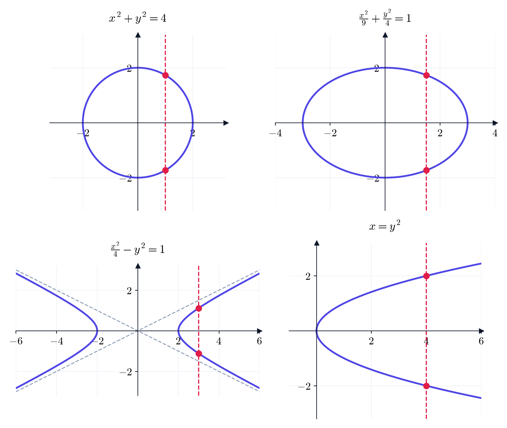{fig-alt="ארבע עקומות, ובכל אחת קו אנכי מקווקו שחותך את העקומה בשתי נקודות" width="85%" fig-align="center"}
:::

::: {.content-visible when-format="pdf"}
```{=latex}
\par\medskip
\noindent\beginL\hbox to \linewidth{\hss\includegraphics[width=0.85\linewidth]{figures/not-functions.png}\hss}\endL\par
\medskip
```
:::

::: {.thmkey icon="idea" title="חיתוך לחלקים"}
אף שהעקומות האלה אינן גרפים של פונקציות, אפשר לחתוך כל אחת מהן לחלקים שכל אחד מהם הוא גרף של פונקציה. למשל, נבודד את $y$ במשוואת המעגל: $$\begin{aligned} x^2 + y^2 &= 4 \\ y^2 &= 4 - x^2 \\ y &= \pm\sqrt{4 - x^2} \end{aligned}$$ לכן חצי המעגל העליון הוא הגרף של הפונקציה $,y = \sqrt{4 - x^2}$ והתחתון הוא הגרף של $.y = -\sqrt{4 - x^2}$ באותו אופן, הענף העליון של $x = y^2$ הוא הגרף של $.y = \sqrt{x}$
:::

### תחום ההגדרה הטבעי {.unnumbered}

לעיתים קרובות נותנים פונקציה רק בעזרת נוסחה, בלי לציין את תחום ההגדרה. במקרה כזה מסכימים שתחום ההגדרה הוא כל המספרים שבהם לנוסחה יש משמעות.

::: {#box-def-natural-domain .thmdef title="תחום ההגדרה הטבעי"}
[**תחום ההגדרה הטבעי**]{.term} של פונקציה שנתונה בנוסחה הוא קבוצת כל ה-$x$ הממשיים שעבורם הנוסחה מוגדרת.
:::

::: {.thmkey icon="calc" title="מציאת תחום הגדרה"}
עוברים על הנוסחה ומחפשים את הפעולות ה"מסוכנות":

1. **חילוק**: המכנה חייב להיות שונה מאפס.
2. **שורש זוגי** ($\sqrt{\ }$, $\sqrt[4]{\ }$, ...): הביטוי שבתוכו חייב להיות אי-שלילי.
3. **לוגריתם** (נכיר בהמשך הפרק): הביטוי שבתוכו חייב להיות חיובי.

כל דרישה כזו נותנת משוואה או אי-שוויון. פותרים את כולם, ותחום ההגדרה הוא ה**חיתוך** של כל הפתרונות.
:::

::: {#box-exm-domain .thmexm title="תחומי הגדרה"}
מצאו את תחום ההגדרה הטבעי, כתבו אותו כקבוצה וסרטטו אותו על הישר הממשי.

**(א)** $f(x) = \sqrt{x - 3}$

:::: fill
תחום ההגדרה: [$[3, \infty)$]{.blank ans="[3,inf)" plot="1,5"}

::: explain
יש כאן שורש, ולכן צריך $$\begin{aligned} x - 3 &\ge 0 \\ x &\ge 3 \end{aligned}$$
:::
::::

**(ב)** $f(x) = \frac{1}{x^2 - 4}$

:::: fill
תחום ההגדרה: [$\mathbb{R} \setminus \{-2, 2\}$]{.blank ans="R-{-2,2}" w="14" plot="-4,4"}

::: explain
יש כאן חילוק, ולכן צריך $.x^2 - 4 \neq 0$ נמצא מתי המכנה מתאפס: $$\begin{aligned} x^2 - 4 &= 0 \\ x^2 &= 4 \\ x &= \pm 2 \end{aligned}$$ את שתי הנקודות האלה מוציאים. תחום ההגדרה: $,\mathbb{R} \setminus \{-2, 2\}$ שאפשר לכתוב גם כ-$.(-\infty, -2) \cup (-2, 2) \cup (2, \infty)$
:::
::::

**(ג)** $f(x) = \frac{\sqrt{x + 1}}{x - 2}$

:::: fill
תחום ההגדרה: [$[-1, 2) \cup (2, \infty)$]{.blank ans="[-1,2)U(2,inf)" w="14" plot="-3,4"}

::: hint
יש כאן שתי פעולות "מסוכנות": שורש וחילוק. כל אחת נותנת דרישה.
:::
::: explain
- **בגלל השורש:** $,x + 1 \ge 0$ כלומר $.x \ge -1$
- **בגלל המכנה:** $,x - 2 \neq 0$ כלומר $.x \neq 2$
- **החיתוך:** כל $x \ge -1$ חוץ מ-$,x = 2$ כלומר $.[-1, 2) \cup (2, \infty)$
:::
::::
:::

::: {.thmsummary}
- פונקציה מתאימה לכל $x$ בתחום ההגדרה ערך **יחיד** $.f(x)$ התמונה היא כל הערכים שמתקבלים בפועל; כדי לבדוק אם $y$ בתמונה, פותרים $.f(x) = y$
- המישור הוא $,\mathbb{R}^2 = \mathbb{R} \times \mathbb{R}$ ו-$(a, b)$ על הגרף של $f$ בדיוק כאשר $.f(a) = b$
- מבחן הקו האנכי: עקומה היא גרף של פונקציה אם כל קו אנכי חותך אותה לכל היותר פעם אחת. מעגל, אליפסה, היפרבולה ו-$x = y^2$ אינם גרפים של פונקציות.
- תחום הגדרה טבעי: מכנה $\neq 0$, ביטוי בתוך שורש זוגי $,\ge 0$ ולוקחים את החיתוך.
:::

### תרגילים {.unnumbered}

::::: {#box-q-values .thmqst title="מציבים בפונקציה"}
תהי $.f(x) = x^2 - 3x + 1$ חשבו.

:::: fill
**(א)** $f(2) =$ [$-1$]{.blank ans="-1"}

**(ב)** $f(-1) =$ [$5$]{.blank ans="5"}

**(ג)** $f(0) =$ [$1$]{.blank ans="1"}

**(ד)** $f\left(\frac{1}{2}\right) =$ [$-\frac{1}{4}$]{.blank ans="-1/4"}

::: hint
מציבים את המספר **בכל** מקום שבו מופיע $,x$ עם סוגריים: למשל $.f(-1) = (-1)^2 - 3 \cdot (-1) + 1$
:::
::: explain
**(א)** $$\begin{aligned} f(2) &= 2^2 - 3 \cdot 2 + 1 \\ &= 4 - 6 + 1 \\ &= -1 \end{aligned}$$

**(ב)** $$\begin{aligned} f(-1) &= (-1)^2 - 3 \cdot (-1) + 1 \\ &= 1 + 3 + 1 \\ &= 5 \end{aligned}$$

**(ג)** $$\begin{aligned} f(0) &= 0^2 - 3 \cdot 0 + 1 \\ &= 1 \end{aligned}$$

**(ד)** $$\begin{aligned} f\left(\tfrac{1}{2}\right) &= \left(\tfrac{1}{2}\right)^2 - 3 \cdot \tfrac{1}{2} + 1 \\ &= \tfrac{1}{4} - \tfrac{6}{4} + \tfrac{4}{4} \\ &= -\tfrac{1}{4} \end{aligned}$$
:::
::::
:::::

::::: {#box-q-substitute .thmqst title="מציבים ביטוי"}
אפשר להציב בפונקציה גם ביטוי. כתבו כל תוצאה בלי סוגריים, אם אפשר.

:::: fill
**(א)** עבור $f(x) = 2x + 3$: $f(a + 1) =$ [$2a + 5$]{.blank ans="2a+5"}

**(ב)** עבור $f(x) = 2x + 3$: $f(2a) =$ [$4a + 3$]{.blank ans="4a+3"}

**(ג)** עבור $f(x) = x^2$: $f(x + 1) - f(x) =$ [$2x + 1$]{.blank ans="2x+1"}

::: hint
במקום כל $x$ כותבים את הביטוי כולו, בתוך סוגריים.
:::
::: explain
**(א)** $$\begin{aligned} f(a + 1) &= 2(a + 1) + 3 \\ &= 2a + 2 + 3 \\ &= 2a + 5 \end{aligned}$$

**(ב)** $$\begin{aligned} f(2a) &= 2 \cdot 2a + 3 \\ &= 4a + 3 \end{aligned}$$

**(ג)** $$\begin{aligned} f(x + 1) - f(x) &= (x + 1)^2 - x^2 \\ &= x^2 + 2x + 1 - x^2 \\ &= 2x + 1 \end{aligned}$$
:::
::::
:::::

::::: {#box-q-piecewise .thmqst title="פונקציה בחלקים"}
תהי $$.f(x) = \begin{cases} 1 - x & x \le 1 \\ x^2 & x > 1 \end{cases}$$

:::: fill
**(א)** $f(-2) =$ [$3$]{.blank ans="3"}

**(ב)** $f(1) =$ [$0$]{.blank ans="0"}

**(ג)** $f(3) =$ [$9$]{.blank ans="9"}

**(ד)** התמונה של $f$ היא [$[0, \infty)$]{.blank ans="[0,inf)"}

::: hint
לכל $x$ בודקים קודם באיזו שורה הוא נמצא. ב-(ב): $1 \le 1$ נכון.
:::
::: explain
**(א)** $,-2 \le 1$ ולכן משתמשים בשורה הראשונה: $$\begin{aligned} f(-2) &= 1 - (-2) \\ &= 3 \end{aligned}$$

**(ב)** $,1 \le 1$ ולכן גם כאן משתמשים בשורה הראשונה: $$\begin{aligned} f(1) &= 1 - 1 \\ &= 0 \end{aligned}$$

**(ג)** $,3 > 1$ ולכן משתמשים בשורה השנייה: $$\begin{aligned} f(3) &= 3^2 \\ &= 9 \end{aligned}$$

**(ד)** עבור $x \le 1$ הערכים $1 - x$ ממלאים את $,[0, \infty)$ ועבור $x > 1$ הערכים $x^2$ ממלאים את $.(1, \infty)$ האיחוד הוא $.[0, \infty)$
:::
::::
:::::

::::: {#box-q-on-graph .thmqst title="על הגרף או לא?"}
אילו מהנקודות נמצאות על הגרף של $?f(x) = \sqrt{x + 5}$

**(א)** $(4, 3)$

::: {.quiz options="על הגרף|לא על הגרף" answer="על הגרף"}
$,f(4) = \sqrt{9} = 3$ ולכן הנקודה על הגרף.
:::

**(ב)** $(-1, -2)$

::: {.quiz options="על הגרף|לא על הגרף" answer="לא על הגרף"}
$.f(-1) = \sqrt{4} = 2 \neq -2$ השורש אינו שלילי, ולכן אין על הגרף נקודות מתחת לציר $.x$
:::

**(ג)** $(-5, 0)$

::: {.quiz options="על הגרף|לא על הגרף" answer="על הגרף"}
$,f(-5) = \sqrt{0} = 0$ ולכן הנקודה על הגרף. זו נקודת ההתחלה של הגרף.
:::
:::::

::::: {#box-q-image .thmqst title="בתמונה או לא?"}
תהי $.f(x) = x^2 + 3$

**(א)** האם $7$ בתמונה של $?f$

::: {.quiz options="כן|לא" answer="כן"}
פותרים $,x^2 + 3 = 7$ כלומר $,x^2 = 4$ ויש פתרון, למשל $.x = 2$
:::

**(ב)** האם $2$ בתמונה של $?f$

::: {.quiz options="כן|לא" answer="לא"}
$,x^2 + 3 = 2$ פירושו $,x^2 = -1$ ואין לזה פתרון ממשי.
:::

:::: fill
**(ג)** התמונה של $f$ היא [$[3, \infty)$]{.blank ans="[3,inf)"}

::: explain
$x^2$ מקבל את כל הערכים ב-$,[0, \infty)$ ולכן $x^2 + 3$ מקבל את כל הערכים ב-$.[3, \infty)$
:::
::::
:::::

::::: {#box-q-floor .thmqst title="עוד ערך שלם"}
:::: fill
**(א)** $\lfloor -0.5 \rfloor =$ [$-1$]{.blank ans="-1" miss="0 :: $0$ נמצא מימין למספר $-0.5$, כלומר גדול ממנו. הולכים מהמספר $-0.5$ שמאלה עד השלם הראשון."}

**(ב)** $\lfloor \pi \rfloor =$ [$3$]{.blank ans="3"}

**(ג)** קבוצת הפתרונות של $\lfloor x \rfloor = 3$ היא [$[3, 4)$]{.blank ans="[3,4)"}

::: hint
ב-(ג): אילו מספרים "הולכים שמאלה" ופוגשים קודם את $?3$ בגרף: זו המדרגה בגובה $.3$
:::
::: explain
**(א)** השלמים שקטנים או שווים ל-$-0.5$ הם $,\dots, -3, -2, -1$ והגדול שבהם הוא $.{-}1$

**(ב)** $,\pi = 3.14\ldots$ ולכן $.\lfloor \pi \rfloor = 3$

**(ג)** צריך $3 \le x$ (כדי ש-$3$ לא יהיה גדול מ-$x$), וגם $x < 4$ (אחרת גם $4$ היה שלם שאינו גדול מ-$x$). הפתרון הוא $.[3, 4)$
:::
::::
:::::

::::: {#box-q-domain .thmqst title="תחומי הגדרה"}
מצאו את תחום ההגדרה הטבעי של כל פונקציה וסרטטו אותו על הישר הממשי.

:::: fill
**(א)** $\frac{1}{\sqrt{5 - x}}$: [$(-\infty, 5)$]{.blank ans="(-inf,5)" plot="2,7"}

**(ב)** $\sqrt{2x - 6}$: [$[3, \infty)$]{.blank ans="[3,inf)" plot="1,5"}

**(ג)** $\frac{1}{x^2 - 9}$: [$\mathbb{R} \setminus \{-3, 3\}$]{.blank ans="R-{-3,3}" w="14" plot="-5,5"}

**(ד)** $\frac{\sqrt{4 - x}}{x + 1}$: [$(-\infty, -1) \cup (-1, 4]$]{.blank ans="(-inf,-1)U(-1,4]" w="16" plot="-3,6"}

**(ה)** $\sqrt{x^2 + 1}$: [$\mathbb{R}$]{.blank ans="R" plot="-3,3"}

::: hint
עברו על הפעולות ה"מסוכנות": מכנה שונה מאפס, ושורש של ביטוי אי-שלילי. אם שורש נמצא במכנה, צריך שהביטוי שבתוכו יהיה **חיובי**.
:::
::: explain
**(א)** בגלל השורש $,5 - x \ge 0$ ובגלל המכנה $.\sqrt{5 - x} \neq 0$ יחד: $,5 - x > 0$ כלומר $$\begin{aligned} 5 - x &> 0 \\ -x &> -5 \\ x &< 5 \end{aligned}$$ בשורה השלישית כפלנו ב-$,-1$ ולכן הכיוון התהפך.

**(ב)** $$\begin{aligned} 2x - 6 &\ge 0 \\ 2x &\ge 6 \\ x &\ge 3 \end{aligned}$$

**(ג)** $$\begin{aligned} x^2 - 9 &\neq 0 \\ x^2 &\neq 9 \\ x &\neq \pm 3 \end{aligned}$$

**(ד)** $4 - x \ge 0$ (כלומר $x \le 4$) וגם $x + 1 \neq 0$ (כלומר $x \neq -1$).

**(ה)** $x^2 + 1 \ge 1 > 0$ לכל $,x$ ולכן אין שום דרישה.
:::
::::
:::::

::::: {#box-q-domain-order .thmqst title="שלבי הפתרון"}
מוצאים את תחום ההגדרה של $.f(x) = \frac{1}{\sqrt{x}} + \sqrt{3 - x}$ סדרו את שלבי הפתרון.

:::: order
::: step
מזהים את הפעולות ה"מסוכנות": שני שורשים, ומכנה.
:::
::: step
כותבים דרישה לכל אחת מהן: $,x \ge 0$ $\sqrt{x} \neq 0$ ו-$.3 - x \ge 0$
:::
::: step
פותרים כל דרישה: $x > 0$ (משתי הדרישות הראשונות) ו-$.x \le 3$
:::
::: step
לוקחים את החיתוך: $.0 < x \le 3$
:::
::: step
כותבים את התשובה כקטע: $.(0, 3]$
:::
::::
:::::

::::: {#box-q-conics .thmqst title="אליפסה והיפרבולה"}
:::: fill
**(א)** האליפסה $\frac{x^2}{25} + \frac{y^2}{16} = 1$ חותכת את ציר $x$ ב-$x \in$ [$\{-5, 5\}$]{.blank ans="{5,-5}"} ואת ציר $y$ ב-$y \in$ [$\{-4, 4\}$]{.blank ans="{4,-4}"}

**(ב)** לקודקודים של ההיפרבולה $\frac{x^2}{9} - \frac{y^2}{4} = 1$ יש $x \in$ [$\{-3, 3\}$]{.blank ans="{3,-3}"}

**(ג)** האסימפטוטות שלה הן $y = \pm m x$ עם $m =$ [$\frac{2}{3}$]{.blank ans="2/3"}

::: hint
אליפסה $\frac{x^2}{a^2} + \frac{y^2}{b^2} = 1$ חותכת את הצירים ב-$(\pm a, 0)$ וב-$.(0, \pm b)$ להיפרבולה $\frac{x^2}{a^2} - \frac{y^2}{b^2} = 1$ יש אסימפטוטות $.y = \pm \frac{b}{a} x$
:::
::: explain
**(א)** על ציר $x$ מתקיים $:y = 0$ $$\begin{aligned} \frac{x^2}{25} &= 1 \\ x^2 &= 25 \\ x &= \pm 5 \end{aligned}$$ על ציר $y$ מתקיים $:x = 0$ $$\begin{aligned} \frac{y^2}{16} &= 1 \\ y^2 &= 16 \\ y &= \pm 4 \end{aligned}$$

**(ב)** הקודקודים על ציר $,x$ כלומר $:y = 0$ $$\begin{aligned} \frac{x^2}{9} &= 1 \\ x^2 &= 9 \\ x &= \pm 3 \end{aligned}$$

**(ג)** כאן $a = 3$ ו-$,b = 2$ ולכן $.m = \frac{b}{a} = \frac{2}{3}$
:::
::::
:::::

::::: {#box-q-is-function .thmqst title="גרף של פונקציה?"}
**(א)** $x^2 + y^2 = 9$

::: {.quiz options="כן|לא" answer="לא"}
זה מעגל שרדיוסו $.3$ הקו $x = 0$ חותך אותו בשתי נקודות, $.(0, \pm 3)$
:::

**(ב)** $y = x^2 - 4$

::: {.quiz options="כן|לא" answer="כן"}
לכל $x$ יש ערך אחד של $,y$ ולכן כל קו אנכי חותך את הגרף פעם אחת.
:::

**(ג)** $x = |y|$

::: {.quiz options="כן|לא" answer="לא"}
הקו $x = 2$ חותך את העקומה ב-$(2, 2)$ וב-$.(2, -2)$
:::
:::::

## בניית פונקציות מפונקציות פשוטות יותר {#הרכבת-פונקציות}

משתי פונקציות $f$ ו-$g$ אפשר לבנות פונקציות חדשות: $(f\pm g)(x)=f(x)\pm g(x)$ ו-$(fg)(x)=f(x)g(x)$, בכל $x$ שבו שתיהן מוגדרות. גם $(f/g)(x)=f(x)/g(x)$ היא פונקציה, ובתחומה דורשים בנוסף $.g(x)\ne0$

### הרכבת פונקציות {.unnumbered}

נוסחאות מסובכות בנויות משלבים פשוטים. למשל, כדי לחשב את $\sqrt{x^2 + 4}$ מחשבים קודם $x^2 + 4$, ואחר כך את השורש של התוצאה. לזהות את השלבים האלה זו מיומנות חשובה.

::: {#box-def-composition .thmdef title="הרכבת פונקציות"}
[**ההרכבה**]{.term} של $f$ ו-$g$ היא הפונקציה $$,(f \circ g)(x) = f\big(g(x)\big)$$ כלומר "קודם $g$, ואחר כך $f$". תחום ההגדרה של $f \circ g$ הוא כל ה-$x$ שבתחום של $g$, ושעבורם $g(x)$ בתחום של $.f$
:::

בשפה של מכונות: מעמידים שתי מכונות בשורה. מכניסים את $x$ למכונה $,g$ ואת מה שיצא ממנה מכניסים למכונה $.f$ שימו לב שקוראים את $f \circ g$ מימין לשמאל: $g$ פועלת ראשונה.

::: {#box-exm-composition .thmexm title="הרכבה בשני הסדרים"}
יהיו $f(x) = x^2$ ו-$.g(x) = x + 4$ חשבו את $f \circ g$ ואת $,g \circ f$ ואת הערכים שלהן ב-$.x = 1$

:::: fill
- $(f \circ g)(x) =$ [$(x + 4)^2$]{.blank ans="(x+4)^2"}
- $(g \circ f)(x) =$ [$x^2 + 4$]{.blank ans="x^2+4"}
- $(f \circ g)(1) =$ [$25$]{.blank ans="25"}
- $(g \circ f)(1) =$ [$5$]{.blank ans="5"}

::: explain
ב-$f \circ g$ מפעילים קודם את $:g$ $$\begin{aligned} (f \circ g)(x) &= f\big(g(x)\big) \\ &= f(x + 4) \\ &= (x + 4)^2 \end{aligned}$$ ב-$g \circ f$ מפעילים קודם את $:f$ $$\begin{aligned} (g \circ f)(x) &= g\big(f(x)\big) \\ &= g(x^2) \\ &= x^2 + 4 \end{aligned}$$ עבור $:x = 1$ $$(f \circ g)(1) = (1 + 4)^2 = 25, \qquad (g \circ f)(1) = 1^2 + 4 = 5$$
:::
::::
:::

::: {.thmwarn title="הסדר חשוב"}
באופן כללי $.f \circ g \neq g \circ f$ בדוגמה האחרונה, "קודם להוסיף $4$ ואחר כך לרבע" שונה מ"קודם לרבע ואחר כך להוסיף $4$".
:::

::: {#box-exm-composition-domain .thmexm title="תחום ההגדרה של הרכבה"}
יהיו $f(x) = \sqrt{x}$ ו-$.g(x) = x - 5$ מצאו את $f \circ g$ ואת תחום ההגדרה שלה. סרטטו את התחום על הישר הממשי.

:::: fill
$(f \circ g)(x) =$ [$\sqrt{x - 5}$]{.blank ans="sqrt(x-5)"}

תחום ההגדרה: [$[5, \infty)$]{.blank ans="[5,inf)" plot="3,7"}

::: explain
$$.(f \circ g)(x) = f(x - 5) = \sqrt{x - 5}$$ הפונקציה $g$ מוגדרת לכל $,x$ אבל את הפלט שלה מכניסים לשורש, ולכן צריך $,g(x) \ge 0$ כלומר $$\begin{aligned} x - 5 &\ge 0 \\ x &\ge 5 \end{aligned}$$ תחום ההגדרה של ההרכבה הוא $,[5, \infty)$ והוא **קטן** מתחום ההגדרה של $.g$
:::
::::
:::

::: {.thmwarn title="למה צריך את התנאי על התחום"}
יהיו $f(x) = \sqrt{x}$ ו-$.g(x) = -1 - x^2$ הערך $g(x)$ תמיד שלילי, ולכן $\sqrt{g(x)}$ אינו מוגדר לאף $x$: תחום ההגדרה של $f \circ g$ הוא הקבוצה הריקה. לא מספיק ש-$f$ ו-$g$ מוגדרות; צריך שהפלט של $g$ יהיה קלט חוקי של $.f$
:::

::: {.thmkey icon="calc" title="פירוק לשלבים"}
כדי לכתוב פונקציה כהרכבה, שואלים: "מה מחשבים קודם?" זו הפונקציה הפנימית $.g$ "מה עושים לתוצאה?" זו הפונקציה החיצונית $.f$
:::

::: {#box-exm-decompose .thmexm title="פירוק להרכבה"}
כתבו כל פונקציה בצורה $.f(g(x))$

**(א)** $\sqrt{x^2 + 4}$

:::: {.composition-practice target="sqrt(x^2+4)"}
::::

:::: {.lecture-answer title="תשובה לסעיף (א)"}
$\sqrt{x^2 + 4} = f(g(x))$ עבור $g(x) = x^2 + 4$ (קודם) ו-$f(x) = \sqrt{x}$ (אחר כך).
::::

**(ב)** $(3x - 1)^7$

:::: {.composition-practice target="(3x-1)^7"}
::::

:::: {.lecture-answer title="תשובה לסעיף (ב)"}
$(3x - 1)^7 = f(g(x))$ עבור $g(x) = 3x - 1$ ו-$.f(x) = x^7$
::::
:::

:::: {.thmchk}
יהיו $f(x) = x^2$ ו-$.g(x) = x + 4$ מהו $?(f \circ g)(0)$

::: {.quiz options="$4$|$16$" answer="$16$"}
קודם $:g$ $,g(0) = 4$ ואחר כך $:f$ $.f(4) = 16$ התשובה $4$ מתקבלת בסדר ההפוך, $.(g \circ f)(0)$
:::
::::

::: {.thmsummary}
- $(f \circ g)(x) = f(g(x))$: קודם $,g$ ואחר כך $.f$ בדרך כלל $.f \circ g \neq g \circ f$
- תחום ההגדרה של $f \circ g$: ה-$x$ שבתחום של $,g$ שהפלט שלהם הוא קלט חוקי של $.f$
- כדי לפרק: "מה מחשבים קודם?" זו הפנימית; "מה עושים לתוצאה?" זו החיצונית.
:::

### תרגילים {.unnumbered}

::::: {#box-q-composition .thmqst title="הרכבה ותחום"}
יהיו $f(x) = \frac{1}{x}$ ו-$.g(x) = x - 2$
מצאו את שתי ההרכבות ואת תחומי ההגדרה שלהן. סרטטו כל תחום על הישר הממשי.

:::: fill
**(א)** $(f \circ g)(x) =$ [$\frac{1}{x - 2}$]{.blank ans="1/(x-2)"}

תחום ההגדרה: [$\mathbb{R} \setminus \{2\}$]{.blank ans="R-{2}" plot="0,4"}

**(ב)** $(g \circ f)(x) =$ [$\frac{1}{x} - 2$]{.blank ans="1/x-2"}

תחום ההגדרה: [$\mathbb{R} \setminus \{0\}$]{.blank ans="R-{0}" plot="-3,3"}

::: explain
**ההרכבה $f \circ g$**: קודם $,g$ ואחר כך $:f$ $$.(f \circ g)(x) = f(x - 2) = \frac{1}{x - 2}$$ המכנה חייב להיות שונה מאפס: $,x - 2 \neq 0$ כלומר $.x \neq 2$

**ההרכבה $g \circ f$**: קודם $,f$ ואחר כך $:g$ $$.(g \circ f)(x) = g\left(\frac{1}{x}\right) = \frac{1}{x} - 2$$ כאן $f$ עצמה דורשת $,x \neq 0$ ואחרי זה $g$ מוגדרת לכל מספר.
:::
::::
:::::

::::: {#box-q-compose-calc .thmqst title="מחשבים הרכבות"}
יהיו $f(x) = 2x - 1$ ו-$.g(x) = x^2$

:::: fill
**(א)** $(f \circ g)(x) =$ [$2x^2 - 1$]{.blank ans="2x^2-1"}

**(ב)** $(g \circ f)(x) =$ [$(2x - 1)^2$]{.blank ans="(2x-1)^2"}

**(ג)** $(f \circ f)(x) =$ [$4x - 3$]{.blank ans="4x-3"}

**(ד)** $(f \circ g)(3) =$ [$17$]{.blank ans="17"}

::: hint
ב-$f \circ g$ מציבים את $g(x)$ במקום כל $x$ בנוסחה של $.f$
:::
::: explain
**(א)** $$\begin{aligned} (f \circ g)(x) &= f(g(x)) \\ &= f(x^2) \\ &= 2x^2 - 1 \end{aligned}$$

**(ב)** $$\begin{aligned} (g \circ f)(x) &= g(f(x)) \\ &= g(2x - 1) \\ &= (2x - 1)^2 \end{aligned}$$

**(ג)** $$\begin{aligned} (f \circ f)(x) &= f(f(x)) \\ &= f(2x - 1) \\ &= 2(2x - 1) - 1 \\ &= 4x - 3 \end{aligned}$$

**(ד)** $$\begin{aligned} (f \circ g)(3) &= f(g(3)) \\ &= f(9) \\ &= 2 \cdot 9 - 1 \\ &= 17 \end{aligned}$$
:::
::::
:::::

::::: {#box-q-compose-table .thmqst title="הרכבה מטבלה"}
הפונקציות $f$ ו-$g$ נתונות בטבלה:

| $x$ | $1$ | $2$ | $3$ |
|:--:|:--:|:--:|:--:|
| $f(x)$ | $3$ | $1$ | $2$ |
| $g(x)$ | $2$ | $3$ | $1$ |

:::: fill
**(א)** $(f \circ g)(1) =$ [$1$]{.blank ans="1"}

**(ב)** $(g \circ f)(1) =$ [$1$]{.blank ans="1"}

**(ג)** $(f \circ f)(2) =$ [$3$]{.blank ans="3"}

**(ד)** $(g \circ g)(3) =$ [$2$]{.blank ans="2"}

::: hint
מבפנים החוצה: ב-(א) מחפשים קודם את $g(1)$ בטבלה, ואחר כך את $f$ של התוצאה.
:::
::: explain
**(א)** $$\begin{aligned} (f \circ g)(1) &= f(g(1)) \\ &= f(2) \\ &= 1 \end{aligned}$$

**(ב)** $$\begin{aligned} (g \circ f)(1) &= g(f(1)) \\ &= g(3) \\ &= 1 \end{aligned}$$

**(ג)** $$\begin{aligned} (f \circ f)(2) &= f(f(2)) \\ &= f(1) \\ &= 3 \end{aligned}$$

**(ד)** $$\begin{aligned} (g \circ g)(3) &= g(g(3)) \\ &= g(1) \\ &= 2 \end{aligned}$$
:::
::::
:::::

::::: {#box-q-compose-domain .thmqst title="תחום ההגדרה של הרכבה"}
יהיו $f(x) = \sqrt{x}$ ו-$.g(x) = x - 3$
מצאו את תחומי ההגדרה של ההרכבות וסרטטו אותם על הישר הממשי.

:::: fill
**(א)** תחום ההגדרה של $f \circ g$ הוא [$[3, \infty)$]{.blank ans="[3,inf)" plot="1,5"}

**(ב)** תחום ההגדרה של $g \circ f$ הוא [$[0, \infty)$]{.blank ans="[0,inf)" plot="-2,3"}

::: explain
**(א)** $,(f \circ g)(x) = \sqrt{x - 3}$ וצריך $,x - 3 \ge 0$ כלומר $.x \ge 3$

**(ב)** $,(g \circ f)(x) = \sqrt{x} - 3$ ו-$f$ דורשת $.x \ge 0$ אחרי זה $g$ מוגדרת לכל מספר.
:::
::::
:::::

:::: {#box-q-decompose .thmqst title="פירוק להרכבה"}
כתבו כל פונקציה בצורה $.f(g(x))$

**(א)** $(x^2 + 1)^5$

::: {.lecture-answer title="תשובה לסעיף (א)"}
$g(x) = x^2 + 1$ (קודם) ו-$f(x) = x^5$ (אחר כך).
:::

**(ב)** $\sqrt{3x - 2}$

::: {.lecture-answer title="תשובה לסעיף (ב)"}
$g(x) = 3x - 2$ ו-$.f(x) = \sqrt{x}$
:::

**(ג)** $|x^3 - 1|$

::: {.lecture-answer title="תשובה לסעיף (ג)"}
$g(x) = x^3 - 1$ ו-$.f(x) = |x|$ יש גם פירוקים אחרים, למשל $g(x) = x^3$ ו-$:f(x) = |x - 1|$ גם הוא נכון.
:::
::::

## פונקציות זוגיות ואי-זוגיות

::::: {#box-term-reflection .thmterm title="שיקוף — תמונת ראי"}
דמיינו שהישר הוא **מראה**. **שיקוף ביחס לישר** מעביר נקודה שאינה על הישר לצד השני, בדיוק מולה ובאותו מרחק מהישר. הקו המחבר בין הנקודה לתמונת הראי שלה פוגש את המראה בזווית ישרה. נקודה שנמצאת על המראה נשארת במקומה. כדי לשקף גרף, משקפים כל נקודה שלו.

נתמקד בשלוש ״מראות״: ציר $,x$ ציר $y$ והישר $.y=x$ בכל ציור הישר הירוק הוא המראה, הנקודה הכחולה $A$ היא המקור והכתומה $A'$ היא תמונת הראי שלה. הסימונים על הקטע המקווקו מראים ששני חצאיו שווים.

:::: {.reflection-panels}
::: {.reflection-panel}
**שיקוף ביחס לציר $x$**

מחליפים את הסימן של $y$; ה-$x$ נשאר כפי שהיה:
$$ (a,b) \longmapsto (a,-b) $$

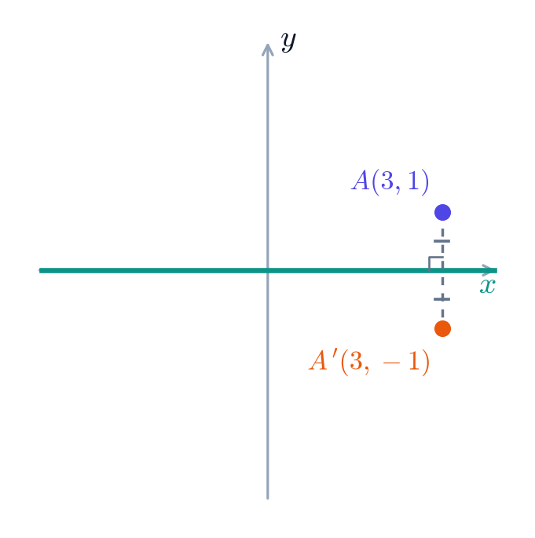{fig-alt="ציר x בירוק הוא המראה. הנקודה הכחולה (3,1) משתקפת אל (3,-1) בכתום. הנקודות נמצאות זו מעל זו ובמרחק שווה מהציר." width="100%"}
:::

::: {.reflection-panel}
**שיקוף ביחס לציר $y$**

מחליפים את הסימן של $x$; ה-$y$ נשאר כפי שהיה:
$$ (a,b) \longmapsto (-a,b) $$

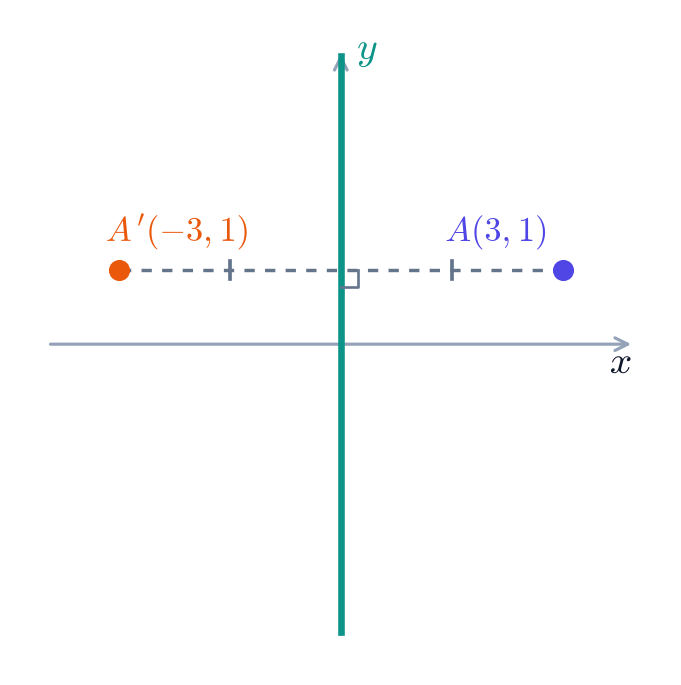{fig-alt="ציר y בירוק הוא המראה. הנקודה הכחולה (3,1) משתקפת אל (-3,1) בכתום. הנקודות נמצאות באותו גובה ובמרחק שווה מהציר." width="100%"}
:::

::: {.reflection-panel}
**שיקוף ביחס לישר $y=x$**

מחליפים בין שני השיעורים:
$$ (a,b) \longmapsto (b,a) $$

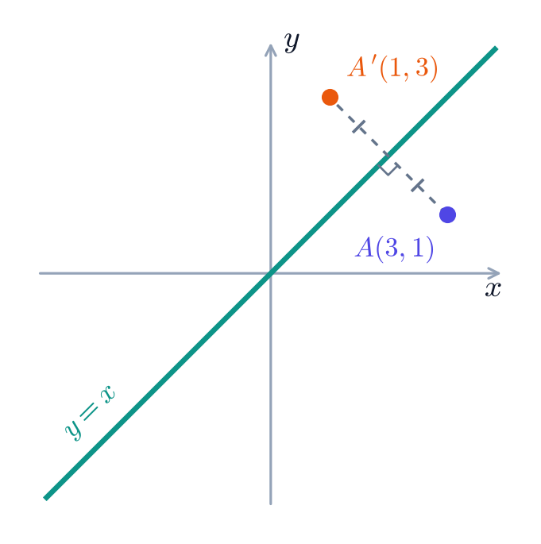{fig-alt="הישר האלכסוני y=x בירוק הוא המראה. הנקודה הכחולה (3,1) משתקפת אל (1,3) בכתום. הקטע ביניהן מאונך לישר, והישר חוצה אותו לשני חלקים שווים." width="100%"}
:::
::::
:::::

:::: {#box-sim-reflection .thmsim title="מַרְאָה, מַרְאָה, שֶׁעַל הַקִּיר: מִי הַיָּפָה בְּכָל הָעִיר?"}
```{=html}
<iframe class="widget-frame" src="widgets/ch01/reflection.html" loading="lazy" title="שיקוף: מזיזים מלכה ומסובבים מראה" data-min-height="0" style="height: 410px"></iframe>
```
::::

:::: {.thmchk title="מול המראה"}
משקפים את הנקודה $(-2,4)$ ביחס לישר $.y=x$ איזו נקודה מתקבלת?

::: {.quiz options="$(4,-2)$|$(2,4)$|$(-2,-4)$" answer="$(4,-2)$"}
מחליפים בין שני השיעורים: $.(-2,4)\longmapsto(4,-2)$
:::

משקפים את הנקודה $(0,3)$ ביחס לציר $.y$ האם היא זזה?

::: {.quiz options="לא, היא נשארת במקומה|כן, היא עוברת לצד השני" answer="לא, היא נשארת במקומה"}
הנקודה נמצאת על ציר $y$ עצמו, ולכן נשארת במקומה. גם הכלל נותן $.(0,3)\longmapsto(-0,3)=(0,3)$
:::
::::

גרף הוא **סימטרי ביחס לישר** אם השיקוף ביחס לישר הזה מחזיר את אותו הגרף.
בפונקציה זוגית או אי-זוגית, הסימטריה חוסכת עבודה: אפשר לצייר את החצי הימני של הגרף, $,x \ge 0$ ולהשלים ממנו את החצי השמאלי.

::: {#box-def-even-odd .thmdef title="פונקציה זוגית ואי-זוגית"}
תהי $f$ פונקציה שתחום ההגדרה שלה **סימטרי סביב $0$** (כלומר, אם $x$ בתחום, גם $-x$ בתחום).

- $f$ נקראת [**זוגית**]{.term} אם $f(-x) = f(x)$ לכל $x$ בתחום.
- $f$ נקראת [**אי-זוגית**]{.term} אם $f(-x) = -f(x)$ לכל $x$ בתחום.
:::

::: {.thmkey icon="idea" title="מה רואים בגרף"}
- הגרף של פונקציה **זוגית** סימטרי ביחס לציר $y$: הצד השמאלי הוא שיקוף ראי של הצד הימני.
- הגרף של פונקציה **אי-זוגית** סימטרי ביחס לראשית: חצי סיבוב סביב הראשית מחזיר אותו לעצמו.
:::

::: {.content-visible when-format="html"}
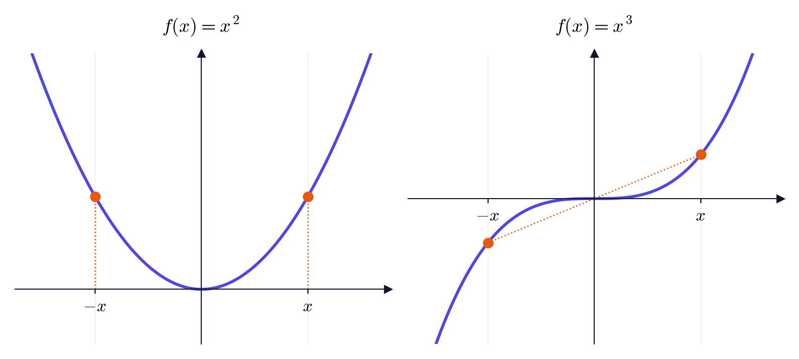{fig-alt="פרבולה עם שתי נקודות בגובה שווה, ופונקציה מעוקבת עם שתי נקודות סימטריות ביחס לראשית" width="80%" fig-align="center"}
:::

::: {.content-visible when-format="pdf"}
```{=latex}
\par\medskip
\noindent\beginL\hbox to \linewidth{\hss\includegraphics[width=0.8\linewidth]{figures/even-odd.png}\hss}\endL\par
\medskip
```
:::

::: {.thmkey icon="calc" title="בדיקת זוגיות"}
1. בודקים שתחום ההגדרה סימטרי סביב $.0$
2. מחשבים את $f(-x)$: מציבים $-x$ בכל מקום שבו מופיע $,x$ ומפשטים.
3. אם התקבל $,f(x)$ הפונקציה זוגית. אם התקבל $,-f(x)$ היא אי-זוגית.
4. אחרת, כדי להראות שהיא **לא** זוגית ולא אי-זוגית, מספיק למצוא מספר אחד $x$ שבו שני השוויונות נכשלים.
:::

:::: {#box-exm-even-odd .thmexm title="זוגית, אי-זוגית או אף אחת מהן?"}
סווגו כל פונקציה. אחרי שתבחרו, יופיע החישוב.

**(א)** $f(x) = x^4 - 2x^2$

::: {.quiz options="זוגית|אי-זוגית|אף אחת מהן" answer="זוגית"}
התחום הוא $,\mathbb{R}$ והוא סימטרי. נציב $:-x$ $$\begin{aligned} f(-x) &= (-x)^4 - 2(-x)^2 \\ &= x^4 - 2x^2 \\ &= f(x) \end{aligned}$$ (חזקה זוגית "מוחקת" את המינוס: $(-x)^4 = x^4$ ו-$.(-x)^2 = x^2$) לכן $f$ זוגית. מאותה סיבה גם $x^2$ זוגית, ו-$|x|$ זוגית כי $.|{-}x| = |x|$
:::

**(ב)** $f(x) = x^3 - 4x$

::: {.quiz options="זוגית|אי-זוגית|אף אחת מהן" answer="אי-זוגית"}
נציב $:-x$ $$\begin{aligned} f(-x) &= (-x)^3 - 4(-x) \\ &= -x^3 + 4x \\ &= -(x^3 - 4x) \\ &= -f(x) \end{aligned}$$ (חזקה אי-זוגית "שומרת" את המינוס: $.(-x)^3 = -x^3$) לכן $f$ אי-זוגית.
:::

**(ג)** $f(x) = x^2 + x$

::: {.quiz options="זוגית|אי-זוגית|אף אחת מהן" answer="אף אחת מהן"}
נציב $,-x$ ונקבל $,f(-x) = x^2 - x$ שאינו $f(x)$ ואינו $.{-}f(x)$ כדי להראות זאת בוודאות, נבחר מספר, $:x = 1$ $$f(1) = 1 + 1 = 2, \qquad f(-1) = 1 - 1 = 0$$ מתקיים $,f(-1) \neq f(1)$ ולכן $f$ אינה זוגית. מתקיים גם $,f(-1) \neq -f(1) = -2$ ולכן $f$ אינה אי-זוגית.
:::
::::

::: {.thmwarn title="למה דורשים תחום סימטרי"}
- נגדיר $f(x) = x^2$ רק על הקטע $.[-1, 3]$ הנוסחה זהה, אבל הפונקציה **אינה** זוגית: $,f(3) = 9$ ו-$f(-3)$ כלל אינו מוגדר, כי $-3$ אינו בתחום. בלי תחום סימטרי אין עם מה להשוות.
- רוב הפונקציות אינן זוגיות ואינן אי-זוגיות. "לא זוגית" אינו אומר "אי-זוגית".
:::

:::: {#box-q-parity-operations .thmchk title="מה קורה לזוגיות כשבונים פונקציה חדשה?"}
נניח ש-$f$ ו-$g$ מוגדרות על כל $.\mathbb{R}$ איזו סימטריה מובטחת בכל משבצת: זוגית, אי-זוגית, או שלא ניתן לקבוע? נסו קודם עם $x^2$ ו-$x^3$, ואז בדקו מה קורה כשמציבים $-x$ במקום $.x$

| $f$ | $g$ | $f\pm g$ | $fg$ | $f\circ g$ |
|---|---|---|---|---|
| זוגית | זוגית | ? | ? | ? |
| זוגית | אי-זוגית | ? | ? | ? |
| אי-זוגית | זוגית | ? | ? | ? |
| אי-זוגית | אי-זוגית | ? | ? | ? |

::: {.lecture-answer title="בדיקה והסבר"}
| $f$ | $g$ | $f\pm g$ | $fg$ | $f\circ g$ |
|---|---|---|---|---|
| זוגית | זוגית | זוגית | זוגית | זוגית |
| זוגית | אי-זוגית | לא ניתן לקבוע | אי-זוגית | זוגית |
| אי-זוגית | זוגית | לא ניתן לקבוע | אי-זוגית | זוגית |
| אי-זוגית | אי-זוגית | אי-זוגית | זוגית | אי-זוגית |

במכפלה, שני מינוסים מבטלים זה את זה. בהרכבה מחשבים קודם את $g(-x)$, ואז מפעילים את $.f$ למשל, אם שתיהן אי-זוגיות, אז $.f(g(-x))=f(-g(x))=-f(g(x))$

למנה $f/g$ אותם כללי זוגיות כמו למכפלה, בתחום שבו $.g(x)\ne0$ בסכום מעורב אין כלל קבוע: $x^2+x$ אינה זוגית ואינה אי-זוגית. לעומת זאת, פונקציית האפס היא גם זוגית וגם אי-זוגית, וחיבורה אינו משנה את הפונקציה האחרת.
:::
::::

::: {.thmsummary}
- זוגית: $,f(-x) = f(x)$ והגרף סימטרי ביחס לציר $.y$ אי-זוגית: $,f(-x) = -f(x)$ והגרף סימטרי ביחס לראשית.
- בודקים על ידי הצבה של $-x$ ופישוט. כדי לשלול, מספיקה דוגמה מספרית אחת.
- רוב הפונקציות אינן זוגיות ואינן אי-זוגיות.
:::

### תרגילים {.unnumbered}

::::: {#box-q-f-minus-x .thmqst title="מציבים $-x$"}
חשבו את $f(-x)$ ופשטו.

:::: fill
**(א)** עבור $f(x) = x^3 + 2x$: $f(-x) =$ [$-x^3 - 2x$]{.blank ans="-x^3-2x"}

**(ב)** עבור $f(x) = x^4 - 3x^2 + 1$: $f(-x) =$ [$x^4 - 3x^2 + 1$]{.blank ans="x^4-3x^2+1"}

**(ג)** עבור $f(x) = x^2 + x$: $f(-x) =$ [$x^2 - x$]{.blank ans="x^2-x"}

::: hint
חזקה זוגית "מוחקת" את המינוס, וחזקה אי-זוגית "שומרת" אותו: $(-x)^4 = x^4$ ו-$.(-x)^3 = -x^3$
:::
::: explain
**(א)** $,f(-x) = (-x)^3 + 2(-x) = -x^3 - 2x = -f(x)$ ולכן $f$ **אי-זוגית**.

**(ב)** $,f(-x) = (-x)^4 - 3(-x)^2 + 1 = x^4 - 3x^2 + 1 = f(x)$ ולכן $f$ **זוגית**.

**(ג)** $f(-x) = x^2 - x$ אינו $f(x)$ ואינו $,-f(x)$ ולכן $f$ אינה זוגית ואינה אי-זוגית.
:::
::::
:::::

::::: {#box-q-even-odd .thmqst title="סווגו"}
**(א)** $x^5 + x$

::: {.quiz options="זוגית|אי-זוגית|אף אחת מהן" answer="אי-זוגית"}
$$\begin{aligned} f(-x) &= (-x)^5 + (-x) \\ &= -x^5 - x \\ &= -(x^5 + x) = -f(x) \end{aligned}$$
:::

**(ב)** $x^2 - 7$

::: {.quiz options="זוגית|אי-זוגית|אף אחת מהן" answer="זוגית"}
$$\begin{aligned} f(-x) &= (-x)^2 - 7 \\ &= x^2 - 7 = f(x) \end{aligned}$$
:::

**(ג)** $x - 1$

::: {.quiz options="זוגית|אי-זוגית|אף אחת מהן" answer="אף אחת מהן"}
נבחר $:x = 1$ $$f(1) = 1 - 1 = 0, \qquad f(-1) = -1 - 1 = -2$$ מתקיים $f(-1) \neq f(1)$ ולכן אינה זוגית, וגם $f(-1) = -2 \neq 0 = -f(1)$ ולכן אינה אי-זוגית.
:::

**(ד)** $\frac{1}{x}$

::: {.quiz options="זוגית|אי-זוגית|אף אחת מהן" answer="אי-זוגית"}
התחום $\mathbb{R} \setminus \{0\}$ סימטרי, ו-$.\frac{1}{-x} = -\frac{1}{x}$
:::

**(ה)** $|x| + x^2$

::: {.quiz options="זוגית|אי-זוגית|אף אחת מהן" answer="זוגית"}
$,|{-}x| = |x|$ ו-$,(-x)^2 = x^2$ ולכן $.f(-x) = f(x)$
:::

**(ו)** $\frac{x}{x^2 + 1}$

::: {.quiz options="זוגית|אי-זוגית|אף אחת מהן" answer="אי-זוגית"}
המונה מחליף סימן והמכנה לא: $.f(-x) = \frac{-x}{x^2 + 1} = -f(x)$
:::
:::::

::::: {#box-q-symmetry-values .thmqst title="משתמשים בסימטריה"}
:::: fill
**(א)** $f$ זוגית ו-$.f(2) = 5$ אז $f(-2) =$ [$5$]{.blank ans="5"}

**(ב)** $g$ אי-זוגית ו-$.g(3) = -4$ אז $g(-3) =$ [$4$]{.blank ans="4"}

**(ג)** $h$ אי-זוגית ומוגדרת ב-$.0$ אז $h(0) =$ [$0$]{.blank ans="0"}

::: hint
ב-(ג): הציבו $x = 0$ בהגדרה $.h(-x) = -h(x)$
:::
::: explain
**(א)** $f$ זוגית, ולכן $:f(-x) = f(x)$ $$\begin{aligned} f(-2) &= f(2) \\ &= 5 \end{aligned}$$

**(ב)** $g$ אי-זוגית, ולכן $:g(-x) = -g(x)$ $$\begin{aligned} g(-3) &= -g(3) \\ &= -(-4) \\ &= 4 \end{aligned}$$

**(ג)** $,h(-0) = -h(0)$ כלומר $.h(0) = -h(0)$ המספר היחיד ששווה למינוס עצמו הוא $,0$ ולכן $.h(0) = 0$ לכן הגרף של פונקציה אי-זוגית שמוגדרת ב-$0$ עובר דרך הראשית.
:::
::::
:::::

## הזזה ומתיחה של גרפים


אנחנו מכירים מעט גרפים בסיסיים: $x^2$, $\sqrt{x}$, $|x|$, ובהמשך גם $\sin x$ ו-$.2^x$ בעזרת הזזות ומתיחות אפשר לקבל מהם הרבה גרפים חדשים, בלי עבודה נוספת.

::: {#box-thm-transformations .thmthm title="הזזה, מתיחה ושיקוף"}
יהי $c > 0$. הגרף של כל אחת מהפונקציות בטבלה מתקבל מהגרף של $y = f(x)$ כך:

| הפונקציה החדשה | מה קורה לגרף |
|:--:|:--|
| $f(x) + c$ | הזזה **למעלה** ב-$c$ |
| $f(x) - c$ | הזזה **למטה** ב-$c$ |
| $f(x - c)$ | הזזה **ימינה** ב-$c$ |
| $f(x + c)$ | הזזה **שמאלה** ב-$c$ |
| $c \, f(x)$ | מתיחה אנכית פי $;c$ אם $c < 1$ זה כיווץ |
| $f(c\,x)$ | כיווץ אופקי פי $;c$ אם $c < 1$ זו מתיחה |
| $-f(x)$ | שיקוף ביחס לציר $x$ |
| $f(-x)$ | שיקוף ביחס לציר $y$ |
:::

::: {.thmwarn title="ההזזה האופקית הפוכה לאינטואיציה"}
הגרף של $f(x - 2)$ זז **ימינה**, למרות סימן המינוס. הסיבה: הפונקציה החדשה מקבלת כל ערך **בנקודה שנמצאת $2$ יחידות ימינה יותר**. למשל, $\sqrt{x}$ מתחילה ב-$,x = 0$ ואילו $\sqrt{x - 2}$ מתחילה רק ב-$,x = 2$ כי שם $.x - 2 = 0$ באותו אופן, הגרף של $f(2x)$ **מתכווץ**: הפונקציה החדשה מקבלת כל ערך בנקודה שקרובה פי $2$ ל-$.0$
:::

את הכללים האלה הכי קל להרגיש בידיים. בסימולציה הבאה בוחרים גרף בסיסי ומזיזים את הפרמטרים.

:::::: {#box-sim-transformations .thmsim title="מעבדת ההזזות"}
::: {.content-visible when-format="html"}
```{=html}
<iframe class="widget-frame" src="widgets/ch01/transformations.html" loading="lazy" title="מעבדת ההזזות"></iframe>
```
:::

::: {.content-visible when-format="pdf"}
```{=latex}
\par\medskip
\noindent\beginL\hbox to \linewidth{\hss\includegraphics[width=0.7\linewidth]{figures/transformations-lab.png}\hss}\endL\par
\medskip
```

*הסימולציה האינטראקטיבית זמינה בגרסה המקוונת.*
:::

הסימולציה מציירת את $y = a \, f\big(b(x - c)\big) + d$ (בקו מלא) לצד הגרף הבסיסי $y = f(x)$ (בקו מקווקו). נסו:

- להזיז רק את $c$: לאיזה כיוון זז הגרף כאשר $c = 2$?
- לשנות את $a$ למספר $-1$: מה קורה?
- לשנות את $b$ ל-$2$: הגרף נמתח או מתכווץ?
::::::

::: {#box-exm-sqrt-family .thmexm title="משפחת השורש"}
נצא מ-$.y = \sqrt{x}$ איך מתקבל ממנו הגרף של כל אחת מהפונקציות הבאות? $$\sqrt{x + 1}, \quad \sqrt{x} + 1, \quad 3\sqrt{x}, \quad -\sqrt{x}, \quad \sqrt{-x}, \quad \sqrt{x - 2}$$

:::: {.lecture-answer title="הצגת התשובות"}
- $\sqrt{x + 1}$: הזזה שמאלה ב-$1$. היא מתחילה ב-$.x = -1$
- $\sqrt{x} + 1$: הזזה למעלה ב-$1$.
- $3\sqrt{x}$: מתיחה אנכית פי $3$.
- $-\sqrt{x}$: שיקוף ביחס לציר $x$.
- $\sqrt{-x}$: שיקוף ביחס לציר $y$. היא מוגדרת עבור $.x \le 0$
- $\sqrt{x - 2}$: הזזה ימינה ב-$2$.

::::: {.content-visible when-format="html"}
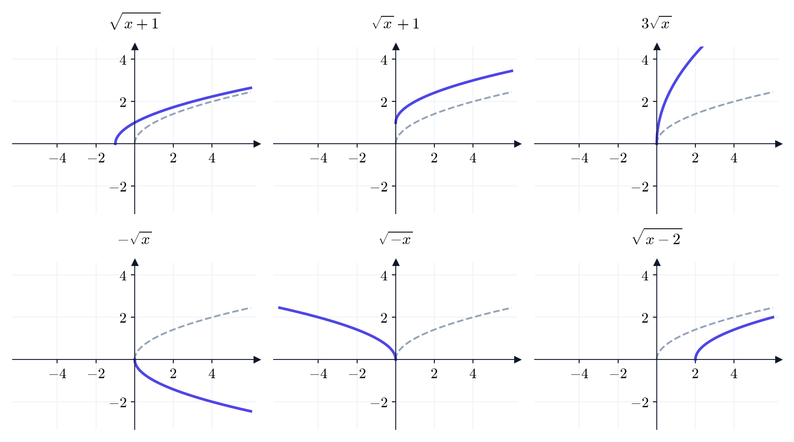{fig-alt="שש מערכות צירים, ובכל אחת גרף השורש המקורי מקווקו והגרף החדש בקו מלא" width="95%" fig-align="center"}
:::::

::::: {.content-visible when-format="pdf"}
```{=latex}
\par\medskip
\noindent\beginL\hbox to \linewidth{\hss\includegraphics[width=0.95\linewidth]{figures/sqrt-family.png}\hss}\endL\par
\medskip
```
:::::
::::
:::

:::: {.thmchk}
לאיזה כיוון זז הגרף של $(x + 5)^2$ ביחס לגרף של $?x^2$

::: {.quiz options="ימינה ב-$5$|שמאלה ב-$5$" answer="שמאלה ב-$5$"}
בתוך הסוגריים יש $,x + 5$ כלומר $f(x + 5)$ עם $,f(x) = x^2$ ולכן הזזה **שמאלה**. בדיקה: הקודקוד, שבו מה שבתוך הסוגריים מתאפס, נמצא ב-$.x = -5$
:::
::::

::: {.thmkey icon="calc" title="ציור גרף בעזרת הזזות"}
1. מזהים את הגרף הבסיסי.
2. רושמים את השינויים: קודם את השינויים **בתוך** הסוגריים (אופקיים), ואחר כך את אלה **מחוץ** להם (אנכיים).
3. מזיזים כמה נקודות מפתח: נקודות חיתוך עם הצירים, קודקוד, אסימפטוטה. מציירים את הגרף דרכן.
:::

::: {#box-exm-complete-square .thmexm title="השלמה לריבוע"}
ציירו את $.f(x) = x^2 - 4x + 7$ איפה הקודקוד, ומהי התמונה?

::::: fill
::: eqline
$x^2 - 4x + 7 = (x -{}$ [$2$]{.blank ans="2"} $)^2 +{}$ [$3$]{.blank ans="3"}
:::

הזיזו את הפרבולה $y = x^2$ עד שתקבלו את הגרף של $:f$

```{=html}
<iframe class="widget-frame" src="widgets/ch01/move-graph.html?f=sq&c=2&d=3" loading="lazy" title="מזיזים את הפרבולה"></iframe>
```

הקודקוד הוא $($[$2$]{.blank ans="2"}$,{}$ [$3$]{.blank ans="3"}$)$

התמונה היא [$[3, \infty)$]{.blank ans="[3,inf)"}

::: hint
נסו לכתוב את הפונקציה בצורה $(x - h)^2 + k$ ("השלמה לריבוע"). איזה ריבוע מתחיל ב-$?x^2 - 4x$
:::
::: hint
$.(x - 2)^2 = x^2 - 4x + 4$ כמה חסר כדי להגיע ל-$?7$
:::
::: explain
**משלימים לריבוע.** מכיוון ש-$,(x - 2)^2 = x^2 - 4x + 4$ נקבל $$\begin{aligned} x^2 - 4x + 7 &= (x^2 - 4x + 4) + 3 \\ &= (x - 2)^2 + 3 \end{aligned}$$ **קוראים את השינויים.** הגרף הוא הפרבולה $y = x^2$ אחרי שני שינויים: בתוך הסוגריים $,x - 2$ ולכן הזזה **ימינה** ב-$;2$ מחוץ לסוגריים $,+3$ ולכן הזזה **למעלה** ב-$.3$

**מסקנה.** הקודקוד עובר מ-$(0, 0)$ אל $,(2, 3)$ והתמונה היא $.[3, \infty)$ בדיקה: $,f(2) = 4 - 8 + 7 = 3$ כמו שציפינו.
:::
:::::
:::

::: {.thmsummary}
- שינוי **מחוץ** לסוגריים משפיע על הגרף אנכית, בכיוון הצפוי: הוספת $c$ מזיזה למעלה, כפל ב-$c$ מותח, ומינוס משקף.
- שינוי **בתוך** הסוגריים משפיע אופקית, **הפוך** לאינטואיציה: $f(x - c)$ זז ימינה, ו-$f(cx)$ מתכווץ.
- מציירים על ידי הזזה של כמה נקודות מפתח, כמו הקודקוד.
:::

### תרגילים {.unnumbered}

::::: {#box-q-transform .thmqst title="הקודקוד של $|x + 3| - 1$"}
איך מקבלים את הגרף של $y = |x + 3| - 1$ מהגרף של $?y = |x|$ הזיזו את הגרף עד שיגיע למקום, ומצאו את הקודקוד.

```{=html}
<iframe class="widget-frame" src="widgets/ch01/move-graph.html?f=abs&c=-3&d=-1" loading="lazy" title="מזיזים את הגרף של הערך המוחלט"></iframe>
```

:::: fill
הקודקוד הוא $($[$-3$]{.blank ans="-3"}$,{}$ [$-1$]{.blank ans="-1"}$)$

::: explain
נעבור לפי השיטה:

1. הגרף הבסיסי: $,|x|$ צורת $V$ שקודקודה ב-$.(0, 0)$
2. בתוך הערך המוחלט יש $,x + 3$ כלומר $f(x + 3)$ עם $,f(x) = |x|$ ולכן הזזה **שמאלה** ב-$.3$
3. מחוץ לערך המוחלט יש $,-1$ ולכן הזזה **למטה** ב-$.1$

בדיקה: עבור $x = -3$ מתקבל $.|{-}3 + 3| - 1 = 0 - 1 = -1$
:::
::::
:::::

::::: {#box-q-write-formula .thmqst title="מהתיאור לנוסחה"}
כתבו את הנוסחה של הפונקציה החדשה.

:::: fill
**(א)** מזיזים את $\sqrt{x}$ ימינה ב-$3$ ולמעלה ב-$.1$ $y =$ [$\sqrt{x - 3} + 1$]{.blank ans="sqrt(x-3)+1" w="12"}

**(ב)** משקפים את $x^2$ ביחס לציר $,x$ ואחר כך מזיזים למעלה ב-$.4$ $y =$ [$4 - x^2$]{.blank ans="4-x^2" w="12"}

**(ג)** מותחים את $|x|$ אנכית פי $,2$ ואחר כך מזיזים שמאלה ב-$.1$ $y =$ [$2|x + 1|$]{.blank ans="2|x+1|" w="12"}

**(ד)** מזיזים את $x^2$ שמאלה ב-$5$ ולמטה ב-$.2$ $y =$ [$(x + 5)^2 - 2$]{.blank ans="(x+5)^2-2" w="12"}

::: hint
הזזה ימינה ב-$c$ פירושה להחליף את $x$ ב-$;x - c$ הזזה למעלה פירושה להוסיף $c$ לכל הביטוי.
:::
::: explain
**(א)** הזזה ימינה ב-$3$ מחליפה את $x$ ב-$,x - 3$ והזזה למעלה ב-$1$ מוסיפה $:1$ $$\begin{aligned} \sqrt{x} &\to \sqrt{x - 3} \\ &\to \sqrt{x - 3} + 1 \end{aligned}$$

**(ב)** השיקוף ביחס לציר $x$ הופך את הסימן של כל הביטוי, וההזזה למעלה מוסיפה $:4$ $$\begin{aligned} x^2 &\to -x^2 \\ &\to -x^2 + 4 = 4 - x^2 \end{aligned}$$

**(ג)** המתיחה כופלת את כל הביטוי ב-$,2$ וההזזה שמאלה מחליפה את $x$ ב-$:x + 1$ $$\begin{aligned} |x| &\to 2|x| \\ &\to 2|x + 1| \end{aligned}$$

**(ד)** הזזה שמאלה ב-$5$ מחליפה את $x$ ב-$,x + 5$ והזזה למטה ב-$2$ מחסירה $:2$ $$\begin{aligned} x^2 &\to (x + 5)^2 \\ &\to (x + 5)^2 - 2 \end{aligned}$$
:::
::::
:::::

::::: {#box-q-order-transform .thmqst title="מהפרבולה $x^2$ אל $-2(x + 1)^2 + 3$"}
מקבלים את הגרף של $y = -2(x + 1)^2 + 3$ מהגרף של $y = x^2$ בארבעה צעדים. סדרו אותם לפי השיטה: קודם השינוי שבתוך הסוגריים, ואחר כך אלה שמחוץ להם.

:::: order
::: {.step rank="0"}
הזזה שמאלה ב-$1$
:::
::: {.step rank="1"}
מתיחה אנכית פי $2$
:::
::: {.step rank="1"}
שיקוף ביחס לציר $x$
:::
::: {.step rank="2"}
הזזה למעלה ב-$3$
:::
::: after
את המתיחה ואת השיקוף אפשר לבצע בכל סדר, כי $.{-}2y = 2 \cdot (-y)$ אבל ההזזה למעלה באה אחרי שניהם: אם מזיזים קודם למעלה ב-$3$ ורק אחר כך משקפים, הקודקוד מגיע ל-$(-1, -3)$ במקום ל-$.(-1, 3)$
:::
::::
:::::

::::: {#box-q-complete-square .thmqst title="עוד השלמה לריבוע"}
:::: fill
::: eqline
$x^2 + 6x + 5 = (x +{}$ [$3$]{.blank ans="3"} $)^2 -{}$ [$4$]{.blank ans="4"}
:::

הזיזו את הפרבולה $y = x^2$ למקום:

```{=html}
<iframe class="widget-frame" src="widgets/ch01/move-graph.html?f=sq&c=-3&d=-4" loading="lazy" title="מזיזים את הפרבולה"></iframe>
```

הקודקוד הוא $($[$-3$]{.blank ans="-3"}$,{}$ [$-4$]{.blank ans="-4"}$)$

התמונה היא [$[-4, \infty)$]{.blank ans="[-4,inf)"}

::: hint
$.(x + 3)^2 = x^2 + 6x + 9$ מה צריך להוסיף או להחסיר כדי לקבל $?x^2 + 6x + 5$
:::
::: explain
$$\begin{aligned} x^2 + 6x + 5 &= (x^2 + 6x + 9) - 4 \\ &= (x + 3)^2 - 4 \end{aligned}$$ זו $x^2$ אחרי הזזה **שמאלה** ב-$3$ ו**למטה** ב-$.4$ הקודקוד עובר מ-$(0, 0)$ אל $.(-3, -4)$
:::
::::
:::::

::::: {#box-q-which-way .thmqst title="לאן זז הגרף?"}
**(א)** הגרף של $f(x + 2)$ לעומת הגרף של $:f(x)$

::: {.quiz options="ימינה ב-$2$|שמאלה ב-$2$|למעלה ב-$2$" answer="שמאלה ב-$2$"}
השינוי בתוך הסוגריים פועל הפוך לאינטואיציה: $f(x + 2)$ מקבל כל ערך בנקודה שנמצאת $2$ יחידות **שמאלה**.
:::

**(ב)** הגרף של $f(3x)$ לעומת הגרף של $:f(x)$

::: {.quiz options="נמתח אופקית|מתכווץ אופקית|נמתח אנכית" answer="מתכווץ אופקית"}
$f(3x)$ מקבל כל ערך בנקודה שקרובה פי $3$ ל-$,0$ ולכן הגרף מתכווץ אופקית פי $.3$
:::

**(ג)** הקודקוד של $y = (x - 4)^2 + 1$ הוא:

::: {.quiz options="$(4, 1)$|$(-4, 1)$|$(4, -1)$" answer="$(4, 1)$"}
הזזה ימינה ב-$4$ ולמעלה ב-$,1$ ולכן הקודקוד עובר מ-$(0, 0)$ אל $.(4, 1)$
:::
:::::

## פולינומים ושורשיהם


הפונקציות הפשוטות ביותר הן אלה שמשתמשות רק בחיבור ובכפל. הן מוגדרות בכל מקום, וקל לחשב אותן.

::: {#box-def-polynomial .thmdef title="פולינום"}
[**פולינום**]{.term} הוא פונקציה מהצורה $$,P(x) = a_n x^n + a_{n-1} x^{n-1} + \dots + a_1 x + a_0$$ כאשר $a_0, \dots, a_n$ מספרים ממשיים ([**המקדמים**]{.term}) ו-$.a_n \neq 0$ המספר $n$ נקרא [**המעלה**]{.term} של $.P$ [**שורש**]{.term} של $P$ הוא מספר $r$ שעבורו $.P(r) = 0$
:::

הדרישה $a_n \neq 0$ קובעת את המעלה: בלעדיה, $0 \cdot x^3 + x + 1$ היה "פולינום ממעלה $3$", אף שזו פשוט הפונקציה $.x + 1$ פולינום ממעלה $1$ הוא ישר, וממעלה $2$ הוא פרבולה. בגרף, השורשים הם הנקודות שבהן הגרף חותך את ציר $x$ או נוגע בו.

::: {#box-thm-roots .thmthm title="שורשים של פולינומים"}
(א) $r$ הוא שורש של $P$ אם ורק אם אפשר לכתוב $,P(x) = (x - r) \, Q(x)$ כאשר $Q$ פולינום ממעלה אחת פחות.

(ב) לפולינום ממעלה $n$ יש **לכל היותר** $n$ שורשים ממשיים.

(ג) [**נוסחת השורשים**]{.term}: לפולינום $ax^2 + bx + c$ (עם $a \neq 0$) נסמן $\Delta = b^2 - 4ac$ (**הדיסקרימיננטה**). אם $,\Delta < 0$ אין שורשים ממשיים. אם $,\Delta \ge 0$ השורשים הם $$,x = \frac{-b \pm \sqrt{\Delta}}{2a}$$ ויש שני שורשים אם $\Delta > 0$ ושורש אחד אם $.\Delta = 0$
:::

::: {.thmwarn title="לכל היותר, לא בדיוק"}
לפולינום ממעלה $n$ יכולים להיות **פחות** מ-$n$ שורשים. למשל ל-$x^2 + 4$ אין שורשים ממשיים כלל: $x^2 + 4 \ge 4 > 0$ לכל $.x$
:::

::: {.thmkey icon="calc" title="מציאת שורשים"}
1. מוציאים גורם משותף, למשל $.x^3 - 9x = x(x^2 - 9)$
2. מזהים נוסחאות כפל מקוצר: $a^2 - b^2 = (a - b)(a + b)$ ו-$.a^2 \pm 2ab + b^2 = (a \pm b)^2$
3. לפולינום ממעלה $2$ משתמשים בנוסחת השורשים.
4. לפולינום ממעלה $3$ מנחשים שורש שלם $r$ מבין המחלקים של $a_0$ (כולל השליליים). לפי (א), $,P(x) = (x - r)Q(x)$ כאשר $Q$ ממעלה $,2$ ואת $Q$ מוצאים בחילוק של $P$ ב-$x - r$ (או בניחוש, ובדיקה בכפל). לבסוף מוצאים את השורשים של $.Q$
:::

::: {#box-exm-poly-roots .thmexm title="מציאת שורשים"}
מצאו את השורשים. כתבו את התשובה כרשימה.

**(א)** $x^2 - x - 6$

:::: fill
$\Delta =$ [$25$]{.blank ans="25"} והשורשים: [$\{-2, 3\}$]{.blank ans="{3,-2}"}

::: explain
נשתמש בנוסחת השורשים עם $,a = 1$ $b = -1$ ו-$:c = -6$ $$\begin{aligned} \Delta &= b^2 - 4ac \\ &= (-1)^2 - 4 \cdot 1 \cdot (-6) \\ &= 1 + 24 = 25 \\ x &= \frac{-b \pm \sqrt{\Delta}}{2a} = \frac{1 \pm 5}{2} \end{aligned}$$ כלומר $x = \frac{6}{2} = 3$ או $.x = \frac{-4}{2} = -2$ לפי (א) במשפט, $.x^2 - x - 6 = (x - 3)(x + 2)$
:::
::::

**(ב)** $x^3 - 9x$

פותרים את המשוואה $.x^3 - 9x = 0$

::::: {.derive start="x^3-9x=0"}
::: {.step line="x([x^2-9])=0"}
מוציאים גורם משותף $.x$
:::
::: {.step line="x(x-[3])(x+[3])=0"}
הפרש ריבועים: $.a^2 - b^2 = (a - b)(a + b)$
:::
::: {.step line="x=0 או x=[3] או x=[-3]"}
מכפלה שווה $0$ כשאחד הגורמים שווה $.0$
:::
::: hint
נוציא גורם משותף $,x$ ואחר כך נשתמש ב-$.a^2 - b^2 = (a - b)(a + b)$
:::
::: hint
מכפלה מתאפסת כאשר אחד הגורמים מתאפס.
:::
:::::

:::: fill
השורשים: [$\{-3, 0, 3\}$]{.blank ans="{0,3,-3}"}

::: explain
מכפלה מתאפסת כאשר אחד הגורמים מתאפס, ולכן השורשים הם $0$, $3$ ו-$.{-}3$
:::
::::

**(ג)** $x^2 + 4$

:::: fill
השורשים: [$\emptyset$]{.blank ans="{}"}

::: explain
כאן $:\Delta = 0^2 - 4 \cdot 1 \cdot 4 = -16 < 0$ אין שורשים ממשיים.
:::
::::

**(ד)** $x^2 + 6x + 9$

:::: fill
השורשים: [$\{-3\}$]{.blank ans="{-3}"}

::: explain
זו נוסחת הכפל המקוצר $:(a + b)^2 = a^2 + 2ab + b^2$ $$\begin{aligned} x^2 + 6x + 9 &= x^2 + 2 \cdot 3 \cdot x + 3^2 \\ &= (x + 3)^2 \end{aligned}$$ יש שורש יחיד, $,-3$ ושם הגרף **נוגע** בציר $x$ בלי לחצות אותו. (שורש כזה נקרא **שורש כפול**.) גם הדיסקרימיננטה מראה זאת: $.\Delta = 36 - 36 = 0$
:::
::::

**(ה)** $x^3 - 2x^2 - x + 2$

::::: {.solve}
::: hint
זה פולינום ממעלה $.3$ לפי השיטה, מנחשים שורש שלם בין המחלקים של $,a_0 = 2$ כלומר $.\pm 1, \pm 2$
:::
::: step
**מנחשים שורש.** ננסה את $:x = 1$ $$1^3 - 2 \cdot 1^2 - 1 + 2 = 1 - 2 - 1 + 2 = 0$$ לכן $1$ שורש.
:::
::: step
**מוציאים גורם.** לפי (א) במשפט אפשר להוציא את הגורם $.(x - 1)$ אפשר לבדוק בכפל ש-$$.x^3 - 2x^2 - x + 2 = (x - 1)(x^2 - x - 2)$$
:::
::: step
**מפרקים את הריבועי.** את $x^2 - x - 2$ מפרקים כמו ב-(א): $.x^2 - x - 2 = (x - 2)(x + 1)$ לכן $$x^3 - 2x^2 - x + 2 = (x - 1)(x - 2)(x + 1)$$ והשורשים הם $1$, $2$ ו-$.{-}1$
:::
:::::

:::: fill
השורשים: [$\{-1, 1, 2\}$]{.blank ans="{1,2,-1}"}
::::
:::

::: {.content-visible when-format="html"}
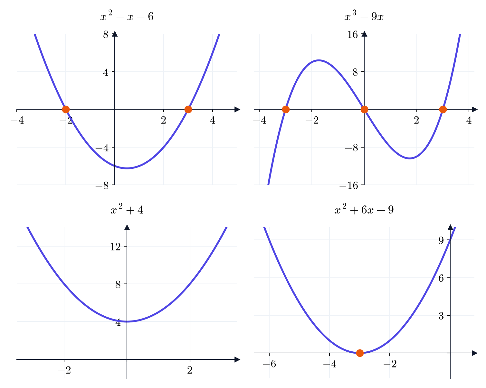{fig-alt="ארבעה גרפים: פרבולה עם שני שורשים, פולינום ממעלה שלוש עם שלושה שורשים, פרבולה בלי שורשים ופרבולה שנוגעת בציר" width="80%" fig-align="center"}
:::

::: {.content-visible when-format="pdf"}
```{=latex}
\par\medskip
\noindent\beginL\hbox to \linewidth{\hss\includegraphics[width=0.8\linewidth]{figures/polynomials.png}\hss}\endL\par
\medskip
```
:::

:::: {.thmchk}
כמה שורשים ממשיים יש ל-$?x^2 + 2x + 5$

::: {.quiz options="$0$|$1$|$2$" answer="$0$"}
$,\Delta = 2^2 - 4 \cdot 1 \cdot 5 = 4 - 20 = -16$ ו-$,\Delta < 0$ ולכן אין שורשים ממשיים.
:::
::::

::: {.thmsummary}
- פולינום בנוי מחזקות של $x$ עם מקדמים. המעלה היא החזקה הגבוהה ביותר, ושורש הוא מקום שבו הפולינום מתאפס.
- $r$ שורש בדיוק כאשר $(x - r)$ גורם של הפולינום. לפולינום ממעלה $n$ יש לכל היותר $n$ שורשים.
- ריבועי: נוסחת השורשים, והדיסקרימיננטה $\Delta$ קובעת כמה שורשים יש. מעוקב: מנחשים שורש שלם בין המחלקים של $.a_0$
:::

### תרגילים {.unnumbered}

::::: {#box-q-poly-basics .thmqst title="מעלה, מקדם, ערך"}
יהי $.P(x) = 4x^3 - x + 7$

:::: fill
המעלה של $P$ היא [$3$]{.blank ans="3"}, המקדם $a_0 =$ [$7$]{.blank ans="7"}, ו-$P(-1) =$ [$4$]{.blank ans="4"}

::: explain
החזקה הגבוהה ביותר היא $,x^3$ ו-$a_0$ הוא המקדם בלי $,x$ כלומר $.7$ הצבה: $.P(-1) = 4 \cdot (-1)^3 - (-1) + 7 = -4 + 1 + 7 = 4$
:::
::::
:::::

::::: {#box-q-roots .thmqst title="מוצאים שורשים"}
מצאו את קבוצת השורשים: פתרו את המשוואה $P(x) = 0$ צעד אחר צעד. קודם מוציאים גורם משותף ומחפשים כפל מקוצר; אם לא הולך, נוסחת השורשים. כתבו את התשובה כרשימה.

**(א)** $3x^2 - 12$

:::: {.derive start="3x^2-12=0"}
::: {.step line="3x^2=[12]"}
מוסיפים $.12$
:::
::: {.step line="x^2=[4]"}
מחלקים ב-$.3$
:::
::: {.step line="x=[2] או x=[-2]"}
מוציאים שורש: יש שתי אפשרויות. (אפשר גם לפרק: $.3x^2 - 12 = 3(x - 2)(x + 2)$)
:::
::::

:::: fill
השורשים: [$\{-2, 2\}$]{.blank ans="{2,-2}"}
::::

**(ב)** $x^3 - x^2$

:::: {.derive start="x^3-x^2=0"}
::: {.step line="x^2(x-[1])=0"}
מוציאים גורם משותף $.x^2$
:::
::: {.step line="x=[0] או x=[1]"}
מכפלה שווה $0$ כשאחד הגורמים שווה $.0$ השורש $0$ הוא שורש כפול, כי הגורם $x$ מופיע פעמיים.
:::
::::

:::: fill
השורשים: [$\{0, 1\}$]{.blank ans="{0,1}"}
::::

**(ג)** $x^2 - 5x + 6$

:::: {.derive start="x^2-5x+6=0"}
::: {.step line="(x-[2])(x-[3])=0"}
מפרקים לגורמים.
:::
::: {.step line="x=[2] או x=[3]"}
מכפלה שווה $0$ כשאחד הגורמים שווה $.0$
:::
::: hint
חפשו שני מספרים שסכומם $5$ ומכפלתם $.6$
:::
::::

:::: fill
השורשים: [$\{2, 3\}$]{.blank ans="{2,3}"}
::::

**(ד)** $2x^2 + x - 1$

:::: {.derive start="2x^2+x-1=0"}
::: {.step line="x=(-1+sqrt([9]))/4 או x=(-1-sqrt(9))/4"}
נוסחת השורשים $x = \frac{-b \pm \sqrt{\Delta}}{2a}$ עם $,a = 2$ $b = 1$ ו-$.c = -1$ בתיבה: $.\Delta = b^2 - 4ac$
:::
::: {.step line="x=[1/2] או x=[-1]"}
מחשבים את שני הפתרונות.
:::
::: hint
$.\Delta = 1^2 - 4 \cdot 2 \cdot (-1)$
:::
::::

:::: fill
השורשים: [$\left\{-1, \frac{1}{2}\right\}$]{.blank ans="{1/2,-1}"}
::::

**(ה)** $x^2 - 10x + 25$

:::: {.derive start="x^2-10x+25=0"}
::: {.step line="(x-[5])^2=0"}
כפל מקוצר: $.(a - b)^2 = a^2 - 2ab + b^2$
:::
::: {.step line="x=[5]"}
ריבוע שווה $0$ רק כשהבסיס שווה $.0$ זה שורש כפול.
:::
::::

:::: fill
השורשים: [$\{5\}$]{.blank ans="{5}"}
::::

**(ו)** $x^2 + x + 1$

:::: fill
השורשים: [$\emptyset$]{.blank ans="{}"}

::: explain
$,\Delta = 1 - 4 = -3 < 0$ ולכן אין שורשים ממשיים, ואין מה לפתור צעד אחר צעד.
:::
::::

**(ז)** $x^3 - 4x$

:::: {.derive start="x^3-4x=0"}
::: {.step line="x(x-[2])(x+[2])=0"}
מוציאים גורם משותף $x$ ומפרקים הפרש ריבועים.
:::
::: {.step line="x=0 או x=[2] או x=[-2]"}
מכפלה שווה $0$ כשאחד הגורמים שווה $.0$
:::
::::

:::: fill
השורשים: [$\{-2, 0, 2\}$]{.blank ans="{0,2,-2}"}
::::
:::::

::::: {#box-q-factor .thmqst title="כתבו כמכפלה"}
פרקו לגורמים. כתבו את התשובה כמכפלה.

:::: fill
**(א)** $x^2 - 9 =$ [$(x - 3)(x + 3)$]{.blank ans="(x-3)(x+3)" form="product" w="14"}

**(ב)** $x^2 - 7x + 12 =$ [$(x - 3)(x - 4)$]{.blank ans="(x-3)(x-4)" form="product" w="14"}

**(ג)** $x^3 - x =$ [$x(x - 1)(x + 1)$]{.blank ans="x(x-1)(x+1)" form="product" w="14"}

::: hint
אם $r$ שורש, $(x - r)$ גורם. מצאו קודם את השורשים.
:::
::: explain
**(א)** הפרש ריבועים, $a^2 - b^2 = (a - b)(a + b)$ עם $a = x$ ו-$:b = 3$ $$\begin{aligned} x^2 - 9 &= x^2 - 3^2 \\ &= (x - 3)(x + 3) \end{aligned}$$

**(ב)** מחפשים שני מספרים שסכומם $7$ ומכפלתם $:12$ אלה $3$ ו-$.4$ בדיקה בכפל: $$\begin{aligned} (x - 3)(x - 4) &= x^2 - 4x - 3x + 12 \\ &= x^2 - 7x + 12 \end{aligned}$$

**(ג)** $$\begin{aligned} x^3 - x &= x(x^2 - 1) \\ &= x(x - 1)(x + 1) \end{aligned}$$ בשורה הראשונה הוצאנו גורם משותף $,x$ ובשנייה פירקנו הפרש ריבועים.
:::
::::
:::::

::::: {#box-q-how-many-roots .thmqst title="כמה שורשים?"}
**(א)** $x^2 - 6x + 9$

::: {.quiz options="$0$|$1$|$2$" answer="$1$"}
$,\Delta = 36 - 36 = 0$ ולכן יש שורש אחד, $x = 3$ (שורש כפול).
:::

**(ב)** $3x^2 + 2x + 1$

::: {.quiz options="$0$|$1$|$2$" answer="$0$"}
$.\Delta = 4 - 12 = -8 < 0$
:::

**(ג)** $x^2 - 2$

::: {.quiz options="$0$|$1$|$2$" answer="$2$"}
$,\Delta = 0 + 8 = 8 > 0$ והשורשים הם $.\pm\sqrt{2}$
:::
:::::

::::: {#box-q-cubic .thmqst title="פולינום ממעלה שלוש"}
מצאו את השורשים של $.x^3 - 3x^2 - x + 3$ פתרו את המשוואה $x^3 - 3x^2 - x + 3 = 0$ צעד אחר צעד.

:::: {.derive start="x^3-3x^2-x+3=0"}
::: {.step line="(x-1)([x^2-2x-3])=0"}
ניחשנו את השורש $,x = 1$ ולכן מוציאים את הגורם $.(x - 1)$
:::
::: {.step line="(x-1)(x-[3])(x+[1])=0"}
מפרקים את הגורם הריבועי.
:::
::: {.step line="x=1 או x=[3] או x=[-1]"}
מכפלה שווה $0$ כשאחד הגורמים שווה $.0$
:::
::: hint
נחשו שורש בין המחלקים של $:3$ $.\pm 1, \pm 3$
:::
::: hint
$,1 - 3 - 1 + 3 = 0$ ולכן $1$ שורש, ואפשר להוציא את הגורם $.(x - 1)$ בדקו בכפל ש-$.x^3 - 3x^2 - x + 3 = (x - 1)(x^2 - 2x - 3)$
:::
::::

:::: fill
השורשים: [$\{-1, 1, 3\}$]{.blank ans="{1,3,-1}"}
::::
:::::

::::: {#box-q-order-cubic .thmqst title="שלבי הפתרון של פולינום ממעלה שלוש"}
סדרו את השלבים למציאת השורשים של $.x^3 + 2x^2 - 5x - 6$

:::: order
::: step
מנסים את המחלקים של $:{-}6$ $.\pm 1, \pm 2, \pm 3, \pm 6$
:::
::: step
מגלים שהמספר $-1$ הוא שורש: $.{-}1 + 2 + 5 - 6 = 0$
:::
::: step
מוציאים את הגורם $,(x + 1)$ ומקבלים $.(x + 1)(x^2 + x - 6)$
:::
::: step
מפרקים את הגורם הריבועי: $.x^2 + x - 6 = (x + 3)(x - 2)$
:::
::: step
רושמים את השורשים: $-1$, $-3$ ו-$.2$
:::
::::
:::::

::::: {#box-q-build-poly .thmqst title="בונים פולינום"}
כתבו פולינום ממעלה $,3$ עם מקדם מוביל $,1$ שהשורשים שלו הם $1$, $2$ ו-$.{-}3$ (כתבו אותו כמכפלה.)

:::: fill
$P(x) =$ [$(x - 1)(x - 2)(x + 3)$]{.blank ans="(x-1)(x-2)(x+3)" form="product" w="18"}

::: explain
לפי (א) במשפט, כל שורש $r$ נותן גורם $.(x - r)$ שלושה גורמים נותנים מעלה $,3$ והמקדם של $x^3$ במכפלה הוא $.1$
:::
::::
:::::

## הפונקציות הטריגונומטריות


הפונקציות הטריגונומטריות צמחו מהניסיון למדוד: לחשב אורכים וזוויות במשולשים, במדידת קרקעות ובאסטרונומיה. כבר בבבל העתיקה מדדו זוויות (משם מגיעה החלוקה של המעגל ל-$360$ מעלות), וביוון העתיקה נבנו טבלאות שקושרות בין זוויות לאורכים במעגל. מאז הן מופיעות בכל מקום שבו יש סיבוב או תנודה. נגדיר את $\sin$ ואת $\cos$ בעזרת מעגל, וכל התכונות שלהן ינבעו מהציור.

### רדיאנים {.unnumbered}

[**מעגל היחידה**]{.term} הוא המעגל שמרכזו בראשית ורדיוסו $1$. היקפו $.2\pi$

::: {#box-def-radian .thmdef title="רדיאן"}
את הזווית מודדים לפי **אורך הקשת** שהיא חותכת על מעגל היחידה. היחידה נקראת [**רדיאן**]{.term}. [**הזווית שווה למרחק שהולכים על המעגל:**]{.key-rule} זווית של $\theta$ רדיאנים היא בדיוק הליכה של מרחק $\theta$ לאורך מעגל היחידה, מהנקודה $(1, 0)$ נגד כיוון השעון.

מכיוון שהיקף המעגל הוא $2\pi$:

- סיבוב שלם הוא $;2\pi$
- חצי סיבוב הוא $;\pi$
- רבע סיבוב (זווית ישרה) הוא $.\frac{\pi}{2}$
:::

::: {.content-visible when-format="html"}
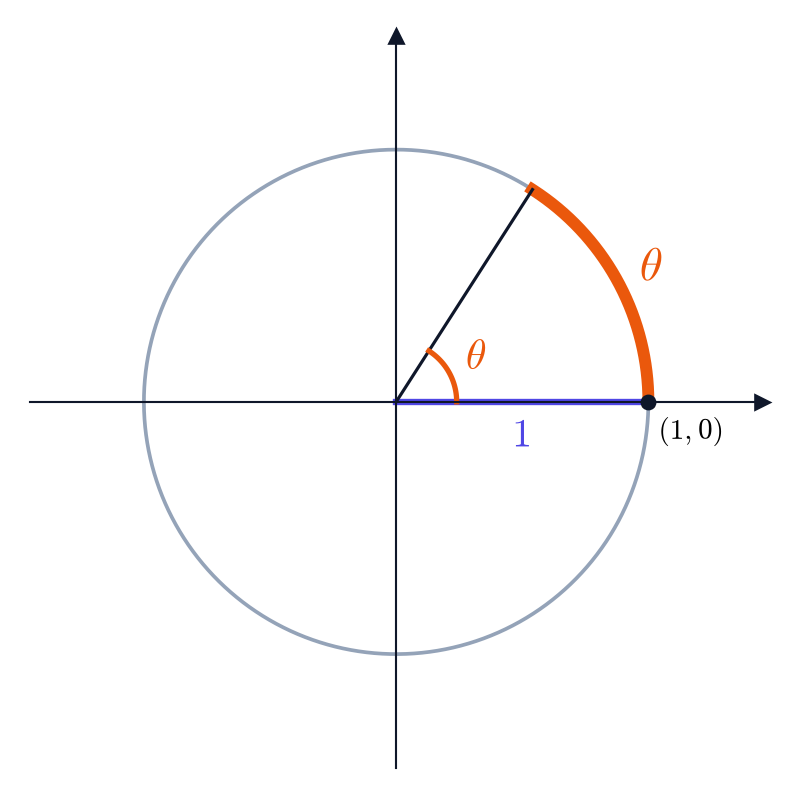{fig-alt="מעגל היחידה עם זווית במרכז וקשת מודגשת, שתיהן מסומנות תטא, ורדיוס באורך אחת" width="50%" fig-align="center"}
:::

::: {.thmkey icon="idea" title="למה רדיאנים"}
ברדיאנים הזווית **היא** אורך, ולכן היא מספר ממשי רגיל, על אותו ישר כמו כל שאר המספרים בקורס. החלוקה ל-$360$ מעלות שרירותית. לאורך כל הקורס זוויות יימדדו ברדיאנים. (רק כדי להתמצא: $\pi$ רדיאנים הם $180$ מעלות.)
:::

:::: {.thmchk}
כמה רדיאנים הם שלושה רבעים של סיבוב?

::: {.quiz options="$\frac{3\pi}{4}$|$\frac{3\pi}{2}$|$3\pi$" answer="$\frac{3\pi}{2}$"}
סיבוב שלם הוא $,2\pi$ ולכן שלושה רבעים ממנו הם $.\frac{3}{4} \cdot 2\pi = \frac{3\pi}{2}$ התשובה $\frac{3\pi}{4}$ היא שלושה רבעים של **חצי** סיבוב.
:::
::::

### ההגדרה הגאומטרית {.unnumbered}

::: {#box-def-sin-cos .thmdef title="סינוס וקוסינוס"}
מתחילים בנקודה $(1, 0)$ והולכים לאורך מעגל היחידה מרחק $\theta$: נגד כיוון השעון אם $,\theta > 0$ ועם כיוון השעון אם $.\theta < 0$ את השיעורים של הנקודה שמגיעים אליה מסמנים $\cos\theta$ ו-$,\sin\theta$ כלומר הנקודה היא $.(\cos\theta, \sin\theta)$

כלומר, [**$\cos\theta$**]{.term} הוא **שיעור ה-$x$** של הנקודה, ו-[**$\sin\theta$**]{.term} הוא **שיעור ה-$y$** שלה.
:::

::: {.content-visible when-format="html"}
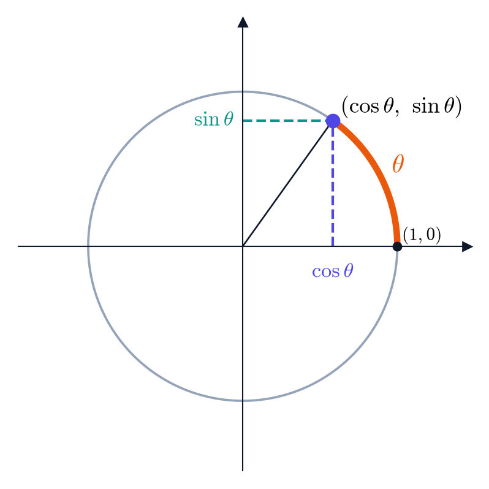{fig-alt="מעגל היחידה, קשת באורך תטא מהנקודה אחת אפס, והנקודה קוסינוס תטא סינוס תטא עם ההיטלים שלה על הצירים" width="50%" fig-align="center"}
:::

::: {.content-visible when-format="pdf"}
```{=latex}
\par\medskip
\noindent\beginL\hbox to \linewidth{\hss\includegraphics[width=0.5\linewidth]{figures/unit-circle.png}\hss}\endL\par
\medskip
```
:::

:::::: {#box-sim-unit-circle .thmsim title="הולכים על מעגל היחידה"}
::: {.content-visible when-format="html"}
```{=html}
<iframe class="widget-frame" src="widgets/ch01/unit-circle.html" loading="lazy" title="הולכים על מעגל היחידה"></iframe>
```
:::

::: {.content-visible when-format="pdf"}
```{=latex}
\par\medskip
\noindent\beginL\hbox to \linewidth{\hss\includegraphics[width=0.95\linewidth]{figures/unit-circle-walk.png}\hss}\endL\par
\medskip
```

*הסימולציה האינטראקטיבית זמינה בגרסה המקוונת.*
:::

הזיזו את $\theta$ (או לחצו על "הליכה"). משמאל: הנקודה $(\cos\theta, \sin\theta)$ על המעגל, הרדיוס אליה והזווית $\theta$ שהוא יוצר עם ציר $.x$ הקו המקווקו היורד מהנקודה אל ציר $x$ נוחת ב-$,\cos\theta$ והקו אל ציר $y$ נוחת ב-$.\sin\theta$ אחרי סיבוב שלם הזווית ממשיכה על אותו מעגל, בצבע אחר. מימין: הגובה של הנקודה, $,\sin\theta$ מסומן מעל $.\theta$

שימו לב: [**הזווית $\theta$ שווה לאורך הקשת שהלכנו על המעגל.**]{.key-rule} לכן "ללכת מרחק $\theta$ על המעגל" ו"לסובב את הרדיוס בזווית $\theta$" הם אותו דבר.

נסו לענות לפני שאתם בודקים:

- איפה הנקודה כאשר $?\theta = \pi$ מה הם $\cos\pi$ ו-$?\sin\pi$
- מה קורה אחרי $?\theta = 2\pi$
- מה הערך הגדול ביותר של $?\sin\theta$
::::::

### מה רואים בציור {.unnumbered}

כל התכונות הבסיסיות של $\sin$ ו-$\cos$ נובעות ישירות מההגדרה, וכל אחת מהן היא ציור על המעגל:

:::: {#box-thm-trig-props .thmthm title="תכונות הסינוס והקוסינוס"}
לכל $\theta$ ממשי:

(א) **סיבוב שלם**: $\sin(\theta + 2\pi) = \sin\theta$ ו-$.\cos(\theta + 2\pi) = \cos\theta$

::: {.lecture-answer title="מאיפה זה בא?"}
הליכה של עוד $2\pi$ היא עוד סיבוב שלם, כי היקף המעגל הוא $.2\pi$ לכן מגיעים בדיוק לאותה נקודה, ולשתי הזוויות יש אותם שיעורים.

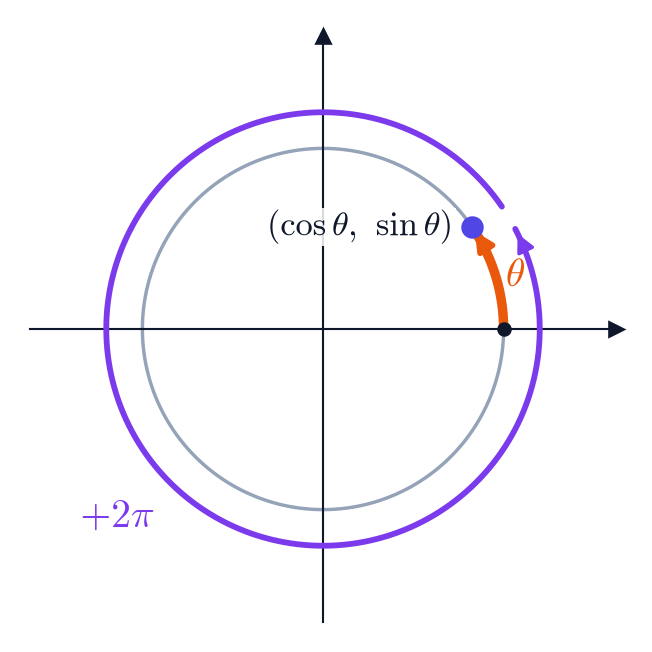{fig-alt="מעגל היחידה, קשת כתומה באורך תטא ולולאה סגולה של סיבוב שלם שחוזרת לאותה נקודה" width="42%" fig-align="center"}
:::

(ב) **חסימות**: $-1 \le \sin\theta \le 1$ ו-$.{-}1 \le \cos\theta \le 1$

::: {.lecture-answer title="מאיפה זה בא?"}
מעגל היחידה כלוא בריבוע שצלעותיו על הישרים $x = \pm 1$ ו-$.y = \pm 1$ לכן לכל נקודה עליו שני השיעורים, $\cos\theta$ ו-$,\sin\theta$ בין $-1$ ל-$.1$

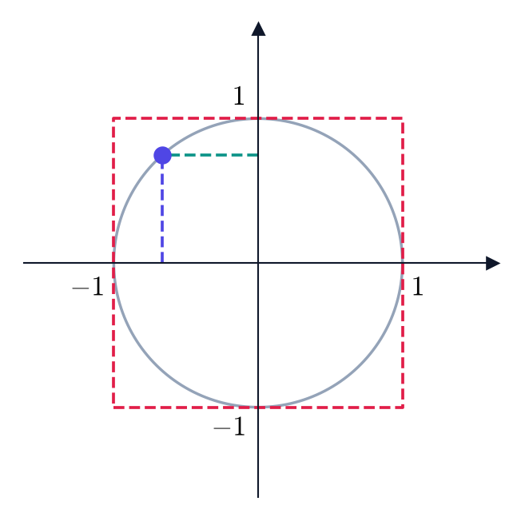{fig-alt="מעגל היחידה בתוך ריבוע מקווקו, ונקודה על המעגל עם ההיטלים שלה על הצירים" width="42%" fig-align="center"}
:::

(ג) **זהות פיתגורס**: $.\sin^2\theta + \cos^2\theta = 1$

::: {.lecture-answer title="מאיפה זה בא?"}
מהנקודה $(\cos\theta, \sin\theta)$ מורידים אנך לציר $.x$ מתקבל משולש ישר-זווית: הניצבים באורך $|\cos\theta|$ ו-$,|\sin\theta|$ והיתר הוא רדיוס, באורך $.1$ לפי משפט פיתגורס $.\cos^2\theta + \sin^2\theta = 1^2 = 1$

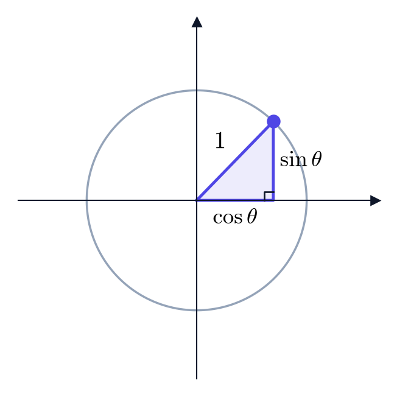{fig-alt="מעגל היחידה ובתוכו משולש ישר-זווית מהראשית אל הנקודה על המעגל, עם ניצבים קוסינוס תטא וסינוס תטא ויתר אחת" width="42%" fig-align="center"}
:::

(ד) **זוגיות**: $\cos(-\theta) = \cos\theta$ ו-$.\sin(-\theta) = -\sin\theta$

::: {.lecture-answer title="מאיפה זה בא?"}
הליכה של $-\theta$ היא אותה הליכה, אבל עם כיוון השעון. מגיעים לנקודה הסימטרית ביחס לציר $:x$ שיעור ה-$x$ נשאר, ושיעור ה-$y$ מחליף סימן.

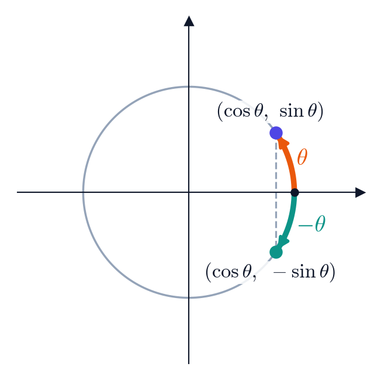{fig-alt="שתי קשתות מהנקודה אחת אפס, אחת למעלה ואחת למטה, והנקודות שבקצותיהן סימטריות ביחס לציר x" width="42%" fig-align="center"}
:::

(ה) **חצי סיבוב**: $\sin(\theta + \pi) = -\sin\theta$ ו-$.\cos(\theta + \pi) = -\cos\theta$

::: {.lecture-answer title="מאיפה זה בא?"}
עוד חצי סיבוב מביא לנקודה הנגדית במעגל, בקצה השני של הקוטר. שני השיעורים שלה מחליפים סימן.

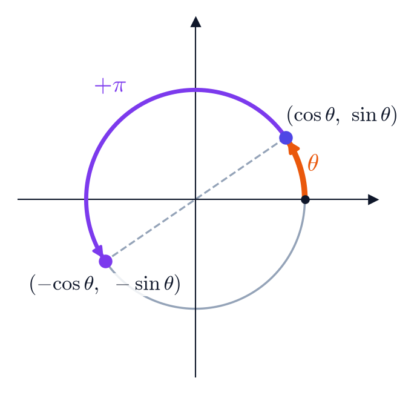{fig-alt="קשת כתומה באורך תטא ואחריה חצי סיבוב סגול, עד הנקודה הנגדית במעגל" width="42%" fig-align="center"}
:::

(ו) **שיקוף ביחס לציר $y$**: $\sin(\pi - \theta) = \sin\theta$ ו-$.\cos(\pi - \theta) = -\cos\theta$

::: {.lecture-answer title="מאיפה זה בא?"}
כדי להגיע ל-$\pi - \theta$ הולכים חצי סיבוב, עד $,(-1, 0)$ וחוזרים $\theta$ אחורה. זו תמונת ראי של ההליכה ל-$\theta$ ביחס לציר $:y$ שיעור ה-$y$ נשאר, ושיעור ה-$x$ מחליף סימן.

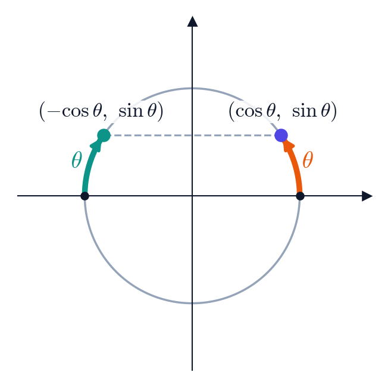{fig-alt="שתי קשתות באורך תטא, אחת מימין ואחת משמאל, והנקודות שבקצותיהן באותו גובה" width="42%" fig-align="center"}
:::

(ז) **זווית משלימה**: $\sin\left(\frac{\pi}{2} - \theta\right) = \cos\theta$ ו-$.\cos\left(\frac{\pi}{2} - \theta\right) = \sin\theta$

::: {.lecture-answer title="מאיפה זה בא?"}
כדי להגיע ל-$\frac{\pi}{2} - \theta$ הולכים רבע סיבוב, עד $,(0, 1)$ וחוזרים $\theta$ אחורה. זו תמונת ראי של ההליכה ל-$\theta$ ביחס לישר $,y = x$ ושיקוף ביחס לישר הזה מחליף בין שני השיעורים.

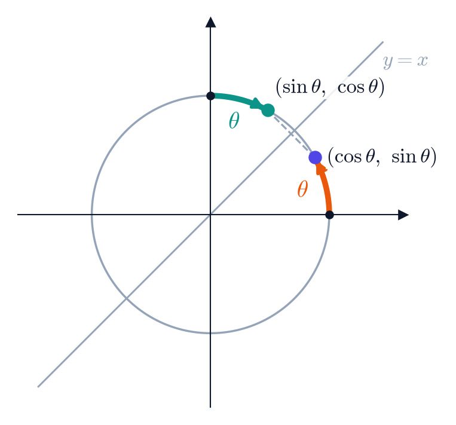{fig-alt="שתי קשתות באורך תטא, מהנקודה אחת אפס ומהנקודה אפס אחת, והנקודות שבקצותיהן סימטריות ביחס לישר y שווה x" width="42%" fig-align="center"}
:::
::::

לתכונה (א) יש שם: [**מחזוריות**]{.term}.

::: {#box-def-periodic .thmdef title="פונקציה מחזורית"}
פונקציה $f$ נקראת **מחזורית** עם [**מחזור**]{.term} $T > 0$ אם $f(x + T) = f(x)$ לכל $.x$ בדרך כלל, "המחזור" הוא ה-$T$ הקטן ביותר שמקיים זאת.
:::

לפי (א), $\sin$ ו-$\cos$ מחזוריות עם מחזור $.2\pi$ ולפי (ד), $\cos$ זוגית ו-$\sin$ אי-זוגית.

::: {#box-exm-frac-part .thmexm title="פונקציה מחזורית בלי טריגונומטריה"}
הפונקציה $f(x) = x - \lfloor x \rfloor$ נקראת "החלק השברי" של $.x$ חשבו את $,f(2.3)$ $f(5.3)$ ו-$.f(-0.7)$ מה אתם מנחשים?

:::: {.lecture-answer}
$$\begin{aligned} f(2.3) &= 2.3 - 2 = 0.3 \\ f(5.3) &= 5.3 - 5 = 0.3 \\ f(-0.7) &= -0.7 - (-1) = 0.3 \end{aligned}$$ הפונקציה מחזורית עם מחזור $.1$ מעבר מ-$x$ ל-$x + 1$ מגדיל את $x$ ב-$1$ וגם את $\lfloor x \rfloor$ ב-$,1$ ולכן ההפרש לא משתנה: $$\begin{aligned} f(x + 1) &= (x + 1) - \lfloor x + 1 \rfloor \\ &= (x + 1) - (\lfloor x \rfloor + 1) \\ &= x - \lfloor x \rfloor = f(x) \end{aligned}$$ התמונה של $f$ היא $.[0, 1)$

::::: {.content-visible when-format="html"}
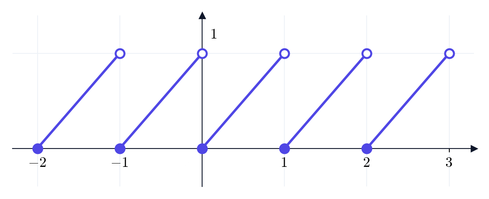{fig-alt="גרף שן מסור: קטעים עולים מאפס לאחת שחוזרים בכל יחידה" width="70%" fig-align="center"}
:::::

::::: {.content-visible when-format="pdf"}
```{=latex}
\par\medskip
\noindent\beginL\hbox to \linewidth{\hss\includegraphics[width=0.7\linewidth]{figures/frac-part.png}\hss}\endL\par
\medskip
```
:::::
::::
:::

### ערכים מיוחדים {.unnumbered}

את הערכים בזוויות המיוחדות לא צריך לשנן: אפשר לקבל אותם מציור.

::: {#box-exm-axis-values .thmexm title="ארבע הנקודות על הצירים"}
לאן מגיעים אחרי $\theta = 0$, $\frac{\pi}{2}$, $\pi$ ו-$?\frac{3\pi}{2}$ מלאו את הטבלה. (היעזרו בסימולציה, או בציור של מעגל היחידה.)

:::: fill
| $\theta$ | $0$ | $\frac{\pi}{2}$ | $\pi$ | $\frac{3\pi}{2}$ |
|:--:|:--:|:--:|:--:|:--:|
| $\cos\theta$ | [$1$]{.blank ans="1"} | [$0$]{.blank ans="0"} | [$-1$]{.blank ans="-1"} | [$0$]{.blank ans="0"} |
| $\sin\theta$ | [$0$]{.blank ans="0"} | [$1$]{.blank ans="1"} | [$0$]{.blank ans="0"} | [$-1$]{.blank ans="-1"} |

::: explain
- $\theta = 0$: הנקודה $(1, 0)$, ולכן $\cos 0 = 1$ ו-$.\sin 0 = 0$
- $\theta = \frac{\pi}{2}$ (רבע סיבוב): הנקודה $(0, 1)$, ולכן $\cos\frac{\pi}{2} = 0$ ו-$.\sin\frac{\pi}{2} = 1$
- $\theta = \pi$ (חצי סיבוב): הנקודה $(-1, 0)$, ולכן $\cos\pi = -1$ ו-$.\sin\pi = 0$
- $\theta = \frac{3\pi}{2}$: הנקודה $(0, -1)$, ולכן $\cos\frac{3\pi}{2} = 0$ ו-$.\sin\frac{3\pi}{2} = -1$
:::
::::
:::

::::: {#box-exm-special-angles .thmexm title="הזוויות $\\frac{\\pi}{4}$, $\\frac{\\pi}{6}$ ו-$\\frac{\\pi}{3}$"}
**(א)** חשבו את $\sin\frac{\pi}{4}$ ואת $.\cos\frac{\pi}{4}$

:::: fill
הזווית $\frac{\pi}{4}$ היא חצי מזווית ישרה, ולכן הנקודה נמצאת על הישר $,y = x$ כלומר $.\cos\frac{\pi}{4} = \sin\frac{\pi}{4}$ נסמן את הערך המשותף ב-$s$ ונציב בזהות פיתגורס (תכונה (ג)), $.s^2 + s^2 = 1$ השלימו:

$s^2 =$ [$\frac{1}{2}$]{.blank ans="1/2"}

הנקודה ברביע הראשון, ולכן $s$ חיובי:

$\sin\frac{\pi}{4} = \cos\frac{\pi}{4} = s =$ [$\frac{\sqrt{2}}{2}$]{.blank ans="sqrt(2)/2" allow-expression="true"}

::: hint
מ-$s^2 + s^2 = 1$ מקבלים $,2s^2 = 1$ ואז מחלקים ב-$.2$
:::
::: explain
$$\begin{aligned} s^2 + s^2 &= 1 \\ 2s^2 &= 1 \\ s^2 &= \tfrac{1}{2} \\ s &= \tfrac{1}{\sqrt{2}} = \tfrac{\sqrt{2}}{2} \end{aligned}$$
לקחנו את השורש החיובי, כי הנקודה ברביע הראשון.
:::
::::

**(ב)** חשבו את $\sin\frac{\pi}{6}$ ואת $.\cos\frac{\pi}{6}$

:::: fill
נסתכל על הנקודות שמתאימות ל-$\frac{\pi}{6}$ ול-$,-\frac{\pi}{6}$ ועל המשולש שהן יוצרות יחד עם הראשית. שתי הצלעות שיוצאות מהראשית הן רדיוסים, ולכן אורכן $.1$ הזווית ביניהן:

$\frac{\pi}{6} + \frac{\pi}{6} =$ [$\frac{\pi}{3}$]{.blank ans="pi/3" allow-expression="true"}

המשולש שווה-שוקיים, ולכן שתי זוויות הבסיס שלו שוות. סכום הזוויות במשולש הוא $,\pi$ ולכן כל אחת מזוויות הבסיס היא

$\frac{1}{2}\left(\pi - \frac{\pi}{3}\right) =$ [$\frac{\pi}{3}$]{.blank ans="pi/3" allow-expression="true"}

כל הזוויות שוות, כלומר המשולש שווה-צלעות, וגם הצלע השלישית שלו, האנכית, באורך $.1$ היא מחברת את $\left(\cos\frac{\pi}{6}, \sin\frac{\pi}{6}\right)$ ל-$,\left(\cos\frac{\pi}{6}, -\sin\frac{\pi}{6}\right)$ ולכן אורכה $.2\sin\frac{\pi}{6}$ מכאן:

$\sin\frac{\pi}{6} =$ [$\frac{1}{2}$]{.blank ans="1/2"}

ומזהות פיתגורס (הקוסינוס חיובי ברביע הראשון):

$\cos\frac{\pi}{6} = \sqrt{1 - \sin^2\frac{\pi}{6}} =$ [$\frac{\sqrt{3}}{2}$]{.blank ans="sqrt(3)/2" allow-expression="true"}

::: hint
אורך הצלע האנכית הוא $2\sin\frac{\pi}{6}$ וגם $,1$ ולכן $.2\sin\frac{\pi}{6} = 1$
:::
::: hint
$.1 - \left(\frac{1}{2}\right)^2 = \frac{3}{4}$
:::
::: explain
$$\begin{aligned} 2\sin\tfrac{\pi}{6} &= 1 \\ \sin\tfrac{\pi}{6} &= \tfrac{1}{2} \end{aligned}$$
$$\begin{aligned} \cos\tfrac{\pi}{6} &= \sqrt{1 - \sin^2\tfrac{\pi}{6}} \\ &= \sqrt{1 - \tfrac{1}{4}} \\ &= \sqrt{\tfrac{3}{4}} \\ &= \tfrac{\sqrt{3}}{2} \end{aligned}$$
:::
::::

**(ג)** חשבו את $\sin\frac{\pi}{3}$ ואת $.\cos\frac{\pi}{3}$

:::: fill
מתקיים $,\frac{\pi}{2} - \frac{\pi}{6} = \frac{\pi}{3}$ ולכן לפי תכונת הזווית המשלימה (ז) ולפי סעיף (ב):

$\sin\frac{\pi}{3} = \cos\frac{\pi}{6} =$ [$\frac{\sqrt{3}}{2}$]{.blank ans="sqrt(3)/2" allow-expression="true"}

$\cos\frac{\pi}{3} = \sin\frac{\pi}{6} =$ [$\frac{1}{2}$]{.blank ans="1/2"}
::::
:::::

::::: {#box-exm-special-table .thmexm title="טבלת הערכים המיוחדים"}
מלאו את הטבלה בעזרת שתי הדוגמאות האחרונות.

:::: fill
| $\theta$ | $0$ | $\frac{\pi}{6}$ | $\frac{\pi}{4}$ | $\frac{\pi}{3}$ | $\frac{\pi}{2}$ |
|:--:|:--:|:--:|:--:|:--:|:--:|
| $\sin\theta$ | [$0$]{.blank ans="0"} | [$\frac{1}{2}$]{.blank ans="1/2"} | [$\frac{\sqrt{2}}{2}$]{.blank ans="sqrt(2)/2" allow-expression="true"} | [$\frac{\sqrt{3}}{2}$]{.blank ans="sqrt(3)/2" allow-expression="true"} | [$1$]{.blank ans="1"} |
| $\cos\theta$ | [$1$]{.blank ans="1"} | [$\frac{\sqrt{3}}{2}$]{.blank ans="sqrt(3)/2" allow-expression="true"} | [$\frac{\sqrt{2}}{2}$]{.blank ans="sqrt(2)/2" allow-expression="true"} | [$\frac{1}{2}$]{.blank ans="1/2"} | [$0$]{.blank ans="0"} |

::: explain
דרך לזכור: בשורה של $\sin$ הערכים הם $,\frac{\sqrt{0}}{2}, \frac{\sqrt{1}}{2}, \frac{\sqrt{2}}{2}, \frac{\sqrt{3}}{2}, \frac{\sqrt{4}}{2}$ ובשורה של $\cos$ אותם ערכים בסדר הפוך. כש-$\theta$ גדל מ-$0$ ל-$,\frac{\pi}{2}$ הנקודה עולה על המעגל: הגובה שלה, $,\sin\theta$ גדל, והמרחק שלה מציר $,y$ כלומר $,\cos\theta$ קטן.
:::
::::
:::::

::: {.thmkey icon="calc" title="הערך בכל זווית מיוחדת"}
1. מחסירים (או מוסיפים) סיבובים שלמים של $2\pi$ עד שהזווית בין $0$ ל-$.2\pi$
2. בעזרת התכונות (ד)–(ו) מעבירים את הזווית לרביע הראשון, $.\left[0, \frac{\pi}{2}\right]$
3. קוראים את הערך, וקובעים את הסימן לפי הרביע שבו הנקודה המקורית נמצאת.
:::

:::: {.thmchk}
**(א)** מהו $?\sin\frac{3\pi}{2}$

::: {.quiz options="$1$|$0$|$-1$" answer="$-1$"}
שלושה רבעים של סיבוב מביאים לנקודה התחתונה של המעגל, $,(0, -1)$ ולכן $.\sin\frac{3\pi}{2} = -1$
:::

**(ב)** מהו $?\cos(7\pi)$

::: {.quiz options="$1$|$0$|$-1$" answer="$-1$"}
$,7\pi = 6\pi + \pi$ כלומר שלושה סיבובים שלמים ועוד חצי סיבוב. לכן מגיעים לאותה נקודה כמו ב-$,\pi$ הנקודה $,(-1, 0)$ ו-$.\cos(7\pi) = -1$
:::
::::

### הגרפים {.unnumbered}

אם "נפרוש" את המעגל על ציר $x$, ונצייר מעל כל $\theta$ את הגובה של הנקודה, נקבל את הגרף של $.\sin$ באותו אופן מתקבל הגרף של $.\cos$ בגרפים רואים את המחזוריות, את זה שכל הערכים בין $-1$ ל-$,1$ את השורשים, ואת הזוגיות של $\cos$ והאי-זוגיות של $.\sin$

::: {.content-visible when-format="html"}
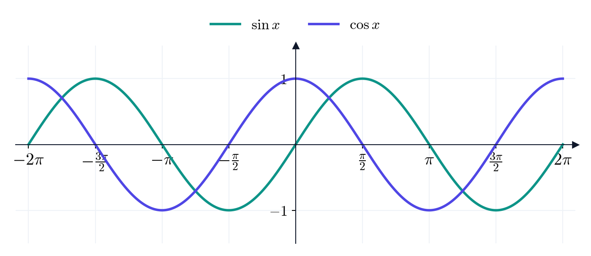{fig-alt="גלי הסינוס והקוסינוס בין מינוס שתיים פאי לשתיים פאי" width="90%" fig-align="center"}
:::

::: {.content-visible when-format="pdf"}
```{=latex}
\par\medskip
\noindent\beginL\hbox to \linewidth{\hss\includegraphics[width=0.9\linewidth]{figures/sin-cos.png}\hss}\endL\par
\medskip
```
:::

שימו לב שהגרף של $\cos$ הוא הגרף של $\sin$ אחרי הזזה שמאלה ב-$.\frac{\pi}{2}$ זו תכונה (ז) בשפה של הזזות: $.\cos x = \sin\left(x + \frac{\pi}{2}\right)$

### טנגנס {.unnumbered}

::: {#box-def-tan .thmdef title="טנגנס"}
[**הטנגנס**]{.term} הוא $$.\tan\theta = \frac{\sin\theta}{\cos\theta}$$ מבחינה גאומטרית, $\tan\theta$ הוא **השיפוע** של הקרן מהראשית אל הנקודה $.(\cos\theta, \sin\theta)$
:::

::: {.thmwarn title="איפה טנגנס אינו מוגדר"}
$\tan\theta$ אינו מוגדר כאשר $,\cos\theta = 0$ כלומר בנקודות $\theta = \frac{\pi}{2} + k\pi$ עבור $k$ שלם. בנקודות האלה הקרן אנכית, ולקו אנכי אין שיפוע. בגרף, אלה **אסימפטוטות אנכיות**: כשמתקרבים לנקודות האלה, הערכים של $\tan$ גדלים (או קטנים) בלי גבול.
:::

מתכונה (ה): $$\begin{aligned} \tan(\theta + \pi) &= \frac{\sin(\theta + \pi)}{\cos(\theta + \pi)} \\ &= \frac{-\sin\theta}{-\cos\theta} \\ &= \tan\theta \end{aligned}$$ ולכן $\tan$ מחזורית עם מחזור $,\pi$ חצי מהמחזור של $\sin$ ו-$.\cos$ מתכונה (ד), $\tan$ אי-זוגית. למשל $.\tan\frac{\pi}{4} = \frac{\sqrt{2}/2}{\sqrt{2}/2} = 1$

::: {.content-visible when-format="html"}
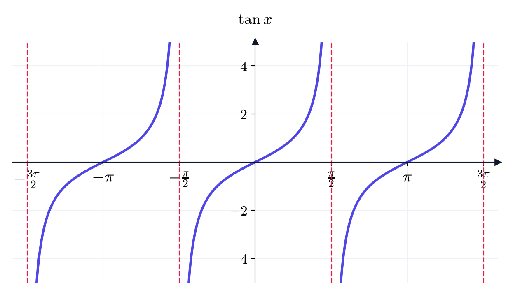{fig-alt="גרף הטנגנס עם קווים אנכיים מקווקווים במינוס שלוש פאי חצי, מינוס פאי חצי, פאי חצי ושלוש פאי חצי" width="75%" fig-align="center"}
:::

::: {.content-visible when-format="pdf"}
```{=latex}
\par\medskip
\noindent\beginL\hbox to \linewidth{\hss\includegraphics[width=0.75\linewidth]{figures/tan.png}\hss}\endL\par
\medskip
```
:::

### הזזה ומתיחה של פונקציות טריגונומטריות {.unnumbered}

::: {.thmkey icon="rule" title="משרעת ומחזור"}
לפונקציה $A\sin(Bx)$ (וכך גם ל-$A\cos(Bx)$), עם $A, B \neq 0$:

- [**המשרעת**]{.term} (גובה הגל) היא $,|A|$ והתמונה היא $.[-|A|, |A|]$
- **המחזור** הוא $.\frac{2\pi}{|B|}$
:::

זה בדיוק מה שאומרת טבלת ההזזות: הכפלה ב-$A$ מותחת את הגרף אנכית, והכפלת $x$ ב-$B$ מכווצת אותו אופקית פי $.B$ אפשר לראות את זה גם ב[מעבדת ההזזות](#box-sim-transformations), עם הגרף הבסיסי $.\sin x$

::: {#box-exm-trig-transform .thmexm title="פונקציות טריגונומטריות מוזזות"}
מצאו את המחזור ואת התמונה.

**(א)** $3\sin x$

:::: fill
המחזור: [$2\pi$]{.blank ans="2pi" allow-expression="true"} התמונה: [$[-3, 3]$]{.blank ans="[-3,3]"}

::: explain
כאן $A = 3$ ו-$.B = 1$ המחזור הוא $,\frac{2\pi}{1} = 2\pi$ והמשרעת היא $,3$ ולכן התמונה היא $.[-3, 3]$
:::
::::

**(ב)** $\sin(4x)$

:::: fill
המחזור: [$\frac{\pi}{2}$]{.blank ans="pi/2" allow-expression="true"} התמונה: [$[-1, 1]$]{.blank ans="[-1,1]"}

::: explain
כאן $A = 1$ ו-$.B = 4$ המחזור הוא $$,\frac{2\pi}{4} = \frac{\pi}{2}$$ והתמונה היא $.[-1, 1]$ בדיקה: כאשר $x$ גדל ב-$,\frac{\pi}{2}$ הביטוי $4x$ גדל ב-$,2\pi$ כלומר בסיבוב שלם.
:::
::::

**(ג)** $\cos\left(x - \frac{\pi}{2}\right)$. איזו פונקציה מוכרת זו?

:::: fill
$\cos\left(x - \frac{\pi}{2}\right) =$ [$\sin x$]{.blank ans="sin(x)"}

::: explain
זו הזזה ימינה ב-$\frac{\pi}{2}$ של $,\cos$ ולכן המחזור הוא $2\pi$ והתמונה היא $.[-1, 1]$ נחשב בעזרת התכונות: $$\begin{aligned} \cos\left(x - \tfrac{\pi}{2}\right) &= \cos\left(\tfrac{\pi}{2} - x\right) \\ &= \sin x \end{aligned}$$ בשורה הראשונה השתמשנו בזוגיות של $\cos$ (תכונה (ד)), ובשנייה בתכונת הזווית המשלימה (ז). כלומר, הזזה של $\cos$ ימינה ב-$\frac{\pi}{2}$ נותנת בדיוק את $.\sin$
:::
::::
:::

::: {.thmsummary}
- זוויות מודדים ברדיאנים: סיבוב שלם הוא $.2\pi$
- הולכים על מעגל היחידה מרחק $\theta$ מ-$:(1, 0)$ שיעור ה-$x$ הוא $,\cos\theta$ ושיעור ה-$y$ הוא $.\sin\theta$
- $\sin$ ו-$\cos$ מחזוריות עם מחזור $,2\pi$ ערכיהן בין $-1$ ל-$,1$ ו-$.\sin^2\theta + \cos^2\theta = 1$ $\cos$ זוגית ו-$\sin$ אי-זוגית.
- $\tan\theta = \frac{\sin\theta}{\cos\theta}$ מחזורית עם מחזור $,\pi$ ואינה מוגדרת כאשר $.\cos\theta = 0$
- ל-$A\sin(Bx)$ יש משרעת $|A|$ ומחזור $.\frac{2\pi}{|B|}$
:::

### תרגילים {.unnumbered}

::::: {#box-q-radians .thmqst title="סיבובים ורדיאנים"}
כמה רדיאנים הם:

:::: fill
**(א)** רבע סיבוב: [$\frac{\pi}{2}$]{.blank ans="pi/2" allow-expression="true"}

**(ב)** שישית סיבוב: [$\frac{\pi}{3}$]{.blank ans="pi/3" allow-expression="true"}

**(ג)** שלושה סיבובים שלמים: [$6\pi$]{.blank ans="6pi" allow-expression="true"}

::: hint
סיבוב שלם הוא $.2\pi$
:::
::: explain
**(א)** $$\begin{aligned} \tfrac{1}{4} \cdot 2\pi &= \tfrac{2\pi}{4} \\ &= \tfrac{\pi}{2} \end{aligned}$$

**(ב)** $$\begin{aligned} \tfrac{1}{6} \cdot 2\pi &= \tfrac{2\pi}{6} \\ &= \tfrac{\pi}{3} \end{aligned}$$

**(ג)** $$\begin{aligned} 3 \cdot 2\pi &= 6\pi \end{aligned}$$
:::
::::
:::::

::::: {#box-q-special .thmqst title="ערכים מיוחדים"}
חשבו.

:::: fill
**(א)** $\sin\frac{5\pi}{6} =$ [$\frac{1}{2}$]{.blank ans="1/2"}

**(ב)** $\cos\frac{4\pi}{3} =$ [$-\frac{1}{2}$]{.blank ans="-1/2"}

**(ג)** $\sin\frac{7\pi}{6} =$ [$-\frac{1}{2}$]{.blank ans="-1/2"}

**(ד)** $\cos\frac{3\pi}{4} =$ [$-\frac{\sqrt{2}}{2}$]{.blank ans="-sqrt(2)/2" allow-expression="true"}

**(ה)** $\tan\frac{\pi}{3} =$ [$\sqrt{3}$]{.blank ans="sqrt(3)" allow-expression="true"}

**(ו)** $\sin\left(-\frac{\pi}{2}\right) =$ [$-1$]{.blank ans="-1"}

**(ז)** $\sin\frac{13\pi}{6} =$ [$\frac{1}{2}$]{.blank ans="1/2"}

::: hint
כתבו את הזווית בעזרת זווית מהרביע הראשון, למשל $,\frac{5\pi}{6} = \pi - \frac{\pi}{6}$ ובדקו באיזה רביע הנקודה כדי לקבוע את הסימן.
:::
::: explain
**(א)** לפי תכונה (ו): $.\sin\frac{5\pi}{6} = \sin\left(\pi - \frac{\pi}{6}\right) = \sin\frac{\pi}{6} = \frac{1}{2}$

**(ב)** לפי תכונה (ה): $.\cos\frac{4\pi}{3} = \cos\left(\frac{\pi}{3} + \pi\right) = -\cos\frac{\pi}{3} = -\frac{1}{2}$

**(ג)** $\frac{7\pi}{6} = \frac{\pi}{6} + \pi$ ולפי (ה) הסינוס מחליף סימן.

**(ד)** $\frac{3\pi}{4} = \pi - \frac{\pi}{4}$ ולפי (ו) הקוסינוס מחליף סימן.

**(ה)** $$\begin{aligned} \tan\tfrac{\pi}{3} &= \frac{\sin\frac{\pi}{3}}{\cos\frac{\pi}{3}} \\ &= \frac{\sqrt{3}/2}{1/2} \\ &= \sqrt{3} \end{aligned}$$

**(ו)** הליכה של רבע סיבוב עם כיוון השעון מגיעה ל-$.(0, -1)$

**(ז)** $,\frac{13\pi}{6} = 2\pi + \frac{\pi}{6}$ סיבוב שלם ועוד $.\frac{\pi}{6}$
:::
::::
:::::

::::: {#box-q-trig-eq .thmqst title="משוואות על המעגל"}
מצאו את כל הפתרונות בקטע $.[0, 2\pi]$ כתבו את התשובה כרשימה.

:::: fill
**(א)** $\sin x = 0$: [$\{0, \pi, 2\pi\}$]{.blank ans="{0,pi,2pi}" w="14"}

**(ב)** $\cos x = \frac{1}{2}$: [$\left\{\frac{\pi}{3}, \frac{5\pi}{3}\right\}$]{.blank ans="{pi/3,5pi/3}" w="14"}

**(ג)** $2\sin x + 1 = 0$: [$\left\{\frac{7\pi}{6}, \frac{11\pi}{6}\right\}$]{.blank ans="{7pi/6,11pi/6}" w="14"}

::: hint
על המעגל: מחפשים את כל הנקודות בגובה (או במרחק אופקי) המתאים. בדרך כלל יש שתיים בכל סיבוב.
:::
::: explain
**(א)** הגובה $0$ מתקבל בנקודות $(1, 0)$ ו-$,(-1, 0)$ כלומר ב-$,0$ $\pi$ ו-$.2\pi$

**(ב)** $,\cos\frac{\pi}{3} = \frac{1}{2}$ והנקודה המשוקפת ביחס לציר $x$ מתאימה ל-$.2\pi - \frac{\pi}{3} = \frac{5\pi}{3}$

**(ג)** $.\sin x = -\frac{1}{2}$ הגובה שלילי ברביעים השלישי והרביעי: $\pi + \frac{\pi}{6} = \frac{7\pi}{6}$ ו-$.2\pi - \frac{\pi}{6} = \frac{11\pi}{6}$
:::
::::
:::::

::::: {#box-q-trig .thmqst title="מחזור ותמונה"}
:::: fill
**(א)** $2\cos(\pi x) + 1$: המחזור [$2$]{.blank ans="2"} והתמונה [$[-1, 3]$]{.blank ans="[-1,3]"}

**(ב)** $4\sin(3x)$: המחזור [$\frac{2\pi}{3}$]{.blank ans="2pi/3" allow-expression="true"} והתמונה [$[-4, 4]$]{.blank ans="[-4,4]"}

**(ג)** $-\cos\frac{x}{2}$: המחזור [$4\pi$]{.blank ans="4pi" allow-expression="true"} והתמונה [$[-1, 1]$]{.blank ans="[-1,1]"}

**(ד)** $1 - 2\sin x$: המחזור [$2\pi$]{.blank ans="2pi" allow-expression="true"} והתמונה [$[-1, 3]$]{.blank ans="[-1,3]"}

::: hint
המחזור הוא $,\frac{2\pi}{|B|}$ ואת התמונה בונים בשלבים מ-$.{-}1 \le \sin \le 1$
:::
::: explain
**(א)** $,B = \pi$ ולכן המחזור הוא $.\frac{2\pi}{\pi} = 2$ התמונה: $$\begin{aligned} -1 &\le \cos(\pi x) \le 1 \\ -2 &\le 2\cos(\pi x) \le 2 \\ -1 &\le 2\cos(\pi x) + 1 \le 3 \end{aligned}$$

**(ב)** $B = 3$ ו-$.|A| = 4$

**(ג)** $,B = \frac{1}{2}$ ולכן המחזור הוא $.\frac{2\pi}{1/2} = 4\pi$ המינוס משקף, והתמונה נשארת $.[-1, 1]$

**(ד)** $$\begin{aligned} -1 &\le \sin x \le 1 \\ -2 &\le -2\sin x \le 2 \\ -1 &\le 1 - 2\sin x \le 3 \end{aligned}$$ בשורה השנייה כפלנו ב-$,(-2)$ ולכן הכיוון התהפך: $,2 \ge -2\sin x \ge -2$ וכתבנו את זה מהקטן לגדול. בשלישית הוספנו $.1$
:::
::::
:::::

::::: {#box-q-pythagoras .thmqst title="מהסינוס אל הקוסינוס"}
ידוע ש-$\sin\theta = \frac{3}{5}$ ושהנקודה ברביע השני, $.\frac{\pi}{2} < \theta < \pi$

:::: fill
$\cos\theta =$ [$-\frac{4}{5}$]{.blank ans="-4/5"} ו-$\tan\theta =$ [$-\frac{3}{4}$]{.blank ans="-3/4"}

::: hint
זהות פיתגורס: $.\sin^2\theta + \cos^2\theta = 1$ ברביע השני הקוסינוס שלילי.
:::
::: explain
$$\begin{aligned} \cos^2\theta &= 1 - \sin^2\theta \\ &= 1 - \tfrac{9}{25} = \tfrac{16}{25} \end{aligned}$$ ולכן $.\cos\theta = \pm\frac{4}{5}$ ברביע השני $,\cos\theta < 0$ ולכן $.\cos\theta = -\frac{4}{5}$ לבסוף $.\tan\theta = \frac{3/5}{-4/5} = -\frac{3}{4}$
:::
::::
:::::

::::: {#box-q-tan-defined .thmqst title="טנגנס"}
**(א)** האם $\tan\frac{\pi}{2}$ מוגדר?

::: {.quiz options="כן|לא" answer="לא"}
$,\cos\frac{\pi}{2} = 0$ ואי אפשר לחלק באפס. בגרף זו אסימפטוטה אנכית.
:::

**(ב)** $\tan\pi$ שווה:

::: {.quiz options="$0$|$1$|אינו מוגדר" answer="$0$"}
$.\tan\pi = \frac{\sin\pi}{\cos\pi} = \frac{0}{-1} = 0$
:::
:::::

## הפונקציה המעריכית


בפונקציה לינארית, כל צעד של $1$ ב-$x$ **מוסיף** לערך אותה כמות, למשל $.+2$ בפונקציה מעריכית, כל צעד **כופל** את הערך באותו גורם, למשל $.\times 2$ כדי להגדיר אותה צריך לתת משמעות לביטוי כמו $2^x$ גם כאשר $x$ אינו מספר טבעי.

### חזקות עם מעריך שאינו טבעי {.unnumbered}

נזכיר את המשמעות של החזקה $a^x$ (עם $a > 0$) עבור מעריכים שאינם טבעיים:

| המעריך | ההגדרה | דוגמה |
|:--:|:--:|:--:|
| אפס | $a^0 = 1$ | $5^0 = 1$ |
| שלם שלילי | $a^{-n} = \frac{1}{a^n}$ | $2^{-3} = \frac{1}{2^3} = \frac{1}{8}$ |
| הופכי של טבעי | $a^{1/n} = \sqrt[n]{a}$ | $8^{1/3} = \sqrt[3]{8} = 2$ |
| רציונלי | $a^{m/n} = \sqrt[n]{a^m}$ | $8^{2/3} = \sqrt[3]{8^2} = \sqrt[3]{64} = 4$ |

שימו לב שהשורה השנייה מתאימה לסימון של המספר ההופכי: $.a^{-1} = \frac{1}{a}$ ההגדרות האלה נבחרו כך שחוקי החזקות, למשל $,a^m \cdot a^n = a^{m+n}$ ימשיכו להתקיים.

:::: {.thmchk}
מהו $?4^{-1/2}$

::: {.quiz options="$-2$|$\frac{1}{2}$|$2$" answer="$\frac{1}{2}$"}
המינוס במעריך פירושו הופכי, והחצי פירושו שורש: $$\begin{aligned} 4^{-1/2} &= \frac{1}{4^{1/2}} \\ &= \frac{1}{\sqrt{4}} \\ &= \frac{1}{2}. \end{aligned}$$ מעריך שלילי **אינו** הופך את התוצאה לשלילית.
:::
::::

::: {.thmwarn title="למה הבסיס חייב להיות חיובי"}
עבור בסיס שלילי, ההגדרות בטבלה נכשלות. למשל, $(-4)^{1/2} = \sqrt{-4}$ אינו מוגדר. לכן מגדירים את הפונקציה המעריכית רק עבור $.a > 0$
:::

ומה לגבי מעריך אי-רציונלי, למשל $?2^{\sqrt{2}}$ את ההגדרה המדויקת נדחה לפרק הבא, כי היא דורשת את מושג הגבול. באופן אינטואיטיבי: את הנקודות $\left(x, 2^x\right)$ עבור כל $x$ **רציונלי** אפשר לחשב ולסמן במישור, ויש רק דרך אחת להעביר דרך כולן קו רציף, בלי קפיצות. הקו הזה הוא הגרף של $,2^x$ והערך שלו מעל $x = \sqrt{2}$ הוא $.2^{\sqrt{2}}$

::: {.content-visible when-format="html"}
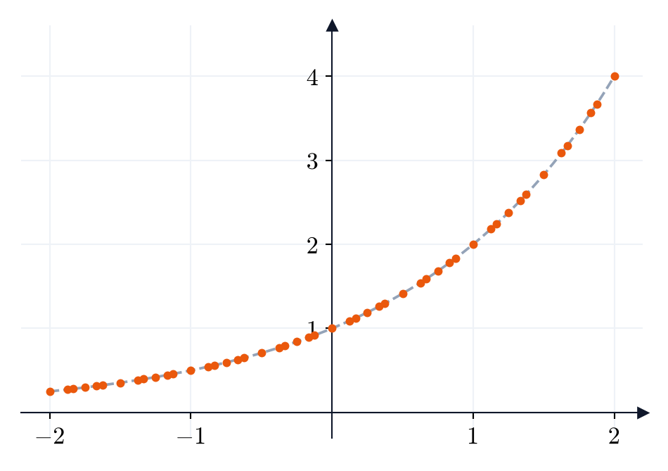{fig-alt="נקודות רבות על עקומה מעריכית עולה, וקו מקווקו שעובר דרכן" width="60%" fig-align="center"}
:::

::: {.content-visible when-format="pdf"}
```{=latex}
\par\medskip
\noindent\beginL\hbox to \linewidth{\hss\includegraphics[width=0.6\linewidth]{figures/exp-rational-points.png}\hss}\endL\par
\medskip
```
:::

::: {#box-def-exponential .thmdef title="הפונקציה המעריכית"}
יהי $a > 0$ ו-$.a \neq 1$ [**הפונקציה המעריכית**]{.term} עם בסיס $a$ היא $.f(x) = a^x$ תחום ההגדרה שלה הוא $,\mathbb{R}$ והתמונה שלה היא $.(0, \infty)$
:::

(הבסיס $a = 1$ אינו מעניין: $1^x = 1$ לכל $.x$)

::: {#box-thm-exp-laws .thmthm title="חוקי החזקות"}
לכל $a, b > 0$ ולכל $x, y$ ממשיים: $$\begin{aligned} a^{x+y} &= a^x \cdot a^y \\ a^{x-y} &= \frac{a^x}{a^y} \\ \left(a^x\right)^y &= a^{xy} \\ (ab)^x &= a^x \cdot b^x \end{aligned}$$
:::

### הגרפים {.unnumbered}

::: {.thmkey icon="idea" title="שתי צורות"}
- אם $a > 1$, הפונקציה $a^x$ **עולה**: ככל ש-$x$ גדל, $a^x$ גדל, ובמהירות הולכת וגדלה.
- אם $0 < a < 1$, הפונקציה $a^x$ **יורדת**. למשל, $\left(\frac{1}{2}\right)^x = 2^{-x}$ היא השיקוף של $2^x$ ביחס לציר $.y$
- כל הגרפים עוברים דרך $,(0, 1)$ כי $,a^0 = 1$ וכולם נמצאים מעל ציר $,x$ כי $.a^x > 0$
:::

::: {.content-visible when-format="html"}
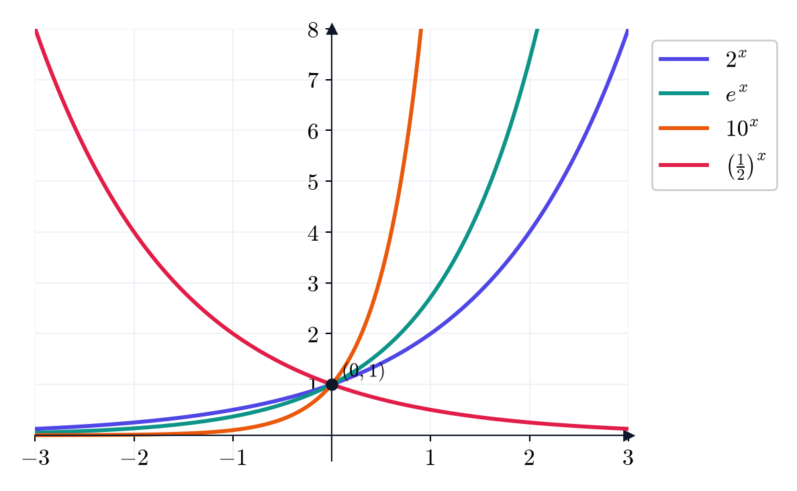{fig-alt="ארבעה גרפים של פונקציות מעריכיות שנפגשים בנקודה אפס אחת" width="65%" fig-align="center"}
:::

::: {.content-visible when-format="pdf"}
```{=latex}
\par\medskip
\noindent\beginL\hbox to \linewidth{\hss\includegraphics[width=0.65\linewidth]{figures/exponentials.png}\hss}\endL\par
\medskip
```
:::

::: {.thmkey icon="calc" title="פישוט ביטויים עם חזקות"}
כותבים את כל החזקות עם **בסיס משותף** (למשל $4 = 2^2$ ו-$8 = 2^3$), ואז משתמשים בחוקי החזקות.
:::

::: {#box-exm-exp-transform .thmexm title="הזזה ומתיחה של הפונקציה המעריכית"}
בכל סעיף הביאו את הגרף של המעריכית הבסיסית למקום, ואז מצאו את התמונה ונקודה אחת על הגרף.

**(א)** $y = 2 - 3^x$

```{=html}
<iframe class="widget-frame" src="widgets/ch01/move-graph.html?f=exp3&a=-1&d=2" loading="lazy" title="מזיזים את הגרף של 3 בחזקת x"></iframe>
```

:::: fill
התמונה: [$(-\infty, 2)$]{.blank ans="(-inf,2)"} והגרף עובר דרך $(0,{}$ [$1$]{.blank ans="1"}$)$

::: explain
נכתוב $,y = -3^x + 2$ ונבנה את הגרף בשני שלבים:

1. $-3^x$ הוא שיקוף של $3^x$ ביחס לציר $.x$ מכיוון ש-$,3^x > 0$ מתקבל $,-3^x < 0$ והתמונה היא $.(-\infty, 0)$
2. הוספת $2$ מזיזה למעלה ב-$.2$ התמונה הופכת ל-$.(-\infty, 2)$

נקודה על הגרף: עבור $x = 0$ מתקבל $.y = 2 - 1 = 1$
:::
::::

**(ב)** $y = 2^{x+2} - 1$

```{=html}
<iframe class="widget-frame" src="widgets/ch01/move-graph.html?f=exp2&c=-2&d=-1" loading="lazy" title="מזיזים את הגרף של 2 בחזקת x"></iframe>
```

:::: fill
התמונה: [$(-1, \infty)$]{.blank ans="(-1,inf)"} והגרף עובר דרך $({-}2,{}$ [$0$]{.blank ans="0"}$)$

::: explain
בתוך החזקה $,x + 2$ ולכן הזזה **שמאלה** ב-$.2$ מחוץ לה $,-1$ ולכן הזזה **למטה** ב-$.1$ התמונה של $2^x$ היא $,(0, \infty)$ ואחרי ההזזה למטה היא $.(-1, \infty)$ נקודה על הגרף: עבור $x = -2$ מתקבל $.y = 2^0 - 1 = 0$
:::
::::
:::

**נחשו:** מי גדולה יותר כאשר $,x = 15$ $2^x$ או $?x^3$

::: {.quiz options="$x^3$|$2^x$" answer="$2^x$"}
$2^{15} = 32768$ ואילו $,15^3 = 3375$ כמעט פי עשרה פחות! הטבלה הבאה מראה מה קרה בדרך.
:::

::: {.thmkey icon="idea" title="המעריכית מנצחת את החזקה"}
נשווה את $2^x$ ל-$:x^3$

| $x$ | $2$ | $5$ | $9$ | $10$ | $15$ |
|:--:|:--:|:--:|:--:|:--:|:--:|
| $x^3$ | $8$ | $125$ | $729$ | $1000$ | $3375$ |
| $2^x$ | $4$ | $32$ | $512$ | $1024$ | $32768$ |

בהתחלה $x^3$ גדולה יותר, אבל מ-$x = 10$ והלאה $2^x$ עוקפת אותה, והפער גדל מהר מאוד. כך זה תמיד: פונקציה מעריכית עם בסיס גדול מ-$1$ גדלה בסופו של דבר מהר יותר מכל פולינום.
:::

::: {.thmsummary}
- $,a^0 = 1$ $,a^{-n} = \frac{1}{a^n}$ ו-$.a^{m/n} = \sqrt[n]{a^m}$ הבסיס חייב להיות חיובי.
- $a^x$ מוגדרת לכל $,x$ והתמונה שלה $.(0, \infty)$ הגרף עובר דרך $.(0, 1)$
- $a > 1$: עולה; $0 < a < 1$: יורדת. בסופו של דבר $a^x$ (עם $a > 1$) עוקפת כל פולינום.
- מפשטים בעזרת בסיס משותף וחוקי החזקות.
:::

### תרגילים {.unnumbered}

::::: {#box-q-exp .thmqst title="מפשטים בצעדים"}
פשטו את $\frac{4^x \cdot 2^3}{8^x}$ לחזקה אחת של $.2$

:::: {.derive goal="2^(3-x)" start="4^x*2^3/8^x"}
::: {.step line="2^[2x]*2^3/2^[3x]"}
כותבים $4^x = \left(2^2\right)^x$ ו-$,8^x = \left(2^3\right)^x$ וכופלים מעריכים.
:::
::: {.step line="2^[2x+3-3x]"}
כפל חזקות: מחברים מעריכים. חילוק: מחסירים את המעריך של המכנה.
:::
::: {.step line="2^[3-x]"}
מפשטים את המעריך.
:::
::: hint
כתבו קודם $4 = 2^2$ ו-$,8 = 2^3$ כלומר $4^x = (2^2)^x = 2^{2x}$ ו-$.8^x = 2^{3x}$
:::
::: hint
אחר כך: במונה $,2^{2x} \cdot 2^3 = 2^{2x + 3}$ ובחילוק מחסירים את המעריך של המכנה.
:::
::::
:::::

::::: {#box-q-exp-graph .thmqst title="תיאור גרף"}
בכל סעיף הביאו את הגרף של המעריכית הבסיסית למקום, ואז מצאו את התמונה ואת נקודת החיתוך עם ציר $.y$

:::: fill
**(א)** $y = 3^{-x} + 1$

```{=html}
<iframe class="widget-frame" src="widgets/ch01/move-graph.html?f=exp3&b=-1&d=1" loading="lazy" title="מזיזים את הגרף של 3 בחזקת x"></iframe>
```

התמונה היא [$(1, \infty)$]{.blank ans="(1,inf)"} והגרף חותך את ציר $y$ בגובה [$2$]{.blank ans="2"}

**(ב)** $y = 3 \cdot 2^x - 1$

```{=html}
<iframe class="widget-frame" src="widgets/ch01/move-graph.html?f=exp2&a=3&d=-1" loading="lazy" title="מזיזים את הגרף של 2 בחזקת x"></iframe>
```

התמונה היא [$(-1, \infty)$]{.blank ans="(-1,inf)"} והגרף חותך את ציר $y$ בגובה [$2$]{.blank ans="2"}

::: explain
**(א)** $,3^{-x} = \left(\frac{1}{3}\right)^x$ פונקציה מעריכית **יורדת** עם תמונה $.(0, \infty)$ הוספת $1$ מזיזה למעלה, והתמונה הופכת ל-$.(1, \infty)$ עבור $x = 0$: $.y = 1 + 1 = 2$

**(ב)** $3 \cdot 2^x$ מקבל את כל הערכים ב-$,(0, \infty)$ ואחרי הורדה ב-$1$ מתקבל $.(-1, \infty)$ עבור $x = 0$: $.y = 3 \cdot 1 - 1 = 2$
:::
::::
:::::

::::: {#box-q-powers .thmqst title="חזקות"}
חשבו.

:::: fill
**(א)** $16^{3/4} =$ [$8$]{.blank ans="8"}

**(ב)** $9^{-1/2} =$ [$\frac{1}{3}$]{.blank ans="1/3"}

**(ג)** $\left(\frac{1}{4}\right)^{-2} =$ [$16$]{.blank ans="16"}

**(ד)** $32^{1/5} =$ [$2$]{.blank ans="2"}

**(ה)** $1000^{2/3} =$ [$100$]{.blank ans="100"}

::: hint
המכנה במעריך הוא שורש, המונה הוא חזקה, והמינוס הוא הופכי. כדאי להתחיל בשורש.
:::
::: explain
**(א)** $$\begin{aligned} 16^{3/4} &= \left(\sqrt[4]{16}\right)^3 \\ &= 2^3 \\ &= 8 \end{aligned}$$

**(ב)** $$\begin{aligned} 9^{-1/2} &= \frac{1}{9^{1/2}} \\ &= \frac{1}{\sqrt{9}} \\ &= \frac{1}{3} \end{aligned}$$

**(ג)** המינוס במעריך הופך את השבר: $$\begin{aligned} \left(\tfrac{1}{4}\right)^{-2} &= 4^2 \\ &= 16 \end{aligned}$$

**(ד)** $$\begin{aligned} 32^{1/5} &= \sqrt[5]{32} \\ &= 2 \end{aligned}$$ כי $.2^5 = 32$

**(ה)** $$\begin{aligned} 1000^{2/3} &= \left(\sqrt[3]{1000}\right)^2 \\ &= 10^2 \\ &= 100 \end{aligned}$$
:::
::::
:::::

::::: {#box-q-simplify-powers .thmqst title="חוקי החזקות"}
פשטו לחזקה אחת. כתבו את התשובה בצורה הפשוטה ביותר.

:::: fill
**(א)** $x^3 \cdot x^5 =$ [$x^8$]{.blank ans="x^8" form="simple"}

**(ב)** $\left(2^x\right)^3 \cdot 2^{-x} =$ [$2^{2x}$]{.blank ans="2^(2x)" form="simple"}

**(ג)** $\frac{9^x}{3^x} =$ [$3^x$]{.blank ans="3^x" form="simple"}

::: explain
**(א)** בכפל מחברים מעריכים: $$\begin{aligned} x^3 \cdot x^5 &= x^{3 + 5} \\ &= x^8 \end{aligned}$$

**(ב)** $$\begin{aligned} \left(2^x\right)^3 \cdot 2^{-x} &= 2^{3x} \cdot 2^{-x} \\ &= 2^{3x - x} \\ &= 2^{2x} \end{aligned}$$

**(ג)** $$\begin{aligned} \frac{9^x}{3^x} &= \frac{\left(3^2\right)^x}{3^x} \\ &= \frac{3^{2x}}{3^x} \\ &= 3^{2x - x} \\ &= 3^x \end{aligned}$$
:::
::::
:::::

::::: {#box-q-exp-eq .thmqst title="משוואות עם בסיס משותף"}
**(א)** פתרו את $.4^x = 8$ כתבו את שני האגפים כחזקות של $,2$ ואז השוו את המעריכים.

:::: {.derive start="4^x=8"}
::: {.step line="2^[2x]=2^[3]"}
כותבים את שני האגפים כחזקות של $.2$
:::
::: {.step line="2x=[3]"}
משווים מעריכים (מפעילים $\log_2$ על שני האגפים).
:::
::: {.step line="x=[3/2]"}
מחלקים ב-$.2$
:::
::: hint
$4^x = 2^{2x}$ ו-$.8 = 2^3$ מ-$2^{2x} = 2^3$ נובע $2x = 3$ (זה בדיוק "הפעלת $\log_2$ על שני האגפים").
:::
::::

**(ב)** $2^x = 32$

:::: {.derive start="2^x=32"}
::: {.step line="2^x=2^[5]"}
כותבים את $32$ כחזקה של $.2$
:::
::: {.step line="x=[5]"}
משווים מעריכים (מפעילים $\log_2$ על שני האגפים).
:::
::::

:::: fill
$x =$ [$5$]{.blank ans="5"}
::::

**(ג)** $3^{x + 1} = 27$

:::: {.derive start="3^(x+1)=27"}
::: {.step line="3^(x+1)=3^[3]"}
כותבים את $27$ כחזקה של $.3$
:::
::: {.step line="x+1=[3]"}
משווים מעריכים.
:::
::: {.step line="x=[2]"}
מחסירים $.1$
:::
::: hint
$.27 = 3^3$
:::
::::

:::: fill
$x =$ [$2$]{.blank ans="2"}
::::

**(ד)** $\left(\frac{1}{2}\right)^x = 4$

:::: {.derive start="(1/2)^x=4"}
::: {.step line="2^[-x]=2^[2]"}
כותבים את שני האגפים כחזקות של $.2$
:::
::: {.step line="-x=[2]"}
משווים מעריכים (מפעילים $\log_2$ על שני האגפים).
:::
::: {.step line="x=[-2]"}
כופלים ב-$.{-}1$
:::
::: hint
$\left(\frac{1}{2}\right)^x = 2^{-x}$ ו-$.4 = 2^2$
:::
::::

:::: fill
$x =$ [$-2$]{.blank ans="-2"}
::::
:::::

::::: {#box-q-exp-vs-poly .thmqst title="מי גדולה יותר?"}
השלימו את השורה של $,2^x$ והשוו אותה לשורה של $.x^2$

:::: fill
| $x$ | $1$ | $2$ | $3$ | $4$ | $5$ | $6$ |
|:--:|:--:|:--:|:--:|:--:|:--:|:--:|
| $x^2$ | $1$ | $4$ | $9$ | $16$ | $25$ | $36$ |
| $2^x$ | [$2$]{.blank ans="2"} | [$4$]{.blank ans="4"} | [$8$]{.blank ans="8"} | [$16$]{.blank ans="16"} | [$32$]{.blank ans="32"} | [$64$]{.blank ans="64"} |
::::

באילו מהערכים שבטבלה $x^2$ גדולה **ממש** מ-$?2^x$

::: {.quiz options="רק $x = 3$|$x = 3$ ו-$x = 4$|באף אחד" answer="רק $x = 3$"}
רק עבור $:x = 3$ $.9 > 8$ עבור $x = 2$ ו-$x = 4$ הן שוות ($4 = 4$ ו-$16 = 16$), ובשאר הערכים $2^x$ גדולה יותר. שימו לב שהפער גדל מהר: עבור $x = 5$ הוא $,32 - 25 = 7$ ועבור $x = 6$ כבר $.64 - 36 = 28$
:::
:::::

## פונקציות הפוכות


לעיתים קרובות יודעים את הפלט ומחפשים את הקלט. איזה $x$ מקיים $x^3 = 8$? איזה $x$ מקיים $2^x = 8$? הפונקציה ההפוכה "מחזירה" מהפלט אל הקלט. אבל כדי שזה יעבוד, לכל פלט חייב להיות קלט **יחיד**.

::: {#box-def-one-to-one .thmdef title="פונקציה חד-חד-ערכית"}
פונקציה $f$ נקראת [**חד-חד-ערכית**]{.term} אם היא אינה מקבלת אותו ערך פעמיים: אם $x_1 \neq x_2$ אז $.f(x_1) \neq f(x_2)$
:::

::: {.thmkey icon="rule" title="מבחן הקו האופקי"}
פונקציה היא חד-חד-ערכית אם ורק אם **כל קו אופקי** חותך את הגרף שלה **לכל היותר בנקודה אחת**.
:::

::: {.content-visible when-format="html"}
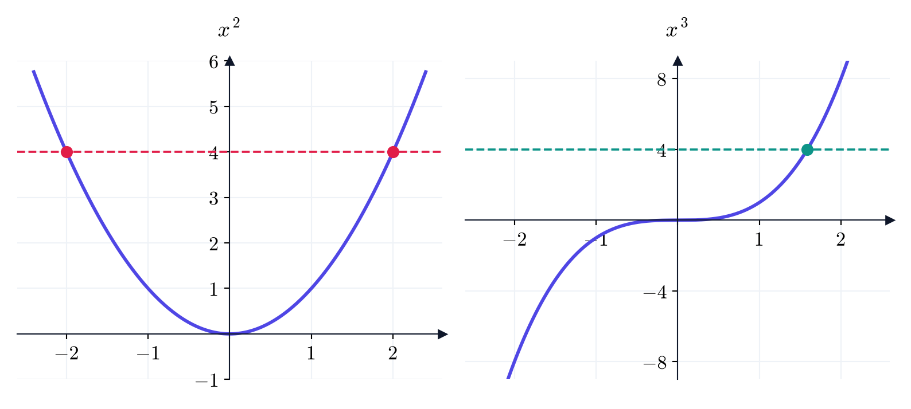{fig-alt="פרבולה שחתוכה בקו אופקי בשתי נקודות, ופונקציה מעוקבת שחתוכה בקו אופקי בנקודה אחת" width="80%" fig-align="center"}
:::

::: {.content-visible when-format="pdf"}
```{=latex}
\par\medskip
\noindent\beginL\hbox to \linewidth{\hss\includegraphics[width=0.8\linewidth]{figures/horizontal-line-test.png}\hss}\endL\par
\medskip
```
:::

:::: {.thmchk}
האם $f(x) = |x|$ (על כל $\mathbb{R}$) חד-חד-ערכית?

::: {.quiz options="כן|לא" answer="לא"}
לא: $,|2| = |{-}2| = 2$ כלומר שני קלטים שונים נותנים אותו ערך. בגרף (צורת $V$), הקו האופקי $y = 2$ חותך אותו פעמיים.
:::
::::

חד-חד-ערכיות מבטיחה שלכל פלט יש **לכל היותר** קלט אחד. כדי שאפשר יהיה לחזור אחורה מ**כל** $y$ בטווח, צריך גם שלכל $y$ כזה יהיה **לפחות** קלט אחד, כלומר שכל $y$ בטווח אכן מתקבל.

::: {#box-def-onto .thmdef title="פונקציה על"}
תהי $f : A \to B$ פונקציה. נאמר ש-$f$ היא [**פונקציה על**]{.term} (או ש-$f$ היא "על $B$") אם כל איבר של הטווח מתקבל: לכל $y \in B$ יש $x \in A$ שעבורו $.f(x) = y$ במילים אחרות, התמונה של $f$ שווה לטווח שלה.
:::

::: {.thmkey icon="rule" title="שוב מבחן הקו האופקי"}
פונקציה $f : A \to \mathbb{R}$ היא על אם ורק אם **כל קו אופקי** חותך את הגרף שלה **לפחות בנקודה אחת**. (אם הטווח הוא קבוצה אחרת $,B$ בודקים רק את הקווים $y = b$ שבהם $.b \in B$)
:::

::: {.content-visible when-format="html"}
{fig-alt="פרבולה וקו אופקי מתחת לציר x שאינו פוגש אותה, ולצידה פונקציה מעוקבת ששני קווים אופקיים פוגשים אותה בנקודה אחת כל אחד" width="80%" fig-align="center"}
:::

::: {.thmkey icon="calc" title="בודקים אם פונקציה היא על"}
1. כותבים את המשוואה $f(x) = y$ עבור $y$ כללי מהטווח.
2. מנסים לפתור אותה עבור $.x$ (זו אותה שיטה כמו במציאת התמונה.)
3. אם לכל $y$ בטווח יש פתרון בתחום ההגדרה, $f$ על. אם יש $y$ אחד בטווח שאין עבורו פתרון, $f$ אינה על, וה-$y$ הזה הוא הדוגמה הנגדית.
:::

::: {#box-exm-onto .thmexm title="על, או לא על?"}
**(א)** $f : \mathbb{R} \to \mathbb{R}$, $.f(x) = 3x + 1$

::: {.quiz options="על|לא על" answer="על"}
על. נפתור את $f(x) = y$ עבור $y$ כללי: $$\begin{aligned} 3x + 1 &= y \\ 3x &= y - 1 \\ x &= \frac{y - 1}{3} \end{aligned}$$ לכל $y$ ממשי יש פתרון. למשל, עבור $y = 7$ מקבלים $,x = 2$ ואכן $.f(2) = 7$
:::

**(ב)** $f : \mathbb{R} \to \mathbb{R}$, $.f(x) = x^2$

::: {.quiz options="על|לא על" answer="לא על"}
לא על. המספר $-1$ נמצא בטווח, אבל למשוואה $x^2 = -1$ אין פתרון ממשי, כי ריבוע אינו שלילי. התמונה של $f$ היא רק $,[0, \infty)$ והיא קטנה מהטווח.
:::

**(ג)** $f : \mathbb{R} \to [0, \infty)$, $.f(x) = x^2$

::: {.quiz options="על|לא על" answer="על"}
על. עכשיו הטווח הוא $,[0, \infty)$ ולכל $y \ge 0$ המשוואה $x^2 = y$ פתירה, למשל על ידי $.x = \sqrt{y}$ זה אותו כלל כמו ב-(ב), אבל עם טווח אחר.
:::
:::

::: {.thmwarn title="הכול תלוי בטווח"}
השאלה "האם $f$ על?" תלויה בטווח שבחרנו, ולא רק בכלל $.f(x)$ כמו שראינו ב-(ב) וב-(ג), $x^2$ אינה על $,\mathbb{R}$ אבל היא על $.[0, \infty)$ לכן כשאומרים "על", צריך לדעת על איזה טווח מדובר. כשהטווח לא נאמר, הכוונה היא ל-$.\mathbb{R}$
:::

::: {.thmkey icon="idea" title="חד-חד-ערכית ועל"}
- **חד-חד-ערכית:** כל קו אופקי פוגש את הגרף **לכל היותר** פעם אחת.
- **על:** כל קו אופקי בגובה שבטווח פוגש את הגרף **לפחות** פעם אחת.
- **שתיהן יחד:** כל קו כזה פוגש את הגרף **בדיוק** פעם אחת. אז לכל $y$ בטווח יש קלט אחד ויחיד, והפונקציה ההפוכה מוגדרת על **כל** הטווח.
:::

:::: {.thmchk}
האם $f : \mathbb{R} \to \mathbb{R}$, $f(x) = 2^x$ היא על?

::: {.quiz options="כן|לא" answer="לא"}
לא: $2^x > 0$ לכל $,x$ ולכן למשל $y = -1$ אינו מתקבל. התמונה היא רק $.(0, \infty)$ לעומת זאת, $2^x$ **חד-חד-ערכית**: היא עולה, ולכן אינה מקבלת אותו ערך פעמיים.
:::
::::

::: {#box-def-inverse .thmdef title="פונקציה הפיכה ופונקציה הפוכה"}
תהי $f : A \to B$ פונקציה. נאמר ש-$f$ [**הפיכה**]{.term} אם היא **חד-חד-ערכית ועל**. אז לכל $y \in B$ יש $x \in A$ **אחד ויחיד** שעבורו $.f(x) = y$ [**הפונקציה ההפוכה**]{.term} $f^{-1} : B \to A$ שולחת את $y$ אל ה-$x$ הזה: $$.f^{-1}(y) = x \iff f(x) = y$$ התפקידים מתחלפים: תחום ההגדרה של $f^{-1}$ הוא הטווח $B$ של $,f$ והתמונה של $f^{-1}$ היא תחום ההגדרה $A$ של $.f$
:::

נובע מההגדרה ש-$f^{-1}(f(x)) = x$ ו-$,f(f^{-1}(y)) = y$ כלומר כל אחת מהפונקציות "מבטלת" את השנייה. בשפה של מכונות: $f^{-1}$ היא המכונה שמריצה את $f$ אחורה.

::: {.thmwarn title="למה צריך את שני התנאים"}
לכל $y$ בטווח, $f^{-1}(y)$ צריך להיות מספר **אחד ויחיד**. כל אחד מהתנאים דואג לחצי מזה.

**בלי חד-חד-ערכיות יש יותר ממועמד אחד.** הפונקציה $f(x) = x^2$ על כל $\mathbb{R}$ מקיימת $.f(3) = f(-3) = 9$ מהו $?f^{-1}(9)$ יש שני מועמדים, $3$ ו-$,-3$ ואין סיבה לבחור באחד מהם.

**בלי על אין אף מועמד.** עבור $f : \mathbb{R} \to \mathbb{R}$, $f(x) = 2^x$ אין $x$ שעבורו $,2^x = -1$ ולכן אין ערך שאפשר לתת ל-$.f^{-1}(-1)$

לכל בעיה יש תיקון משלה:

- פונקציה שאינה חד-חד-ערכית: **מצמצמים את תחום ההגדרה**. על $[0, \infty)$ הפונקציה $x^2$ חד-חד-ערכית, וההפוכה שלה היא $.\sqrt{x}$ נשתמש ברעיון הזה שוב עבור שורשים ועבור הפונקציות הטריגונומטריות ההפוכות.
- פונקציה שאינה על: **מצמצמים את הטווח לתמונה**. הפונקציה $2^x$ מ-$\mathbb{R}$ אל $(0, \infty)$ היא על, וגם חד-חד-ערכית, ולכן היא הפיכה.
:::

::: {.thmkey icon="rule" title="בפועל בודקים רק חד-חד-ערכיות"}
כל פונקציה היא על **התמונה שלה**. לכן כדי לדעת אם לפונקציה יש הפוכה, מספיק לבדוק שהיא חד-חד-ערכית, ולבחור את התמונה כטווח. ההפוכה מוגדרת אז על התמונה.
:::

:::: {.thmchk}
תהי $f : [0, \infty) \to \mathbb{R}$, $.f(x) = x^2$ מה נכון?

::: {.quiz options="היא הפיכה|היא אינה חד-חד-ערכית|היא אינה על" answer="היא אינה על"}
היא אינה על: $x^2 \ge 0$ לכל $,x$ ולכן למשל $-1$ אינו מתקבל. היא כן חד-חד-ערכית, כי על $[0, \infty)$ הגרף שלה עולה. אם נצמצם את הטווח לתמונה, $,[0, \infty)$ היא תהיה הפיכה, וההפוכה שלה היא $.\sqrt{x}$
:::
::::

::: {#box-exm-inverse-table .thmexm title="פונקציה הפוכה מטבלה"}
נתון ש-$f$ חד-חד-ערכית, ו-$f(2) = 9$, $f(4) = 1$, $.f(7) = 3$ מהם $f^{-1}(1)$ ו-$?f^{-1}(3)$

:::: fill
$f^{-1}(1) =$ [$4$]{.blank ans="4"} ו-$f^{-1}(3) =$ [$7$]{.blank ans="7"}

::: explain
$f$ שולחת את $4$ ל-$1$ ואת $7$ ל-$.3$ מחפשים בטבלה את הפלט, וקוראים את הקלט.
:::
::::
:::

::: {.thmkey icon="calc" title="מציאת פונקציה הפוכה"}
1. כותבים $.y = f(x)$
2. פותרים את המשוואה ומבטאים את $x$ בעזרת $.y$
3. מחליפים את שמות המשתנים, $x$ במקום $y$, ומקבלים את $.f^{-1}(x)$
:::

::: {#box-exm-inverse-formula .thmexm title="מציאת פונקציה הפוכה"}
מצאו את הפונקציה ההפוכה.

**(א)** $f(x) = 5x - 2$

כותבים $y = 5x - 2$ ומבודדים את $x$ צעד אחר צעד:

::::: {.derive vars="x,y" solve="x" start="y=5x-2"}
::: {.step line="y+[2]=5x"}
מוסיפים $2$ לשני האגפים.
:::
::: {.step line="x=[(y+2)/5]"}
מחלקים ב-$5$ וכותבים את $x$ משמאל.
:::
::: hint
מה מפריע ל-$x$ להיות לבד? קודם ה-$,-2$ ואחר כך הכפל ב-$.5$
:::
:::::

:::: fill
מחליפים את שמות המשתנים: $f^{-1}(x) =$ [$\frac{x + 2}{5}$]{.blank ans="(x+2)/5"}

::: explain
**בדיקה:** $f(0) = -2$ ו-$.f^{-1}(-2) = \frac{-2 + 2}{5} = 0$
:::
::::

**(ב)** $f(x) = x^3 - 1$

::::: {.derive vars="x,y" solve="x" start="y=x^3-1"}
::: {.step line="y+[1]=x^3"}
מוסיפים $1$ לשני האגפים.
:::
::: {.step line="x=[cbrt(y+1)]"}
מוציאים שורש שלישי משני האגפים.
:::
::: hint
אחרי שמבודדים את $,x^3$ מוציאים שורש שלישי משני האגפים.
:::
:::::

:::: fill
$f^{-1}(x) =$ [$\sqrt[3]{x + 1}$]{.blank ans="cbrt(x+1)"}

::: explain
בדיקה: $f(2) = 7$ ו-$.f^{-1}(7) = \sqrt[3]{8} = 2$
:::
::::
:::

::: {.thmkey icon="idea" title="לא לכל הפוכה יש נוסחה"}
לא תמיד אפשר לבטא את הפונקציה ההפוכה בנוסחה. למשל, $f(x) = x^5 + x$ חד-חד-ערכית (ככל ש-$x$ גדל, גם $x^5$ וגם $x$ גדלים), ולכן יש לה פונקציה הפוכה, אבל אין נוסחה מפורשת עבור $f^{-1}(x)$ בעזרת פעולות חשבון ושורשים. לחלק מהפונקציות ההפוכות החשובות פשוט **נותנים שם**: כך יקרה עם ההפוכה של $,a^x$ שנקראת לוגריתם, ועם ההפוכות של הפונקציות הטריגונומטריות.
:::

::: {.thmwarn title="הסימון $f^{-1}$"}
$f^{-1}(x)$ **אינו** $.\frac{1}{f(x)}$ ה-$-1$ כאן מסמן "פונקציה הפוכה", ולא את המספר ההופכי $a^{-1} = \frac{1}{a}$ שפגשנו בתחילת הפרק. למשל עבור $,f(x) = 5x - 2$ מצאנו $,f^{-1}(x) = \frac{x + 2}{5}$ ואילו $.\frac{1}{f(x)} = \frac{1}{5x - 2}$
:::

מה קורה לגרף? בגרף של $f$ הקלט $x$ נמצא על הציר האופקי, והפלט $y$ על הציר האנכי: מ-$x$ עולים אל הגרף, ומשם פונים אל $.y$ הפונקציה ההפוכה הולכת בכיוון ההפוך: הקלט שלה הוא $,y$ והפלט שלה הוא $.x$ לכן את הגרף של $f^{-1}$ **לא צריך לחשב מחדש**. זה אותו גרף, רק ש**הצירים מחליפים תפקידים**: $y$ עובר לציר האופקי ו-$x$ לציר האנכי. אחר כך מחליפים את השמות, כמו בשלב האחרון של מציאת ההפוכה, וקוראים לציר האופקי שוב $.x$

::: {.content-visible when-format="html"}
{fig-alt="שלושה גרפים: הגרף של x בריבוע עם חצים מ-2 אל 4; אותו גרף כשהציר האופקי הוא y והאנכי x, עם חצים מ-4 אל 2; והגרף של שורש x לצד הגרף של x בריבוע והישר y שווה x" width="100%" fig-align="center"}
:::

::: {#box-thm-inverse-graph .thmthm title="הגרף של הפונקציה ההפוכה"}
הגרף של $f^{-1}$ הוא השיקוף של הגרף של $f$ ביחס לישר $.y = x$
:::

::: {.lecture-answer title="למה?"}
הנקודה $(a, b)$ נמצאת על הגרף של $f$ אם ורק אם $,f(a) = b$ כלומר $,f^{-1}(b) = a$ כלומר הנקודה $(b, a)$ על הגרף של $.f^{-1}$ החלפת השיעורים, כלומר החלפת התפקידים של הצירים, היא בדיוק שיקוף ביחס ל-$.y = x$
:::

:::::: {#box-sim-inverse .thmsim title="מחליפים את הצירים"}
::: {.content-visible when-format="html"}
```{=html}
<iframe class="widget-frame" src="widgets/ch01/inverse.html" loading="lazy" title="מחליפים את הצירים"></iframe>
```
:::

::: {.content-visible when-format="pdf"}
```{=latex}
\par\medskip
\noindent\beginL\hbox to \linewidth{\hss\includegraphics[width=\linewidth]{figures/inverse-swap-axes.png}\hss}\endL\par
\medskip
```

*הסימולציה האינטראקטיבית זמינה בגרסה המקוונת.*
:::

הגרף הכחול הוא הגרף של $,f$ והכתום הוא אותו גרף על דף שאפשר להפוך סביב הישר $.y = x$ הכפתור "החלפת הצירים" הופך את הדף: ציר $x$ נעשה אנכי וציר $y$ נעשה אופקי. הכפתור "החלפת השמות" קורא לציר האופקי שוב $.x$ נסו:

- לבחור $2x + 1$ ולהחליף את הצירים ואת השמות. איזו נוסחה מתקבלת? לאן עברה הנקודה $?(1, 3)$
- להזיז את הנקודה בעזרת המחוון, לפני ההיפוך ואחריו.
- לבחור $x^2$ על כל $\mathbb{R}$ ולהחליף את הצירים. מה קרה לקו האופקי האדום? למה מה שהתקבל אינו גרף של פונקציה?
- לעבור ל-$x^2$ עבור $.x \ge 0$ מה השתנה?
::::::

::: {.thmsummary}
- **חד-חד-ערכית:** כל קו אופקי חותך את הגרף לכל היותר פעם אחת. $f : A \to B$ היא **על** אם התמונה שלה היא כל $,B$ והתשובה תלויה בטווח.
- $f$ **הפיכה** אם היא חד-חד-ערכית ועל. אז לכל $y$ בטווח יש $x$ אחד ויחיד עם $,f(x) = y$ וזה $.f^{-1}(y)$
- פונקציה שאינה חד-חד-ערכית: מצמצמים את תחום ההגדרה. פונקציה שאינה על: מצמצמים את הטווח לתמונה.
- מוצאים את $f^{-1}$ על ידי פתרון $y = f(x)$ עבור $,x$ ואז מחליפים את שמות המשתנים.
- הגרף של $f^{-1}$ הוא הגרף של $f$ כשהצירים מחליפים תפקידים, כלומר השיקוף שלו ביחס ל-$.y = x$ ו-$f^{-1}(x)$ **אינו** $.\frac{1}{f(x)}$
:::

### תרגילים {.unnumbered}

::::: {#box-q-inverse .thmqst title="מוצאים הפוכה ובודקים"}
מצאו את הפונקציה ההפוכה ל-$.f(x) = \frac{x + 3}{2}$

:::: {.derive vars="x,y" solve="x" start="y=(x+3)/2"}
::: {.step line="2y=x+[3]"}
כופלים ב-$.2$
:::
::: {.step line="x=[2y-3]"}
מחסירים $.3$
:::
::::

:::: fill
$f^{-1}(x) =$ [$2x - 3$]{.blank ans="2x-3"}

::: explain
בדיקה: נציב את $f^{-1}(x)$ ב-$:f$ $$\begin{aligned} f\big(f^{-1}(x)\big) &= f(2x - 3) \\ &= \frac{(2x - 3) + 3}{2} \\ &= \frac{2x}{2} = x \end{aligned}$$
:::
::::
:::::

::::: {#box-q-one-to-one .thmqst title="חד-חד-ערכית?"}
**(א)** $x^3$ (על כל $\mathbb{R}$)

::: {.quiz options="כן|לא" answer="כן"}
כל קו אופקי חותך את הגרף של $x^3$ פעם אחת בדיוק.
:::

**(ב)** $x^2 - 4$ (על כל $\mathbb{R}$)

::: {.quiz options="כן|לא" answer="לא"}
$.f(2) = f(-2) = 0$
:::

**(ג)** $2x + 1$

::: {.quiz options="כן|לא" answer="כן"}
אם $2x_1 + 1 = 2x_2 + 1$ אז $.x_1 = x_2$ הגרף הוא ישר עולה.
:::

**(ד)** $\sin x$ (על כל $\mathbb{R}$)

::: {.quiz options="כן|לא" answer="לא"}
$,\sin 0 = \sin\pi = 0$ ובכלל, הסינוס מחזורי ולכן חוזר על כל ערך אינסוף פעמים.
:::

**(ה)** $2^x$

::: {.quiz options="כן|לא" answer="כן"}
$2^x$ עולה כל הזמן, ולכן אינה מקבלת אותו ערך פעמיים.
:::
:::::

::::: {#box-q-onto .thmqst title="על?"}
**(א)** $f : \mathbb{R} \to \mathbb{R}$, $f(x) = x^3$

::: {.quiz options="כן|לא" answer="כן"}
כן. לכל $y$ המשוואה $x^3 = y$ פתירה: $.x = \sqrt[3]{y}$ בגרף, כל קו אופקי פוגש את $.x^3$
:::

**(ב)** $f : \mathbb{R} \to \mathbb{R}$, $f(x) = |x|$

::: {.quiz options="כן|לא" answer="לא"}
לא. $|x| \ge 0$ לכל $,x$ ולכן למשל $-3$ אינו מתקבל. התמונה היא רק $.[0, \infty)$
:::

**(ג)** $f : \mathbb{R} \to [0, \infty)$, $f(x) = |x|$

::: {.quiz options="כן|לא" answer="כן"}
כן. לכל $y \ge 0$ יש פתרון, למשל $,x = y$ כי $.|y| = y$
:::

**(ד)** $f : \mathbb{R} \to \mathbb{R}$, $f(x) = x^2 - 4$

:::: fill
התמונה של $f$ היא [$[-4, \infty)$]{.blank ans="[-4,inf)"}

::: explain
$x^2 \ge 0$ ולכן $,x^2 - 4 \ge -4$ וכל $y \ge -4$ מתקבל: מ-$x^2 - 4 = y$ מקבלים למשל $.x = \sqrt{y + 4}$
:::
::::

האם $f$ על?

::: {.quiz options="כן|לא" answer="לא"}
לא. הטווח הוא $,\mathbb{R}$ אבל התמונה היא רק $.[-4, \infty)$ למשל, $y = -5$ אינו מתקבל. (על הטווח $[-4, \infty)$ היא כן על.)
:::

**(ה)** $f : \mathbb{R} \to \mathbb{R}$, $f(x) = 5x - 2$

::: {.quiz options="חד-חד-ערכית ועל|רק חד-חד-ערכית|רק על|אף אחת מהן" answer="חד-חד-ערכית ועל"}
גם וגם. פתרון $5x - 2 = y$ נותן $:$ $$x = \frac{y + 2}{5}$$ לכל $y$ יש פתרון (ולכן על), והפתרון יחיד (ולכן חד-חד-ערכית). זו בדיוק הנוסחה של $f^{-1}$ שמצאנו בדוגמה, והיא מוגדרת על כל $.\mathbb{R}$
:::
:::::

::::: {#box-q-find-inverse .thmqst title="עוד פונקציות הפוכות"}
מצאו את $f^{-1}(x)$ בכל סעיף: כותבים $,y = f(x)$ מבודדים את $x$ צעד אחר צעד, ומחליפים שמות.

**(א)** $f(x) = 3 - 4x$

:::: {.derive vars="x,y" solve="x" start="y=3-4x"}
::: {.step line="4x=[3-y]"}
מוסיפים $4x$ לשני האגפים ומחסירים $.y$
:::
::: {.step line="x=[(3-y)/4]"}
מחלקים ב-$.4$
:::
::::

:::: fill
$f^{-1}(x) =$ [$\frac{3 - x}{4}$]{.blank ans="(3-x)/4"}
::::

**(ב)** $f(x) = \frac{2x + 1}{3}$

:::: {.derive vars="x,y" solve="x" start="y=(2x+1)/3"}
::: {.step line="3y=2x+[1]"}
כופלים ב-$.3$
:::
::: {.step line="[3y-1]=2x"}
מחסירים $.1$
:::
::: {.step line="x=[(3y-1)/2]"}
מחלקים ב-$.2$
:::
::::

:::: fill
$f^{-1}(x) =$ [$\frac{3x - 1}{2}$]{.blank ans="(3x-1)/2"}
::::

**(ג)** $f(x) = \sqrt[3]{x + 2}$

:::: {.derive vars="x,y" solve="x" start="y=cbrt(x+2)"}
::: {.step line="y^3=x+[2]"}
מעלים את שני האגפים בחזקה שלישית.
:::
::: {.step line="x=[y^3-2]"}
מחסירים $.2$
:::
::: hint
כדי להיפטר מהשורש השלישי, מעלים את שני האגפים בחזקה שלישית.
:::
::::

:::: fill
$f^{-1}(x) =$ [$x^3 - 2$]{.blank ans="x^3-2"}
::::

**(ד)** $f(x) = \frac{1}{x}$ (עבור $x \neq 0$)

:::: fill
$f^{-1}(x) =$ [$\frac{1}{x}$]{.blank ans="1/x"}

::: explain
$,y = \frac{1}{x}$ כלומר $.x = \frac{1}{y}$ הפונקציה היא ההפוכה של עצמה: הגרף שלה סימטרי ביחס לישר $.y = x$
:::
::::
:::::

::::: {#box-q-inverse-values .thmqst title="בלי נוסחה"}
תהי $.f(x) = 3x + 1$ חשבו בלי למצוא נוסחה ל-$.f^{-1}$

:::: fill
**(א)** $f^{-1}(7) =$ [$2$]{.blank ans="2"}

**(ב)** $f^{-1}\big(f(5)\big) =$ [$5$]{.blank ans="5"}

**(ג)** $f\big(f^{-1}(13)\big) =$ [$13$]{.blank ans="13"}

::: explain
**(א)** $f^{-1}(7)$ הוא ה-$x$ שעבורו $:f(x) = 7$ $$\begin{aligned} 3x + 1 &= 7 \\ 3x &= 6 \\ x &= 2 \end{aligned}$$

**(ב)** $$\begin{aligned} f(5) &= 3 \cdot 5 + 1 \\ &= 16 \end{aligned}$$ ו-$f^{-1}(16)$ הוא ה-$x$ שעבורו $,f(x) = 16$ כלומר $.5$ באופן כללי ההפוכה מבטלת את $,f$ כלומר $.f^{-1}(f(x)) = x$

**(ג)** $f^{-1}(13)$ הוא ה-$x$ שעבורו $:f(x) = 13$ $$\begin{aligned} 3x + 1 &= 13 \\ 3x &= 12 \\ x &= 4 \end{aligned}$$ ולכן $.f\big(f^{-1}(13)\big) = f(4) = 13$ באופן כללי $.f\big(f^{-1}(y)\big) = y$
:::
::::
:::::

::::: {#box-q-inverse-domain .thmqst title="מצמצמים ומוצאים הפוכה"}
תהי $f(x) = x^2 + 1$ על התחום $.[0, \infty)$
מצאו את הפונקציה ההפוכה ואת תחום ההגדרה שלה, וסרטטו את התחום על הישר הממשי.

:::: fill
התמונה של $f$ (שהיא גם תחום ההגדרה של $f^{-1}$) היא [$[1, \infty)$]{.blank ans="[1,inf)" plot="-1,4"}

$f^{-1}(x) =$ [$\sqrt{x - 1}$]{.blank ans="sqrt(x-1)"}

::: explain
$x^2 \ge 0$ ולכן $.x^2 + 1 \ge 1$ נבודד את $:x$ $$\begin{aligned} y &= x^2 + 1 \\ y - 1 &= x^2 \\ x &= \sqrt{y - 1} \end{aligned}$$ לקחנו את השורש החיובי, כי $x$ בתחום $.[0, \infty)$
:::
::::
:::::

::::: {#box-q-order-inverse .thmqst title="שלבי מציאת ההפוכה"}
סדרו את השלבים למציאת ההפוכה של $.f(x) = \frac{x - 1}{3}$

:::: order
::: step
כותבים $.y = \frac{x - 1}{3}$
:::
::: step
כופלים ב-$:3$ $.3y = x - 1$
:::
::: step
מוסיפים $:1$ $.x = 3y + 1$
:::
::: step
מחליפים את שמות המשתנים: $.f^{-1}(x) = 3x + 1$
:::
::: step
בודקים: $f(1) = 0$ ו-$.f^{-1}(0) = 1$
:::
::::
:::::

## פונקציות נוספות


### לוגריתמים {.unnumbered}

איך פותרים את $?2^x = 10$ אין חזקה שלמה של $2$ שנותנת $10$: $2^3 = 8$ ו-$.2^4 = 16$ כדי לפתור, צריך פונקציה ש"מבטלת" את הפונקציה המעריכית, כלומר את הפונקציה ההפוכה שלה.

::: {#box-def-log .thmdef title="לוגריתם"}
יהי $a > 0$ ו-$.a \neq 1$ הפונקציה $a^x$ חד-חד-ערכית (ראו בגרף שלה), ולכן יש לה פונקציה הפוכה, שנקראת [**הלוגריתם לפי בסיס $a$**]{.term}: $$.\log_a x = y \iff a^y = x$$ במילים: $\log_a x$ הוא **החזקה שבה צריך להעלות את $a$ כדי לקבל $x$**. תחום ההגדרה של $\log_a$ הוא $,(0, \infty)$ והתמונה שלו היא $\mathbb{R}$ (התחום והתמונה של $a^x$ מתחלפים).
:::

זו דוגמה לפונקציה הפוכה שאין לה נוסחה בעזרת הפעולות המוכרות, ולכן קיבלה שם משלה.

:::: {.thmchk}
**(א)** מהו $?\log_2 8$

::: {.quiz options="$3$|$4$|$\frac{8}{2}$" answer="$3$"}
שואלים: "באיזו חזקה צריך להעלות את $2$ כדי לקבל $?8$" מכיוון ש-$,2^3 = 8$ התשובה היא $.3$
:::

**(ב)** מהו $?\log_{10} 0.01$

::: {.quiz options="$-2$|$2$|$0.1$" answer="$-2$"}
$,0.01 = \frac{1}{100} = 10^{-2}$ ולכן $.\log_{10} 0.01 = -2$ לוגריתם של מספר בין $0$ ל-$1$ הוא שלילי.
:::
::::

::: {.thmkey title="הלוגריתם והמעריכית מבטלים זה את זה"}
לכל $x$ ממשי $$,\log_a\left(a^x\right) = x$$ ולכל $x > 0$ $$.a^{\log_a x} = x$$ למשל $\log_2\left(2^5\right) = 5$ ו-$.2^{\log_2 7} = 7$
:::

::: {.thmwarn title="לוגריתם של מספר שאינו חיובי"}
$\log_a 0$ ו-$\log_a(-2)$ **אינם מוגדרים**: $a^y$ תמיד חיובי, ולכן אין $y$ שעבורו $a^y = 0$ או $.a^y = -2$ זה השלב השלישי ברשימה למציאת תחום הגדרה: מה שבתוך הלוגריתם חייב להיות חיובי.
:::

#### חוקי הלוגריתמים {.unnumbered}

כל חוק של חזקות נותן חוק של לוגריתמים. למשל, החוק $a^{u+v} = a^u \cdot a^v$ אומר שכפל של חזקות הוא חיבור של מעריכים. מכיוון שהלוגריתם הוא בדיוק המעריך, מקבלים: [**הלוגריתם הופך כפל לחיבור.**]{.key-rule}

::: {#box-thm-log-laws .thmthm title="חוקי הלוגריתמים"}
לכל $x, y > 0$ ולכל $r$ ממשי:

(א) $\log_a(xy) = \log_a x + \log_a y$

(ב) $\log_a\left(\frac{x}{y}\right) = \log_a x - \log_a y$

(ג) $\log_a\left(x^r\right) = r \log_a x$

(ד) $\log_a 1 = 0$ ו-$\log_a a = 1$

(ה) **החלפת בסיס**: לכל בסיס נוסף $b$ (עם $b > 0$ ו-$b \neq 1$), $.\log_a x = \frac{\log_b x}{\log_b a}$
:::

::: {.lecture-answer title="מאיפה בא חוק (א)?"}
נסמן $u = \log_a x$ ו-$,v = \log_a y$ כלומר $a^u = x$ ו-$.a^v = y$ אז $$\begin{aligned} xy &= a^u \cdot a^v \\ &= a^{u + v} \end{aligned}$$ ולפי הגדרת הלוגריתם $.\log_a(xy) = u + v = \log_a x + \log_a y$
:::

חוק (ה) אומר שמספיק להכיר לוגריתם לפי בסיס אחד, למשל $\log_{10}$ שיש בכל מחשבון, כדי לחשב לוגריתם לפי כל בסיס.

::: {.thmwarn title="טעויות נפוצות"}
- $.\log_a(x + y) \neq \log_a x + \log_a y$ הלוגריתם הופך **כפל** לחיבור, לא חיבור לחיבור.
- $.\frac{\log_a x}{\log_a y} \neq \log_a\frac{x}{y}$ מנה של לוגריתמים אינה לוגריתם של מנה.
- $.(\log_a x)^2 \neq \log_a\left(x^2\right)$ לפי (ג), $,\log_a\left(x^2\right) = 2\log_a x$ וזה שונה מ-$.(\log_a x)^2$
:::

#### הגרף {.unnumbered}

הגרף של $\log_2 x$ הוא השיקוף של הגרף של $2^x$ ביחס לישר $.y = x$ הוא עובר דרך $,(1, 0)$ עולה, וגדל לאט מאוד. כאשר $x$ מתקרב ל-$0$ מימין, $\log_2 x$ יורד מתחת לכל מספר.

::: {.content-visible when-format="html"}
{fig-alt="גרף שתיים בחזקת x וגרף לוגריתם לפי בסיס שתיים, סימטריים ביחס לישר y שווה x" width="50%" fig-align="center"}
:::

::: {.content-visible when-format="pdf"}
```{=latex}
\par\medskip
\noindent\beginL\hbox to \linewidth{\hss\includegraphics[width=0.5\linewidth]{figures/exp-log.png}\hss}\endL\par
\medskip
```
:::

::: {#box-key-exp-solving .thmkey icon="calc" title="פתרון משוואות מעריכיות ולוגריתמיות"}
**משוואה מעריכית:**

1. מבודדים את החזקה $a^{(\dots)}$ בצד אחד.
2. מפעילים $\log_a$ על שני האגפים, ומשתמשים ב-$.\log_a\left(a^u\right) = u$ (אם יש שני בסיסים שונים, בוחרים אחד מהם ומשתמשים בחוק (ג).)
3. פותרים.

**משוואה לוגריתמית:** מבודדים את הלוגריתם, מעלים את הבסיס בחזקת שני האגפים, פותרים, ו**בודקים שהפתרון בתחום ההגדרה**.
:::

::: {#box-exm-log .thmexm title="חישובים ומשוואות"}
**(א)** חשבו.

:::: fill
$\log_2 32 =$ [$5$]{.blank ans="5"}, $\log_{10} 0.001 =$ [$-3$]{.blank ans="-3"}, $\log_9 3 =$ [$\frac{1}{2}$]{.blank ans="1/2"}

::: explain
כדי לחשב לוגריתם, שואלים "באיזו חזקה צריך להעלות את הבסיס":

- $,\log_2 32 = 5$ כי $.2^5 = 32$
- $,\log_{10} 0.001 = -3$ כי $.10^{-3} = \frac{1}{1000} = 0.001$
- $,\log_9 3 = \frac{1}{2}$ כי $.9^{1/2} = \sqrt{9} = 3$
:::
::::

**(ב)** חשבו.

:::: fill
$\log_3 54 - \log_3 2 =$ [$3$]{.blank ans="3"}

::: explain
לפי חוק (ב): $$\begin{aligned} \log_3 54 - \log_3 2 &= \log_3\frac{54}{2} \\ &= \log_3 27 \\ &= 3 \end{aligned}$$ כי $.3^3 = 27$
:::
::::

**(ג)** פרקו את $\log_2\frac{x^3}{\sqrt{y}}$ (עבור $x, y > 0$) לסכום והפרש של כפולות של $\log_2 x$ ושל $.\log_2 y$

:::: fill
$\log_2\frac{x^3}{\sqrt{y}} =$ [$3\log_2 x - \tfrac{1}{2}\log_2 y$]{.blank ans="3log_2(x)-1/2*log_2(y)" positive="x,y" vars="x,y" w="20"}

::: explain
$$\begin{aligned} \log_2\frac{x^3}{\sqrt{y}} &= \log_2\left(x^3\right) - \log_2\left(\sqrt{y}\right) \\ &= \log_2\left(x^3\right) - \log_2\left(y^{1/2}\right) \\ &= 3\log_2 x - \tfrac{1}{2}\log_2 y \end{aligned}$$ בשורה הראשונה השתמשנו בחוק (ב), ובשלישית בחוק (ג).
:::
::::

**(ד)** פתרו את $.\log_2 x = 3$

::::: {.derive start="log_2(x)=3"}
::: {.step line="x=2^[3]"}
מעלים את $2$ בחזקת שני האגפים, כי $.2^{\log_2 x} = x$
:::
::: {.step line="x=[8]"}
מחשבים.
:::
::: hint
העלו את $2$ בחזקת שני האגפים. מה זה $?2^{\log_2 x}$
:::
:::::

:::: fill
$x =$ [$8$]{.blank ans="8"}

::: explain
בדיקה: $,8 > 0$ ואכן $.\log_2 8 = 3$
:::
::::

**(ה)** פתרו את $.2^{2x - 1} = 7$

::::: {.derive start="2^(2x-1)=7"}
::: {.step line="2x-1=[log_2(7)]" allow-expression="true"}
מפעילים $\log_2$ על שני האגפים.
:::
::: {.step line="2x=[1+log_2(7)]" allow-expression="true"}
מוסיפים $.1$
:::
::: {.step line="x=[(1+log_2(7))/2]" allow-expression="true"}
מחלקים ב-$.2$
:::
::: hint
הפעילו $\log_2$ על שני האגפים. מה זה $?\log_2\left(2^{2x - 1}\right)$
:::
:::::

:::: fill
$x =$ [$\frac{1 + \log_2 7}{2}$]{.blank ans="(1+log_2(7))/2" w="14" allow-expression="true"}
::::

**(ו)** פתרו את $.5 \cdot 2^x = 40$

::::: {.derive start="5*2^x=40"}
::: {.step line="2^x=[8]"}
מחלקים ב-$.5$
:::
::: {.step line="2^x=2^[3]"}
כותבים את $8$ כחזקה של $.2$
:::
::: {.step line="x=[3]"}
משווים מעריכים (מפעילים $\log_2$ על שני האגפים).
:::
::: hint
קודם בודדו את החזקה $,2^x$ ואז כתבו את $8$ כחזקה של $.2$
:::
:::::

:::: fill
$x =$ [$3$]{.blank ans="3"}
::::

**(ז)** פתרו את $.2^x = 3^{x - 1}$

::::: {.solve}
::: hint
יש כאן שני בסיסים. בחרו אחד מהם, למשל $,2$ והפעילו $\log_2$ על שני האגפים. באגף ימין תצטרכו את חוק (ג).
:::
::: step
**מפעילים $\log_2$:** $$\begin{aligned} \log_2\left(2^x\right) &= \log_2\left(3^{x - 1}\right) \\ x &= (x - 1)\log_2 3 \end{aligned}$$
:::
::: step
**פותחים סוגריים ומעבירים אגפים:** $$\begin{aligned} x &= x\log_2 3 - \log_2 3 \\ \log_2 3 &= x\log_2 3 - x \end{aligned}$$
:::
::: step
**מוציאים את $x$ כגורם משותף ומחלקים:** $$\begin{aligned} \log_2 3 &= x(\log_2 3 - 1) \\ x &= \frac{\log_2 3}{\log_2 3 - 1} \end{aligned}$$
:::
:::::

:::: fill
$x =$ [$\frac{\log_2 3}{\log_2 3 - 1}$]{.blank ans="log_2(3)/(log_2(3)-1)" w="16" allow-expression="true"}
::::

**(ח)** מצאו את תחום ההגדרה של $,y = \log_2(x - 3) + 1$ והביאו את הגרף של $\log_2 x$ למקום.

```{=html}
<iframe class="widget-frame" src="widgets/ch01/move-graph.html?f=log2&c=3&d=1" loading="lazy" title="מזיזים את הגרף של הלוגריתם"></iframe>
```

:::: fill
תחום ההגדרה: [$(3, \infty)$]{.blank ans="(3,inf)"} והגרף עובר דרך $(4,{}$ [$1$]{.blank ans="1"}$)$

::: explain
מה שבתוך הלוגריתם חייב להיות חיובי: $$\begin{aligned} x - 3 &> 0 \\ x &> 3 \end{aligned}$$ הגרף הוא הגרף של $\log_2 x$ אחרי הזזה ימינה ב-$3$ ולמעלה ב-$.1$ נקודה על הגרף: עבור $x = 4$ מתקבל $.y = \log_2 1 + 1 = 1$
:::
::::
:::

::: {.thmkey icon="idea" title="הלוגריתם סופר ספרות"}
$\log_{10} x$ מודד את מספר הספרות של $:x$ לכל מספר בעל $4$ ספרות (מ-$1000$ עד $9999$), $\log_{10} x$ נמצא בין $3$ ל-$.4$ למשל $\log_{10} 1000 = 3$ ו-$.\log_{10} 4500 \approx 3.65$ הלוגריתם גדל לאט מאוד: כדי שיגדל ב-$1$, צריך להכפיל את $x$ פי $.10$
:::

:::: {.thmchk}
כמה ספרות יש למספר $?2^{100}$ (היעזרו ב-$.\log_{10} 2 \approx 0.301$)

::: {.quiz options="$30$|$31$|$100$" answer="$31$"}
לפי חוק (ג): $$\begin{aligned} \log_{10}\left(2^{100}\right) &= 100 \log_{10} 2 \\ &\approx 100 \cdot 0.301 \\ &= 30.1 \end{aligned}$$ הלוגריתם נמצא בין $30$ ל-$,31$ כמו שלמספר בן $4$ ספרות הלוגריתם בין $3$ ל-$.4$ לכן ל-$2^{100}$ יש $31$ ספרות, בלי לחשב אותו!
:::
::::

### חזקות ושורשים {.unnumbered}

::: {#box-def-power .thmdef title="פונקציית חזקה"}
[**פונקציית חזקה**]{.term} היא פונקציה מהצורה $f(x) = x^n$ עבור $n$ טבעי.

- אם $n$ **זוגי**, הגרף נראה כמו $x^2$: הפונקציה זוגית, ואינה חד-חד-ערכית.
- אם $n$ **אי-זוגי**, הגרף נראה כמו $x^3$: הפונקציה אי-זוגית, וחד-חד-ערכית.
:::

**השורש** הוא הפונקציה ההפוכה של החזקה. כאן נפגוש שוב את הבעיה של חד-חד-ערכיות:

::: {#box-def-root .thmdef title="פונקציית שורש"}
- אם $n$ אי-זוגי, $x^n$ חד-חד-ערכית על כל $,\mathbb{R}$ וההפוכה שלה [**$\sqrt[n]{x}$**]{.term} מוגדרת לכל $x$ ממשי. למשל $.\sqrt[3]{-8} = -2$
- אם $n$ זוגי, מצמצמים את $x^n$ ל-$,[0, \infty)$ ולכן $\sqrt[n]{x}$ מוגדרת רק עבור $,x \ge 0$ ותמיד $.\sqrt[n]{x} \ge 0$
:::

::: {.thmkey title="שורש הוא חזקה"}
$,\sqrt[n]{x} = x^{1/n}$ ולכן כל חוקי החזקות חלים גם על שורשים. למשל $$.\sqrt{x} \cdot \sqrt[3]{x} = x^{1/2} \cdot x^{1/3} = x^{\frac{1}{2} + \frac{1}{3}} = x^{5/6}$$
:::

::: {#box-warn-root-equation .thmwarn title="שורש ומשוואה"}
למשוואה $x^2 = 9$ יש **שני** פתרונות, $,\pm 3$ אבל $\sqrt{9} = 3$ בלבד: השורש הוא פונקציה, ולכן מחזיר ערך אחד. מאותה סיבה $.\sqrt{x^2} = |x|$
:::

:::: {.thmchk}
מהו $?\sqrt[3]{-27}$

::: {.quiz options="$-3$|$3$|אינו מוגדר" answer="$-3$"}
$,(-3)^3 = -27$ ולכן $.\sqrt[3]{-27} = -3$ שורש **אי-זוגי** מוגדר גם למספרים שליליים. רק שורש זוגי, כמו $,\sqrt{-27}$ אינו מוגדר.
:::
::::

::: {.content-visible when-format="html"}
![משמאל: $x^2$ (על $[0, \infty)$) ו-$\sqrt{x}$. מימין: $x^3$ ו-$\sqrt[3]{x}$. בכל זוג, הגרפים הם שיקוף זה של זה ביחס לישר $y = x$.](figures/powers-roots.png){fig-alt="שני זוגות של גרפים: חזקה ושורש, סימטריים ביחס לישר y שווה x" width="85%" fig-align="center"}
:::

::: {.content-visible when-format="pdf"}
```{=latex}
\par\medskip
\noindent\beginL\hbox to \linewidth{\hss\includegraphics[width=0.85\linewidth]{figures/powers-roots.png}\hss}\endL\par
\medskip
```
:::

### פונקציות רציונליות {.unnumbered}

חילוק הוא פעולה בסיסית, ולכן אחרי הפולינומים באה המשפחה הבאה: מנות של פולינומים.

::: {#box-def-rational .thmdef title="פונקציה רציונלית"}
[**פונקציה רציונלית**]{.term} היא מנה של שני פולינומים, $.R(x) = \frac{P(x)}{Q(x)}$ תחום ההגדרה שלה הוא כל ה-$x$ שעבורם $.Q(x) \neq 0$
:::

שתי הדוגמאות הבסיסיות:

- $\frac{1}{x}$ אי-זוגית. ככל ש-$x$ מתקרב ל-$0$, הערך גדל מאוד בערכו המוחלט: הישר $x = 0$ הוא **אסימפטוטה אנכית**. ככל ש-$x$ גדל, הערך מתקרב ל-$0$: הישר $y = 0$ הוא **אסימפטוטה אופקית**.
- $\frac{1}{x^2}$ זוגית ותמיד חיובית, עם אותן אסימפטוטות.

::: {.content-visible when-format="html"}
{fig-alt="גרף אחד חלקי x בשני רביעים מנוגדים, וגרף אחד חלקי x בריבוע מעל ציר x" width="80%" fig-align="center"}
:::

::: {.content-visible when-format="pdf"}
```{=latex}
\par\medskip
\noindent\beginL\hbox to \linewidth{\hss\includegraphics[width=0.8\linewidth]{figures/rational.png}\hss}\endL\par
\medskip
```
:::

::: {.thmkey icon="calc" title="תחום הגדרה של פונקציה רציונלית"}
מוצאים את השורשים של המכנה (בשיטות של פולינומים), ומוציאים אותם מ-$.\mathbb{R}$ הנקודות האלה הן המועמדות להיות אסימפטוטות אנכיות.
:::

::: {#box-exm-rational .thmexm title="פונקציות רציונליות"}
**(א)** מצאו את תחום ההגדרה של $\frac{x + 1}{x^2 - 4}$ וסרטטו אותו על הישר הממשי.

:::: fill
תחום ההגדרה: [$\mathbb{R} \setminus \{-2, 2\}$]{.blank ans="R-{-2,2}" w="14" plot="-4,4"}

::: explain
נמצא את השורשים של המכנה: $$\begin{aligned} x^2 - 4 &= 0 \\ (x - 2)(x + 2) &= 0 \\ x &= \pm 2 \end{aligned}$$
:::
::::

**(ב)** איך מתקבל הגרף של $\frac{1}{x - 2} + 3$ מהגרף של $?\frac{1}{x}$ הביאו את הגרף למקום. איפה האסימפטוטות?

```{=html}
<iframe class="widget-frame" src="widgets/ch01/move-graph.html?f=inv&c=2&d=3" loading="lazy" title="מזיזים את הגרף של אחד חלקי x"></iframe>
```

:::: fill
האסימפטוטה האנכית: $x =$ [$2$]{.blank ans="2"} והאופקית: $y =$ [$3$]{.blank ans="3"}

::: explain
שני שינויים: בתוך השבר $,x - 2$ ולכן הזזה ימינה ב-$;2$ מחוץ לשבר $,+3$ ולכן הזזה למעלה ב-$.3$ האסימפטוטות של $\frac{1}{x}$ הן $x = 0$ ו-$,y = 0$ ואחרי ההזזה הן $x = 2$ ו-$.y = 3$ תחום ההגדרה: $.\mathbb{R} \setminus \{2\}$
:::
::::
:::

::: {.thmwarn title="צמצום משנה את תחום ההגדרה"}
הפונקציה $\frac{x^2 - 1}{x - 1}$ **אינה** אותה פונקציה כמו $.x + 1$ אמנם $$,\frac{x^2 - 1}{x - 1} = \frac{(x - 1)(x + 1)}{x - 1} = x + 1$$ אבל רק עבור $:x \neq 1$ ב-$x = 1$ הפונקציה המקורית אינה מוגדרת. הגרף שלה הוא ישר עם "חור" בנקודה $.(1, 2)$
:::

### הפונקציות הטריגונומטריות ההפוכות {.unnumbered}

לפעמים יודעים את הערך של $\sin$ ומחפשים את הזווית: איזו זווית $\theta$ מקיימת $?\sin\theta = \frac{1}{2}$ איזו מקיימת $?\tan\theta = 1$ לשם כך משתמשים בפונקציות הטריגונומטריות ההפוכות. גם להן אין נוסחה בעזרת פעולות מוכרות, ולכן הן קיבלו שמות משלהן.

::: {.thmwarn title="הבעיה, והפתרון"}
$\sin$, $\cos$ ו-$\tan$ **אינן** חד-חד-ערכיות. למשל, ל-$\sin\theta = \frac{1}{2}$ יש אינסוף פתרונות: $,\frac{\pi}{6}$ $,\frac{5\pi}{6}$ $\frac{\pi}{6} + 2\pi$ ועוד. הפתרון זהה לזה של $x^2$ ו-$:\sqrt{x}$ מצמצמים כל פונקציה לקטע שבו היא חד-חד-ערכית, ושבו היא עדיין מקבלת את כל הערכים שלה.
:::

::: {#box-def-inverse-trig .thmdef title="הפונקציות הטריגונומטריות ההפוכות"}
- $\sin$ מצומצמת לקטע $\left[-\frac{\pi}{2}, \frac{\pi}{2}\right]$, וההפוכה שלה היא $.\arcsin : [-1, 1] \to \left[-\frac{\pi}{2}, \frac{\pi}{2}\right]$
- $\cos$ מצומצמת לקטע $[0, \pi]$, וההפוכה שלה היא $.\arccos : [-1, 1] \to [0, \pi]$
- $\tan$ מצומצמת לקטע $\left(-\frac{\pi}{2}, \frac{\pi}{2}\right)$, וההפוכה שלה היא $.\arctan : \mathbb{R} \to \left(-\frac{\pi}{2}, \frac{\pi}{2}\right)$

כלומר, [**$\arcsin y$**]{.term} היא **הזווית בקטע $\left[-\frac{\pi}{2}, \frac{\pi}{2}\right]$ שהסינוס שלה הוא $y$**, וכך גם לשתי האחרות.
:::

::: {.content-visible when-format="html"}
{fig-alt="שש מערכות צירים: למעלה סינוס, קוסינוס וטנגנס עם קטע מודגש, ולמטה הפונקציות ההפוכות" width="95%" fig-align="center"}
:::

::: {.content-visible when-format="pdf"}
```{=latex}
\par\medskip
\noindent\beginL\hbox to \linewidth{\hss\includegraphics[width=0.95\linewidth]{figures/inverse-trig.png}\hss}\endL\par
\medskip
```
:::

::: {#box-thm-inverse-trig .thmthm title="כמה כללים"}
(א) $\sin(\arcsin x) = x$ לכל $.x \in [-1, 1]$

(ב) $\arcsin(\sin x) = x$ **רק** עבור $.x \in \left[-\frac{\pi}{2}, \frac{\pi}{2}\right]$

(ג) $\arcsin$ ו-$\arctan$ אי-זוגיות.

(ד) $.\arcsin x + \arccos x = \frac{\pi}{2}$

(ה) $\arctan$ חסומה: כאשר $x$ גדל, $\arctan x$ מתקרבת ל-$,\frac{\pi}{2}$ וכאשר $x$ קטן, היא מתקרבת ל-$.{-}\frac{\pi}{2}$ אלה האסימפטוטות האופקיות שלה.
:::

:::: {#box-exm-inverse-trig .thmexm title="חישובים"}
חשבו.

**(א)** $\arcsin\frac{1}{2} =$ [$\frac{\pi}{6}$]{.blank ans="pi/6" miss="5pi/6 :: גם $\sin\frac{5\pi}{6} = \frac{1}{2}$, אבל $\frac{5\pi}{6}$ אינו בקטע $\left[-\frac{\pi}{2}, \frac{\pi}{2}\right]$." allow-expression="true"}

::: {.lecture-answer title="הסבר לסעיף (א)"}
מחפשים זווית בקטע $\left[-\frac{\pi}{2}, \frac{\pi}{2}\right]$ שהסינוס שלה $.\frac{1}{2}$ ראינו ש-$,\sin\frac{\pi}{6} = \frac{1}{2}$ ו-$\frac{\pi}{6}$ בקטע, ולכן $.\arcsin\frac{1}{2} = \frac{\pi}{6}$ גם $\sin\frac{5\pi}{6} = \frac{1}{2}$, אבל $\frac{5\pi}{6}$ **אינו** בקטע, ולכן אינו התשובה.
:::

**(ב)** $\arccos(-1) =$ [$\pi$]{.blank ans="pi" allow-expression="true"}

::: {.lecture-answer title="הסבר לסעיף (ב)"}
מחפשים זווית ב-$[0, \pi]$ שהקוסינוס שלה $.{-}1$ מכיוון ש-$,\cos\pi = -1$ התשובה היא $.\pi$
:::

**(ג)** $\arctan 1 =$ [$\frac{\pi}{4}$]{.blank ans="pi/4" allow-expression="true"}

::: {.lecture-answer title="הסבר לסעיף (ג)"}
מחפשים זווית ב-$\left(-\frac{\pi}{2}, \frac{\pi}{2}\right)$ שהטנגנס שלה $.1$ מכיוון ש-$,\tan\frac{\pi}{4} = \frac{\sin(\pi/4)}{\cos(\pi/4)} = 1$ התשובה היא $.\frac{\pi}{4}$
:::

**(ד)** מהו $?\arcsin(\sin\pi)$ (זהירות, מלכודת.)

::: {.quiz options="$\pi$|$0$" answer="$0$"}
נחשב מבפנים החוצה: $$\begin{aligned} \arcsin(\sin\pi) &= \arcsin 0 \\ &= 0 \end{aligned}$$ והתוצאה **אינה** $.\pi$ זו בדיוק ההסתייגות בכלל (ב): $\pi$ אינו בקטע $.\left[-\frac{\pi}{2}, \frac{\pi}{2}\right]$
:::
::::

::: {.thmwarn title="טעויות נפוצות"}
- $\arcsin 2$ **אינו מוגדר**: הסינוס לעולם אינו גדול מ-$1$, ולכן תחום ההגדרה של $\arcsin$ הוא $.[-1, 1]$
- הסימון $\sin^{-1} x$ פירושו $,\arcsin x$ ולא $.\frac{1}{\sin x}$
:::

::: {.thmsummary}
- $\log_a x$ הוא החזקה שבה מעלים את $a$ כדי לקבל $.x$ מוגדר רק עבור $.x > 0$ הלוגריתם הופך כפל לחיבור, וחזקה לכפל.
- משוואה מעריכית: מבודדים את החזקה ומפעילים $.\log$ משוואה לוגריתמית: מעלים בחזקה, ובודקים את תחום ההגדרה.
- שורש זוגי מוגדר רק למספרים אי-שליליים ותמיד אי-שלילי; שורש אי-זוגי מוגדר לכל מספר.
- פונקציה רציונלית אינה מוגדרת בשורשי המכנה. צמצום אינו מחזיר את הנקודות שהוצאו.
- $,\arcsin$ $\arccos$ ו-$\arctan$ נותנות זווית, בקטעים $,\left[-\frac{\pi}{2}, \frac{\pi}{2}\right]$ $[0, \pi]$ ו-$\left(-\frac{\pi}{2}, \frac{\pi}{2}\right)$ בהתאמה.
:::

### תרגילים {.unnumbered}

::::: {#box-q-log-values .thmqst title="מחשבים לוגריתמים"}
:::: fill
**(א)** $\log_5 125 =$ [$3$]{.blank ans="3"}

**(ב)** $\log_2\frac{1}{8} =$ [$-3$]{.blank ans="-3"}

**(ג)** $\log_7 1 =$ [$0$]{.blank ans="0"}

**(ד)** $\log_4 2 =$ [$\frac{1}{2}$]{.blank ans="1/2"}

**(ה)** $3^{\log_3 11} =$ [$11$]{.blank ans="11"}

::: hint
שואלים: באיזו חזקה צריך להעלות את הבסיס כדי לקבל את המספר?
:::
::: explain
**(א)** מחפשים את החזקה שבה צריך להעלות את $5$ כדי לקבל $:125$ $$\begin{aligned} 5^3 &= 125 \end{aligned}$$ ולכן $.\log_5 125 = 3$

**(ב)** $$\begin{aligned} 2^{-3} &= \tfrac{1}{2^3} \\ &= \tfrac{1}{8} \end{aligned}$$ ולכן $.\log_2\frac{1}{8} = -3$

**(ג)** $,7^0 = 1$ ולכן $.\log_7 1 = 0$

**(ד)** $$\begin{aligned} 4^{1/2} &= \sqrt{4} \\ &= 2 \end{aligned}$$ ולכן $.\log_4 2 = \frac{1}{2}$

**(ה)** $\log_3 11$ הוא החזקה שבה מעלים את $3$ כדי לקבל $,11$ ולכן $.3^{\log_3 11} = 11$
:::
::::
:::::

::::: {#box-q-log-combine .thmqst title="חוקי הלוגריתמים"}
:::: fill
**(א)** $\log_2 40 - \log_2 5 =$ [$3$]{.blank ans="3"}

**(ב)** $\log_6 4 + \log_6 9 =$ [$2$]{.blank ans="2"}

**(ג)** $2\log_3 6 - \log_3 4 =$ [$2$]{.blank ans="2"}

::: hint
חברו קודם ללוגריתם אחד בעזרת חוקים (א)–(ג), ורק אחר כך חשבו.
:::
::: explain
**(א)** $$\begin{aligned} \log_2 40 - \log_2 5 &= \log_2\tfrac{40}{5} \\ &= \log_2 8 \\ &= 3 \end{aligned}$$

**(ב)** $$\begin{aligned} \log_6 4 + \log_6 9 &= \log_6(4 \cdot 9) \\ &= \log_6 36 \\ &= 2 \end{aligned}$$

**(ג)** $$\begin{aligned} 2\log_3 6 - \log_3 4 &= \log_3 6^2 - \log_3 4 \\ &= \log_3 36 - \log_3 4 \\ &= \log_3\tfrac{36}{4} \\ &= \log_3 9 \\ &= 2 \end{aligned}$$
:::
::::
:::::

::::: {#box-q-log .thmqst title="משוואות מעריכיות ולוגריתמיות"}
פתרו כל סעיף צעד אחר צעד. במשוואה מעריכית מפעילים $\log$ על שני האגפים; במשוואה לוגריתמית מעלים את הבסיס בחזקת שני האגפים.

**(א)** $3^x = 20$

:::: {.derive start="3^x=20"}
::: {.step line="x=[log_3(20)]" allow-expression="true"}
מפעילים $\log_3$ על שני האגפים.
:::
::::

:::: fill
$x =$ [$\log_3 20$]{.blank ans="log_3(20)" allow-expression="true"}

::: explain
ערך מספרי בעזרת החלפת בסיס: $,x = \frac{\log_{10} 20}{\log_{10} 3} \approx \frac{1.301}{0.477} \approx 2.73$ וזה סביר, כי $3^2 = 9 < 20 < 27 = 3^3$.
:::
::::

**(ב)** $\log_3 x = 4$

:::: {.derive start="log_3(x)=4"}
::: {.step line="x=3^[4]"}
מעלים את $3$ בחזקת שני האגפים.
:::
::: {.step line="x=[81]"}
מחשבים.
:::
::::

:::: fill
$x =$ [$81$]{.blank ans="81"}
::::

**(ג)** $\log_2(x + 1) = 3$

:::: {.derive start="log_2(x+1)=3"}
::: {.step line="x+1=2^[3]"}
מעלים את $2$ בחזקת שני האגפים.
:::
::: {.step line="x+1=[8]"}
מחשבים.
:::
::: {.step line="x=[7]"}
מחסירים $.1$
:::
::::

:::: fill
$x =$ [$7$]{.blank ans="7"}
::::

**(ד)** $2^{x + 1} = 5$

:::: {.derive start="2^(x+1)=5"}
::: {.step line="x+1=[log_2(5)]" allow-expression="true"}
מפעילים $\log_2$ על שני האגפים.
:::
::: {.step line="x=[log_2(5)-1]" allow-expression="true"}
מחסירים $.1$
:::
::::

:::: fill
$x =$ [$\log_2 5 - 1$]{.blank ans="log_2(5)-1" allow-expression="true"}
::::
:::::

::::: {#box-q-log-eq-domain .thmqst title="לא לשכוח את תחום ההגדרה"}
פתרו את $.\log_2 x + \log_2(x - 2) = 3$

:::: {.solve}
::: hint
חברו את שני הלוגריתמים בעזרת חוק (א), ובסוף בדקו כל פתרון: מה שבתוך כל לוגריתם חייב להיות חיובי.
:::
::: step
**חוק (א):** $,\log_2\big(x(x - 2)\big) = 3$ ולכן $.x(x - 2) = 2^3 = 8$
:::
::: step
**פותרים:** $,x^2 - 2x - 8 = 0$ כלומר $,(x - 4)(x + 2) = 0$ ולכן $x = 4$ או $.x = -2$
:::
::: step
**בודקים:** עבור $x = -2$ הביטוי $\log_2(-2)$ אינו מוגדר, ולכן $-2$ **אינו** פתרון. עבור $x = 4$: $.\log_2 4 + \log_2 2 = 2 + 1 = 3$
:::
::::

:::: fill
קבוצת הפתרונות: [$\{4\}$]{.blank ans="{4}" miss="{4,-2} :: בדקו את $-2$ במשוואה המקורית: האם $\log_2(-2)$ מוגדר?"}
::::
:::::

::::: {#box-q-log-domain .thmqst title="תחום הגדרה של לוגריתם"}
כתבו וסרטטו את תחום ההגדרה של כל פונקציה.

:::: fill
**(א)** $\log_2(4 - x^2)$: [$(-2, 2)$]{.blank ans="(-2,2)" plot="-3,-2,-1,0,1,2,3"}

**(ב)** $\log_2(x - 5)$: [$(5, \infty)$]{.blank ans="(5,inf)" plot="2,3,4,5,6,7,8"}

**(ג)** $\log_3(9 - x)$: [$(-\infty, 9)$]{.blank ans="(-inf,9)" plot="6,7,8,9,10,11,12"}

**(ד)** $\log_{10}(x^2 - 1)$: [$(-\infty, -1) \cup (1, \infty)$]{.blank ans="(-inf,-1)U(1,inf)" w="16" plot="-3,-2,-1,0,1,2,3"}

::: hint
מה שבתוך הלוגריתם חייב להיות **חיובי** (לא רק אי-שלילי).
:::
::: explain
**(א)** $$\begin{aligned} 4 - x^2 &> 0 \\ x^2 &< 4 \\ -2 &< x < 2 \end{aligned}$$ (בשורה האחרונה: $x^2 < 4$ פירושו $,|x| < 2$ כלומר המרחק של $x$ מ-$0$ קטן מ-$2$.)

**(ב)** $$\begin{aligned} x - 5 &> 0 \\ x &> 5 \end{aligned}$$

**(ג)** $$\begin{aligned} 9 - x &> 0 \\ 9 &> x \end{aligned}$$

**(ד)** $$\begin{aligned} x^2 - 1 &> 0 \\ x^2 &> 1 \end{aligned}$$ כלומר $,|x| > 1$ ולכן $x > 1$ או $.x < -1$
:::
::::
:::::

::::: {#box-q-roots-values .thmqst title="שורשים"}
בסעיפים (ג)–(ה), מצאו את תחום ההגדרה וסרטטו אותו על הישר הממשי.

:::: fill
**(א)** $\sqrt[3]{-125} =$ [$-5$]{.blank ans="-5"}

**(ב)** $16^{1/4} =$ [$2$]{.blank ans="2"}

**(ג)** תחום ההגדרה של $\sqrt[3]{x - 1}$ הוא [$\mathbb{R}$]{.blank ans="R" plot="-3,3"}

**(ד)** תחום ההגדרה של $\sqrt[4]{2 - x}$ הוא [$(-\infty, 2]$]{.blank ans="(-inf,2]" plot="-1,4"}

**(ה)** תחום ההגדרה של $\sqrt{x - 4} + \sqrt[3]{x}$ הוא [$[4, \infty)$]{.blank ans="[4,inf)" plot="2,6"}

::: hint
שורש אי-זוגי מוגדר לכל מספר; שורש זוגי רק למספרים אי-שליליים.
:::
::: explain
**(א)** $,(-5)^3 = -125$ ולכן $.\sqrt[3]{-125} = -5$

**(ב)** $$\begin{aligned} 16^{1/4} &= \sqrt[4]{16} \\ &= 2 \end{aligned}$$ כי $.2^4 = 16$

**(ג)** שורש שלישי (אי-זוגי) מוגדר לכל מספר, ולכן אין שום דרישה.

**(ד)** שורש רביעי (זוגי) דורש מספר אי-שלילי: $$\begin{aligned} 2 - x &\ge 0 \\ 2 &\ge x \end{aligned}$$

**(ה)** השורש השלישי מוגדר לכל מספר, ולכן רק השורש הריבועי דורש משהו: $$\begin{aligned} x - 4 &\ge 0 \\ x &\ge 4 \end{aligned}$$
:::
::::
:::::

::::: {#box-q-rational-domain .thmqst title="פונקציות רציונליות"}
בסעיפים (א)–(ב), מצאו את תחום ההגדרה וסרטטו אותו על הישר הממשי.

:::: fill
**(א)** תחום ההגדרה של $\frac{x}{x^2 - 5x + 6}$ הוא [$\mathbb{R} \setminus \{2, 3\}$]{.blank ans="R-{2,3}" w="14" plot="0,5"}

**(ב)** תחום ההגדרה של $\frac{x + 3}{x^2 + x - 6}$ הוא [$\mathbb{R} \setminus \{-3, 2\}$]{.blank ans="R-{-3,2}" w="14" plot="-5,4"}

**(ג)** האסימפטוטות של $2 + \frac{1}{x + 4}$ הן $x =$ [$-4$]{.blank ans="-4"} ו-$y =$ [$2$]{.blank ans="2"}

::: explain
**(א)** נמצא את השורשים של המכנה בנוסחת השורשים, עם $,a = 1$ $b = -5$ ו-$:c = 6$ $$\begin{aligned} \Delta &= (-5)^2 - 4 \cdot 1 \cdot 6 = 25 - 24 = 1 \\ x &= \frac{5 \pm 1}{2} \end{aligned}$$ כלומר $x = 3$ או $.x = 2$ (ואכן $.x^2 - 5x + 6 = (x - 2)(x - 3)$)

**(ב)** $,x^2 + x - 6 = (x + 3)(x - 2)$ ולכן מוציאים את $-3$ ואת $.2$ שימו לב: גם אם $x + 3$ מצטמצם, הנקודה $-3$ נשארת מחוץ לתחום.

**(ג)** הזזה של $\frac{1}{x}$ שמאלה ב-$4$ ולמעלה ב-$.2$
:::
::::
:::::

::::: {#box-q-inverse-trig .thmqst title="הפונקציות הטריגונומטריות ההפוכות"}
חשבו.

:::: fill
**(א)** $\arccos\frac{1}{2} =$ [$\frac{\pi}{3}$]{.blank ans="pi/3" allow-expression="true"}

**(ב)** $\arctan(-1) =$ [$-\frac{\pi}{4}$]{.blank ans="-pi/4" miss="3pi/4 :: $\tan\frac{3\pi}{4} = -1$, אבל $\frac{3\pi}{4}$ אינו בקטע $\left(-\frac{\pi}{2}, \frac{\pi}{2}\right)$." allow-expression="true"}

**(ג)** $\arcsin\left(-\frac{1}{2}\right) =$ [$-\frac{\pi}{6}$]{.blank ans="-pi/6" allow-expression="true"}

**(ד)** $\arccos\left(-\frac{1}{2}\right) =$ [$\frac{2\pi}{3}$]{.blank ans="2pi/3" allow-expression="true"}

**(ה)** $\arctan\sqrt{3} =$ [$\frac{\pi}{3}$]{.blank ans="pi/3" allow-expression="true"}

**(ו)** $\arcsin\left(\sin\frac{5\pi}{6}\right) =$ [$\frac{\pi}{6}$]{.blank ans="pi/6" miss="5pi/6 :: זו המלכודת מכלל (ב) בפרק: $\arcsin$ מחזירה זווית בקטע $\left[-\frac{\pi}{2}, \frac{\pi}{2}\right]$, ו-$\frac{5\pi}{6}$ אינו בקטע." allow-expression="true"}

**(ז)** $\cos\left(\arcsin\frac{3}{5}\right) =$ [$\frac{4}{5}$]{.blank ans="4/5"}

::: hint
בכל סעיף מחפשים זווית בקטע הנכון: $\left[-\frac{\pi}{2}, \frac{\pi}{2}\right]$ ל-$,\arcsin$ $[0, \pi]$ ל-$\arccos$ ו-$\left(-\frac{\pi}{2}, \frac{\pi}{2}\right)$ ל-$.\arctan$
:::
::: hint
ב-(ז): נסמן $.\theta = \arcsin\frac{3}{5}$ אז $\sin\theta = \frac{3}{5}$ ו-$\theta$ בקטע שבו הקוסינוס אינו שלילי. השתמשו בזהות פיתגורס.
:::
::: explain
**(א)** מחפשים זווית ב-$[0, \pi]$ שהקוסינוס שלה $.\frac{1}{2}$ מתקיים $\cos\frac{\pi}{3} = \frac{1}{2}$ ו-$,\frac{\pi}{3} \in [0, \pi]$ ולכן $.\arccos\frac{1}{2} = \frac{\pi}{3}$

**(ב)** $\arctan$ אי-זוגית: $$\begin{aligned} \arctan(-1) &= -\arctan 1 \\ &= -\tfrac{\pi}{4} \end{aligned}$$ כי $\tan\frac{\pi}{4} = 1$ ו-$.\frac{\pi}{4} \in \left(-\frac{\pi}{2}, \frac{\pi}{2}\right)$

**(ג)** $\arcsin$ אי-זוגית: $$\begin{aligned} \arcsin\left(-\tfrac{1}{2}\right) &= -\arcsin\tfrac{1}{2} \\ &= -\tfrac{\pi}{6} \end{aligned}$$

**(ד)** מחפשים זווית ב-$[0, \pi]$ שהקוסינוס שלה $.{-}\frac{1}{2}$ לפי תכונה (ו): $$\begin{aligned} \cos\tfrac{2\pi}{3} &= \cos\left(\pi - \tfrac{\pi}{3}\right) \\ &= -\cos\tfrac{\pi}{3} \\ &= -\tfrac{1}{2} \end{aligned}$$ ו-$,\frac{2\pi}{3} \in [0, \pi]$ ולכן $.\arccos\left(-\frac{1}{2}\right) = \frac{2\pi}{3}$

**(ה)** $$\begin{aligned} \tan\tfrac{\pi}{3} &= \frac{\sin\frac{\pi}{3}}{\cos\frac{\pi}{3}} \\ &= \frac{\sqrt{3}/2}{1/2} \\ &= \sqrt{3} \end{aligned}$$ ו-$,\frac{\pi}{3} \in \left(-\frac{\pi}{2}, \frac{\pi}{2}\right)$ ולכן $.\arctan\sqrt{3} = \frac{\pi}{3}$

**(ו)** מבפנים החוצה. לפי תכונה (ו), $:\sin\frac{5\pi}{6} = \sin\left(\pi - \frac{\pi}{6}\right) = \frac{1}{2}$ $$\begin{aligned} \arcsin\left(\sin\tfrac{5\pi}{6}\right) &= \arcsin\tfrac{1}{2} \\ &= \tfrac{\pi}{6} \end{aligned}$$

**(ז)** נסמן $,\theta = \arcsin\frac{3}{5}$ כלומר $\sin\theta = \frac{3}{5}$ ו-$.\theta \in \left[-\frac{\pi}{2}, \frac{\pi}{2}\right]$ בקטע הזה $,\cos\theta \ge 0$ ולכן מזהות פיתגורס: $$\begin{aligned} \cos\theta &= \sqrt{1 - \sin^2\theta} \\ &= \sqrt{1 - \tfrac{9}{25}} \\ &= \sqrt{\tfrac{16}{25}} \\ &= \tfrac{4}{5} \end{aligned}$$
:::
::::
:::::

::: {.foldable title="מילון מונחים — מספרים ממשיים ופונקציות"}
| מונח | פירוש |
|:--|:--|
| שייך, $x \in A$ | $x$ הוא איבר בקבוצה $A$. |
| מוכל, $A \subseteq B$ | כל איבר של $A$ שייך גם ל-$B$. |
| איחוד, $A \cup B$ | האיברים ששייכים לפחות לאחת משתי הקבוצות. |
| חיתוך, $A \cap B$ | האיברים ששייכים לשתי הקבוצות. |
| הפרש, $A \setminus B$ | האיברים של $A$ שאינם שייכים ל-$B$. |
| אי־שוויון חזק / חלש | חזק: $<$ או $>$; חלש: $\le$ או $\ge$, כולל שוויון. |
| תנאי חזק יותר | מבטיח את התנאי האחר, אבל לא להפך. |
| אם ורק אם, $\iff$ | שני התנאים מתקיימים בדיוק באותם מקרים. |
| תחום הגדרה | הערכים שמותר להציב בפונקציה. |
| טווח / תמונה | הטווח הוא קבוצת היעד שנקבעה; התמונה היא הערכים שהפונקציה מקבלת בפועל. |
| איכותי / כמותי | איכותי: תיאור ההתנהגות והצורה; כמותי: ערכים ומידות מספריים. |
| שיקוף ביחס לישר | תמונת ראי כשהישר הוא המראה: נקודה שמחוץ לישר עוברת אל הנקודה שמולה בצד השני, באותו מרחק מהישר. נקודות שעל הישר נשארות במקומן. |
| סימטריה ביחס לישר | השיקוף ביחס לישר מחזיר את אותה הצורה. |
| עולה ממש / יורדת ממש | כאשר $x$ גדל, ערך הפונקציה גדל / קטן, בלי שוויון. |
| חד־חד־ערכית | קלטים שונים נותנים פלטים שונים. |
| על | כל איבר בטווח מתקבל כפלט. |
| פונקציה הפוכה | מחזירה מהפלט לקלט; שונה מהמספר ההופכי $\frac{1}{f(x)}$. |
| הרכבה | הפעלת פונקציה על התוצאה של פונקציה אחרת. |
| אסימפטוטה | ישר שהגרף מתקרב אליו במובן המתואר בדוגמה, ליד נקודה או רחוק לאורך הציר. |
:::
