# הרצאה 1: מבוא — מספרים ממשיים ופונקציות {chapter="1"}

בהרצאה הזו נבנה את השפה שבה נשתמש לאורך כל הקורס: המספרים הממשיים, קטעים וערך מוחלט, ובעיקר **פונקציות**. נכיר את המשפחות הבסיסיות של פונקציות: פולינומים, פונקציות טריגונומטריות, הפונקציה המעריכית והלוגריתם, ונלמד איך לבנות מהן פונקציות חדשות בעזרת הזזה, מתיחה, הרכבה והיפוך. בסוף ההרצאה נכיר כמה פונקציות נוספות שכדאי להכיר.

המטרה היא לא להוכיח, אלא להבין מה כל מושג אומר, למה צריך אותו, ואיך משתמשים בו.

## מערכות המספרים: מהטבעיים אל הממשיים

כל מה שנעשה בקורס, סדרות, גבולות, נגזרות ואינטגרלים, מתרחש על **ישר המספרים הממשיים**. כדי להבין מה הם המספרים הממשיים, כדאי לראות איך הם נבנים בשלבים: כל מערכת מספרים חדשה נוספה כי הקודמת לא הספיקה כדי לפתור בעיה פשוטה.

### המספרים הטבעיים, השלמים והרציונליים {.unnumbered}

::: {#box-def-naturals .thmdef title="המספרים הטבעיים"}
**המספרים הטבעיים** הם המספרים שבהם אנחנו סופרים: $$.\mathbb{N} = \{1, 2, 3, 4, \dots\}$$
:::

במספרים הטבעיים אפשר לחבר ולכפול, ותמיד נקבל מספר טבעי. אבל כבר החיסור $3-5$ אינו נותן מספר טבעי. לכן מוסיפים את האפס ואת המספרים השליליים.

::: {#box-def-integers .thmdef title="המספרים השלמים"}
**המספרים השלמים** הם $$.\mathbb{Z} = \{\dots, -3, -2, -1, 0, 1, 2, 3, \dots\}$$
:::

בשלמים אפשר לחבר, לחסר ולכפול, למשל $.3 - 5 = -2 \in \mathbb{Z}$ אבל החילוק $1 \div 3$ כבר אינו נותן מספר שלם. לכן מוסיפים את השברים.

::: {#box-def-rationals .thmdef title="המספרים הרציונליים"}
**המספרים הרציונליים** הם כל המספרים שאפשר לכתוב כשבר של שני שלמים: $$,\mathbb{Q} = \left\{ \frac{m}{n} : m, n \in \mathbb{Z}, \ n \neq 0 \right\}$$ למשל $\frac{3}{4}$, $-\frac{5}{2}$, $7 = \frac{7}{1}$ ו-$.0.25 = \frac{1}{4}$
:::

::: {.thmwarn title="אסור לחלק באפס"}
בהגדרה של שבר דרשנו $.n \neq 0$ ביטויים כמו $\frac{5}{0}$ או $\frac{0}{0}$ **אינם מוגדרים**, ואינם מספרים בכלל. נחזור לדרישה הזו שוב ושוב: בכל פעם שמופיע שבר, נבדוק שהמכנה אינו אפס.
:::

### למה צריך את המספרים הממשיים {.unnumbered}

ברציונליים אפשר לחבר, לחסר, לכפול ולחלק (לא באפס). האם זה מספיק? מתברר שלא. נתבונן בריבוע שאורך צלעו $1$. לפי משפט פיתגורס, אורך האלכסון שלו $d$ מקיים $d^2 = 1^2 + 1^2 = 2$, כלומר $.d = \sqrt{2}$ באופן דומה, היקף של מעגל שקוטרו $1$ הוא $.\pi$

::: {#box-thm-irrational .thmthm title="יש מספרים שאינם רציונליים"}
המספרים $\sqrt{2}$ ו-$\pi$ **אינם רציונליים**: אין שבר $\frac{m}{n}$ ששווה להם בדיוק. מספר שאינו רציונלי נקרא **אי-רציונלי**.
:::

המשמעות: אם נסמן על הישר רק את המספרים הרציונליים, יישארו בו "חורים", למשל בדיוק במקום של $.\sqrt{2}$ **המספרים הממשיים** $\mathbb{R}$ ממלאים את כל החורים: כל נקודה על הישר היא מספר ממשי, וכל מספר ממשי הוא נקודה על הישר. קיבלנו שרשרת של מערכות מספרים, שכל אחת מכילה את הקודמת: $$.\mathbb{N} \subset \mathbb{Z} \subset \mathbb{Q} \subset \mathbb{R}$$

::: {.thmkey icon="idea" title="ההצגה העשרונית"}
כל מספר ממשי אפשר לכתוב כשבר עשרוני, ולפי ההצגה הזו אפשר להבחין בין שני הסוגים:

- ההצגה העשרונית של מספר **רציונלי** נגמרת או מחזורית, למשל $\frac{3}{8} = 0.375$ ו-$.\frac{4}{11} = 0.363636\ldots$
- ההצגה העשרונית של מספר **אי-רציונלי** אינסופית ואינה מחזורית, למשל $\sqrt{2} = 1.41421356\ldots$ ו-$.\pi = 3.14159265\ldots$

אם נקטע את ההצגה העשרונית אחרי כמה ספרות, נקבל מספר רציונלי שקרוב למספר המקורי, וככל שנשאיר יותר ספרות, הקירוב טוב יותר. זה הרמז הראשון למושג **הגבול**, שבו נעסוק מההרצאה הבאה.
:::

### ישר המספרים {.unnumbered}

את המספרים הממשיים מציירים על ישר: בוחרים נקודה שתייצג את $0$, כיוון חיובי (ימינה) ויחידת אורך. המספרים הממשיים **מסודרים**: נאמר ש-$a < b$ אם $a$ נמצא משמאל ל-$b$ על הישר. למשל $-3 > -\pi$ ו-$.\sqrt{2} < 1.5$

::: {.content-visible when-format="html"}
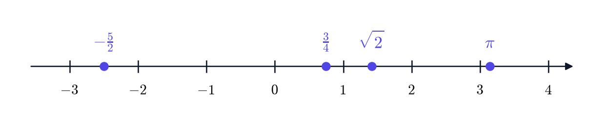{fig-alt="ישר המספרים ועליו מסומנים מינוס חמש חצאים, שלושה רבעים, שורש שתיים ופאי" width="85%" fig-align="center"}
:::

::: {.content-visible when-format="pdf"}
```{=latex}
\par\medskip
\noindent\beginL\hbox to \linewidth{\hss\includegraphics[width=0.85\linewidth]{figures/real-line.png}\hss}\endL\par
\medskip
```
:::

::: {#box-q-rational .thmqst}
אילו מהמספרים הבאים רציונליים? $$.0.121212\ldots, \qquad \sqrt{9}, \qquad \sqrt{7}, \qquad -\frac{6}{3}$$
:::

::: {.thmsol .foldable}
- $0.121212\ldots$ רציונלי, כי ההצגה העשרונית שלו מחזורית. (למעשה $.0.121212\ldots = \frac{12}{99} = \frac{4}{33}$)
- $\sqrt{9} = 3$ רציונלי, ואפילו טבעי.
- $\sqrt{7}$ אי-רציונלי. (כמו $\sqrt{2}$, השורש של מספר טבעי שאינו ריבוע של מספר טבעי הוא אי-רציונלי.)
- $-\frac{6}{3} = -2$ רציונלי, ואפילו שלם.
:::

## קבוצות וקטעים

נצטרך לתאר אוספים של מספרים: את כל הפתרונות של אי-שוויון, או את כל המספרים שבהם נוסחה מוגדרת. לשם כך נשתמש בכמה סימונים של קבוצות.

::: {#box-def-set-notation .thmdef title="סימוני קבוצות"}
- $x \in A$ פירושו: $x$ **שייך** לקבוצה $A$. הסימון $x \notin A$ פירושו שאינו שייך.
- $A \subseteq B$ פירושו: כל איבר של $A$ הוא גם איבר של $.B$
- $A \cup B$ (**איחוד**): כל האיברים שנמצאים ב-$A$ **או** ב-$B$ (או בשתיהן).
- $A \cap B$ (**חיתוך**): כל האיברים שנמצאים **גם** ב-$A$ **וגם** ב-$.B$
- $\emptyset$ היא **הקבוצה הריקה**, שאין בה איברים.
- $\{x : \dots\}$ היא קבוצת כל ה-$x$ שמקיימים את התנאי שכתוב אחרי הנקודתיים. למשל $.\{x \in \mathbb{Z} : 0 < x < 4\} = \{1, 2, 3\}$
:::

למשל, $-3 \in \mathbb{Z}$ אבל $\pi \notin \mathbb{Z}$, ו-$.\{1, 2\} \cup \{2, 5\} = \{1, 2, 5\}$

הקבוצות החשובות ביותר על הישר הן **קטעים**: כל המספרים שבין שתי נקודות.

::: {#box-def-interval .thmdef title="קטעים"}
יהיו $a < b$ מספרים ממשיים. נגדיר:

| סימון | הקבוצה | שם |
|:--:|:--:|:--|
| $(a, b)$ | $\{x : a < x < b\}$ | קטע פתוח |
| $[a, b]$ | $\{x : a \le x \le b\}$ | קטע סגור |
| $[a, b)$ | $\{x : a \le x < b\}$ | קטע חצי-פתוח |
| $(a, b]$ | $\{x : a < x \le b\}$ | קטע חצי-פתוח |
| $(a, \infty)$ | $\{x : x > a\}$ | קרן פתוחה |
| $[a, \infty)$ | $\{x : x \ge a\}$ | קרן סגורה |
| $(-\infty, b)$ | $\{x : x < b\}$ | קרן פתוחה |
| $(-\infty, b]$ | $\{x : x \le b\}$ | קרן סגורה |

סוגר עגול פירושו שנקודת הקצה **אינה** שייכת לקטע, וסוגר מרובע פירושו שהיא **כן** שייכת. גם הישר כולו הוא קטע: $.\mathbb{R} = (-\infty, \infty)$
:::

בציור מסמנים נקודת קצה ששייכת לקטע בעיגול מלא, ונקודת קצה שאינה שייכת בעיגול ריק.

::: {.content-visible when-format="html"}
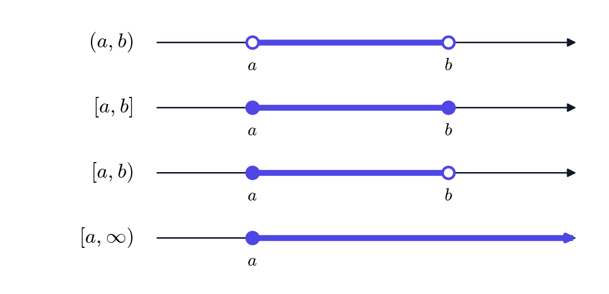{fig-alt="ארבעה ישרים: קטע פתוח עם עיגולים ריקים, קטע סגור עם עיגולים מלאים, קטע חצי פתוח וקרן" width="70%" fig-align="center"}
:::

::: {.content-visible when-format="pdf"}
```{=latex}
\par\medskip
\noindent\beginL\hbox to \linewidth{\hss\includegraphics[width=0.7\linewidth]{figures/intervals.png}\hss}\endL\par
\medskip
```
:::

::: {.thmwarn title="אינסוף אינו מספר"}
הסימן $\infty$ אינו מספר, ואי אפשר "להגיע" אליו. לכן ליד $\infty$ או $-\infty$ הסוגר תמיד **עגול**: כותבים $[2, \infty)$ ולא $.[2, \infty]$
:::

::: {#box-exm-intervals .thmexm title="קטעים, איחודים וחיתוכים"}
(א) הקבוצה $\{x : -1 \le x < 4\}$ היא הקטע $.[-1, 4)$

(ב) הקבוצה $(-\infty, 0] \cup (2, 6)$ היא כל המספרים שקטנים או שווים ל-$0$, יחד עם כל המספרים שבין $2$ ל-$6$. היא אינה קטע אחד, אלא איחוד של שני קטעים.

(ג) $.[1, 5] \cap (3, 8) = (3, 5]$ המספרים המשותפים לשני הקטעים הם אלה שגדולים מ-$3$ (כדי להיות בקטע השני) וקטנים או שווים ל-$5$ (כדי להיות בקטע הראשון).

(ד) $,[0, 1] \cap [2, 3] = \emptyset$ כי אין מספר ששייך לשני הקטעים.
:::

::: {.thmkey icon="calc" title="חיתוך ואיחוד של קטעים"}
הדרך הבטוחה: לצייר את שני הקטעים על אותו ישר, זה מעל זה. **חיתוך** הוא החלק שמכוסה פעמיים, ו**איחוד** הוא כל מה שמכוסה לפחות פעם אחת. בנקודות הקצה בודקים בנפרד אם הנקודה שייכת לקטעים.
:::

::: {#box-q-intervals .thmqst}
חשבו: (א) $;[-3, 2) \cap (0, 5]$ (ב) $.(-\infty, 1) \cup [1, 4]$
:::

::: {.thmsol .foldable}
(א) המשותף הוא המספרים שגדולים מ-$0$ וקטנים מ-$2$, ולכן $.(0, 2)$ הנקודה $0$ אינה בקטע השני, והנקודה $2$ אינה בקטע הראשון.

(ב) $.(-\infty, 4]$ הנקודה $1$ שייכת לקטע השני, ולכן ה"חור" שהשאיר הקטע הראשון נסגר.
:::

## ערך מוחלט

הערך המוחלט מודד **גודל** של מספר, בלי להתחשב בסימן שלו. אבל השימוש החשוב שלו בקורס הוא אחר: הביטוי $|a - b|$ מודד **מרחק** בין שני מספרים. מושג הגבול, שנלמד בהרצאה הבאה, מדבר על מספרים שמתקרבים זה לזה, ולכן כולו כתוב בשפה של ערך מוחלט.

::: {#box-def-abs .thmdef title="ערך מוחלט"}
**הערך המוחלט** של מספר ממשי $a$ הוא $$.|a| = \begin{cases} a & a \ge 0 \\ -a & a < 0 \end{cases}$$
:::

למשל $|5| = 5$, $|-5| = 5$ ו-$.|0| = 0$ שימו לב ש-$-a$ חיובי כאשר $a$ שלילי, ולכן תמיד $.|a| \ge 0$

::: {.thmkey icon="idea" title="ערך מוחלט הוא מרחק"}
$|a|$ הוא המרחק של $a$ מ-$0$ על הישר, ו-$|a - b|$ הוא **המרחק בין $a$ ל-$b$**. למשל $|7 - 3| = |3 - 7| = 4$, ו-$|x - 2|$ הוא המרחק של $x$ מ-$.2$
:::

::: {#box-thm-abs-props .thmthm title="תכונות הערך המוחלט"}
לכל $a, b$ ממשיים:

(א) $.|ab| = |a| \cdot |b|$ ובפרט $.|-a| = |a|$

(ב) $.\sqrt{a^2} = |a|$

(ג) **אי-שוויון המשולש**: $.|a + b| \le |a| + |b|$
:::

את (א) קל לבדוק בכל אחד מצירופי הסימנים. (ב) אומר שהשורש מחזיר תמיד את הפתרון **האי-שלילי**. (ג) אומר שאם הולכים מ-$0$ צעד באורך $a$ ואחר כך צעד באורך $b$, לא ניתן להתרחק יותר מסכום אורכי הצעדים: אם הצעדים בכיוונים מנוגדים, הם "מבטלים" זה את זה בחלקם.

::: {.thmwarn title="טעויות נפוצות"}
- $\sqrt{x^2} \ne x$ באופן כללי. למשל עבור $x = -4$: $\sqrt{(-4)^2} = \sqrt{16} = 4 = |-4|$, ולא $.-4$
- $|a + b| \ne |a| + |b|$ באופן כללי. למשל עבור $a = 2$ ו-$b = -7$: $|2 + (-7)| = 5$, אבל $.|2| + |-7| = 9$ זו בדיוק הסיבה שאי-שוויון המשולש הוא **אי-שוויון** ולא שוויון.
:::

### ערך מוחלט, מרחק וקטעים {.unnumbered}

נשתמש בפירוש של מרחק כדי לפתור משוואות ואי-שוויונים. האי-שוויון $|x - a| < r$ אומר: המרחק של $x$ מ-$a$ קטן מ-$r$. אלה בדיוק הנקודות שבקטע שמרכזו $a$ ורדיוסו $.r$

::: {.thmkey icon="rule" title="ערך מוחלט וקטעים"}
לכל $r > 0$: $$,|x - a| < r \iff a - r < x < a + r$$ כלומר $.x \in (a - r, a + r)$ ובאופן דומה, $|x - a| > r$ פירושו ש-$x$ **מחוץ** לקטע הזה: $x < a - r$ או $.x > a + r$
:::

::: {.content-visible when-format="html"}
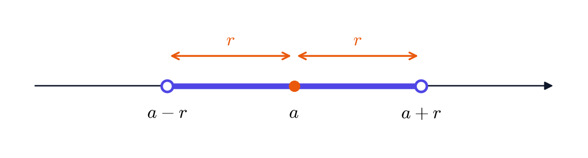{fig-alt="קטע פתוח שמרכזו a וקצותיו a פחות r ו-a ועוד r" width="70%" fig-align="center"}
:::

::: {.content-visible when-format="pdf"}
```{=latex}
\par\medskip
\noindent\beginL\hbox to \linewidth{\hss\includegraphics[width=0.7\linewidth]{figures/distance-interval.png}\hss}\endL\par
\medskip
```
:::

::: {.thmkey icon="calc" title="פתרון משוואות ואי-שוויונים עם ערך מוחלט"}
1. מבודדים את הביטוי שבתוך הערך המוחלט, $E$, בצד אחד: $|E| = c$ או $|E| < c$ או $.|E| > c$
2. אם $c < 0$: למשוואה $|E| = c$ ולאי-שוויון $|E| < c$ אין פתרון, ואי-השוויון $|E| > c$ מתקיים תמיד, כי ערך מוחלט אינו שלילי.
3. אם $c \ge 0$:
   - $|E| = c$ פירושו $E = c$ או $.E = -c$
   - $|E| < c$ פירושו $.-c < E < c$
   - $|E| > c$ פירושו $E > c$ או $.E < -c$
4. פותרים את האי-שוויונים שהתקבלו, וכותבים את התשובה כקטע או כאיחוד של קטעים.
:::

::: {#box-exm-abs-solve .thmexm title="משוואות ואי-שוויונים"}
(א) $.|2x - 3| = 5$ לפי השיטה, $2x - 3 = 5$ או $.2x - 3 = -5$ מהראשונה $x = 4$ ומהשנייה $.x = -1$ יש שני פתרונות.

(ב) $.|x - 4| < 3$ המרחק של $x$ מ-$4$ קטן מ-$3$, ולכן $-3 < x - 4 < 3$, כלומר $.1 < x < 7$ הפתרון הוא הקטע $.(1, 7)$

(ג) $.|2x + 1| \ge 3$ כאן $2x + 1 \ge 3$ או $.2x + 1 \le -3$ מהראשון $x \ge 1$ ומהשני $.x \le -2$ הפתרון הוא $.(-\infty, -2] \cup [1, \infty)$

(ד) $.|x - 2| = -1$ אין פתרון: ערך מוחלט לעולם אינו שלילי.
:::

::: {#box-q-abs .thmqst}
פתרו: (א) $;|x + 2| \le 4$ (ב) $.|3x - 1| > 2$
:::

::: {.thmsol .foldable}
(א) $-4 \le x + 2 \le 4$, ולכן $-6 \le x \le 2$. הפתרון: $.[-6, 2]$

(ב) $3x - 1 > 2$ או $.3x - 1 < -2$ מהראשון $x > 1$, ומהשני $3x < -1$ כלומר $.x < -\frac{1}{3}$ הפתרון: $.\left(-\infty, -\frac{1}{3}\right) \cup (1, \infty)$
:::

## מכפלה קרטזית והמישור

כדי לצייר פונקציה נצטרך נקודות במישור, וכל נקודה במישור היא **זוג סדור** של מספרים $.(x, y)$ המכפלה הקרטזית היא הדרך לבנות קבוצות של זוגות כאלה.

::: {#box-def-cartesian .thmdef title="מכפלה קרטזית"}
**המכפלה הקרטזית** של הקבוצות $A$ ו-$B$ היא קבוצת כל הזוגות הסדורים שהאיבר הראשון שלהם מ-$A$ והשני מ-$B$: $$.A \times B = \{ (a, b) : a \in A, \ b \in B \}$$
:::

::: {#box-exm-cartesian .thmexm title="מכפלות קרטזיות"}
(א) $.\{0, 1\} \times \{a, b, c\} = \{(0, a), (0, b), (0, c), (1, a), (1, b), (1, c)\}$ יש $2 \cdot 3 = 6$ זוגות.

(ב) $[1, 3] \times [0, 2]$ היא קבוצת כל הנקודות $(x, y)$ במישור שבהן $1 \le x \le 3$ ו-$.0 \le y \le 2$ זהו ריבוע (ראו בציור).

(ג) $\mathbb{R} \times \mathbb{R}$, שמסמנים $\mathbb{R}^2$, היא קבוצת כל הזוגות של מספרים ממשיים, כלומר **המישור** כולו.
:::

::: {.content-visible when-format="html"}
![הריבוע $[1,3] \times [0,2]$, ובו הנקודה $(2, 1.5)$.](figures/cartesian-square.png){fig-alt="ריבוע צבוע במישור בין x שווה 1 ל-3 ובין y שווה 0 ל-2" width="45%" fig-align="center"}
:::

::: {.content-visible when-format="pdf"}
```{=latex}
\par\medskip
\noindent\beginL\hbox to \linewidth{\hss\includegraphics[width=0.45\linewidth]{figures/cartesian-square.png}\hss}\endL\par
\medskip
```
:::

::: {.thmwarn title="הסדר חשוב"}
בזוג סדור יש חשיבות לסדר: $.(1, 2) \neq (2, 1)$ הנקודה הראשונה נמצאת מעל $x = 1$, והשנייה מעל $.x = 2$ לכן גם $A \times B \neq B \times A$ באופן כללי. למשל $[1, 3] \times [0, 2]$ ו-$[0, 2] \times [1, 3]$ הם שני ריבועים שונים במישור.
:::

::: {#box-q-cartesian .thmqst}
אילו מהנקודות $(1, 2)$, $(2, 0)$, $(0, 3)$ ו-$(3, 1)$ שייכות ל-$?[0, 2] \times [1, 3]$
:::

::: {.thmsol .foldable}
נקודה $(x, y)$ שייכת אם $0 \le x \le 2$ ו-$.1 \le y \le 3$ לכן $(1, 2)$ ו-$(0, 3)$ שייכות. $(2, 0)$ אינה שייכת, כי $.0 < 1$ $(3, 1)$ אינה שייכת, כי $.3 > 2$
:::

## פונקציות וגרפים

רוב הקורס עוסק ב**פונקציות**: כללים שמתאימים לכל מספר מספר אחר. הדרישה החשובה ביותר היא שהכלל יהיה **חד-משמעי**: כל קלט נותן תשובה אחת, ורק אחת.

::: {#box-def-function .thmdef title="פונקציה"}
יהיו $A$ ו-$B$ קבוצות. **פונקציה** $f : A \to B$ היא כלל שמתאים **לכל** $x \in A$ איבר **יחיד** $.f(x) \in B$

- הקבוצה $A$ נקראת **תחום ההגדרה** של $f$.
- הקבוצה $B$ נקראת **הטווח**.
- קבוצת כל הערכים שהפונקציה מקבלת בפועל, $\{f(x) : x \in A\}$, נקראת **התמונה** של $f$.
- **הגרף** של $f$ הוא קבוצת הנקודות $\{ (x, f(x)) : x \in A \}$ במישור.
:::

התמונה יכולה להיות קטנה מהטווח: עבור $f : \mathbb{R} \to \mathbb{R}$ שמוגדרת על ידי $f(x) = x^2$, הטווח הוא $\mathbb{R}$, אבל התמונה היא רק $,[0, \infty)$ כי ריבוע אינו שלילי.

::: {#box-exm-functions .thmexm title="פונקציות פשוטות"}
(א) $f(x) = 3x + 1$ מוגדרת לכל $x$ ממשי. הגרף שלה הוא ישר, והתמונה היא $.\mathbb{R}$

(ב) $f(x) = x^2$ מוגדרת לכל $x$ ממשי. הגרף שלה הוא פרבולה, והתמונה היא $.[0, \infty)$

(ג) $f(x) = |x|$ היא פונקציה שמוגדרת "בחלקים": $f(x) = x$ עבור $x \ge 0$ ו-$f(x) = -x$ עבור $.x < 0$ הגרף שלה הוא צורת $V$ שקודקודה בראשית, והתמונה היא $.[0, \infty)$

(ד) גם הכלל $$f(x) = \begin{cases} x + 1 & x < 0 \\ x^2 & x \ge 0 \end{cases}$$ הוא פונקציה: לכל $x$ ברור באיזו שורה להשתמש, וכל שורה נותנת ערך אחד. למשל $f(-2) = -1$, $f(0) = 0$ ו-$.f(3) = 9$ בגרף שלה יש "קפיצה" ב-$.x = 0$
:::

### מה אינו פונקציה {.unnumbered}

כדי להבין את ההגדרה, כדאי לראות דוגמאות שאינן עומדות בה. ההגדרה דורשת שלכל $x$ יהיה ערך **יחיד**. בגרף, פירוש הדבר הוא שכל קו אנכי פוגש את הגרף לכל היותר פעם אחת.

::: {.thmkey icon="rule" title="מבחן הקו האנכי"}
עקומה במישור היא גרף של פונקציה אם ורק אם **כל קו אנכי** חותך אותה **לכל היותר בנקודה אחת**.
:::

::: {#box-exm-circle .thmexm title="מעגל"}
המעגל $x^2 + y^2 = 4$ (מרכזו בראשית ורדיוסו $2$) **אינו** גרף של פונקציה. עבור $x = 1$ נקבל $y^2 = 3$, כלומר שתי נקודות: $y = \sqrt{3}$ ו-$.y = -\sqrt{3}$
:::

::: {#box-exm-ellipse .thmexm title="אליפסה"}
**האליפסה** $$\frac{x^2}{9} + \frac{y^2}{4} = 1$$ היא מעגל "מתוח". נמצא את נקודות החיתוך שלה עם הצירים. עבור $y = 0$ נקבל $x^2 = 9$, כלומר $.x = \pm 3$ עבור $x = 0$ נקבל $y^2 = 4$, כלומר $.y = \pm 2$ גם האליפסה אינה גרף של פונקציה: הקו $x = 1.5$ חותך אותה בשתי נקודות.

באופן כללי, האליפסה $\frac{x^2}{a^2} + \frac{y^2}{b^2} = 1$ חותכת את הצירים בנקודות $(\pm a, 0)$ ו-$.(0, \pm b)$ כאשר $a = b$ מתקבל מעגל.
:::

::: {#box-exm-hyperbola .thmexm title="היפרבולה"}
**ההיפרבולה** $$\frac{x^2}{4} - y^2 = 1$$ בנויה משני "ענפים". עבור $y = 0$ נקבל $x = \pm 2$: אלה **הקודקודים**. עבור $x = 0$ נקבל $y^2 = -1$, שאין לו פתרון, ולכן ההיפרבולה אינה חותכת את ציר $.y$ כאשר $x$ גדול, הענפים מתקרבים לישרים $y = \frac{1}{2}x$ ו-$y = -\frac{1}{2}x$, שנקראים **האסימפטוטות** שלה. גם ההיפרבולה אינה גרף של פונקציה: הקו $x = 3$ חותך אותה בשתי נקודות.

באופן כללי, להיפרבולה $\frac{x^2}{a^2} - \frac{y^2}{b^2} = 1$ יש קודקודים $(\pm a, 0)$ ואסימפטוטות $.y = \pm \frac{b}{a} x$
:::

::: {#box-exm-sideways-parabola .thmexm title="פרבולה שוכבת"}
העקומה $x = y^2$ היא פרבולה "שוכבת", שנפתחת ימינה. היא אינה גרף של פונקציה: עבור $x = 4$ נקבל $y = 2$ וגם $.y = -2$
:::

::: {.content-visible when-format="html"}
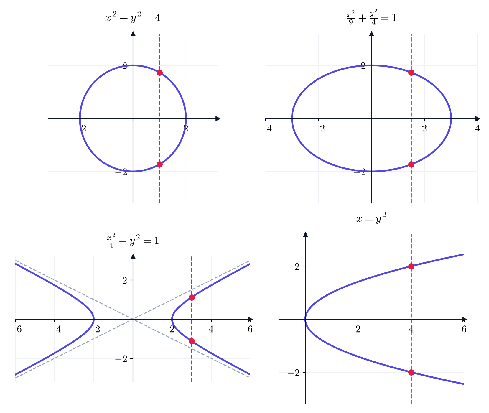{fig-alt="ארבע עקומות, ובכל אחת קו אנכי מקווקו שחותך את העקומה בשתי נקודות" width="85%" fig-align="center"}
:::

::: {.content-visible when-format="pdf"}
```{=latex}
\par\medskip
\noindent\beginL\hbox to \linewidth{\hss\includegraphics[width=0.85\linewidth]{figures/not-functions.png}\hss}\endL\par
\medskip
```
:::

::: {.thmkey icon="idea" title="חיתוך לחלקים"}
אף שהעקומות האלה אינן גרפים של פונקציות, אפשר לחתוך כל אחת מהן לחלקים שכל אחד מהם הוא גרף של פונקציה. למשל, מהמשוואה $x^2 + y^2 = 4$ נקבל $,y = \pm\sqrt{4 - x^2}$ ולכן חצי המעגל העליון הוא הגרף של הפונקציה $,y = \sqrt{4 - x^2}$ והתחתון הוא הגרף של $.y = -\sqrt{4 - x^2}$ באותו אופן, הענף העליון של $x = y^2$ הוא הגרף של $.y = \sqrt{x}$
:::

### תחום ההגדרה הטבעי {.unnumbered}

לעיתים קרובות נותנים פונקציה רק בעזרת נוסחה, בלי לציין את תחום ההגדרה. במקרה כזה מסכימים שתחום ההגדרה הוא כל המספרים שבהם לנוסחה יש משמעות.

::: {#box-def-natural-domain .thmdef title="תחום ההגדרה הטבעי"}
**תחום ההגדרה הטבעי** של פונקציה שנתונה בנוסחה הוא קבוצת כל ה-$x$ הממשיים שעבורם הנוסחה מוגדרת.
:::

::: {.thmkey icon="calc" title="מציאת תחום הגדרה"}
עוברים על הנוסחה ומחפשים את הפעולות ה"מסוכנות":

1. **חילוק**: המכנה חייב להיות שונה מאפס.
2. **שורש זוגי** ($\sqrt{\ }$, $\sqrt[4]{\ }$, ...): הביטוי שבתוכו חייב להיות אי-שלילי.
3. **לוגריתם** (נכיר בהמשך ההרצאה): הביטוי שבתוכו חייב להיות חיובי.

כל דרישה כזו נותנת משוואה או אי-שוויון. פותרים את כולם, ותחום ההגדרה הוא ה**חיתוך** של כל הפתרונות.
:::

::: {#box-exm-domain .thmexm title="תחומי הגדרה"}
(א) $.f(x) = \sqrt{x - 3}$ צריך $x - 3 \ge 0$, כלומר $.x \ge 3$ תחום ההגדרה: $.[3, \infty)$

(ב) $.f(x) = \frac{1}{x^2 - 4}$ צריך $x^2 - 4 \neq 0$, כלומר $.x \neq \pm 2$ תחום ההגדרה: $\mathbb{R} \setminus \{-2, 2\}$, שאפשר לכתוב גם כ-$.(-\infty, -2) \cup (-2, 2) \cup (2, \infty)$

(ג) $.f(x) = \frac{\sqrt{x + 1}}{x - 2}$ יש כאן שתי דרישות: $x + 1 \ge 0$ (בגלל השורש) ו-$x - 2 \neq 0$ (בגלל המכנה). כלומר $x \ge -1$ ו-$.x \neq 2$ תחום ההגדרה: $.[-1, 2) \cup (2, \infty)$
:::

::: {#box-q-domain .thmqst}
מצאו את תחום ההגדרה של $.f(x) = \frac{1}{\sqrt{5 - x}}$
:::

::: {.thmsol .foldable}
בגלל השורש צריך $,5 - x \ge 0$ ובגלל המכנה צריך $.\sqrt{5 - x} \neq 0$ יחד, $5 - x > 0$, כלומר $.x < 5$ תחום ההגדרה: $.(-\infty, 5)$
:::

## פונקציות זוגיות ואי-זוגיות

סימטריה חוסכת עבודה: אם יודעים שגרף סימטרי, מספיק לצייר את החצי הימני שלו, $x \ge 0$, והחצי השמאלי נקבע ממנו.

::: {#box-def-even-odd .thmdef title="פונקציה זוגית ואי-זוגית"}
תהי $f$ פונקציה שתחום ההגדרה שלה **סימטרי סביב $0$** (כלומר, אם $x$ בתחום, גם $-x$ בתחום).

- $f$ נקראת **זוגית** אם $f(-x) = f(x)$ לכל $x$ בתחום.
- $f$ נקראת **אי-זוגית** אם $f(-x) = -f(x)$ לכל $x$ בתחום.
:::

::: {.thmkey icon="idea" title="מה רואים בגרף"}
- הגרף של פונקציה **זוגית** סימטרי ביחס לציר $y$: הצד השמאלי הוא שיקוף ראי של הצד הימני.
- הגרף של פונקציה **אי-זוגית** סימטרי ביחס לראשית: סיבוב של חצי סיבוב סביב הראשית מחזיר אותו לעצמו.
:::

::: {.content-visible when-format="html"}
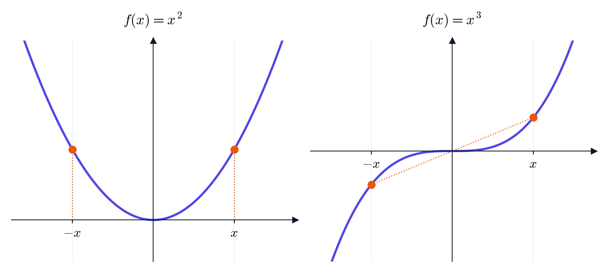{fig-alt="פרבולה עם שתי נקודות בגובה שווה, ופונקציה מעוקבת עם שתי נקודות סימטריות ביחס לראשית" width="80%" fig-align="center"}
:::

::: {.content-visible when-format="pdf"}
```{=latex}
\par\medskip
\noindent\beginL\hbox to \linewidth{\hss\includegraphics[width=0.8\linewidth]{figures/even-odd.png}\hss}\endL\par
\medskip
```
:::

::: {.thmkey icon="calc" title="בדיקת זוגיות"}
1. בודקים שתחום ההגדרה סימטרי סביב $.0$
2. מחשבים את $f(-x)$ ומפשטים.
3. אם התקבל $f(x)$, הפונקציה זוגית. אם התקבל $-f(x)$, היא אי-זוגית.
4. אחרת, כדי להראות שהיא **לא** זוגית ולא אי-זוגית, מספיק למצוא מספר אחד $x$ שבו שני השוויונות נכשלים.
:::

::: {#box-exm-even-odd .thmexm title="זוגית, אי-זוגית או אף אחת מהן"}
(א) $f(x) = x^4 - 2x^2$ זוגית: $.f(-x) = (-x)^4 - 2(-x)^2 = x^4 - 2x^2 = f(x)$ גם $x^2$ ו-$|x|$ זוגיות.

(ב) $f(x) = x^3 - 4x$ אי-זוגית: $.f(-x) = (-x)^3 - 4(-x) = -x^3 + 4x = -(x^3 - 4x) = -f(x)$

(ג) $f(x) = x^2 + x$ אינה זוגית ואינה אי-זוגית. נציב $x = 1$: $f(1) = 2$ ו-$f(-1) = 0$. מתקיים $f(-1) \neq f(1)$ ולכן $f$ אינה זוגית, ו-$f(-1) \neq -f(1)$ ולכן אינה אי-זוגית.
:::

::: {.thmwarn title="למה דורשים תחום סימטרי"}
- נגדיר $f(x) = x^2$ רק על הקטע $.[-1, 3]$ הנוסחה זהה, אבל הפונקציה **אינה** זוגית: $f(3) = 9$, ו-$f(-3)$ כלל אינו מוגדר. בלי תחום סימטרי אין עם מה להשוות.
- רוב הפונקציות אינן זוגיות ואינן אי-זוגיות. "לא זוגית" אינו אומר "אי-זוגית".
:::

::: {#box-q-even-odd .thmqst}
סווגו: (א) $;x^5 + x$ (ב) $;x^2 - 7$ (ג) $.x - 1$
:::

::: {.thmsol .foldable}
(א) $(-x)^5 + (-x) = -x^5 - x = -(x^5 + x)$, ולכן אי-זוגית.

(ב) $(-x)^2 - 7 = x^2 - 7$, ולכן זוגית.

(ג) $f(1) = 0$ ו-$.f(-1) = -2$ מתקיים $f(-1) \neq f(1)$ וגם $,f(-1) \neq -f(1) = 0$ ולכן אף אחת מהן.
:::

## הזזה ומתיחה של גרפים

אנחנו מכירים מעט גרפים בסיסיים: $x^2$, $\sqrt{x}$, $|x|$, ובהמשך $\sin x$ ו-$e^x$. בעזרת הזזות ומתיחות אפשר לקבל מהם הרבה גרפים חדשים, בלי עבודה נוספת.

::: {#box-thm-transformations .thmthm title="הזזה, מתיחה ושיקוף"}
יהי $c > 0$. הגרף של הפונקציה בעמודה השמאלית מתקבל מהגרף של $y = f(x)$ כך:

| הפונקציה החדשה | מה קורה לגרף |
|:--:|:--|
| $f(x) + c$ | הזזה **למעלה** ב-$c$ |
| $f(x) - c$ | הזזה **למטה** ב-$c$ |
| $f(x - c)$ | הזזה **ימינה** ב-$c$ |
| $f(x + c)$ | הזזה **שמאלה** ב-$c$ |
| $c \, f(x)$ | מתיחה אנכית פי $c$ (כיווץ, אם $c < 1$) |
| $f(c\,x)$ | כיווץ אופקי פי $c$ (מתיחה, אם $c < 1$) |
| $-f(x)$ | שיקוף ביחס לציר $x$ |
| $f(-x)$ | שיקוף ביחס לציר $y$ |
:::

::: {.thmwarn title="ההזזה האופקית הפוכה לאינטואיציה"}
הגרף של $f(x - 2)$ זז **ימינה**, למרות סימן המינוס. הסיבה: הפונקציה החדשה מגיעה לכל ערך **מאוחר יותר** ב-$2$. למשל, $\sqrt{x}$ מתחילה ב-$x = 0$, ואילו $\sqrt{x - 2}$ מתחילה רק ב-$,x = 2$ כי שם $.x - 2 = 0$ באותו אופן, הגרף של $f(2x)$ **מתכווץ**: הפונקציה החדשה מגיעה לכל ערך בחצי מהזמן.
:::

::: {#box-exm-sqrt-family .thmexm title="משפחת השורש"}
נצא מ-$y = \sqrt{x}$ (בקו מקווקו בציור):

- $\sqrt{x + 1}$: הזזה שמאלה ב-$1$. היא מתחילה ב-$.x = -1$
- $\sqrt{x} + 1$: הזזה למעלה ב-$1$.
- $3\sqrt{x}$: מתיחה אנכית פי $3$.
- $-\sqrt{x}$: שיקוף ביחס לציר $x$.
- $\sqrt{-x}$: שיקוף ביחס לציר $y$. היא מוגדרת עבור $.x \le 0$
- $\sqrt{x - 2}$: הזזה ימינה ב-$2$.
:::

::: {.content-visible when-format="html"}
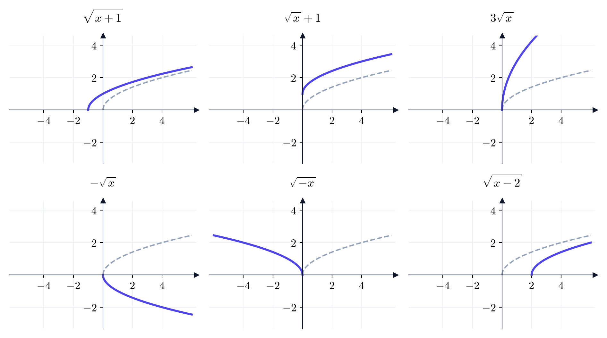{fig-alt="שש מערכות צירים, ובכל אחת גרף השורש המקורי מקווקו והגרף החדש בקו מלא" width="95%" fig-align="center"}
:::

::: {.content-visible when-format="pdf"}
```{=latex}
\par\medskip
\noindent\beginL\hbox to \linewidth{\hss\includegraphics[width=0.95\linewidth]{figures/sqrt-family.png}\hss}\endL\par
\medskip
```
:::

::: {.thmkey icon="calc" title="ציור גרף בעזרת הזזות"}
1. מזהים את הגרף הבסיסי.
2. רושמים את השינויים: קודם את השינויים **בתוך** הסוגריים (אופקיים), ואחר כך את אלה **מחוץ** להם (אנכיים).
3. מזיזים כמה נקודות מפתח: נקודות חיתוך עם הצירים, קודקוד, אסימפטוטה. מציירים את הגרף דרכן.
:::

::: {#box-exm-complete-square .thmexm title="השלמה לריבוע"}
נצייר את $.f(x) = x^2 - 4x + 7$ נשלים לריבוע. מכיוון ש-$(x - 2)^2 = x^2 - 4x + 4$, נקבל $$.x^2 - 4x + 7 = (x^2 - 4x + 4) + 3 = (x - 2)^2 + 3$$ לכן הגרף הוא הפרבולה $y = x^2$ אחרי הזזה **ימינה** ב-$2$ ו**למעלה** ב-$3$. הקודקוד עובר מ-$(0, 0)$ אל $,(2, 3)$ והתמונה היא $.[3, \infty)$
:::

::: {#box-q-transform .thmqst}
איך מקבלים את הגרף של $y = |x + 3| - 1$ מהגרף של $?y = |x|$ איפה הקודקוד?
:::

::: {.thmsol .foldable}
בתוך הערך המוחלט יש $,x + 3$ ולכן הזזה שמאלה ב-$3$. מחוץ לו יש $,-1$ ולכן הזזה למטה ב-$1$. הקודקוד עובר מ-$(0, 0)$ אל $.(-3, -1)$
:::

## הרכבת פונקציות

נוסחאות מסובכות בנויות משלבים פשוטים. למשל, כדי לחשב את $\sqrt{x^2 + 4}$ מחשבים קודם $x^2 + 4$, ואחר כך את השורש של התוצאה. לזהות את השלבים האלה זו מיומנות חשובה: עליה בנוי כלל השרשרת לגזירה, שנלמד בהמשך.

::: {#box-def-composition .thmdef title="הרכבת פונקציות"}
**ההרכבה** של $f$ ו-$g$ היא הפונקציה $$,(f \circ g)(x) = f\big(g(x)\big)$$ כלומר "קודם $g$, ואחר כך $f$". תחום ההגדרה של $f \circ g$ הוא כל ה-$x$ שבתחום של $g$, ושעבורם $g(x)$ בתחום של $.f$
:::

::: {#box-exm-composition .thmexm title="הרכבה בשני הסדרים"}
יהיו $f(x) = x^2$ ו-$.g(x) = x + 4$ אז $$.(f \circ g)(x) = f(x + 4) = (x + 4)^2, \qquad (g \circ f)(x) = g(x^2) = x^2 + 4$$ למשל, עבור $x = 1$ נקבל $(f \circ g)(1) = 25$ ואילו $.(g \circ f)(1) = 5$
:::

::: {.thmwarn title="הסדר חשוב"}
באופן כללי $.f \circ g \neq g \circ f$ בדוגמה האחרונה, "קודם להוסיף $4$ ואחר כך לרבע" שונה מ"קודם לרבע ואחר כך להוסיף $4$".
:::

::: {#box-exm-composition-domain .thmexm title="תחום ההגדרה של הרכבה"}
יהיו $f(x) = \sqrt{x}$ ו-$.g(x) = x - 5$ אז $.(f \circ g)(x) = \sqrt{x - 5}$ הפונקציה $g$ מוגדרת לכל $x$, אבל ההרכבה מוגדרת רק כאשר $,x - 5 \ge 0$ כלומר בקטע $.[5, \infty)$ תחום ההגדרה של ההרכבה **קטן** מהתחום של $.g$
:::

::: {.thmwarn title="למה צריך את התנאי על התחום"}
יהיו $f(x) = \sqrt{x}$ ו-$.g(x) = -1 - x^2$ הערך $g(x)$ תמיד שלילי, ולכן $\sqrt{g(x)}$ אינו מוגדר לאף $x$: תחום ההגדרה של $f \circ g$ הוא הקבוצה הריקה. לא מספיק ש-$f$ ו-$g$ מוגדרות; צריך שהפלט של $g$ יהיה קלט חוקי של $.f$
:::

::: {.thmkey icon="calc" title="פירוק לשלבים"}
כדי לכתוב פונקציה כהרכבה, שואלים: "מה מחשבים קודם?" זו הפונקציה הפנימית $.g$ "מה עושים לתוצאה?" זו הפונקציה החיצונית $.f$
:::

::: {#box-exm-decompose .thmexm title="פירוק להרכבה"}
(א) $\sqrt{x^2 + 4} = f(g(x))$ עבור $g(x) = x^2 + 4$ (קודם) ו-$f(x) = \sqrt{x}$ (אחר כך).

(ב) $(3x - 1)^7 = f(g(x))$ עבור $g(x) = 3x - 1$ ו-$.f(x) = x^7$
:::

::: {#box-q-composition .thmqst}
יהיו $f(x) = \frac{1}{x}$ ו-$.g(x) = x - 2$ מצאו את $f \circ g$ ואת $g \circ f$ ואת תחומי ההגדרה שלהן.
:::

::: {.thmsol .foldable}
$(f \circ g)(x) = \frac{1}{x - 2}$, ותחום ההגדרה הוא $.x \neq 2$

$(g \circ f)(x) = \frac{1}{x} - 2$, ותחום ההגדרה הוא $.x \neq 0$
:::

## פולינומים ושורשיהם

הפונקציות הפשוטות ביותר הן אלה שמשתמשות רק בחיבור ובכפל. הן מוגדרות בכל מקום, קל לחשב אותן, ובסוף הקורס נראה שאפשר לקרב בעזרתן כמעט כל פונקציה אחרת (טורי טיילור).

::: {#box-def-polynomial .thmdef title="פולינום"}
**פולינום** הוא פונקציה מהצורה $$,P(x) = a_n x^n + a_{n-1} x^{n-1} + \dots + a_1 x + a_0$$ כאשר $a_0, \dots, a_n$ מספרים ממשיים (**המקדמים**) ו-$.a_n \neq 0$ המספר $n$ נקרא **המעלה** של $.P$ **שורש** של $P$ הוא מספר $r$ שעבורו $.P(r) = 0$
:::

הדרישה $a_n \neq 0$ קובעת את המעלה: בלעדיה, $0 \cdot x^3 + x + 1$ היה "פולינום ממעלה $3$", אף שזו פשוט הפונקציה $.x + 1$ פולינום ממעלה $1$ הוא ישר, וממעלה $2$ הוא פרבולה. בגרף, השורשים הם הנקודות שבהן הגרף חותך את ציר $x$ או נוגע בו.

::: {#box-thm-roots .thmthm title="שורשים של פולינומים"}
(א) $r$ הוא שורש של $P$ אם ורק אם אפשר לכתוב $,P(x) = (x - r) \, Q(x)$ כאשר $Q$ פולינום ממעלה אחת פחות.

(ב) לפולינום ממעלה $n$ יש **לכל היותר** $n$ שורשים ממשיים.

(ג) **נוסחת השורשים**: לפולינום $ax^2 + bx + c$ (עם $a \neq 0$) יש את השורשים $$,x = \frac{-b \pm \sqrt{b^2 - 4ac}}{2a}$$ והמספר $\Delta = b^2 - 4ac$ (**הדיסקרימיננטה**) קובע כמה הם: שני שורשים אם $,\Delta > 0$ שורש אחד אם $,\Delta = 0$ ואין שורשים ממשיים אם $.\Delta < 0$
:::

::: {.thmwarn title="לכל היותר, לא בדיוק"}
לפולינום ממעלה $n$ יכולים להיות **פחות** מ-$n$ שורשים. למשל ל-$x^2 + 4$ אין שורשים ממשיים כלל: $x^2 + 4 \ge 4 > 0$ לכל $.x$
:::

::: {.thmkey icon="calc" title="מציאת שורשים"}
1. מוציאים גורם משותף, למשל $.x^3 - 9x = x(x^2 - 9)$
2. מזהים נוסחאות כפל מקוצר: $a^2 - b^2 = (a - b)(a + b)$ ו-$.a^2 \pm 2ab + b^2 = (a \pm b)^2$
3. לפולינום ממעלה $2$ משתמשים בנוסחת השורשים.
4. לפולינום ממעלה $3$ מנחשים שורש שלם $r$ מבין המחלקים של $a_0$ (כולל השליליים), ואז מחלקים ב-$(x - r)$ לפי (א) ומקבלים פולינום ממעלה $2$.
:::

::: {#box-exm-roots .thmexm title="מציאת שורשים"}
(א) $.x^2 - x - 6 = (x - 3)(x + 2)$ השורשים: $3$ ו-$.-2$

(ב) $.x^3 - 9x = x(x^2 - 9) = x(x - 3)(x + 3)$ השורשים: $0$, $3$ ו-$.-3$

(ג) ל-$x^2 + 4$ אין שורשים ממשיים.

(ד) $.x^2 + 6x + 9 = (x + 3)^2$ יש שורש יחיד, $,-3$ ושם הגרף **נוגע** בציר $x$ בלי לחצות אותו. (שורש כזה נקרא **שורש כפול**.)

(ה) $.x^3 - 2x^2 - x + 2$ המחלקים של $a_0 = 2$ הם $\pm 1, \pm 2$. ננסה $x = 1$: $1 - 2 - 1 + 2 = 0$, ולכן $1$ שורש. נחלק ונקבל $,x^3 - 2x^2 - x + 2 = (x - 1)(x^2 - x - 2) = (x - 1)(x - 2)(x + 1)$ והשורשים הם $1$, $2$ ו-$.-1$
:::

::: {.content-visible when-format="html"}
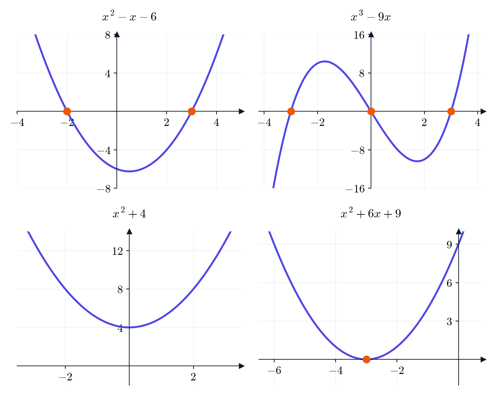{fig-alt="ארבעה גרפים: פרבולה עם שני שורשים, פולינום ממעלה שלוש עם שלושה שורשים, פרבולה בלי שורשים ופרבולה שנוגעת בציר" width="80%" fig-align="center"}
:::

::: {.content-visible when-format="pdf"}
```{=latex}
\par\medskip
\noindent\beginL\hbox to \linewidth{\hss\includegraphics[width=0.8\linewidth]{figures/polynomials.png}\hss}\endL\par
\medskip
```
:::

::: {#box-q-roots .thmqst}
מצאו את השורשים של (א) $;3x^2 - 12$ (ב) $.x^3 - x^2$
:::

::: {.thmsol .foldable}
(א) $3x^2 - 12 = 3(x^2 - 4) = 3(x - 2)(x + 2)$, והשורשים הם $.\pm 2$

(ב) $x^3 - x^2 = x^2(x - 1)$, והשורשים הם $0$ (שורש כפול) ו-$.1$
:::

## הפונקציות הטריגונומטריות

נרצה פונקציות **שחוזרות על עצמן**. מעגל מייצר אותן באופן טבעי: אם מסתובבים סביבו שוב ושוב, חוזרים לאותן נקודות. כך נגדיר את $\sin$ ו-$\cos$, וכל התכונות שלהן ינבעו מהציור.

### רדיאנים {.unnumbered}

**מעגל היחידה** הוא המעגל שמרכזו בראשית ורדיוסו $1$. היקפו $.2\pi$

::: {#box-def-radian .thmdef title="רדיאן"}
את הזווית מודדים לפי **אורך הקשת** שהיא חותכת על מעגל היחידה. היחידה נקראת **רדיאן**. מכיוון שהיקף המעגל הוא $2\pi$:

- סיבוב שלם הוא $;2\pi$
- חצי סיבוב הוא $;\pi$
- רבע סיבוב (זווית ישרה) הוא $.\frac{\pi}{2}$
:::

::: {.thmkey icon="idea" title="למה רדיאנים"}
ברדיאנים הזווית **היא** אורך, ולכן היא מספר ממשי רגיל, על אותו ישר כמו כל שאר המספרים בקורס. החלוקה ל-$360$ מעלות שרירותית. לאורך כל הקורס זוויות יימדדו ברדיאנים. (רק כדי להתמצא: $\pi$ רדיאנים הם $180$ מעלות.)
:::

### ההגדרה הגאומטרית {.unnumbered}

::: {#box-def-sin-cos .thmdef title="סינוס וקוסינוס"}
מתחילים בנקודה $(1, 0)$ והולכים לאורך מעגל היחידה מרחק $\theta$: נגד כיוון השעון אם $,\theta > 0$ ועם כיוון השעון אם $.\theta < 0$ לנקודה שמגיעים אליה קוראים $.(\cos\theta, \sin\theta)$

כלומר, $\cos\theta$ הוא **שיעור ה-$x$** של הנקודה, ו-$\sin\theta$ הוא **שיעור ה-$y$** שלה.
:::

::: {.content-visible when-format="html"}
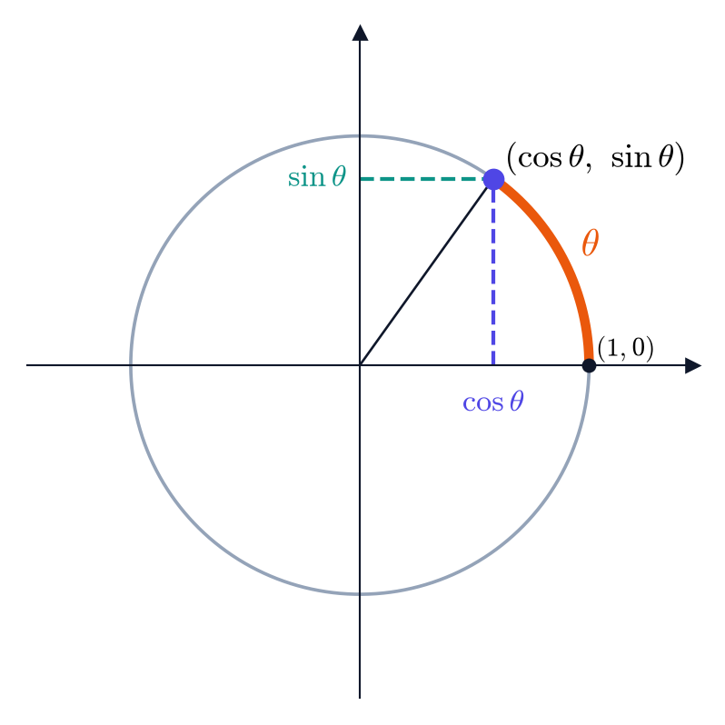{fig-alt="מעגל היחידה, קשת באורך תטא מהנקודה אחת אפס, והנקודה קוסינוס תטא סינוס תטא עם ההיטלים שלה על הצירים" width="50%" fig-align="center"}
:::

::: {.content-visible when-format="pdf"}
```{=latex}
\par\medskip
\noindent\beginL\hbox to \linewidth{\hss\includegraphics[width=0.5\linewidth]{figures/unit-circle.png}\hss}\endL\par
\medskip
```
:::

### מה רואים בציור {.unnumbered}

כל התכונות הבסיסיות של $\sin$ ו-$\cos$ נובעות ישירות מההגדרה:

::: {#box-thm-trig-props .thmthm title="תכונות הסינוס והקוסינוס"}
לכל $\theta$ ממשי:

(א) **מחזוריות**: $\sin(\theta + 2\pi) = \sin\theta$ ו-$.\cos(\theta + 2\pi) = \cos\theta$

(ב) **טווח**: $-1 \le \sin\theta \le 1$ ו-$.-1 \le \cos\theta \le 1$

(ג) **זהות פיתגורס**: $.\sin^2\theta + \cos^2\theta = 1$

(ד) **זוגיות**: $\cos(-\theta) = \cos\theta$ ו-$.\sin(-\theta) = -\sin\theta$

(ה) **חצי סיבוב**: $\sin(\theta + \pi) = -\sin\theta$ ו-$.\cos(\theta + \pi) = -\cos\theta$

(ו) **שיקוף ביחס לציר $y$**: $\sin(\pi - \theta) = \sin\theta$ ו-$.\cos(\pi - \theta) = -\cos\theta$

(ז) **זווית משלימה**: $\sin\left(\frac{\pi}{2} - \theta\right) = \cos\theta$ ו-$.\cos\left(\frac{\pi}{2} - \theta\right) = \sin\theta$
:::

מאיפה זה בא? כל אחת מהתכונות היא תיאור של מה שקורה על המעגל:

- (א) הליכה של עוד $2\pi$ היא עוד סיבוב שלם, שמחזיר אותנו לאותה נקודה.
- (ב) כל נקודה על מעגל היחידה נמצאת בין $-1$ ל-$1$ בכל אחד מהשיעורים.
- (ג) המרחק של הנקודה מהראשית הוא $1$, ולפי משפט פיתגורס $.\cos^2\theta + \sin^2\theta = 1^2$
- (ד) הליכה של $-\theta$ (עם כיוון השעון) מגיעה לשיקוף של הנקודה ביחס לציר $x$: שיעור ה-$x$ נשאר, ושיעור ה-$y$ מחליף סימן.
- (ה) עוד חצי סיבוב מביא אותנו לנקודה הנגדית במעגל, ששני השיעורים שלה מחליפים סימן.
- (ו) הנקודות שמתאימות ל-$\theta$ ול-$\pi - \theta$ הן שיקוף זו של זו ביחס לציר $.y$
- (ז) הנקודות שמתאימות ל-$\theta$ ול-$\frac{\pi}{2} - \theta$ הן שיקוף זו של זו ביחס לישר $y = x$, ושיקוף כזה מחליף בין השיעורים.

תכונה (א) היא הסיבה שבשבילה בנינו את הפונקציות האלה. ניתן לה שם:

::: {#box-def-periodic .thmdef title="פונקציה מחזורית"}
פונקציה $f$ נקראת **מחזורית** עם **מחזור** $T > 0$ אם $f(x + T) = f(x)$ לכל $.x$ בדרך כלל, "המחזור" הוא ה-$T$ הקטן ביותר שמקיים זאת.
:::

לפי (א), $\sin$ ו-$\cos$ מחזוריות עם מחזור $.2\pi$ ולפי (ד), $\cos$ זוגית ו-$\sin$ אי-זוגית.

### ערכים מיוחדים {.unnumbered}

את הערכים בזוויות המיוחדות לא צריך לשנן: אפשר לקבל אותם מציור.

::: {#box-exm-axis-values .thmexm title="ארבע הנקודות על הצירים"}
- $\theta = 0$: הנקודה $(1, 0)$, ולכן $\cos 0 = 1$ ו-$.\sin 0 = 0$
- $\theta = \frac{\pi}{2}$ (רבע סיבוב): הנקודה $(0, 1)$, ולכן $\cos\frac{\pi}{2} = 0$ ו-$.\sin\frac{\pi}{2} = 1$
- $\theta = \pi$ (חצי סיבוב): הנקודה $(-1, 0)$, ולכן $\cos\pi = -1$ ו-$.\sin\pi = 0$
- $\theta = \frac{3\pi}{2}$: הנקודה $(0, -1)$, ולכן $\cos\frac{3\pi}{2} = 0$ ו-$.\sin\frac{3\pi}{2} = -1$
:::

::: {#box-exm-special-angles .thmexm title="הזוויות $\\frac{\\pi}{4}$, $\\frac{\\pi}{6}$ ו-$\\frac{\\pi}{3}$"}
(א) $.\theta = \frac{\pi}{4}$ זו חצי מזווית ישרה, ולכן הנקודה נמצאת על הישר $,y = x$ כלומר $.\cos\frac{\pi}{4} = \sin\frac{\pi}{4}$ מזהות פיתגורס, $2\sin^2\frac{\pi}{4} = 1$, ולכן $.\sin\frac{\pi}{4} = \cos\frac{\pi}{4} = \frac{\sqrt{2}}{2}$

(ב) $.\theta = \frac{\pi}{6}$ הנקודות שמתאימות ל-$\frac{\pi}{6}$ ול-$-\frac{\pi}{6}$ יוצרות יחד עם הראשית משולש שווה-צלעות (כל זוויותיו $\frac{\pi}{3}$ וצלעותיו $1$). הצלע האנכית שלו באורך $,2\sin\frac{\pi}{6}$ והיא שווה ל-$1$. לכן $,\sin\frac{\pi}{6} = \frac{1}{2}$ ומזהות פיתגורס $.\cos\frac{\pi}{6} = \sqrt{1 - \frac{1}{4}} = \frac{\sqrt{3}}{2}$

(ג) $.\theta = \frac{\pi}{3}$ לפי תכונת הזווית המשלימה, עם $,\frac{\pi}{2} - \frac{\pi}{6} = \frac{\pi}{3}$ נקבל $\sin\frac{\pi}{3} = \cos\frac{\pi}{6} = \frac{\sqrt{3}}{2}$ ו-$.\cos\frac{\pi}{3} = \sin\frac{\pi}{6} = \frac{1}{2}$
:::

::: {.thmkey icon="calc" title="הערך בכל זווית מיוחדת"}
1. מחסירים (או מוסיפים) סיבובים שלמים של $2\pi$ עד שהזווית בין $0$ ל-$.2\pi$
2. בעזרת התכונות (ד)–(ו) מעבירים את הזווית לרבע הראשון, $.\left[0, \frac{\pi}{2}\right]$
3. קוראים את הערך, וקובעים את הסימן לפי הרביע שבו הנקודה המקורית נמצאת.
:::

::: {#box-q-special .thmqst}
חשבו את $\sin\frac{5\pi}{6}$ ואת $.\cos\frac{4\pi}{3}$
:::

::: {.thmsol .foldable}
$\frac{5\pi}{6} = \pi - \frac{\pi}{6}$, ולפי (ו) $.\sin\frac{5\pi}{6} = \sin\frac{\pi}{6} = \frac{1}{2}$

$\frac{4\pi}{3} = \pi + \frac{\pi}{3}$, ולפי (ה) $.\cos\frac{4\pi}{3} = -\cos\frac{\pi}{3} = -\frac{1}{2}$
:::

### הגרפים {.unnumbered}

אם "נפרוש" את המעגל על ציר $x$, ונצייר מעל כל $\theta$ את הגובה של הנקודה, נקבל את הגרף של $.\sin$ באותו אופן מתקבל הגרף של $.\cos$ בגרפים רואים את המחזוריות, את הטווח $[-1, 1]$, את השורשים, ואת הזוגיות של $\cos$ והאי-זוגיות של $.\sin$

::: {.content-visible when-format="html"}
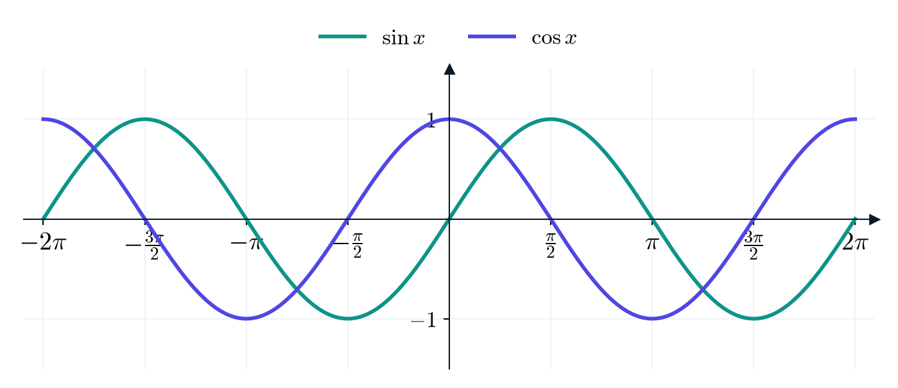{fig-alt="גלי הסינוס והקוסינוס בין מינוס שתיים פאי לשתיים פאי" width="90%" fig-align="center"}
:::

::: {.content-visible when-format="pdf"}
```{=latex}
\par\medskip
\noindent\beginL\hbox to \linewidth{\hss\includegraphics[width=0.9\linewidth]{figures/sin-cos.png}\hss}\endL\par
\medskip
```
:::

שימו לב שהגרף של $\cos$ הוא הגרף של $\sin$ אחרי הזזה שמאלה ב-$.\frac{\pi}{2}$ זו תכונה (ז) בשפה של הזזות: $.\cos x = \sin\left(x + \frac{\pi}{2}\right)$

### טנגנס {.unnumbered}

::: {#box-def-tan .thmdef title="טנגנס"}
$$.\tan\theta = \frac{\sin\theta}{\cos\theta}$$ מבחינה גאומטרית, $\tan\theta$ הוא **השיפוע** של הקרן מהראשית אל הנקודה $.(\cos\theta, \sin\theta)$
:::

::: {.thmwarn title="איפה טנגנס אינו מוגדר"}
$\tan\theta$ אינו מוגדר כאשר $,\cos\theta = 0$ כלומר בנקודות $\theta = \frac{\pi}{2} + k\pi$ עבור $k$ שלם. בנקודות האלה הקרן אנכית, ולקו אנכי אין שיפוע. בגרף, אלה **אסימפטוטות אנכיות**: הפונקציה שואפת שם ל-$\infty$ או ל-$.-\infty$
:::

מתכונה (ה), $,\tan(\theta + \pi) = \frac{-\sin\theta}{-\cos\theta} = \tan\theta$ ולכן $\tan$ מחזורית עם מחזור $\pi$ בלבד. מתכונה (ד), $\tan$ אי-זוגית. למשל $.\tan\frac{\pi}{4} = 1$

::: {.content-visible when-format="html"}
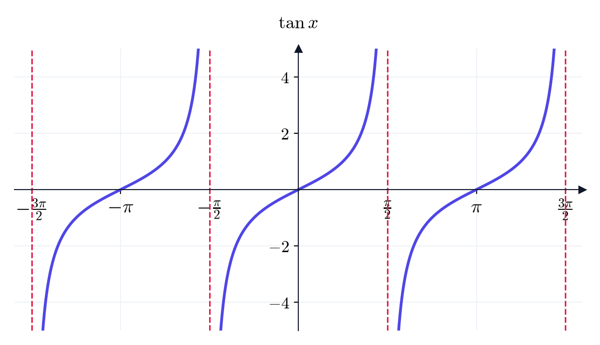{fig-alt="גרף הטנגנס עם קווים אנכיים מקווקווים במינוס שלוש פאי חצי, מינוס פאי חצי, פאי חצי ושלוש פאי חצי" width="75%" fig-align="center"}
:::

::: {.content-visible when-format="pdf"}
```{=latex}
\par\medskip
\noindent\beginL\hbox to \linewidth{\hss\includegraphics[width=0.75\linewidth]{figures/tan.png}\hss}\endL\par
\medskip
```
:::

### הזזה ומתיחה של פונקציות טריגונומטריות {.unnumbered}

::: {.thmkey icon="rule" title="משרעת ומחזור"}
לפונקציה $A\sin(Bx)$ (וכך גם ל-$A\cos(Bx)$), עם $A, B \neq 0$:

- **המשרעת** (גובה הגל) היא $,|A|$ והתמונה היא $.[-|A|, |A|]$
- **המחזור** הוא $.\frac{2\pi}{|B|}$
:::

זה בדיוק מה שאומרת טבלת ההזזות: הכפלה ב-$A$ מותחת את הגרף אנכית, והכפלת $x$ ב-$B$ מכווצת אותו אופקית פי $.B$

::: {#box-exm-trig-transform .thmexm title="פונקציות טריגונומטריות מוזזות"}
(א) $3\sin x$ מחזורית עם מחזור $,2\pi$ והתמונה שלה $.[-3, 3]$

(ב) $\sin(4x)$ מחזורית עם מחזור $,\frac{2\pi}{4} = \frac{\pi}{2}$ והתמונה שלה $.[-1, 1]$

(ג) $\cos\left(x - \frac{\pi}{2}\right)$ היא הגרף של $\cos$ אחרי הזזה ימינה ב-$,\frac{\pi}{2}$ וזה בדיוק הגרף של $.\sin x$ כלומר $.\cos\left(x - \frac{\pi}{2}\right) = \sin x$ (זו גם תכונה (ז), יחד עם הזוגיות של $\cos$.)
:::

::: {#box-q-trig .thmqst}
מצאו את המחזור ואת התמונה של $.2\cos(\pi x) + 1$
:::

::: {.thmsol .foldable}
המחזור הוא $.\frac{2\pi}{\pi} = 2$ הפונקציה $2\cos(\pi x)$ מקבלת ערכים ב-$,[-2, 2]$ והוספת $1$ מזיזה למעלה, ולכן התמונה היא $.[-1, 3]$
:::

## הפונקציה המעריכית

בפונקציה לינארית, כל צעד של $1$ ב-$x$ **מוסיף** לערך אותה כמות, למשל $.+2$ בפונקציה מעריכית, כל צעד **כופל** את הערך באותו גורם, למשל $.\times 2$ כדי להגדיר אותה צריך לתת משמעות לביטוי כמו $2^x$ גם כאשר $x$ אינו מספר טבעי, למשל $2^{-3}$ או $2^{1/2}$ או אפילו $.2^{\sqrt{2}}$

### בניית החזקה $a^x$ {.unnumbered}

יהי $a > 0$. נבנה את $a^x$ בשלבים, כאשר בכל שלב **הכלל $a^m \cdot a^n = a^{m+n}$ מכתיב** את ההגדרה:

1. **חזקה טבעית**: $a^n = a \cdot a \cdots a$ ($n$ פעמים). עבור חזקות כאלה הכלל נכון, כי $a^m \cdot a^n$ הוא $m + n$ פעמים $.a$
2. **חזקה אפס**: כדי שיתקיים $,a^0 \cdot a^n = a^{0 + n} = a^n$ חייבים להגדיר $.a^0 = 1$
3. **חזקה שלילית**: כדי שיתקיים $,a^{-n} \cdot a^n = a^0 = 1$ חייבים להגדיר $.a^{-n} = \frac{1}{a^n}$ למשל $.2^{-3} = \frac{1}{8}$
4. **חזקה רציונלית**: כדי שיתקיים $,\left(a^{1/n}\right)^n = a^{1/n} \cdots a^{1/n} = a^1 = a$ חייבים להגדיר $.a^{1/n} = \sqrt[n]{a}$ ומכאן $.a^{m/n} = \sqrt[n]{a^m}$ למשל $.8^{2/3} = \sqrt[3]{64} = 4$
5. **חזקה אי-רציונלית**: את $2^{\sqrt{2}}$ מקרבים בעזרת ההצגה העשרונית של $.\sqrt{2}$ המספרים $2^{1.4}$, $2^{1.41}$, $2^{1.414}$, ... הם חזקות רציונליות, והם מתקרבים יותר ויותר למספר מסוים. את המספר הזה מגדירים להיות $.2^{\sqrt{2}}$ (זה בדיוק הרעיון של גבול, שנלמד בהרצאה הבאה.)

::: {.thmwarn title="למה הבסיס חייב להיות חיובי"}
בשלב 4 הבנייה נכשלת עבור בסיס שלילי. למשל, $(-4)^{1/2} = \sqrt{-4}$ אינו מוגדר. לכן מגדירים את הפונקציה המעריכית רק עבור $.a > 0$
:::

::: {#box-def-exponential .thmdef title="הפונקציה המעריכית"}
יהי $a > 0$ ו-$.a \neq 1$ **הפונקציה המעריכית** עם בסיס $a$ היא $.f(x) = a^x$ תחום ההגדרה שלה הוא $\mathbb{R}$, והתמונה שלה היא $.(0, \infty)$
:::

(הבסיס $a = 1$ אינו מעניין: $1^x = 1$ לכל $.x$)

::: {#box-thm-exp-laws .thmthm title="חוקי החזקות"}
לכל $a, b > 0$ ולכל $x, y$ ממשיים: $$.a^{x+y} = a^x a^y, \qquad a^{x-y} = \frac{a^x}{a^y}, \qquad \left(a^x\right)^y = a^{xy}, \qquad (ab)^x = a^x b^x$$
:::

אלה בדיוק הכללים שבעזרתם בנינו את החזקה, ולכן הם נכונים לכל מעריך ממשי.

### הגרפים {.unnumbered}

::: {.thmkey icon="idea" title="שלוש צורות"}
- אם $a > 1$, הפונקציה $a^x$ **עולה**: ככל ש-$x$ גדל, $a^x$ גדל, ובמהירות הולכת וגדלה.
- אם $0 < a < 1$, הפונקציה $a^x$ **יורדת**. למשל, $\left(\frac{1}{2}\right)^x = 2^{-x}$ היא השיקוף של $2^x$ ביחס לציר $.y$
- כל הגרפים עוברים דרך $,(0, 1)$ כי $,a^0 = 1$ וכולם נמצאים מעל ציר $x$, כי $.a^x > 0$
:::

בין כל הבסיסים יש אחד "טבעי" במיוחד: המספר $.e \approx 2.718$ נגדיר אותו במדויק בהרצאה הבאה, כגבול של סדרה. הפונקציה $e^x$ נקראת לעיתים קרובות "**הפונקציה המעריכית**" בלי לציין בסיס.

::: {.content-visible when-format="html"}
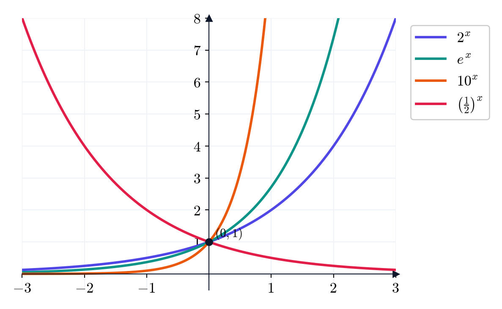{fig-alt="ארבעה גרפים של פונקציות מעריכיות שנפגשים בנקודה אפס אחת" width="65%" fig-align="center"}
:::

::: {.content-visible when-format="pdf"}
```{=latex}
\par\medskip
\noindent\beginL\hbox to \linewidth{\hss\includegraphics[width=0.65\linewidth]{figures/exponentials.png}\hss}\endL\par
\medskip
```
:::

::: {.thmkey icon="calc" title="פישוט ביטויים עם חזקות"}
כותבים את כל החזקות עם **בסיס משותף** (למשל $4 = 2^2$ ו-$8 = 2^3$), ואז משתמשים בחוקי החזקות.
:::

::: {#box-exm-exp-transform .thmexm title="הזזה ומתיחה של הפונקציה המעריכית"}
(א) $.y = 2 - 3^x$ נכתוב $.y = -3^x + 2$ קודם שיקוף של $3^x$ ביחס לציר $x$ (התמונה הופכת ל-$(-\infty, 0)$), ואחר כך הזזה למעלה ב-$2$. התמונה היא $,(-\infty, 2)$ והישר $y = 2$ הוא אסימפטוטה אופקית: הגרף מתקרב אליו כאשר $x$ שואף ל-$.-\infty$

(ב) $.y = e^{x+2} - 1$ הזזה שמאלה ב-$2$ ולמטה ב-$1$. התמונה היא $,(-1, \infty)$ והאסימפטוטה האופקית היא $.y = -1$
:::

::: {.thmkey icon="idea" title="המעריכית מנצחת את החזקה"}
נשווה את $2^x$ ל-$:x^3$

| $x$ | $2$ | $5$ | $9$ | $10$ | $15$ |
|:--:|:--:|:--:|:--:|:--:|:--:|
| $x^3$ | $8$ | $125$ | $729$ | $1000$ | $3375$ |
| $2^x$ | $4$ | $32$ | $512$ | $1024$ | $32768$ |

בהתחלה $x^3$ גדולה יותר, אבל מ-$x = 10$ והלאה $2^x$ עוקפת אותה, והפער גדל מהר מאוד. כך זה תמיד: פונקציה מעריכית עם בסיס גדול מ-$1$ גדלה בסופו של דבר מהר יותר מכל פולינום.
:::

::: {#box-q-exp .thmqst}
(א) פשטו את $.\frac{4^x \cdot 2^3}{8^x}$ (ב) תארו את הגרף של $.y = 3^{-x} + 1$
:::

::: {.thmsol .foldable}
(א) $.\frac{4^x \cdot 2^3}{8^x} = \frac{2^{2x} \cdot 2^3}{2^{3x}} = 2^{2x + 3 - 3x} = 2^{3 - x}$

(ב) $3^{-x} = \left(\frac{1}{3}\right)^x$ יורדת, וההזזה למעלה ב-$1$ נותנת אסימפטוטה אופקית $y = 1$ ותמונה $.(1, \infty)$ הגרף עובר דרך $.(0, 2)$
:::

## פונקציות הפוכות

לעיתים קרובות יודעים את הפלט ומחפשים את הקלט. איזה $x$ מקיים $x^3 = 8$? איזה $x$ מקיים $2^x = 8$? הפונקציה ההפוכה "מחזירה" מהפלט אל הקלט. אבל כדי שזה יעבוד, לכל פלט חייב להיות קלט **יחיד**.

::: {#box-def-one-to-one .thmdef title="פונקציה חד-חד-ערכית"}
פונקציה $f$ נקראת **חד-חד-ערכית** אם היא אינה מקבלת אותו ערך פעמיים: אם $x_1 \neq x_2$ אז $.f(x_1) \neq f(x_2)$
:::

::: {.thmkey icon="rule" title="מבחן הקו האופקי"}
פונקציה היא חד-חד-ערכית אם ורק אם **כל קו אופקי** חותך את הגרף שלה **לכל היותר בנקודה אחת**.
:::

::: {.content-visible when-format="html"}
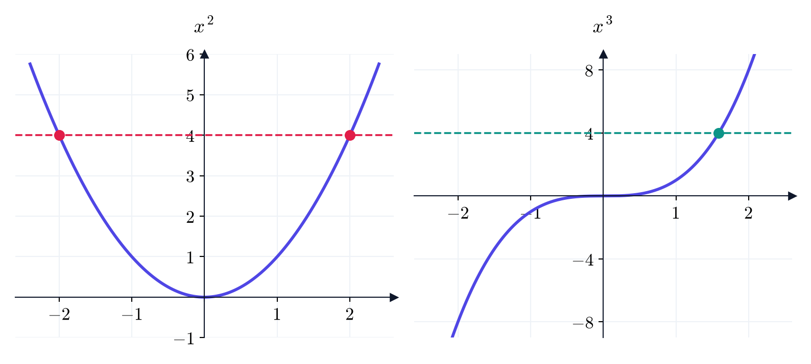{fig-alt="פרבולה שחתוכה בקו אופקי בשתי נקודות, ופונקציה מעוקבת שחתוכה בקו אופקי בנקודה אחת" width="80%" fig-align="center"}
:::

::: {.content-visible when-format="pdf"}
```{=latex}
\par\medskip
\noindent\beginL\hbox to \linewidth{\hss\includegraphics[width=0.8\linewidth]{figures/horizontal-line-test.png}\hss}\endL\par
\medskip
```
:::

::: {#box-def-inverse .thmdef title="פונקציה הפוכה"}
תהי $f$ פונקציה חד-חד-ערכית. **הפונקציה ההפוכה** $f^{-1}$ מוגדרת על ידי $$.f^{-1}(y) = x \iff f(x) = y$$ תחום ההגדרה של $f^{-1}$ הוא התמונה של $f$, והתמונה של $f^{-1}$ היא תחום ההגדרה של $f$: התפקידים מתחלפים.
:::

נובע מההגדרה ש-$f^{-1}(f(x)) = x$ ו-$,f(f^{-1}(y)) = y$ כלומר כל אחת מהפונקציות "מבטלת" את השנייה.

::: {#box-exm-inverse-table .thmexm title="פונקציה הפוכה מטבלה"}
נתון ש-$f$ חד-חד-ערכית, ו-$f(2) = 9$, $f(4) = 1$, $.f(7) = 3$ אז $f^{-1}(1) = 4$ ו-$,f^{-1}(3) = 7$ כי $f$ שולחת את $4$ ל-$1$ ואת $7$ ל-$.3$
:::

::: {.thmkey icon="calc" title="מציאת פונקציה הפוכה"}
1. כותבים $.y = f(x)$
2. פותרים את המשוואה ומבטאים את $x$ בעזרת $.y$
3. מחליפים את שמות המשתנים, $x$ במקום $y$, ומקבלים את $.f^{-1}(x)$
:::

::: {#box-exm-inverse-formula .thmexm title="מציאת פונקציה הפוכה"}
(א) $.f(x) = 5x - 2$ נכתוב $,y = 5x - 2$ ומכאן $.x = \frac{y + 2}{5}$ לכן $.f^{-1}(x) = \frac{x + 2}{5}$

(ב) $.f(x) = x^3 - 1$ נכתוב $,y = x^3 - 1$ ומכאן $x^3 = y + 1$ ו-$.x = \sqrt[3]{y + 1}$ לכן $.f^{-1}(x) = \sqrt[3]{x + 1}$
:::

::: {.thmwarn title="למה דורשים חד-חד-ערכיות"}
הפונקציה $f(x) = x^2$ על כל $\mathbb{R}$ אינה חד-חד-ערכית: $f(3) = f(-3) = 9$. אם ננסה להגדיר את $,f^{-1}(9)$ יש שני מועמדים, $3$ ו-$,-3$ ואין סיבה לבחור באחד מהם. לכן ל-$x^2$ על $\mathbb{R}$ אין פונקציה הפוכה.

הפתרון: **לצמצם את תחום ההגדרה**. אם נגדיר את $x^2$ רק על $,[0, \infty)$ היא חד-חד-ערכית, וההפוכה שלה היא $.\sqrt{x}$ נשתמש ברעיון הזה שוב בסוף ההרצאה.
:::

::: {.thmwarn title="הסימון $f^{-1}$"}
$f^{-1}(x)$ **אינו** $.\frac{1}{f(x)}$ ה-$-1$ כאן מסמן "הפוכה" ביחס להרכבה, ולא חזקה. למשל עבור $,f(x) = 5x - 2$ מצאנו $,f^{-1}(x) = \frac{x + 2}{5}$ ואילו $.\frac{1}{f(x)} = \frac{1}{5x - 2}$
:::

::: {#box-thm-inverse-graph .thmthm title="הגרף של הפונקציה ההפוכה"}
הגרף של $f^{-1}$ הוא השיקוף של הגרף של $f$ ביחס לישר $.y = x$
:::

הסיבה: הנקודה $(a, b)$ נמצאת על הגרף של $f$ אם ורק אם $,f(a) = b$ כלומר $,f^{-1}(b) = a$ כלומר הנקודה $(b, a)$ על הגרף של $.f^{-1}$ החלפת השיעורים היא בדיוק שיקוף ביחס ל-$.y = x$

::: {#box-q-inverse .thmqst}
מצאו את הפונקציה ההפוכה ל-$,f(x) = \frac{x + 3}{2}$ ובדקו ש-$.f(f^{-1}(x)) = x$
:::

::: {.thmsol .foldable}
מ-$y = \frac{x + 3}{2}$ נקבל $2y = x + 3$, כלומר $.x = 2y - 3$ לכן $.f^{-1}(x) = 2x - 3$ בדיקה: $.f(f^{-1}(x)) = f(2x - 3) = \frac{(2x - 3) + 3}{2} = \frac{2x}{2} = x$
:::

## לוגריתמים

איך פותרים את $?2^x = 10$ אין חזקה שלמה של $2$ שנותנת $10$: $2^3 = 8$ ו-$.2^4 = 16$ כדי לפתור, צריך פונקציה ש"מבטלת" את הפונקציה המעריכית, כלומר את הפונקציה ההפוכה שלה.

::: {#box-def-log .thmdef title="לוגריתם"}
יהי $a > 0$ ו-$.a \neq 1$ הפונקציה $a^x$ חד-חד-ערכית (ראו בגרף שלה), ולכן יש לה פונקציה הפוכה, שנקראת **הלוגריתם לפי בסיס $a$**: $$.\log_a x = y \iff a^y = x$$ במילים: $\log_a x$ הוא **החזקה שבה צריך להעלות את $a$ כדי לקבל $x$**.

- תחום ההגדרה של $\log_a$ הוא $,(0, \infty)$ והתמונה שלו היא $\mathbb{R}$ (התחום והתמונה של $a^x$ מתחלפים).
- הלוגריתם לפי בסיס $e$ נקרא **הלוגריתם הטבעי**, ומסמנים אותו $.\ln x = \log_e x$
:::

::: {.thmkey title="הלוגריתם והמעריכית מבטלים זה את זה"}
לכל $x$ ממשי מתקיים $,\log_a\left(a^x\right) = x$ ולכל $x > 0$ מתקיים $.a^{\log_a x} = x$ בפרט $\ln\left(e^x\right) = x$ ו-$.e^{\ln x} = x$
:::

::: {.thmwarn title="לוגריתם של מספר שאינו חיובי"}
$\log_a 0$ ו-$\log_a(-2)$ **אינם מוגדרים**: $a^y$ תמיד חיובי, ולכן אין $y$ שעבורו $a^y = 0$ או $.a^y = -2$ זה השלב השלישי ברשימה למציאת תחום הגדרה: מה שבתוך הלוגריתם חייב להיות חיובי.
:::

### חוקי הלוגריתמים {.unnumbered}

כל חוק של חזקות נותן חוק של לוגריתמים. למשל, החוק $a^{u+v} = a^u a^v$ אומר שכפל של חזקות הוא חיבור של מעריכים. מכיוון שהלוגריתם הוא בדיוק המעריך, מקבלים: **הלוגריתם הופך כפל לחיבור**.

::: {#box-thm-log-laws .thmthm title="חוקי הלוגריתמים"}
לכל $x, y > 0$ ולכל $r$ ממשי:

(א) $\log_a(xy) = \log_a x + \log_a y$

(ב) $\log_a\left(\frac{x}{y}\right) = \log_a x - \log_a y$

(ג) $\log_a\left(x^r\right) = r \log_a x$

(ד) $\log_a 1 = 0$ ו-$\log_a a = 1$

(ה) **החלפת בסיס**: $.\log_a x = \frac{\ln x}{\ln a}$
:::

למשל (א) נובע כך: אם $u = \log_a x$ ו-$,v = \log_a y$ אז $,a^u = x$ ו-$,a^v = y$ ולכן $.xy = a^u a^v = a^{u+v}$ כלומר $.\log_a(xy) = u + v$ חוק (ה) אומר שמספיק להכיר לוגריתם אחד, $,\ln$ כדי לחשב לוגריתם בכל בסיס.

::: {.thmwarn title="טעויות נפוצות"}
- $.\log(x + y) \neq \log x + \log y$ הלוגריתם הופך **כפל** לחיבור, לא חיבור לחיבור.
- $.\frac{\log x}{\log y} \neq \log\frac{x}{y}$ מנה של לוגריתמים אינה לוגריתם של מנה.
- $.(\ln x)^2 \neq \ln\left(x^2\right)$ לפי (ג), $,\ln\left(x^2\right) = 2\ln x$ וזה שונה מ-$.(\ln x)^2$
:::

### הגרף {.unnumbered}

הגרף של $\ln x$ הוא השיקוף של הגרף של $e^x$ ביחס לישר $y = x$. הוא עובר דרך $,(1, 0)$ עולה, גדל לאט מאוד, ויש לו אסימפטוטה אנכית ב-$.x = 0$ כאשר $x$ מתקרב ל-$0$ מימין, $\ln x$ שואף ל-$.-\infty$

::: {.content-visible when-format="html"}
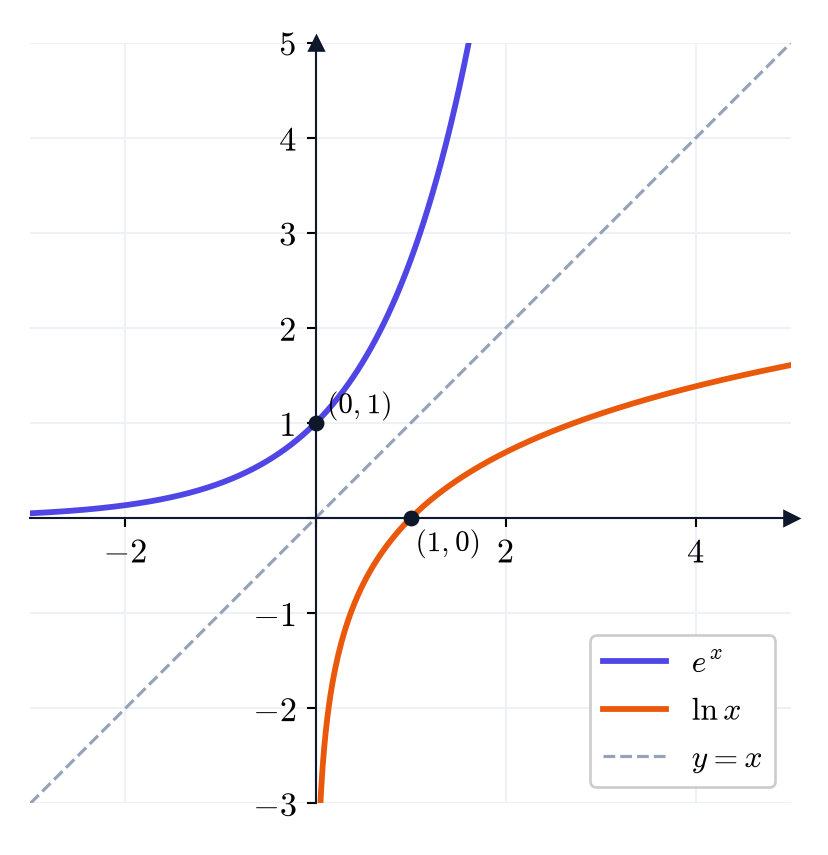{fig-alt="גרף האקספוננט וגרף הלוגריתם הטבעי, סימטריים ביחס לישר y שווה x" width="50%" fig-align="center"}
:::

::: {.content-visible when-format="pdf"}
```{=latex}
\par\medskip
\noindent\beginL\hbox to \linewidth{\hss\includegraphics[width=0.5\linewidth]{figures/exp-ln.png}\hss}\endL\par
\medskip
```
:::

::: {.thmkey icon="calc" title="פתרון משוואות מעריכיות ולוגריתמיות"}
**משוואה מעריכית:**

1. מבודדים את החזקה $a^{(\dots)}$ בצד אחד.
2. מפעילים $\ln$ (או $\log_a$) על שני האגפים.
3. "מורידים" את המעריך בעזרת $.\ln\left(a^u\right) = u \ln a$
4. פותרים.

**משוואה לוגריתמית:** מבודדים את הלוגריתם, מפעילים את הפונקציה המעריכית על שני האגפים, פותרים, ו**בודקים שהפתרון בתחום ההגדרה**.
:::

::: {#box-exm-log .thmexm title="חישובים ומשוואות"}
(א) $,\log_2 32 = 5$ כי $.2^5 = 32$ באופן דומה $,\log_{10} 0.001 = -3$ כי $,10^{-3} = 0.001$ ו-$,\log_9 3 = \frac{1}{2}$ כי $.9^{1/2} = 3$

(ב) לפי (ב), $.\log_3 54 - \log_3 2 = \log_3\frac{54}{2} = \log_3 27 = 3$

(ג) לפי (ב) ו-(ג), $.\ln\frac{x^3}{\sqrt{y}} = \ln\left(x^3\right) - \ln\left(y^{1/2}\right) = 3\ln x - \frac{1}{2}\ln y$

(ד) $.\ln x = 3$ נפעיל את הפונקציה המעריכית: $.x = e^3$

(ה) $.e^{2x - 1} = 7$ נפעיל $\ln$: $,2x - 1 = \ln 7$ ולכן $.x = \frac{1 + \ln 7}{2}$

(ו) $.5 \cdot 2^x = 40$ נבודד: $,2^x = 8$ ולכן $.x = 3$

(ז) $.2^x = 3^{x - 1}$ נפעיל $\ln$ על שני האגפים: $.x\ln 2 = (x - 1)\ln 3$ נעביר אגפים: $,x\ln 3 - x\ln 2 = \ln 3$ כלומר $,x(\ln 3 - \ln 2) = \ln 3$ ולכן $.x = \frac{\ln 3}{\ln 3 - \ln 2}$

(ח) $.y = \ln(x - 3) + 1$ צריך $,x - 3 > 0$ ולכן תחום ההגדרה הוא $.(3, \infty)$ הגרף הוא הגרף של $\ln x$ אחרי הזזה ימינה ב-$3$ ולמעלה ב-$1$, והאסימפטוטה האנכית היא $.x = 3$
:::

::: {.thmkey icon="idea" title="הלוגריתם סופר ספרות"}
$\log_{10} x$ הוא בערך מספר הספרות של $x$: $\log_{10} 1000 = 3$ ו-$.\log_{10} 4500 \approx 3.65$ הלוגריתם גדל לאט מאוד: כדי שיגדל ב-$1$, צריך להכפיל את $x$ פי $.10$
:::

::: {#box-q-log .thmqst}
(א) פתרו $.3^x = 20$ (ב) מצאו את תחום ההגדרה של $.\ln\left(4 - x^2\right)$
:::

::: {.thmsol .foldable}
(א) $,x\ln 3 = \ln 20$ ולכן $.x = \frac{\ln 20}{\ln 3} \approx 2.73$

(ב) צריך $,4 - x^2 > 0$ כלומר $,x^2 < 4$ כלומר $.-2 < x < 2$ תחום ההגדרה: $.(-2, 2)$
:::

## פונקציות חזקה ושורש

עד כאן כיסינו את כל נושאי השבוע. בחלק האחרון של ההרצאה נכיר כמה פונקציות נוספות שיופיעו לאורך הקורס. נעבור עליהן בקצרה: מה הן, איך נראה הגרף שלהן, ומה צריך לזכור.

::: {#box-def-power .thmdef title="פונקציית חזקה"}
**פונקציית חזקה** היא פונקציה מהצורה $f(x) = x^n$ עבור $n$ טבעי.

- אם $n$ **זוגי**, הגרף נראה כמו $x^2$: הפונקציה זוגית, ואינה חד-חד-ערכית.
- אם $n$ **אי-זוגי**, הגרף נראה כמו $x^3$: הפונקציה אי-זוגית, וחד-חד-ערכית.
:::

**השורש** הוא הפונקציה ההפוכה של החזקה. כאן נפגוש שוב את הבעיה של חד-חד-ערכיות:

::: {#box-def-root .thmdef title="פונקציית שורש"}
- אם $n$ אי-זוגי, $x^n$ חד-חד-ערכית על כל $,\mathbb{R}$ וההפוכה שלה $\sqrt[n]{x}$ מוגדרת לכל $x$ ממשי. למשל $.\sqrt[3]{-8} = -2$
- אם $n$ זוגי, מצמצמים את $x^n$ ל-$,[0, \infty)$ ולכן $\sqrt[n]{x}$ מוגדרת רק עבור $,x \ge 0$ ותמיד $.\sqrt[n]{x} \ge 0$
:::

::: {.thmkey title="שורש הוא חזקה"}
$,\sqrt[n]{x} = x^{1/n}$ ולכן כל חוקי החזקות חלים גם על שורשים. למשל $.\sqrt{x} \cdot \sqrt[3]{x} = x^{1/2} \cdot x^{1/3} = x^{5/6}$
:::

::: {.thmwarn title="שורש ומשוואה"}
למשוואה $x^2 = 9$ יש **שני** פתרונות, $,\pm 3$ אבל $\sqrt{9} = 3$ בלבד: השורש הוא פונקציה, ולכן מחזיר ערך אחד. מאותה סיבה $.\sqrt{x^2} = |x|$
:::

::: {.content-visible when-format="html"}
![משמאל: $x^2$ (על $[0, \infty)$) ו-$\sqrt{x}$. מימין: $x^3$ ו-$\sqrt[3]{x}$. בכל זוג, הגרפים הם שיקוף זה של זה ביחס לישר $y = x$.](figures/powers-roots.png){fig-alt="שני זוגות של גרפים: חזקה ושורש, סימטריים ביחס לישר y שווה x" width="85%" fig-align="center"}
:::

::: {.content-visible when-format="pdf"}
```{=latex}
\par\medskip
\noindent\beginL\hbox to \linewidth{\hss\includegraphics[width=0.85\linewidth]{figures/powers-roots.png}\hss}\endL\par
\medskip
```
:::

::: {#box-q-roots-domain .thmqst}
מצאו את תחומי ההגדרה של $\sqrt[3]{x - 1}$ ושל $.\sqrt[4]{2 - x}$
:::

::: {.thmsol .foldable}
שורש שלישי מוגדר לכל מספר, ולכן $\sqrt[3]{x - 1}$ מוגדרת על כל $.\mathbb{R}$ שורש רביעי דורש $,2 - x \ge 0$ ולכן $\sqrt[4]{2 - x}$ מוגדרת על $.(-\infty, 2]$
:::

## פונקציות רציונליות

חילוק הוא פעולה בסיסית, ולכן אחרי הפולינומים באה המשפחה הבאה: מנות של פולינומים.

::: {#box-def-rational .thmdef title="פונקציה רציונלית"}
**פונקציה רציונלית** היא מנה של שני פולינומים, $.R(x) = \frac{P(x)}{Q(x)}$ תחום ההגדרה שלה הוא כל ה-$x$ שעבורם $.Q(x) \neq 0$
:::

שתי הדוגמאות הבסיסיות:

- $\frac{1}{x}$ אי-זוגית. ככל ש-$x$ מתקרב ל-$0$, הערך גדל מאוד בערכו המוחלט: הישר $x = 0$ הוא **אסימפטוטה אנכית**. ככל ש-$x$ גדל, הערך מתקרב ל-$0$: הישר $y = 0$ הוא **אסימפטוטה אופקית**.
- $\frac{1}{x^2}$ זוגית ותמיד חיובית, עם אותן אסימפטוטות.

::: {.content-visible when-format="html"}
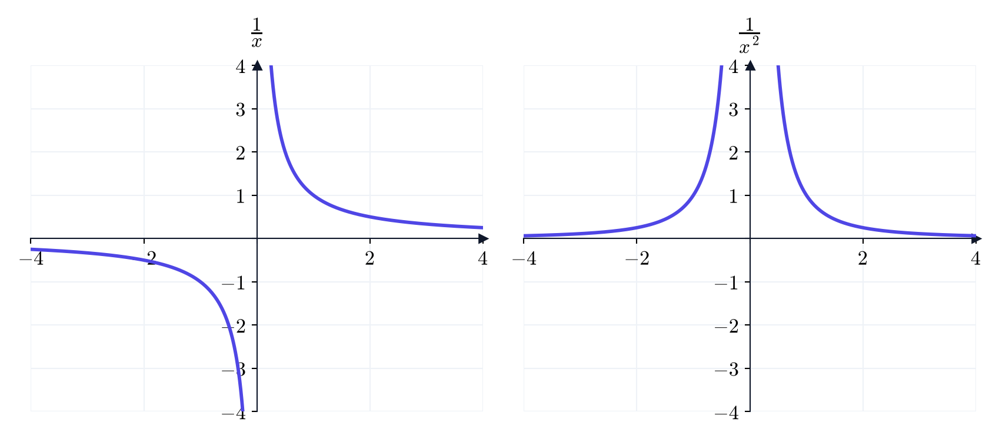{fig-alt="גרף אחד חלקי x בשני רביעים מנוגדים, וגרף אחד חלקי x בריבוע מעל ציר x" width="80%" fig-align="center"}
:::

::: {.content-visible when-format="pdf"}
```{=latex}
\par\medskip
\noindent\beginL\hbox to \linewidth{\hss\includegraphics[width=0.8\linewidth]{figures/rational.png}\hss}\endL\par
\medskip
```
:::

::: {.thmkey icon="calc" title="תחום הגדרה של פונקציה רציונלית"}
מוצאים את השורשים של המכנה (בשיטות של פולינומים), ומוציאים אותם מ-$.\mathbb{R}$ הנקודות האלה הן המועמדות להיות אסימפטוטות אנכיות.
:::

::: {#box-exm-rational .thmexm title="פונקציות רציונליות"}
(א) $.\frac{x + 1}{x^2 - 4}$ המכנה מתאפס ב-$,x = \pm 2$ ולכן תחום ההגדרה הוא $.\mathbb{R} \setminus \{-2, 2\}$

(ב) $\frac{1}{x - 2} + 3$ היא $\frac{1}{x}$ אחרי הזזה ימינה ב-$2$ ולמעלה ב-$3$. האסימפטוטות הן $x = 2$ ו-$.y = 3$
:::

::: {.thmwarn title="צמצום משנה את תחום ההגדרה"}
הפונקציה $\frac{x^2 - 1}{x - 1}$ **אינה** אותה פונקציה כמו $.x + 1$ אמנם $,\frac{x^2 - 1}{x - 1} = \frac{(x - 1)(x + 1)}{x - 1} = x + 1$ אבל רק עבור $:x \neq 1$ ב-$x = 1$ הפונקציה המקורית אינה מוגדרת. הגרף שלה הוא ישר עם "חור" בנקודה $.(1, 2)$ נחזור לדוגמה הזו כשנלמד גבולות.
:::

::: {#box-q-rational .thmqst}
מצאו את תחום ההגדרה של $.\frac{x}{x^2 - 5x + 6}$
:::

::: {.thmsol .foldable}
$x^2 - 5x + 6 = (x - 2)(x - 3)$, ולכן המכנה מתאפס ב-$2$ וב-$3$. תחום ההגדרה: $.\mathbb{R} \setminus \{2, 3\}$
:::

## פונקציית הסימן ופונקציית הערך השלם

שתי פונקציות פשוטות, שמוגדרות בעזרת כלל ולא בעזרת נוסחה אחת. בגרפים שלהן יש **קפיצות**, והן יהיו הדוגמאות הראשונות שלנו לפונקציות שאינן רציפות.

::: {#box-def-sgn .thmdef title="פונקציית הסימן"}
$$.\operatorname{sgn}(x) = \begin{cases} 1 & x > 0 \\ 0 & x = 0 \\ -1 & x < 0 \end{cases}$$
:::

למשל $,\operatorname{sgn}(-3.7) = -1$ ומתקיים $.|x| = x \cdot \operatorname{sgn}(x)$ פונקציית הסימן אי-זוגית.

::: {#box-def-floor .thmdef title="הערך השלם (רצפה)"}
**הערך השלם** של $x$, שמסומן $,\lfloor x \rfloor$ הוא המספר השלם הגדול ביותר שקטן או שווה ל-$.x$
:::

למשל $,\lfloor 2.7 \rfloor = 2$ $,\lfloor 5 \rfloor = 5$ ו-$.\lfloor -1.2 \rfloor = -2$

::: {.thmwarn title="ערך שלם של מספר שלילי"}
עבור מספרים שליליים, הערך השלם **אינו** "מחיקת הספרות שאחרי הנקודה": $,\lfloor -1.2 \rfloor = -2$ ולא $,-1$ כי $-1 > -1.2$ ואנחנו מחפשים שלם שקטן או שווה ל-$.-1.2$
:::

::: {.content-visible when-format="html"}
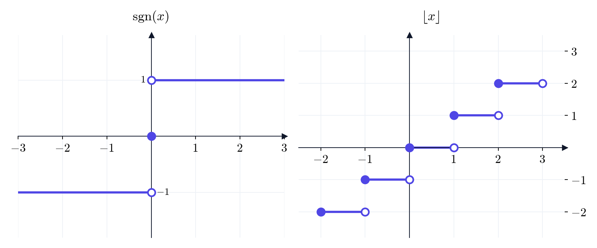{fig-alt="גרף פונקציית הסימן עם קפיצה באפס, וגרף מדרגות של פונקציית הערך השלם" width="85%" fig-align="center"}
:::

::: {.content-visible when-format="pdf"}
```{=latex}
\par\medskip
\noindent\beginL\hbox to \linewidth{\hss\includegraphics[width=0.85\linewidth]{figures/sgn-floor.png}\hss}\endL\par
\medskip
```
:::

::: {#box-q-floor .thmqst}
(א) חשבו $\lfloor -0.5 \rfloor$ ו-$.\lfloor \pi \rfloor$ (ב) פתרו $.\lfloor x \rfloor = 3$
:::

::: {.thmsol .foldable}
(א) $\lfloor -0.5 \rfloor = -1$ ו-$.\lfloor \pi \rfloor = 3$

(ב) $\lfloor x \rfloor = 3$ בדיוק כאשר $,3 \le x < 4$ כלומר $.x \in [3, 4)$
:::

## הפונקציות הטריגונומטריות ההפוכות

לפעמים יודעים את הערך של $\sin$ ומחפשים את הזווית: איזו זווית $\theta$ מקיימת $?\sin\theta = \frac{1}{2}$ איזו מקיימת $?\tan\theta = 1$ לשם כך משתמשים בפונקציות הטריגונומטריות ההפוכות.

::: {.thmwarn title="הבעיה, והפתרון"}
$\sin$, $\cos$ ו-$\tan$ **אינן** חד-חד-ערכיות. למשל, ל-$\sin\theta = \frac{1}{2}$ יש אינסוף פתרונות: $,\frac{\pi}{6}$ $,\frac{5\pi}{6}$ $\frac{\pi}{6} + 2\pi$ ועוד. הפתרון זהה לזה של $x^2$ ו-$:\sqrt{x}$ מצמצמים כל פונקציה לקטע שבו היא חד-חד-ערכית, ושבו היא עדיין מקבלת את כל הערכים שלה.
:::

::: {#box-def-inverse-trig .thmdef title="הפונקציות הטריגונומטריות ההפוכות"}
- $\sin$ מצומצמת לקטע $\left[-\frac{\pi}{2}, \frac{\pi}{2}\right]$, וההפוכה שלה היא $.\arcsin : [-1, 1] \to \left[-\frac{\pi}{2}, \frac{\pi}{2}\right]$
- $\cos$ מצומצמת לקטע $[0, \pi]$, וההפוכה שלה היא $.\arccos : [-1, 1] \to [0, \pi]$
- $\tan$ מצומצמת לקטע $\left(-\frac{\pi}{2}, \frac{\pi}{2}\right)$, וההפוכה שלה היא $.\arctan : \mathbb{R} \to \left(-\frac{\pi}{2}, \frac{\pi}{2}\right)$

כלומר, $\arcsin y$ היא **הזווית בקטע $\left[-\frac{\pi}{2}, \frac{\pi}{2}\right]$ שהסינוס שלה הוא $y$**, וכך גם לשתי האחרות.
:::

::: {.content-visible when-format="html"}
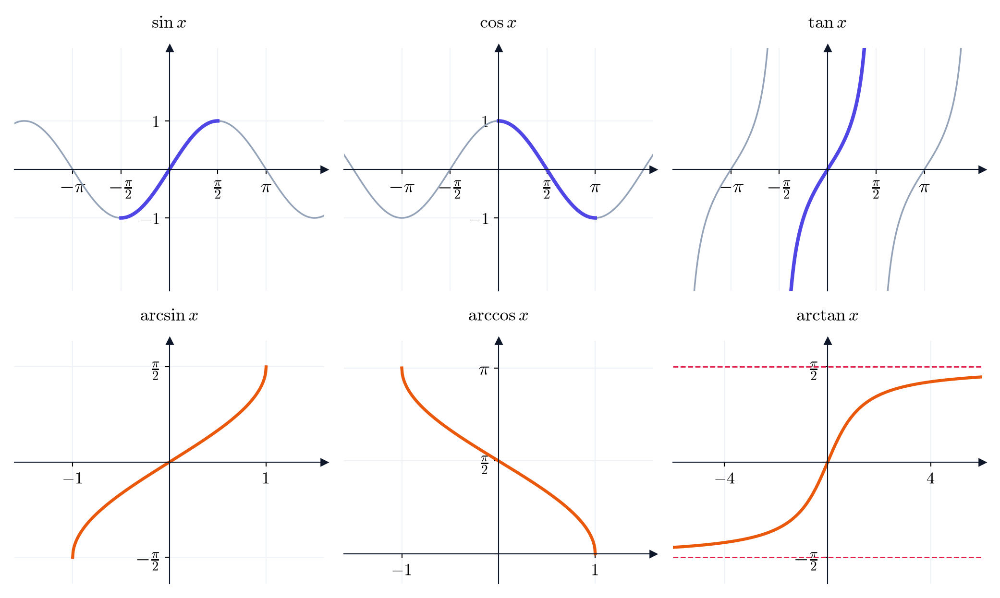{fig-alt="שש מערכות צירים: למעלה סינוס, קוסינוס וטנגנס עם קטע מודגש, ולמטה הפונקציות ההפוכות" width="95%" fig-align="center"}
:::

::: {.content-visible when-format="pdf"}
```{=latex}
\par\medskip
\noindent\beginL\hbox to \linewidth{\hss\includegraphics[width=0.95\linewidth]{figures/inverse-trig.png}\hss}\endL\par
\medskip
```
:::

::: {#box-thm-inverse-trig .thmthm title="כמה כללים"}
(א) $\sin(\arcsin x) = x$ לכל $.x \in [-1, 1]$

(ב) $\arcsin(\sin x) = x$ **רק** עבור $.x \in \left[-\frac{\pi}{2}, \frac{\pi}{2}\right]$

(ג) $\arcsin$ ו-$\arctan$ אי-זוגיות.

(ד) $.\arcsin x + \arccos x = \frac{\pi}{2}$

(ה) $\arctan$ חסומה: כאשר $x$ גדל, $\arctan x$ מתקרבת ל-$,\frac{\pi}{2}$ וכאשר $x$ קטן, היא מתקרבת ל-$.-\frac{\pi}{2}$ אלה האסימפטוטות האופקיות שלה.
:::

::: {#box-exm-inverse-trig .thmexm title="חישובים"}
(א) $,\arcsin\frac{1}{2} = \frac{\pi}{6}$ ולא $,\frac{5\pi}{6}$ כי התשובה חייבת להיות בקטע $.\left[-\frac{\pi}{2}, \frac{\pi}{2}\right]$

(ב) $,\arccos(-1) = \pi$ כי $\cos\pi = -1$ ו-$.\pi \in [0, \pi]$

(ג) $,\arctan 1 = \frac{\pi}{4}$ כי $.\tan\frac{\pi}{4} = 1$

(ד) $.\arcsin(\sin\pi) = \arcsin 0 = 0 \neq \pi$ זו בדיוק ההסתייגות בכלל (ב): $\pi$ אינו בקטע $.\left[-\frac{\pi}{2}, \frac{\pi}{2}\right]$
:::

::: {.thmwarn title="טעויות נפוצות"}
- $\arcsin 2$ **אינו מוגדר**: הסינוס לעולם אינו גדול מ-$1$, ולכן תחום ההגדרה של $\arcsin$ הוא $.[-1, 1]$
- הסימון $\sin^{-1} x$ פירושו $,\arcsin x$ ולא $.\frac{1}{\sin x}$
:::

::: {#box-q-inverse-trig .thmqst}
חשבו את $\arccos\frac{1}{2}$ ואת $.\arctan(-1)$
:::

::: {.thmsol .foldable}
$,\arccos\frac{1}{2} = \frac{\pi}{3}$ כי $\cos\frac{\pi}{3} = \frac{1}{2}$ ו-$.\frac{\pi}{3} \in [0, \pi]$

$,\arctan(-1) = -\frac{\pi}{4}$ כי $\arctan$ אי-זוגית ו-$.\arctan 1 = \frac{\pi}{4}$
:::
