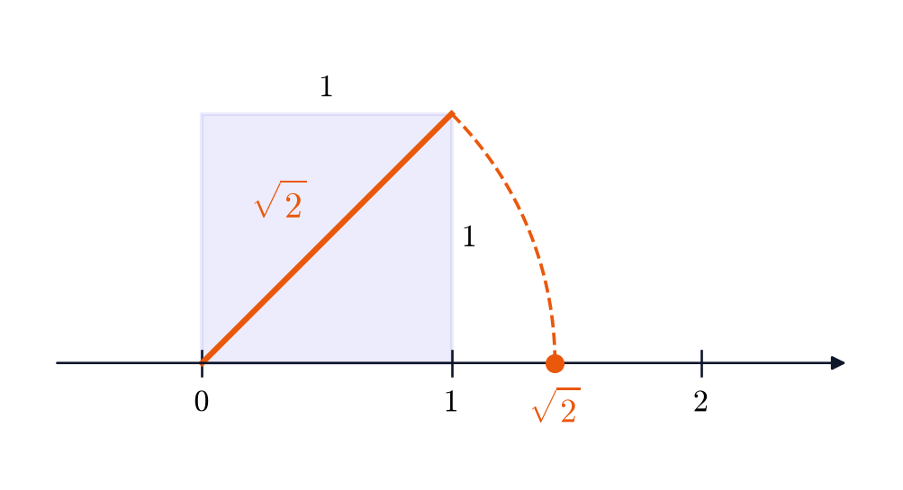
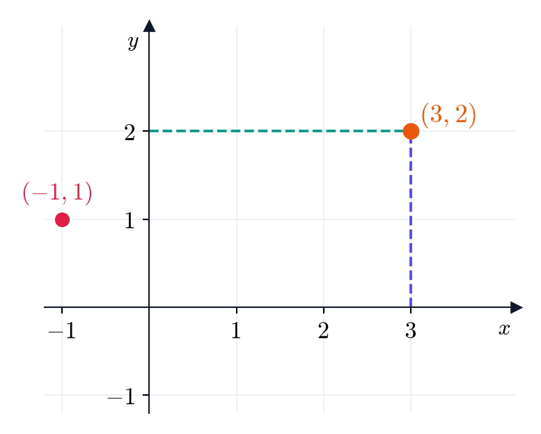
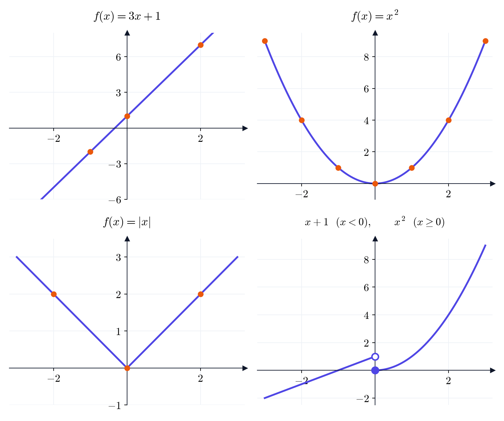
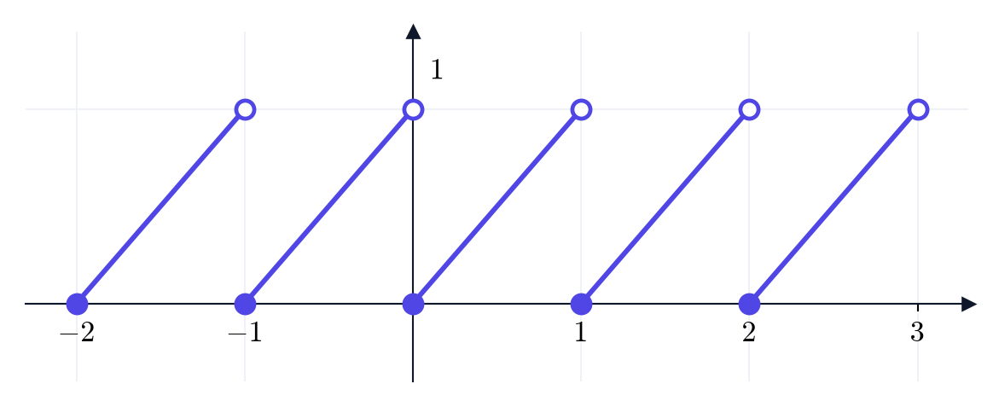
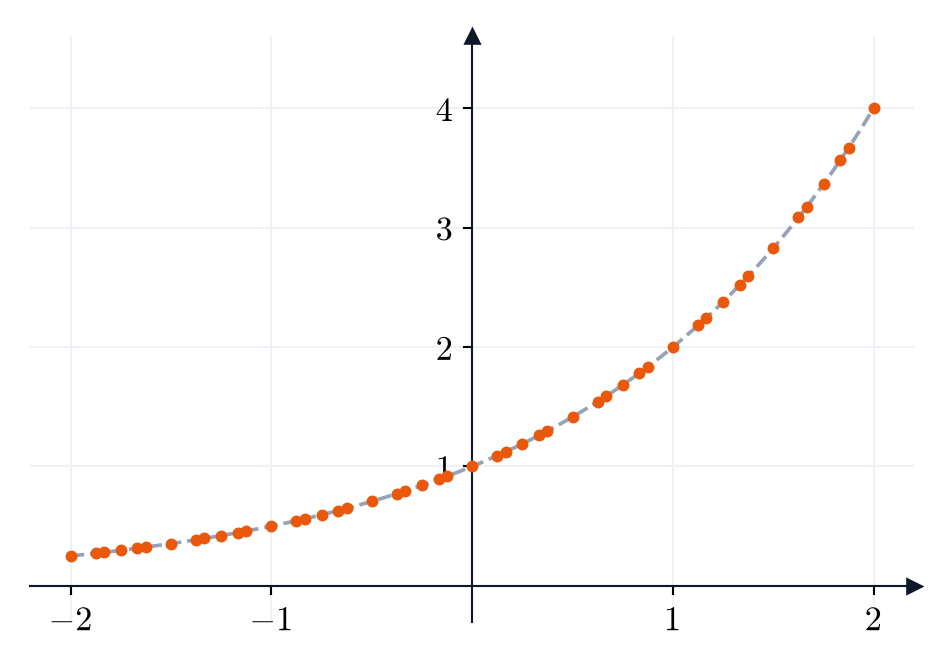
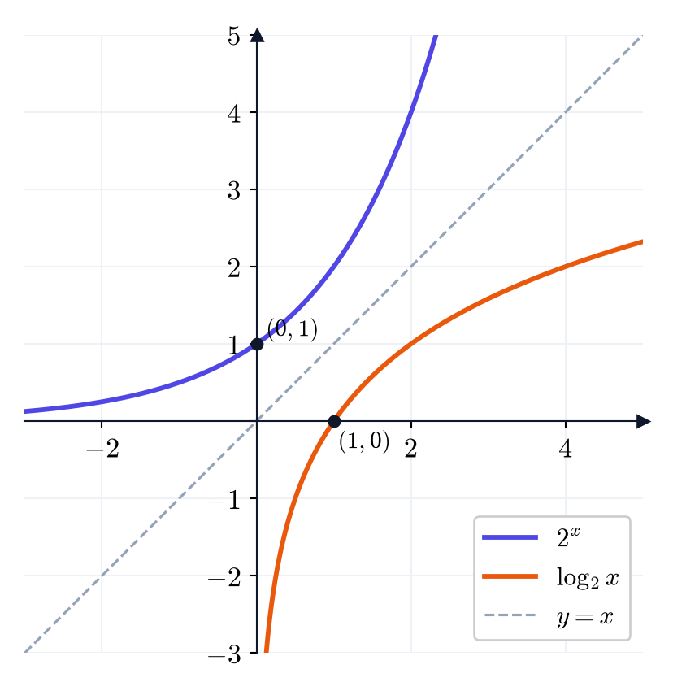

# הרצאה 1: מבוא — מספרים ממשיים ופונקציות {chapter="1"}

בהרצאה הזו נבנה את השפה שבה נשתמש לאורך כל הקורס: המספרים הממשיים, קטעים וערך מוחלט, ובעיקר **פונקציות**. נכיר את המשפחות הבסיסיות של פונקציות: פולינומים, פונקציות טריגונומטריות, הפונקציה המעריכית והלוגריתם, יחד עם פונקציות נוספות, ונלמד איך לבנות מהן פונקציות חדשות בעזרת הזזה, מתיחה, הרכבה והיפוך.

## מערכות המספרים: מהטבעיים אל הממשיים

כל מה שנעשה בקורס, סדרות, גבולות, נגזרות ואינטגרלים, מתרחש על **הישר הממשי**. כדי להבין מה הם המספרים הממשיים, כדאי לראות איך הם נבנים בשלבים: כל מערכת מספרים חדשה נוספה כי הקודמת לא הספיקה כדי לפתור בעיה פשוטה.

### המספרים הטבעיים, השלמים והרציונליים {.unnumbered}

::: {#box-def-naturals .thmdef title="המספרים הטבעיים"}
**המספרים הטבעיים** הם המספרים שבהם אנחנו סופרים: $$.\mathbb{N} = \{1, 2, 3, 4, \dots\}$$
:::

במספרים הטבעיים אפשר לחבר ולכפול, ותמיד נקבל מספר טבעי. אבל כבר החיסור $3 - 5$ אינו נותן מספר טבעי. לכן מוסיפים את האפס ואת המספרים השליליים.

::: {#box-def-integers .thmdef title="המספרים השלמים"}
**המספרים השלמים** הם $$.\mathbb{Z} = \{\dots, -3, -2, -1, 0, 1, 2, 3, \dots\}$$
:::

בשלמים אפשר לחבר, לחסר ולכפול. למשל $.3 - 5 = -2$ אבל חילוק כבר אינו נותן תמיד מספר שלם: $\frac{1}{3}$ אינו מספר שלם. לכן מוסיפים את השברים.

::: {#box-def-rationals .thmdef title="המספרים הרציונליים"}
**המספרים הרציונליים** הם כל המספרים שאפשר לכתוב כשבר של שני שלמים: $$,\mathbb{Q} = \left\{ \frac{m}{n} : m, n \in \mathbb{Z}, \ n \neq 0 \right\}$$ למשל $\frac{3}{4}$, $-\frac{5}{2}$, $7 = \frac{7}{1}$ ו-$.0.25 = \frac{1}{4}$
:::

מה בדיוק הוספנו? מתברר שחילוק אינו פעולה חדשה: הוא כפל במספר מתאים.

::: {#box-def-reciprocal .thmdef title="המספר ההופכי"}
יהי $a \neq 0$. **המספר ההופכי** ל-$,a$ שמסומן $,a^{-1}$ הוא המספר שמקיים $$.a \cdot a^{-1} = 1$$ כלומר $.a^{-1} = \frac{1}{a}$
:::

למשל: $$2^{-1} = \frac{1}{2}, \qquad \left(\frac{3}{4}\right)^{-1} = \frac{4}{3}, \qquad (-5)^{-1} = -\frac{1}{5}$$ ובכל מקרה אפשר לבדוק שהמכפלה היא $1$, למשל $.\frac{3}{4} \cdot \frac{4}{3} = \frac{12}{12} = 1$

::: {.thmkey icon="rule" title="חילוק הוא כפל בהופכי"}
לכל $b$ ולכל $a \neq 0$: $$.\frac{b}{a} = b \cdot a^{-1}$$ למשל $.\frac{6}{3} = 6 \cdot 3^{-1} = 6 \cdot \frac{1}{3} = 2$
:::

עכשיו אפשר לנסח מה חסר בשלמים: ההופכי של $3$ הוא $,\frac{1}{3}$ והוא אינו שלם. ברציונליים, לעומת זאת, לכל מספר ששונה מאפס יש הופכי, ולכן אפשר לחלק בכל מספר ששונה מאפס.

::: {.thmwarn title="אסור לחלק באפס"}
ל-$0$ **אין** הופכי: אין מספר שכפול $0$ נותן $,1$ כי $0 \cdot c = 0$ לכל $.c$ לכן ביטויים כמו $\frac{5}{0}$ או $\frac{0}{0}$ **אינם מוגדרים**, ואינם מספרים בכלל. זו גם הסיבה שבהגדרה של שבר דרשנו $.n \neq 0$ בכל פעם שמופיע שבר, צריך לבדוק שהמכנה אינו אפס.
:::

### למה צריך את המספרים הממשיים {.unnumbered}

ברציונליים אפשר לחבר, לחסר, לכפול ולחלק (לא באפס). האם זה מספיק? מתברר שלא. נתבונן בריבוע שאורך צלעו $1$, ונסמן ב-$d$ את אורך האלכסון שלו. לפי משפט פיתגורס $$,d^2 = 1^2 + 1^2 = 2$$ כלומר $.d = \sqrt{2}$ אם נסובב את האלכסון סביב הראשית עד שהוא שוכב על הישר, הקצה שלו יסמן על הישר נקודה, ובמקום הזה נמצא המספר $.\sqrt{2}$

::: {.content-visible when-format="html"}
{fig-alt="ריבוע שאורך צלעו אחת ואלכסון באורך שורש שתיים, וקשת שמעבירה את האלכסון לישר" width="60%" fig-align="center"}
:::

::: {.content-visible when-format="pdf"}
```{=latex}
\par\medskip
\noindent\beginL\hbox to \linewidth{\hss\includegraphics[width=0.6\linewidth]{figures/sqrt2.png}\hss}\endL\par
\medskip
```
:::

::: {#box-thm-irrational .thmthm title="יש מספרים שאינם רציונליים"}
המספרים $\sqrt{2}$ ו-$\pi$ **אינם רציונליים**: אין שבר $\frac{m}{n}$ ששווה להם בדיוק. מספר שאינו רציונלי נקרא **אי-רציונלי**.
:::

$\sqrt{2}$ אינו מקרה יוצא דופן. הכלל הבא נותן אינסוף דוגמאות נוספות:

::: {#box-thm-irrational-roots .thmthm title="שורשים אי-רציונליים"}
יהיו $n$ ו-$k \ge 2$ מספרים טבעיים. אם אין מספר טבעי $m$ שמקיים $,m^k = n$ אז $\sqrt[k]{n}$ אי-רציונלי.
:::

במילים: אם השורש של מספר טבעי אינו יוצא מספר טבעי, הוא בכלל לא יוצא שבר. למשל:

- $\sqrt{3}$, $\sqrt{7}$ ו-$\sqrt{10}$ אי-רציונליים, כי $3$, $7$ ו-$10$ אינם ריבועים של מספרים טבעיים.
- $\sqrt[3]{2}$ אי-רציונלי, כי אין מספר טבעי שהחזקה השלישית שלו היא $2$: $1^3 = 1$ ו-$.2^3 = 8$
- לעומת זאת, $\sqrt{9} = 3$ ו-$\sqrt[3]{8} = 2$ רציונליים, ואפילו טבעיים.

המשמעות: אם נסמן על הישר רק את המספרים הרציונליים, יישארו בו "חורים", למשל בדיוק במקום של $.\sqrt{2}$ **המספרים הממשיים**, שמסומנים $,\mathbb{R}$ ממלאים את כל החורים: כל נקודה על הישר היא מספר ממשי, וכל מספר ממשי הוא נקודה על הישר.

קיבלנו שרשרת של מערכות מספרים, שכל אחת מכילה את הקודמת: כל מספר טבעי הוא גם מספר שלם, כל מספר שלם הוא גם מספר רציונלי, וכל מספר רציונלי הוא גם מספר ממשי.

### קבוצות: מוכל ושייך {.unnumbered}

אוספים של אובייקטים מתמטיים נקראים **קבוצות**. כאשר אוסף אחד הוא חלק מאוסף גדול יותר, נאמר שהוא **מוכל** בו. למשל, קבוצת המספרים הטבעיים מוכלת בקבוצת המספרים השלמים, וזה בדיוק מה שאומרת השרשרת שלמעלה. לעומת זאת, כאשר איבר מסוים נמצא בתוך קבוצה, נאמר שהוא **שייך** לה. למשל, המספר $3$ שייך לקבוצת המספרים הטבעיים.

חשוב לא לבלבל: **מוכל** הוא יחס בין שתי קבוצות, ו**שייך** הוא יחס בין איבר לקבוצה. את הסימונים של שני היחסים נכיר בסעיף הבא.

### הישר הממשי {.unnumbered}

את המספרים הממשיים מציירים על ישר, שנקרא **הישר הממשי**: בוחרים נקודה שתייצג את $,0$ כיוון חיובי (ימינה) ויחידת אורך.

::: {#box-def-order .thmdef title="סדר"}
יהיו $a$ ו-$b$ מספרים ממשיים. אם $a$ נמצא משמאל ל-$b$ על הישר, נאמר ש-$a$ **קטן** מ-$,b$ ונסמן $.a < b$ במקרה כזה נאמר גם ש-$b$ **גדול** מ-$,a$ ונסמן $.b > a$

אם $a$ קטן מ-$b$ או שווה לו, נסמן $,a \le b$ ובאופן דומה $.b \ge a$
:::

למשל:

- $,2 < 5$ כי $2$ משמאל ל-$.5$
- $,-3 < -1$ כי $-3$ משמאל ל-$.-1$ (בין שני מספרים שליליים, הקטן הוא זה שהערך המוחלט שלו גדול יותר.)
- $.0.5 < 1$
- $,4 \le 4$ כי $4$ שווה ל-$,4$ אבל $4 < 4$ אינו נכון.

::: {.content-visible when-format="html"}
{fig-alt="הישר הממשי ועליו מסומנים מינוס חמש חצאים, שלושה רבעים, שורש שתיים ופאי" width="85%" fig-align="center"}
:::

::: {.content-visible when-format="pdf"}
```{=latex}
\par\medskip
\noindent\beginL\hbox to \linewidth{\hss\includegraphics[width=0.85\linewidth]{figures/real-line.png}\hss}\endL\par
\medskip
```
:::

::: {#box-q-rational .thmqst}
אילו מהמספרים הבאים רציונליים? $$.1.25, \qquad \sqrt{9}, \qquad \sqrt{7}, \qquad -\frac{6}{3}$$ עבור המספרים הרציונליים, כתבו אותם כשבר.
:::

::: {.thmsol .foldable}
**המספר $1.25$** רציונלי. שתי ספרות אחרי הנקודה פירושן מאיות, ולכן $$.1.25 = \frac{125}{100} = \frac{5}{4}$$ (צמצמנו ב-$25$.)

**המספר $\sqrt{9}$** רציונלי: $,\sqrt{9} = 3$ ו-$.3 = \frac{3}{1}$

**המספר $\sqrt{7}$** אי-רציונלי: אין מספר טבעי שהריבוע שלו הוא $7$ (כי $2^2 = 4$ ו-$3^2 = 9$), ולכן לפי [](#box-thm-irrational-roots) $\sqrt{7}$ אי-רציונלי.

**המספר $-\frac{6}{3}$** רציונלי, כי הוא כתוב כשבר של שני שלמים. אפשר גם לצמצם: $.-\frac{6}{3} = -2$
:::

## קבוצות וקטעים

נצטרך לתאר אוספים של מספרים: את כל הפתרונות של אי-שוויון, או את כל המספרים שבהם נוסחה מוגדרת. לשם כך נגדיר סימונים ליחסים שפגשנו בסעיף הקודם, שייך ומוכל, ועוד כמה.

::: {#box-def-set-notation .thmdef title="סימוני קבוצות"}
- $x \in A$ פירושו: $x$ **שייך** לקבוצה $A$ (הוא אחד האיברים שלה). הסימון $x \notin A$ פירושו שאינו שייך.
- $A \subseteq B$ פירושו: $A$ **מוכלת** ב-$B$, כלומר כל איבר של $A$ הוא גם איבר של $.B$
- $A \cup B$ (**איחוד**): כל האיברים שנמצאים ב-$A$ **או** ב-$B$ (או בשתיהן).
- $A \cap B$ (**חיתוך**): כל האיברים שנמצאים **גם** ב-$A$ **וגם** ב-$.B$
- $\emptyset$ היא **הקבוצה הריקה**, שאין בה איברים.
- $\{x : \dots\}$ היא קבוצת כל ה-$x$ שמקיימים את התנאי שכתוב אחרי הנקודתיים.
:::

בסימונים האלה, השרשרת של מערכות המספרים מהסעיף הקודם נכתבת כך: $$.\mathbb{N} \subseteq \mathbb{Z} \subseteq \mathbb{Q} \subseteq \mathbb{R}$$

::: {.thmwarn title="מוכל או שייך"}
חשוב לא לבלבל: **מוכל** ($\subseteq$) הוא יחס בין **שתי קבוצות**, ו**שייך** ($\in$) הוא יחס בין **איבר לקבוצה**. למשל:

- $3 \in \mathbb{N}$ **נכון**: $3$ הוא איבר של $.\mathbb{N}$
- $3 \subseteq \mathbb{N}$ **שגוי**: $3$ הוא מספר ולא קבוצה, ולכן אין משמעות לשאלה אם הוא "מוכל". זו טעות נפוצה.
- $\{3\} \subseteq \mathbb{N}$ **נכון**: הקבוצה שהאיבר היחיד שלה הוא $3$ היא חלק מ-$.\mathbb{N}$
- $\mathbb{N} \subseteq \mathbb{Z}$ **נכון**, אבל $\mathbb{N} \in \mathbb{Z}$ **שגוי**: $\mathbb{N}$ אינו מספר שלם, אלא קבוצה של מספרים.
:::

::: {#box-exm-sets .thmexm title="סימוני קבוצות"}
(א) $-3 \in \mathbb{Z}$ אבל $.\pi \notin \mathbb{Z}$

(ב) $.\{1, 2\} \cup \{2, 5\} = \{1, 2, 5\}$ האיבר $2$ מופיע בשתי הקבוצות, אבל באיחוד רושמים אותו פעם אחת.

(ג) $.\{1, 2\} \cap \{2, 5\} = \{2\}$ רק $2$ נמצא בשתי הקבוצות.

(ד) $.\{x \in \mathbb{Z} : 0 < x < 4\} = \{1, 2, 3\}$ אלה המספרים השלמים שגדולים מ-$0$ וקטנים מ-$.4$
:::

הקבוצות החשובות ביותר על הישר הן **קטעים**: כל המספרים שבין שתי נקודות.

::: {#box-def-interval .thmdef title="קטעים"}
יהיו $a < b$ מספרים ממשיים. נגדיר:

| סימון | הקבוצה | שם |
|:--:|:--:|:--|
| $(a, b)$ | $\{x : a < x < b\}$ | קטע פתוח |
| $[a, b]$ | $\{x : a \le x \le b\}$ | קטע סגור |
| $[a, b)$ | $\{x : a \le x < b\}$ | קטע חצי-פתוח |
| $(a, b]$ | $\{x : a < x \le b\}$ | קטע חצי-פתוח |
| $(a, \infty)$ | $\{x : x > a\}$ | קרן פתוחה |
| $[a, \infty)$ | $\{x : x \ge a\}$ | קרן סגורה |
| $(-\infty, b)$ | $\{x : x < b\}$ | קרן פתוחה |
| $(-\infty, b]$ | $\{x : x \le b\}$ | קרן סגורה |

סוגר עגול פירושו שנקודת הקצה **אינה** שייכת לקטע, וסוגר מרובע פירושו שהיא **כן** שייכת. גם הישר כולו הוא קטע: $.\mathbb{R} = (-\infty, \infty)$
:::

בציור מסמנים נקודת קצה ששייכת לקטע בעיגול מלא, ונקודת קצה שאינה שייכת בעיגול ריק.

::: {.content-visible when-format="html"}
{fig-alt="ארבעה ישרים: קטע פתוח עם עיגולים ריקים, קטע סגור עם עיגולים מלאים, קטע חצי פתוח וקרן" width="70%" fig-align="center"}
:::

::: {.content-visible when-format="pdf"}
```{=latex}
\par\medskip
\noindent\beginL\hbox to \linewidth{\hss\includegraphics[width=0.7\linewidth]{figures/intervals.png}\hss}\endL\par
\medskip
```
:::

::: {.thmwarn title="אינסוף אינו מספר"}
הסימן $\infty$ אינו מספר, ואי אפשר "להגיע" אליו. לכן ליד $\infty$ או $-\infty$ הסוגר תמיד **עגול**: כותבים $[2, \infty)$ ולא $.[2, \infty]$
:::

::: {.thmkey icon="calc" title="חיתוך ואיחוד של קטעים"}
1. כותבים את התנאי של כל קטע כאי-שוויונים. למשל, $x \in [1, 5]$ פירושו $.1 \le x \le 5$
2. **חיתוך**: $x$ צריך לקיים את **כל** התנאים. לכן הקצה השמאלי של החיתוך הוא **הגדול** מבין הקצוות השמאליים, והקצה הימני הוא **הקטן** מבין הקצוות הימניים. אם הקצה השמאלי שהתקבל גדול מהימני, החיתוך ריק.
3. **איחוד**: $x$ צריך לקיים **לפחות אחד** מהתנאים.
4. בכל נקודת קצה בודקים בנפרד אם היא שייכת לתוצאה. כדאי לצייר את הקטעים על אותו ישר, זה מעל זה.
:::

::: {#box-exm-intervals .thmexm title="קטעים, איחודים וחיתוכים"}
(א) הקבוצה $\{x : -1 \le x < 4\}$ היא הקטע $.[-1, 4)$ הנקודה $-1$ שייכת (כי $\le$), ולכן הסוגר משמאל מרובע. הנקודה $4$ אינה שייכת (כי $<$), ולכן הסוגר מימין עגול.

(ב) הקבוצה $(-\infty, 0] \cup (2, 6)$ היא כל ה-$x$ שמקיימים $x \le 0$ **או** $.2 < x < 6$ היא אינה קטע אחד: יש בה "רווח" בין $0$ ל-$2$. למשל $-5$ ו-$3$ שייכים אליה, ו-$1$ אינו שייך.

(ג) נחשב את $.[1, 5] \cap (3, 8)$ צריך $1 \le x \le 5$ (כדי להיות בקטע הראשון) **וגם** $3 < x < 8$ (כדי להיות בשני).

**הקצה השמאלי**: צריך גם $x \ge 1$ וגם $.x > 3$ התנאי $x > 3$ חזק יותר: כל $x$ שגדול מ-$3$ גדול גם מ-$1$. לכן נשאר $.x > 3$

**הקצה הימני**: צריך גם $x \le 5$ וגם $.x < 8$ התנאי $x \le 5$ חזק יותר, ולכן נשאר $.x \le 5$

יחד: $3 < x \le 5$, כלומר $$.[1, 5] \cap (3, 8) = (3, 5]$$

(ד) נחשב את $.[0, 1] \cap [2, 3]$ צריך $x \le 1$ (מהקטע הראשון) וגם $x \ge 2$ (מהשני). אין מספר שמקיים את שניהם, ולכן $$.[0, 1] \cap [2, 3] = \emptyset$$
:::

::: {#box-q-intervals .thmqst}
חשבו:

(א) $[-3, 2) \cap (0, 5]$

(ב) $(-\infty, 1) \cup [1, 4]$
:::

::: {.thmsol .foldable}
**(א)** צריך $-3 \le x < 2$ **וגם** $.0 < x \le 5$

**הקצה השמאלי**: צריך $x \ge -3$ וגם $.x > 0$ התנאי $x > 0$ חזק יותר, ולכן נשאר $.x > 0$ (הנקודה $0$ אינה שייכת לקטע השני, ולכן גם לא לחיתוך.)

**הקצה הימני**: צריך $x < 2$ וגם $.x \le 5$ התנאי $x < 2$ חזק יותר, ולכן נשאר $.x < 2$ (הנקודה $2$ אינה שייכת לקטע הראשון.)

יחד: $0 < x < 2$, כלומר $$.[-3, 2) \cap (0, 5] = (0, 2)$$

**(ב)** צריך $x < 1$ **או** $.1 \le x \le 4$ נבדוק מי מקיים לפחות אחד מהם:

- כל $x < 1$ מקיים את התנאי הראשון.
- כל $x$ שמקיים $1 \le x \le 4$ מקיים את השני. בפרט הנקודה $1$, שחסרה בקטע הראשון, שייכת לשני.
- $x > 4$ אינו מקיים אף אחד מהתנאים.

לכן האיחוד הוא כל ה-$x$ שמקיימים $x \le 4$: $$.(-\infty, 1) \cup [1, 4] = (-\infty, 4]$$
:::

## ערך מוחלט

אם אנחנו חושבים על מספרים ממשיים כעל נקודות על ישר, טבעי לשאול: איך מודדים **מרחק** בין שתי נקודות? הכלי לכך הוא הערך המוחלט. יתברר בהמשך שזה מושג מרכזי באנליזה, ושלמעשה הכל נבנה סביבו.

::: {#box-def-abs .thmdef title="ערך מוחלט"}
**הערך המוחלט** של מספר ממשי $a$ הוא $$.|a| = \begin{cases} a & a \ge 0 \\ -a & a < 0 \end{cases}$$
:::

למשל, $|5| = 5$ כי $,5 \ge 0$ ו-$|-5| = -(-5) = 5$ כי $.-5 < 0$ כאשר $a$ שלילי, $-a$ חיובי, ולכן תמיד $.|a| \ge 0$

::: {.thmkey icon="idea" title="ערך מוחלט הוא מרחק"}
$|a|$ הוא המרחק של $a$ מ-$0$ על הישר, ו-$|a - b|$ הוא **המרחק בין $a$ ל-$b$**. למשל: $$,|7 - 3| = |4| = 4 \qquad |3 - 7| = |-4| = 4$$ והמרחק בין $3$ ל-$7$ הוא אכן $4$, בלי קשר לסדר. באופן דומה, $|x - 2|$ הוא המרחק של $x$ מ-$.2$
:::

::: {#box-thm-abs-props .thmthm title="תכונות הערך המוחלט"}
לכל $a, b$ ממשיים:

(א) $.|ab| = |a| \cdot |b|$ ובפרט $.|-a| = |a|$

(ב) $.\sqrt{a^2} = |a|$

(ג) **אי-שוויון המשולש**: $.|a + b| \le |a| + |b|$
:::

(א) אומר שאפשר לחשב את הגודל של מכפלה מהגדלים של הגורמים. (ב) אומר שהשורש מחזיר תמיד את הפתרון **האי-שלילי**. (ג) אומר שאם הולכים מ-$0$ צעד באורך $|a|$ ואחר כך צעד באורך $|b|$, לא ניתן להתרחק יותר מסכום אורכי הצעדים: אם הצעדים בכיוונים מנוגדים, הם "מבטלים" זה את זה בחלקם.

::: {.thmwarn title="טעויות נפוצות"}
- $\sqrt{x^2} \ne x$ באופן כללי. למשל, עבור $x = -4$: $$.\sqrt{(-4)^2} = \sqrt{16} = 4 = |-4| \neq -4$$
- $|a + b| \ne |a| + |b|$ באופן כללי. למשל, עבור $a = 2$ ו-$b = -7$: $$|a + b| = |2 + (-7)| = |-5| = 5, \qquad |a| + |b| = |2| + |-7| = 2 + 7 = 9$$ זו בדיוק הסיבה שאי-שוויון המשולש הוא **אי-שוויון** ולא שוויון.
:::

### כללי אי-שוויונים {.unnumbered}

כדי לפתור משוואות ואי-שוויונים עם ערך מוחלט, נצטרך לעבוד עם אי-שוויונים. נזכיר את הכללים.

::: {#box-thm-inequalities .thmthm title="כללי אי-שוויונים"}
יהיו $a < b$ מספרים ממשיים. אז:

(א) **הוספה**: לכל $,c$ מתקיים $.a + c < b + c$ (וכך גם בחיסור.)

(ב) **כפל בחיובי**: אם $,c > 0$ אז $.ac < bc$ הכיוון נשמר.

(ג) **כפל בשלילי**: אם $,c < 0$ אז $.ac > bc$ **הכיוון מתהפך**. (וכך גם בחילוק.)

(ד) **הופכיים**: אם $a$ ו-$b$ **שניהם חיוביים** (או שניהם שליליים), אז $.\frac{1}{a} > \frac{1}{b}$ הכיוון מתהפך.

(ה) **ריבוע**: אם $,0 \le a < b$ אז $.a^2 < b^2$

(ו) **שרשור**: אם $a < b$ ו-$,b < c$ אז $.a < c$
:::

כל הכללים נכונים גם עבור $\le$ במקום $.<$

::: {.thmwarn title="איפה הכללים נשברים"}
- **כפל בשלילי הופך את הכיוון**: $2 < 3$, אבל אחרי כפל ב-$-1$ מתקבל $.-2 > -3$
- **כפל בביטוי שהסימן שלו לא ידוע**, כמו $x$: מותר, אבל צריך לבדוק בנפרד את המקרה שבו הביטוי חיובי (הכיוון נשמר) ואת המקרה שבו הוא שלילי (הכיוון מתהפך).
- **הופכיים עם סימנים שונים**: $,-1 < 2$ ו-$,\frac{1}{-1} = -1 < \frac{1}{2}$ כלומר הכיוון **לא** התהפך. כלל (ד) דורש סימנים זהים.
- **ריבוע של שליליים**: $,-3 < 2$ אבל $.(-3)^2 = 9 > 4 = 2^2$ כלל (ה) דורש מספרים אי-שליליים.
:::

::: {#box-exm-linear-ineq .thmexm title="פתרון אי-שוויון לינארי"}
נפתור $.3 - 2x < 7$ $$\begin{aligned} 3 - 2x &< 7 \\ -2x &< 4 \\ x &> -2 \end{aligned}$$ בשורה השנייה חיסרנו $3$ משני האגפים (כלל (א)). בשורה השלישית חילקנו ב-$,-2$ ולכן **הכיוון התהפך** (כלל (ג)). הפתרון הוא הקטע $.(-2, \infty)$ בדיקה: עבור $x = 0$ (שבקטע) מתקבל $,3 < 7$ נכון. עבור $x = -5$ (מחוץ לקטע) מתקבל $,13 < 7$ לא נכון.
:::

::: {#box-exm-cases-ineq .thmexm title="כפל בביטוי שהסימן שלו לא ידוע"}
נפתור $.\frac{1}{x} < 2$ כאן $x \neq 0$ (אחרת השבר אינו מוגדר). כדי להיפטר מהשבר נרצה לכפול ב-$,x$ אבל הכיוון תלוי בסימן של $,x$ ולכן נבדוק שני מקרים.

**מקרה 1: $x > 0$.** הכפל ב-$x$ שומר על הכיוון: $$\begin{aligned} 1 &< 2x \\ \tfrac{1}{2} &< x \end{aligned}$$ במקרה הזה הפתרונות הם $.x > \frac{1}{2}$

**מקרה 2: $x < 0$.** הכפל ב-$x$ **הופך** את הכיוון: $$\begin{aligned} 1 &> 2x \\ \tfrac{1}{2} &> x \end{aligned}$$ כל $x < 0$ מקיים $,x < \frac{1}{2}$ ולכן במקרה הזה **כל** $x < 0$ הוא פתרון.

הפתרון הוא איחוד שני המקרים: $.(-\infty, 0) \cup \left(\frac{1}{2}, \infty\right)$ בדיקה: עבור $x = -1$ מתקבל $,-1 < 2$ נכון. עבור $x = \frac{1}{4}$ מתקבל $,4 < 2$ לא נכון, ואכן $\frac{1}{4}$ אינו בפתרון.
:::

### ערך מוחלט, מרחק וקטעים {.unnumbered}

נשתמש בפירוש של מרחק. האי-שוויון $|x - a| < r$ אומר: המרחק של $x$ מ-$a$ קטן מ-$r$. אלה בדיוק הנקודות שבקטע שמרכזו $a$ ורדיוסו $.r$

::: {.thmkey icon="rule" title="ערך מוחלט וקטעים"}
לכל $r > 0$: $$|x - a| < r \iff a - r < x < a + r$$ כלומר $.x \in (a - r, a + r)$ ובאופן דומה, $|x - a| > r$ פירושו ש-$x$ **מחוץ** לקטע הזה: $x < a - r$ או $.x > a + r$
:::

::: {.content-visible when-format="html"}
{fig-alt="קטע פתוח שמרכזו a וקצותיו a פחות r ו-a ועוד r" width="70%" fig-align="center"}
:::

::: {.content-visible when-format="pdf"}
```{=latex}
\par\medskip
\noindent\beginL\hbox to \linewidth{\hss\includegraphics[width=0.7\linewidth]{figures/distance-interval.png}\hss}\endL\par
\medskip
```
:::

::: {.thmkey icon="calc" title="פתרון משוואות ואי-שוויונים עם ערך מוחלט"}
1. מבודדים את הביטוי שבתוך הערך המוחלט, $E$, בצד אחד: $|E| = c$ או $|E| < c$ או $.|E| > c$
2. אם $c < 0$: למשוואה $|E| = c$ ולאי-שוויון $|E| < c$ אין פתרון, ואי-השוויון $|E| > c$ מתקיים תמיד, כי ערך מוחלט אינו שלילי.
3. אם $c \ge 0$:
   - $|E| = c$ פירושו $E = c$ או $.E = -c$
   - $|E| < c$ פירושו $.-c < E < c$
   - $|E| > c$ פירושו $E > c$ או $.E < -c$
4. פותרים את המשוואות או את אי-השוויונים שהתקבלו בעזרת [](#box-thm-inequalities), וכותבים את התשובה כקטע או כאיחוד של קטעים.
:::

::: {#box-exm-abs-solve .thmexm title="משוואות ואי-שוויונים"}
**(א)** נפתור $.|2x - 3| = 5$ לפי השיטה, יש שתי אפשרויות:

$$\begin{aligned} 2x - 3 &= 5 & \qquad\qquad 2x - 3 &= -5 \\ 2x &= 8 & 2x &= -2 \\ x &= 4 & x &= -1 \end{aligned}$$

יש שני פתרונות: $x = 4$ ו-$.x = -1$ בדיקה: $|2 \cdot 4 - 3| = |5| = 5$ ו-$.|2 \cdot (-1) - 3| = |-5| = 5$

**(ב)** נפתור $.|x - 4| < 3$ במילים: המרחק של $x$ מ-$4$ קטן מ-$3$. לפי השיטה: $$\begin{aligned} -3 &< x - 4 < 3 \\ 1 &< x < 7 \end{aligned}$$ (הוספנו $4$ לכל שלושת החלקים.) הפתרון הוא הקטע $,(1, 7)$ כלומר הנקודות שמרחקן מ-$4$ קטן מ-$.3$

**(ג)** נפתור $.|2x + 1| \ge 3$ לפי השיטה, יש שתי אפשרויות:

$$\begin{aligned} 2x + 1 &\ge 3 & \qquad\qquad 2x + 1 &\le -3 \\ 2x &\ge 2 & 2x &\le -4 \\ x &\ge 1 & x &\le -2 \end{aligned}$$

ה-$x$ שמקיים **אחת** מהאפשרויות הוא פתרון, ולכן הפתרון הוא האיחוד $.(-\infty, -2] \cup [1, \infty)$ בדיקה: עבור $x = 0$ (שאינו בפתרון) מתקבל $,|1| = 1 \ge 3$ לא נכון.

**(ד)** למשוואה $|x - 2| = -1$ אין פתרון: ערך מוחלט לעולם אינו שלילי.
:::

::: {#box-q-abs .thmqst}
פתרו:

(א) $|x + 2| \le 4$

(ב) $|3x - 1| > 2$
:::

::: {.thmsol .foldable}
**(א)** לפי השיטה: $$\begin{aligned} -4 &\le x + 2 \le 4 \\ -6 &\le x \le 2 \end{aligned}$$ (חיסרנו $2$ מכל שלושת החלקים.) הפתרון: $.[-6, 2]$ (אלה הנקודות שמרחקן מ-$-2$ הוא לכל היותר $4$.)

**(ב)** לפי השיטה, יש שתי אפשרויות:

$$\begin{aligned} 3x - 1 &> 2 & \qquad\qquad 3x - 1 &< -2 \\ 3x &> 3 & 3x &< -1 \\ x &> 1 & x &< -\tfrac{1}{3} \end{aligned}$$

הפתרון: $.\left(-\infty, -\frac{1}{3}\right) \cup (1, \infty)$
:::

## פונקציות וגרפים

רוב הקורס עוסק ב**פונקציות**: כללים שמתאימים לכל מספר מספר אחר. הדרישה החשובה ביותר היא שהכלל יהיה **חד-משמעי**: כל קלט נותן תשובה אחת, ורק אחת.

::: {#box-def-function .thmdef title="פונקציה"}
יהיו $A$ ו-$B$ קבוצות. **פונקציה** $f : A \to B$ היא כלל שמתאים **לכל** $x \in A$ איבר **יחיד** $.f(x) \in B$

- הקבוצה $A$ נקראת **תחום ההגדרה** של $.f$
- הקבוצה $B$ נקראת **הטווח** של $.f$
- קבוצת כל הערכים שהפונקציה מקבלת בפועל, $,\{f(x) : x \in A\}$ נקראת **התמונה** של $.f$
:::

התמונה יכולה להיות קטנה מהטווח. למשל, עבור $f : \mathbb{R} \to \mathbb{R}$ שמוגדרת על ידי $,f(x) = x^2$ הטווח הוא $,\mathbb{R}$ אבל התמונה היא רק $,[0, \infty)$ כי ריבוע אינו שלילי.

::: {.thmkey icon="calc" title="מציאת התמונה"}
כדי לבדוק אם מספר $y$ נמצא בתמונה של $,f$ פותרים את המשוואה $f(x) = y$ עבור $.x$ אם יש לה פתרון בתחום ההגדרה, $y$ בתמונה. אם אין לה פתרון, $y$ אינו בתמונה.
:::

::: {#box-exm-functions .thmexm title="פונקציות פשוטות"}
**(א)** $,f(x) = 3x + 1$ מוגדרת לכל $x$ ממשי. נחשב כמה ערכים: $$f(0) = 3 \cdot 0 + 1 = 1, \qquad f(2) = 3 \cdot 2 + 1 = 7, \qquad f(-1) = 3 \cdot (-1) + 1 = -2$$ **התמונה היא כל $\mathbb{R}$.** נבדוק לפי השיטה: יהי $y$ מספר ממשי כלשהו. נפתור את המשוואה $:f(x) = y$ $$\begin{aligned} 3x + 1 &= y \\ 3x &= y - 1 \\ x &= \frac{y - 1}{3} \end{aligned}$$ לכל $y$ יש פתרון, ולכן כל $y$ ממשי נמצא בתמונה. למשל, עבור $y = 10$ נקבל $,x = 3$ ואכן $.f(3) = 10$

**(ב)** $,f(x) = x^2$ מוגדרת לכל $x$ ממשי. נחשב: $$f(3) = 9, \qquad f(-3) = (-3)^2 = 9, \qquad f(0) = 0$$ שני קלטים שונים, $3$ ו-$,-3$ נותנים אותו פלט. זה מותר: ההגדרה דורשת שלכל **קלט** יהיה פלט יחיד, ולא להפך. **התמונה היא $[0, \infty)$**: מצד אחד, $x^2 \ge 0$ לכל $,x$ ולכן אין בתמונה מספרים שליליים. מצד שני, לכל $y \ge 0$ המשוואה $x^2 = y$ פתירה, למשל על ידי $,x = \sqrt{y}$ ולכן כל $y \ge 0$ בתמונה.

**(ג)** $f(x) = |x|$ מוגדרת "בחלקים": $f(x) = x$ עבור $x \ge 0$ ו-$f(x) = -x$ עבור $.x < 0$ למשל $f(2) = 2$ ו-$.f(-2) = 2$ מאותה סיבה כמו ב-(ב), התמונה היא $.[0, \infty)$

**(ד)** גם הכלל $$f(x) = \begin{cases} x + 1 & x < 0 \\ x^2 & x \ge 0 \end{cases}$$ הוא פונקציה: לכל $x$ יש בדיוק שורה אחת שמתאימה לו, וכל שורה נותנת ערך אחד. נחשב: $$\begin{aligned} f(-2) &= -2 + 1 = -1 \\ f(0) &= 0^2 = 0 \\ f(3) &= 3^2 = 9 \end{aligned}$$ עבור $-2$ השתמשנו בשורה הראשונה, כי $,-2 < 0$ ועבור $0$ ו-$3$ בשורה השנייה, כי הם $.\ge 0$ **התמונה.** עבור $x < 0$ הערכים $x + 1$ ממלאים את הקרן $,(-\infty, 1)$ ועבור $x \ge 0$ הערכים $x^2$ ממלאים את $.[0, \infty)$ האיחוד של שתי הקרניים הוא כל $.\mathbb{R}$
:::

### המישור: מכפלה קרטזית {.unnumbered}

כדי להבין פונקציה, נרצה לצייר אותה. כמו שמספרים ממשיים מתארים נקודות על ישר אינסופי, איך נתאר נקודות על מישור, או חלקים ממנו? לכל נקודה במישור נתאים **שני** ערכים: את המיקום שלה לאורך (לאורך ציר $x$) ואת המיקום שלה לרוחב (לאורך ציר $y$). שני הערכים האלה נקראים **הקואורדינטות** (או **השיעורים**) של הנקודה, ואת הנקודה כותבים כזוג $.(x, y)$ זוג כזה נקרא **זוג סדור**, כי יש חשיבות לסדר: הערך הראשון הוא תמיד שיעור ה-$x$.

::: {.content-visible when-format="html"}
{fig-alt="מערכת צירים ובה הנקודות שלוש שתיים ומינוס אחת אחת, עם קווים מקווקווים אל הצירים" width="45%" fig-align="center"}
:::

::: {.content-visible when-format="pdf"}
```{=latex}
\par\medskip
\noindent\beginL\hbox to \linewidth{\hss\includegraphics[width=0.45\linewidth]{figures/plane-point.png}\hss}\endL\par
\medskip
```
:::

::: {#box-def-cartesian .thmdef title="מכפלה קרטזית"}
**המכפלה הקרטזית** של הקבוצות $A$ ו-$B$ היא קבוצת כל הזוגות הסדורים שהאיבר הראשון שלהם מ-$A$ והשני מ-$B$: $$.A \times B = \{ (a, b) : a \in A, \ b \in B \}$$ בפרט, **המישור** הוא $,\mathbb{R}^2 = \mathbb{R} \times \mathbb{R}$ קבוצת כל הזוגות של מספרים ממשיים.
:::

::: {#box-exm-cartesian .thmexm title="מכפלות קרטזיות"}
(א) $.\{0, 1\} \times \{a, b, c\} = \{(0, a), (0, b), (0, c), (1, a), (1, b), (1, c)\}$ לכל אחת משתי האפשרויות לאיבר הראשון יש שלוש אפשרויות לאיבר השני, ולכן יש $2 \cdot 3 = 6$ זוגות.

(ב) $[1, 3] \times [0, 2]$ היא קבוצת כל הנקודות $(x, y)$ במישור שבהן $1 \le x \le 3$ ו-$.0 \le y \le 2$ זהו ריבוע.
:::

::: {.content-visible when-format="html"}
![הריבוע $[1,3] \times [0,2]$, ובו הנקודה $(2, 1.5)$.](figures/cartesian-square.png){fig-alt="ריבוע צבוע במישור בין x שווה 1 ל-3 ובין y שווה 0 ל-2" width="45%" fig-align="center"}
:::

::: {.content-visible when-format="pdf"}
```{=latex}
\par\medskip
\noindent\beginL\hbox to \linewidth{\hss\includegraphics[width=0.45\linewidth]{figures/cartesian-square.png}\hss}\endL\par
\medskip
```
:::

::: {.thmwarn title="הסדר חשוב"}
בזוג סדור יש חשיבות לסדר: $.(1, 2) \neq (2, 1)$ הנקודה הראשונה נמצאת מעל $,x = 1$ והשנייה מעל $.x = 2$ לכן גם $A \times B \neq B \times A$ באופן כללי. למשל, $[1, 3] \times [0, 2]$ ו-$[0, 2] \times [1, 3]$ הם שני ריבועים שונים במישור.
:::

::: {#box-q-cartesian .thmqst}
אילו מהנקודות $(1, 2)$, $(2, 0)$, $(0, 3)$ ו-$(3, 1)$ שייכות ל-$?[0, 2] \times [1, 3]$
:::

::: {.thmsol .foldable}
נקודה $(x, y)$ שייכת ל-$[0, 2] \times [1, 3]$ אם $0 \le x \le 2$ **וגם** $.1 \le y \le 3$ נבדוק כל נקודה:

- $(1, 2)$: $0 \le 1 \le 2$ ו-$.1 \le 2 \le 3$ **שייכת**.
- $(2, 0)$: $0 \le 2 \le 2$, אבל $.0 < 1$ **אינה שייכת**.
- $(0, 3)$: $0 \le 0 \le 2$ ו-$.1 \le 3 \le 3$ **שייכת** (נקודות הקצה שייכות, כי הקטעים סגורים).
- $(3, 1)$: $.3 > 2$ **אינה שייכת**.
:::

### הגרף של פונקציה {.unnumbered}

::: {#box-def-graph .thmdef title="הגרף של פונקציה"}
**הגרף** של פונקציה $f : A \to \mathbb{R}$ הוא קבוצת הנקודות במישור $$.\{ (x, f(x)) : x \in A \} \subseteq \mathbb{R}^2$$ כלומר, מעל כל $x$ בתחום ההגדרה מסמנים נקודה בגובה $.f(x)$
:::

::: {.thmkey icon="rule" title="נקודה על הגרף"}
הנקודה $(a, b)$ נמצאת על הגרף של $f$ **אם ורק אם** $.f(a) = b$ למשל, עבור $:f(x) = x^2 + 1$

- הנקודה $(2, 5)$ על הגרף, כי $.f(2) = 2^2 + 1 = 5$
- הנקודה $(1, 3)$ אינה על הגרף, כי $.f(1) = 1^2 + 1 = 2 \neq 3$
:::

איך מציירים גרף? מחשבים את הפונקציה בכמה נקודות, מסמנים את הנקודות $(x, f(x))$ ומחברים ביניהן. ככל שמשתמשים ביותר נקודות, הציור מדויק יותר. בסימולציה הבאה רואים את התהליך עבור $.f(x) = x^2$

:::::: {#box-sim-parabola .thmsim title="מנקודות לגרף: הפרבולה"}
::: {.content-visible when-format="html"}
```{=html}
<iframe class="widget-frame" src="widgets/ch01/parabola-points.html" loading="lazy" title="מנקודות לגרף: הפרבולה"></iframe>
```
:::

::: {.content-visible when-format="pdf"}
```{=latex}
\par\medskip
\noindent\beginL\hbox to \linewidth{\hss\includegraphics[width=0.95\linewidth]{figures/parabola-points.png}\hss}\endL\par
\medskip
```

*הסימולציה האינטראקטיבית זמינה בגרסה המקוונת.*
:::

עם $5$ נקודות מתקבל קו שבור עם "פינות". עם $9$ נקודות הפינות כבר קטנות, ועם $41$ נקודות הקו השבור כמעט אינו נבדל מהפרבולה. הגרף של $x^2$ הוא העקומה החלקה שהקווים השבורים האלה מתקרבים אליה.
::::::

הנה הגרפים של הפונקציות מ-[](#box-exm-functions), ובהם מסומנות הנקודות שחישבנו:

::: {.content-visible when-format="html"}
{fig-alt="ארבעה גרפים: ישר, פרבולה, צורת V, ופונקציה עם קפיצה באפס" width="85%" fig-align="center"}
:::

::: {.content-visible when-format="pdf"}
```{=latex}
\par\medskip
\noindent\beginL\hbox to \linewidth{\hss\includegraphics[width=0.85\linewidth]{figures/function-examples.png}\hss}\endL\par
\medskip
```
:::

::: {.thmkey icon="idea" title="ציור הוא תמונה איכותית"}
ציור של גרף הוא בדרך כלל **לא מדויק**. הוא נותן לנו בעיקר מידע **איכותי**: איפה הפונקציה עולה ואיפה היא יורדת, איפה היא חותכת את הצירים, ואיך היא מתנהגת בקצוות. בשביל מידע **כמותי**, כמו ערך מדויק בנקודה, מחשבים מהנוסחה. שימו לב גם שקנה המידה על ציר $x$ ועל ציר $y$ **לא חייב להיות זהה**: למשל, בגרף של $3x + 1$ למעלה, יחידה על ציר $y$ קצרה יותר מיחידה על ציר $.x$ בוחרים קנה מידה שבו רואים היטב את מה שמעניין.
:::

### פונקציית הסימן והערך השלם {.unnumbered}

שתי פונקציות פשוטות נוספות, שמוגדרות בעזרת כלל ולא בעזרת נוסחה אחת.

::: {#box-def-sgn .thmdef title="פונקציית הסימן"}
$$.\operatorname{sgn}(x) = \begin{cases} 1 & x > 0 \\ 0 & x = 0 \\ -1 & x < 0 \end{cases}$$
:::

למשל, $\operatorname{sgn}(-3.7) = -1$ ו-$.\operatorname{sgn}(\pi) = 1$ התמונה של פונקציית הסימן היא הקבוצה $.\{-1, 0, 1\}$ שימו לב ש-$:|x| = x \cdot \operatorname{sgn}(x)$ עבור $x = -3$ למשל, $.(-3) \cdot \operatorname{sgn}(-3) = (-3) \cdot (-1) = 3 = |-3|$

::: {#box-def-floor .thmdef title="הערך השלם (רצפה)"}
**הערך השלם** של $,x$ שמסומן $,\lfloor x \rfloor$ הוא המספר השלם הגדול ביותר שקטן או שווה ל-$.x$
:::

למשל:

- $,\lfloor 2.7 \rfloor = 2$ כי השלמים שקטנים או שווים ל-$2.7$ הם $\dots, 0, 1, 2$, והגדול שבהם הוא $.2$
- $,\lfloor 5 \rfloor = 5$ כי $5$ עצמו שלם.
- $,\lfloor -1.2 \rfloor = -2$ כי השלמים שקטנים או שווים ל-$-1.2$ הם $\dots, -4, -3, -2$, והגדול שבהם הוא $.-2$

התמונה של פונקציית הערך השלם היא $.\mathbb{Z}$

::: {.thmwarn title="ערך שלם של מספר שלילי"}
עבור מספרים שליליים, הערך השלם **אינו** "מחיקת הספרות שאחרי הנקודה": $,\lfloor -1.2 \rfloor = -2$ ולא $,-1$ כי $-1 > -1.2$ ואנחנו מחפשים שלם שקטן או שווה ל-$.-1.2$
:::

בגרפים של שתי הפונקציות יש **קפיצות**.

::: {.content-visible when-format="html"}
{fig-alt="גרף פונקציית הסימן עם קפיצה באפס, וגרף מדרגות של פונקציית הערך השלם" width="85%" fig-align="center"}
:::

::: {.content-visible when-format="pdf"}
```{=latex}
\par\medskip
\noindent\beginL\hbox to \linewidth{\hss\includegraphics[width=0.85\linewidth]{figures/sgn-floor.png}\hss}\endL\par
\medskip
```
:::

::: {#box-q-floor .thmqst}
(א) חשבו $\lfloor -0.5 \rfloor$ ו-$.\lfloor \pi \rfloor$

(ב) פתרו $.\lfloor x \rfloor = 3$
:::

::: {.thmsol .foldable}
**(א)** השלמים שקטנים או שווים ל-$-0.5$ הם $,\dots, -3, -2, -1$ והגדול שבהם הוא $,-1$ ולכן $.\lfloor -0.5 \rfloor = -1$ מכיוון ש-$,\pi = 3.14\ldots$ השלמים שקטנים או שווים לו הם $,\dots, 1, 2, 3$ ולכן $.\lfloor \pi \rfloor = 3$

**(ב)** $\lfloor x \rfloor = 3$ פירושו ש-$3$ הוא השלם הגדול ביותר שאינו גדול מ-$.x$ לכן צריך $3 \le x$ (כדי ש-$3$ לא יהיה גדול מ-$x$), וגם $x < 4$ (אחרת גם $4$ היה שלם שאינו גדול מ-$x$). הפתרון: $.x \in [3, 4)$ (בגרף: זו המדרגה בגובה $3$.)
:::

### מה אינו פונקציה {.unnumbered}

כדי להבין את ההגדרה, כדאי לראות דוגמאות שאינן עומדות בה. ההגדרה דורשת שלכל $x$ יהיה ערך **יחיד**. בגרף, פירוש הדבר הוא שכל קו אנכי פוגש את הגרף לכל היותר פעם אחת.

::: {.thmkey icon="rule" title="מבחן הקו האנכי"}
עקומה במישור היא גרף של פונקציה אם ורק אם **כל קו אנכי** חותך אותה **לכל היותר בנקודה אחת**.
:::

::: {#box-exm-circle .thmexm title="מעגל"}
המעגל $x^2 + y^2 = 4$ (מרכזו בראשית ורדיוסו $2$) **אינו** גרף של פונקציה. נציב $:x = 1$ $$\begin{aligned} 1^2 + y^2 &= 4 \\ y^2 &= 3 \\ y &= \pm\sqrt{3} \end{aligned}$$ הקו האנכי $x = 1$ חותך את המעגל בשתי נקודות, $(1, \sqrt{3})$ ו-$.(1, -\sqrt{3})$
:::

::: {#box-exm-ellipse .thmexm title="אליפסה"}
**האליפסה** $$\frac{x^2}{9} + \frac{y^2}{4} = 1$$ היא מעגל "מתוח". נמצא את נקודות החיתוך שלה עם הצירים:

- **עם ציר $x$** ($y = 0$): $,\frac{x^2}{9} = 1$ כלומר $,x^2 = 9$ ולכן $.x = \pm 3$ הנקודות: $.(\pm 3, 0)$
- **עם ציר $y$** ($x = 0$): $,\frac{y^2}{4} = 1$ כלומר $,y^2 = 4$ ולכן $.y = \pm 2$ הנקודות: $.(0, \pm 2)$

גם האליפסה אינה גרף של פונקציה: למשל, הקו $x = 0$ חותך אותה בשתי הנקודות $.(0, \pm 2)$

באופן כללי, האליפסה $\frac{x^2}{a^2} + \frac{y^2}{b^2} = 1$ חותכת את הצירים בנקודות $(\pm a, 0)$ ו-$.(0, \pm b)$ כאשר $a = b$ מתקבל מעגל.
:::

::: {#box-exm-hyperbola .thmexm title="היפרבולה"}
**ההיפרבולה** $$\frac{x^2}{4} - y^2 = 1$$ בנויה משני "ענפים".

- **עם ציר $x$** ($y = 0$): $,\frac{x^2}{4} = 1$ כלומר $,x^2 = 4$ ולכן $.x = \pm 2$ הנקודות $(\pm 2, 0)$ נקראות **הקודקודים**.
- **עם ציר $y$** ($x = 0$): $,-y^2 = 1$ כלומר $,y^2 = -1$ ולמשוואה הזו אין פתרון. ההיפרבולה אינה חותכת את ציר $.y$

כאשר $x$ גדול, הענפים מתקרבים לישרים $y = \frac{1}{2}x$ ו-$,y = -\frac{1}{2}x$ שנקראים **האסימפטוטות** של ההיפרבולה. גם ההיפרבולה אינה גרף של פונקציה: הקו $x = 3$ חותך אותה בשתי נקודות.

באופן כללי, להיפרבולה $\frac{x^2}{a^2} - \frac{y^2}{b^2} = 1$ יש קודקודים $(\pm a, 0)$ ואסימפטוטות $.y = \pm \frac{b}{a} x$
:::

::: {#box-exm-sideways-parabola .thmexm title="פרבולה שוכבת"}
העקומה $x = y^2$ היא פרבולה "שוכבת", שנפתחת ימינה. היא אינה גרף של פונקציה. נציב $:x = 4$ $$,4 = y^2$$ ולכן $y = 2$ או $:y = -2$ שתי נקודות על אותו קו אנכי.
:::

::: {.content-visible when-format="html"}
{fig-alt="ארבע עקומות, ובכל אחת קו אנכי מקווקו שחותך את העקומה בשתי נקודות" width="85%" fig-align="center"}
:::

::: {.content-visible when-format="pdf"}
```{=latex}
\par\medskip
\noindent\beginL\hbox to \linewidth{\hss\includegraphics[width=0.85\linewidth]{figures/not-functions.png}\hss}\endL\par
\medskip
```
:::

::: {.thmkey icon="idea" title="חיתוך לחלקים"}
אף שהעקומות האלה אינן גרפים של פונקציות, אפשר לחתוך כל אחת מהן לחלקים שכל אחד מהם הוא גרף של פונקציה. למשל, נבודד את $y$ במשוואת המעגל: $$\begin{aligned} x^2 + y^2 &= 4 \\ y^2 &= 4 - x^2 \\ y &= \pm\sqrt{4 - x^2} \end{aligned}$$ לכן חצי המעגל העליון הוא הגרף של הפונקציה $,y = \sqrt{4 - x^2}$ והתחתון הוא הגרף של $.y = -\sqrt{4 - x^2}$ באותו אופן, הענף העליון של $x = y^2$ הוא הגרף של $.y = \sqrt{x}$
:::

### תחום ההגדרה הטבעי {.unnumbered}

לעיתים קרובות נותנים פונקציה רק בעזרת נוסחה, בלי לציין את תחום ההגדרה. במקרה כזה מסכימים שתחום ההגדרה הוא כל המספרים שבהם לנוסחה יש משמעות.

::: {#box-def-natural-domain .thmdef title="תחום ההגדרה הטבעי"}
**תחום ההגדרה הטבעי** של פונקציה שנתונה בנוסחה הוא קבוצת כל ה-$x$ הממשיים שעבורם הנוסחה מוגדרת.
:::

::: {.thmkey icon="calc" title="מציאת תחום הגדרה"}
עוברים על הנוסחה ומחפשים את הפעולות ה"מסוכנות":

1. **חילוק**: המכנה חייב להיות שונה מאפס.
2. **שורש זוגי** ($\sqrt{\ }$, $\sqrt[4]{\ }$, ...): הביטוי שבתוכו חייב להיות אי-שלילי.
3. **לוגריתם** (נכיר בהמשך ההרצאה): הביטוי שבתוכו חייב להיות חיובי.

כל דרישה כזו נותנת משוואה או אי-שוויון. פותרים את כולם, ותחום ההגדרה הוא ה**חיתוך** של כל הפתרונות.
:::

::: {#box-exm-domain .thmexm title="תחומי הגדרה"}
**(א)** $.f(x) = \sqrt{x - 3}$ יש כאן שורש, ולכן צריך $$\begin{aligned} x - 3 &\ge 0 \\ x &\ge 3 \end{aligned}$$ תחום ההגדרה: $.[3, \infty)$

**(ב)** $.f(x) = \frac{1}{x^2 - 4}$ יש כאן חילוק, ולכן צריך $.x^2 - 4 \neq 0$ נמצא מתי המכנה מתאפס: $$\begin{aligned} x^2 - 4 &= 0 \\ x^2 &= 4 \\ x &= \pm 2 \end{aligned}$$ את שתי הנקודות האלה מוציאים. תחום ההגדרה: $,\mathbb{R} \setminus \{-2, 2\}$ שאפשר לכתוב גם כ-$.(-\infty, -2) \cup (-2, 2) \cup (2, \infty)$

**(ג)** $.f(x) = \frac{\sqrt{x + 1}}{x - 2}$ יש כאן שתי דרישות:

- בגלל השורש: $,x + 1 \ge 0$ כלומר $.x \ge -1$
- בגלל המכנה: $,x - 2 \neq 0$ כלומר $.x \neq 2$

תחום ההגדרה הוא החיתוך: כל $x \ge -1$ חוץ מ-$,x = 2$ כלומר $.[-1, 2) \cup (2, \infty)$
:::

::: {#box-q-domain .thmqst}
מצאו את תחום ההגדרה של $.f(x) = \frac{1}{\sqrt{5 - x}}$
:::

::: {.thmsol .foldable}
יש כאן שתי דרישות:

- בגלל השורש: $.5 - x \ge 0$
- בגלל המכנה: $,\sqrt{5 - x} \neq 0$ כלומר $.5 - x \neq 0$

יחד: $.5 - x > 0$ נפתור: $$\begin{aligned} 5 - x &> 0 \\ -x &> -5 \\ x &< 5 \end{aligned}$$ בשורה השנייה חיסרנו $,5$ ובשלישית כפלנו ב-$,-1$ ולכן הכיוון התהפך. תחום ההגדרה: $.(-\infty, 5)$
:::

## פונקציות זוגיות ואי-זוגיות

סימטריה חוסכת עבודה: אם יודעים שגרף סימטרי, מספיק לצייר את החצי הימני שלו, $,x \ge 0$ והחצי השמאלי נקבע ממנו.

::: {#box-def-even-odd .thmdef title="פונקציה זוגית ואי-זוגית"}
תהי $f$ פונקציה שתחום ההגדרה שלה **סימטרי סביב $0$** (כלומר, אם $x$ בתחום, גם $-x$ בתחום).

- $f$ נקראת **זוגית** אם $f(-x) = f(x)$ לכל $x$ בתחום.
- $f$ נקראת **אי-זוגית** אם $f(-x) = -f(x)$ לכל $x$ בתחום.
:::

::: {.thmkey icon="idea" title="מה רואים בגרף"}
- הגרף של פונקציה **זוגית** סימטרי ביחס לציר $y$: הצד השמאלי הוא שיקוף ראי של הצד הימני.
- הגרף של פונקציה **אי-זוגית** סימטרי ביחס לראשית: סיבוב של חצי סיבוב סביב הראשית מחזיר אותו לעצמו.
:::

::: {.content-visible when-format="html"}
{fig-alt="פרבולה עם שתי נקודות בגובה שווה, ופונקציה מעוקבת עם שתי נקודות סימטריות ביחס לראשית" width="80%" fig-align="center"}
:::

::: {.content-visible when-format="pdf"}
```{=latex}
\par\medskip
\noindent\beginL\hbox to \linewidth{\hss\includegraphics[width=0.8\linewidth]{figures/even-odd.png}\hss}\endL\par
\medskip
```
:::

::: {.thmkey icon="calc" title="בדיקת זוגיות"}
1. בודקים שתחום ההגדרה סימטרי סביב $.0$
2. מחשבים את $f(-x)$: מציבים $-x$ בכל מקום שבו מופיע $,x$ ומפשטים.
3. אם התקבל $,f(x)$ הפונקציה זוגית. אם התקבל $,-f(x)$ היא אי-זוגית.
4. אחרת, כדי להראות שהיא **לא** זוגית ולא אי-זוגית, מספיק למצוא מספר אחד $x$ שבו שני השוויונות נכשלים.
:::

::: {#box-exm-even-odd .thmexm title="זוגית, אי-זוגית או אף אחת מהן"}
**(א)** $.f(x) = x^4 - 2x^2$ התחום הוא $,\mathbb{R}$ והוא סימטרי. נציב $:-x$ $$\begin{aligned} f(-x) &= (-x)^4 - 2(-x)^2 \\ &= x^4 - 2x^2 \\ &= f(x) \end{aligned}$$ (חזקה זוגית "מוחקת" את המינוס: $(-x)^4 = x^4$ ו-$.(-x)^2 = x^2$) לכן $f$ זוגית. באותו אופן, גם $x^2$ ו-$|x|$ זוגיות.

**(ב)** $.f(x) = x^3 - 4x$ נציב $:-x$ $$\begin{aligned} f(-x) &= (-x)^3 - 4(-x) \\ &= -x^3 + 4x \\ &= -(x^3 - 4x) \\ &= -f(x) \end{aligned}$$ (חזקה אי-זוגית "שומרת" את המינוס: $.(-x)^3 = -x^3$) לכן $f$ אי-זוגית.

**(ג)** $.f(x) = x^2 + x$ נציב $,-x$ ונקבל $,f(-x) = x^2 - x$ שאינו $f(x)$ ואינו $.-f(x)$ כדי להראות זאת בוודאות, נבחר מספר, $:x = 1$ $$f(1) = 1 + 1 = 2, \qquad f(-1) = 1 - 1 = 0$$ מתקיים $,f(-1) \neq f(1)$ ולכן $f$ אינה זוגית. מתקיים גם $,f(-1) \neq -f(1) = -2$ ולכן $f$ אינה אי-זוגית.
:::

::: {.thmwarn title="למה דורשים תחום סימטרי"}
- נגדיר $f(x) = x^2$ רק על הקטע $.[-1, 3]$ הנוסחה זהה, אבל הפונקציה **אינה** זוגית: $,f(3) = 9$ ו-$f(-3)$ כלל אינו מוגדר, כי $-3$ אינו בתחום. בלי תחום סימטרי אין עם מה להשוות.
- רוב הפונקציות אינן זוגיות ואינן אי-זוגיות. "לא זוגית" אינו אומר "אי-זוגית".
:::

::: {#box-q-even-odd .thmqst}
סווגו:

(א) $x^5 + x$

(ב) $x^2 - 7$

(ג) $x - 1$
:::

::: {.thmsol .foldable}
**(א)** $$\begin{aligned} f(-x) &= (-x)^5 + (-x) \\ &= -x^5 - x \\ &= -(x^5 + x) = -f(x) \end{aligned}$$ ולכן הפונקציה אי-זוגית.

**(ב)** $$\begin{aligned} f(-x) &= (-x)^2 - 7 \\ &= x^2 - 7 = f(x) \end{aligned}$$ ולכן הפונקציה זוגית.

**(ג)** נבחר $:x = 1$ $$f(1) = 1 - 1 = 0, \qquad f(-1) = -1 - 1 = -2$$ מתקיים $,f(-1) = -2 \neq 0 = f(1)$ ולכן אינה זוגית. מתקיים $,f(-1) = -2 \neq 0 = -f(1)$ ולכן אינה אי-זוגית.
:::

## הזזה ומתיחה של גרפים

אנחנו מכירים מעט גרפים בסיסיים: $x^2$, $\sqrt{x}$, $|x|$, ובהמשך גם $\sin x$ ו-$.2^x$ בעזרת הזזות ומתיחות אפשר לקבל מהם הרבה גרפים חדשים, בלי עבודה נוספת.

::: {#box-thm-transformations .thmthm title="הזזה, מתיחה ושיקוף"}
יהי $c > 0$. הגרף של הפונקציה בעמודה השמאלית מתקבל מהגרף של $y = f(x)$ כך:

| הפונקציה החדשה | מה קורה לגרף |
|:--:|:--|
| $f(x) + c$ | הזזה **למעלה** ב-$c$ |
| $f(x) - c$ | הזזה **למטה** ב-$c$ |
| $f(x - c)$ | הזזה **ימינה** ב-$c$ |
| $f(x + c)$ | הזזה **שמאלה** ב-$c$ |
| $c \, f(x)$ | מתיחה אנכית פי $c$ (כיווץ, אם $c < 1$) |
| $f(c\,x)$ | כיווץ אופקי פי $c$ (מתיחה, אם $c < 1$) |
| $-f(x)$ | שיקוף ביחס לציר $x$ |
| $f(-x)$ | שיקוף ביחס לציר $y$ |
:::

::: {.thmwarn title="ההזזה האופקית הפוכה לאינטואיציה"}
הגרף של $f(x - 2)$ זז **ימינה**, למרות סימן המינוס. הסיבה: הפונקציה החדשה מגיעה לכל ערך **מאוחר יותר** ב-$2$. למשל, $\sqrt{x}$ מתחילה ב-$x = 0$, ואילו $\sqrt{x - 2}$ מתחילה רק ב-$,x = 2$ כי שם $.x - 2 = 0$ באותו אופן, הגרף של $f(2x)$ **מתכווץ**: הפונקציה החדשה מגיעה לכל ערך בחצי מהזמן.
:::

::: {#box-exm-sqrt-family .thmexm title="משפחת השורש"}
נצא מ-$y = \sqrt{x}$ (בקו מקווקו בציור):

- $\sqrt{x + 1}$: הזזה שמאלה ב-$1$. היא מתחילה ב-$.x = -1$
- $\sqrt{x} + 1$: הזזה למעלה ב-$1$.
- $3\sqrt{x}$: מתיחה אנכית פי $3$.
- $-\sqrt{x}$: שיקוף ביחס לציר $x$.
- $\sqrt{-x}$: שיקוף ביחס לציר $y$. היא מוגדרת עבור $.x \le 0$
- $\sqrt{x - 2}$: הזזה ימינה ב-$2$.
:::

::: {.content-visible when-format="html"}
{fig-alt="שש מערכות צירים, ובכל אחת גרף השורש המקורי מקווקו והגרף החדש בקו מלא" width="95%" fig-align="center"}
:::

::: {.content-visible when-format="pdf"}
```{=latex}
\par\medskip
\noindent\beginL\hbox to \linewidth{\hss\includegraphics[width=0.95\linewidth]{figures/sqrt-family.png}\hss}\endL\par
\medskip
```
:::

::: {.thmkey icon="calc" title="ציור גרף בעזרת הזזות"}
1. מזהים את הגרף הבסיסי.
2. רושמים את השינויים: קודם את השינויים **בתוך** הסוגריים (אופקיים), ואחר כך את אלה **מחוץ** להם (אנכיים).
3. מזיזים כמה נקודות מפתח: נקודות חיתוך עם הצירים, קודקוד, אסימפטוטה. מציירים את הגרף דרכן.
:::

::: {#box-exm-complete-square .thmexm title="השלמה לריבוע"}
נצייר את $.f(x) = x^2 - 4x + 7$ נשלים לריבוע. מכיוון ש-$,(x - 2)^2 = x^2 - 4x + 4$ נקבל $$\begin{aligned} x^2 - 4x + 7 &= (x^2 - 4x + 4) + 3 \\ &= (x - 2)^2 + 3 \end{aligned}$$ לכן הגרף הוא הפרבולה $y = x^2$ אחרי שני שינויים:

- בתוך הסוגריים $,x - 2$ ולכן הזזה **ימינה** ב-$.2$
- מחוץ לסוגריים $,+3$ ולכן הזזה **למעלה** ב-$.3$

הקודקוד עובר מ-$(0, 0)$ אל $,(2, 3)$ והתמונה היא $.[3, \infty)$ בדיקה: $,f(2) = 4 - 8 + 7 = 3$ כמו שציפינו.
:::

::: {#box-q-transform .thmqst}
איך מקבלים את הגרף של $y = |x + 3| - 1$ מהגרף של $?y = |x|$ איפה הקודקוד?
:::

::: {.thmsol .foldable}
נעבור לפי השיטה:

1. הגרף הבסיסי: $,|x|$ צורת $V$ שקודקודה ב-$.(0, 0)$
2. בתוך הערך המוחלט יש $,x + 3$ כלומר $f(x + 3)$ עם $,f(x) = |x|$ ולכן הזזה **שמאלה** ב-$.3$
3. מחוץ לערך המוחלט יש $,-1$ ולכן הזזה **למטה** ב-$.1$

הקודקוד עובר מ-$(0, 0)$ אל $.(-3, -1)$ בדיקה: עבור $x = -3$ מתקבל $.|-3 + 3| - 1 = 0 - 1 = -1$
:::

## הרכבת פונקציות

נוסחאות מסובכות בנויות משלבים פשוטים. למשל, כדי לחשב את $\sqrt{x^2 + 4}$ מחשבים קודם $x^2 + 4$, ואחר כך את השורש של התוצאה. לזהות את השלבים האלה זו מיומנות חשובה.

::: {#box-def-composition .thmdef title="הרכבת פונקציות"}
**ההרכבה** של $f$ ו-$g$ היא הפונקציה $$,(f \circ g)(x) = f\big(g(x)\big)$$ כלומר "קודם $g$, ואחר כך $f$". תחום ההגדרה של $f \circ g$ הוא כל ה-$x$ שבתחום של $g$, ושעבורם $g(x)$ בתחום של $.f$
:::

::: {#box-exm-composition .thmexm title="הרכבה בשני הסדרים"}
יהיו $f(x) = x^2$ ו-$.g(x) = x + 4$ נחשב את שתי ההרכבות. ב-$f \circ g$ מפעילים קודם את $:g$ $$\begin{aligned} (f \circ g)(x) &= f\big(g(x)\big) = f(x + 4) = (x + 4)^2 \end{aligned}$$ ב-$g \circ f$ מפעילים קודם את $:f$ $$\begin{aligned} (g \circ f)(x) &= g\big(f(x)\big) = g(x^2) = x^2 + 4 \end{aligned}$$ למשל, עבור $:x = 1$ $$(f \circ g)(1) = (1 + 4)^2 = 25, \qquad (g \circ f)(1) = 1^2 + 4 = 5$$
:::

::: {.thmwarn title="הסדר חשוב"}
באופן כללי $.f \circ g \neq g \circ f$ בדוגמה האחרונה, "קודם להוסיף $4$ ואחר כך לרבע" שונה מ"קודם לרבע ואחר כך להוסיף $4$".
:::

::: {#box-exm-composition-domain .thmexm title="תחום ההגדרה של הרכבה"}
יהיו $f(x) = \sqrt{x}$ ו-$.g(x) = x - 5$ אז $$.(f \circ g)(x) = f(x - 5) = \sqrt{x - 5}$$ הפונקציה $g$ מוגדרת לכל $,x$ אבל את הפלט שלה מכניסים לשורש, ולכן צריך $,g(x) \ge 0$ כלומר $$\begin{aligned} x - 5 &\ge 0 \\ x &\ge 5 \end{aligned}$$ תחום ההגדרה של ההרכבה הוא $,[5, \infty)$ והוא **קטן** מתחום ההגדרה של $.g$
:::

::: {.thmwarn title="למה צריך את התנאי על התחום"}
יהיו $f(x) = \sqrt{x}$ ו-$.g(x) = -1 - x^2$ הערך $g(x)$ תמיד שלילי, ולכן $\sqrt{g(x)}$ אינו מוגדר לאף $x$: תחום ההגדרה של $f \circ g$ הוא הקבוצה הריקה. לא מספיק ש-$f$ ו-$g$ מוגדרות; צריך שהפלט של $g$ יהיה קלט חוקי של $.f$
:::

::: {.thmkey icon="calc" title="פירוק לשלבים"}
כדי לכתוב פונקציה כהרכבה, שואלים: "מה מחשבים קודם?" זו הפונקציה הפנימית $.g$ "מה עושים לתוצאה?" זו הפונקציה החיצונית $.f$
:::

::: {#box-exm-decompose .thmexm title="פירוק להרכבה"}
(א) $\sqrt{x^2 + 4} = f(g(x))$ עבור $g(x) = x^2 + 4$ (קודם) ו-$f(x) = \sqrt{x}$ (אחר כך).

(ב) $(3x - 1)^7 = f(g(x))$ עבור $g(x) = 3x - 1$ ו-$.f(x) = x^7$
:::

::: {#box-q-composition .thmqst}
יהיו $f(x) = \frac{1}{x}$ ו-$.g(x) = x - 2$ מצאו את $f \circ g$ ואת $g \circ f$ ואת תחומי ההגדרה שלהן.
:::

::: {.thmsol .foldable}
**ההרכבה $f \circ g$**: קודם $,g$ ואחר כך $:f$ $$.(f \circ g)(x) = f(x - 2) = \frac{1}{x - 2}$$ המכנה חייב להיות שונה מאפס: $,x - 2 \neq 0$ כלומר $.x \neq 2$ תחום ההגדרה: $.\mathbb{R} \setminus \{2\}$

**ההרכבה $g \circ f$**: קודם $,f$ ואחר כך $:g$ $$.(g \circ f)(x) = g\left(\frac{1}{x}\right) = \frac{1}{x} - 2$$ כאן $f$ עצמה דורשת $,x \neq 0$ ואחרי זה $g$ מוגדרת לכל מספר. תחום ההגדרה: $.\mathbb{R} \setminus \{0\}$
:::

## פולינומים ושורשיהם

הפונקציות הפשוטות ביותר הן אלה שמשתמשות רק בחיבור ובכפל. הן מוגדרות בכל מקום, וקל לחשב אותן.

::: {#box-def-polynomial .thmdef title="פולינום"}
**פולינום** הוא פונקציה מהצורה $$,P(x) = a_n x^n + a_{n-1} x^{n-1} + \dots + a_1 x + a_0$$ כאשר $a_0, \dots, a_n$ מספרים ממשיים (**המקדמים**) ו-$.a_n \neq 0$ המספר $n$ נקרא **המעלה** של $.P$ **שורש** של $P$ הוא מספר $r$ שעבורו $.P(r) = 0$
:::

הדרישה $a_n \neq 0$ קובעת את המעלה: בלעדיה, $0 \cdot x^3 + x + 1$ היה "פולינום ממעלה $3$", אף שזו פשוט הפונקציה $.x + 1$ פולינום ממעלה $1$ הוא ישר, וממעלה $2$ הוא פרבולה. בגרף, השורשים הם הנקודות שבהן הגרף חותך את ציר $x$ או נוגע בו.

::: {#box-thm-roots .thmthm title="שורשים של פולינומים"}
(א) $r$ הוא שורש של $P$ אם ורק אם אפשר לכתוב $,P(x) = (x - r) \, Q(x)$ כאשר $Q$ פולינום ממעלה אחת פחות.

(ב) לפולינום ממעלה $n$ יש **לכל היותר** $n$ שורשים ממשיים.

(ג) **נוסחת השורשים**: לפולינום $ax^2 + bx + c$ (עם $a \neq 0$) יש את השורשים $$,x = \frac{-b \pm \sqrt{b^2 - 4ac}}{2a}$$ והמספר $\Delta = b^2 - 4ac$ (**הדיסקרימיננטה**) קובע כמה הם: שני שורשים אם $,\Delta > 0$ שורש אחד אם $,\Delta = 0$ ואין שורשים ממשיים אם $.\Delta < 0$
:::

::: {.thmwarn title="לכל היותר, לא בדיוק"}
לפולינום ממעלה $n$ יכולים להיות **פחות** מ-$n$ שורשים. למשל ל-$x^2 + 4$ אין שורשים ממשיים כלל: $x^2 + 4 \ge 4 > 0$ לכל $.x$
:::

::: {.thmkey icon="calc" title="מציאת שורשים"}
1. מוציאים גורם משותף, למשל $.x^3 - 9x = x(x^2 - 9)$
2. מזהים נוסחאות כפל מקוצר: $a^2 - b^2 = (a - b)(a + b)$ ו-$.a^2 \pm 2ab + b^2 = (a \pm b)^2$
3. לפולינום ממעלה $2$ משתמשים בנוסחת השורשים.
4. לפולינום ממעלה $3$ מנחשים שורש שלם $r$ מבין המחלקים של $a_0$ (כולל השליליים), ואז מחלקים ב-$(x - r)$ לפי (א) ומקבלים פולינום ממעלה $2$.
:::

::: {#box-exm-roots .thmexm title="מציאת שורשים"}
**(א)** $.x^2 - x - 6$ נשתמש בנוסחת השורשים עם $,a = 1$ $b = -1$ ו-$:c = -6$ $$\begin{aligned} \Delta &= b^2 - 4ac = (-1)^2 - 4 \cdot 1 \cdot (-6) = 1 + 24 = 25 \\ x &= \frac{-b \pm \sqrt{\Delta}}{2a} = \frac{1 \pm 5}{2} \end{aligned}$$ כלומר $x = \frac{6}{2} = 3$ או $.x = \frac{-4}{2} = -2$ לפי (א) במשפט, $.x^2 - x - 6 = (x - 3)(x + 2)$

**(ב)** $.x^3 - 9x$ נוציא גורם משותף, ואחר כך נשתמש ב-$:a^2 - b^2 = (a - b)(a + b)$ $$\begin{aligned} x^3 - 9x &= x(x^2 - 9) \\ &= x(x - 3)(x + 3) \end{aligned}$$ מכפלה מתאפסת כאשר אחד הגורמים מתאפס, ולכן השורשים הם $0$, $3$ ו-$.-3$

**(ג)** $.x^2 + 4$ כאן $:\Delta = 0^2 - 4 \cdot 1 \cdot 4 = -16 < 0$ אין שורשים ממשיים.

**(ד)** $.x^2 + 6x + 9$ זו נוסחת הכפל המקוצר $:(a + b)^2 = a^2 + 2ab + b^2$ $$x^2 + 6x + 9 = x^2 + 2 \cdot 3 \cdot x + 3^2 = (x + 3)^2$$ יש שורש יחיד, $,-3$ ושם הגרף **נוגע** בציר $x$ בלי לחצות אותו. (שורש כזה נקרא **שורש כפול**.) גם הדיסקרימיננטה מראה זאת: $.\Delta = 36 - 36 = 0$

**(ה)** $.x^3 - 2x^2 - x + 2$ נחפש שורש שלם בין המחלקים של $,a_0 = 2$ כלומר $.\pm 1, \pm 2$ ננסה את $:x = 1$ $$1^3 - 2 \cdot 1^2 - 1 + 2 = 1 - 2 - 1 + 2 = 0$$ לכן $1$ שורש, ולפי (א) במשפט אפשר להוציא את הגורם $.(x - 1)$ אפשר לבדוק בכפל ש-$$,x^3 - 2x^2 - x + 2 = (x - 1)(x^2 - x - 2)$$ ואת $x^2 - x - 2$ מפרקים כמו ב-(א): $.x^2 - x - 2 = (x - 2)(x + 1)$ לכן $$x^3 - 2x^2 - x + 2 = (x - 1)(x - 2)(x + 1)$$ והשורשים הם $1$, $2$ ו-$.-1$
:::

::: {.content-visible when-format="html"}
{fig-alt="ארבעה גרפים: פרבולה עם שני שורשים, פולינום ממעלה שלוש עם שלושה שורשים, פרבולה בלי שורשים ופרבולה שנוגעת בציר" width="80%" fig-align="center"}
:::

::: {.content-visible when-format="pdf"}
```{=latex}
\par\medskip
\noindent\beginL\hbox to \linewidth{\hss\includegraphics[width=0.8\linewidth]{figures/polynomials.png}\hss}\endL\par
\medskip
```
:::

::: {#box-q-roots .thmqst}
מצאו את השורשים של:

(א) $3x^2 - 12$

(ב) $x^3 - x^2$
:::

::: {.thmsol .foldable}
**(א)** נוציא גורם משותף $,3$ ונשתמש ב-$:a^2 - b^2$ $$\begin{aligned} 3x^2 - 12 &= 3(x^2 - 4) \\ &= 3(x - 2)(x + 2) \end{aligned}$$ השורשים הם $2$ ו-$.-2$

**(ב)** נוציא גורם משותף $:x^2$ $$x^3 - x^2 = x^2(x - 1)$$ המכפלה מתאפסת כאשר $x^2 = 0$ או $,x - 1 = 0$ ולכן השורשים הם $0$ (שורש כפול, כי הגורם $x$ מופיע פעמיים) ו-$.1$
:::

## הפונקציות הטריגונומטריות

הפונקציות הטריגונומטריות צמחו מהניסיון למדוד: לחשב אורכים וזוויות במשולשים, במדידת קרקעות ובאסטרונומיה. כבר בבבל העתיקה מדדו זוויות (משם מגיעה החלוקה של המעגל ל-$360$ מעלות), וביוון העתיקה נבנו טבלאות שקושרות בין זוויות לאורכים במעגל. מאז הן מופיעות בכל מקום שבו יש סיבוב או תנודה. נגדיר את $\sin$ ואת $\cos$ בעזרת מעגל, וכל התכונות שלהן ינבעו מהציור.

### רדיאנים {.unnumbered}

**מעגל היחידה** הוא המעגל שמרכזו בראשית ורדיוסו $1$. היקפו $.2\pi$

::: {#box-def-radian .thmdef title="רדיאן"}
את הזווית מודדים לפי **אורך הקשת** שהיא חותכת על מעגל היחידה. היחידה נקראת **רדיאן**. מכיוון שהיקף המעגל הוא $2\pi$:

- סיבוב שלם הוא $;2\pi$
- חצי סיבוב הוא $;\pi$
- רבע סיבוב (זווית ישרה) הוא $.\frac{\pi}{2}$
:::

::: {.thmkey icon="idea" title="למה רדיאנים"}
ברדיאנים הזווית **היא** אורך, ולכן היא מספר ממשי רגיל, על אותו ישר כמו כל שאר המספרים בקורס. החלוקה ל-$360$ מעלות שרירותית. לאורך כל הקורס זוויות יימדדו ברדיאנים. (רק כדי להתמצא: $\pi$ רדיאנים הם $180$ מעלות.)
:::

### ההגדרה הגאומטרית {.unnumbered}

::: {#box-def-sin-cos .thmdef title="סינוס וקוסינוס"}
מתחילים בנקודה $(1, 0)$ והולכים לאורך מעגל היחידה מרחק $\theta$: נגד כיוון השעון אם $,\theta > 0$ ועם כיוון השעון אם $.\theta < 0$ לנקודה שמגיעים אליה קוראים $.(\cos\theta, \sin\theta)$

כלומר, $\cos\theta$ הוא **שיעור ה-$x$** של הנקודה, ו-$\sin\theta$ הוא **שיעור ה-$y$** שלה.
:::

::: {.content-visible when-format="html"}
{fig-alt="מעגל היחידה, קשת באורך תטא מהנקודה אחת אפס, והנקודה קוסינוס תטא סינוס תטא עם ההיטלים שלה על הצירים" width="50%" fig-align="center"}
:::

::: {.content-visible when-format="pdf"}
```{=latex}
\par\medskip
\noindent\beginL\hbox to \linewidth{\hss\includegraphics[width=0.5\linewidth]{figures/unit-circle.png}\hss}\endL\par
\medskip
```
:::

### מה רואים בציור {.unnumbered}

כל התכונות הבסיסיות של $\sin$ ו-$\cos$ נובעות ישירות מההגדרה:

::: {#box-thm-trig-props .thmthm title="תכונות הסינוס והקוסינוס"}
לכל $\theta$ ממשי:

(א) **מחזוריות**: $\sin(\theta + 2\pi) = \sin\theta$ ו-$.\cos(\theta + 2\pi) = \cos\theta$

(ב) **טווח**: $-1 \le \sin\theta \le 1$ ו-$.-1 \le \cos\theta \le 1$

(ג) **זהות פיתגורס**: $.\sin^2\theta + \cos^2\theta = 1$

(ד) **זוגיות**: $\cos(-\theta) = \cos\theta$ ו-$.\sin(-\theta) = -\sin\theta$

(ה) **חצי סיבוב**: $\sin(\theta + \pi) = -\sin\theta$ ו-$.\cos(\theta + \pi) = -\cos\theta$

(ו) **שיקוף ביחס לציר $y$**: $\sin(\pi - \theta) = \sin\theta$ ו-$.\cos(\pi - \theta) = -\cos\theta$

(ז) **זווית משלימה**: $\sin\left(\frac{\pi}{2} - \theta\right) = \cos\theta$ ו-$.\cos\left(\frac{\pi}{2} - \theta\right) = \sin\theta$
:::

מאיפה זה בא? כל אחת מהתכונות היא תיאור של מה שקורה על המעגל:

- (א) הליכה של עוד $2\pi$ היא עוד סיבוב שלם, שמחזיר אותנו לאותה נקודה.
- (ב) כל נקודה על מעגל היחידה נמצאת בין $-1$ ל-$1$ בכל אחד מהשיעורים.
- (ג) המרחק של הנקודה מהראשית הוא $1$, ולפי משפט פיתגורס $.\cos^2\theta + \sin^2\theta = 1^2$
- (ד) הליכה של $-\theta$ (עם כיוון השעון) מגיעה לשיקוף של הנקודה ביחס לציר $x$: שיעור ה-$x$ נשאר, ושיעור ה-$y$ מחליף סימן.
- (ה) עוד חצי סיבוב מביא אותנו לנקודה הנגדית במעגל, ששני השיעורים שלה מחליפים סימן.
- (ו) הנקודות שמתאימות ל-$\theta$ ול-$\pi - \theta$ הן שיקוף זו של זו ביחס לציר $.y$
- (ז) הנקודות שמתאימות ל-$\theta$ ול-$\frac{\pi}{2} - \theta$ הן שיקוף זו של זו ביחס לישר $y = x$, ושיקוף כזה מחליף בין השיעורים.

לתכונה (א) יש שם: **מחזוריות**.

::: {#box-def-periodic .thmdef title="פונקציה מחזורית"}
פונקציה $f$ נקראת **מחזורית** עם **מחזור** $T > 0$ אם $f(x + T) = f(x)$ לכל $.x$ בדרך כלל, "המחזור" הוא ה-$T$ הקטן ביותר שמקיים זאת.
:::

לפי (א), $\sin$ ו-$\cos$ מחזוריות עם מחזור $.2\pi$ ולפי (ד), $\cos$ זוגית ו-$\sin$ אי-זוגית.

::: {#box-exm-frac-part .thmexm title="פונקציה מחזורית בלי טריגונומטריה"}
הפונקציה $f(x) = x - \lfloor x \rfloor$ ("החלק השברי" של $x$) מחזורית עם מחזור $.1$ נחשב כמה ערכים: $$\begin{aligned} f(2.3) &= 2.3 - 2 = 0.3 \\ f(5.3) &= 5.3 - 5 = 0.3 \\ f(-0.7) &= -0.7 - (-1) = 0.3 \end{aligned}$$ מעבר מ-$x$ ל-$x + 1$ מגדיל את $x$ ב-$1$ וגם את $\lfloor x \rfloor$ ב-$,1$ ולכן ההפרש לא משתנה: $$\begin{aligned} f(x + 1) &= (x + 1) - \lfloor x + 1 \rfloor \\ &= (x + 1) - (\lfloor x \rfloor + 1) \\ &= x - \lfloor x \rfloor = f(x) \end{aligned}$$ התמונה של $f$ היא $.[0, 1)$
:::

::: {.content-visible when-format="html"}
{fig-alt="גרף שן מסור: קטעים עולים מאפס לאחת שחוזרים בכל יחידה" width="70%" fig-align="center"}
:::

::: {.content-visible when-format="pdf"}
```{=latex}
\par\medskip
\noindent\beginL\hbox to \linewidth{\hss\includegraphics[width=0.7\linewidth]{figures/frac-part.png}\hss}\endL\par
\medskip
```
:::

### ערכים מיוחדים {.unnumbered}

את הערכים בזוויות המיוחדות לא צריך לשנן: אפשר לקבל אותם מציור.

::: {#box-exm-axis-values .thmexm title="ארבע הנקודות על הצירים"}
- $\theta = 0$: הנקודה $(1, 0)$, ולכן $\cos 0 = 1$ ו-$.\sin 0 = 0$
- $\theta = \frac{\pi}{2}$ (רבע סיבוב): הנקודה $(0, 1)$, ולכן $\cos\frac{\pi}{2} = 0$ ו-$.\sin\frac{\pi}{2} = 1$
- $\theta = \pi$ (חצי סיבוב): הנקודה $(-1, 0)$, ולכן $\cos\pi = -1$ ו-$.\sin\pi = 0$
- $\theta = \frac{3\pi}{2}$: הנקודה $(0, -1)$, ולכן $\cos\frac{3\pi}{2} = 0$ ו-$.\sin\frac{3\pi}{2} = -1$
:::

::: {#box-exm-special-angles .thmexm title="הזוויות $\\frac{\\pi}{4}$, $\\frac{\\pi}{6}$ ו-$\\frac{\\pi}{3}$"}
**(א)** $.\theta = \frac{\pi}{4}$ זו חצי מזווית ישרה, ולכן הנקודה נמצאת על הישר $,y = x$ כלומר $.\cos\frac{\pi}{4} = \sin\frac{\pi}{4}$ נסמן את הערך המשותף ב-$s$ ונציב בזהות פיתגורס: $$\begin{aligned} s^2 + s^2 &= 1 \\ 2s^2 &= 1 \\ s^2 &= \tfrac{1}{2} \\ s &= \tfrac{1}{\sqrt{2}} = \tfrac{\sqrt{2}}{2} \end{aligned}$$ (לקחנו את השורש החיובי, כי הנקודה ברביע הראשון.) לכן $.\sin\frac{\pi}{4} = \cos\frac{\pi}{4} = \frac{\sqrt{2}}{2}$

**(ב)** $.\theta = \frac{\pi}{6}$ הנקודות שמתאימות ל-$\frac{\pi}{6}$ ול-$-\frac{\pi}{6}$ יוצרות יחד עם הראשית משולש שכל זוויותיו $,\frac{\pi}{3}$ כלומר משולש שווה-צלעות, וכל צלעותיו באורך $.1$ הצלע האנכית שלו מחברת את $\left(\cos\frac{\pi}{6}, \sin\frac{\pi}{6}\right)$ ל-$,\left(\cos\frac{\pi}{6}, -\sin\frac{\pi}{6}\right)$ ולכן אורכה $:2\sin\frac{\pi}{6}$ $$\begin{aligned} 2\sin\tfrac{\pi}{6} &= 1 \\ \sin\tfrac{\pi}{6} &= \tfrac{1}{2} \end{aligned}$$ מזהות פיתגורס: $$.\cos\tfrac{\pi}{6} = \sqrt{1 - \sin^2\tfrac{\pi}{6}} = \sqrt{1 - \tfrac{1}{4}} = \sqrt{\tfrac{3}{4}} = \tfrac{\sqrt{3}}{2}$$

**(ג)** $.\theta = \frac{\pi}{3}$ מתקיים $,\frac{\pi}{2} - \frac{\pi}{6} = \frac{\pi}{3}$ ולכן לפי תכונת הזווית המשלימה (ז): $$\sin\tfrac{\pi}{3} = \cos\tfrac{\pi}{6} = \tfrac{\sqrt{3}}{2}, \qquad \cos\tfrac{\pi}{3} = \sin\tfrac{\pi}{6} = \tfrac{1}{2}$$
:::

::: {.thmkey icon="calc" title="הערך בכל זווית מיוחדת"}
1. מחסירים (או מוסיפים) סיבובים שלמים של $2\pi$ עד שהזווית בין $0$ ל-$.2\pi$
2. בעזרת התכונות (ד)–(ו) מעבירים את הזווית לרבע הראשון, $.\left[0, \frac{\pi}{2}\right]$
3. קוראים את הערך, וקובעים את הסימן לפי הרביע שבו הנקודה המקורית נמצאת.
:::

::: {#box-q-special .thmqst}
חשבו את $\sin\frac{5\pi}{6}$ ואת $.\cos\frac{4\pi}{3}$
:::

::: {.thmsol .foldable}
**$\sin\frac{5\pi}{6}$.** הזווית כבר בין $0$ ל-$,2\pi$ ונכתוב אותה בעזרת זווית מהרבע הראשון: $.\frac{5\pi}{6} = \pi - \frac{\pi}{6}$ לפי תכונה (ו): $$.\sin\tfrac{5\pi}{6} = \sin\left(\pi - \tfrac{\pi}{6}\right) = \sin\tfrac{\pi}{6} = \tfrac{1}{2}$$ (הנקודה ברביע השני, שבו הסינוס חיובי, ולכן הסימן חיובי.)

**$\cos\frac{4\pi}{3}$.** נכתוב $.\frac{4\pi}{3} = \pi + \frac{\pi}{3}$ לפי תכונה (ה): $$.\cos\tfrac{4\pi}{3} = \cos\left(\tfrac{\pi}{3} + \pi\right) = -\cos\tfrac{\pi}{3} = -\tfrac{1}{2}$$ (הנקודה ברביע השלישי, שבו הקוסינוס שלילי.)
:::
### הגרפים {.unnumbered}

אם "נפרוש" את המעגל על ציר $x$, ונצייר מעל כל $\theta$ את הגובה של הנקודה, נקבל את הגרף של $.\sin$ באותו אופן מתקבל הגרף של $.\cos$ בגרפים רואים את המחזוריות, את הטווח $[-1, 1]$, את השורשים, ואת הזוגיות של $\cos$ והאי-זוגיות של $.\sin$

::: {.content-visible when-format="html"}
{fig-alt="גלי הסינוס והקוסינוס בין מינוס שתיים פאי לשתיים פאי" width="90%" fig-align="center"}
:::

::: {.content-visible when-format="pdf"}
```{=latex}
\par\medskip
\noindent\beginL\hbox to \linewidth{\hss\includegraphics[width=0.9\linewidth]{figures/sin-cos.png}\hss}\endL\par
\medskip
```
:::

שימו לב שהגרף של $\cos$ הוא הגרף של $\sin$ אחרי הזזה שמאלה ב-$.\frac{\pi}{2}$ זו תכונה (ז) בשפה של הזזות: $.\cos x = \sin\left(x + \frac{\pi}{2}\right)$

### טנגנס {.unnumbered}

::: {#box-def-tan .thmdef title="טנגנס"}
$$.\tan\theta = \frac{\sin\theta}{\cos\theta}$$ מבחינה גאומטרית, $\tan\theta$ הוא **השיפוע** של הקרן מהראשית אל הנקודה $.(\cos\theta, \sin\theta)$
:::

::: {.thmwarn title="איפה טנגנס אינו מוגדר"}
$\tan\theta$ אינו מוגדר כאשר $,\cos\theta = 0$ כלומר בנקודות $\theta = \frac{\pi}{2} + k\pi$ עבור $k$ שלם. בנקודות האלה הקרן אנכית, ולקו אנכי אין שיפוע. בגרף, אלה **אסימפטוטות אנכיות**: הפונקציה שואפת שם ל-$\infty$ או ל-$.-\infty$
:::

מתכונה (ה): $$\tan(\theta + \pi) = \frac{\sin(\theta + \pi)}{\cos(\theta + \pi)} = \frac{-\sin\theta}{-\cos\theta} = \tan\theta$$ ולכן $\tan$ מחזורית עם מחזור $\pi$ בלבד. מתכונה (ד), $\tan$ אי-זוגית. למשל $.\tan\frac{\pi}{4} = \frac{\sqrt{2}/2}{\sqrt{2}/2} = 1$

::: {.content-visible when-format="html"}
{fig-alt="גרף הטנגנס עם קווים אנכיים מקווקווים במינוס שלוש פאי חצי, מינוס פאי חצי, פאי חצי ושלוש פאי חצי" width="75%" fig-align="center"}
:::

::: {.content-visible when-format="pdf"}
```{=latex}
\par\medskip
\noindent\beginL\hbox to \linewidth{\hss\includegraphics[width=0.75\linewidth]{figures/tan.png}\hss}\endL\par
\medskip
```
:::

### הזזה ומתיחה של פונקציות טריגונומטריות {.unnumbered}

::: {.thmkey icon="rule" title="משרעת ומחזור"}
לפונקציה $A\sin(Bx)$ (וכך גם ל-$A\cos(Bx)$), עם $A, B \neq 0$:

- **המשרעת** (גובה הגל) היא $,|A|$ והתמונה היא $.[-|A|, |A|]$
- **המחזור** הוא $.\frac{2\pi}{|B|}$
:::

זה בדיוק מה שאומרת טבלת ההזזות: הכפלה ב-$A$ מותחת את הגרף אנכית, והכפלת $x$ ב-$B$ מכווצת אותו אופקית פי $.B$

::: {#box-exm-trig-transform .thmexm title="פונקציות טריגונומטריות מוזזות"}
**(א)** $.3\sin x$ כאן $A = 3$ ו-$.B = 1$ המחזור הוא $,\frac{2\pi}{1} = 2\pi$ והמשרעת היא $,3$ ולכן התמונה היא $.[-3, 3]$

**(ב)** $.\sin(4x)$ כאן $A = 1$ ו-$.B = 4$ המחזור הוא $$,\frac{2\pi}{4} = \frac{\pi}{2}$$ והתמונה היא $.[-1, 1]$ בדיקה: כאשר $x$ גדל ב-$,\frac{\pi}{2}$ הביטוי $4x$ גדל ב-$,2\pi$ כלומר בסיבוב שלם.

**(ג)** $.\cos\left(x - \frac{\pi}{2}\right)$ זו הזזה ימינה ב-$\frac{\pi}{2}$ של $.\cos$ נחשב בעזרת התכונות: $$\begin{aligned} \cos\left(x - \tfrac{\pi}{2}\right) &= \cos\left(\tfrac{\pi}{2} - x\right) \\ &= \sin x \end{aligned}$$ בשורה הראשונה השתמשנו בזוגיות של $\cos$ (תכונה (ד)), ובשנייה בתכונת הזווית המשלימה (ז). כלומר, הזזה של $\cos$ ימינה ב-$\frac{\pi}{2}$ נותנת בדיוק את $.\sin$
:::

::: {#box-q-trig .thmqst}
מצאו את המחזור ואת התמונה של $.2\cos(\pi x) + 1$
:::

::: {.thmsol .foldable}
**המחזור.** כאן $,B = \pi$ ולכן המחזור הוא $$.\frac{2\pi}{\pi} = 2$$

**התמונה.** נבנה את הפונקציה בשלבים: $$\begin{aligned} -1 &\le \cos(\pi x) \le 1 \\ -2 &\le 2\cos(\pi x) \le 2 \\ -1 &\le 2\cos(\pi x) + 1 \le 3 \end{aligned}$$ בשורה השנייה כפלנו ב-$2$ (מתיחה אנכית), ובשלישית הוספנו $1$ (הזזה למעלה). התמונה היא $.[-1, 3]$
:::

## הפונקציה המעריכית

בפונקציה לינארית, כל צעד של $1$ ב-$x$ **מוסיף** לערך אותה כמות, למשל $.+2$ בפונקציה מעריכית, כל צעד **כופל** את הערך באותו גורם, למשל $.\times 2$ כדי להגדיר אותה צריך לתת משמעות לביטוי כמו $2^x$ גם כאשר $x$ אינו מספר טבעי.

### חזקות עם מעריך שאינו טבעי {.unnumbered}

נזכיר את המשמעות של החזקה $a^x$ (עם $a > 0$) עבור מעריכים שאינם טבעיים:

| המעריך | ההגדרה | דוגמה |
|:--:|:--:|:--:|
| אפס | $a^0 = 1$ | $5^0 = 1$ |
| שלם שלילי | $a^{-n} = \frac{1}{a^n}$ | $2^{-3} = \frac{1}{2^3} = \frac{1}{8}$ |
| הופכי של טבעי | $a^{1/n} = \sqrt[n]{a}$ | $8^{1/3} = \sqrt[3]{8} = 2$ |
| רציונלי | $a^{m/n} = \sqrt[n]{a^m}$ | $8^{2/3} = \sqrt[3]{8^2} = \sqrt[3]{64} = 4$ |

שימו לב שהשורה השנייה מתאימה לסימון של המספר ההופכי: $.a^{-1} = \frac{1}{a}$ ההגדרות האלה נבחרו כך שחוקי החזקות, למשל $,a^m \cdot a^n = a^{m+n}$ ימשיכו להתקיים.

::: {.thmwarn title="למה הבסיס חייב להיות חיובי"}
עבור בסיס שלילי, ההגדרות בטבלה נכשלות. למשל, $(-4)^{1/2} = \sqrt{-4}$ אינו מוגדר. לכן מגדירים את הפונקציה המעריכית רק עבור $.a > 0$
:::

ומה לגבי מעריך אי-רציונלי, למשל $?2^{\sqrt{2}}$ את ההגדרה המדויקת נדחה לפרק הבא, כי היא דורשת את מושג הגבול. באופן אינטואיטיבי: את הנקודות $\left(x, 2^x\right)$ עבור כל $x$ **רציונלי** אפשר לחשב ולסמן במישור, ויש רק דרך אחת להעביר דרך כולן קו רציף, בלי קפיצות. הקו הזה הוא הגרף של $,2^x$ והערך שלו מעל $x = \sqrt{2}$ הוא $.2^{\sqrt{2}}$

::: {.content-visible when-format="html"}
{fig-alt="נקודות רבות על עקומה מעריכית עולה, וקו מקווקו שעובר דרכן" width="60%" fig-align="center"}
:::

::: {.content-visible when-format="pdf"}
```{=latex}
\par\medskip
\noindent\beginL\hbox to \linewidth{\hss\includegraphics[width=0.6\linewidth]{figures/exp-rational-points.png}\hss}\endL\par
\medskip
```
:::

::: {#box-def-exponential .thmdef title="הפונקציה המעריכית"}
יהי $a > 0$ ו-$.a \neq 1$ **הפונקציה המעריכית** עם בסיס $a$ היא $.f(x) = a^x$ תחום ההגדרה שלה הוא $,\mathbb{R}$ והתמונה שלה היא $.(0, \infty)$
:::

(הבסיס $a = 1$ אינו מעניין: $1^x = 1$ לכל $.x$)

::: {#box-thm-exp-laws .thmthm title="חוקי החזקות"}
לכל $a, b > 0$ ולכל $x, y$ ממשיים: $$\begin{aligned} a^{x+y} &= a^x \cdot a^y \\ a^{x-y} &= \frac{a^x}{a^y} \\ \left(a^x\right)^y &= a^{xy} \\ (ab)^x &= a^x \cdot b^x \end{aligned}$$
:::

### הגרפים {.unnumbered}

::: {.thmkey icon="idea" title="שתי צורות"}
- אם $a > 1$, הפונקציה $a^x$ **עולה**: ככל ש-$x$ גדל, $a^x$ גדל, ובמהירות הולכת וגדלה.
- אם $0 < a < 1$, הפונקציה $a^x$ **יורדת**. למשל, $\left(\frac{1}{2}\right)^x = 2^{-x}$ היא השיקוף של $2^x$ ביחס לציר $.y$
- כל הגרפים עוברים דרך $,(0, 1)$ כי $,a^0 = 1$ וכולם נמצאים מעל ציר $,x$ כי $.a^x > 0$
:::

::: {.content-visible when-format="html"}
{fig-alt="ארבעה גרפים של פונקציות מעריכיות שנפגשים בנקודה אפס אחת" width="65%" fig-align="center"}
:::

::: {.content-visible when-format="pdf"}
```{=latex}
\par\medskip
\noindent\beginL\hbox to \linewidth{\hss\includegraphics[width=0.65\linewidth]{figures/exponentials.png}\hss}\endL\par
\medskip
```
:::

::: {.thmkey icon="calc" title="פישוט ביטויים עם חזקות"}
כותבים את כל החזקות עם **בסיס משותף** (למשל $4 = 2^2$ ו-$8 = 2^3$), ואז משתמשים בחוקי החזקות.
:::

::: {#box-exm-exp-transform .thmexm title="הזזה ומתיחה של הפונקציה המעריכית"}
**(א)** $.y = 2 - 3^x$ נכתוב $,y = -3^x + 2$ ונבנה את הגרף בשני שלבים:

1. $-3^x$ הוא שיקוף של $3^x$ ביחס לציר $.x$ מכיוון ש-$,3^x > 0$ מתקבל $,-3^x < 0$ והתמונה היא $.(-\infty, 0)$
2. הוספת $2$ מזיזה למעלה ב-$.2$ התמונה הופכת ל-$.(-\infty, 2)$

הישר $y = 2$ הוא **אסימפטוטה אופקית**: כאשר $x$ קטן מאוד (שלילי וגדול בערכו המוחלט), הביטוי $3^x$ קרוב מאוד ל-$,0$ ולכן $y$ קרוב מאוד ל-$.2$ נקודה על הגרף: עבור $x = 0$ מתקבל $.y = 2 - 1 = 1$

**(ב)** $.y = 2^{x+2} - 1$ בתוך החזקה $,x + 2$ ולכן הזזה **שמאלה** ב-$.2$ מחוץ לה $,-1$ ולכן הזזה **למטה** ב-$.1$ התמונה של $2^x$ היא $,(0, \infty)$ ואחרי ההזזה למטה היא $.(-1, \infty)$ האסימפטוטה האופקית היא $.y = -1$ נקודה על הגרף: עבור $x = -2$ מתקבל $.y = 2^0 - 1 = 0$
:::

::: {.thmkey icon="idea" title="המעריכית מנצחת את החזקה"}
נשווה את $2^x$ ל-$:x^3$

| $x$ | $2$ | $5$ | $9$ | $10$ | $15$ |
|:--:|:--:|:--:|:--:|:--:|:--:|
| $x^3$ | $8$ | $125$ | $729$ | $1000$ | $3375$ |
| $2^x$ | $4$ | $32$ | $512$ | $1024$ | $32768$ |

בהתחלה $x^3$ גדולה יותר, אבל מ-$x = 10$ והלאה $2^x$ עוקפת אותה, והפער גדל מהר מאוד. כך זה תמיד: פונקציה מעריכית עם בסיס גדול מ-$1$ גדלה בסופו של דבר מהר יותר מכל פולינום.
:::

::: {#box-q-exp .thmqst}
(א) פשטו את $.\frac{4^x \cdot 2^3}{8^x}$

(ב) תארו את הגרף של $.y = 3^{-x} + 1$
:::

::: {.thmsol .foldable}
**(א)** נכתוב הכל בבסיס $:2$ $4 = 2^2$ ו-$.8 = 2^3$ לפי חוקי החזקות: $$\begin{aligned} \frac{4^x \cdot 2^3}{8^x} &= \frac{\left(2^2\right)^x \cdot 2^3}{\left(2^3\right)^x} \\ &= \frac{2^{2x} \cdot 2^3}{2^{3x}} \\ &= 2^{2x + 3 - 3x} \\ &= 2^{3 - x} \end{aligned}$$

**(ב)** נכתוב $.3^{-x} = \left(3^{-1}\right)^x = \left(\frac{1}{3}\right)^x$ זו פונקציה מעריכית עם בסיס בין $0$ ל-$,1$ ולכן היא **יורדת**, והתמונה שלה $.(0, \infty)$ הוספת $1$ מזיזה למעלה ב-$:1$

- התמונה: $;(1, \infty)$
- אסימפטוטה אופקית: $,y = 1$ שאליה הגרף מתקרב כאשר $x$ גדל;
- נקודה על הגרף: עבור $x = 0$ מתקבל $.y = 3^0 + 1 = 2$
:::

## פונקציות הפוכות

לעיתים קרובות יודעים את הפלט ומחפשים את הקלט. איזה $x$ מקיים $x^3 = 8$? איזה $x$ מקיים $2^x = 8$? הפונקציה ההפוכה "מחזירה" מהפלט אל הקלט. אבל כדי שזה יעבוד, לכל פלט חייב להיות קלט **יחיד**.

::: {#box-def-one-to-one .thmdef title="פונקציה חד-חד-ערכית"}
פונקציה $f$ נקראת **חד-חד-ערכית** אם היא אינה מקבלת אותו ערך פעמיים: אם $x_1 \neq x_2$ אז $.f(x_1) \neq f(x_2)$
:::

::: {.thmkey icon="rule" title="מבחן הקו האופקי"}
פונקציה היא חד-חד-ערכית אם ורק אם **כל קו אופקי** חותך את הגרף שלה **לכל היותר בנקודה אחת**.
:::

::: {.content-visible when-format="html"}
{fig-alt="פרבולה שחתוכה בקו אופקי בשתי נקודות, ופונקציה מעוקבת שחתוכה בקו אופקי בנקודה אחת" width="80%" fig-align="center"}
:::

::: {.content-visible when-format="pdf"}
```{=latex}
\par\medskip
\noindent\beginL\hbox to \linewidth{\hss\includegraphics[width=0.8\linewidth]{figures/horizontal-line-test.png}\hss}\endL\par
\medskip
```
:::

::: {#box-def-inverse .thmdef title="פונקציה הפוכה"}
תהי $f$ פונקציה חד-חד-ערכית. **הפונקציה ההפוכה** $f^{-1}$ מוגדרת על ידי $$.f^{-1}(y) = x \iff f(x) = y$$ תחום ההגדרה של $f^{-1}$ הוא התמונה של $f$, והתמונה של $f^{-1}$ היא תחום ההגדרה של $f$: התפקידים מתחלפים.
:::

נובע מההגדרה ש-$f^{-1}(f(x)) = x$ ו-$,f(f^{-1}(y)) = y$ כלומר כל אחת מהפונקציות "מבטלת" את השנייה.

::: {#box-exm-inverse-table .thmexm title="פונקציה הפוכה מטבלה"}
נתון ש-$f$ חד-חד-ערכית, ו-$f(2) = 9$, $f(4) = 1$, $.f(7) = 3$ אז $f^{-1}(1) = 4$ ו-$,f^{-1}(3) = 7$ כי $f$ שולחת את $4$ ל-$1$ ואת $7$ ל-$.3$
:::

::: {.thmkey icon="calc" title="מציאת פונקציה הפוכה"}
1. כותבים $.y = f(x)$
2. פותרים את המשוואה ומבטאים את $x$ בעזרת $.y$
3. מחליפים את שמות המשתנים, $x$ במקום $y$, ומקבלים את $.f^{-1}(x)$
:::

::: {#box-exm-inverse-formula .thmexm title="מציאת פונקציה הפוכה"}
**(א)** $.f(x) = 5x - 2$ נכתוב $y = 5x - 2$ ונבודד את $:x$ $$\begin{aligned} y &= 5x - 2 \\ y + 2 &= 5x \\ x &= \frac{y + 2}{5} \end{aligned}$$ נחליף את שמות המשתנים: $.f^{-1}(x) = \frac{x + 2}{5}$ בדיקה: $f(0) = -2$ ו-$.f^{-1}(-2) = \frac{-2 + 2}{5} = 0$

**(ב)** $.f(x) = x^3 - 1$ נכתוב $y = x^3 - 1$ ונבודד את $:x$ $$\begin{aligned} y &= x^3 - 1 \\ y + 1 &= x^3 \\ x &= \sqrt[3]{y + 1} \end{aligned}$$ נחליף את שמות המשתנים: $.f^{-1}(x) = \sqrt[3]{x + 1}$ בדיקה: $f(2) = 7$ ו-$.f^{-1}(7) = \sqrt[3]{8} = 2$
:::

::: {.thmkey icon="idea" title="לא לכל הפוכה יש נוסחה"}
לא תמיד אפשר לבטא את הפונקציה ההפוכה בנוסחה. למשל, $f(x) = x^5 + x$ חד-חד-ערכית, ולכן יש לה פונקציה הפוכה, אבל אין נוסחה מפורשת עבור $f^{-1}(x)$ בעזרת פעולות חשבון ושורשים. לחלק מהפונקציות ההפוכות החשובות פשוט **נותנים שם**: כך יקרה עם ההפוכה של $,a^x$ שנקראת לוגריתם, ועם ההפוכות של הפונקציות הטריגונומטריות.
:::

::: {.thmwarn title="למה דורשים חד-חד-ערכיות"}
הפונקציה $f(x) = x^2$ על כל $\mathbb{R}$ אינה חד-חד-ערכית: $f(3) = f(-3) = 9$. אם ננסה להגדיר את $,f^{-1}(9)$ יש שני מועמדים, $3$ ו-$,-3$ ואין סיבה לבחור באחד מהם. לכן ל-$x^2$ על $\mathbb{R}$ אין פונקציה הפוכה.

הפתרון: **לצמצם את תחום ההגדרה**. אם נגדיר את $x^2$ רק על $,[0, \infty)$ היא חד-חד-ערכית, וההפוכה שלה היא $.\sqrt{x}$ נשתמש ברעיון הזה שוב בסוף ההרצאה.
:::

::: {.thmwarn title="הסימון $f^{-1}$"}
$f^{-1}(x)$ **אינו** $.\frac{1}{f(x)}$ ה-$-1$ כאן מסמן "הפוכה" ביחס להרכבה, ולא חזקה. למשל עבור $,f(x) = 5x - 2$ מצאנו $,f^{-1}(x) = \frac{x + 2}{5}$ ואילו $.\frac{1}{f(x)} = \frac{1}{5x - 2}$
:::

::: {#box-thm-inverse-graph .thmthm title="הגרף של הפונקציה ההפוכה"}
הגרף של $f^{-1}$ הוא השיקוף של הגרף של $f$ ביחס לישר $.y = x$
:::

הסיבה: הנקודה $(a, b)$ נמצאת על הגרף של $f$ אם ורק אם $,f(a) = b$ כלומר $,f^{-1}(b) = a$ כלומר הנקודה $(b, a)$ על הגרף של $.f^{-1}$ החלפת השיעורים היא בדיוק שיקוף ביחס ל-$.y = x$

::: {#box-q-inverse .thmqst}
מצאו את הפונקציה ההפוכה ל-$,f(x) = \frac{x + 3}{2}$ ובדקו ש-$.f(f^{-1}(x)) = x$
:::

::: {.thmsol .foldable}
נכתוב $y = \frac{x + 3}{2}$ ונבודד את $:x$ $$\begin{aligned} y &= \frac{x + 3}{2} \\ 2y &= x + 3 \\ x &= 2y - 3 \end{aligned}$$ לכן $.f^{-1}(x) = 2x - 3$

בדיקה: נציב את $f^{-1}(x)$ ב-$:f$ $$\begin{aligned} f\big(f^{-1}(x)\big) &= f(2x - 3) \\ &= \frac{(2x - 3) + 3}{2} \\ &= \frac{2x}{2} = x \end{aligned}$$
:::

## פונקציות נוספות

בסעיף הזה נכיר עוד כמה משפחות של פונקציות שיופיעו לאורך הקורס: לוגריתמים, חזקות ושורשים, פונקציות רציונליות והפונקציות הטריגונומטריות ההפוכות.

### לוגריתמים {.unnumbered}

איך פותרים את $?2^x = 10$ אין חזקה שלמה של $2$ שנותנת $10$: $2^3 = 8$ ו-$.2^4 = 16$ כדי לפתור, צריך פונקציה ש"מבטלת" את הפונקציה המעריכית, כלומר את הפונקציה ההפוכה שלה.

::: {#box-def-log .thmdef title="לוגריתם"}
יהי $a > 0$ ו-$.a \neq 1$ הפונקציה $a^x$ חד-חד-ערכית (ראו בגרף שלה), ולכן יש לה פונקציה הפוכה, שנקראת **הלוגריתם לפי בסיס $a$**: $$.\log_a x = y \iff a^y = x$$ במילים: $\log_a x$ הוא **החזקה שבה צריך להעלות את $a$ כדי לקבל $x$**. תחום ההגדרה של $\log_a$ הוא $,(0, \infty)$ והתמונה שלו היא $\mathbb{R}$ (התחום והתמונה של $a^x$ מתחלפים).
:::

זו דוגמה לפונקציה הפוכה שאין לה נוסחה בעזרת הפעולות המוכרות, ולכן קיבלה שם משלה.

::: {.thmkey title="הלוגריתם והמעריכית מבטלים זה את זה"}
לכל $x$ ממשי $$,\log_a\left(a^x\right) = x$$ ולכל $x > 0$ $$.a^{\log_a x} = x$$ למשל $\log_2\left(2^5\right) = 5$ ו-$.2^{\log_2 7} = 7$
:::

::: {.thmwarn title="לוגריתם של מספר שאינו חיובי"}
$\log_a 0$ ו-$\log_a(-2)$ **אינם מוגדרים**: $a^y$ תמיד חיובי, ולכן אין $y$ שעבורו $a^y = 0$ או $.a^y = -2$ זה השלב השלישי ברשימה למציאת תחום הגדרה: מה שבתוך הלוגריתם חייב להיות חיובי.
:::

#### חוקי הלוגריתמים {.unnumbered}

כל חוק של חזקות נותן חוק של לוגריתמים. למשל, החוק $a^{u+v} = a^u \cdot a^v$ אומר שכפל של חזקות הוא חיבור של מעריכים. מכיוון שהלוגריתם הוא בדיוק המעריך, מקבלים: **הלוגריתם הופך כפל לחיבור**.

::: {#box-thm-log-laws .thmthm title="חוקי הלוגריתמים"}
לכל $x, y > 0$ ולכל $r$ ממשי:

(א) $\log_a(xy) = \log_a x + \log_a y$

(ב) $\log_a\left(\frac{x}{y}\right) = \log_a x - \log_a y$

(ג) $\log_a\left(x^r\right) = r \log_a x$

(ד) $\log_a 1 = 0$ ו-$\log_a a = 1$

(ה) **החלפת בסיס**: לכל בסיס נוסף $b$ (עם $b > 0$ ו-$b \neq 1$), $.\log_a x = \frac{\log_b x}{\log_b a}$
:::

למשל, נראה מאיפה בא חוק (א). נסמן $u = \log_a x$ ו-$,v = \log_a y$ כלומר $a^u = x$ ו-$.a^v = y$ אז $$\begin{aligned} xy &= a^u \cdot a^v \\ &= a^{u + v} \end{aligned}$$ ולפי הגדרת הלוגריתם $.\log_a(xy) = u + v = \log_a x + \log_a y$ חוק (ה) אומר שמספיק להכיר לוגריתם לפי בסיס אחד, למשל $\log_{10}$ שיש בכל מחשבון, כדי לחשב לוגריתם לפי כל בסיס.

::: {.thmwarn title="טעויות נפוצות"}
- $.\log_a(x + y) \neq \log_a x + \log_a y$ הלוגריתם הופך **כפל** לחיבור, לא חיבור לחיבור.
- $.\frac{\log_a x}{\log_a y} \neq \log_a\frac{x}{y}$ מנה של לוגריתמים אינה לוגריתם של מנה.
- $.(\log_a x)^2 \neq \log_a\left(x^2\right)$ לפי (ג), $,\log_a\left(x^2\right) = 2\log_a x$ וזה שונה מ-$.(\log_a x)^2$
:::

#### הגרף {.unnumbered}

הגרף של $\log_2 x$ הוא השיקוף של הגרף של $2^x$ ביחס לישר $.y = x$ הוא עובר דרך $,(1, 0)$ עולה, גדל לאט מאוד, ויש לו אסימפטוטה אנכית ב-$:x = 0$ כאשר $x$ מתקרב ל-$0$ מימין, $\log_2 x$ יורד מתחת לכל מספר.

::: {.content-visible when-format="html"}
{fig-alt="גרף שתיים בחזקת x וגרף לוגריתם לפי בסיס שתיים, סימטריים ביחס לישר y שווה x" width="50%" fig-align="center"}
:::

::: {.content-visible when-format="pdf"}
```{=latex}
\par\medskip
\noindent\beginL\hbox to \linewidth{\hss\includegraphics[width=0.5\linewidth]{figures/exp-log.png}\hss}\endL\par
\medskip
```
:::

::: {.thmkey icon="calc" title="פתרון משוואות מעריכיות ולוגריתמיות"}
**משוואה מעריכית:**

1. מבודדים את החזקה $a^{(\dots)}$ בצד אחד.
2. מפעילים $\log_a$ על שני האגפים, ומשתמשים ב-$.\log_a\left(a^u\right) = u$ (אם יש שני בסיסים שונים, בוחרים אחד מהם ומשתמשים בחוק (ג).)
3. פותרים.

**משוואה לוגריתמית:** מבודדים את הלוגריתם, מעלים את הבסיס בחזקת שני האגפים, פותרים, ו**בודקים שהפתרון בתחום ההגדרה**.
:::

::: {#box-exm-log .thmexm title="חישובים ומשוואות"}
**(א)** כדי לחשב לוגריתם, שואלים "באיזו חזקה צריך להעלות את הבסיס":

- $,\log_2 32 = 5$ כי $.2^5 = 32$
- $,\log_{10} 0.001 = -3$ כי $.10^{-3} = \frac{1}{1000} = 0.001$
- $,\log_9 3 = \frac{1}{2}$ כי $.9^{1/2} = \sqrt{9} = 3$

**(ב)** לפי חוק (ב): $$\begin{aligned} \log_3 54 - \log_3 2 &= \log_3\frac{54}{2} \\ &= \log_3 27 \\ &= 3 \end{aligned}$$ כי $.3^3 = 27$

**(ג)** נפרק את $\log_2\frac{x^3}{\sqrt{y}}$ (עבור $x, y > 0$): $$\begin{aligned} \log_2\frac{x^3}{\sqrt{y}} &= \log_2\left(x^3\right) - \log_2\left(\sqrt{y}\right) \\ &= \log_2\left(x^3\right) - \log_2\left(y^{1/2}\right) \\ &= 3\log_2 x - \tfrac{1}{2}\log_2 y \end{aligned}$$ בשורה הראשונה השתמשנו בחוק (ב), ובשלישית בחוק (ג).

**(ד)** $.\log_2 x = 3$ נעלה את $2$ בחזקת שני האגפים: $$\begin{aligned} 2^{\log_2 x} &= 2^3 \\ x &= 8 \end{aligned}$$ בדיקה: $,8 > 0$ ואכן $.\log_2 8 = 3$

**(ה)** $.2^{2x - 1} = 7$ נפעיל $\log_2$ על שני האגפים: $$\begin{aligned} \log_2\left(2^{2x - 1}\right) &= \log_2 7 \\ 2x - 1 &= \log_2 7 \\ 2x &= 1 + \log_2 7 \\ x &= \frac{1 + \log_2 7}{2} \end{aligned}$$

**(ו)** $.5 \cdot 2^x = 40$ נבודד את החזקה, ואז נזהה את המעריך: $$\begin{aligned} 2^x &= 8 \\ 2^x &= 2^3 \\ x &= 3 \end{aligned}$$

**(ז)** $.2^x = 3^{x - 1}$ כאן יש שני בסיסים. נפעיל $\log_2$ על שני האגפים, ובאגף ימין נשתמש בחוק (ג): $$\begin{aligned} \log_2\left(2^x\right) &= \log_2\left(3^{x - 1}\right) \\ x &= (x - 1)\log_2 3 \\ x &= x\log_2 3 - \log_2 3 \\ \log_2 3 &= x\log_2 3 - x \\ \log_2 3 &= x(\log_2 3 - 1) \\ x &= \frac{\log_2 3}{\log_2 3 - 1} \end{aligned}$$ (בשורה הרביעית העברנו אגפים, ובחמישית הוצאנו את $x$ כגורם משותף.)

**(ח)** $.y = \log_2(x - 3) + 1$ מה שבתוך הלוגריתם חייב להיות חיובי: $$\begin{aligned} x - 3 &> 0 \\ x &> 3 \end{aligned}$$ תחום ההגדרה הוא $.(3, \infty)$ הגרף הוא הגרף של $\log_2 x$ אחרי הזזה ימינה ב-$3$ ולמעלה ב-$,1$ והאסימפטוטה האנכית עוברת מ-$x = 0$ ל-$.x = 3$
:::

::: {.thmkey icon="idea" title="הלוגריתם סופר ספרות"}
$\log_{10} x$ הוא בערך מספר הספרות של $x$: $\log_{10} 1000 = 3$ ו-$.\log_{10} 4500 \approx 3.65$ הלוגריתם גדל לאט מאוד: כדי שיגדל ב-$1$, צריך להכפיל את $x$ פי $.10$
:::

::: {#box-q-log .thmqst}
(א) פתרו $.3^x = 20$

(ב) מצאו את תחום ההגדרה של $.\log_2\left(4 - x^2\right)$
:::

::: {.thmsol .foldable}
**(א)** נפעיל $\log_3$ על שני האגפים: $$\begin{aligned} \log_3\left(3^x\right) &= \log_3 20 \\ x &= \log_3 20 \end{aligned}$$ כדי לקבל ערך מספרי, נשתמש בהחלפת בסיס (חוק (ה)) עם $:b = 10$ $$.x = \frac{\log_{10} 20}{\log_{10} 3} \approx \frac{1.301}{0.477} \approx 2.73$$ בדיקת סבירות: $3^2 = 9$ ו-$,3^3 = 27$ ו-$20$ ביניהם, ולכן $x$ בין $2$ ל-$.3$

**(ב)** מה שבתוך הלוגריתם חייב להיות חיובי: $$\begin{aligned} 4 - x^2 &> 0 \\ x^2 &< 4 \\ -2 &< x < 2 \end{aligned}$$ (בשורה האחרונה: $x^2 < 4$ פירושו $,|x| < 2$ כלומר המרחק של $x$ מ-$0$ קטן מ-$2$.) תחום ההגדרה: $.(-2, 2)$
:::

### חזקות ושורשים {.unnumbered}

::: {#box-def-power .thmdef title="פונקציית חזקה"}
**פונקציית חזקה** היא פונקציה מהצורה $f(x) = x^n$ עבור $n$ טבעי.

- אם $n$ **זוגי**, הגרף נראה כמו $x^2$: הפונקציה זוגית, ואינה חד-חד-ערכית.
- אם $n$ **אי-זוגי**, הגרף נראה כמו $x^3$: הפונקציה אי-זוגית, וחד-חד-ערכית.
:::

**השורש** הוא הפונקציה ההפוכה של החזקה. כאן נפגוש שוב את הבעיה של חד-חד-ערכיות:

::: {#box-def-root .thmdef title="פונקציית שורש"}
- אם $n$ אי-זוגי, $x^n$ חד-חד-ערכית על כל $,\mathbb{R}$ וההפוכה שלה $\sqrt[n]{x}$ מוגדרת לכל $x$ ממשי. למשל $.\sqrt[3]{-8} = -2$
- אם $n$ זוגי, מצמצמים את $x^n$ ל-$,[0, \infty)$ ולכן $\sqrt[n]{x}$ מוגדרת רק עבור $,x \ge 0$ ותמיד $.\sqrt[n]{x} \ge 0$
:::

::: {.thmkey title="שורש הוא חזקה"}
$,\sqrt[n]{x} = x^{1/n}$ ולכן כל חוקי החזקות חלים גם על שורשים. למשל $$.\sqrt{x} \cdot \sqrt[3]{x} = x^{1/2} \cdot x^{1/3} = x^{\frac{1}{2} + \frac{1}{3}} = x^{5/6}$$
:::

::: {.thmwarn title="שורש ומשוואה"}
למשוואה $x^2 = 9$ יש **שני** פתרונות, $,\pm 3$ אבל $\sqrt{9} = 3$ בלבד: השורש הוא פונקציה, ולכן מחזיר ערך אחד. מאותה סיבה $.\sqrt{x^2} = |x|$
:::

::: {.content-visible when-format="html"}
![משמאל: $x^2$ (על $[0, \infty)$) ו-$\sqrt{x}$. מימין: $x^3$ ו-$\sqrt[3]{x}$. בכל זוג, הגרפים הם שיקוף זה של זה ביחס לישר $y = x$.](figures/powers-roots.png){fig-alt="שני זוגות של גרפים: חזקה ושורש, סימטריים ביחס לישר y שווה x" width="85%" fig-align="center"}
:::

::: {.content-visible when-format="pdf"}
```{=latex}
\par\medskip
\noindent\beginL\hbox to \linewidth{\hss\includegraphics[width=0.85\linewidth]{figures/powers-roots.png}\hss}\endL\par
\medskip
```
:::

::: {#box-q-roots-domain .thmqst}
מצאו את תחומי ההגדרה של $\sqrt[3]{x - 1}$ ושל $.\sqrt[4]{2 - x}$
:::

::: {.thmsol .foldable}
**$\sqrt[3]{x - 1}$.** שורש שלישי (אי-זוגי) מוגדר לכל מספר, גם שלילי. לכן אין שום דרישה, ותחום ההגדרה הוא $.\mathbb{R}$

**$\sqrt[4]{2 - x}$.** שורש רביעי (זוגי) דורש ביטוי אי-שלילי: $$\begin{aligned} 2 - x &\ge 0 \\ 2 &\ge x \end{aligned}$$ תחום ההגדרה: $.(-\infty, 2]$
:::

### פונקציות רציונליות {.unnumbered}

חילוק הוא פעולה בסיסית, ולכן אחרי הפולינומים באה המשפחה הבאה: מנות של פולינומים.

::: {#box-def-rational .thmdef title="פונקציה רציונלית"}
**פונקציה רציונלית** היא מנה של שני פולינומים, $.R(x) = \frac{P(x)}{Q(x)}$ תחום ההגדרה שלה הוא כל ה-$x$ שעבורם $.Q(x) \neq 0$
:::

שתי הדוגמאות הבסיסיות:

- $\frac{1}{x}$ אי-זוגית. ככל ש-$x$ מתקרב ל-$0$, הערך גדל מאוד בערכו המוחלט: הישר $x = 0$ הוא **אסימפטוטה אנכית**. ככל ש-$x$ גדל, הערך מתקרב ל-$0$: הישר $y = 0$ הוא **אסימפטוטה אופקית**.
- $\frac{1}{x^2}$ זוגית ותמיד חיובית, עם אותן אסימפטוטות.

::: {.content-visible when-format="html"}
{fig-alt="גרף אחד חלקי x בשני רביעים מנוגדים, וגרף אחד חלקי x בריבוע מעל ציר x" width="80%" fig-align="center"}
:::

::: {.content-visible when-format="pdf"}
```{=latex}
\par\medskip
\noindent\beginL\hbox to \linewidth{\hss\includegraphics[width=0.8\linewidth]{figures/rational.png}\hss}\endL\par
\medskip
```
:::

::: {.thmkey icon="calc" title="תחום הגדרה של פונקציה רציונלית"}
מוצאים את השורשים של המכנה (בשיטות של פולינומים), ומוציאים אותם מ-$.\mathbb{R}$ הנקודות האלה הן המועמדות להיות אסימפטוטות אנכיות.
:::

::: {#box-exm-rational .thmexm title="פונקציות רציונליות"}
**(א)** $.\frac{x + 1}{x^2 - 4}$ נמצא את השורשים של המכנה: $$\begin{aligned} x^2 - 4 &= 0 \\ (x - 2)(x + 2) &= 0 \\ x &= \pm 2 \end{aligned}$$ תחום ההגדרה הוא $.\mathbb{R} \setminus \{-2, 2\}$

**(ב)** $\frac{1}{x - 2} + 3$ היא $\frac{1}{x}$ אחרי שני שינויים: בתוך השבר $,x - 2$ ולכן הזזה ימינה ב-$;2$ מחוץ לשבר $,+3$ ולכן הזזה למעלה ב-$.3$ האסימפטוטות של $\frac{1}{x}$ הן $x = 0$ ו-$,y = 0$ ואחרי ההזזה הן $x = 2$ ו-$.y = 3$ תחום ההגדרה: $.\mathbb{R} \setminus \{2\}$
:::

::: {.thmwarn title="צמצום משנה את תחום ההגדרה"}
הפונקציה $\frac{x^2 - 1}{x - 1}$ **אינה** אותה פונקציה כמו $.x + 1$ אמנם $$,\frac{x^2 - 1}{x - 1} = \frac{(x - 1)(x + 1)}{x - 1} = x + 1$$ אבל רק עבור $:x \neq 1$ ב-$x = 1$ הפונקציה המקורית אינה מוגדרת. הגרף שלה הוא ישר עם "חור" בנקודה $.(1, 2)$
:::

::: {#box-q-rational .thmqst}
מצאו את תחום ההגדרה של $.\frac{x}{x^2 - 5x + 6}$
:::

::: {.thmsol .foldable}
נמצא את השורשים של המכנה בנוסחת השורשים, עם $,a = 1$ $b = -5$ ו-$:c = 6$ $$\begin{aligned} \Delta &= (-5)^2 - 4 \cdot 1 \cdot 6 = 25 - 24 = 1 \\ x &= \frac{5 \pm 1}{2} \end{aligned}$$ כלומר $x = 3$ או $.x = 2$ (ואכן $.x^2 - 5x + 6 = (x - 2)(x - 3)$) תחום ההגדרה: $.\mathbb{R} \setminus \{2, 3\}$
:::

### הפונקציות הטריגונומטריות ההפוכות {.unnumbered}

לפעמים יודעים את הערך של $\sin$ ומחפשים את הזווית: איזו זווית $\theta$ מקיימת $?\sin\theta = \frac{1}{2}$ איזו מקיימת $?\tan\theta = 1$ לשם כך משתמשים בפונקציות הטריגונומטריות ההפוכות. גם להן אין נוסחה בעזרת פעולות מוכרות, ולכן הן קיבלו שמות משלהן.

::: {.thmwarn title="הבעיה, והפתרון"}
$\sin$, $\cos$ ו-$\tan$ **אינן** חד-חד-ערכיות. למשל, ל-$\sin\theta = \frac{1}{2}$ יש אינסוף פתרונות: $,\frac{\pi}{6}$ $,\frac{5\pi}{6}$ $\frac{\pi}{6} + 2\pi$ ועוד. הפתרון זהה לזה של $x^2$ ו-$:\sqrt{x}$ מצמצמים כל פונקציה לקטע שבו היא חד-חד-ערכית, ושבו היא עדיין מקבלת את כל הערכים שלה.
:::

::: {#box-def-inverse-trig .thmdef title="הפונקציות הטריגונומטריות ההפוכות"}
- $\sin$ מצומצמת לקטע $\left[-\frac{\pi}{2}, \frac{\pi}{2}\right]$, וההפוכה שלה היא $.\arcsin : [-1, 1] \to \left[-\frac{\pi}{2}, \frac{\pi}{2}\right]$
- $\cos$ מצומצמת לקטע $[0, \pi]$, וההפוכה שלה היא $.\arccos : [-1, 1] \to [0, \pi]$
- $\tan$ מצומצמת לקטע $\left(-\frac{\pi}{2}, \frac{\pi}{2}\right)$, וההפוכה שלה היא $.\arctan : \mathbb{R} \to \left(-\frac{\pi}{2}, \frac{\pi}{2}\right)$

כלומר, $\arcsin y$ היא **הזווית בקטע $\left[-\frac{\pi}{2}, \frac{\pi}{2}\right]$ שהסינוס שלה הוא $y$**, וכך גם לשתי האחרות.
:::

::: {.content-visible when-format="html"}
{fig-alt="שש מערכות צירים: למעלה סינוס, קוסינוס וטנגנס עם קטע מודגש, ולמטה הפונקציות ההפוכות" width="95%" fig-align="center"}
:::

::: {.content-visible when-format="pdf"}
```{=latex}
\par\medskip
\noindent\beginL\hbox to \linewidth{\hss\includegraphics[width=0.95\linewidth]{figures/inverse-trig.png}\hss}\endL\par
\medskip
```
:::

::: {#box-thm-inverse-trig .thmthm title="כמה כללים"}
(א) $\sin(\arcsin x) = x$ לכל $.x \in [-1, 1]$

(ב) $\arcsin(\sin x) = x$ **רק** עבור $.x \in \left[-\frac{\pi}{2}, \frac{\pi}{2}\right]$

(ג) $\arcsin$ ו-$\arctan$ אי-זוגיות.

(ד) $.\arcsin x + \arccos x = \frac{\pi}{2}$

(ה) $\arctan$ חסומה: כאשר $x$ גדל, $\arctan x$ מתקרבת ל-$,\frac{\pi}{2}$ וכאשר $x$ קטן, היא מתקרבת ל-$.-\frac{\pi}{2}$ אלה האסימפטוטות האופקיות שלה.
:::

::: {#box-exm-inverse-trig .thmexm title="חישובים"}
**(א)** $.\arcsin\frac{1}{2}$ מחפשים זווית בקטע $\left[-\frac{\pi}{2}, \frac{\pi}{2}\right]$ שהסינוס שלה $.\frac{1}{2}$ ראינו ש-$,\sin\frac{\pi}{6} = \frac{1}{2}$ ו-$\frac{\pi}{6}$ בקטע, ולכן $.\arcsin\frac{1}{2} = \frac{\pi}{6}$ גם $\sin\frac{5\pi}{6} = \frac{1}{2}$, אבל $\frac{5\pi}{6}$ **אינו** בקטע, ולכן אינו התשובה.

**(ב)** $.\arccos(-1)$ מחפשים זווית ב-$[0, \pi]$ שהקוסינוס שלה $.-1$ מכיוון ש-$,\cos\pi = -1$ התשובה היא $.\pi$

**(ג)** $.\arctan 1$ מחפשים זווית ב-$\left(-\frac{\pi}{2}, \frac{\pi}{2}\right)$ שהטנגנס שלה $.1$ מכיוון ש-$,\tan\frac{\pi}{4} = \frac{\sin(\pi/4)}{\cos(\pi/4)} = 1$ התשובה היא $.\frac{\pi}{4}$

**(ד)** $.\arcsin(\sin\pi)$ נחשב מבפנים החוצה: $$\arcsin(\sin\pi) = \arcsin 0 = 0$$ והתוצאה **אינה** $.\pi$ זו בדיוק ההסתייגות בכלל (ב): $\pi$ אינו בקטע $.\left[-\frac{\pi}{2}, \frac{\pi}{2}\right]$
:::

::: {.thmwarn title="טעויות נפוצות"}
- $\arcsin 2$ **אינו מוגדר**: הסינוס לעולם אינו גדול מ-$1$, ולכן תחום ההגדרה של $\arcsin$ הוא $.[-1, 1]$
- הסימון $\sin^{-1} x$ פירושו $,\arcsin x$ ולא $.\frac{1}{\sin x}$
:::

::: {#box-q-inverse-trig .thmqst}
חשבו את $\arccos\frac{1}{2}$ ואת $.\arctan(-1)$
:::

::: {.thmsol .foldable}
**$\arccos\frac{1}{2}$.** מחפשים זווית ב-$[0, \pi]$ שהקוסינוס שלה $.\frac{1}{2}$ ראינו ש-$,\cos\frac{\pi}{3} = \frac{1}{2}$ ו-$,\frac{\pi}{3} \in [0, \pi]$ ולכן $.\arccos\frac{1}{2} = \frac{\pi}{3}$

**$\arctan(-1)$.** לפי כלל (ג), $\arctan$ אי-זוגית, ולכן $$.\arctan(-1) = -\arctan 1 = -\frac{\pi}{4}$$
:::
