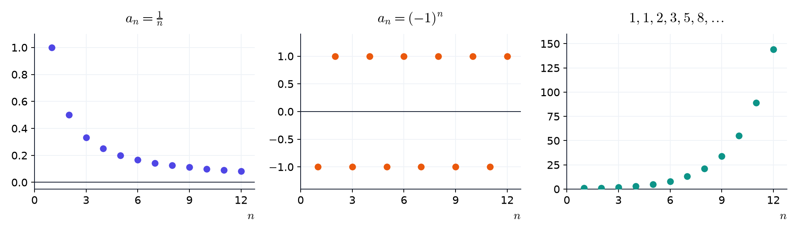
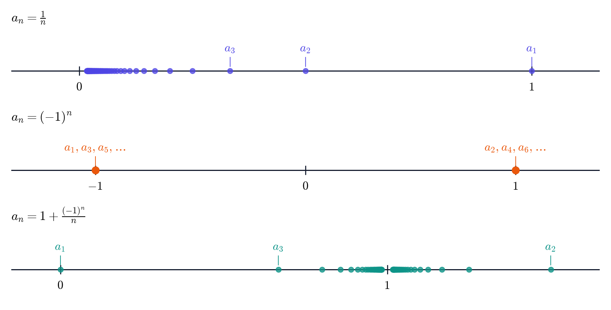
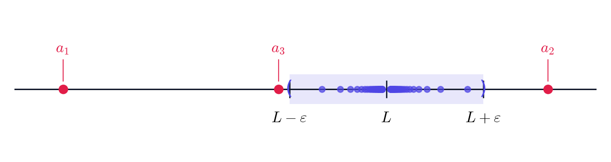
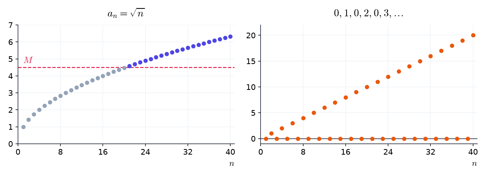
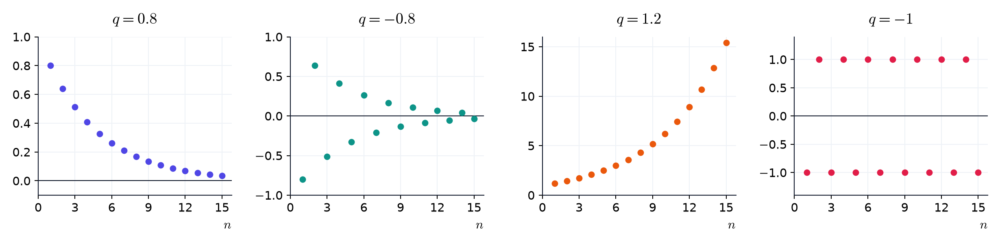
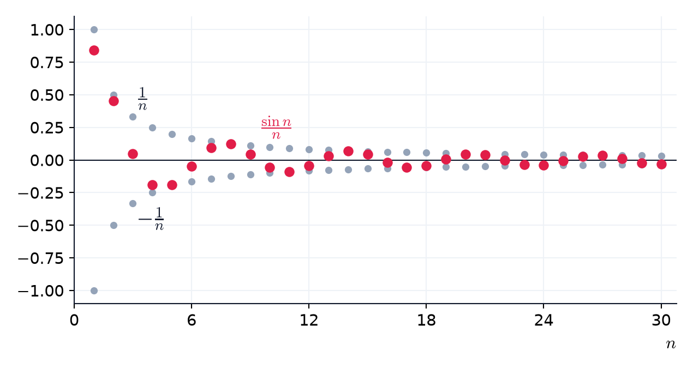
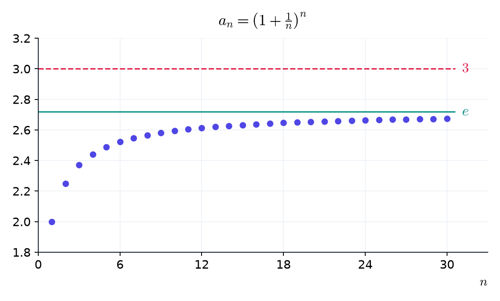
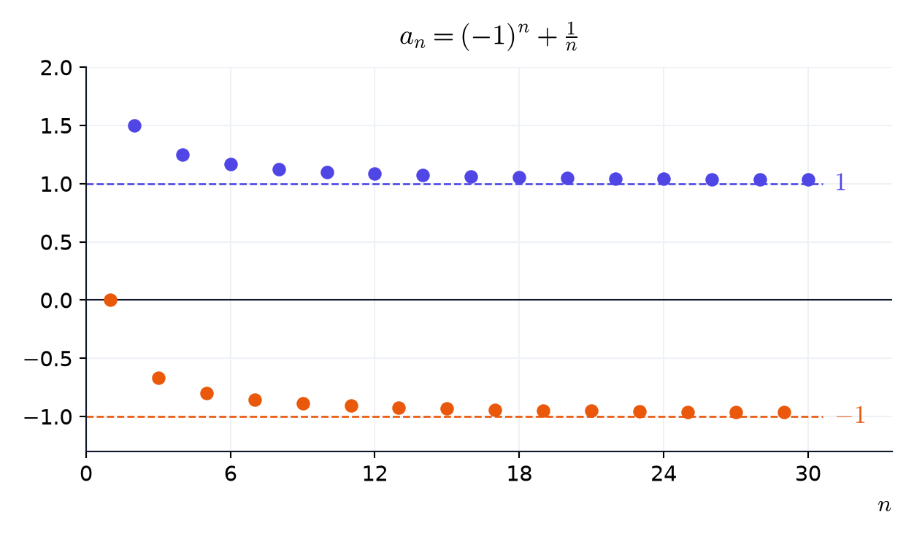

# סדרות וגבולות {chapter="2"}

## סדרות


בפרק 1 ראינו ש-$\sqrt{2}$ אינו רציונלי, ולכן הכתיבה העשרונית שלו לא נגמרת. אפשר רק לקרב אותו, ספרה אחר ספרה:

$$1, \quad 1.4, \quad 1.41, \quad 1.414, \quad 1.4142, \quad \ldots$$

רשימה כזו, שיש בה סדר ואין לה סוף, היא סדרה.

::: {#box-def-sequence .thmdef title="סדרה"}
[**סדרה**]{.term} היא רשימה אינסופית ומסודרת של מספרים ממשיים:

$$a_1, \quad a_2, \quad a_3, \quad \ldots$$

המספר $a_n$ נקרא [**האיבר**]{.term} שבמקום $,n$ ו-$n$ נקרא [**האינדקס**]{.term}. נסמן את הסדרה כולה ב-$a_n$ או ב-$.(a_n)$

במונחים של פרק 1: סדרה היא פונקציה שתחום ההגדרה שלה הוא $,\mathbb{N}$ ו-$a_n$ הוא הערך שלה ב-$.n$
:::

::: {.thmkey icon="idea" title="שתי דרכים לתאר סדרה"}
- **נוסחה:** כלל שמחשב את $a_n$ ישירות מ-$.n$ למשל, הנוסחה $a_n = 2n - 1$ נותנת את הסדרה $1, 3, 5, 7, \ldots$ של המספרים האי-זוגיים.
- **רקורסיה:** נותנים את האיבר הראשון (או כמה ראשונים), וכלל שמחשב כל איבר מהקודמים לו. למשל, $a_1 = 1$ ו-$a_{n+1} = 2a_n$ נותנים את הסדרה $1, 2, 4, 8, \ldots$ של חזקות $2$.
:::

::: {#box-def-famous .thmdef title="סדרות מפורסמות"}
- [**הסדרה הקבועה**]{.term} $a_n = c$ נותנת $c, c, c, \ldots$ בכל מקום.
- [**הסדרה ההרמונית**]{.term} $a_n = \frac{1}{n}$ נותנת $1, \frac{1}{2}, \frac{1}{3}, \frac{1}{4}, \ldots$ בזה אחר זה.
- [**סדרה מתחלפת**]{.term} היא סדרה שהסימנים של איבריה מתחלפים. למשל, $a_n = (-1)^n$ נותנת $-1, 1, -1, 1, \ldots$ לסירוגין.
- [**סדרה חשבונית**]{.term}: בכל צעד מוסיפים אותו מספר $d$ (ההפרש), ולכן $.a_n = a_1 + (n - 1)d$
- [**סדרה הנדסית**]{.term}: בכל צעד כופלים באותו מספר $q$ (המנה), ולכן $.a_n = a_1 q^{n-1}$
- [**סדרת פיבונאצ'י**]{.term}: שני האיברים הראשונים הם $,1$ וכל איבר הוא סכום שני הקודמים לו: $.a_{n+2} = a_{n+1} + a_n$
:::

את הסדרה מציירים כנקודות $,(n, a_n)$ בלי לחבר ביניהן: בין $n = 1$ ל-$n = 2$ אין איבר.

::: {.content-visible when-format="html"}
{fig-alt="שלושה גרפים של נקודות: נקודות שיורדות לעבר אפס, נקודות שקופצות בין מינוס אחת לאחת, ונקודות שעולות מהר" width="95%" fig-align="center"}
:::

יש עוד דרך לצייר סדרה: מסמנים את האיברים עצמם כנקודות על הישר הממשי. בציור כזה לא רואים את המקום של כל איבר בסדרה, אבל רואים היטב איפה האיברים מצטופפים.

::: {.content-visible when-format="html"}
{fig-alt="שלושה ישרים עם נקודות: נקודות שמצטופפות ליד אפס, שתי נקודות במינוס אחת ובאחת, ונקודות משני הצדדים של אחת שמצטופפות לידה" width="85%" fig-align="center"}
:::

::: {#box-exm-seq-terms .thmexm title="מחשבים איברים"}
כתבו את האיברים מופרדים בפסיקים.

:::: fill
**(א)** הסדרה $a_n = \frac{n + 1}{n}$

$a_1 =$ [$2$]{.blank ans="2"}, $a_2 =$ [$\frac{3}{2}$]{.blank ans="3/2"}, $a_{10} =$ [$\frac{11}{10}$]{.blank ans="11/10"}

**(ב)** שמונת האיברים הראשונים של סדרת פיבונאצ'י:

::: eqline
[$1, 1, 2, 3, 5, 8, 13, 21$]{.blank kind="list" ans="1,1,2,3,5,8,13,21" w="24"}
:::

**(ג)** הסדרה החשבונית שמתחילה ב-$4, 7, 10, 13$

$a_n =$ [$3n + 1$]{.blank ans="3n+1" vars="n"}, $a_{20} =$ [$61$]{.blank ans="61"}

**(ד)** הסדרה ההנדסית שמתחילה ב-$3, 6, 12, 24$

$a_n =$ [$3 \cdot 2^{n-1}$]{.blank ans="3*2^(n-1)" vars="n"}

::: hint
ב-(ב) כל איבר הוא סכום שני הקודמים לו. ב-(ג) ההפרש הוא $,d = 3$ וב-(ד) המנה היא $.q = 2$
:::
::: explain
**(א)** $,a_1 = \frac{2}{1} = 2$ $,a_2 = \frac{3}{2}$ $.a_{10} = \frac{11}{10}$

**(ב)** $,1 + 1 = 2$ $,1 + 2 = 3$ $,2 + 3 = 5$ $,3 + 5 = 8$ $5 + 8 = 13$ ו-$.8 + 13 = 21$

**(ג)** $a_1 = 4$ ו-$,d = 3$ ולכן $$\begin{aligned} a_n &= 4 + (n - 1) \cdot 3 \\ &= 3n + 1 \\ a_{20} &= 3 \cdot 20 + 1 = 61 \end{aligned}$$

**(ד)** $,a_1 = 3$ ובכל צעד כופלים ב-$,2$ ולכן $.a_n = 3 \cdot 2^{n-1}$
:::
::::
:::

::: {.thmwarn title="כמה איברים ראשונים לא קובעים סדרה"}
איך ממשיכים את $2, 4, 8$ ואחריהם שלוש נקודות? אולי $16$ (חזקות של $2$), ואולי $14$ (ההפרשים $2, 4, 6$ גדלים ב-$2$). לכן מתארים סדרה בנוסחה או ברקורסיה. כשמבקשים "נוסחה לפי האיברים הראשונים", הכוונה לנוסחה הפשוטה ביותר שמתאימה להם.
:::

:::: {.thmchk}
**(א)** האם הרשימה שבה כל האיברים שווים ל-$1$ היא סדרה?

::: {.quiz options="כן|לא" answer="כן"}
כן, זו הסדרה הקבועה $.a_n = 1$ בסדרה מותר לאיברים לחזור.
:::

**(ב)** מהו האיבר החמישי של $?a_n = (-1)^n n$

::: {.quiz options="$5$|$-5$" answer="$-5$"}
$.a_5 = (-1)^5 \cdot 5 = -5$ חזקה אי-זוגית של $-1$ שווה $.{-}1$
:::
::::

::: {.thmsummary}
- סדרה היא רשימה אינסופית $a_1, a_2, a_3$ וכן הלאה, ו-$a_n$ הוא האיבר שבמקום $.n$
- מתארים סדרה בנוסחה או ברקורסיה, ולא בכמה איברים ראשונים.
- סדרות מפורסמות: קבועה, הרמונית, מתחלפת, חשבונית, הנדסית, פיבונאצ'י.
:::

### תרגילים {.unnumbered}

::::: {#box-q-seq-terms .thmqst title="איברים מנוסחה"}
חשבו.

:::: fill
**(א)** $a_n = n^2 - n$

$a_3 =$ [$6$]{.blank ans="6"}

**(ב)** $a_n = \frac{(-1)^n}{n}$

$a_4 =$ [$\frac{1}{4}$]{.blank ans="1/4"}, $a_5 =$ [$-\frac{1}{5}$]{.blank ans="-1/5"}

**(ג)** $a_n = \frac{2^n}{n}$

$a_3 =$ [$\frac{8}{3}$]{.blank ans="8/3"}
::::
:::::

::::: {#box-q-seq-recursion .thmqst title="איברים מרקורסיה"}
הסדרה נתונה ברקורסיה: $a_1 = 2$ ו-$.a_{n+1} = 3a_n - 1$ חשבו:

:::: fill
$a_2 =$ [$5$]{.blank ans="5"}, $a_3 =$ [$14$]{.blank ans="14"}, $a_4 =$ [$41$]{.blank ans="41"}

::: explain
$,a_2 = 3 \cdot 2 - 1 = 5$ $,a_3 = 3 \cdot 5 - 1 = 14$ $.a_4 = 3 \cdot 14 - 1 = 41$
:::
::::
:::::

::::: {#box-q-seq-geometric .thmqst title="סדרה הנדסית עם מנה שלילית"}
$a_1 = 2$ והמנה היא $.q = -3$ כתבו את חמשת האיברים הראשונים, מופרדים בפסיקים.

:::: fill
::: eqline
[$2, -6, 18, -54, 162$]{.blank kind="list" ans="2,-6,18,-54,162" w="24"}
:::

::: explain
בכל צעד כופלים ב-$,{-}3$ ולכן הסימן מתחלף: זו גם סדרה מתחלפת.
:::
::::
:::::

::::: {#box-q-seq-formula .thmqst title="נוסחה מאיברים"}
מצאו את הנוסחה הפשוטה ביותר שמתאימה לאיברים הראשונים.

:::: fill
**(א)** $7, 12, 17, 22$

$a_n =$ [$5n + 2$]{.blank ans="5n+2" vars="n"}

**(ב)** $1, 4, 9, 16$

$a_n =$ [$n^2$]{.blank ans="n^2" vars="n"}

**(ג)** $\frac{1}{2}, \frac{1}{4}, \frac{1}{8}, \frac{1}{16}$

$a_n =$ [$\frac{1}{2^n}$]{.blank ans="1/2^n" vars="n"}

::: explain
**(א)** חשבונית עם $a_1 = 7$ ו-$:d = 5$ $$\begin{aligned} a_n &= 7 + 5(n - 1) \\ &= 7 + 5n - 5 \\ &= 5n + 2 \end{aligned}$$

**(ב)** אלה הריבועים $,1^2, 2^2, 3^2, 4^2$ ולכן $.a_n = n^2$

**(ג)** הנדסית עם $a_1 = \frac{1}{2}$ ו-$,q = \frac{1}{2}$ ולכן $.a_n = \frac{1}{2}\left(\frac{1}{2}\right)^{n-1} = \frac{1}{2^n}$
:::
::::
:::::

::::: {#box-q-seq-kind .thmqst title="חשבונית או הנדסית?"}
**(א)** הסדרה שמתחילה ב-$5, 2, -1, -4$

::: {.quiz options="חשבונית|הנדסית|אף אחת" answer="חשבונית"}
חשבונית: בכל צעד מוסיפים $.{-}3$
:::

**(ב)** הסדרה שמתחילה ב-$2, -6, 18, -54$

::: {.quiz options="חשבונית|הנדסית|אף אחת" answer="הנדסית"}
הנדסית: בכל צעד כופלים ב-$.{-}3$
:::

**(ג)** הסדרה שמתחילה ב-$1, 2, 4, 7, 11$

::: {.quiz options="חשבונית|הנדסית|אף אחת" answer="אף אחת"}
אף אחת: ההפרשים $1, 2, 3, 4$ אינם קבועים, וגם המנות אינן קבועות.
:::
:::::

## גבול של סדרה


הקירובים העשרוניים מתקרבים אל $\sqrt{2}$ כמה שרוצים, ואילו $(-1)^n$ קופצת בין $-1$ ל-$1$ ולא מתייצבת. במילים: $a_n$ מתקרבת ל-$L$ אם $a_n$ קרוב ל-$L$ כמה שרוצים, בתנאי ש-$n$ גדול מספיק.

כדי לבדוק "קרוב כמה שרוצים" מדברים על [**שגיאה**]{.term}: המרחק $|a_n - L|$ בין האיבר לגבול. בוחרים [**שגיאה מותרת**]{.term}, מספר חיובי $\varepsilon$ (למשל $0.1$ או $0.001$), וצריך להראות שממקום מסוים והלאה השגיאה של **כל** האיברים קטנה מ-$.\varepsilon$

::: {#box-def-limit .thmdef title="גבול של סדרה"}
נאמר שהסדרה $a_n$ [**מתכנסת**]{.term} ל-$,L$ ונסמן $\lim\limits_{n\to\infty} a_n = L$ או $,a_n \to L$ אם לכל שגיאה מותרת $\varepsilon > 0$ יש מקום בסדרה שממנו והלאה כל האיברים מקיימים

$$.|a_n - L| < \varepsilon$$

המספר $L$ נקרא [**הגבול**]{.term} של הסדרה, ונאמר גם ש-$a_n$ [**שואפת**]{.term} ל-$.L$ סדרה שיש לה גבול נקראת מתכנסת, וסדרה שאין לה גבול נקראת [**מתבדרת**]{.term}.
:::

:::::: {#box-sim-error-band .thmsim title="שגיאה מותרת ורצועה סביב הגבול"}
```{=html}
<iframe class="widget-frame" src="widgets/ch02/error-band.html" loading="lazy" title="שגיאה מותרת ורצועה סביב הגבול"></iframe>
```

בחרו סדרה והקטינו את השגיאה המותרת $.\varepsilon$ הרצועה היא כל המספרים שהמרחק שלהם מ-$L$ קטן מ-$.\varepsilon$ ככל שהשגיאה המותרת קטנה, המקום שממנו והלאה כל האיברים בתוך הרצועה נדחה ימינה, אבל עבור סדרה מתכנסת הוא תמיד קיים. עבור $(-1)^n$ ושגיאה מותרת קטנה מספיק אין מקום כזה, לא משנה סביב איזה מספר שמים את הרצועה.
::::::

**על הישר הממשי.** האי-שוויון $|a_n - L| < \varepsilon$ אומר ש-$a_n$ נמצא בקטע $.(L - \varepsilon, L + \varepsilon)$ לכן בציור על הישר הממשי ההגדרה אומרת: לכל שגיאה מותרת, **כל האיברים חוץ ממספר סופי שלהם** נמצאים בקטע הזה. מחוץ לקטע נשארים רק האיברים שלפני המקום שממנו והלאה כולם בפנים.

::: {.content-visible when-format="html"}
{fig-alt="ישר ממשי עם קטע מוצלל סביב L; נקודות כחולות רבות מצטופפות בתוך הקטע, ושלוש נקודות אדומות מחוצה לו" width="85%" fig-align="center"}
:::

::: {#box-exm-one-over-n .thmexm title="הסדרה ההרמונית שואפת לאפס"}
עבור $a_n = \frac{1}{n}$ ו-$,L = 0$ השגיאה היא $.\left|\frac{1}{n} - 0\right| = \frac{1}{n}$ מאיזה מקום היא קטנה מהשגיאה המותרת?

:::: fill
**(א)** השגיאה המותרת $\varepsilon = 0.1$

החל מ-$n =$ [$11$]{.blank ans="11"}

**(ב)** השגיאה המותרת $\varepsilon = 0.001$

החל מ-$n =$ [$1001$]{.blank ans="1001"}

::: explain
**(א)** $$\begin{aligned} \tfrac{1}{n} &< 0.1 \\ 1 &< 0.1n \\ 10 &< n \end{aligned}$$ (כפלנו ב-$n$ וחילקנו ב-$,0.1$ שניהם חיוביים.) כלומר החל מ-$.n = 11$

**(ב)** $$\begin{aligned} \tfrac{1}{n} &< 0.001 \\ 1 &< 0.001n \\ 1000 &< n \end{aligned}$$ כלומר החל מ-$.n = 1001$ לכל שגיאה מותרת $\varepsilon$ זה קורה כאשר $,n > \frac{1}{\varepsilon}$ ולכן $.\frac{1}{n} \to 0$
:::
::::
:::

::: {.thmkey icon="rule" title="רק הזנב קובע"}
- האיברים ממקום מסוים והלאה נקראים [**זנב**]{.term} של הסדרה, והגבול תלוי רק בזנב. שינוי של $1000$ האיברים הראשונים לא משנה אותו.
- לסדרה יש **לכל היותר גבול אחד**: אי אפשר להתקרב כמה שרוצים לשני מספרים שונים בבת אחת.
- הגבול לא חייב להיות אחד האיברים, והסדרה לא חייבת להתקרב אליו מצד אחד. למשל, $1 + \frac{(-1)^n}{n}$ נמצאת לסירוגין מעל $1$ ומתחת לו, ובכל זאת שואפת ל-$.1$
:::

::: {.thmkey icon="idea" title="חזקה עם מעריך אי-רציונלי"}
בפרק 1 דחינו את ההגדרה של חזקה כמו $.2^{\sqrt{2}}$ עכשיו אפשר להשלים אותה: לוקחים את הקירובים העשרוניים של $,\sqrt{2}$ ואת החזקות שלהם, $2^{1}$ ו-$2^{1.4}$ ו-$2^{1.41}$ וכן הלאה. כל אחת מהן היא חזקה עם מעריך רציונלי, שכבר הגדרנו. הסדרה הזו מתכנסת, ו-$2^{\sqrt{2}}$ הוא הגבול שלה, בערך $.2.665$
:::

:::: {.thmchk}
**(א)** מהו הגבול של הסדרה $0.9, \ 0.99, \ 0.999$ וכן הלאה, שבה כל איבר מוסיף עוד $9$ בסוף?

::: {.quiz options="$1$|מעט פחות מ-$1$|אין לה גבול" answer="$1$"}
השגיאות הן $0.1$ ו-$0.01$ ו-$0.001$ וכן הלאה, ולכן לכל שגיאה מותרת יש מקום שממנו והלאה כל האיברים בשגיאה קטנה ממנה. הגבול הוא בדיוק $.1$
:::

**(ב)** האם הסדרה $1, 0, \frac{1}{2}, 0, \frac{1}{3}, 0$ וכן הלאה מתכנסת?

::: {.quiz options="כן, ל-$0$|לא" answer="כן, ל-$0$"}
כן, ל-$.0$ השגיאה של האפסים היא $,0$ והשגיאה של האיבר $\frac{1}{k}$ היא $,\frac{1}{k}$ שקטנה מכל שגיאה מותרת כש-$k$ גדול מספיק. הסדרה לא חייבת להתקרב לגבול בכל צעד.
:::
::::

### שאיפה לאינסוף {.unnumbered}

הסדרה $\sqrt{n}$ מתבדרת, אבל בצורה מסודרת: היא עוברת כל גובה ונשארת מעליו.

::: {#box-def-infinite-limit .thmdef title="שאיפה לאינסוף"}
נאמר ש-$a_n$ [**שואפת לאינסוף**]{.term} ונסמן $\lim\limits_{n\to\infty} a_n = \infty$ או $,a_n \to \infty$ אם לכל מספר $M$ יש מקום בסדרה שממנו והלאה כל האיברים גדולים מ-$.M$ באופן דומה, $a_n$ [**שואפת למינוס אינסוף**]{.term} ($a_n \to -\infty$) אם לכל מספר $M$ יש מקום בסדרה שממנו והלאה כל האיברים קטנים מ-$.M$
:::

::: {.content-visible when-format="html"}
{fig-alt="משמאל נקודות שעולות ועוברות קו אופקי ונשארות מעליו; מימין נקודות שעולות לסירוגין עם נקודות על אפס" width="90%" fig-align="center"}
:::

::: {.thmwarn title="אינסוף אינו גבול"}
סדרה ששואפת לאינסוף היא סדרה **מתבדרת**: אין מספר שהיא מתקרבת אליו. הסימון $\lim\limits_{n\to\infty} a_n = \infty$ רק מתאר **איך** היא מתבדרת.
:::

### מה עושים עם גבול {.unnumbered}

כשפוגשים סדרה, המשימה היא אחת משלוש:

::: {.thmkey icon="idea" title="שלוש משימות"}
1. **לחשב את הגבול.** בעזרת כמה גבולות שכדאי לזכור, וכללי חישוב פשוטים.
2. **להראות שיש גבול**, גם בלי לדעת מהו. למשל, כשהסדרה עולה כל הזמן ובכל זאת נשארת מתחת למספר קבוע.
3. **להראות שאין גבול.** למשל, כשהאיברים מתרחקים מאפס בלי סוף, או כשחלק מהאיברים מתקרבים למספר אחד וחלק למספר אחר.
:::

::: {.thmkey icon="idea" title="לא תמיד אפשר לחשב"}
לפעמים יודעים שיש גבול, אבל אין דרך לכתוב אותו בעזרת המספרים שאנחנו מכירים. כך קורה עם הסדרה $:\left(1 + \frac{1}{n}\right)^n$ יש לה גבול, אבל שום חישוב פשוט לא נותן אותו. בהמשך הפרק נראה למה יש לה גבול, ונקרא לו $.e$
:::

:::: {.thmchk}
איזו משימה מתאימה לסדרה $?(-1)^n$

::: {.quiz options="לחשב את הגבול|להראות שיש גבול|להראות שאין גבול" answer="להראות שאין גבול"}
האיברים קופצים בין $-1$ ל-$1$ ולא מתייצבים, ולכן המשימה היא להראות שאין לה גבול: חלק מהאיברים (במקומות הזוגיים) שווים $,1$ והשאר שווים $.{-}1$
:::
::::

::: {.thmsummary}
- $a_n \to L$ אם לכל שגיאה מותרת $\varepsilon > 0$ יש מקום שממנו והלאה כל האיברים מקיימים $.|a_n - L| < \varepsilon$
- רק הזנב קובע את הגבול, ולסדרה יש לכל היותר גבול אחד.
- $a_n \to \infty$ אם לכל מספר $M$ יש מקום שממנו והלאה כל האיברים גדולים מ-$.M$ זו סדרה מתבדרת.
- על סדרה יש שלוש משימות: לחשב את הגבול, להראות שהוא קיים, או להראות שאינו קיים. לא תמיד אפשר לחשב אותו.
:::

### תרגילים {.unnumbered}

::::: {#box-q-limit-table .thmqst title="מנחשים גבול מטבלה"}
:::: fill
**(א)** $a_n = \frac{2n + 1}{n}$

| $n$ | $1$ | $10$ | $100$ | $1000$ |
|:--:|:--:|:--:|:--:|:--:|
| $a_n$ | $3$ | $2.1$ | $2.01$ | $2.001$ |

הגבול הוא [$2$]{.blank ans="2"}

**(ב)** $a_n = 5 - \frac{1}{n^2}$

| $n$ | $1$ | $10$ | $100$ |
|:--:|:--:|:--:|:--:|
| $a_n$ | $4$ | $4.99$ | $4.9999$ |

הגבול הוא [$5$]{.blank ans="5"}

::: explain
**(א)** $,\frac{2n + 1}{n} = 2 + \frac{1}{n}$ והשגיאה $\frac{1}{n}$ קטנה כמה שרוצים.

**(ב)** השגיאה היא $,\frac{1}{n^2}$ שקטנה כמה שרוצים, ולכן הגבול $.5$
:::
::::
:::::

::::: {#box-q-converges .thmqst title="מתכנסת?"}
**(א)** $\frac{(-1)^n}{n}$

::: {.quiz options="מתכנסת|מתבדרת" answer="מתכנסת"}
מתכנסת ל-$:0$ השגיאה היא $,\frac{1}{n}$ בדיוק כמו בסדרה ההרמונית.
:::

**(ב)** $(-1)^n$

::: {.quiz options="מתכנסת|מתבדרת" answer="מתבדרת"}
מתבדרת: האיברים $1$ ו-$-1$ חוזרים בלי סוף, ואין מספר שהמרחק של שניהם ממנו קטן מ-$.0.5$
:::

**(ג)** $7$ (הסדרה הקבועה)

::: {.quiz options="מתכנסת|מתבדרת" answer="מתכנסת"}
מתכנסת ל-$,7$ כי השגיאה היא תמיד $.0$
:::

**(ד)** $n^2$

::: {.quiz options="מתכנסת|מתבדרת" answer="מתבדרת"}
מתבדרת: היא שואפת לאינסוף.
:::
:::::

::::: {#box-q-error-place .thmqst title="שגיאה מותרת"}
עבור $a_n = \frac{n + 2}{n}$ ו-$L = 1$ השגיאה היא $.\left|\frac{n + 2}{n} - 1\right| = \frac{2}{n}$

:::: fill
השגיאה קטנה מ-$\varepsilon = 0.01$ החל מ-$n =$ [$201$]{.blank ans="201"}

::: explain
$\frac{2}{n} < 0.01$ בדיוק כאשר $,n > 200$ כלומר החל מ-$.n = 201$ אפשר לבדוק בסימולציה [](#box-sim-error-band).
:::
::::
:::::

::::: {#box-q-to-infinity .thmqst title="לאן היא שואפת?"}
**(א)** $-3n$

::: {.quiz options="$\infty$|$-\infty$|אף אחד מהם" answer="$-\infty$"}
$:{-}\infty$ לכל מספר $M$ יש מקום שממנו והלאה $.{-}3n < M$
:::

**(ב)** $(-2)^n$

::: {.quiz options="$\infty$|$-\infty$|אף אחד מהם" answer="אף אחד מהם"}
אף אחד מהם: הסימן מתחלף ($-2$ ואחריו $4$ ואחריו $-8$), ולכן היא לא נשארת מעל שום מספר וגם לא מתחת לשום מספר.
:::

**(ג)** $n + 2(-1)^n$

::: {.quiz options="$\infty$|$-\infty$|אף אחד מהם" answer="$\infty$"}
$:\infty$ האיברים הם $-1, 4, 1, 6, 3, 8$ וכן הלאה: הסדרה לא עולה בכל צעד, אבל $,n + 2(-1)^n \ge n - 2$ ולכן לכל $M$ ממקום מסוים כל האיברים גדולים מ-$.M$ כדי לשאוף לאינסוף לא חייבים לעלות בכל צעד.
:::
:::::

## סדרות סטנדרטיות


::: {#box-thm-standard .thmthm title="גבולות של סדרות סטנדרטיות"}
1. סדרה קבועה: $.c \to c$
2. $\frac{1}{n^p} \to 0$ לכל $.p > 0$ למשל $\frac{1}{n}$ ו-$\frac{1}{n^2}$ ו-$.\frac{1}{\sqrt{n}}$
3. $n^p \to \infty$ לכל $.p > 0$
4. הסדרה $q^n$ תלויה ב-$:q$
   - אם $|q| < 1$ אז $.q^n \to 0$
   - אם $q = 1$ אז $.q^n \to 1$
   - אם $q > 1$ אז $.q^n \to \infty$
   - אם $q \le -1$ היא מתבדרת, ואינה שואפת ל-$\infty$ וגם לא ל-$.{-}\infty$
5. $\sqrt[n]{a} \to 1$ לכל $,a > 0$ וגם $.\sqrt[n]{n} \to 1$
:::

::: {.lecture-answer title="למה?"}
- כפל חוזר במספר שהערך המוחלט שלו קטן מ-$1$ מקרב את התוצאה לאפס: $,0.8^2 = 0.64$ $,0.8^{10} \approx 0.11$ $.0.8^{30} \approx 0.001$ כפל חוזר במספר גדול מ-$1$ מגדיל בלי גבול.
- $\sqrt[n]{a} = a^{1/n}$ והמעריך $\frac{1}{n}$ שואף ל-$,0$ ו-$.a^0 = 1$ למשל $.\sqrt[10]{2} \approx 1.07$
- גם $\sqrt[n]{n}$ מתקרב ל-$:1$ $,\sqrt[10]{10} \approx 1.26$ $,\sqrt[100]{100} \approx 1.047$ $.\sqrt[1000]{1000} \approx 1.007$
:::

::: {.content-visible when-format="html"}
{fig-alt="ארבעה גרפים של נקודות: יורדות לאפס, מחליפות סימן ומתקרבות לאפס, עולות מהר, קופצות בין אחת למינוס אחת" width="95%" fig-align="center"}
:::

::: {.thmwarn title="למה צריך את התנאים?"}
- עבור $q = -1$ האיברים קופצים בין $-1$ ל-$,1$ ואין גבול, אף ש-$|q| = 1$ כמו עבור $.q = 1$
- עבור $q = -2$ הערך המוחלט גדל, אבל הסימן מתחלף, ולכן אין גבול וגם אין שאיפה ל-$\pm\infty$ (כמו בתרגיל [](#box-q-to-infinity)).
- ב-(2) הדרישה $p > 0$ הכרחית: עבור $p = 0$ מתקבלת הסדרה הקבועה $,\frac{1}{n^0} = 1$ שאינה שואפת ל-$.0$
- ב-(5) הדרישה $a > 0$ הכרחית: עבור $a = 0$ כל האיברים $,0$ והגבול $0$ ולא $.1$
:::

::: {#box-exm-standard .thmexm title="גבולות סטנדרטיים"}


:::: fill
**(א)** $(0.9)^n \to$ [$0$]{.blank ans="0"}

**(ב)** $\left(-\frac{1}{3}\right)^n \to$ [$0$]{.blank ans="0"}

**(ג)** $(1.5)^n \to$ [$\infty$]{.blank ans="inf"}

**(ד)** $\frac{1}{n^5} \to$ [$0$]{.blank ans="0"}

**(ה)** $\sqrt[n]{7} \to$ [$1$]{.blank ans="1"}

::: explain
**(א)** זו $q^n$ עם $,q = 0.9$ ו-$,|q| < 1$ ולכן לפי סעיף 4 במשפט הגבול הוא $.0$

**(ב)** זו $q^n$ עם $,q = -\frac{1}{3}$ ו-$,|q| = \frac{1}{3} < 1$ ולכן לפי סעיף 4 הגבול הוא $.0$ הסימן מתחלף, אבל האיברים מתקרבים ל-$.0$

**(ג)** לפי סעיף 4, כי $.q > 1$

**(ד)** לפי סעיף 2 עם $.p = 5$

**(ה)** לפי סעיף 5.
:::
::::
:::

:::: {.thmchk}
**(א)** לאן שואפת הסדרה $?(1.01)^n$

::: {.quiz options="$1$|$\infty$|$0$" answer="$\infty$"}
$,q = 1.01 > 1$ ולכן $.(1.01)^n \to \infty$ זה לוקח זמן ($1.01^{100} \approx 2.7$), אבל היא עוברת כל גובה.
:::

**(ב)** לאן שואפת הסדרה $?(-0.99)^n$

::: {.quiz options="$0$|אף מספר|$-1$" answer="$0$"}
$,|q| = 0.99 < 1$ ולכן $.(-0.99)^n \to 0$ הסימן מתחלף, אבל הערך המוחלט שואף ל-$.0$
:::
::::

::: {.thmsummary}
- סדרה קבועה שואפת לעצמה. $\frac{1}{n^p} \to 0$ ו-$n^p \to \infty$ כאשר $.p > 0$
- $q^n$ שואפת ל-$0$ כאשר $,|q| < 1$ ל-$1$ כאשר $,q = 1$ ול-$\infty$ כאשר $.q > 1$ כאשר $q \le -1$ היא מתבדרת.
- $\sqrt[n]{a} \to 1$ (כאשר $a > 0$) וגם $.\sqrt[n]{n} \to 1$
:::

### תרגילים {.unnumbered}

::::: {#box-q-standard .thmqst title="לאן הסדרה שואפת?"}
:::: fill
**(א)** $\left(\frac{2}{3}\right)^n \to$ [$0$]{.blank ans="0"}

**(ב)** $\frac{1}{\sqrt{n}} \to$ [$0$]{.blank ans="0"}

**(ג)** $n^3 \to$ [$\infty$]{.blank ans="inf"}

**(ד)** $4^n \to$ [$\infty$]{.blank ans="inf"}

**(ה)** $\sqrt[n]{100} \to$ [$1$]{.blank ans="1"}

**(ו)** $(-0.5)^n \to$ [$0$]{.blank ans="0"}
::::
:::::

::::: {#box-q-geometric-q .thmqst title="מתי $q^n$ מתכנסת?"}
:::: fill
$q^n$ מתכנסת בדיוק כאשר $q$ בקבוצה [$(-1, 1]$]{.blank ans="(-1,1]"}

::: explain
עבור $|q| < 1$ הגבול $,0$ ועבור $q = 1$ הגבול $.1$ עבור $q > 1$ היא שואפת לאינסוף, ועבור $q \le -1$ היא מתבדרת. לכן $.q \in (-1, 1]$
:::
::::
:::::

::::: {#box-q-standard-trap .thmqst title="איזו מתבדרת?"}
איזו מהסדרות הבאות מתבדרת?

::: {.quiz options="$\left(\frac{1}{2}\right)^n$|$\sqrt[n]{n}$|$(-1.2)^n$|$\frac{1}{n^{0.1}}$" answer="$(-1.2)^n$"}
$(-1.2)^n$ מתבדרת, כי $.q = -1.2 \le -1$ השאר מתכנסות: $\left(\frac{1}{2}\right)^n \to 0$ ו-$\sqrt[n]{n} \to 1$ וגם $\frac{1}{n^{0.1}} \to 0$ כי $.p = 0.1 > 0$
:::
:::::

::::: {#box-q-standard-limits .thmqst title="מה הגבול?"}
**(א)** $\sqrt[n]{n}$

::: {.quiz options="$0$|$1$|$\infty$" answer="$1$"}
$:1$ לפי סעיף 5. אף ש-$n$ גדל, השורש מסדר $n$ מקרב אותו ל-$.1$
:::

**(ב)** $\frac{1}{n^{3/2}}$

::: {.quiz options="$0$|$1$|$\infty$" answer="$0$"}
$:0$ לפי סעיף 2 עם $.p = \frac{3}{2} > 0$
:::
:::::

## חשבון גבולות, סנדוויץ' והשוואה


::: {#box-thm-limit-arithmetic .thmthm title="חשבון גבולות"}
אם $a_n \to A$ ו-$,b_n \to B$ כאשר $A$ ו-$B$ מספרים, אז לכל מספר $c$ ולכל $k$ טבעי:

1. $a_n + b_n \to A + B$ ו-$a_n - b_n \to A - B$ וגם $c \cdot a_n \to cA$
2. $a_n b_n \to AB$
3. $\frac{a_n}{b_n} \to \frac{A}{B}$ אם $B \neq 0$
4. $(a_n)^k \to A^k$ ו-$\sqrt{a_n} \to \sqrt{A}$ אם $a_n \ge 0$
:::

::: {.thmwarn title="למה צריך $B \neq 0$?"}
אם $b_n \to 0$ אין תשובה אחת: $\frac{1}{1/n} = n \to \infty$ אבל $\frac{1}{(-1)^n / n} = (-1)^n n$ מתבדרת ואינה שואפת ל-$.\pm\infty$ לכן "$\frac{c}{0}$" אינו כלל.
:::

חלק מהחישובים עובדים גם כשסדרה שואפת לאינסוף. כאן $c$ הוא מספר, ו-"$c + \infty = \infty$" הוא קיצור של: אם $a_n \to c$ ו-$b_n \to \infty$ אז $.a_n + b_n \to \infty$

::: {.thmkey icon="rule" title="חשבון עם אינסוף"}
- $c + \infty = \infty$ ו-$\infty + \infty = \infty$
- $\infty \cdot \infty = \infty$
- $c \cdot \infty = \infty$ אם $,c > 0$ ו-$c \cdot \infty = -\infty$ אם $c < 0$
- $\frac{c}{\infty} = 0$ ו-$\frac{\infty}{c} = \infty$ אם $c > 0$
:::

::: {.thmwarn title="צורות לא מוגדרות"}
לצורות $\infty - \infty$ ו-$\frac{\infty}{\infty}$ ו-$0 \cdot \infty$ ו-$\frac{0}{0}$ **אין תשובה קבועה**: אותה צורה יכולה לתת תשובות שונות.

- $\infty - \infty$: הסדרות $n - n$ ו-$(n + 1) - n$ ו-$2n - n$ שואפות ל-$0$ ול-$1$ ול-$.\infty$
- $\frac{\infty}{\infty}$: הסדרות $\frac{n}{n}$ ו-$\frac{n^2}{n}$ ו-$\frac{n}{n^2}$ שואפות ל-$1$ ול-$\infty$ ול-$.0$

כשמקבלים צורה כזו, קודם מעבירים את הביטוי לצורה אחרת, ורק אז מחשבים.
:::

::: {.thmkey icon="calc" title="מה עושים עם צורה לא מוגדרת"}
1. מנה של פולינומים: מחלקים את המונה ואת המכנה בחזקה הגבוהה ביותר של $n$ במכנה.
2. מנה עם חזקות כמו $2^n$ ו-$:3^n$ מחלקים בחזקה הגדולה ביותר.
3. הפרש כמו $:n - n^2$ מוציאים את החזקה הגבוהה ביותר כגורם משותף.
4. אחר כך מחליפים כל סדרה סטנדרטית בגבול שלה (למשל $\frac{1}{n} \to 0$) ומחשבים לפי חשבון הגבולות.
:::

::::: {#box-exm-lim-rational .thmexm title="חשבון גבולות, צעד אחר צעד"}
חשבו את הגבולות.

**(א)** $\lim\limits_{n\to\infty} \frac{3n^2 + 1}{n^2 + 4n}$

:::: {.derive limit="n" start="(3n^2+1)/(n^2+4n)"}
::: {.step line="(3+[1/n^2])/(1+[4/n])"}
מחלקים את המונה ואת המכנה ב-$.n^2$
:::
::: {.step line="(3+[0])/(1+[0])"}
מחליפים כל סדרה סטנדרטית בגבול שלה.
:::
::: {.step line="[3]"}
מחשבים.
:::
::: hint
המונה והמכנה שואפים שניהם ל-$:\infty$ זו הצורה $.\frac{\infty}{\infty}$ החזקה הגבוהה במכנה היא $.n^2$
:::
::::

**(ב)** $\lim\limits_{n\to\infty} \frac{2n + 5}{n^2 + 1}$

:::: {.derive limit="n" start="(2n+5)/(n^2+1)"}
::: {.step line="([2/n]+[5/n^2])/(1+[1/n^2])"}
מחלקים את המונה ואת המכנה ב-$,n^2$ החזקה הגבוהה במכנה.
:::
::: {.step line="([0]+[0])/(1+[0])"}
מחליפים כל סדרה סטנדרטית בגבול שלה.
:::
::: {.step line="[0]"}
מחשבים.
:::
::::

**(ג)** $\lim\limits_{n\to\infty} \frac{n^2 + 1}{2n + 3}$

:::: {.derive limit="n" start="(n^2+1)/(2n+3)"}
::: {.step line="(n+[1/n])/(2+[3/n])"}
מחלקים את המונה ואת המכנה ב-$,n$ החזקה הגבוהה במכנה.
:::
::: {.step line="[inf]"}
המונה שואף לאינסוף, והמכנה שואף למספר חיובי.
:::
::: hint
כאן החזקה הגבוהה במכנה היא $.n$ אחרי החילוק המונה שואף לאינסוף והמכנה ל-$.2$
:::
::::

**(ד)** $\lim\limits_{n\to\infty} \frac{2^n + 3^n}{3^n}$

:::: {.derive limit="n" start="(2^n+3^n)/3^n"}
::: {.step line="([2/3])^n+[1]"}
מחלקים כל מחובר במונה ב-$,3^n$ וכותבים את $\frac{2^n}{3^n}$ כחזקה של שבר אחד.
:::
::: {.step line="[0]+1"}
סדרה הנדסית עם $|q| < 1$ שואפת ל-$.0$
:::
::: {.step line="[1]"}
מחשבים.
:::
::: hint
חלקו כל מחובר במונה ב-$,3^n$ והיעזרו בגבול של $q^n$ עבור $.q = \frac{2}{3}$
:::
::::
:::::

::: {.thmkey icon="idea" title="מה קובע את התשובה"}
במנה של פולינומים קובעות החזקות הגבוהות ביותר של המונה ושל המכנה:

- אם הן שוות, הגבול הוא המנה של המקדמים שלהן (ב-(א), $\frac{3}{1} = 3$).
- אם החזקה במונה קטנה יותר, הגבול $0$ (ב-(ב)).
- אם היא גדולה יותר, הסדרה שואפת ל-$\infty$ או ל-$,{-}\infty$ לפי הסימן של מנת המקדמים (ב-(ג)).
:::

:::: {.thmchk}
**(א)** מהו הגבול של $?\frac{5n^3 - n}{2n^3 + 7}$

::: {.quiz options="$\frac{5}{2}$|$1$|$\infty$" answer="$\frac{5}{2}$"}
החזקות הגבוהות שוות ($n^3$), ולכן הגבול הוא המנה של המקדמים, $.\frac{5}{2}$
:::

**(ב)** לאן שואפת $?n - n^2$

::: {.quiz options="$0$|$-\infty$|$\infty$" answer="$-\infty$"}
זו הצורה $,\infty - \infty$ ואינה $.0$ מוציאים גורם משותף: $,n - n^2 = n^2\left(\frac{1}{n} - 1\right)$ והגורם השני מקיים $,\frac{1}{n} - 1 \to -1$ ולכן $.n - n^2 \to -\infty$
:::
::::

### כלל הסנדוויץ' {.unnumbered}

חשבון הגבולות לא עוזר עבור $,\frac{\sin n}{n}$ כי ל-$\sin n$ אין גבול. במקרה כזה לוחצים את הסדרה בין שתי סדרות שהגבול שלהן ידוע.

::: {#box-thm-squeeze .thmthm title="כלל הסנדוויץ'"}
אם $b_n \le a_n \le c_n$ (ממקום מסוים והלאה), והסדרות $b_n$ ו-$c_n$ שואפות **לאותו** גבול $,L$ אז גם $.a_n \to L$
:::

::: {.content-visible when-format="html"}
{fig-alt="נקודות אדומות בין שתי שורות של נקודות אפורות, אחת מעל ואחת מתחת, שמתכנסות לאפס" width="75%" fig-align="center"}
:::

::: {.thmkey icon="calc" title="שימוש בכלל הסנדוויץ'"}
1. חוסמים את החלק שקופץ, למשל $.{-}1 \le \sin n \le 1$
2. עושים את אותה פעולה בשלושת החלקים (חילוק ב-$n$ חיובי שומר על כיוון אי-השוויון).
3. בודקים ששני החסמים שואפים לאותו גבול.
:::

::: {#box-exm-squeeze .thmexm title="סינוס חלקי $n$"}
חשבו את $.\lim\limits_{n\to\infty} \frac{\sin n}{n}$

:::: fill
מכיוון ש-$-1 \le \sin n \le 1$ ו-$n > 0$ מתקבל $.{-}\frac{1}{n} \le \frac{\sin n}{n} \le \frac{1}{n}$ לכן הגבול הוא [$0$]{.blank ans="0"}

::: explain
שתי הסדרות $-\frac{1}{n}$ ו-$\frac{1}{n}$ שואפות ל-$,0$ ולכן לפי כלל הסנדוויץ' גם $.\frac{\sin n}{n} \to 0$
:::
::::
:::

::: {#box-def-bounded .thmdef title="סדרה חסומה"}
נאמר שסדרה $a_n$ [**חסומה**]{.term} אם יש מספר $M$ כך ש-$|a_n| \le M$ לכל $.n$ למשל, $\sin n$ ו-$\cos n$ ו-$(-1)^n$ חסומות (עם $M = 1$). כל סדרה מתכנסת חסומה, אבל לא כל סדרה חסומה מתכנסת: $(-1)^n$ חסומה ומתבדרת.
:::

הנימוק של $\frac{\sin n}{n}$ עובד בכל מקום שבו סדרה חסומה מוכפלת בסדרה ששואפת לאפס:

::: {.thmkey icon="rule" title="חסומה כפול שואפת לאפס"}
אם $a_n$ חסומה ו-$,b_n \to 0$ אז $.a_n b_n \to 0$ למשל, $\frac{(-1)^n}{\sqrt{n}} \to 0$ ו-$.\frac{\sin(3n)}{n} \to 0$
:::

::: {.thmwarn title="למה צריך כל תנאי"}
- בכלל הסנדוויץ' שתי הסדרות מהצדדים חייבות לשאוף **לאותו** גבול: $,{-}1 \le (-1)^n \le 1$ אבל הסדרות הקבועות $-1$ ו-$1$ שואפות לגבולות שונים, ול-$(-1)^n$ אין גבול.
- בכפל, הגורם הראשון חייב להיות חסום: $n \cdot \frac{1}{n} = 1$ ואינה שואפת ל-$,0$ כי $n$ אינה חסומה.
- והגורם השני חייב לשאוף לאפס: $(-1)^n \cdot 1$ מתבדרת.
:::

### השוואה {.unnumbered}

אי-שוויון בין האיברים של שתי סדרות עובר גם לגבולות שלהן. בעיקר משתמשים בזה כדי להראות שסדרה שואפת לאינסוף: מספיק למצוא סדרה **קטנה** ממנה ששואפת לאינסוף.

::: {#box-thm-compare .thmthm title="השוואת גבולות"}
נניח ש-$a_n \le b_n$ ממקום מסוים והלאה.

(א) אם $a_n \to A$ ו-$,b_n \to B$ אז $.A \le B$

(ב) אם $,a_n \to \infty$ אז גם $.b_n \to \infty$

(ג) אם $,b_n \to -\infty$ אז גם $.a_n \to -\infty$
:::

::: {.lecture-answer title="מאיפה זה בא?"}
בסעיף (ב): לכל מספר $M$ יש מקום שממנו והלאה $,a_n > M$ ויש מקום שממנו והלאה $.b_n \ge a_n$ מהמאוחר מבין שני המקומות $,b_n \ge a_n > M$ כלומר גם $b_n$ גדולים מ-$.M$ סעיף (ג) הוא אותו נימוק בכיוון ההפוך.
:::

::: {.thmterm title="חזק וחלש"}
אי־שוויון **חזק** ($<$ או $>$) אינו מתיר שוויון; אי־שוויון **חלש** ($\le$ או $\ge$) מתיר אותו. במעבר לגבולות ייתכן שהבדל בין האיברים ייעלם.
:::

::: {.thmwarn title="מה ההשוואה לא אומרת"}
- בסעיף (א), גם אם $a_n < b_n$ **לכל** $,n$ אפשר להסיק רק $.A \le B$ למשל, $0 < \frac{1}{n}$ לכל $,n$ אבל לשתי הסדרות אותו גבול, $.0$
- בסעיף (ב) הכיוון חשוב: סדרה **קטנה** מסדרה ששואפת לאינסוף לא בהכרח שואפת לאינסוף. למשל, $1 \le n$ ו-$,n \to \infty$ אבל הסדרה הקבועה $1$ אינה שואפת לאינסוף.
:::

::: {#box-exm-compare .thmexm title="מראים שסדרה שואפת לאינסוף"}
הראו שהסדרות שואפות לאינסוף.

**(א)** $n + \sin n$

:::: fill
מכיוון ש-$,\sin n \ge -1$ מתקיים

::: eqline
$n + \sin n \ge n -{}$ [$1$]{.blank ans="1"}
:::

ולכן $n + \sin n \to$ [$\infty$]{.blank ans="inf"}

::: explain
**(א)** הסדרה $n - 1$ שואפת לאינסוף, כי $n \to \infty$ ו-$.\infty - 1 = \infty$ הסדרה $n + \sin n$ גדולה ממנה, ולכן לפי סעיף (ב) ב-[](#box-thm-compare) גם $.n + \sin n \to \infty$ שימו לב שחשבון הגבולות לבדו לא עוזר כאן, כי ל-$\sin n$ אין גבול.
:::
::::

**(ב)** $\frac{n}{2} + 3(-1)^n$

:::: fill
מכיוון ש-$,(-1)^n \ge -1$ מתקיים

::: eqline
$\frac{n}{2} + 3(-1)^n \ge \frac{n}{2} -{}$ [$3$]{.blank ans="3"}
:::

ולכן $\frac{n}{2} + 3(-1)^n \to$ [$\infty$]{.blank ans="inf"}

::: explain
**(ב)** $$\begin{aligned} (-1)^n &\ge -1 \\ 3(-1)^n &\ge -3 \\ \tfrac{n}{2} + 3(-1)^n &\ge \tfrac{n}{2} - 3 \end{aligned}$$ הסדרה $\frac{n}{2} - 3$ שואפת לאינסוף, ולכן לפי סעיף (ב) ב-[](#box-thm-compare) גם $.\frac{n}{2} + 3(-1)^n \to \infty$
:::
::::
:::

::: {.thmkey icon="calc" title="איך מחשבים גבול"}
1. מפרקים את הסדרה לסדרות סטנדרטיות, ומחשבים לפי חשבון הגבולות.
2. אם מתקבלת צורה לא מוגדרת, קודם משנים את הביטוי, כמו בתיבה "מה עושים עם צורה לא מוגדרת".
3. אם יש בסדרה גורם חסום שאין לו גבול (כמו $\sin n$ או $(-1)^n$), משתמשים בכלל הסנדוויץ' או ב"חסומה כפול שואפת לאפס".
4. אם נראה שהסדרה שואפת לאינסוף אבל יש בה גורם כזה, משתמשים בהשוואה.
:::

::: {.thmsummary}
- סכום, מכפלה ומנה של סדרות מתכנסות מתכנסים לסכום, למכפלה ולמנה של הגבולות (במנה: אם הגבול במכנה אינו $0$).
- לצורות $\infty - \infty$ ו-$\frac{\infty}{\infty}$ ו-$0 \cdot \infty$ ו-$\frac{0}{0}$ אין תשובה קבועה: קודם משנים את הביטוי. במנה של פולינומים מחלקים בחזקה הגבוהה ביותר במכנה.
- כלל הסנדוויץ': סדרה שכלואה בין שתי סדרות עם אותו גבול שואפת אליו. בפרט, מכפלה של סדרה חסומה בסדרה ששואפת לאפס שואפת לאפס.
- השוואה: אי-שוויון בין סדרות עובר לגבולות (אי-שוויון חזק הופך לחלש), וסדרה שגדולה מסדרה ששואפת לאינסוף שואפת לאינסוף.
:::

### תרגילים {.unnumbered}

::::: {#box-q-undetermined .thmqst title="מוגדר או לא?"}
איזה מהביטויים הבאים הוא צורה לא מוגדרת?

::: {.quiz options="$\frac{5}{\infty}$|$\infty + \infty$|$\frac{\infty}{\infty}$|$3 \cdot \infty$" answer="$\frac{\infty}{\infty}$"}
רק $\frac{\infty}{\infty}$ אינה מוגדרת: למשל $\frac{n}{n} \to 1$ אבל $.\frac{n^2}{n} \to \infty$ שאר הביטויים מוגדרים: $\frac{5}{\infty} = 0$ ו-$\infty + \infty = \infty$ ו-$.3 \cdot \infty = \infty$
:::
:::::

::::: {#box-q-lim-rational .thmqst title="מנות של פולינומים"}
חשבו צעד אחר צעד.

**(א)** $\lim\limits_{n\to\infty} \frac{4n - 1}{2n + 7}$

:::: {.derive limit="n" start="(4n-1)/(2n+7)"}
::: {.step line="(4-[1/n])/(2+[7/n])"}
מחלקים את המונה ואת המכנה בחזקה הגבוהה ביותר של $n$ במכנה.
:::
::: {.step line="(4-[0])/(2+[0])"}
מחליפים כל סדרה סטנדרטית בגבול שלה.
:::
::: {.step line="[2]"}
מחשבים.
:::
::::

**(ב)** $\lim\limits_{n\to\infty} \frac{n^3 - 2n}{5n^3 + 1}$

:::: {.derive limit="n" start="(n^3-2n)/(5n^3+1)"}
::: {.step line="(1-[2/n^2])/(5+[1/n^3])"}
מחלקים את המונה ואת המכנה בחזקה הגבוהה ביותר של $n$ במכנה.
:::
::: {.step line="(1-[0])/(5+[0])"}
מחליפים כל סדרה סטנדרטית בגבול שלה.
:::
::: {.step line="[1/5]"}
מחשבים.
:::
::::

**(ג)** $\lim\limits_{n\to\infty} \frac{6n + 1}{n^2 + 3}$

:::: {.derive limit="n" start="(6n+1)/(n^2+3)"}
::: {.step line="([6/n]+[1/n^2])/(1+[3/n^2])"}
מחלקים את המונה ואת המכנה בחזקה הגבוהה ביותר של $n$ במכנה.
:::
::: {.step line="([0]+[0])/(1+[0])"}
מחליפים כל סדרה סטנדרטית בגבול שלה.
:::
::: {.step line="[0]"}
מחשבים.
:::
::::

**(ד)** $\lim\limits_{n\to\infty} \frac{n^2 - 5}{3n + 1}$

:::: {.derive limit="n" start="(n^2-5)/(3n+1)"}
::: {.step line="(n-[5/n])/(3+[1/n])"}
מחלקים את המונה ואת המכנה בחזקה הגבוהה ביותר של $n$ במכנה.
:::
::: {.step line="[inf]"}
מחליפים כל סדרה סטנדרטית בגבול שלה.
:::
::::
:::::

::::: {#box-q-lim-powers .thmqst title="עם חזקות"}
חשבו צעד אחר צעד: $\lim\limits_{n\to\infty} \frac{5 \cdot 2^n + 4^n}{4^n}$

:::: {.derive limit="n" start="(5*2^n+4^n)/4^n"}
::: {.step line="5([1/2])^n+[1]"}
מחלקים כל מחובר במונה ב-$.4^n$
:::
::: {.step line="5*[0]+1"}
מחליפים כל סדרה סטנדרטית בגבול שלה.
:::
::: {.step line="[1]"}
מחשבים.
:::
::: hint
חלקו כל מחובר במונה ב-$,4^n$ וכתבו את $\frac{2^n}{4^n}$ כחזקה של שבר אחד.
:::
::::
:::::

::::: {#box-q-lim-bounded .thmqst title="חסומה כפול שואפת לאפס"}
חשבו צעד אחר צעד.

**(א)** $\lim\limits_{n\to\infty} \frac{\cos n}{n^2}$

:::: {.derive limit="n" start="cos(n)/n^2"}
::: {.step line="cos(n)*[1/n^2]"}
כותבים כמכפלה של סדרה חסומה בסדרה סטנדרטית.
:::
::: {.step line="[0]"}
חסומה כפול סדרה ששואפת לאפס.
:::
::::

**(ב)** $\lim\limits_{n\to\infty} \frac{n + \cos n}{n}$

:::: {.derive limit="n" start="(n+cos(n))/n"}
::: {.step line="1+[cos(n)/n]"}
מפרקים לשני שברים.
:::
::: {.step line="1+[0]"}
חסומה כפול סדרה ששואפת לאפס.
:::
::: {.step line="[1]"}
מחשבים.
:::
::: hint
פרקו את השבר לשני שברים.
:::
::::
:::::

::::: {#box-q-compare .thmqst title="השוואה"}
**(א)** הראו ש-$.n^2 - 5\cos n \to \infty$

:::: fill
מכיוון ש-$,\cos n \le 1$ מתקיים

::: eqline
$n^2 - 5\cos n \ge n^2 -{}$ [$5$]{.blank ans="5"}
:::

ולכן $n^2 - 5\cos n \to$ [$\infty$]{.blank ans="inf"}

::: explain
**(א)** $$\begin{aligned} \cos n &\le 1 \\ -5\cos n &\ge -5 \\ n^2 - 5\cos n &\ge n^2 - 5 \end{aligned}$$ בשורה השנייה כפלנו ב-$(-5)$ (שלילי, ולכן הכיוון התהפך), ובשלישית הוספנו $.n^2$ הסדרה $n^2 - 5$ שואפת לאינסוף, ולכן לפי [](#box-thm-compare) גם $.n^2 - 5\cos n \to \infty$
:::
::::

**(ב)** נניח ש-$a_n < 3$ לכל $n$ וש-$.a_n \to A$ מה בטוח נכון?

::: {.quiz options="$A < 3$|$A \le 3$|$A = 3$" answer="$A \le 3$"}
לפי סעיף (א) ב-[](#box-thm-compare) מתקיים $.A \le 3$ אי אפשר לומר יותר. הסדרה $3 - \frac{1}{n}$ קטנה מ-$3$ לכל $,n$ והגבול שלה $,3$ כלומר לא בהכרח $.A < 3$ וגם הסדרה הקבועה $0$ קטנה מ-$,3$ אבל הגבול שלה $,0$ כלומר לא בהכרח $.A = 3$
:::

**(ג)** נניח ש-$a_n \le n$ לכל $.n$ האם בהכרח $?a_n \to \infty$

::: {.quiz options="כן|לא בהכרח" answer="לא בהכרח"}
לא בהכרח. השוואה עם סדרה ששואפת לאינסוף עובדת רק כשהסדרה שלנו **גדולה** ממנה. למשל, הסדרה $a_n = 0$ מקיימת $0 \le n$ ושואפת ל-$.0$
:::
:::::

## קיום ואי-קיום של גבול


### סדרות מונוטוניות {.unnumbered}

סדרה שעולה כל הזמן, אבל אף פעם לא עוברת מספר מסוים, חייבת להתייצב ליד מספר כלשהו. כדי לומר את זה במדויק נגדיר:

::: {#box-def-monotone .thmdef title="סדרה מונוטונית"}
נאמר שהסדרה $a_n$ [**עולה**]{.term} אם $a_n \le a_{n+1}$ לכל $,n$ ו-[**יורדת**]{.term} אם $a_n \ge a_{n+1}$ לכל $.n$ סדרה עולה או יורדת נקראת [**מונוטונית**]{.term}.
:::

::: {.thmkey icon="calc" title="איך בודקים אם סדרה עולה או יורדת"}
מחשבים את ההפרש $a_{n+1} - a_n$ ומפשטים.

- אם $a_{n+1} - a_n \ge 0$ לכל $,n$ הסדרה עולה.
- אם $a_{n+1} - a_n \le 0$ לכל $,n$ היא יורדת.
- אם הסימן של ההפרש מתחלף, היא אינה מונוטונית.
:::

::: {#box-exm-monotone .thmexm title="עולה או יורדת?"}
**(א)** $a_n = 3 - \frac{1}{n}$

:::: fill
::: eqline
$a_{n+1} - a_n =$ [$\frac{1}{n(n+1)}$]{.blank ans="1/(n(n+1))" vars="n" w="12"}
:::

::: hint
$.a_{n+1} - a_n = \left(3 - \frac{1}{n+1}\right) - \left(3 - \frac{1}{n}\right)$ ה-$3$ מתבטלים.
:::
::: explain
**(א)** $$\begin{aligned} a_{n+1} - a_n &= \left(3 - \tfrac{1}{n+1}\right) - \left(3 - \tfrac{1}{n}\right) \\ &= \tfrac{1}{n} - \tfrac{1}{n+1} \\ &= \tfrac{(n+1) - n}{n(n+1)} \\ &= \tfrac{1}{n(n+1)} \end{aligned}$$ ההפרש חיובי לכל $,n$ ולכן הסדרה עולה.
:::
::::

**(ב)** $a_n = \frac{(-1)^n}{n}$

::: {.quiz options="עולה|יורדת|לא מונוטונית" answer="לא מונוטונית"}
האיברים הם $-1, \frac{1}{2}, -\frac{1}{3}, \frac{1}{4}$ וכן הלאה: פעם עולים ופעם יורדים. לכן הסדרה אינה מונוטונית, אף שהיא מתכנסת ל-$.0$
:::
:::

::: {#box-thm-monotone-bounded .thmthm title="מונוטונית וחסומה מתכנסת"}
סדרה מונוטונית וחסומה מתכנסת.
:::

::: {.lecture-answer title="מאיפה זה בא?"}
נצייר סדרה עולה וחסומה על הישר הממשי. כל איבר נמצא מימין לקודם (או במקומו), אבל אף איבר אינו עובר את החסם. לאיברים אין לאן לברוח, ולכן הם מצטופפים ליד מספר אחד, והוא הגבול.
:::

::: {.thmwarn title="צריך את שני התנאים"}
- מונוטונית ולא חסומה: $n$ עולה ושואפת לאינסוף.
- חסומה ולא מונוטונית: $(-1)^n$ חסומה, ואין לה גבול.
:::

::: {.thmwarn title="המשפט לא אומר מהו הגבול"}
המשפט אומר **שיש** גבול, אבל לא **מהו**. הגבול אינו בהכרח המספר שחוסם את הסדרה: $1 - \frac{1}{n}$ עולה וקטנה מ-$,5$ אבל הגבול שלה $.1$
:::

### המספר e {.unnumbered}

::::: {#box-exm-e-sequence .thmexm title="הסדרה $\\left(1 + \\frac{1}{n}\\right)^n$"}
נחשב כמה איברים של $.a_n = \left(1 + \frac{1}{n}\right)^n$

:::: fill
$a_1 =$ [$2$]{.blank ans="2"}, $a_2 =$ [$\frac{9}{4}$]{.blank ans="9/4"}

::: explain
$$\begin{aligned} a_1 &= (1 + 1)^1 \\ &= 2 \end{aligned}$$ $$\begin{aligned} a_2 &= \left(1 + \tfrac{1}{2}\right)^2 \\ &= \left(\tfrac{3}{2}\right)^2 \\ &= \tfrac{9}{4} = 2.25 \end{aligned}$$
:::
::::

ועם מחשבון:

| $n$ | $1$ | $2$ | $10$ | $100$ | $1000$ |
|:--:|:--:|:--:|:--:|:--:|:--:|
| $a_n$ | $2$ | $2.25$ | $2.5937\ldots$ | $2.7048\ldots$ | $2.7169\ldots$ |

האיברים עולים ונשארים בין $2$ ל-$.3$ אפשר להראות שזה נכון לכל $,n$ כלומר הסדרה עולה וחסומה, ולכן לפי [](#box-thm-monotone-bounded) יש לה גבול.
:::::

::: {#box-def-e .thmdef title="המספר $e$"}
את הגבול של הסדרה $\left(1 + \frac{1}{n}\right)^n$ נסמן ב-[**$e$**]{.term}: $$.\lim_{n\to\infty} \left(1 + \frac{1}{n}\right)^n = e \approx 2.718$$ מעכשיו זו עוד סדרה סטנדרטית, ומשתמשים בה בחשבון גבולות כמו בכל האחרות.
:::

::: {.content-visible when-format="html"}
{fig-alt="נקודות שעולות ומתקרבות לקו אופקי שמסומן e, מתחת לקו מקווקו בגובה שלוש" width="75%" fig-align="center"}
:::

::: {.thmwarn title="$1^\\infty$ היא צורה לא מוגדרת"}
הבסיס $1 + \frac{1}{n}$ שואף ל-$1$ והמעריך $n$ שואף לאינסוף. הצבה של הגבולות נותנת $,1^\infty$ ונדמה ש"אחת בכל חזקה היא אחת", אבל הגבול הוא $,e$ ולא $.1$ לעומת זאת, $1^n = 1$ שואפת ל-$.1$ אותה צורה נותנת תשובות שונות, ולכן גם $1^\infty$ היא צורה לא מוגדרת, כמו $\frac{\infty}{\infty}$ ו-$.\infty - \infty$
:::

::::: {#box-exm-e-arith .thmexm title="חשבון גבולות עם $e$"}
חשבו את $.\lim\limits_{n\to\infty} \left(3\left(1 + \frac{1}{n}\right)^n - \frac{2}{n}\right)$

:::: {.derive limit="n" start="3(1+1/n)^n-2/n"}
::: {.step line="3[e]-[0]" allow-expression="true"}
מחליפים כל סדרה סטנדרטית בגבול שלה, וגם את $\left(1 + \frac{1}{n}\right)^n$ ב-$.e$
:::
::: {.step line="[3e]" allow-expression="true"}
מחשבים.
:::
::::
:::::

### מתי אין גבול {.unnumbered}

כדי להראות שאין גבול, מחפשים אחד מהסימנים הבאים.

::: {.thmkey icon="rule" title="שלושה סימנים שאין גבול"}
1. **הסדרה אינה חסומה.** כל סדרה מתכנסת חסומה ([](#box-def-bounded)), ולכן לסדרה שאינה חסומה אין גבול. היא יכולה לשאוף לאינסוף או למינוס אינסוף, ויכולה גם לא לשאוף לשום דבר.
2. **סכום של סדרה מתכנסת וסדרה מתבדרת מתבדר.** אם $a_n$ מתכנסת ו-$b_n$ מתבדרת, אז $a_n + b_n$ מתבדרת: אילו $a_n + b_n$ הייתה מתכנסת, גם ההפרש $(a_n + b_n) - a_n$ היה מתכנס, וההפרש הזה הוא $.b_n$
3. **שני חלקים של הסדרה, כל אחד עם אינסוף איברים, מתקרבים למספרים שונים.** למשל, האיברים במקומות הזוגיים מתקרבים למספר אחד, ואלה שבמקומות האי-זוגיים למספר אחר. בסדרה מתכנסת **כל** האיברים, ממקום מסוים והלאה, קרובים לאותו גבול.
:::

::: {.content-visible when-format="html"}
{fig-alt="נקודות כחולות שיורדות לעבר אחת ונקודות כתומות שיורדות לעבר מינוס אחת" width="75%" fig-align="center"}
:::

::::: {#box-exm-no-limit .thmexm title="אין גבול"}
בכל אחד מהסעיפים (א)–(ג) הראו שאין גבול, ואמרו איזה סימן מראה זאת.

**(א)** $(-2)^n$

:::: fill
$|(-2)^n| = 2^n \to$ [$\infty$]{.blank ans="inf"}

::: explain
**(א)** הערך המוחלט של האיברים גדל בלי סוף, ולכן הסדרה אינה חסומה (סימן 1), ואין לה גבול. היא גם אינה שואפת לאינסוף או למינוס אינסוף, כי הסימן של האיברים מתחלף.
:::
::::

**(ב)** $(-1)^n + \frac{3n}{n + 1}$

:::: fill
$\frac{3n}{n + 1} \to$ [$3$]{.blank ans="3"}

::: explain
**(ב)** $$\begin{aligned} \frac{3n}{n + 1} &= \frac{3}{1 + \frac{1}{n}} \\ &\to \frac{3}{1 + 0} \\ &= 3 \end{aligned}$$ בשורה הראשונה חילקנו את המונה ואת המכנה ב-$.n$ הסדרה $\frac{3n}{n + 1}$ מתכנסת ו-$(-1)^n$ מתבדרת, ולכן הסכום מתבדר (סימן 2).
:::
::::

**(ג)** $(-1)^n + \frac{1}{n}$

:::: fill
האיברים במקומות הזוגיים מתקרבים למספר [$1$]{.blank ans="1"}, ואלה שבמקומות האי-זוגיים מתקרבים למספר [$-1$]{.blank ans="-1"}

::: explain
**(ג)** כש-$n$ זוגי, $(-1)^n = 1$ והאיבר הוא $.1 + \frac{1}{n} \to 1$ כש-$n$ אי-זוגי, $(-1)^n = -1$ והאיבר הוא $.{-}1 + \frac{1}{n} \to -1$ שני החלקים מתקרבים למספרים שונים, ולכן אין גבול (סימן 3). גם סימן 2 עובד כאן: $(-1)^n$ מתבדרת ו-$\frac{1}{n}$ מתכנסת.
:::
::::

**(ד)** מה אפשר לומר על $?n + (-1)^n$

::: {.quiz options="מתכנסת|שואפת לאינסוף|מתבדרת ואינה שואפת לאינסוף" answer="שואפת לאינסוף"}
הסדרה אינה חסומה, ולכן אין לה גבול. אבל היא כן שואפת לאינסוף: $,n + (-1)^n \ge n - 1$ ולפי [](#box-thm-compare) גם $.n + (-1)^n \to \infty$ "אין גבול" ו"שואפת לאינסוף" אינם סותרים.
:::
:::::

::: {.thmkey icon="idea" title="ארגז הכלים"}
| המשימה | הכלים |
|:--|:--|
| לחשב גבול | סדרות סטנדרטיות, חשבון גבולות, כלל הסנדוויץ' |
| להראות שיש גבול | מונוטונית וחסומה, וגם כל חישוב של הגבול |
| להראות שהסדרה שואפת לאינסוף | השוואה עם סדרה קטנה ממנה ששואפת לאינסוף |
| להראות שאין גבול | אינה חסומה, מתכנסת ועוד מתבדרת, שני חלקים שמתקרבים למספרים שונים |
:::

::: {.thmsummary}
- סדרה **מונוטונית וחסומה** מתכנסת. כך מראים שיש גבול גם כשאי אפשר לחשב אותו.
- $\left(1 + \frac{1}{n}\right)^n \to e \approx 2.718$ ו-$1^\infty$ היא צורה לא מוגדרת.
- אין גבול אם הסדרה אינה חסומה, אם היא סכום של סדרה מתכנסת ומתבדרת, או אם שני חלקים שלה מתקרבים למספרים שונים.
:::

### תרגילים {.unnumbered}

::::: {#box-q-monotone-kind .thmqst title="עולה, יורדת או לא מונוטונית?"}
**(א)** $\frac{n}{n + 1}$

::: {.quiz options="עולה|יורדת|לא מונוטונית" answer="עולה"}
$$\begin{aligned} a_{n+1} - a_n &= \frac{n + 1}{n + 2} - \frac{n}{n + 1} \\ &= \frac{(n + 1)^2 - n(n + 2)}{(n + 1)(n + 2)} \\ &= \frac{n^2 + 2n + 1 - n^2 - 2n}{(n + 1)(n + 2)} \\ &= \frac{1}{(n + 1)(n + 2)} \end{aligned}$$ ההפרש חיובי, ולכן הסדרה עולה.
:::

**(ב)** $\frac{1}{n^2}$

::: {.quiz options="עולה|יורדת|לא מונוטונית" answer="יורדת"}
כש-$n$ גדל, המכנה $n^2$ גדל, ולכן השבר קטן: $.\frac{1}{(n + 1)^2} < \frac{1}{n^2}$ הסדרה יורדת.
:::

**(ג)** $(-1)^n n$

::: {.quiz options="עולה|יורדת|לא מונוטונית" answer="לא מונוטונית"}
האיברים הם $-1, 2, -3, 4$ וכן הלאה: פעם עולים ופעם יורדים, ולכן הסדרה אינה מונוטונית.
:::
:::::

::::: {#box-q-monotone-bounded .thmqst title="מונוטונית וחסומה"}
תהי $.a_n = 5 - \frac{2}{n}$

:::: fill
**(א)** $a_{n+1} - a_n =$ [$\frac{2}{n(n+1)}$]{.blank ans="2/(n(n+1))" vars="n" w="12"}

::: explain
**(א)** $$\begin{aligned} a_{n+1} - a_n &= \left(5 - \tfrac{2}{n+1}\right) - \left(5 - \tfrac{2}{n}\right) \\ &= \tfrac{2}{n} - \tfrac{2}{n+1} \\ &= \tfrac{2(n+1) - 2n}{n(n+1)} \\ &= \tfrac{2}{n(n+1)} \end{aligned}$$ ההפרש חיובי, ולכן הסדרה עולה.
:::
::::

:::: fill
**(ב)** הסדרה עולה (סעיף (א)), וכל האיברים בין $a_1 = 3$ ל-$,5$ ולכן היא חסומה ויש לה גבול. הגבול הוא [$5$]{.blank ans="5"}

::: explain
**(ב)** לפי [](#box-thm-monotone-bounded) יש גבול, והפעם אפשר גם לחשב אותו: $.5 - \frac{2}{n} \to 5 - 0 = 5$
:::
::::
:::::

::::: {#box-q-e-limits .thmqst title="גבולות עם $e$"}


:::: fill
**(א)** $\lim\limits_{n\to\infty} 2\left(1 + \frac{1}{n}\right)^n =$ [$2e$]{.blank ans="2e" allow-expression="true"}

**(ב)** $\lim\limits_{n\to\infty} \left(1 + \frac{1}{n}\right)^{2n} =$ [$e^2$]{.blank ans="e^2" allow-expression="true"}

**(ג)** $\lim\limits_{n\to\infty} \left(\left(1 + \frac{1}{n}\right)^n + \frac{5}{n^2}\right) =$ [$e$]{.blank ans="e" allow-expression="true"}

::: hint
ב-(ב): $.\left(1 + \frac{1}{n}\right)^{2n} = \left(\left(1 + \frac{1}{n}\right)^n\right)^2$
:::
::: explain
**(א)** כפל בקבוע: $.2\left(1 + \frac{1}{n}\right)^n \to 2e$

**(ב)** $$\begin{aligned} \left(1 + \tfrac{1}{n}\right)^{2n} &= \left(\left(1 + \tfrac{1}{n}\right)^n\right)^2 \\ &\to e^2 \end{aligned}$$ לפי חוקי החזקות ולפי חשבון הגבולות (חזקה של סדרה מתכנסת).

**(ג)** $.\left(1 + \frac{1}{n}\right)^n + \frac{5}{n^2} \to e + 0 = e$
:::
::::
:::::

::::: {#box-q-has-limit .thmqst title="יש גבול?"}
**(א)** $(-1)^n n$

::: {.quiz options="יש גבול|אין גבול" answer="אין גבול"}
אין גבול: $,|(-1)^n n| = n$ ולכן הסדרה אינה חסומה (סימן 1).
:::

**(ב)** $\frac{\sin n}{n} + (-1)^n$

::: {.quiz options="יש גבול|אין גבול" answer="אין גבול"}
אין גבול: הסדרה $\frac{\sin n}{n}$ מתכנסת (לאפס), ו-$(-1)^n$ מתבדרת, ולכן הסכום מתבדר (סימן 2).
:::

**(ג)** $2 + \frac{(-1)^n}{n}$

::: {.quiz options="יש גבול|אין גבול" answer="יש גבול"}
יש גבול: $\frac{(-1)^n}{n} \to 0$ (חסומה כפול שואפת לאפס), ולכן הסדרה שואפת ל-$.2$
:::

**(ד)** $\cos(n\pi)$

::: {.quiz options="יש גבול|אין גבול" answer="אין גבול"}
אין גבול: כש-$n$ זוגי, $n\pi$ הוא מספר שלם של סיבובים ו-$,\cos(n\pi) = 1$ וכש-$n$ אי-זוגי $.\cos(n\pi) = -1$ שני חלקים עם גבולות שונים (סימן 3). למעשה $.\cos(n\pi) = (-1)^n$
:::
:::::

::::: {#box-q-even-odd .thmqst title="זוגיים ואי-זוגיים"}
תהי $.a_n = \frac{n + (-1)^n n}{n + 1}$

:::: fill
**(א)** האיברים במקומות הזוגיים מתקרבים ל-[$2$]{.blank ans="2"}

**(ב)** האיברים במקומות האי-זוגיים מתקרבים ל-[$0$]{.blank ans="0"}

::: explain
**(א)** כש-$n$ זוגי, $:(-1)^n = 1$ $$\begin{aligned} a_n &= \frac{n + n}{n + 1} \\ &= \frac{2n}{n + 1} \\ &= \frac{2}{1 + \frac{1}{n}} \\ &\to \frac{2}{1 + 0} = 2 \end{aligned}$$ בשורה השלישית חילקנו את המונה ואת המכנה ב-$.n$

**(ב)** כש-$n$ אי-זוגי, $:(-1)^n = -1$ $$a_n = \frac{n - n}{n + 1} = 0$$ שני החלקים מתקרבים למספרים שונים, ולכן לסדרה אין גבול.
:::
::::
:::::

::::: {#box-q-which-tool .thmqst title="בוחרים כלי"}
**(א)** איזה כלי מראה ש-$?\frac{\cos n}{n} \to 0$

::: {.quiz options="כלל הסנדוויץ'|מונוטונית וחסומה|השוואה לאינסוף" answer="כלל הסנדוויץ'"}
כלל הסנדוויץ': $,-\frac{1}{n} \le \frac{\cos n}{n} \le \frac{1}{n}$ ושתי הסדרות מהצדדים שואפות ל-$.0$ (אפשר גם לומר: חסומה כפול שואפת לאפס.) "מונוטונית וחסומה" לא היה עוזר: הוא מראה רק שיש גבול, ולא שהגבול $,0$ וממילא הסדרה אינה מונוטונית, כי $\cos n$ מחליף סימן.
:::

**(ב)** איזה כלי מראה ש-$?n^2 + \sin n \to \infty$

::: {.quiz options="כלל הסנדוויץ'|מונוטונית וחסומה|השוואה לאינסוף" answer="השוואה לאינסוף"}
השוואה לאינסוף: $,n^2 + \sin n \ge n^2 - 1$ והסדרה $n^2 - 1$ שואפת לאינסוף. לפי [](#box-thm-compare) גם $.n^2 + \sin n \to \infty$
:::

**(ג)** נניח ש-$a_n$ עולה וש-$a_n < 5$ לכל $.n$ מה בטוח נכון?

::: {.quiz options="$a_n \to 5$|$a_n$ מתכנסת לגבול שאינו גדול מ-$5$|$a_n \to \infty$" answer="$a_n$ מתכנסת לגבול שאינו גדול מ-$5$"}
הסדרה עולה, ולכן כל האיברים בין $a_1$ ל-$,5$ והיא חסומה. סדרה עולה וחסומה מתכנסת ([](#box-thm-monotone-bounded)), ולפי סעיף (א) ב-[](#box-thm-compare) הגבול אינו גדול מ-$.5$ הוא לא בהכרח $:5$ למשל, $2 - \frac{1}{n}$ עולה, קטנה מ-$5$ ושואפת ל-$.2$
:::
:::::

::: {.foldable title="מילון מונחים — סדרות וגבולות"}
| מונח | פירוש |
|:--|:--|
| איבר / אינדקס | $a_n$ הוא האיבר שבמקום $n$; $n$ הוא האינדקס. |
| רקורסיה | קביעת איברים ראשונים וכלל לחישוב איברים מתוך הקודמים להם. |
| מתכנסת / גבול | איברי הסדרה קרובים ככל שנרצה למספר קבוע, החל ממקום מתאים והלאה; המספר הוא הגבול. |
| מתבדרת | אינה מתכנסת למספר ממשי. גם סדרה ששואפת לאינסוף מתבדרת. |
| שגיאה מותרת, $\varepsilon$ | המרחק החיובי שבו אנחנו מוכנים להתרחק מהגבול. |
| החל ממקום מסוים | מותר שהטענה לא תתקיים בכמה איברים ראשונים; אחריהם היא מתקיימת תמיד. |
| חסומה / חסם | כל האיברים בין שני מספרים קבועים. חסם עליון נמצא מעל כל האיברים או שווה להם; חסם תחתון מתחתם או שווה להם. |
| מונוטונית | עולה לאורך הסדרה או יורדת לאורכה; לפי ההגדרה כאן, מותר גם שוויון בין איברים. |
| אי־שוויון חזק / חלש | חזק: $<$ או $>$; חלש: $\le$ או $\ge$. |
| צורה לא מוגדרת | צירוף גבולות כמו $\frac{0}{0}$ שאינו קובע לבדו את התוצאה. |
| סנדוויץ׳ | סדרה שנמצאת בין שתי סדרות בעלות אותו גבול מתכנסת גם היא אליו. |
:::
