# סדרות וגבולות {chapter="2"}

## סדרות

נתחיל במספר $3$, ובכל צעד נוסיף $2$. כך נקבל
$$3,\ 5,\ 7,\ 9,\ldots$$
הכלל מאפשר להמשיך את הרשימה בלי סוף. לכל מספר ברשימה יש מקום: המספר הראשון הוא $3$, השני הוא $5$, וכן הלאה. רשימה אינסופית ומסודרת כזו נקראת **סדרה**.

::: {#box-def-sequence .thmdef title="סדרה"}
[**סדרה**]{.term} היא רשימה אינסופית ומסודרת של מספרים ממשיים:
$$a_1,\ a_2,\ a_3,\ldots$$
המספר $a_n$ הוא [**האיבר**]{.term} שבמקום $n$.

המספר $n$ נקרא [**האינדקס**]{.term}: הוא מציין את מקומו של האיבר בסדרה.

את הסדרה כולה נסמן $(a_n)_{n=1}^{\infty}$. הסימון מציין שהאינדקס עובר על $1,2,3,\ldots$; לעומת זאת, $a_n$ מציין איבר אחד. בסדרה יש חשיבות לסדר, ומותר לאותו מספר להופיע בכמה מקומות.

במונחים של פרק 1: סדרה היא פונקציה שמתאימה לכל מספר טבעי $n$ את האיבר $a_n$. כאן נתחיל לספור מהאינדקס $1$, אלא אם נאמר אחרת.
:::

::: {#box-exm-seq-index .thmexm title="האינדקס והאיבר"}
בסדרה שבפתיחה:
$$\begin{aligned}
a_1&=3,\\
a_2&=5,\\
a_3&=7.
\end{aligned}$$
בכתיב $a_3=7$, **האינדקס** הוא $3$, ו**האיבר השלישי** הוא $7$.

:::: fill
האיבר הרביעי הוא [$9$]{.blank ans="9"}.

האינדקס של האיבר $5$ הוא [$2$]{.blank ans="2"}.

::: explain
האיבר הרביעי הוא $9$: כלומר $a_4=9$.

האיבר השני הוא $5$: כלומר $a_2=5$.
:::
::::
:::

### דרכי הגדרה של סדרה {.unnumbered}

אי אפשר לרשום רשימה אינסופית במלואה. כדי להגדיר סדרה נותנים כלל שקובע את איבריה. נשתמש בשתי דרכים נפוצות.

::: {#box-method-sequence .thmdef title="דרכי הגדרה: נוסחה ורקורסיה"}
**נוסחה לאיבר הכללי** מחשבת את $a_n$ ישירות מתוך האינדקס $n$, בלי לחשב את האיברים שלפניו.

בהגדרה באמצעות [**רקורסיה**]{.term} נותנים איבר ראשון, או כמה איברים ראשונים, וכלל לחישוב כל איבר חדש מתוך קודמיו.
:::

::::: {#box-exm-explicit-formula .thmexm title="חישוב איבר באמצעות נוסחה"}
נתונה הסדרה $a_n=2n+1$, עבור $n\ge1$. כדי לחשב את האיבר העשירי מציבים $n=10$:
$$a_{10}=2\cdot10+1=21.$$

::: fill
חשבו את $a_6$: בשדה הראשון כתבו את הביטוי לאחר הצבת האינדקס, ובשני את התוצאה כמספר.

:::: {.sequence-calculations}
$a_6=$ [$2\cdot6+1$]{.blank ans="13" allow-expression="true" form="calculation" w="10" calculation="2*6+1"} $=$ [$13$]{.blank ans="13" w="5"}
::::
:::
:::::

::::: {#box-exm-recursion-terms .thmexm title="חישוב איברים ברקורסיה"}
נתונה הסדרה $(a_n)_{n=1}^{\infty}$ באמצעות איבר ראשון:
$$a_1=1,$$
וכלל לחישוב האיבר הבא:
$$a_{n+1}=2a_n.$$
כלומר, מתחילים במספר $1$, ובכל צעד כופלים את האיבר הקודם ב $2$:
$$\begin{aligned}
a_2&=2\cdot1=2,\\
a_3&=2\cdot2=4.
\end{aligned}$$

::: fill
המשיכו באותו אופן: כתבו את החישוב, ואחריו את התוצאה.

:::: {.sequence-calculations}
$a_4=$ [$2\cdot4$]{.blank ans="8" allow-expression="true" form="calculation" w="10" calculation="2*4"} $=$ [$8$]{.blank ans="8" w="5"}

$a_5=$ [$2\cdot8$]{.blank ans="16" allow-expression="true" form="calculation" w="10" calculation="2*8"} $=$ [$16$]{.blank ans="16" w="5"}
::::

::: explain
$$\begin{aligned}
a_4&=2a_3=2\cdot4=8,\\
a_5&=2a_4=2\cdot8=16.
\end{aligned}$$
:::
:::

לאותה סדרה יכולות להיות שתי ההצגות: הסדרה הרקורסיבית בדוגמה מתוארת גם בנוסחה $a_n=2^{n-1}$.
:::::

::: {#box-exm-sequence-continuations .thmexm title="אותם איברים ראשונים, המשכים שונים"}
בסדרה המתחילה באיברים $2,4,8,\ldots$ האיבר הבא יכול להיות $16$ אם כופלים בכל פעם ב $2$, או $14$ אם מוסיפים לפי הסדר $2,4,6,8,\ldots$. שתי האפשרויות מתאימות לשלושת האיברים הנתונים. כדי לדעת איזו סדרה מתוארת, צריך כלל או מידע נוסף.
:::

### שתי דרכים לצייר סדרה {.unnumbered}

::: {#box-exm-sequence-drawings .thmexm title="ציור הסדרה $a_n=2n+1$ בשתי דרכים"}
נדגים על ששת האיברים הראשונים של $a_n=2n+1$: המספרים $3,5,7,9,11,13,\ldots$.

**במישור:** מסמנים את הנקודות $(n,a_n)$. בציר האופקי מסמנים את האינדקס $n$, ובציר האנכי את האיבר $a_n$.

למשל, האיבר $a_2=5$ נותן את הנקודה $(2,5)$.
הקווים המקווקווים עוזרים לקרוא את השיעורים; הם אינם חלק מהגרף. לא מחברים בין הנקודות: בין האינדקסים $1$ ו $2$ אין אינדקס נוסף בסדרה.

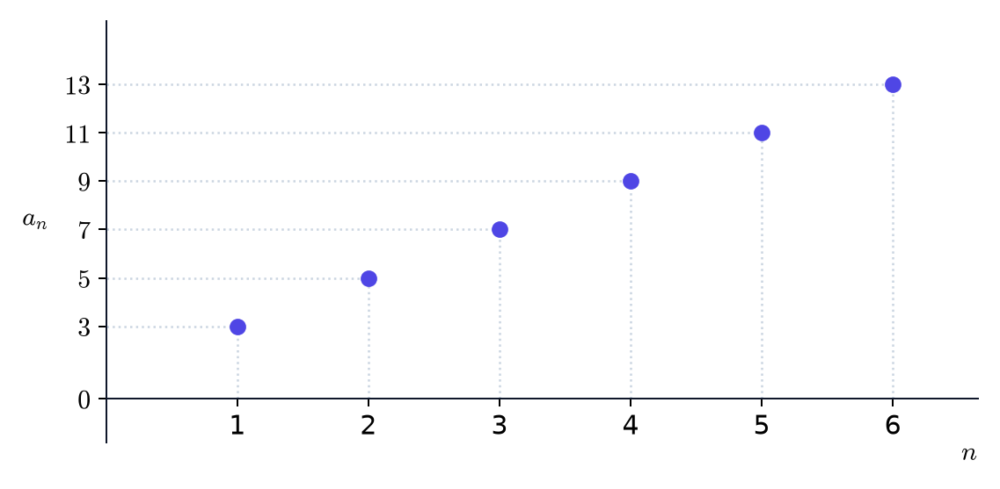{fig-alt="שש הנקודות אחת שלוש, שתיים חמש, שלוש שבע, ארבע תשע, חמש אחת עשרה ושש שלוש עשרה. כל אינדקס מסומן, וקווים מקווקווים מחברים כל נקודה לשיעוריה בצירים." width="560" fig-align="center"}

**על הישר הממשי:** מסמנים את איברי הסדרה $a_n$ עצמם. למשל, את $a_2$ מסמנים בנקודה $5$, כי האיבר השני הוא $5$.

התוויות מראות איזה איבר מסומן בכל נקודה; המיקום על הישר נקבע לפי **האיבר**, ולא לפי האינדקס.

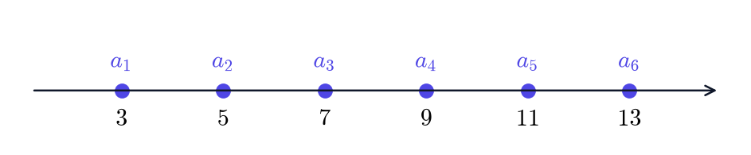{fig-alt="על ישר המספרים מסומנים הערכים שלוש, חמש, שבע, תשע, אחת עשרה ושלוש עשרה, ומעליהם בהתאמה a1 עד a6." width="560" fig-align="center"}
:::

:::: {.thmchk}
אם $a_4=-2$, היכן מסמנים אותו בכל ציור?

::: fill
במישור מסמנים את הנקודה [( [$4$]{.blank ans="4" w="3"}, [$-2$]{.blank ans="-2" w="3"} )]{.fill-ltr dir="ltr"}.

על הישר הממשי מסמנים את האיבר בנקודה [$-2$]{.blank ans="-2" w="3"}.

::: explain
במישור זו הנקודה $(4,-2)$; על הישר זו הנקודה $-2$, עם התווית $a_4$.
:::
:::
::::

::::: {#box-def-famous .thmexm title="כמה סדרות מוכרות"}
בכל ציור מופיעים ששת האיברים הראשונים.

**(א) סדרה קבועה:** כל האיברים שווים לאותו מספר, $a_n=c$. למשל, עבור $c=2$ מתקבלת $2,2,2,\ldots$.

{fig-alt="שש נקודות בגובה שתיים, באינדקסים אחת עד שש." width="500" fig-align="center"}

**(ב) הסדרה ההרמונית:** $a_n=\frac1n$, כלומר $1,\frac{1}{2},\frac13,\ldots$.

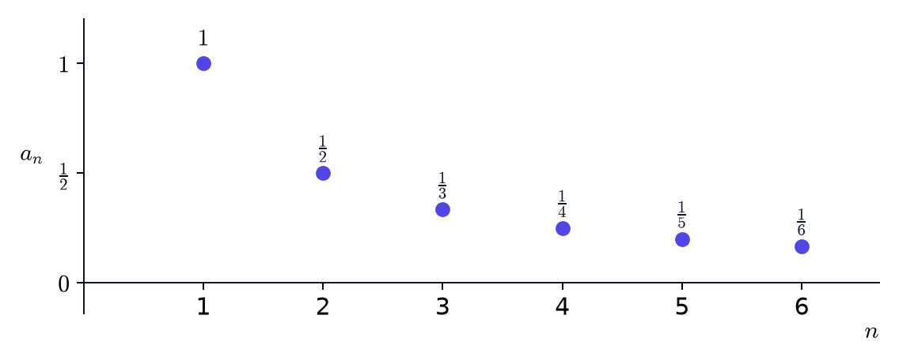{fig-alt="שש נקודות של הסדרה אחד חלקי n. כל אינדקס וכל ערך מסומנים." width="500" fig-align="center"}

**(ג) סדרה מתחלפת:** איבר חיובי ואיבר שלילי מופיעים לסירוגין. למשל, $a_n=(-1)^n$ נותנת $-1,1,-1,1,\ldots$.

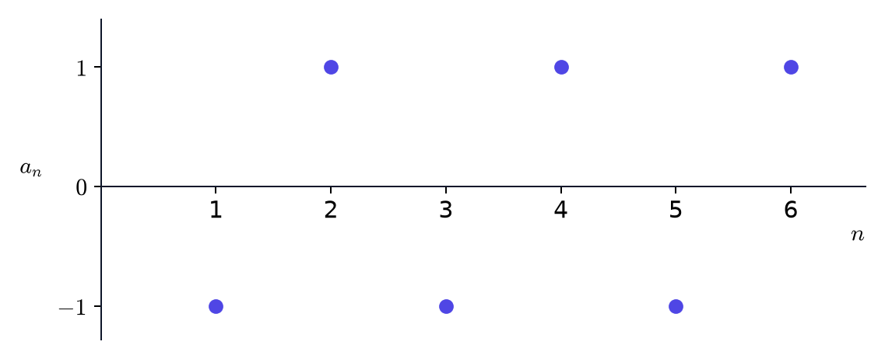{fig-alt="באינדקסים האי זוגיים הנקודות בגובה מינוס אחת, ובזוגיים בגובה אחת. כל ששת האינדקסים מסומנים." width="500" fig-align="center"}

על הישר הממשי, איברים בעלי אותו ערך נופלים על אותה נקודה: $a_1,a_3,a_5$ נמצאים כולם ב $-1$, ו $a_2,a_4,a_6$ ב $1$.

**(ד) סדרה חשבונית:** בכל צעד מוסיפים [**הפרש קבוע**]{.term} $d$:
$$a_{n+1}=a_n+d.$$
הנוסחה לאיבר הכללי היא
$$a_n=a_1+(n-1)d.$$
יש $n-1$ צעדים מהאיבר הראשון לאיבר שבמקום $n$.

למשל, $a_1=1$ ו $d=2$ נותנים $1,3,5,7,\ldots$.

{fig-alt="שש הנקודות של הסדרה אחת, שלוש, חמש, שבע, תשע, אחת עשרה. כל אינדקס וכל ערך מסומנים." width="500" fig-align="center"}

**(ה) סדרה הנדסית:** בכל צעד כופלים במספר קבוע $q$, שנקרא [**מנת הסדרה**]{.term}:
$$a_{n+1}=qa_n.$$
כאשר $a_n\ne0$, אפשר לחשב אותו כמנה $q=\frac{a_{n+1}}{a_n}$. כלל הכפל תקף גם כשהאיבר הוא אפס; במקרה הזה אין מחלקים בו.
כאשר $q\ne0$, הנוסחה לאיבר הכללי היא
$$a_n=a_1q^{n-1}.$$
הכפל החוזר מסביר את החזקה $n-1$ בנוסחה.

למשל, $a_1=1$ ו $q=2$ נותנים $1,2,4,8,\ldots$.

{fig-alt="שש הנקודות של הסדרה אחת, שתיים, ארבע, שמונה, שש עשרה ושלושים ושתיים. כל אינדקס וכל ערך מסומנים." width="500" fig-align="center"}

**(ו) סדרת פיבונאצ'י:** מתחילים ב $a_1=a_2=1$, וכל איבר חדש הוא סכום שני קודמיו:
$$a_{n+2}=a_{n+1}+a_n.$$
כך מתקבלת הסדרה $1,1,2,3,5,8,13,\ldots$.

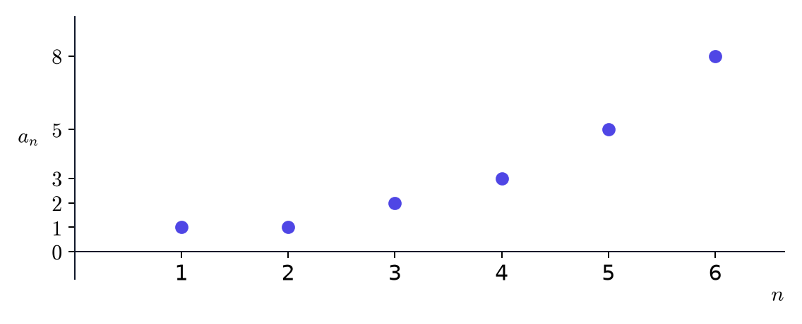{fig-alt="שש הנקודות של סדרת פיבונאצ'י: אחת, אחת, שתיים, שלוש, חמש ושמונה. שתי הנקודות הראשונות באותו גובה, אך במקומות שונים." width="500" fig-align="center"}
:::::

::::: {#box-exm-seq-terms .thmsolved title="מחשבים איברים"}
**(א)** נתונה הסדרה $a_n=\frac{n+1}{n}$. חשבו את האיברים המבוקשים.

:::: fill
בכל שורה כתבו תחילה את הביטוי לאחר הצבת האינדקס, ואחריו את התוצאה.

::: {.sequence-table dir="ltr"}
| האיבר | הצבה בנוסחה | תוצאה |
|:---:|:---:|:---:|
| $a_1$ | [$\frac{1+1}{1}$]{.blank ans="2" allow-expression="true" form="calculation" w="10" calculation="((1+1)/(1))"} | [$2$]{.blank ans="2" w="5"} |
| $a_2$ | [$\frac{2+1}{2}$]{.blank ans="3/2" allow-expression="true" form="calculation" w="10" calculation="((2+1)/(2))"} | [$\frac{3}{2}$]{.blank ans="3/2" w="5"} |
| $a_{10}$ | [$\frac{10+1}{10}$]{.blank ans="11/10" allow-expression="true" form="calculation" w="10" calculation="((10+1)/(10))"} | [$\frac{11}{10}$]{.blank ans="11/10" w="5"} |
:::

::: explain
מציבים בכל פעם את האינדקס במקום $n$:
$$\begin{aligned}
a_1&=\frac{1+1}{1}=2,\\[4pt]
a_2&=\frac{2+1}{2}=\frac{3}{2},\\[4pt]
a_{10}&=\frac{10+1}{10}=\frac{11}{10}.
\end{aligned}$$
:::
::::

**(ב)** השלימו את שמונת האיברים הראשונים של סדרת פיבונאצ'י.

:::: fill

::: {.sequence-inputs}
$a_1=$ [$1$]{.blank ans="1" w="3"}

$a_2=$ [$1$]{.blank ans="1" w="3"}
:::

::: {.sequence-table dir="ltr"}
| האיבר | חישוב | תוצאה |
|:---:|:---:|:---:|
| $a_3$ | [$1+1$]{.blank ans="2" allow-expression="true" form="calculation" w="10" calculation="1+1"} | [$2$]{.blank ans="2" w="5"} |
| $a_4$ | [$1+2$]{.blank ans="3" allow-expression="true" form="calculation" w="10" calculation="1+2"} | [$3$]{.blank ans="3" w="5"} |
| $a_5$ | [$2+3$]{.blank ans="5" allow-expression="true" form="calculation" w="10" calculation="2+3"} | [$5$]{.blank ans="5" w="5"} |
| $a_6$ | [$3+5$]{.blank ans="8" allow-expression="true" form="calculation" w="10" calculation="3+5"} | [$8$]{.blank ans="8" w="5"} |
| $a_7$ | [$5+8$]{.blank ans="13" allow-expression="true" form="calculation" w="10" calculation="5+8"} | [$13$]{.blank ans="13" w="5"} |
| $a_8$ | [$8+13$]{.blank ans="21" allow-expression="true" form="calculation" w="10" calculation="8+13"} | [$21$]{.blank ans="21" w="5"} |
:::

::: hint
שני האיברים הראשונים הם $1$. אחר כך מחברים בכל פעם את שני האיברים הקודמים.
:::

::: explain
$1,1,2,3,5,8,13,21,\ldots$.

למשל, $a_7=a_5+a_6=5+8=13$.
:::
::::

**(ג)** סדרה חשבונית מתחילה באיברים $4,7,10,13,\ldots$.

מצאו את האיבר הראשון ואת ההפרש, וכתבו נוסחה לאיבר הכללי.

:::: fill

::: {.sequence-inputs}
$a_1=$ [$4$]{.blank ans="4" w="3"}

$d=$ [$3$]{.blank ans="3" w="3"}

$a_n=$ [$3n+1$]{.blank id="seq-arithmetic-formula" ans="3n+1" vars="n" positive="n" integer="n" w="10"}
:::

כעת הציבו $n=20$ בנוסחה וחשבו:

::: {.sequence-table dir="ltr"}
| האיבר | הצבה בנוסחה | תוצאה |
|:---:|:---:|:---:|
| $a_{20}$ | [$3\cdot20+1$]{.blank ans="61" allow-expression="true" form="calculation" w="10" calculation="3*20+1" calculation-from="seq-arithmetic-formula" index="20"} | [$61$]{.blank ans="61" w="5"} |
:::

::: hint
בנוסחה $a_n=a_1+(n-1)d$, הציבו את האיבר הראשון ואת ההפרש.
:::

::: explain
$$\begin{aligned}
a_n&=4+3(n-1)=3n+1,\\
a_{20}&=3\cdot20+1=61.
\end{aligned}$$
:::
::::

**(ד)** סדרה הנדסית מתחילה באיברים $3,6,12,24,\ldots$.

מצאו את האיבר הראשון ואת המנה, וכתבו נוסחה לאיבר הכללי.

:::: fill

::: {.sequence-inputs}
$a_1=$ [$3$]{.blank ans="3" w="3"}

$q=$ [$2$]{.blank ans="2" w="3"}

$a_n=$ [$3\cdot2^{n-1}$]{.blank id="seq-geometric-formula" ans="3*2^(n-1)" vars="n" positive="n" integer="n" w="10"}
:::

כעת הציבו $n=6$ בנוסחה וחשבו:

::: {.sequence-table dir="ltr"}
| האיבר | הצבה בנוסחה | תוצאה |
|:---:|:---:|:---:|
| $a_6$ | [$3\cdot2^{6-1}$]{.blank ans="96" allow-expression="true" form="calculation" w="10" calculation="3*2^(6-1)" calculation-from="seq-geometric-formula" index="6"} | [$96$]{.blank ans="96" w="5"} |
:::

::: hint
בנוסחה $a_n=a_1q^{n-1}$, הציבו את האיבר הראשון ואת המנה.
:::

::: explain
$$\begin{aligned}
a_n&=3\cdot2^{n-1},\\
a_6&=3\cdot2^{6-1}=96.
\end{aligned}$$
:::
::::
:::::

::::: {.thmchk}
**(א)** האם הרשימה האינסופית שבה כל האיברים שווים ל $1$ היא סדרה?

:::: {.quiz options="כן|לא" answer="כן"}
איברים באינדקסים שונים יכולים להיות שווים. כתבו נוסחה לאיבר הכללי:

::: fill

:::: {.eqline dir="ltr"}
$a_n=$ [$1$]{.blank ans="1" kind="expr" vars="n" positive="n" integer="n"}
::::
:::
::::

**(ב)** חשבו את האיבר החמישי של $a_n=(-1)^n n$ בשני שלבים.

:::: fill
בשדה הראשון הציבו $n=5$, ובשני כתבו את התוצאה כמספר:

::: {.sequence-calculations}
$a_5=$ [$(-1)^5\cdot5$]{.blank ans="-5" allow-expression="true" form="calculation" w="10" calculation="(-1)^5*5"} $=$ [$-5$]{.blank ans="-5" w="5"}
:::

::: explain
$(-1)^5=-1$, ולכן $(-1)^5\cdot5=-5$.
:::
::::
:::::

### תרגילים {.unnumbered}

::::: {#box-q-seq-terms .thmqst title="איברים מנוסחה"}
חשבו את האיברים המבוקשים. כתבו את ההצבה בנוסחה ואת התוצאה.

:::: fill
**(א)** $a_n=n^2-n$

::: {.sequence-table dir="ltr"}
| האיבר | הצבה בנוסחה | תוצאה |
|:---:|:---:|:---:|
| $a_3$ | [$3^2-3$]{.blank ans="6" allow-expression="true" form="calculation" w="10" calculation="3^2-3"} | [$6$]{.blank ans="6" w="5"} |
:::

**(ב)** $a_n=\frac{(-1)^n}{n}$

::: {.sequence-table dir="ltr"}
| האיבר | הצבה בנוסחה | תוצאה |
|:---:|:---:|:---:|
| $a_4$ | [$\frac{(-1)^4}{4}$]{.blank ans="1/4" allow-expression="true" form="calculation" w="10" calculation="(((-1)^4)/(4))"} | [$\frac{1}{4}$]{.blank ans="1/4" w="5"} |
| $a_5$ | [$\frac{(-1)^5}{5}$]{.blank ans="-1/5" allow-expression="true" form="calculation" w="10" calculation="(((-1)^5)/(5))"} | [$-\frac{1}{5}$]{.blank ans="-1/5" w="5"} |
:::

**(ג)** $a_n=\frac{2^n}{n}$

::: {.sequence-table dir="ltr"}
| האיבר | הצבה בנוסחה | תוצאה |
|:---:|:---:|:---:|
| $a_3$ | [$\frac{2^3}{3}$]{.blank ans="8/3" allow-expression="true" form="calculation" w="10" calculation="((2^3)/(3))"} | [$\frac{8}{3}$]{.blank ans="8/3" w="5"} |
:::

::: explain
**(א)** $a_3=3^2-3=6$.

**(ב)**
$$\begin{aligned}
a_4&=\frac{(-1)^4}{4}=\frac{1}{4},\\[4pt]
a_5&=\frac{(-1)^5}{5}=-\frac{1}{5}.
\end{aligned}$$

**(ג)** $a_3=\frac{2^3}{3}=\frac{8}{3}$.
:::
::::
:::::

::::: {#box-q-seq-recursion .thmqst title="איברים מרקורסיה"}
נתונים $a_1=2$ ו $a_{n+1}=3a_n-1$.

מצאו את $a_2$, $a_3$ ו $a_4$ בעזרת כלל הרקורסיה.

:::: fill

::: {.sequence-table dir="ltr"}
| האיבר | חישוב | תוצאה |
|:---:|:---:|:---:|
| $a_2$ | [$3\cdot2-1$]{.blank ans="5" allow-expression="true" form="calculation" w="10" calculation="3*2-1"} | [$5$]{.blank ans="5" w="5"} |
| $a_3$ | [$3\cdot5-1$]{.blank ans="14" allow-expression="true" form="calculation" w="10" calculation="3*5-1"} | [$14$]{.blank ans="14" w="5"} |
| $a_4$ | [$3\cdot14-1$]{.blank ans="41" allow-expression="true" form="calculation" w="10" calculation="3*14-1"} | [$41$]{.blank ans="41" w="5"} |
:::

::: hint
בכל צעד השתמשו באיבר שחישבתם בצעד הקודם.
:::

::: explain
$$\begin{aligned}
a_2&=3\cdot2-1=5,\\
a_3&=3\cdot5-1=14,\\
a_4&=3\cdot14-1=41.
\end{aligned}$$
:::
::::
:::::

::::: {#box-q-seq-geometric .thmqst title="סדרה הנדסית עם מנה שלילית"}
בסדרה הנדסית נתונים $a_1=2$ ו $q=-3$.

כתבו נוסחה לאיבר הכללי, והשתמשו בה לחישוב האיברים השני עד החמישי.

:::: fill

::: {.sequence-formula dir="ltr"}
$a_n=$ [$2(-3)^{n-1}$]{.blank id="seq-negative-ratio-formula" ans="2*(-3)^(n-1)" vars="n" positive="n" integer="n" w="14"}
:::

::: {.sequence-table dir="ltr"}
| האיבר | הצבה בנוסחה | תוצאה |
|:---:|:---:|:---:|
| $a_2$ | [$2(-3)^{2-1}$]{.blank ans="-6" allow-expression="true" form="calculation" w="10" calculation="2(-3)^(2-1)" calculation-from="seq-negative-ratio-formula" index="2"} | [$-6$]{.blank ans="-6" w="5"} |
| $a_3$ | [$2(-3)^{3-1}$]{.blank ans="18" allow-expression="true" form="calculation" w="10" calculation="2(-3)^(3-1)" calculation-from="seq-negative-ratio-formula" index="3"} | [$18$]{.blank ans="18" w="5"} |
| $a_4$ | [$2(-3)^{4-1}$]{.blank ans="-54" allow-expression="true" form="calculation" w="10" calculation="2(-3)^(4-1)" calculation-from="seq-negative-ratio-formula" index="4"} | [$-54$]{.blank ans="-54" w="5"} |
| $a_5$ | [$2(-3)^{5-1}$]{.blank ans="162" allow-expression="true" form="calculation" w="10" calculation="2(-3)^(5-1)" calculation-from="seq-negative-ratio-formula" index="5"} | [$162$]{.blank ans="162" w="5"} |
:::

::: hint
הציבו את האיבר הראשון ואת המנה בנוסחה $a_n=a_1q^{n-1}$. שימו לב לסוגריים סביב המנה השלילית.
:::

::: explain
הנוסחה היא $a_n=2(-3)^{n-1}$.

$$\begin{aligned}
a_2&=2(-3)^1=-6,\\
a_3&=2(-3)^2=18,\\
a_4&=2(-3)^3=-54,\\
a_5&=2(-3)^4=162.
\end{aligned}$$
סימני האיברים מתחלפים, כי בכל צעד כופלים במספר שלילי.
:::
::::
:::::

::::: {#box-q-seq-formula .thmqst title="נוסחה שמתאימה לאיברים"}
בכל סעיף נתונים ארבעת האיברים הראשונים. מצאו נוסחה לאיבר הכללי המתאימה להם; תיתכן יותר מנוסחה אחת.

:::: fill

::::: {.sequence-formula-item}
**(א)**

$7,12,17,22,\ldots$

::: {.sequence-formula dir="ltr"}
$a_n=$ [$5n+2$]{.blank ans="5n+2" vars="n" check-at="1,2,3,4" w="14"}
:::
:::::

::::: {.sequence-formula-item}
**(ב)**

$1,4,9,16,\ldots$

::: {.sequence-formula dir="ltr"}
$a_n=$ [$n^2$]{.blank ans="n^2" vars="n" check-at="1,2,3,4" w="14"}
:::
:::::

::::: {.sequence-formula-item}
**(ג)**

$\frac{1}{2},\frac14,\frac18,\frac1{16},\ldots$

::: {.sequence-formula dir="ltr"}
$a_n=$ [$\frac{1}{2^n}$]{.blank ans="1/2^n" vars="n" check-at="1,2,3,4" w="14"}
:::
:::::

::: explain
**(א)** אפשר להמשיך כסדרה חשבונית, עם הפרש $5$:
$$a_n=7+5(n-1)=5n+2.$$

**(ב)** האיברים הנתונים הם הריבועים של האינדקסים שלהם:
$$a_n=n^2.$$

**(ג)** אפשר להמשיך כסדרה הנדסית, עם מנה $\frac{1}{2}$:
$$a_n=\frac1{2^n}.$$
:::
::::
:::::

::::: {#box-q-seq-kind .thmqst title="חשבונית, הנדסית או אף אחת מהן?"}
בכל סעיף נתונים כמה איברים ראשונים. בדקו אם אפשר להמשיך אותם לסדרה חשבונית או לסדרה הנדסית.

אם אפשר, מצאו את האיבר הראשון, את ההפרש או המנה, ונוסחה לאיבר הכללי. אחרת, הראו שההפרשים והמנות אינם קבועים.

**(א)** $5,2,-1,-4,\ldots$

:::: {.sequence-classify answer="arithmetic" terms="5,2,-1,-4" formula="8-3n"}

::: hint
בדקו את ההפרשים ואת המנות בין איברים עוקבים. האם הם קבועים?
:::

::: explain
אפשר להמשיך לסדרה **חשבונית**: ההפרש בכל צעד הוא $-3$.
$$a_1=5,\qquad d=-3.$$
הנוסחה לאיבר הכללי היא
$$a_n=5-3(n-1)=8-3n.$$
:::
::::

**(ב)** $2,-6,18,-54,\ldots$

:::: {.sequence-classify answer="geometric" terms="2,-6,18,-54" formula="2*(-3)^(n-1)"}

::: hint
בדקו את ההפרשים ואת המנות בין איברים עוקבים. גם מספר שלילי יכול להיות מנה קבועה.
:::

::: explain
אפשר להמשיך לסדרה **הנדסית**: המנה בכל צעד היא $-3$.
$$a_1=2,\qquad q=-3.$$
הנוסחה לאיבר הכללי היא
$$a_n=2(-3)^{n-1}.$$
:::
::::

**(ג)** $1,2,4,7,11,\ldots$

:::: {.sequence-classify answer="neither" terms="1,2,4,7,11"}

::: hint
די למצוא שני הפרשים שונים כדי לשלול סדרה חשבונית, ושתי מנות שונות כדי לשלול סדרה הנדסית.
:::

::: explain
**אף אחת מהן.** ההפרשים אינם קבועים:
$$a_2-a_1=1,\qquad a_3-a_2=2.$$
גם המנות אינן קבועות:
$$\frac{a_2}{a_1}=2,\qquad\frac{a_4}{a_3}=\frac74.$$
לכן אי אפשר להמשיך את האיברים הנתונים לסדרה חשבונית או הנדסית.
:::
::::
:::::


## גבול של סדרה

### מקירוב לסף השגיאה {.unnumbered}

בפועל, בחישובים רבים משתמשים במספרים קרובים מספיק למספרים המדויקים. יש לכך כמה סיבות. [כפי שראינו](01-Introduction.qmd#box-thm-irrational), לא כל מספר ממשי אפשר לכתוב כמנה של שני שלמים, ואילו את החישובים המספריים נוח לבצע בעזרת מספרים רציונליים. גם מחשבים, שעליהם נשענים חישובים רבים, משתמשים בדרך כלל בייצוג מספרי בעל דיוק מוגבל: לא כל מספר ממשי אפשר לייצג בו בדיוק.

::: {#box-def-approximation-error .thmdef title="קירוב ושגיאה"}

מספר קרוב שבו משתמשים במקום המספר המדויק נקרא [**קירוב**]{.term} שלו.

ה[**שגיאה**]{.term} היא המרחק בין הקירוב למספר המדויק — כלומר, הערך המוחלט של ההפרש ביניהם.

:::

::: {#box-exm-third-approximation .thmexm title="קירובים עשרוניים"}

גם למספר הרציונלי $\frac13$ אין ייצוג עשרוני סופי. אפשר לקרב אותו באמצעות השברים העשרוניים הסופיים
$$0.3,\quad 0.33,\quad 0.333,\quad\ldots$$

:::

::: {#box-qa-approximation-threshold .thmqa title="האם $0.33$ מדויק מספיק?"}

משתמשים ב $0.33$ כקירוב למספר $\frac13$.

**תשובה.** תלוי בדרישת הדיוק. השגיאה היא
$$\left|0.33-\frac13\right|=\frac1{300}.$$
היא קטנה מ $0.01$, אבל גדולה מ $0.001$. כדי לעמוד בדרישה השנייה צריך קירוב מדויק יותר, למשל $0.333$.

:::

נבחר מספר חיובי, שייקרא [**סף השגיאה**]{.term}, ונדרוש שהשגיאה תהיה קטנה ממנו. שגיאה השווה לסף אינה עומדת בדרישה.

::::: {.thmchk title="אותו קירוב, שתי דרישות"}

משתמשים במספר $2.03$ כקירוב למספר $2$.

:::: fill

השגיאה היא [$0.03$]{.blank ans="0.03"}.

::: explain

השגיאה היא המרחק $|2.03-2|=0.03$.

:::

::::

האם השגיאה קטנה מ $0.1$?

::: {.quiz options="כן|לא" answer="כן"}

כן: $0.03<0.1$.

:::

האם השגיאה קטנה מ $0.01$?

::: {.quiz options="כן|לא" answer="לא"}

לא: $0.03>0.01$. אותו מספר יכול להיות קירוב מתאים לדרישה אחת ולא להתאים לדרישה מחמירה יותר.

:::

:::::

:::::: {.thmchk title="קירוב מהצד השני"}

כעת משתמשים במספר $1.96$ כקירוב למספר $2$.

::::: fill

מהי השגיאה? [$0.04$]{.blank ans="0.04" miss="-0.04 :: חישבתם את ההפרש. השגיאה היא המרחק; מה צריך לעשות כדי לקבל אותו?"}

:::: {.after-attempt}

מדוע השגיאה היא $0.04$ ולא $-0.04$?

::: {.quiz options="כי שגיאה היא מרחק: לוקחים את הערך המוחלט של ההפרש|כי הקירוב חייב להיות גדול מהמספר המדויק|כי כל הפרש בין שני מספרים הוא חיובי" answer="כי שגיאה היא מרחק: לוקחים את הערך המוחלט של ההפרש"}

ההפרש הוא $1.96-2=-0.04$, אך השגיאה היא
$$|1.96-2|=|-0.04|=0.04.$$
המינוס מתאר באיזה צד של $2$ נמצא הקירוב. המרחק מתאר כמה רחוק הוא נמצא, ולכן אינו שלילי.

:::

::::

:::::

::::::

::: {#box-prp-rational-approximation .thmprp title="קירוב במספרים רציונליים"}

לכל שני מספרים ממשיים $a<b$ קיים מספר רציונלי $q\in\mathbb{Q}$ כך ש
$$a<q<b.$$
כלומר, בין כל שני מספרים ממשיים שונים יש מספר רציונלי. תכונה זו נקראת [**צפיפות הרציונליים**]{.term}.

:::

::: {#box-exp-rational-approximation .thmexp title="מצפיפות לקירוב"}
לפי [צפיפות הרציונליים](#box-prp-rational-approximation), בקטע $(L-\varepsilon,L+\varepsilon)$ קיים מספר רציונלי לכל $L\in\mathbb{R}$ ולכל $\varepsilon>0$. המרחק שלו מ $L$ קטן מ $\varepsilon$, ולכן אפשר לקבל קירוב רציונלי בכל רמת דיוק שנבקש.
:::

::: {#box-exm-rational-pi .thmexm title="קירובים רציונליים למספר שאינו רציונלי"}
המספר $\pi$ אינו רציונלי, אבל הקירובים העשרוניים
$$3.14=\frac{157}{50},\qquad3.14159=\frac{314159}{100000}$$
רציונליים: כל אחד מהם הוא מנה של שני מספרים שלמים.
הם מקרבים את $\pi$ ואינם שווים לו. עצם קיומם של קירובים רציונליים אינו אומר שהמספר שמקרבים רציונלי.
:::

כאן נרצה לעבוד עם **סדרה של קירובים**, ולא להסתפק בקירוב אחד. לכל סף שגיאה חיובי שנבחר, קטן ככל שיהיה, נרצה להבטיח שאפשר להתקדם בסדרה עד שכל האיברים שמאותו אינדקס והלאה יעמדו בדרישה. מציאת איבר קרוב אחד אינה מספיקה: גם האיברים שבאים אחריו צריכים להישאר קרובים.

לפעמים הכיוון הפוך: נתונה לנו סדרה, ואנחנו עדיין לא יודעים איזה מספר היא מקרבת, ואם היא בכלל מקרבת מספר כלשהו. נרצה להבין מה פירוש ההתקרבות הזאת, ואיך בודקים אותה.

### הגדרת הגבול {.unnumbered}

::: {#box-def-limit .thmdef title="גבול של סדרה"}

הסדרה $(a_n)_{n=1}^{\infty}$ [**מתכנסת**]{.term} למספר $L$ אם לכל $\varepsilon>0$ יש אינדקס טבעי $N$ כך שלכל $n\ge N$ מתקיים
$$|a_n-L|<\varepsilon.$$
המספר $L$ נקרא [**הגבול**]{.term} של הסדרה. כותבים
$$\lim_{n\to\infty}a_n=L.$$
אפשר לכתוב גם $a_n\to L$, ולומר שהסדרה **שואפת** אל $L$. סדרה שאינה מתכנסת למספר ממשי נקראת [**מתבדרת**]{.term}.

:::

נפרש את ההגדרה: $a_n$ הוא האיבר באינדקס $n$, ו $L$ הוא המועמד לגבול. המספר $\varepsilon>0$ הוא סף ההפרש בערך מוחלט: נדרוש $|a_n-L|<\varepsilon$. שוויון אינו מספיק. אפשר לכתוב את הדרישה גם כך:
$$L-\varepsilon<a_n<L+\varepsilon.$$
הקטע הפתוח $(L-\varepsilon,L+\varepsilon)$ נקרא [**סביבת $\varepsilon$**]{.term} של $L$. נקודות הקצה אינן כלולות בו.

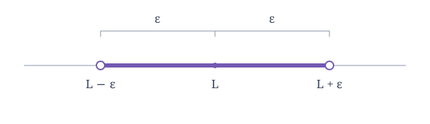{fig-alt="הקטע הפתוח סביב L ברדיוס אפסילון. נקודות הקצה אינן כלולות בו." width="560" fig-align="center"}

::::::: {#box-limit-geometric .thmexp title="פירוש גאומטרי של התכנסות"}

בגרף של סדרה מציירים את הנקודות $(n,a_n)$: האינדקס הוא הקואורדינטה האופקית, והאיבר הוא הגובה. כדי לראות אילו איברים קרובים אל $L$, מציירים שני קווים אופקיים בגבהים $L-\varepsilon$ ו $L+\varepsilon$. השטח שביניהם נקרא **רצועה סביב $L$**. רוחבה האנכי הוא $2\varepsilon$; הקווים שעל שפתה אינם חלק ממנה.

{fig-alt="רצועה אופקית בין הגבהים L פחות אפסילון ו L ועוד אפסילון, עם קו אמצע בגובה L. אין בציור איברי סדרה." width="600" fig-align="center"}

**מה נדרש להתכנסות?** לכל $\varepsilon>0$ צריך להיות אינדקס $N$ כך שלכל $n\ge N$, הנקודה $(n,a_n)$ נמצאת ברצועה. כלומר, מאינדקס מסוים כל האיברים נכנסים ונשארים בפנים. אפשר לחשוב על הרצועה כעל ״בית״: לא מספיק לבקר בו; צריך להישאר בו מאינדקס מסוים והלאה.

ברצועה רחבה ייתכן שדי להתקדם מעט. ברצועה צרה ייתכן שצריך להתקדם הרבה מאוד. **צרה ככל שתהיה הרצועה, בסופו של דבר כל האיברים צריכים להישאר בתוכה.** האינדקס $N$ יכול להשתנות כשמשנים את $\varepsilon$.

למשל, ברצועה הרחבה שבציור אפשר לבחור $N=11$: כל האיברים מהאינדקס הזה והלאה בתוכה. עבור הרצועה הצרה יותר צריך להתקדם רחוק יותר; בציור אפשר לבחור $N=101$. בשני המקרים, כל האיברים שמאותו אינדקס והלאה נשארים בפנים.

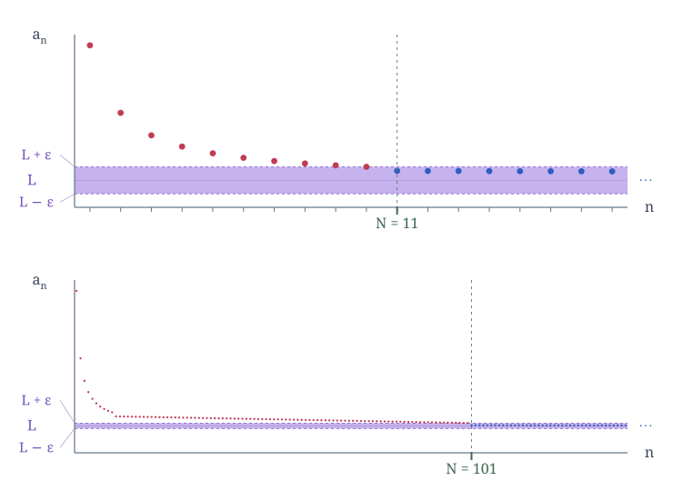{fig-alt="שני ציורים להמחשת התכנסות. ברצועה רחבה די להתקדם מעט, ובצרה צריך להתקדם יותר. בשניהם כל האיברים מאינדקס מתאים והלאה נשארים בפנים." width="650" fig-align="center"}

**ועל ישר המספרים?** שם מציירים את האיברים $a_n$ עצמם. הרצועה מוחלפת בקטע הפתוח $(L-\varepsilon,L+\varepsilon)$, כלומר בסביבת $\varepsilon$ של $L$. הדרישה אותה דרישה: כל סביבה כזאת מכילה את כל האיברים מאינדקס מתאים והלאה.

באיור הבא, עבור סביבת $\varepsilon$ שנבחרה אפשר לבחור $N=5$. מהאיבר $a_5$ והלאה כל האיברים בתוך הסביבה.

{fig-alt="איברי סדרה על ישר המספרים מתקרבים אל L. סביב L מסומנת סביבת ε צרה. מהאיבר a_N ואילך האיברים בתוכה, ובהמשך סימוניהם מתלכדים לעין עם L." width="700" fig-align="center"}

**ברזולוציה הזאת, רק כמה נקודות נבדלות מ $L$ לעין**, אף שיכולים להיות אינסוף ערכים שונים של איברי הסדרה. סימוני האיברים המאוחרים נראים באותו מקום כמו $L$; אין פירוש הדבר שערכיהם שווים לו. הגדלה יכולה לחשוף את ההבדלים, כפי שנראה בסימולציה שבהמשך.

**איך רואים ש $L$ אינו הגבול?** מספיק למצוא רצועה אחת סביבו שעבורה תמיד יש עוד איבר בחוץ, לא משנה כמה רחוק מתקדמים בציר האינדקסים. במילים פשוטות: **האיברים שמחוץ לרצועה אף פעם לא נגמרים.** יש אינסוף איברים כאלה; גם איבר שעל השפה נחשב מחוץ לרצועה.

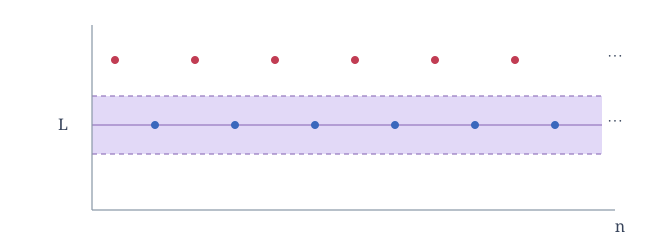{fig-alt="רצועה סביב L ונקודות שחוזרות ויוצאות ממנה. גם בהמשך, מעבר לאינדקסים המצוירים, ממשיכים להופיע איברים מחוץ לרצועה." width="600" fig-align="center"}

כך שוללים את המועמד $L$. ייתכן שהסדרה מתכנסת למספר אחר; כדי להראות שאינה מתכנסת כלל צריך לשלול כל מועמד.

:::::::

::::: {#box-sim-limit-microscope .thmsim title="מיקרוסקופ לקירובים של $\pi$"}

**על ישר המספרים, בכל רזולוציה קבועה רק מספר סופי של איברי סדרה מתכנסת נבדלים מהגבול לעין.** הגדלה יכולה לחשוף עוד נקודות ליד הגבול, אך גם אחריה האיברים המאוחרים יותר נראים יחד איתו כנקודה אחת.

נבנה סדרה של קירובים עשרוניים ל $\pi$: מתחילים ב $3$, ובכל צעד **מוסיפים עוד ספרה אחרי הנקודה**, לפי הפיתוח העשרוני של $\pi$. כך מתקבלת הסדרה
$$3,\ 3.1,\ 3.14,\ 3.141,\ 3.1415,\ 3.14159,\ldots$$
המתכנסת אל $\pi$.
עדיין לא הראינו זאת לפי הגדרת הגבול; כאן נסתמך על הרעיון המוכר של קירוב עשרוני ל $\pi$.

**אם $\varepsilon$ קטן מספיק ביחס לרזולוציה**, איברי הסדרה שבתוך הסביבה $(\pi-\varepsilon,\pi+\varepsilon)$ **אינם נבדלים מ $\pi$ לעין, אף שאינם שווים לו**.

נבצע שתי בדיקות: **נצמצם את הסביבה** עד שכל איברי הסדרה שבתוכה נראים כמו הגבול, ואז **נגדיל את הציור**, כמו במיקרוסקופ, כדי להבחין שוב בחלק מהם.

1. בהגדלה ההתחלתית, בחרו $\varepsilon=\frac{1}{100}$ ואז הקטינו ל $\frac{1}{10000}$.
2. השאירו את $\varepsilon=\frac{1}{10000}$ ולחצו פעמיים על **הגדילו פי 10**. עקבו אחר הנקודות שנפרדות מ $\pi$ לעין. לחצו פעמיים על **הקטינו פי 10** כדי לחזור לתצוגה ההתחלתית.

```{=html}
<iframe class="widget-frame" src="widgets/ch02/microscope.html" loading="lazy" title="מיקרוסקופ לקירובים של π"></iframe>
```

:::::

### ארבע דוגמאות בסיסיות {.unnumbered}

ארבע הדוגמאות הבאות ממחישות איך משתמשים בהגדרת הגבול כדי להראות שסדרה מתכנסת למספר נתון, או להראות שאינה מתכנסת אליו.

::::: {#box-exm-constant-limit .thmexm title="כל האיברים שווים לגבול"}

בסדרה הקבועה $a_n=4$, נבדוק שהמספר $4$ הוא הגבול.

כדי להשתמש בהגדרת הגבול, נפתח במילים **״יהי $\varepsilon>0$״**. פירושן: ניקח מספר חיובי כלשהו, בלי לקבוע לו ערך מסוים. הטיעון צריך לעבוד לכל בחירה כזאת.

עלינו למצוא **אינדקס טבעי $N$** כך שיתקיים $|a_n-4|<\varepsilon$ **לכל $n\ge N$**.

נבחר $N=1$. לכל $n\ge1$ מתקיים
$$|a_n-4|=|4-4|=0<\varepsilon.$$
כלומר, כל האיברים עומדים בדרישה כבר מהראשון. הבחירה הזאת עובדת לכל $\varepsilon>0$, ולכן לפי ההגדרה
$$\lim_{n\to\infty}4=4.$$
אותו חישוב עובד לכל סדרה קבועה $a_n=C$: בוחרים $N=1$ ומקבלים $|a_n-C|=0<\varepsilon$ לכל $n\ge1$. לכן סדרה שכל איבריה שווים $C$ מתכנסת אל $C$.

{fig-alt="כל האיברים של הסדרה הקבועה ארבע נמצאים בגובה ארבע, בתוך כל רצועה חיובית סביב ארבע." width="520" fig-align="center"}

:::: fill

בסדרה $a_n=4$, מתקיים $|a_n-4|=$ [$0$]{.blank ans="0"}.
עבור $\varepsilon=\frac1{10000}$, אפשר לבחור $N=$ [$1$]{.blank ans="1" min-answer="1" integer-answer="true"}.

::: explain

לכל $n\ge1$ מתקיים $|a_n-4|=0<\frac1{10000}$, ולכן כל אינדקס טבעי מתאים.

:::

::::

אם נקטין את $\varepsilon$, האם נצטרך להגדיל את $N$?

::: {.quiz options="כן|לא" answer="לא"}

אותו $N$ עדיין מתאים: לכל $\varepsilon>0$ ולכל $n\ge1$ מתקיים $|a_n-4|=0<\varepsilon$.

:::

:::::

::::: {#box-exm-one-over-n .thmexm title="אף איבר אינו שווה לגבול"}

נבדוק שהסדרה
$$a_n=\frac1n$$
מתכנסת אל $0$. איבריה הראשונים הם
$$1,\frac{1}{2},\frac13,\frac14,\ldots$$

**הערה.** תחילה נראה איך מוצאים $N$ עבור סף מסוים, $\varepsilon=\frac1{10}$. **זוהי דוגמה לחישוב בלבד; אין צורך לכלול אותה בפתרון הסופי.**

[**גם אם נמצא $N$ שמתאים לסף הזה, לא הוכחנו שהסדרה מתכנסת. ההגדרה דורשת בחירה מתאימה לכל $\varepsilon>0$.**]{.remark-emphasis} אחרי ההדגמה נבצע את החישוב הכללי.

**הדגמה עבור $\varepsilon=\frac1{10}$.** נחפש אינדקס $N$ כך שלכל $n\ge N$ יתקיים
$$|a_n-0|<\frac1{10}.$$
נציב $a_n=\frac{1}{n}$:
$$\left|\frac1n-0\right|<\frac1{10}.$$
מכיוון ש $n\ge1$, מתקיים $\frac{1}{n}>0$, ולכן $\left|\frac{1}{n}\right|=\frac{1}{n}$. הדרישה היא אפוא
$$\frac1n<\frac1{10}.$$

אם לא היה אינדקס כזה, כבר היינו יודעים ש $0$ אינו הגבול. **מציאת אינדקס מתאים לסף הזה עדיין אינה מספיקה: צריך להראות שאפשר לעשות זאת לכל $\varepsilon>0$.**

נפתור את האי־שוויון המתאים. מכיוון ש $n>0$, מותר לכפול בו בלי לשנות את כיוון האי־שוויון:
$$\begin{aligned}
\frac1n&<\frac1{10},\\
1&<\frac n{10},\\
10&<n.
\end{aligned}$$
קיבלנו תנאי על האינדקס המשתנה $n$. כעת בוחרים אינדקס טבעי $N$ שממנו כל האינדקסים מקיימים אותו.

| הבחירה | האיברים שמתחילים בה | האם היא מתאימה? |
|:---:|:---|:---|
| $N=10$ | כוללים את $a_{10}=\frac1{10}$, שעל שפת הסביבה | לא: נדרש מרחק **קטן** מ $\varepsilon$ |
| $N=11$ | כולם באינדקסים גדולים מ $10$ | כן |
| $N=20$ | גם הם כולם באינדקסים גדולים מ $10$ | כן; אין חובה לבחור את האינדקס הקטן ביותר |

{fig-alt="האיבר באינדקס עשר נמצא על שפת הרצועה; כל האיברים מהאינדקס אחת עשרה ואילך נמצאים בתוכה." width="650" fig-align="center"}

:::: fill

בסדרה $a_n=\frac{1}{n}$, הדרישה $|a_n-0|<\frac1{1000}$ נותנת $n>$ [$1000$]{.blank ans="1000"}.
אפשר לבחור $N=$ [$1001$]{.blank ans="1001" min-answer="1001" integer-answer="true"}.

::: explain

כל אינדקס טבעי גדול מ $1000$ מתאים. האינדקס $11$, שהתאים לבחירה הקודמת של $\varepsilon$, כבר אינו מספיק.

:::

::::

**כעת ההוכחה לכל $\varepsilon>0$.** ההדגמות עזרו לנו להבין איך למצוא $N$, אבל **מספר סופי של בדיקות אינו מוכיח גבול**. כדי לעמוד בהגדרה, נשאיר את $\varepsilon$ כללי ונמצא $N$ שמתאים לו.

**יהי $\varepsilon>0$**. נרצה למצוא **אינדקס טבעי $N$** שעבורו **לכל $n\ge N$** יתקיים
$$|a_n-0|<\varepsilon.$$
נציב $a_n=\frac{1}{n}$:
$$\left|\frac1n-0\right|<\varepsilon.$$
נפשט בתוך הערך המוחלט:
$$\left|\frac1n\right|<\varepsilon.$$
מכיוון ש $n\ge1$, המספר $\frac{1}{n}$ חיובי, ולכן $\left|\frac{1}{n}\right|=\frac{1}{n}$. נקבל
$$\frac1n<\varepsilon.$$
נכפול ב $n>0$:
$$1<n\varepsilon.$$
נחלק ב $\varepsilon>0$:
$$\frac1\varepsilon<n.$$
כלומר, הדרישה מתקיימת בדיוק כאשר $n>\frac{1}{\varepsilon}$.

::: {#box-def-integer-part}

**כדי לכתוב בחירה מפורשת של $N$**, נשתמש בשיטה נפוצה המבוססת על פונקציית הערך השלם.

נזכיר כי לפי [הגדרת הערך השלם](01-Introduction.qmd#box-def-floor), $\left\lfloor x\right\rfloor$ הוא **השלם הגדול ביותר שקטן או שווה ל $x$**. לכן $\left\lfloor x\right\rfloor+1$ הוא שלם שגדול מ $x$, ולמעשה **השלם הקטן ביותר שגדול ממנו**:
$$\left\lfloor x\right\rfloor\le x<\left\lfloor x\right\rfloor+1.$$

אצלנו $x=\frac{1}{\varepsilon}$, ולכן **נבחר**
$$N=\left\lfloor\frac1\varepsilon\right\rfloor+1.$$

**זו דרך אחת לבחור $N$, ולא הבחירה היחידה:** כל אינדקס טבעי הגדול מ $\frac1\varepsilon$ מתאים.

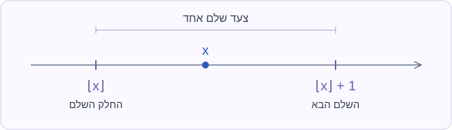{fig-alt="מספר x בין שני שלמים עוקבים. השלם שמשמאל הוא הערך השלם של x; הוספת אחת נותנת את השלם הקטן ביותר שגדול מ x." width="560" fig-align="center"}

:::

המספר $N$ שבחרנו שלם, ולפי האי־שוויון שהסברנו $N>\frac{1}{\varepsilon}>0$, ולכן הוא טבעי. במספרים חיוביים, ככל שהמכנה גדול יותר השבר קטן יותר, ולכן
$$\frac1N<\frac1{\frac{1}{\varepsilon}}=\varepsilon.$$
כעת ניקח **אינדקס כלשהו $n\ge N$**. המכנה גדול לפחות כמו $N$, ולכן
$$|a_n-0|=\frac1n\le\frac1N<\varepsilon.$$
מצאנו $N$ מתאים, והראינו שהדרישה מתקיימת **לכל $n\ge N$**. **מכיוון ש $\varepsilon>0$ היה כלשהו, החישוב עובד לכל סף חיובי — וזה מה שנדרש בהגדרה.** לכן
$$\frac1n\longrightarrow0.$$

:::::

::: {#box-method-limit-proof .thmmethod title="מראים שמספר נתון הוא הגבול לפי ההגדרה"}

**משתמשים בשיטה הזאת כשנתונות סדרה $(a_n)_{n=1}^{\infty}$ ומספר $L$, ומתבקשים להראות לפי ההגדרה ש $L$ הוא גבול הסדרה.** השיטה אינה מיועדת למציאת $L$: מתחילים עם מספר שרוצים לבדוק.

1. **״יהי $\varepsilon>0$״.** לוקחים מספר חיובי כלשהו, בלי לקבוע לו ערך מסוים. לפי ההגדרה, צריך למצוא אינדקס טבעי $N$ כך שלכל $n\ge N$ יתקיים
   $$|a_n-L|<\varepsilon.$$
   החישוב צריך לעבוד לכל $\varepsilon>0$, ולא רק לערך אחד שבחרנו.
2. **מוצאים תנאי על $n$ שמספיק לקיום האי־שוויון.** מציבים את הנוסחה של $a_n$ ואת $L$, ומשתמשים בשיטות לפתרון אי־שוויונות מפרק 1. **אין צורך למצוא את כל הפתרונות.** מספיק למצוא ביטוי $R(\varepsilon)$ כך שכל אינדקס טבעי המקיים
   $$n>R(\varepsilon)$$
   יקיים גם $|a_n-L|<\varepsilon$. כלומר, קבוצת הפתרונות צריכה להכיל את הקבוצה
   $$\{n\in\mathbb N\mid n>R(\varepsilon)\}.$$
   הביטוי $R(\varepsilon)$ יכול להשתנות עם $\varepsilon$, כמו $\frac{1}{\varepsilon}$ בדוגמה של $a_n=\frac{1}{n}$; גם ביטוי קבוע מותר.
3. **בוחרים אינדקס טבעי $N>R(\varepsilon)$.** אפשר להיעזר ב [שיטה לבחירת שלם גדול ממספר נתון](#box-method-integer-above). כעת מסבירים: לכל $n\ge N$ מתקיים
   $$n\ge N>R(\varepsilon),$$
   ולכן, לפי התנאי שמצאנו בשלב 2,
   $$|a_n-L|<\varepsilon.$$
   מצאנו $N$ מתאים לכל $\varepsilon>0$, ולכן לפי הגדרת הגבול $a_n\to L$.

**אם לא הצלחנו למצוא תנאי מתאים:** ייתכן שיש טעות בחישוב או שצריך לנסות דרך אחרת. בתרגיל שבו נתבקשנו להראות שמספר נתון הוא הגבול, זה בדרך כלל הכיוון לבדיקה. אם ניחשנו בעצמנו את $L$, ייתכן שהניחוש שגוי. עצם הקושי למצוא $N$ אינו מוכיח ש $L$ אינו הגבול.

:::

::::: {#box-method-integer-above .thmmethod title="השלם הקטן ביותר שגדול ממספר נתון"}

כדי למצוא את השלם הקטן ביותר $m$ שגדול ממש ממספר ממשי $x$, מחשבים את הערך השלם של $x$ ומוסיפים $1$:
$$m=\left\lfloor x\right\rfloor+1.$$
כש $x\ge0$, המספר שמתקבל טבעי. ב [שיטת הגבול לפי ההגדרה](#box-method-limit-proof), אפשר להציב $x=R(\varepsilon)$ ולבחור כך את $N$. אם התקבל שלם קטן מ $1$, בוחרים $N=1$. אין חובה לבחור את האינדקס הקטן ביותר: גם כל אינדקס טבעי גדול יותר מתאים.

:::::

::::: {#box-check-integer-above .thmchk title="בוחרים שלם גדול יותר"}

למשל, עבור $x=\frac{21}{2}$ מחשבים תחילה
$$\left\lfloor\frac{21}{2}\right\rfloor=10.$$
מוסיפים $1$ ומקבלים $11$, שהוא השלם הקטן ביותר שגדול מ $\frac{21}{2}$.

:::: fill

מהו השלם הקטן ביותר שגדול ממש מ $\frac{17}{4}$? [$5$]{.blank ans="5" integer-answer="true"}.

::: explain

הערך השלם הוא $\left\lfloor \frac{17}{4}\right\rfloor=4$. מוסיפים $1$ ומקבלים $5$. שלמים גדולים יותר גם גדולים מ $\frac{17}{4}$, אבל $5$ הוא הקטן ביותר מביניהם.

:::

::::

:::::

::: {#box-insight-epsilon-index .thminsight title="האינדקס יכול להיות תלוי ב $\varepsilon$"}

**קודם בוחרים $\varepsilon$, ורק אחר כך בוחרים $N$ שמתאים לו.** ערכים שונים של $\varepsilon$ עשויים לדרוש אינדקסים שונים. בסדרה $a_n=\frac{1}{n}$ בחרנו $N=\left\lfloor \frac{1}{\varepsilon}\right\rfloor+1$, ולכן הקטנת הסף עשויה לדרוש אינדקס גדול יותר. בסדרה הקבועה $a_n=4$, לעומת זאת, אותו $N=1$ מתאים לכל $\varepsilon>0$.

:::

:::: {#box-sim-error-band .thmsim title="בחירת $\varepsilon$ ובחירת האינדקס"}

**המטרה של הסימולציה היא להראות שהקטנת $\varepsilon$ עשויה לדרוש $N$ גדול יותר.**

נבדוק זאת בסדרה $a_n=\frac{1}{n}$, ש[הראינו כי היא מתכנסת אל $0$](#box-exm-one-over-n).

שנו את $\varepsilon$ ועקבו אחר $N$, המחושב אוטומטית. בכל בחירה, כל האיברים החל מ $N$ נמצאים בתוך הרצועה.

```{=html}
<iframe class="widget-frame" src="widgets/ch02/error-band.html?case=reciprocal" loading="lazy" title="אחת חלקי n: בחירת ε, האינדקס והאיברים"></iframe>
```

::::


:::: {.thmchk title="האינדקס והגבול"}

האם בסדרה $\frac1n$ יש איבר השווה בדיוק לגבול $0$?

::: {.quiz options="כן|לא" answer="לא"}

כל האיברים חיוביים. התכנסות דורשת קרבה בכל דיוק, ולא פגיעה מדויקת בגבול.

:::

בסדרה $a_n=\frac1n$, נדרוש שהמרחק מאפס יהיה קטן מ $\frac{2}{21}$. הדרישה שקולה ל
$$\frac1n<\frac{2}{21}\quad\Longleftrightarrow\quad n>\frac{21}{2}.$$
האם כל האיברים החל מאינדקס $11$ עומדים בדרישה הזאת?

::: {.quiz options="כן|לא" answer="כן"}

כן. כל $n\ge11$ מקיים $n>\frac{21}{2}$, ולכן $|a_n-0|=\frac{1}{n}<\frac{2}{21}$. אפשר לבחור $N=11$: צריך מספר טבעי הגדול מהסף $\frac{21}{2}$, ולא להוסיף אחת לסף באופן אוטומטי.

:::

::::

::::: {#box-exm-alternating-converges .thmexm title="מתקרבים משני הצדדים"}

נבדוק את המועמד $L=0$ עבור
$$a_n=\frac{(-1)^n}{n}.$$
איבריה הראשונים הם
$$-1,\frac{1}{2},-\frac13,\frac14,\ldots$$
באינדקסים אי־זוגיים האיברים קטנים מהגבול $0$, ובזוגיים הם גדולים ממנו. לזה הכוונה ב״משני הצדדים״: פעם מתחת לגבול ופעם מעליו. נבדוק את המרחק ממנו:
$$\left|\frac{(-1)^n}{n}-0\right|=\frac1n.$$
אלה בדיוק המרחקים מאפס של איברי הסדרה $\frac{1}{n}$. לכן, לכל $\varepsilon>0$, בוחרים $N>\frac1\varepsilon$, ומקבלים שגם הסדרה $\frac{(-1)^n}{n}$ מתכנסת לאפס.

האם התכנסות מחייבת להישאר באותו צד של הגבול?

::: {.quiz options="כן|לא" answer="לא"}

הסדרה הזאת מתכנסת לאפס אף שהיא מחליפה צד בכל צעד. הדרישה עוסקת במרחק, לא בכיוון.

:::

:::::

:::: {#box-sim-alternating-decay .thmsim title="בחירת $\varepsilon$ בהתקרבות משני הצדדים"}

**המטרה של הסימולציה היא לראות שהאיברים נשארים ברצועה גם כשהם מחליפים צד ביחס לגבול.**

נבדוק את הסדרה $a_n=\frac{(-1)^n}{n}$, ש[הראינו כי היא מתכנסת אל $0$](#box-exm-alternating-converges).

שנו את $\varepsilon$; $N$ מתעדכן אוטומטית. שימו לב: כל הנקודות החל מ $N$ בתוך הרצועה, פעם מעל $0$ ופעם מתחתיו.

```{=html}
<iframe class="widget-frame" src="widgets/ch02/error-band.html?case=alternating-decay" loading="lazy" title="סימן מתחלף ומרחק קטן: התכנסות משני הצדדים"></iframe>
```

::::

::: {#box-warn-single-threshold-intro .thmwarn title="סף אחד אינו מספיק"}

**גם אם כל האיברים בתוך רצועה אחת, עדיין לא הראינו שקיים גבול.** [הגדרת הגבול](#box-def-limit) דורשת שהבחירה של $N$ תהיה אפשרית **לכל $\varepsilon>0$**.

בדוגמה הבאה, עבור הסדרה $a_n=(-1)^n$, הניסיונות שבחלק המקופל ממחישים את הטעות הזאת. הם נועדו להבנה; הפתרון הקצר מופיע אחריהם.

:::

:::::: {#box-exm-alternating-diverges .thmexm title="סדרה שאינה מתכנסת"}

נראה שהסדרה
$$a_n=(-1)^n,\qquad -1,1,-1,1,\ldots$$
אינה מתכנסת.

::::: {.foldable title="ניסיונות לבחירת גבול — מדוע רצועה רחבה יכולה להטעות?"}

**ניסיון ראשון: האם $L=1$ הוא גבול הסדרה $a_n=(-1)^n$?**

נבחר תחילה $\varepsilon=\frac{5}{2}$. הרצועה סביב $1$ היא
$$\left(1-\frac52,1+\frac52\right)=\left(-\frac32,\frac72\right).$$
עבור איבר השווה $1$, מתקיים $|1-1|=0$.

עבור איבר השווה $-1$, מתקיים $|-1-1|=2$.

שני המרחקים קטנים מ $\frac{5}{2}$, ולכן **$N=1$ מתאים לסף הזה**: כל האיברים בתוך הרצועה הכחולה הרחבה.

כעת נבחר $\varepsilon=\frac{1}{2}$. הרצועה מצטמצמת ל $(\frac{1}{2},\frac{3}{2})$. בכל אינדקס אי־זוגי מתקיים
$$|a_n-1|=|-1-1|=2>\frac12.$$
לכן כל ההופעות של $-1$ מחוץ לרצועה הצרה. הן חוזרות אחרי כל אינדקס שנבחר, ולכן **לא קיים $N$ מתאים לסף $\frac{1}{2}$**. מכאן ש $1$ אינו הגבול.

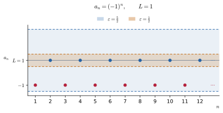{fig-alt="הסדרה אחת ומינוס אחת לסירוגין מול האינדקס n, סביב המועמד L=1. הרצועה הכחולה עם אפסילון חמש חלקי שתיים מכילה את כל הנקודות. ברצועה הכתומה עם אפסילון חצי נשארות רק הנקודות בגובה אחת; ההופעות של מינוס אחת מחוץ לה." width="580" fig-align="center"}

:::: {.foldable title="מדוע $-1$ אינו גבול הסדרה $a_n=(-1)^n$?"}

נבדוק את $L=-1$ עבור הסדרה $a_n=(-1)^n$.

עבור $\varepsilon=\frac{5}{2}$, הרצועה היא $(-\frac{7}{2},\frac{3}{2})$. המרחקים מ $-1$ הם $0$ או $2$, ולכן כל האיברים בתוכה ו $N=1$ מתאים.

עבור $\varepsilon=\frac{1}{2}$, בכל אינדקס זוגי מתקיים
$$|a_n-(-1)|=|1+1|=2>\frac12.$$
הערך $1$ חוזר באינדקסים זוגיים גדולים כרצוננו. לכן **לא קיים $N$ שממנו והלאה כל האיברים ברצועה הצרה**, ו $-1$ אינו הגבול.

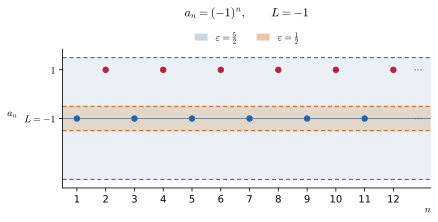{fig-alt="הסדרה a_n=(-1)^n סביב המועמד L=-1. רצועה כחולה ברדיוס חמש חלקי שתיים מכילה את כל הנקודות. ברצועה כתומה ברדיוס חצי נשארות רק הנקודות בגובה מינוס אחת. כל הנקודות הזוגיות בגובה אחת בחוץ." width="580" fig-align="center"}

::::

:::: {.foldable title="מדוע $0$ אינו גבול הסדרה $a_n=(-1)^n$?"}

נבדוק את $L=0$ עבור הסדרה $a_n=(-1)^n$. לכל $n\ge1$ מתקיים
$$|a_n-0|=|(-1)^n|=1.$$
עבור $\varepsilon=\frac{3}{2}$, כל האיברים בתוך הרצועה ו $N=1$ מתאים.

עבור $\varepsilon=\frac{1}{2}$, מתקיים $|a_n-0|=1>\frac{1}{2}$ בכל אינדקס. **כל האיברים מחוץ לרצועה הצרה**, ולכן $0$ אינו הגבול.

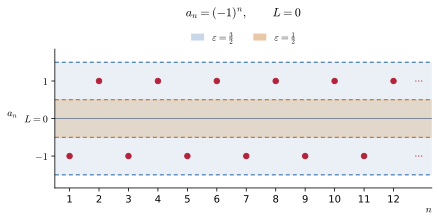{fig-alt="הסדרה a_n=(-1)^n סביב אפס. רצועה כחולה ברדיוס שלוש חלקי שתיים מכילה את כל הנקודות. רצועה כתומה ברדיוס חצי אינה מכילה אף נקודה." width="580" fig-align="center"}

::::

שלילת $1$, $-1$ ו $0$ לבדה עדיין אינה שוללת כל מספר ממשי אחר. כדי להראות שאין גבול, צריך טיעון שמתאים **לכל מועמד $L$**.

:::::

**אין צורך לכלול את כל הניסיונות בפתרון. הנה פתרון קצר ששולל כל מועמד בבת אחת.**

יהי $L$ מספר ממשי כלשהו. לפי [אי־שוויון המשולש](01-Introduction.qmd#box-thm-abs-props),
$$\begin{aligned}
2=|1-(-1)|
&=|(1-L)+(L+1)|\\
&\le |1-L|+|L+1|\\
&=|1-L|+|-1-L|.
\end{aligned}$$
לכן **לפחות אחד משני המרחקים מ $L$ גדול או שווה ל $1$**. אילו שניהם היו קטנים מ $1$, סכומם היה קטן מ $2$, בניגוד לאי־שוויון שקיבלנו.

נבחר $\varepsilon=\frac{1}{2}$. הערך שמרחקו מ $L$ לפחות $1$ חוזר בכל שני אינדקסים בסדרה $a_n=(-1)^n$. לכן **לכל אינדקס טבעי $N$ קיים $n\ge N$** שעבורו
$$|a_n-L|\ge1>\frac12=\varepsilon.$$
כלומר, תמיד קיים איבר נוסף מחוץ לרצועה. לא קיים $N$ שממנו והלאה כל האיברים בתוכה. לכן $L$ אינו גבול; ומכיוון שהטיעון מתאים לכל $L$, **הסדרה אינה מתכנסת**.

::::::

::::: {#box-prp-neighborhood-separation .thmmethod title="מפרידים בין שני מספרים שונים"}

לשני מספרים $a<b$ קיים מרחק חיובי $b-a$. כדי לבחור סביבם סביבות שאינן חופפות, נבחר
$$\varepsilon=\frac{b-a}{4}.$$
כל סביבה נמשכת רק רבע מהדרך אל המרכז האחר, ולכן נשאר ביניהן רווח.

**מדוע לא קיים מספר שנמצא בשתי הסביבות?** אילו מספר $x$ היה בשתיהן, היה מתקיים
$$|x-a|<\varepsilon,$$
וגם
$$|x-b|<\varepsilon.$$
לפי [אי־שוויון המשולש](01-Introduction.qmd#box-thm-abs-props), היינו מקבלים
$$\begin{aligned}
b-a=|b-a|
&=|(b-x)+(x-a)|\\
&\le |b-x|+|x-a|\\
&<2\varepsilon\\
&=\frac{b-a}{2}.
\end{aligned}$$
זה בלתי אפשרי: מספר חיובי אינו קטן מחצי מעצמו. לכן **שתי הסביבות אינן חופפות**.

הבחירה עובדת לכל שני מספרים שונים, קרובים ככל שיהיו. אין צורך למצוא את הרדיוס הגדול ביותר שמתאים; רבע מהמרחק תמיד מספיק.

:::::

::::: {#box-exp-separation-example .thmexp title="בחירת סביבות נפרדות — דוגמה"}

עבור $a=2$ ו $b=6$ נבחר
$$\begin{aligned}
\varepsilon&=\frac{b-a}{4}\\
&=\frac{6-2}{4}\\
&=1.
\end{aligned}$$
הסביבות הן $(1,3)$ ו $(5,7)$. באיור רואים שני קטעים פתוחים נפרדים על ישר המספרים.

{fig-alt="שתי סביבות פתוחות על ישר המספרים, עם רווח ביניהן. מרכז כל סביבה מסומן בנקודה, וקצותיה מסומנים בעיגולים פתוחים." width="540" fig-align="center"}

:::::

::::: {.thmchk title="בחירת סביבות נפרדות"}

:::: fill

עבור $a=2$ ו $b=6$, המרחק הוא [$4$]{.blank ans="4"}, ולפי השיטה אפשר לבחור $\varepsilon=$ [$1$]{.blank ans="1"}.

::: explain

מחשבים $\varepsilon=\frac{b-a}{4}=\frac{6-2}{4}=1$. הסביבות הן $(1,3)$ ו $(5,7)$. אילו $x$ היה בשתיהן, [אי־שוויון המשולש](01-Introduction.qmd#box-thm-abs-props) היה נותן $4\le|6-x|+|x-2|<2$, וזה בלתי אפשרי.

:::

::::

:::::

::::: {#box-sim-epsilon-challenge .thmsim title="מצמצמים את הרצועה ובודקים את הטענה"}

**המטרה של הסימולציה היא להראות שהצלחה עבור $\varepsilon$ אחד אינה מוכיחה גבול.**

נבדוק את הסדרה $a_n=(-1)^n$ ברצועה רחבה, ואז נצמצם אותה סביב אותו מועמד לגבול.

בחרו מועמד $L$ ולחצו **בדיקת הרצועה**. הקטינו את $\varepsilon$ עד $\frac{1}{2}$ ובדקו שוב: ערך שהיה בתוך הרצועה יוצא ממנה, וממשיך להופיע בחוץ כל שני אינדקסים.

**איבר חריג יחיד אינו מספיק לשלילת גבול. כאן הערך שבחוץ חוזר אינסוף פעמים.**

```{=html}
<iframe class="widget-frame" src="widgets/ch02/epsilon-game.html" loading="lazy" title="שוללים מועמד לגבול באמצעות רצועה צרה"></iframe>
```

:::::


::::: {.thmchk title="פגענו ביעד. האם זה מספיק?"}

**(א)** בסדרה $a_n=n$ מתקיים $a_3=3$. האם מכאן שהגבול הוא $3$?

באיור נבחר $\varepsilon=1$.

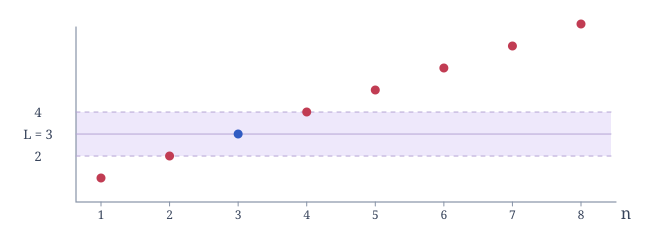{fig-alt="הסדרה a_n=n פוגעת בערך שלוש באינדקס שלוש. האיברים מאינדקס ארבע והלאה נמצאים על השפה או מחוץ לרצועה שבין שתיים לארבע, וממשיכים להתרחק." width="560" fig-align="center"}

::: {.quiz options="כן|לא" answer="לא"}

לא. למשל, עבור $\varepsilon=1$ צריך שכל האיברים מאינדקס מסוים יהיו בקטע $(2,4)$. אבל כל האיברים באינדקסים $4,5,6,\ldots$ נמצאים על השפה או מחוץ לקטע. הפגיעה באינדקס $3$ אינה עוזרת בהמשך.

:::

**(ב)** בסדרה
$$4,4,4,7,7,7,\ldots$$
כל האיברים מאינדקס $4$ והלאה שווים $7$. האם הסדרה מתכנסת אל $4$?

באיור נבחר $\varepsilon=1$.

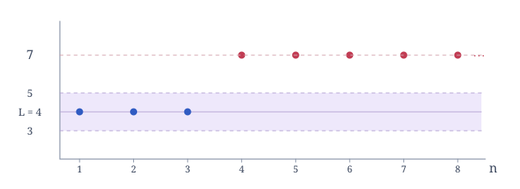{fig-alt="שלושת האיברים הראשונים שווים ארבע ונמצאים במרכז הרצועה שבין שלוש לחמש. כל האיברים מאינדקס ארבע והלאה שווים שבע ונמצאים מחוץ לרצועה." width="560" fig-align="center"}

::: {.quiz options="כן|לא" answer="לא"}

לא. שלוש פגיעות ב $4$ אינן מספיקות: בהמשך מתקיים תמיד $|a_n-4|=3$. עבור $\varepsilon=1$ אין אינדקס שממנו הדרישה מתקיימת תמיד.

:::

**(ג)** האם אינסוף איברים השווים ל $L$ מבטיחים שהסדרה מתכנסת אל $L$? הסתכלו בסדרה שמתחלפת בין שני מספרים קבועים $L<M$:
$$L,M,L,M,L,M,\ldots$$

באיור נבחר $0<\varepsilon<M-L$.

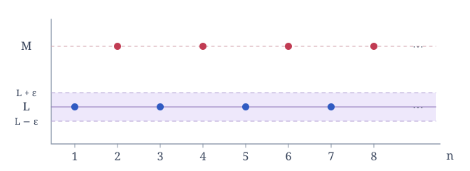{fig-alt="באינדקסים האי־זוגיים האיברים שווים L, ובזוגיים הם שווים M. כל ההופעות של M נמצאות מחוץ לסביבה הצרה של L, והן ממשיכות להופיע באינדקסים גדולים כרצוננו." width="560" fig-align="center"}

::: {.quiz options="כן|לא" answer="לא"}

לא. עבור $\varepsilon$ שנבחר, כל איבר השווה $M$ נמצא מחוץ לסביבה של $L$, ואיברים כאלה מופיעים אחרי כל אינדקס שנבחר. הסדרה פוגעת ב $L$ אינסוף פעמים, אבל אינה נשארת קרובה אליו.

:::

**(ד)** לעומת זאת, נבחן את הסדרה
$$7,7,7,4,4,4,\ldots$$
כל האיברים מאינדקס $4$ והלאה שווים $4$. האם עכשיו הגבול הוא $4$?

באיור נבחר $\varepsilon=1$.

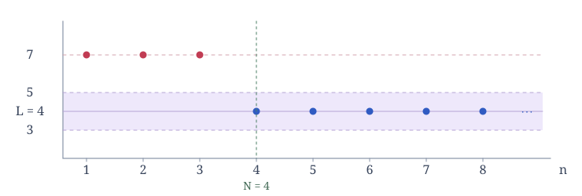{fig-alt="שלושת האיברים הראשונים שווים שבע ונמצאים מחוץ לרצועה סביב ארבע. כל האיברים מאינדקס ארבע והלאה שווים ארבע, במרכז הרצועה, ונשארים שם." width="560" fig-align="center"}

::: {.quiz options="כן|לא" answer="כן"}

כן. בוחרים $N=4$. כל האיברים שממנו והלאה שווים $4$, ולכן $|a_n-4|=0<\varepsilon$ לכל $\varepsilon>0$.

:::

:::::

::::: {#box-warn-one-epsilon .thmwarn title="טעות נפוצה — רצועה רחבה יכולה להטעות"}

**מציאת $N$ מתאים עבור $\varepsilon$ אחד אינה מוכיחה ש $L$ הוא הגבול. צריך להצליח לכל $\varepsilon>0$.**

בסדרה $a_n=(-1)^n$, עבור $L=0$ ו $\varepsilon=\frac{3}{2}$ מתקיים $|a_n-0|=1<\frac{3}{2}$ לכל $n\ge1$. אבל עבור $\varepsilon=\frac{1}{2}$, כל האיברים מחוץ לרצועה. באיור רואים את שתי הרצועות סביב אותו $L=0$.

{fig-alt="סביב אפס, הרצועה הכחולה עם אפסילון שלוש חלקי שתיים מכילה את כל איברי הסדרה a_n=(-1)^n. ברצועה הכתומה עם אפסילון חצי כולם בחוץ: הצלחה בסף הרחב אינה מוכיחה שאפס הוא הגבול." width="580" fig-align="center"}

:::::

::::: {#box-insight-smaller-epsilon .thminsight title="אם הדרישה נכשלת, הקטנת $\varepsilon$ אינה עוזרת"}

נתונות סדרה $(a_n)_{n=1}^{\infty}$ ומספר $L$.

**אם לא קיים $N$ מתאים עבור $\varepsilon_0>0$, לא קיים $N$ מתאים גם עבור כל $0<\varepsilon<\varepsilon_0$.**

הכישלון עבור $\varepsilon_0$ פירושו שאינסוף איברים מקיימים $|a_n-L|\ge\varepsilon_0$. עבור אותם איברים,
$$|a_n-L|\ge\varepsilon_0>\varepsilon.$$
לכן הם נשארים בחוץ גם כשהרצועה מצטמצמת. **הדרישה עדיין נכשלת אחרי כל אינדקס שנבחר.**

:::::

::::: {#box-exm-smaller-epsilon .thmexm title="שתי רצועות שאינן מכילות את איברי הסדרה"}
נתונה $a_n=(-1)^n$, עבור $n\ge1$, ונבדוק את $L=0$.
לכל $n$ מתקיים $|a_n-0|=1$.
לכן אין $N$ מתאים עבור $\varepsilon_0=\frac{3}{4}$, וגם לא עבור $\varepsilon=\frac{1}{2}$: כל האיברים נמצאים מחוץ לשתי הרצועות.

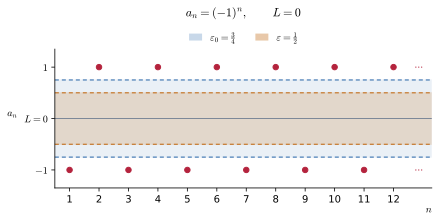{fig-alt="איברי a_n=(-1)^n בגובה אחת ומינוס אחת נמצאים מחוץ לשתי רצועות סביב אפס: הכחולה ברדיוס שלושה רבעים והכתומה ברדיוס חצי. צמצום הרצועה אינו מחזיר פנימה אף נקודה שהיתה בחוץ." width="580" fig-align="center"}

:::::

:::: {#box-check-epsilon-reciprocals .thmchk title="האם צמצום הרצועה יחשוף את הכישלון?"}

נתונות סדרה $(a_n)_{n=1}^{\infty}$ ומספר $L$ שאינו הגבול שלה. בודקים סביב $L$ את הספים $\varepsilon_k=\frac{1}{k}$, כלומר $1,\frac{1}{2},\frac{1}{3},\ldots$.

האם מובטח שנגיע לסף שעבורו אינסוף איברים מקיימים $|a_n-L|\ge\varepsilon_k$?

::: {.quiz options="כן|לא" answer="כן"}

כן. מכיוון ש $L$ אינו הגבול, קיים $\varepsilon_0>0$ שעבורו אינסוף איברים מקיימים
$$|a_n-L|\ge\varepsilon_0.$$
כדי לקבל $\frac1k<\varepsilon_0$, נדרש $k>\frac1{\varepsilon_0}$. לכן נבחר
$$k_0=\left\lfloor\frac1{\varepsilon_0}\right\rfloor+1.$$
לכל $k\ge k_0$, אותם אינסוף איברים מקיימים
$$|a_n-L|\ge\varepsilon_0>\frac1k.$$
לכן מובטח שנגיע לסף שבו הדרישה נכשלת. ייתכן שזה יקרה עוד לפני $k_0$.

:::

::::

:::: {.thmchk title="מה קורה כשמשנים את רוחב הרצועה?"}

נתונה סדרה ומספר $L$. עבור סף מסוים $\varepsilon_0>0$ קיימים אינסוף איברים מחוץ לרצועה סביב $L$.

האם גם עבור $\varepsilon=\frac{\varepsilon_0}{2}$ קיימים אינסוף איברים בחוץ?

::: {.quiz options="כן|לא" answer="כן"}

כן. הרצועה החדשה מוכלת בקודמת, ולכן כל איבר שהיה בחוץ נשאר בחוץ.

:::

האם גם עבור $\varepsilon=2\varepsilon_0$ חייבים להיות אינסוף איברים בחוץ?

::: {.quiz options="כן|לא" answer="לא"}

לא בהכרח. למשל, בסדרה $(-1)^n$ סביב $L=0$, עבור $\varepsilon_0=\frac{3}{4}$ כולם בחוץ, ועבור $2\varepsilon_0=\frac{3}{2}$ כולם בפנים. אם נתחיל במקום זאת ב $\varepsilon_0=\frac{1}{4}$, גם לאחר ההכפלה כולם יישארו בחוץ.

:::

::::

::::: {#box-exm-count-occurrences .thmexm title="סופרים איברים, לא ערכים שונים"}

נתונה הסדרה
$$1,1,1,\frac32,2,2,2,\ldots$$
כל האיברים מאינדקס $5$ והלאה שווים $2$. עבור $L=2$ ו $\varepsilon=\frac14$, הסביבה היא $(\frac74,\frac94)$.

{fig-alt="אינדקסים אחת שתיים ושלוש מכילים את הערך אחת, אינדקס ארבע את שלוש חלקי שתיים. ארבעת האיברים בחוץ; כל האיברים מאינדקס חמש בתוך הרצועה סביב שתיים." width="560" fig-align="center"}

:::: fill

כמה **איברים** מחוץ לסביבה? [$4$]{.blank ans="4" miss="2 :: יש שני ערכים שונים בחוץ, אבל כמה אינדקסים מתאימים להם? כל הופעה נספרת."}

בחרו אינדקס שממנו כל האיברים בסביבה: $N=$ [$5$]{.blank ans="5" min-answer="5" integer-answer="true"}.

::: explain

שלוש ההופעות של $1$ וההופעה של $\frac32$ הן ארבעה איברים. כל האיברים מאינדקס $5$ והלאה שווים $2$, ולכן אותו $N=5$ מתאים גם לכל $\varepsilon$ חיובי קטן יותר.

:::

::::

:::::

::: {.thmkey title="רק מספר סופי של חריגים"}

בסדרה המתכנסת אל $L$, לכל $\varepsilon>0$ יש רק מספר סופי של איברים מחוץ לסביבה. כולם באינדקסים שלפני $N$; מאינדקס $N$ והלאה אין עוד חריגים. על ישר המספרים כמה איברים יכולים להופיע באותה נקודה, ולכן בספירה צריך לזכור את האינדקסים שלהם.

:::

### זנב של סדרה {.unnumbered}

::: {#box-def-sequence-tail .thmdef title="זנב של סדרה"}

בסדרה $(a_n)_{n=1}^{\infty}$, ה[**זנב**]{.term} שמתחיל באינדקס $N$ הוא סדרת כל האיברים מאינדקס זה והלאה, לפי סדרם:
$$a_N,a_{N+1},a_{N+2},\ldots$$
כוללים את האיבר $a_N$ עצמו ואת **כל** האיברים שאחריו; אין דילוגים בין האיברים.

:::

::: {#box-exm-tail-four .thmexm title="זנב שמתחיל באינדקס ארבע"}
נתונה סדרה $(a_n)_{n=1}^{\infty}$. נבחר את הזנב שמתחיל באינדקס $N=4$: משאירים בחוץ את שלושת האיברים הראשונים, והזנב הוא $a_4,a_5,a_6,\ldots$.

{fig-alt="בשורה העליונה הסדרה a1,a2,a3,a4,a5,a6 והלאה. בשורה התחתונה הזנב שמתחיל באינדקס ארבע: a4,a5,a6 והלאה. האיבר a4 כלול; האיברים a1,a2,a3 אינם חלק מהזנב הזה." width="600" fig-align="center"}
:::

::: {#box-prp-tail-is-sequence .thmprp title="הזנב הוא בעצמו סדרה"}

תהי $(a_n)_{n=1}^{\infty}$ סדרה, ויהי $k\ge0$ מספר שלם. הזנב לאחר השמטת $k$ האיברים הראשונים הוא הסדרה $(b_n)_{n=1}^{\infty}$ המוגדרת על ידי
$$b_n=a_{n+k}.$$

:::

מתחילים לספור מחדש את איברי הזנב מהאינדקס $1$.
**המספר $k$ קבוע**, ואילו $n=1,2,3,\ldots$ סופר את איברי הסדרה החדשה. האיברים עצמם וסדרם אינם משתנים; רק האינדקסים מתחילים מחדש.

::: {#box-exm-tail-reindex .thmexm title="האינדקסים של זנב הסדרה $\frac{1}{n}$"}
נתונה הסדרה $a_n=\frac{1}{n}$, עבור $n\ge1$. נשמיט את שלושת איבריה הראשונים ונגדיר $b_n=a_{n+3}=\frac{1}{n+3}$.
אז
$$b_1=a_4=\frac{1}{4},\qquad b_2=a_5=\frac{1}{5},\qquad b_3=a_6=\frac{1}{6}.$$
האיברים נשארו אותם איברים; רק מתחילים לספור אותם מחדש מהאינדקס $1$.
:::

באופן כללי, הזנב שמתחיל באיבר $a_N$ מתקבל בבחירה $k=N-1$.

::: {#box-prp-tail-limit-equivalence .thmprp title="לסדרה ולזנב שלה אותו גבול"}

תהי $(a_n)_{n=1}^{\infty}$ סדרה, יהי $k\ge0$ שלם קבוע, ותהי $(b_n)_{n=1}^{\infty}$ הסדרה המוגדרת על ידי $b_n=a_{n+k}$. לכל $L\in\mathbb R$,
$$a_n\longrightarrow L\quad\Longleftrightarrow\quad b_n\longrightarrow L.$$

:::

::: {#box-exm-tail-cutoff .thmexm title="העברת אינדקס מתאים מהסדרה לזנב"}
נתונה סדרה $(a_n)_{n=1}^{\infty}$ ונגדיר $b_n=a_{n+3}$.
עבור $L\in\mathbb{R}$ ו $\varepsilon>0$, נניח ש $|a_n-L|<\varepsilon$ לכל $n\ge6$.
בסדרה החדשה $b_3=a_6$, ולכן לכל $n\ge3$ מתקיים $|b_n-L|=|a_{n+3}-L|<\varepsilon$.
הדרישה עוברת מאינדקס $6$ בסדרה המקורית לאינדקס $3$ בזנב. אלה בדיוק אותם איברים.

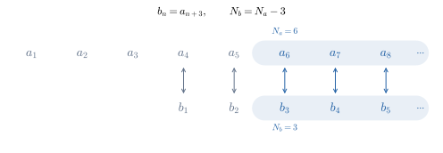{fig-alt="אותם איברים בשתי שורות: בסדרה המקורית מתחילים לבדוק באינדקס שש, ובזנב b_n=a_{n+3} אותם איברים מתחילים באינדקס שלוש. האיברים a_4,a_5,a_6 מתאימים לאיברים b_1,b_2,b_3." width="600" fig-align="center"}
:::

::: {#box-exp-tail-equivalence .thmexp title="מדוע לסדרה ולזנב אותו גבול?"}
**מהסדרה המקורית לזנב.** נניח ש $a_n\to L$, וניקח $\varepsilon>0$. קיים אינדקס $N_a$ כך שלכל $n\ge N_a$ מתקיים $|a_n-L|<\varepsilon$.

עבור הסדרה $b_n=a_{n+k}$ נבחר
$$N_b=\max\{1,N_a-k\}.$$
כלומר, מפחיתים $k$ מהאינדקס; אם התוצאה קטנה מ $1$, מתחילים באינדקס $1$.

לכל $n\ge N_b$ מתקיים $n+k\ge N_a$, ולכן
$$|b_n-L|=|a_{n+k}-L|<\varepsilon.$$
הבחירה אפשרית לכל $\varepsilon>0$, ולכן $b_n\to L$.

**מהזנב לסדרה המקורית.** נניח ש $b_n\to L$, וניקח $\varepsilon>0$. קיים אינדקס $N_b$ כך שלכל $n\ge N_b$ מתקיים $|b_n-L|<\varepsilon$.

עבור הסדרה המקורית נבחר
$$N_a=N_b+k.$$
לכל $n\ge N_a$ מתקיים $n-k\ge N_b$, ולכן
$$|a_n-L|=|b_{n-k}-L|<\varepsilon.$$
גם בכיוון הזה הבחירה אפשרית לכל $\varepsilon>0$, ולכן $a_n\to L$.

**הכללים מתייחסים לכל סף $\varepsilon$ בנפרד:** מעבירים את האינדקס שמתאים לסף הזה. אין צורך לבחור את האינדקס הקטן ביותר האפשרי.
:::

::: {#box-prp-limit-tail .thmprp title="שינוי של מספר סופי של איברים"}

שינוי של מספר סופי של איברים אינו משנה את הגבול או את עצם ההתכנסות.

:::

:::: {#box-exp-changed-prefix .thmexp title="משנים את ההתחלה, שומרים על הזנב"}

אם נחליף את שלושת האיברים הראשונים של הסדרה $a_n=\frac{1}{n}$ במספרים $100$, $-1000$ ו $7$, נקבל
$$100,\;-1000,\;7,\;\frac{1}{4},\;\frac{1}{5},\;\ldots$$
הזנב החל מאינדקס $4$ נשאר אותו זנב. לכל $\varepsilon>0$ אפשר לבחור $N\ge4$ שגדול גם מ $\frac{1}{\varepsilon}$, ולכן הגבול נשאר $0$.

::: {#box-sim-change-prefix .thmsim title="שינוי האיברים שלפני הזנב"}

**המטרה של הסימולציה היא לראות ששינוי האיברים שלפני הזנב אינו משנה את הזנב עצמו.**

מתחילים בסדרה $a_n=\frac{1}{n}$, שגבולה $0$. בחרו את תחילת הזנב $N$ ולחצו **שינוי האיברים שלפני $N$**. הנקודות האפורות משתנות; הנקודות הכחולות נשארות במקומן, והגבול נשאר $0$.

```{=html}
<iframe class="widget-frame" src="widgets/ch02/tail.html" loading="lazy" title="בחירת זנב ושינוי האיברים שלפניו"></iframe>
```

:::

::::

:::: {.thmchk}

שינינו את מיליון האיברים הראשונים של סדרה המתכנסת אל $2$. האם הגבול יכול להשתנות?

::: {.quiz options="כן|לא" answer="לא"}

מיליון הוא עדיין מספר סופי. אפשר לבחור את תחילת הזנב אחרי כל האיברים ששונו.

:::

נבחן את הסדרה $a_n=n$, את המועמד $L=3$ ואת $\varepsilon=1$. הדרישה היא שהאיברים יהיו בקטע $(2,4)$.

האיבר $a_3=3$ נמצא בתוך הקטע. האם $N=3$ מבטיח שכל האיברים מאינדקס זה והלאה יהיו בקטע?

::: {.quiz options="כן|לא" answer="לא"}

לא. כבר האיבר הבא, $a_4=4$, נמצא על שפת הקטע ואינו בתוכו. האיברים $a_5=5,a_6=6,\ldots$ נמצאים מחוץ לקטע ומתרחקים ממנו. צריך שהדרישה תתקיים לכל $n\ge N$; בדיקת האיבר $a_N$ לבדו אינה מספיקה.

:::

::::

::::: {.thmchk title="שתי סדרות שמסכימות בהמשך"}

נתונות שתי סדרות $(a_n)_{n=1}^{\infty}$ ו $(b_n)_{n=1}^{\infty}$ כך שלכל $n\ge5$ מתקיים $a_n=b_n$. ארבעת האיברים הראשונים שלהן יכולים להיות שונים. האם הטענות הבאות נכונות?

**אם $(a_n)$ מתכנסת, גם $(b_n)$ מתכנסת.**

::: {.quiz options="כן|לא" answer="כן"}

כן. שתי הסדרות מסכימות מאינדקס $5$ והלאה. שינוי ארבעת האיברים הראשונים אינו משנה את ההתכנסות.

:::

**אם $(a_n)$ אינה מתכנסת למספר ממשי, גם $(b_n)$ אינה מתכנסת למספר ממשי.**

::: {.quiz options="כן|לא" answer="כן"}

כן. אילו $(b_n)$ הייתה מתכנסת, גם $(a_n)$ הייתה מתכנסת, כי הן נבדלות רק בארבעת האיברים הראשונים.

:::

**ייתכן שאחת מתכנסת והשנייה אינה מתכנסת.**

::: {.quiz options="כן|לא" answer="לא"}

לא. מכיוון שהסדרות מסכימות לכל $n\ge5$, הן מתכנסות יחד או שאף אחת מהן אינה מתכנסת.

:::

**אם שתיהן מתכנסות, הגבולות שווים.**

::: {.quiz options="כן|לא" answer="כן"}

כן. לכל $\varepsilon>0$ אפשר לבחור את אינדקס ההתחלה גם אחרי ארבעת האיברים הראשונים. משם והלאה האיברים שווים, ולכן אותו גבול מתאים לשתי הסדרות.

:::

**ייתכן ששתיהן מתכנסות לגבולות שונים.**

::: {.quiz options="כן|לא" answer="לא"}

לא. שינוי מספר סופי של איברים אינו משנה את הגבול; הסדרות נבדלות לכל היותר בארבעה איברים.

:::

:::::

::::: {#box-q-shifted-sequence .thmexm title="אותם איברים, אינדקסים אחרים"}

נחזור לסדרה $a_n=\frac{1}{n}$, ש[כבר הוכחנו כי היא מתכנסת לאפס](#box-exm-one-over-n). נקבע מספר שלם $k\ge0$ ונגדיר
$$b_n=\frac1{n+k}=a_{n+k}.$$
כפי שראינו ב [טענה על הזנב כסדרה](#box-prp-tail-is-sequence), זו הסדרה שמתקבלת מהשמטת $k$ האיברים הראשונים של $(a_n)_{n=1}^{\infty}$.

למשל, כש $k=3$,
$$\begin{aligned}
b_1&=a_4=\frac14,\\
b_2&=a_5=\frac15,\\
b_3&=a_6=\frac16,\quad\ldots
\end{aligned}$$

**(א)** האם גם $b_n\to0$?

::: {.quiz options="כן|לא" answer="כן"}

כן. לכל $\varepsilon>0$, כל איברי הסדרה $a_n=\frac{1}{n}$ מאינדקס מתאים והלאה קרובים לאפס. גם איברי הזנב מגיעים לאותו חלק של הסדרה ונשארים בו. השמטת האיברים הראשונים אינה משנה את הגבול, ולכן
$$\lim_{n\to\infty}\frac1{n+k}=0.$$

:::

**(ב)** עבור $\varepsilon>0$ נתון, ידוע ש $\frac{1}{n}<\varepsilon$ לכל $n\ge20$. נבחר $k=3$, כלומר $b_n=\frac{1}{n+3}$. מאיזה אינדקס בסדרה $(b_n)_{n=1}^{\infty}$ מובטחת אותה דרישה?

:::: fill

אפשר לבחור $N_b=$ [$17$]{.blank ans="17" min-answer="17" integer-answer="true"}.

::: explain

לכל $n\ge17$ מתקיים $n+3\ge20$, ולכן
$$|b_n-0|=\frac1{n+3}<\varepsilon.$$
גם אינדקס מאוחר יותר מתאים.

:::

::::

**(ג)** נחזור למספר שלם קבוע $k\ge0$ ולסדרה $b_n=\frac{1}{n+k}$. ידוע ש $\frac{1}{n}<\varepsilon$ לכל $n\ge N$. איזה תנאי מתאר בדיוק את כל האינדקסים $n$ שעבורם $b_n$ נלקח מהחלק הזה של הסדרה המקורית?

::: {.quiz options="$n+k\ge N$|$n+k\le N$|$n+k=N$" answer="$n+k\ge N$"}

צריך שהאינדקס המקורי $n+k$ יגיע לפחות ל $N$. אפשר לבחור $N_b=N-k$ אם הוא חיובי. אם $N-k\le1$, אפשר להתחיל ב $N_b=1$. בכל מקרה, גם הבחירה $N_b=N$ מספיקה; אין חובה להתחיל מוקדם ככל האפשר.

:::

:::::

:::: {#box-check-prepend-terms .thmchk title="מוסיפים איברים בתחילת הסדרה"}

נתונה סדרה $(a_n)_{n=1}^{\infty}$ המתכנסת אל $L$. מוסיפים לפניה $100$ מספרים ממשיים כלשהם, ואחריהם משאירים את כל איברי הסדרה המקורית באותו סדר. נסמן את הסדרה שהתקבלה ב $(b_n)_{n=1}^{\infty}$.

האם גם הסדרה החדשה מתכנסת אל אותו גבול $L$?

::: {.quiz options="כן|לא" answer="כן"}

כן. האיבר $a_1$ מופיע כעת באינדקס $101$, ובאופן כללי
$$b_{n+100}=a_n.$$
אם עבור $\varepsilon>0$ כל איברי הסדרה המקורית מאינדקס $N$ והלאה קרובים ל $L$ במרחק קטן מ $\varepsilon$, אותה דרישה מתקיימת בסדרה החדשה מאינדקס $N+100$ והלאה. לכן הוספת $100$ איברים בתחילת הסדרה אינה משנה את הגבול, בלי קשר לערכים שהוספנו.

:::

::::

### למה הגבול יחיד? {.unnumbered}

::: {#box-thm-limit-unique .thmthm title="יחידות הגבול"}

לסדרה מתכנסת יש גבול אחד בלבד.

:::

::: {#box-exp-unique-limit .thmexp title="מדוע אי אפשר להתכנס לשני מספרים שונים?"}
כפי שראינו ב [שיטה להפרדת שני מספרים](#box-prp-neighborhood-separation), אפשר לצייר סביב שני מספרים שונים $L_1,L_2$ סביבות שאין ביניהן חפיפה.

אם $a_n\to L_1$, אז מאינדקס מתאים והלאה כל האיברים בסביבה שבחרנו סביב $L_1$. אף אחד מהם אינו יכול להיות גם בסביבה הנפרדת של $L_2$. לכן בסביבה הזאת של $L_2$ הדרישה נכשלת: מאותו אינדקס כל האיברים בחוץ. מכאן ש $L_2$ אינו גבול. אותו הסבר עובד גם בהחלפת התפקידים.

{fig-alt="שתי רצועות נפרדות סביב L1 ו L2. מאינדקס N והלאה כל האיברים ברצועה סביב L1, ולכן כולם מחוץ לרצועה סביב L2." width="600" fig-align="center"}
:::

::: {#box-exm-unique-limit .thmexm title="לסדרה $\frac{1}{n}$ אין גבול נוסף"}
נתונה הסדרה $a_n=\frac{1}{n}$, עבור $n\ge1$. [הראינו שגבולה $0$](#box-exm-one-over-n), ולכן לפי [יחידות הגבול](#box-thm-limit-unique) היא אינה יכולה להתכנס גם ל $1$.
אפשר לראות זאת גם ישירות: לכל $n\ge5$ מתקיים $a_n<\frac{1}{4}$, ולכן
$$|a_n-1|=1-a_n>\frac{3}{4}.$$
לכן עבור $\varepsilon=\frac{1}{4}$ לא קיים אינדקס שממנו כל האיברים ברצועה סביב $1$.
:::

::: {.thmanalogy title="ליד איזה יעד נשארים?"}

יוצאים מפתח תקווה ורוצים להישאר קרובים גם לחיפה וגם לנהריה. כשדורשים קרבה גדולה מספיק, אי אפשר להישאר ליד שני היעדים יחד. אותו הדבר קורה אפילו עם שני יעדים קרובים, כמו רחוב סומסום $1$ ורחוב סומסום $2$: אפשר לבחור סביבם אזורים קטנים שאינם חופפים, ואז להישאר רק באחד מהם.

:::

:::: {.thmchk title="שתי סביבות נפרדות"}

כל איברי הסדרה החל מאינדקס $20$ נמצאים בקטע $(1,2)$. האם ייתכן שמאינדקס $30$ והלאה כולם נמצאים גם בקטע $(4,5)$?

::: {.quiz options="כן|לא" answer="לא"}

לא. למשל, האיבר באינדקס $30$ היה צריך להיות בשני הקטעים, ואין מספר שנמצא בשניהם. גם האיברים שאחריו אינם יכולים לקיים את שתי הדרישות יחד.

:::

::::

### שתי התנהגויות באותה סדרה {.unnumbered}

::: {#box-def-subsequence .thmdef title="תת־סדרה"}

נתונה סדרה $(a_n)_{n=1}^{\infty}$. בוחרים אינדקסים טבעיים $n_1,n_2,n_3,\ldots$, כך שבכל בחירה מתקדמים לאינדקס גדול יותר:
$$n_{k+1}>n_k.$$
האיברים שנבחרו הם
$$a_{n_1},a_{n_2},a_{n_3},\ldots$$
זוהי [**תת־סדרה**]{.term} של $(a_n)_{n=1}^{\infty}$, ומסמנים אותה $(a_{n_k})_{k=1}^{\infty}$.

האינדקס $k$ סופר את האיברים בתת־הסדרה; $n_k$ הוא האינדקס של האיבר שנבחר בסדרה המקורית.

:::

אפשר לחשוב על הבחירה כעל קפיצות בין איברי הסדרה: קופצים תמיד **קדימה, לפחות אינדקס אחד בכל צעד**. אפשר לעבור לאיבר הבא, ואפשר לדלג על כמה איברים. אסור לחזור לאחור או להישאר באותו אינדקס.

::: {#box-exm-even-subsequence .thmexm title="האיברים הזוגיים של הסדרה $\frac{1}{n}$"}
בסדרה $a_n=\frac{1}{n}$, עבור $n\ge1$, נבחר $n_k=2k$.
אלה אינדקסים טבעיים עולים, ולכן הם מגדירים תת־סדרה:
$$a_{n_k}=a_{2k}=\frac{1}{2k},\qquad k\ge1.$$
איבריה הראשונים הם $\frac{1}{2},\frac{1}{4},\frac{1}{6},\ldots$.
באיבר השלישי שלה, $k=3$, האינדקס המקורי הוא $n_3=6$, והערך הוא $a_6=\frac{1}{6}$.

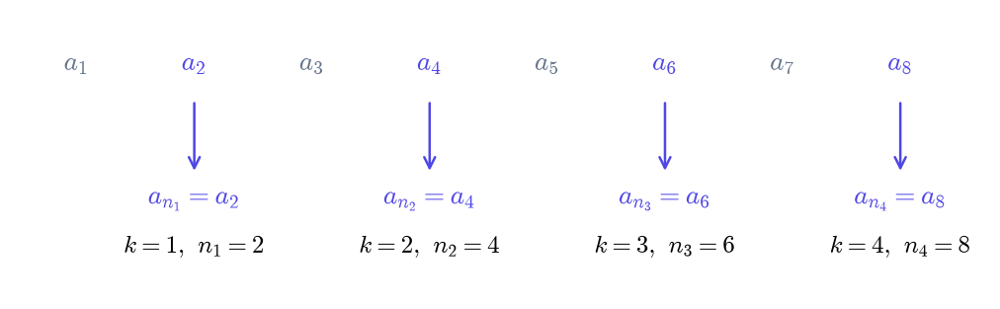{fig-alt="האינדקסים המקוריים אחת עד שמונה. נבחרים האיברים באינדקסים שתיים, ארבע, שש ושמונה; הם האיבר הראשון, השני, השלישי והרביעי בתת הסדרה." width="560" fig-align="center"}

:::

::: {#box-exm-subsequence-choice .thmexm title="מהי תת־סדרה ומה לא?"}

נבחן את הסדרה
$$1,2,3,4,5,6,\ldots$$
הסדרה
$$2,4,6,\ldots$$
היא תת־סדרה שלה: בחרנו איברים מהסדרה המקורית ושמרנו על הסדר שבו הם מופיעים.

לעומת זאת, הסדרה
$$2,1,3,4,5,6,\ldots$$
אינה תת־סדרה שלה. אלה אותם מספרים, אבל הסדר השתנה: אחרי שבחרנו את האיבר $2$, אי אפשר לחזור לאינדקס של האיבר $1$.

**כל סדרה היא תת־סדרה של עצמה.** אין חובה לדלג על איברים: בוחרים $n_k=k$, ומקבלים את כל האיברים באותו סדר.

באיור מוצגות שתי דרכי בחירה בסדרה כלשהי $(a_n)$:

{fig-alt="בשורה הראשונה בוחרים את האיברים באינדקסים אחת, שלוש, ארבע ושבע: כל הקפיצות קדימה, וחלקן מדלגות על איברים. בשורה השנייה בוחרים את כל האיברים, וקופצים בכל פעם לאינדקס הבא. כך מתקבלת הסדרה עצמה." width="600" fig-align="center"}

:::

:::: {.thmchk title="מה מותר לבחור?"}

האם $1,1,2,3,4,\ldots$ היא תת־סדרה של $1,2,3,4,\ldots$?

::: {.quiz options="כן|לא" answer="לא"}

לא. המספר $1$ מופיע בסדרה המקורית פעם אחת בלבד, ואי אפשר לבחור את אותו אינדקס פעמיים. ערכים שווים יכולים להופיע בתת־סדרה רק אם הם מופיעים באינדקסים שונים בסדרה המקורית.

:::

::::

::: {#box-thm-subsequence-limit .thmthm title="הגבול של תת־סדרה"}

אם סדרה מתכנסת אל $L$, כל תת־סדרה שלה מתכנסת גם היא אל $L$.

לכן, אם שתי תתי־סדרות מתכנסות למספרים שונים, הסדרה המקורית אינה מתכנסת.

:::

::: {#box-exp-subsequence-limit .thmexp title="מדוע תת־סדרה שומרת על הגבול?"}
בחירת חלק מהאיברים אינה משנה את העובדה שכל האיברים מאינדקס מסוים והלאה קרובים לגבול. לכן תת־סדרה של סדרה מתכנסת אינה יכולה להוביל לגבול אחר.
:::

::: {#box-exm-subsequence-zero .thmexm title="גבול האיברים הזוגיים של הסדרה $\frac{1}{n}$"}
נתונה הסדרה $a_n=\frac{1}{n}$, ש[גבולה $0$](#box-exm-one-over-n).
נבחר $n_k=2k$ ונקבל את תת־הסדרה $a_{n_k}=\frac{1}{2k}$, עבור $k\ge1$.
לפי [המשפט על גבול תת־סדרה](#box-thm-subsequence-limit),
$$\lim_{k\to\infty}a_{n_k}=\lim_{k\to\infty}\frac{1}{2k}=0.$$
כאן $k$ הוא האינדקס בתת־הסדרה; הגבול נשאר אותו מספר.
:::

:::: {#box-sim-subsequence .thmsim title="בוחרים חלק מהאיברים"}

**המטרה של הסימולציה היא לראות שבחירת תת־סדרה משאירה את ערכי האיברים שנבחרו ואת הגבול.**

נבחר תת־סדרה מתוך $a_n=\frac{1}{n}$, ש[הראינו כי היא מתכנסת אל $0$](#box-exm-one-over-n).

בחרו אינדקסים זוגיים, אי־זוגיים או כל אינדקס שלישי. **העיגולים הסגולים הם איברי תת־הסדרה; הכחולים הם האיברים שלא נבחרו.**

עברו לתצוגת **תת־הסדרה בלבד**: הגבהים נשארים, והאינדקסים מתחלפים מ $n_k$ ל $k=1,2,3,\ldots$. שנו גם את $\varepsilon$ ושימו לב שהאיברים המאוחרים נשארים ברצועה סביב $0$.

```{=html}
<iframe class="widget-frame" src="widgets/ch02/subsequences.html" loading="lazy" title="סדרה ותת־סדרה על אותו גרף ובנפרד"></iframe>
```

::::

::::: {#box-exm-no-limit .thmexm title="קודם בוחרים אינדקסים, ואז מציבים"}

נחזור אל $a_n=(-1)^n$. נבחר את האינדקסים הזוגיים בסדרה המקורית:
$$n_1=2,\quad n_2=4,\quad n_3=6,\quad\ldots$$
כלומר, הנוסחה לאינדקס שנבחר היא
$$n_k=2k.$$
רק עכשיו מציבים אותו בנוסחת האיבר:
$$a_{n_k}=(-1)^{n_k}=(-1)^{2k}=1.$$

| האינדקס בתת־הסדרה $k$ | האינדקס המקורי שנבחר $n_k=2k$ | האיבר שנבחר $a_{n_k}$ |
|:---:|:---:|:---:|
| $1$ | $2$ | $a_2=1$ |
| $2$ | $4$ | $a_4=1$ |
| $3$ | $6$ | $a_6=1$ |

לבחירה השנייה ניתן שם אחר: $m_k$ הוא האינדקס האי־זוגי שנבחר במקום $k$.
$$m_1=1,\quad m_2=3,\quad m_3=5,\quad\ldots$$
כלומר $m_k=2k-1$, ולכן
$$a_{m_k}=(-1)^{m_k}=(-1)^{2k-1}=-1.$$
קיבלנו שתי סדרות קבועות: הראשונה מתכנסת אל $1$, והשנייה אל $-1$. לפי [המשפט על תתי־סדרות](#box-thm-subsequence-limit), זו דרך נוספת להראות שהסדרה המקורית אינה מתכנסת.

{fig-alt="האיברים באינדקסים הזוגיים בגובה אחת, ובאי־זוגיים בגובה מינוס אחת." width="500" fig-align="center"}

:::: fill

בבחירה $n_k=2k$, כאשר $k=3$, האינדקס המקורי הוא $n_3=$ [$6$]{.blank ans="6"}.
האיבר שנבחר הוא $a_{n_3}=$ [$1$]{.blank ans="1"}.

::: explain

האינדקס $3$ סופר את הבחירות; הבחירה השלישית היא האיבר באינדקס $6$ של הסדרה המקורית, שערכו $1$.

:::

::::

:::::

:::: {.thmchk title="תת־סדרה אחת אינה מספיקה"}

בסדרה $(-1)^n$ יש תת־סדרה המתכנסת אל $1$. האם נובע מכך שהסדרה כולה מתכנסת?

::: {.quiz options="כן|לא" answer="לא"}

לא. תת־הסדרה משאירה בחוץ את האיברים השווים $-1$, והם ממשיכים להופיע. צריך לבדוק גם מה קורה לאיברים שלא בחרנו.

:::

::::

::::: {#box-exm-distance-editor .thmsolved title="מציבים את האיבר בעוזר הפתרון"}

נתון $a_n=1+\frac2n$. נתרגל את התנאי $|a_n-1|<\frac14$.

תחילה בחרו **פישוט והחלפה ← הצבה לפי הגדרת הסדרה**, והקלידו $a_n$. בצעד הבא בחרו **פישוט האגפים**: המספרים $1$ ו $-1$ מתבטלים, ו $\frac{2}{n}$ חיובי. אחר כך כופלים במספרים חיוביים דרך **פעולות על האגפים ← כפל**.

:::: {.derive vars="n" solve="n" positive="n" sequence-name="a" sequence-formula="1+2/n" start="abs(a_n-1)<1/4"}

::: {.step line="abs(1+2/n-1)<1/4" action="sequence" value="a_n"}

מציבים את הגדרת האיבר.

:::

::: {.step line="2/n<1/4" action="simplify"}

מפשטים את המרחק; $n$ חיובי.

:::

::: {.step line="2<n/4" action="mul" value="n"}

כופלים ב $n$.

:::

::: {.step line="8<n" action="mul" value="4"}

כופלים ב $4$. לכן אפשר לבחור $N=9$.

:::

::::


::: {#prose-exm-distance-editor-1 .lecture-answer .solution-prose title="פתרון במילים"}

עבור $a_n=1+\frac{2}{n}$ נפתור את הדרישה $|a_n-1|<\frac{1}{4}$. נציב את נוסחת האיבר:
$$\left|1+\frac{2}{n}-1\right|<\frac{1}{4}.$$
הקבועים מתבטלים. מכיוון ש $n\ge1$, מתקיים $\frac{2}{n}>0$, ולכן אפשר להסיר את הערך המוחלט:
$$\frac{2}{n}<\frac{1}{4}.$$
נכפול ב $n>0$, ואחר כך ב $4>0$:
$$2<\frac{n}{4},\qquad 8<n.$$
אפשר לבחור $N=9$. לכל $n\ge9$ מתקיימת הדרישה. זהו חישוב עבור $\varepsilon=\frac{1}{4}$ בלבד; הוכחת גבול דורשת בחירה מתאימה לכל $\varepsilon>0$.

:::

:::::

### תרגילים {.unnumbered}

::::: {#box-q-epsilon-solve .thmqst title="מהאי־שוויון לבחירת אינדקס"}

הראו שהסדרה $a_n=\frac2{n+1}$ מתכנסת אל $0$.

**(א)** מצאו אינדקס שממנו מתקיים $|a_n-0|<\frac{1}{50}$.

:::: {.derive vars="n" solve="n" positive="n" start="2/(n+1)<1/50"}

::: {.step line="2<(n+1)/50" action="mul" value="n+1"}

כופלים ב $n+1>0$.

:::

::: {.step line="100<n+1" action="mul" value="50"}

כופלים ב $50$.

:::

::: {.step line="99<n" action="sub" value="1"}

מחסרים $1$.

:::

::::

:::: fill

אפשר לבחור $N=$ [$100$]{.blank ans="100" min-answer="100" integer-answer="true"}.

::: explain

כל $n\ge100$ מקיים $n>99$, ולכן מתקיים $|a_n-0|<\frac{1}{50}$.

:::

::::

**(ב)** הראו שהדרישה מתקיימת לכל $\varepsilon>0$.

:::: {.derive vars="n,ε" solve="n" positive="n,ε" start="2/(n+1)<ε"}

::: {.step line="2<(n+1)*ε" action="mul" value="n+1"}

כופלים ב $n+1>0$.

:::

::: {.step line="2/ε<n+1" action="div" value="ε"}

מחלקים ב $\varepsilon>0$.

:::

::: {.step line="2/ε-1<n" action="sub" value="1"}

מחסרים $1$ משני האגפים.

:::

::::

האם הבחירה $N=\left\lfloor \frac{2}{\varepsilon}\right\rfloor+1$ מספיקה, גם אם אינה המוקדמת ביותר?

::: {.quiz options="כן|לא" answer="כן"}

כן. זהו מספר טבעי הגדול מ $\frac{2}{\varepsilon}$, ובפרט גדול מ $\frac{2}{\varepsilon}-1$. לכן כל $n\ge N$ מקיים את הדרישה. הבחירה אפשרית לכל סף חיובי, ולכן הגבול הוא $0$.

:::

:::::

::::: {#box-q-error-place .thmqst title="קירוב למספר שאינו אפס"}

הראו שהסדרה $a_n=1+\frac2n$ מתכנסת אל $1$.

**(א) בחירה מספרית של $\varepsilon$.** מצאו אינדקס $N$ שממנו והלאה מתקיים $|a_n-1|<\frac1{100}$.

לפי [הגדרת הגבול](#box-def-limit), מחפשים $N$ שממנו והלאה מתקיים
$$|a_n-1|<\frac{1}{100}.$$

:::: {.derive vars="n" solve="n" positive="n" integer="n" sequence-name="a" sequence-formula="1+2/n" start="abs(a_n-1)<1/100"}

::: {.step line="abs(1+2/n-1)<1/100" action="sequence" value="a_n"}

מציבים את הנוסחה של $a_n$ בתנאי על המרחק.

:::

::: {.step line="2/n<1/100" action="simplify"}

מפשטים בתוך הערך המוחלט. מכיוון ש $n>0$, הביטוי $\frac{2}{n}$ חיובי והערך המוחלט שלו הוא עצמו.

:::

::: {.step line="2<n/100" action="mul" value="n"}

כופלים במספר החיובי $n$.

:::

::: {.step line="200<n" action="mul" value="100"}

כופלים ב $100$.

:::

::: hint

התחילו מהמרחק מ $1$, ולא מהאיבר $a_n$ עצמו.

:::

::::

:::: fill

אפשר לבחור $N=$ [$201$]{.blank ans="201" min-answer="201" integer-answer="true"}.

::: explain

מצאנו $n>200$. כל אינדקס טבעי $N\ge201$ מבטיח שהדרישה תתקיים ממנו והלאה.

:::

::::

**(ב) $\varepsilon>0$ כללי.** כעת הוכיחו את ההתכנסות לכל $\varepsilon>0$. פתרו את האי־שוויון $|a_n-1|<\varepsilon$ בעוזר הפתרון, ואז כתבו בחירה מתאימה של $N$. המספרים $n$ ו $\varepsilon$ חיוביים.

:::: {.derive vars="n,ε" solve="n" positive="n,ε" integer="n" sequence-name="a" sequence-formula="1+2/n" start="abs(a_n-1)<ε"}

::: {.step line="abs(1+2/n-1)<ε" action="sequence" value="a_n"}

מציבים את הגדרת האיבר.

:::

::: {.step line="2/n<ε" action="simplify"}

מפשטים את $|a_n-1|$; $n$ חיובי.

:::

::: {.step line="2<n*ε" action="mul" value="n"}

כופלים ב $n>0$, ולכן כיוון האי־שוויון נשמר.

:::

::: {.step line="2/ε<n" action="div" value="ε"}

מחלקים ב $\varepsilon>0$, ולכן כיוון האי־שוויון נשמר.

:::

::: {.step line="n>2/ε" action="swap"}

מחליפים את סדר האגפים וכותבים את האינדקס משמאל.

:::

::: hint

הפעולות הן אותן פעולות שבסעיף (א). במקום לחלק במספר קבוע, אפשר לחלק ב $\varepsilon$, כי נתון שהוא חיובי.

:::

::::

:::: fill

כתבו את הבחירה לפי [השיטה לבחירת מספר שלם גדול יותר](#box-method-integer-above): $N=$ [$\left\lfloor \frac{2}{\varepsilon}\right\rfloor+1$]{.blank ans="floor(2/ε)+1" vars="ε" positive="ε" kind="expr"}.

::: explain

הבחירה $N=\left\lfloor \frac{2}{\varepsilon}\right\rfloor+1$ היא מספר טבעי הגדול מ $\frac{2}{\varepsilon}$. לכן, לכל $n\ge N$,
$$|a_n-1|=\frac2n\le\frac2N<\varepsilon.$$
הבחירה אפשרית לכל $\varepsilon>0$, ולכן לפי ההגדרה הסדרה מתכנסת אל $1$. גם אינדקס טבעי גדול יותר היה מתאים.

:::

::::

:::::

::::: {#box-q-reject-candidate .thmqst title="מועמד לא מתאים, אבל יש גבול"}

בסדרה $a_n=1+\frac2n$ [כבר הראינו שהגבול הוא $1$](#box-q-error-place). כעת הראו שהמספר $0$ אינו הגבול.

:::: fill

המרחק של האיבר $a_n$ מאפס הוא [$1+\frac{2}{n}$]{.blank ans="1+2/n" vars="n" positive="n" integer="n"}.

מכיוון ש $n>0$, האם המרחק הזה גדול מ $1$ בכל אינדקס? [כן]{.blank kind="text" ans="כן" choices="כן|לא"}

::: explain

המרחק הוא $|1+\frac{2}{n}|=1+\frac{2}{n}$. המחובר $\frac{2}{n}$ חיובי, ולכן המרחק גדול מ $1$ בכל אינדקס.

:::

::::

נבחר $\varepsilon=1$. האם יש אינדקס שממנו כל האיברים נמצאים בסביבה $(-1,1)$?

::: {.quiz options="כן|לא" answer="לא"}

לא. כל האיברים גדולים מ $1$, ולכן שום זנב אינו בתוך הסביבה. מצאנו $\varepsilon>0$ שעבורו דרישת ההגדרה נכשלת בכל בחירה של $N$.

:::

מה הראינו?

::: {.quiz options="המספר 0 אינו הגבול|אין לסדרה גבול כלל|הגבול חייב להיות גדול מכל האיברים" answer="המספר 0 אינו הגבול"}

שללנו מועמד אחד. לא שללנו התכנסות: הסדרה הזאת מתכנסת אל $1$, [כפי שהראינו בתרגיל הקודם](#box-q-error-place).

:::

:::::

::::: {#box-q-error-below .thmqst title="קירוב מהצד השני"}

הראו שהסדרה $a_n=3-\frac4n$ מתכנסת אל $3$. תחילה מצאו אינדקס $N$ שממנו והלאה מתקיים $|a_n-3|<\frac1{20}$, ואחר כך עברו ל $\varepsilon>0$ כללי.

זהו התנאי מתוך [הגדרת הגבול](#box-def-limit): לכל $\varepsilon>0$ צריך למצוא אינדקס $N$ כך שלכל $n\ge N$ מתקיים
$$
\lvert a_n-L\rvert<\varepsilon.
$$
בתרגיל הזה נתונים $L=3$ ו $\varepsilon=\frac{1}{20}$, ולכן מחפשים $N$ שממנו והלאה מתקיים
$$
|a_n-3|<\frac{1}{20}.
$$
כתבו את התנאי בעוזר הפתרון. אחר כך הציבו את הנוסחה של $a_n$ ופתרו את האי־שוויון.

:::: {.derive vars="n" solve="n" positive="n" integer="n" student-setup="distance" sequence-name="a" sequence-formula="3-4/n" start="abs(a_n-3)<1/20"}

::: {.step line="abs(3-4/n-3)<1/20" action="sequence" value="a_n"}

מציבים את הנוסחה של $a_n$ בתנאי על המרחק.

:::

::: {.step line="abs([-4/n])<1/20"}

מפשטים את הביטוי בתוך הערך המוחלט.

:::

::: {.step line="[4/n]<1/20"}

מכיוון ש $n>0$, הביטוי $-\frac4n$ שלילי. הערך המוחלט שלו הוא $\frac4n$.

:::

::: {.step line="4<[n/20]"}

כופלים במספר החיובי $n$.

:::

::: {.step line="n>[80]"}

כופלים ב $20$ וכותבים את האינדקס משמאל.

:::

::: hint

גם כשהאיבר קטן מ $3$, הביטוי $|a_n-3|$ אינו שלילי: הוא ערך מוחלט.

:::

::::

:::: fill

אפשר לבחור $N=$ [$81$]{.blank ans="81" min-answer="81" integer-answer="true"}.

::: explain

האי־שוויון שקול ל $n>80$, ולכן כל אינדקס טבעי $N\ge81$ מתאים.

:::

::::

כעת נבחר $\varepsilon>0$ כללי. איזו בחירה מבטיחה את הדרישה לכל $n\ge N$?

::: {.quiz options="$N>\frac{4}{\varepsilon}$|$N>4\varepsilon$|אותו אינדקס קבוע לכל $\varepsilon>0$" answer="$N>\frac{4}{\varepsilon}$"}

מתקיים $|a_n-3|=\frac{4}{n}$, ולכן הדרישה שקולה ל $n>\frac{4}{\varepsilon}$. לכל $\varepsilon>0$ אפשר לבחור אינדקס טבעי גדול מהסף הזה. כך מראים שהמועמד הנתון הוא הגבול; הבדיקה המספרית לבדה לא הספיקה.

:::

:::::

::::: {#box-q-limit-meaning .thmqst title="מה קובעת ההגדרה?"}

ענו על השאלות. בסעיף (ג) בחרו גם נימוק.

:::: fill

**(א)** עבור $a_n=\frac1n$ ו $\varepsilon=\frac{1}{10}$, האם $N=10$ מתאים ביחס לגבול $0$? [לא]{.blank kind="text" ans="לא" w="4" choices="כן|לא"}

ומה לגבי $N=100$? [כן]{.blank kind="text" ans="כן" w="4" choices="כן|לא"}

**(ב)** החלפנו את מאה האיברים הראשונים של $\frac1n$ במספר $1000$. האם עדיין מתקיים שהסדרה מתכנסת אל $0$? [כן]{.blank kind="text" ans="כן" choices="כן|לא"}.

**(ג)** בסדרה $(-1)^n$, יש אינסוף איברים השווים $1$. האם היא מתכנסת אל $1$? [לא]{.blank kind="text" ans="לא" w="4" choices="כן|לא"}

המרחק מ $1$ של כל איבר באינדקס אי־זוגי הוא [$2$]{.blank ans="2"}.

איזו עובדה מראה שאין לסדרה גבול?

::: {.quiz options="כל האיברים נמצאים בין שני מספרים קבועים|שתי תתי־סדרות מתכנסות לגבולות שונים|יש בסדרה איברים חיוביים ואיברים שליליים" answer="שתי תתי־סדרות מתכנסות לגבולות שונים"}

באינדקסים הזוגיים מתקבלת תת־סדרה קבועה שגבולה $1$, ובאי־זוגיים מתקבלת תת־סדרה קבועה שגבולה $-1$. לפי [המשפט על גבולות של תתי־סדרות](#box-thm-subsequence-limit), הגבולות השונים מראים שהסדרה אינה מתכנסת.

:::

**(ד)** מאה האיברים הראשונים של סדרה נמצאים במרחק קטן מ $\frac{1}{1000}$ מהמספר $5$. האם מכך בלבד אפשר להסיק שהגבול הוא $5$? [לא]{.blank kind="text" ans="לא" w="4" choices="כן|לא"}

::: explain

**(א)** באינדקס $10$ מתקיים $|a_n-0|=\frac{1}{10}$, ואילו החל מאינדקס $100$ מתקיים $|a_n-0|\le \frac{1}{100}$.

**(ב)** שינוי של מספר סופי של איברים אינו משנה את הגבול.

**(ג)** האיברים באינדקסים האי־זוגיים שווים $-1$, ולכן המרחק שלהם מ $1$ הוא $|-1-1|=2$. הם מונעים התכנסות אל $1$.

**(ד)** לא נתון דבר על האיברים הבאים. למשל, כולם יכולים להיות שווים לאפס.

:::

::::

:::::

::::: {#box-q-even-odd .thmqst title="זוגיים ואי־זוגיים"}

נתונה $a_n=2+(-1)^n$. מצאו את שתי תתי־הסדרות וקבעו אם הסדרה מתכנסת.

:::: fill

::: {.sequence-table dir="ltr"}

| הבחירה | האינדקס המקורי שנבחר | הצבה באיבר, לפני פישוט | האיבר לאחר פישוט | הגבול |
|:---:|:---:|:---:|:---:|:---:|
| זוגיים: $2,4,6,\ldots$; $n_k$ | [$2k$]{.blank ans="2k" vars="k" positive="k" integer="k"} | [$2+(-1)^{2k}$]{.blank ans="2+(-1)^(2k)" vars="k" positive="k" integer="k" form="calculation" calculation="2+(-1)^(2k)"} | [$3$]{.blank ans="3"} | [$3$]{.blank ans="3"} |
| אי־זוגיים: $1,3,5,\ldots$; $m_k$ | [$2k-1$]{.blank ans="2k-1" vars="k" positive="k" integer="k"} | [$2+(-1)^{2k-1}$]{.blank ans="2+(-1)^(2k-1)" vars="k" positive="k" integer="k" form="calculation" calculation="2+(-1)^(2k-1)"} | [$1$]{.blank ans="1"} | [$1$]{.blank ans="1"} |

:::

האם $(a_n)$ מתכנסת? [לא]{.blank kind="text" ans="לא" w="4" choices="כן|לא"}

מה הנימוק?

::: {.quiz options="שתי תתי־הסדרות מתכנסות לגבולות שונים|בסדרה מופיעים שני ערכים שונים|כל האיברים נמצאים בין שני מספרים קבועים" answer="שתי תתי־הסדרות מתכנסות לגבולות שונים"}

לפי [המשפט על גבולות של תתי־סדרות](#box-thm-subsequence-limit), אילו הסדרה הייתה מתכנסת, שתי תתי־הסדרות היו מתכנסות לאותו גבול. כאן הגבולות שונים, ולכן הסדרה אינה מתכנסת.

:::

::: hint

הציבו $2k$ במקום $n$ עבור האינדקסים הזוגיים, ו $2k-1$ עבור האינדקסים האי־זוגיים.

:::

::: explain

באינדקסים הזוגיים מתקבל $3$, ובאי־זוגיים מתקבל $1$. הגבולות שונים, ולכן הסדרה אינה מתכנסת.

:::

::::

:::::

::::: {#box-q-alternating-error .thmqst title="סימן מתחלף ומרחק קטן"}

נתונה $a_n=\frac{2(-1)^n}{n+1}$. בדקו את המרחק מאפס.

:::: fill

כתבו את המרחק מאפס לאחר פישוט: [$\frac{2}{n+1}$]{.blank ans="2/(n+1)" vars="n" positive="n" integer="n"}.

האם המרחק שמצאתם מאפשר להראות שהסדרה מתכנסת אל $0$? [כן]{.blank kind="text" ans="כן" choices="כן|לא"}

כדי שיתקיים $|a_n-0|<\frac{1}{100}$, אפשר לבחור $N=$ [$200$]{.blank ans="200" min-answer="200" integer-answer="true"}.

::: hint

הערך המוחלט של $(-1)^n$ הוא $1$, גם כשהסימן של האיבר שלילי.

:::

::: explain

המרחק מאפס הוא $\frac2{n+1}$, ו[כבר ראינו שהוא נעשה קטן מכל $\varepsilon>0$](#box-q-epsilon-solve). לכן הסדרה מתכנסת לאפס. כדי שיתקיים $|a_n-0|<\frac{1}{100}$ מספיק לבחור אינדקס טבעי גדול מ $199$.

:::

::::

עבור $\varepsilon>0$ כללי, איזו בחירה מבטיחה שכל האיברים שמאינדקס $N$ והלאה קרובים לאפס?

::: {.quiz options="$N>\frac{2}{\varepsilon}-1$|$N>\varepsilon$|$N=200$ לכל $\varepsilon>0$" answer="$N>\frac{2}{\varepsilon}-1$"}

המרחק הוא $\frac{2}{n+1}$, ולכן בוחרים אינדקס טבעי $N>\frac{2}{\varepsilon}-1$. זה אפשרי לכל $\varepsilon>0$, וזו ההצדקה להתכנסות אל $0$.

:::

:::::

::::: {#box-q-decimal-decay .thmqst title="התכנסות מהירה: משתמשים בלוגריתם"}

הראו שהסדרה $a_n=\frac{1}{10^n}$ מתכנסת אל $0$. הכתיבה $10^{-n}$ מתארת אותו איבר.

**(א)** מצאו אינדקס שממנו מתקיים $|a_n-0|<\frac{1}{1000}$. אפשר להשתמש בלוגריתם בבסיס $10$, [כפי שראינו בפרק 1](01-Introduction.qmd#box-key-exp-solving).

:::: {.derive vars="n" solve="n" positive="n" start="10^(-n)<1/1000"}

::: {.step line="log_10(10^(-n))<log_10(1/1000)" action="log" value="10" clean="מפעילים לוגריתם בבסיס $10$ על שני האגפים. האגפים חיוביים והבסיס גדול מאחת, ולכן הכיוון נשמר."}

בוחרים ״לוגריתם בבסיס״, עם בסיס $10$. שני האגפים חיוביים, והבסיס גדול מאחת, ולכן הכיוון נשמר.

:::

::: {.step line="-n<-3" action="simplify"}

משתמשים ב $\log_{10}(10^{-n})=-n$ וב $\frac{1}{1000}=10^{-3}$.

:::

::: {.step line="n>3" action="div" value="-1"}

מחלקים ב $-1$ והופכים את כיוון האי־שוויון.

:::

::::

:::: fill

אפשר לבחור $N=$ [$4$]{.blank ans="4" min-answer="4" integer-answer="true"}.

::: explain

האיבר השלישי שווה בדיוק ל $\varepsilon=\frac{1}{1000}$. כל האיברים מאינדקס $4$ והלאה קטנים ממנו.

:::

::::

**(ב)** כעת נטפל בסף כללי $0<\varepsilon<1$. עבור $\varepsilon\ge1$ הדרישה כבר מתקיימת מהאיבר הראשון, כי $\frac{1}{10^n}\le \frac{1}{10}<1$.

:::: {.derive vars="n,ε" solve="n" positive="n,ε" start="10^(-n)<ε"}

::: {.step line="log_10(10^(-n))<log_10(ε)" action="log" value="10"}

מפעילים לוגריתם בבסיס $10$ על שני האגפים החיוביים.

:::

::: {.step line="-n<log_10(ε)" action="simplify"}

מפשטים את הלוגריתם של החזקה.

:::

::: {.step line="n>-log_10(ε)" action="div" value="-1"}

מחלקים ב $-1$ והופכים את הכיוון.

:::

::::

:::: fill

עבור $0<\varepsilon<1$, כתבו בחירה לפי שיטת הערך השלם:
$N=$ [$\left\lfloor-\log_{10}(\varepsilon)\right\rfloor+1$]{.blank ans="floor(-log_10(ε))+1" vars="ε" positive="ε" w="19"}.

::: explain

כש $0<\varepsilon<1$, המספר $-\log_{10}(\varepsilon)$ חיובי. הבחירה נותנת מספר טבעי גדול ממנו. לכן כל $n\ge N$ מקיים $10^{-n}<\varepsilon$. יחד עם המקרה $\varepsilon\ge1$, קיבלנו את הדרישה לכל $\varepsilon>0$.

:::

::::

:::::

::::: {#box-q-three-subsequences .thmqst title="שלוש תתי־סדרות קבועות"}

נתונה הסדרה שבה שלושת הערכים חוזרים שוב ושוב:
$$2,-1,4,2,-1,4,2,-1,4,\ldots$$
נבחר בנפרד את האינדקסים $1,4,7,\ldots$, את האינדקסים $2,5,8,\ldots$ ואת האינדקסים $3,6,9,\ldots$.

:::: fill

בבחירה הראשונה, $n_k=$ [$3k-2$]{.blank ans="3k-2" vars="k" positive="k" integer="k" w="9"}, ולכן $a_{n_k}=$ [$2$]{.blank ans="2" w="3"}.

בבחירה השנייה, $m_k=$ [$3k-1$]{.blank ans="3k-1" vars="k" positive="k" integer="k" w="9"}, ולכן $a_{m_k}=$ [$-1$]{.blank ans="-1" w="3"}.

בבחירה השלישית, $p_k=$ [$3k$]{.blank ans="3k" vars="k" positive="k" integer="k" w="9"}, ולכן $a_{p_k}=$ [$4$]{.blank ans="4" w="3"}.

הגבולות, באותו סדר, הם [$2$]{.blank ans="2" w="3"}, [$-1$]{.blank ans="-1" w="3"}, [$4$]{.blank ans="4" w="3"}.

::: explain

כל בחירה נותנת סדרה קבועה, ולכן הגבול שלה הוא האיבר הקבוע.

:::

::::

האם הסדרה המקורית מתכנסת?

::: {.quiz options="כן|לא" answer="לא"}

לא. לסדרה מתכנסת כל תתי־הסדרות מתכנסות לאותו גבול. כאן הגבולות שונים; למעשה, כבר שתי הבחירות הראשונות מספיקות לשלול התכנסות.

:::

:::::

::::: {#box-q-interleaved-zero .thmqst title="קופצת לאפס ובחזרה — האם היא מתכנסת?"}

נתונה הסדרה
$$1,0,\frac12,0,\frac13,0,\frac14,0,\ldots$$
כל איבר זוגי שווה לאפס. באינדקסים האי־זוגיים מופיעים, לפי הסדר, $1,\frac{1}{2},\frac{1}{3},\ldots$.

**(א) מזהים את שתי הבחירות.**

:::: fill

$a_{2k}=$ [$0$]{.blank ans="0" w="3"}, ואילו $a_{2k-1}=$ [$\frac{1}{k}$]{.blank ans="1/k" vars="k" positive="k" integer="k" w="8"}.

גבול האיברים הזוגיים הוא [$0$]{.blank ans="0" w="3"}, וגבול האיברים האי־זוגיים הוא [$0$]{.blank ans="0" w="3"}.

::: explain

באינדקסים הזוגיים מתקבלת הסדרה הקבועה אפס; באי־זוגיים מתקבלת הסדרה $\frac{1}{k}$. לשתיהן גבול אפס.

:::

::::

האם עצם המעברים מאפס למספר חיובי מוכיח שהסדרה אינה מתכנסת?

::: {.quiz options="כן|לא" answer="לא"}

לא. גם המספרים החיוביים הולכים ומתקרבים לאפס. נבדוק כעת שלכל $\varepsilon>0$, מתקיים $|a_n-0|<\varepsilon$ לכל האיברים מאינדקס מתאים והלאה.

:::

**(ב) מראים שהגבול הוא $0$.** יהי $\varepsilon>0$. האיברים הזוגיים כבר עומדים בדרישה, כי עבורם $|a_n-0|=0<\varepsilon$. לאיבר האי־זוגי באינדקס $2k-1$ נדרוש $\frac{1}{k}<\varepsilon$. פתרו את התנאי על $k$:

:::: {.derive vars="k,ε" solve="k" positive="k,ε" start="1/k<ε"}

::: {.step line="1<k*ε" action="mul" value="k"}

כופלים ב $k>0$.

:::

::: {.step line="1/ε<k" action="div" value="ε"}

מחלקים ב $\varepsilon>0$.

:::

::::

נבחר $K=\left\lfloor \frac{1}{\varepsilon}\right\rfloor+1$. כך כל איבר אי־זוגי שמספרו בבחירה הוא $k\ge K$ עומד בדרישה. עכשיו צריך לחזור לאינדקסים של הסדרה המקורית.

איזו בחירה מבטיחה שכל איברי הסדרה המקורית שמאינדקס $N$ והלאה עומדים בדרישה?

::: {.quiz options="$N=2K-1$|$N=1$ לכל $\varepsilon>0$" answer="$N=2K-1$"}

בוחרים $N=2K-1$. כל אינדקס אי־זוגי $n\ge N$ הוא מהצורה $2k-1$ עם $k\ge K$, ולכן מתקיים $|a_n-0|<\varepsilon$. כל אינדקס זוגי נותן אפס. שתי האפשרויות מכסות את כל האינדקסים, ולכן הסדרה מתכנסת אל $0$.

:::

:::::


## גבולות מוכרים וחשבון גבולות

בחישוב לפי ההגדרה חיפשנו בכל פעם אינדקס המתאים ל $\varepsilon$ שבחרנו. לא צריך לחזור על העבודה הזאת בכל תרגיל: אפשר להיעזר בגבולות שכבר ידועים ולשלב אותם בעזרת כללי חישוב.

נכיר כמה סדרות שימושיות ואת גבולותיהן. את התוצאות נקבל ללא הוכחה; נלמד לזהות מתי הן מתאימות ואיך משתמשים בהן.

### סדרות מוכרות {.unnumbered}

סדרה קבועה מתכנסת לקבוע שלה: $c\to c$. הטבלה הבאה מרכזת את משפחות הגבולות הבסיסיות שבהן נשתמש. גבולות שמתקבלים מהן בחיבור, בכפל או בחילוק נחשב בעזרת הכללים, ולא נרשום כעובדות נוספות לזכירה.

::: {#box-thm-standard .thmthm title="גבולות בסיסיים"}
| הסדרה | הגבול | התנאים |
|:---:|:---:|:---|
| $\frac1{n^p}$ | $0$ | $p>0$ |
| $q^n$ | $0$ | $|q|<1$ |
| $\sqrt[n]{a}$ | $1$ | $a>0$ קבוע |
| $\sqrt[n]{n}$ | $1$ | |
| $\frac{n^p}{q^n}$ | $0$ | $p>0$, $q>1$ |

הפרמטרים $p$, $q$ ו $a$ קבועים; האינדקס $n$ הוא שמשתנה.
:::

::: {#box-exm-standard-illustrations .thmexm title="אחת חלקי חזקה של האינדקס"}
נשווה את $a_n=\frac{1}{n^2}$ ואת $b_n=\frac{1}{\sqrt n}$. נציב כמה אינדקסים:

| $n$ | $a_n=\frac{1}{n^2}$ | $b_n=\frac{1}{\sqrt n}$ |
|:---:|:---:|:---:|
| $1$ | $1$ | $1$ |
| $4$ | $\frac{1}{16}$ | $\frac{1}{2}$ |
| $100$ | $\frac{1}{10000}$ | $\frac{1}{10}$ |

בשתי הסדרות האיברים מתקרבים לאפס, בקצבים שונים. בראשונה המעריך הוא $p=2$; בשנייה $p=\frac{1}{2}$, כי $\sqrt n=n^{\frac{1}{2}}$. שני המעריכים חיוביים, ולכן לפי [הגבולות הבסיסיים](#box-thm-standard),
$$\lim_{n\to\infty}\frac{1}{n^2}=0,\qquad \lim_{n\to\infty}\frac{1}{\sqrt n}=0.$$

{fig-alt="איברי הסדרות אחת חלקי שורש n, אחת חלקי n ואחת חלקי n בריבוע מתקרבים לאפס בקצבים שונים." width="540" fig-align="center"}

**אם התנאי $p>0$ אינו מתקיים:** עבור $p=0$ מתקבלת הסדרה $\frac{1}{n^0}=1$, שאיבריה $1,1,1,\ldots$ וגבולה $1$. עבור $p=-1$ מתקבלת $\frac{1}{n^{-1}}=n$, שאיבריה $1,2,3,\ldots$ ואינם מתקרבים לאפס.
:::

::: {#box-exm-standard-geometric .thmexm title="כופלים בכל צעד באותו מספר"}
בסדרה $a_n=\left(\frac{1}{2}\right)^n$ האיברים הראשונים הם
$$\frac{1}{2},\quad\frac{1}{4},\quad\frac{1}{8},\quad\frac{1}{16},\quad\ldots$$
בסדרה $b_n=\left(-\frac{1}{2}\right)^n$ מתקבלים
$$-\frac{1}{2},\quad\frac{1}{4},\quad-\frac{1}{8},\quad\frac{1}{16},\quad\ldots$$
בשתיהן הערך המוחלט קטן פי $2$ בכל צעד; בשנייה גם הסימן מתחלף. בשני המקרים $|q|=\frac{1}{2}<1$, ולכן לפי [הגבולות הבסיסיים](#box-thm-standard), הגבול הוא $0$.

**אם התנאי $|q|<1$ אינו מתקיים:**

- $q=1$ נותן $1,1,1,\ldots$: הגבול הוא $1$.
- $q=-1$ נותן $-1,1,-1,1,\ldots$: [הסדרה אינה מתכנסת](#box-exm-alternating-diverges).
- $q=2$ נותן $2,4,8,16,\ldots$: האיברים גדלים ואינם מתקרבים לאפס.

**כשהתנאי אינו מתקיים, הכלל אינו חל. אין פירוש הדבר בהכרח שאין גבול.**
:::

::: {#box-sim-standard-geometric .thmsim title="השפעת הבסיס בסדרה הנדסית"}
**המטרה: לראות כיצד הבסיס משנה את התנהגות $a_n=q^n$.** גררו את $q$: השוו בין $\frac{1}{2}$ לבין $-\frac{1}{2}$, ואז נסו $1$, $-1$ ו $2$. שימו לב אם הנקודות מתקרבות לאפס, נשארות קבועות או מתרחקות; הקו המקווקו מסמן את הגבול כאשר הוא קיים.

<iframe class="widget-frame" src="widgets/ch02/known-limits.html?case=geometric" loading="lazy" title="סדרה הנדסית: שינוי הבסיס והשוואת ההתנהגויות"></iframe>
:::

::: {#box-exm-standard-fixed-root .thmexm title="אותו מספר, שורשים מסדרים שונים"}
בסדרה $a_n=\sqrt[n]{16}$ המספר $16$ נשאר קבוע, וסדר השורש משתנה:
$$a_1=16,\qquad a_2=\sqrt{16}=4,$$
$$a_4=\sqrt[4]{16}=2,\qquad a_8=\sqrt[8]{16}=\sqrt2.$$
המספר $16$ חיובי וקבוע, ולכן לפי [הגבולות הבסיסיים](#box-thm-standard),
$$\lim_{n\to\infty}\sqrt[n]{16}=1.$$

גם מספר שבין $0$ ל $1$ מתאים. למשל, בסדרה $b_n=\sqrt[n]{\frac{1}{16}}$ מתקיים
$$b_1=\frac{1}{16},\qquad b_2=\frac{1}{4},\qquad b_4=\frac{1}{2},\qquad b_8=\frac{1}{\sqrt2}.$$
כאן מתקרבים אל $1$ מלמטה; בסדרה הקודמת מתקרבים אליו מלמעלה.

**אם תנאי החיוביות אינו מתקיים:** עבור $a=0$ כל האיברים הם $0$, ולכן הגבול הוא $0$. עבור $a=-16$ השורש מסדר זוגי אינו מספר ממשי; למשל, $\sqrt{-16}$ אינו מוגדר בממשיים.
:::

::: {#box-sim-standard-fixed-root .thmsim title="מתקרבים אל אחת מלמעלה או מלמטה"}
**המטרה: להשוות מאיזה צד מתקרבת הסדרה $a_n=\sqrt[n]{a}$ אל $1$.** בחרו $a=16$, ואחריו $a=\frac{1}{16}$. הגדילו את מספר האיברים המוצגים וראו איך הנקודות מתקרבות לקו המקווקו. בחרו גם $a=1$ להשוואה.

<iframe class="widget-frame" src="widgets/ch02/known-limits.html?case=roots" loading="lazy" title="שורש של מספר קבוע: התקרבות לאחת משני הצדדים"></iframe>
:::

::: {#box-exm-standard-root-index .thmexm title="כשהאינדקס מופיע גם בתוך השורש"}
בסדרה $a_n=\sqrt[n]{n}$ גם המספר שמתחת לשורש וגם סדר השורש משתנים:
$$a_1=1,\qquad a_2=\sqrt2,\qquad a_3=\sqrt[3]{3},$$
$$a_4=\sqrt[4]{4}=\sqrt2,\qquad a_{16}=\sqrt[16]{16}=\sqrt[4]{2}.$$
לפי [הגבולות הבסיסיים](#box-thm-standard),
$$\lim_{n\to\infty}\sqrt[n]{n}=1.$$
האיבר הראשון שווה ל $1$, האיברים הבאים גדולים ממנו, ובהמשך הם מתקרבים אל $1$.

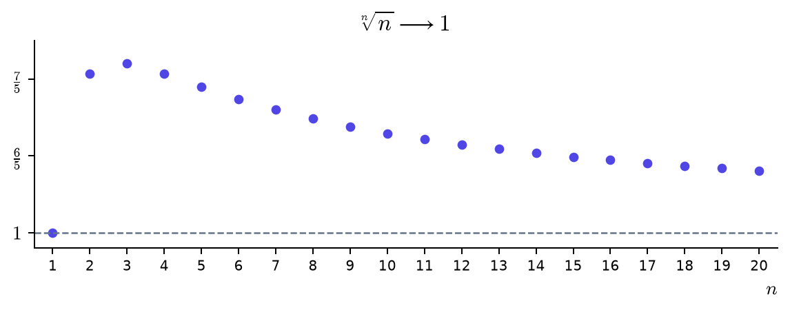{fig-alt="איברי שורש מסדר n של n. הראשונים גדלים ולאחר מכן האיברים קטנים ומתקרבים לאחת." width="540" fig-align="center"}

**לא כל שורש מסדר $n$ שואף ל $1$.** למשל, $b_n=\sqrt[n]{2^n}=2$: האיברים הם $2,2,2,\ldots$ והגבול הוא $2$. כאן מתחת לשורש מופיע $2^n$, ולכן לא מדובר באחת משתי משפחות השורשים שבטבלה.
:::

::: {#box-exm-standard-power-ratio .thmexm title="חזקה של האינדקס מול סדרה הנדסית"}
נבדוק את $a_n=\frac{n^2}{2^n}$:

| $n$ | $a_n$ |
|:---:|:---:|
| $1$ | $\frac{1}{2}$ |
| $2$ | $1$ |
| $3$ | $\frac{9}{8}$ |
| $8$ | $\frac{1}{4}$ |
| $16$ | $\frac{1}{256}$ |

האיברים גדלים בתחילה, אבל בהמשך המכנה גדל מהר יותר מהמונה. כאן $p=2>0$ ו $q=2>1$, ולכן לפי [הגבולות הבסיסיים](#box-thm-standard),
$$\lim_{n\to\infty}\frac{n^2}{2^n}=0.$$

**אם $q>1$ אינו מתקיים:** עבור $q=1$ מתקבלת $\frac{n^2}{1^n}=n^2$, שאיבריה $1,4,9,16,\ldots$ גדלים ואינם מתקרבים לאפס.

**אם $p>0$ אינו מתקיים:** למשל, עבור $p=0$ ו $q=2$ מתקבלת $\frac{n^0}{2^n}=\left(\frac{1}{2}\right)^n$. כלל ההשוואה שבטבלה אינו חל, אבל [הכלל לסדרה הנדסית](#box-thm-standard) כן חל, והגבול עדיין $0$.
:::

::: {#box-sim-standard-power-ratio .thmsim title="התחלה עולה, ובהמשך התקרבות לאפס"}
**המטרה: לראות שהסדרה $a_n=\frac{n^p}{q^n}$ יכולה לגדול בתחילה ובכל זאת לשאוף לאפס.** התחילו ב $p=2$, $q=2$, והגדילו את מספר האיברים המוצגים. אחר כך בחרו $q=1$ וראו מה משתנה כשהתנאי על הבסיס אינו מתקיים.

<iframe class="widget-frame" src="widgets/ch02/known-limits.html?case=ratio" loading="lazy" title="השוואת חזקות: שינוי המעריך והבסיס והצגת המשך הסדרה"></iframe>
:::

::::: {#box-exm-standard .thmsolved title="מזהים את הסדרה המוכרת"}
התאימו כל סדרה לאחת הצורות שבטבלה וחשבו את גבולה.

:::: fill
**(א)** $\left(-\frac{1}{2}\right)^n$

המנה הקבועה בין איברים עוקבים היא $q=$ [$-\frac{1}{2}$]{.blank ans="-1/2"}.

הערך המוחלט שלה הוא $|q|=$ [$\frac{1}{2}$]{.blank ans="1/2"}. האם מתקיים $|q|<1$? [כן]{.blank kind="text" ans="כן" choices="כן|לא"}

לכן הגבול הוא [$0$]{.blank ans="0"}.

**(ב)** $\frac1{\sqrt n}$

נכתוב $\sqrt n=n^p$, כאשר $p=$ [$\frac{1}{2}$]{.blank ans="1/2"}.

האם $p>0$? [כן]{.blank kind="text" ans="כן" choices="כן|לא"}

הגבול הוא [$0$]{.blank ans="0"}.

**(ג)** $\frac{n^3}{2^n}$

המעריך הקבוע הוא $p=$ [$3$]{.blank ans="3"}.

הבסיס הקבוע הוא $q=$ [$2$]{.blank ans="2"}.

האם מתקיימים $p>0$ ו $q>1$? [כן]{.blank kind="text" ans="כן" choices="כן|לא"}

הגבול הוא [$0$]{.blank ans="0"}.

::: explain
**(א)** הערך המוחלט של המנה הוא $\frac{1}{2}<1$. הסימן מתחלף, אך האיברים מתקרבים לאפס.

**(ב)** משתמשים בגבול של $\frac1{n^p}$ עבור $p=\frac{1}{2}$.

**(ג)** משתמשים בגבול של $\frac{n^p}{q^n}$, עם $p=3$ ו $q=2>1$.
:::
::::
:::::

:::: {.thmchk}
מהכלל עבור $q^n$ נובע שגם $(-1)^n\to0$.

::: {.quiz options="נכון|לא נכון" answer="לא נכון"}
כאן $|q|=1$, ולכן התנאי $|q|<1$ אינו מתקיים. [כבר ראינו שסדרה זו אינה מתכנסת](#box-exm-alternating-diverges).
:::

מה קורה ל $\frac1{n^p}$ כאשר $p=0$?

::: {.quiz options="$0$|$1$" answer="$1$"}
כל האיברים שווים $1$. לכן התנאי $p>0$ נחוץ.
:::
::::

::::: {#box-q-geometric-conditions .thmchk title="האם מותר להשתמש בכלל?"}
המנה $q$ היא המספר הקבוע שבו כופלים כדי לעבור מאיבר לאיבר הבא. התנאי $|q|<1$ שייך לכלל ההתכנסות לאפס; הוא אינו חלק מההגדרה של סדרה הנדסית.

:::: fill

::: {.sequence-table dir="ltr"}
| הסדרה | $q$ | $|q|$ | האם מתקיים $|q|<1$? |
|:---:|:---:|:---:|:---:|
| $(-\frac{1}{2})^n$ | [$-\frac{1}{2}$]{.blank ans="-1/2"} | [$\frac{1}{2}$]{.blank ans="1/2"} | [כן]{.blank kind="text" ans="כן" choices="כן\|לא"} |
| $(-1)^n$ | [$-1$]{.blank ans="-1"} | [$1$]{.blank ans="1"} | [לא]{.blank kind="text" ans="לא" choices="כן\|לא"} |
| $(-3)^n$ | [$-3$]{.blank ans="-3"} | [$3$]{.blank ans="3"} | [לא]{.blank kind="text" ans="לא" choices="כן\|לא"} |
| $1^n$ | [$1$]{.blank ans="1"} | [$1$]{.blank ans="1"} | [לא]{.blank kind="text" ans="לא" choices="כן\|לא"} |
:::

::: explain
רק בשורה הראשונה הכלל נותן גבול אפס. המספר $-3$ קטן מ $1$, אבל הערך המוחלט שלו גדול מ $1$: בודקים את הערך המוחלט, ולא רק את הסימן.
:::
::::

אם התנאי של הכלל אינו מתקיים, האם אפשר להסיק שאין גבול?

::: {.quiz options="כן|לא" answer="לא"}
לא. למשל, $1^n$ היא סדרה קבועה וגבולה $1$, אף שהכלל להתכנסות של $q^n$ לאפס אינו חל. ״הכלל אינו חל״ אומר שצריך נימוק אחר; זו אינה מסקנה על התכנסות הסדרה.
:::
:::::

### פעולות על סדרות מתכנסות {.unnumbered}

חשבון הגבולות מאפשר להחליף את סדר הפעולות: במקום לבצע פעולה על איברי הסדרות ואז לקחת גבול, אפשר קודם לקחת את הגבולות ואז לבצע עליהם את אותה פעולה. השוויונות הבאים אומרים ששתי הדרכים נותנות אותה תוצאה, בתנאים המצוינים בכל כלל.

::: {#box-thm-limit-arithmetic .thmthm title="חשבון גבולות"}
נניח שלשתי הסדרות יש גבולות סופיים: $\lim_{n\to\infty}a_n=A$ ו $\lim_{n\to\infty}b_n=B$. אז
$$\lim_{n\to\infty}(a_n+b_n)=\lim_{n\to\infty}a_n+\lim_{n\to\infty}b_n=A+B,$$
$$\lim_{n\to\infty}(a_n-b_n)=\lim_{n\to\infty}a_n-\lim_{n\to\infty}b_n=A-B,$$
$$\lim_{n\to\infty}(a_nb_n)=\left(\lim_{n\to\infty}a_n\right)\left(\lim_{n\to\infty}b_n\right)=AB.$$
אם נוסף על כך $B\ne0$, אז
$$\lim_{n\to\infty}\frac{a_n}{b_n}=\frac{\lim_{n\to\infty}a_n}{\lim_{n\to\infty}b_n}=\frac AB.$$
לכל קבוע ממשי $c$, כפל בקבוע עובר גם הוא מחוץ לגבול:
$$\lim_{n\to\infty}(ca_n)=c\lim_{n\to\infty}a_n=cA.$$
אפשר לקרוא את השוויונות בשני הכיוונים: **להוציא פעולה מחוץ לגבול או להכניס אותה לתוכו**. התנאים נשארים אותם תנאים.
הסדרות והמנות צריכות להיות מוגדרות, לפחות החל מאינדקס מסוים.
:::

::: {#box-exp-limit-arithmetic .thmexp title="מדוע אפשר לבצע פעולות על גבולות?"}
הרעיון הוא שאם שני איברים מספיק קרובים לשני מספרים, גם סכומם ומכפלתם קרובים לסכום ולמכפלה של אותם מספרים. בחילוק צריך להיזהר: כשהמכנה קרוב לאפס, אפילו שינוי קטן בו יכול לשנות מאוד את המנה. לכן [כלל המנה](#box-thm-limit-arithmetic) דורש שגבול המכנה יהיה שונה מאפס.
:::

::: {#box-prp-limit-powers .thmprp title="חזקות קבועות ושורשים"}
אם $a_n\to A$, אז לכל מספר טבעי חיובי וקבוע $k$,
$$\lim_{n\to\infty}a_n^k=\left(\lim_{n\to\infty}a_n\right)^k=A^k.$$

אם האיברים אי־שליליים, הכלל נכון לכל **מעריך ממשי חיובי וקבוע** $p$:
$$\lim_{n\to\infty}a_n^p=\left(\lim_{n\to\infty}a_n\right)^p=A^p.$$
בפרט, לשורש מסדר טבעי קבוע $k\ge2$,
$$\lim_{n\to\infty}\sqrt[k]{a_n}=\sqrt[k]{\lim_{n\to\infty}a_n}=\sqrt[k]{A}.$$
בסדר שורש זוגי נדרשים איברים אי־שליליים, לפחות החל מאינדקס מסוים. בסדר שורש אי־זוגי הכלל נכון גם לאיברים ולגבול שליליים.

אם $A>0$, הכלל נכון גם למעריכים ממשיים שליליים; אז האיברים חיוביים לפחות החל מאינדקס מסוים.
:::

::: {#box-exp-limit-powers .thmexp title="מדוע נדרש מעריך קבוע?"}
בחזקה שלמה חיובית וקבועה מבצעים מספר קבוע של פעולות כפל, ולכן אפשר להפעיל שוב ושוב את [כלל המכפלה](#box-thm-limit-arithmetic).
בשורש מסדר קבוע, שינוי קטן במספר שמתחת לשורש יוצר שינוי קטן בשורש, כל עוד עובדים בתחום ההגדרה. את [כלל השורש](#box-prp-limit-powers) נקבל כאן ללא הוכחה.
אם המעריך או סדר השורש משתנים עם האינדקס, זו אינה אותה פעולה קבועה, והכלל אינו חל.
:::


::: {#box-exm-limit-scalar .thmexm title="הוצאת קבוע מחוץ לגבול"}
נתונה הסדרה $a_n=\frac{2}{n}$, עבור $n\ge1$.
נשתמש ב[כפל בקבוע](#box-thm-limit-arithmetic), ואחר כך ב[גבול המוכר של $\frac{1}{n}$](#box-thm-standard):
$$\lim_{n\to\infty}\frac2n
=2\lim_{n\to\infty}\frac1n
=2\cdot0=0.$$
הוצאת הקבוע אינה מחשבת עדיין את הגבול של $\frac{1}{n}$; היא משאירה גבול פשוט יותר לחישוב.
:::

::::: {#box-exm-limit-actions .thmsolved title="מתרגלים את הפעולות בעוזר"}
**גבול מוכר.** התחילו מהגבול של הסדרה הקבועה $3$. בחרו **כללי גבולות ← גבול מוכר**, כתבו את התוצאה ובדקו את הצעד.

:::: {.derive limit="n" start="lim(3)"}

::: {.step line="3" action="standard"}
גבול הסדרה הקבועה הוא $3$.
:::
::::


::: {#prose-exm-limit-actions-1 .lecture-answer .solution-prose title="פתרון במילים"}

בסדרה הקבועה $a_n=3$ כל האיברים שווים $3$. לפי הגבול המוכר של סדרה קבועה,
$$\lim_{n\to\infty}3=3.$$

:::

**הוצאת פעולה מחוץ לגבול.** כעת עבדו עם $3+\frac1n$. תחילה בחרו **כללי גבולות ← הוצאת פעולה מחוץ לגבול**. לאחר מכן בחרו בכל פעם גבול אחד בתוך השורה והשתמשו ב **גבול מוכר**. לבסוף בחרו **חישוב מספרי ← חישוב התוצאה**.

:::: {.derive limit="n" start="3+1/n"}

::: {.step line="lim(3)+lim(1/n)" action="limitOut"}
מוציאים את החיבור מחוץ לגבול.
:::

::: {.step line="3+lim(1/n)" action="standard" before="lim(3)" clean="גבול הסדרה הקבועה $3$ הוא $3$."}
בוחרים את הגבול של $3$ בלבד.
:::

::: {.step line="3+0" action="standard" before="lim(1/n)" clean="הגבול של $\frac{1}{n}$ הוא $0$."}
בוחרים את הגבול של $\frac{1}{n}$ בלבד.
:::

::: {.step line="3" action="compute"}
מחשבים את הסכום.
:::
::::

::: {#prose-exm-limit-actions-2 .lecture-answer .solution-prose title="פתרון במילים"}

בסדרה $a_n=3+\frac{1}{n}$ שני המחוברים מתכנסים. לפי [כלל החיבור](#box-thm-limit-arithmetic) נפריד את הגבול:
$$\lim_{n\to\infty}\left(3+\frac{1}{n}\right)
=\lim_{n\to\infty}3+\lim_{n\to\infty}\frac{1}{n}.$$
גבול הסדרה הקבועה הוא $3$, והגבול של $\frac{1}{n}$ הוא $0$. לכן גבול הסכום הוא $3+0=3$.

:::

:::::

::::: {#box-exm-compact-limit-action .thmsolved title="אותו חישוב, בצעד מרוכז"}
נחזור במכוון לאותה סדרה, $a_n=3+\frac1n$, כדי להשוות בין שתי דרכי כתיבה בעוזר.

ב [](#box-exm-limit-actions) הוצאנו את החיבור מחוץ לגבול וחישבנו כל גבול בנפרד. הפעולה **כללי גבולות ← חשבון גבולות** משלבת את כללי החשבון עם הגבולות המוכרים בצעד אחד:
$$\lim_{n\to\infty}\left(3+\frac1n\right)=3+0=3.$$

בחרו את הפעולה הזאת וכתבו את התוצאה. גם הדרך המפורטת נשארת אפשרית. בשתי הדרכים חייבים להתקיים תנאי הכללים; למשל, בחילוק גבול המכנה צריך להיות שונה מאפס.

:::: {.derive limit="n" start="3+1/n"}
::: {.step line="3" action="arithmetic"}
גבול הסדרה הקבועה הוא $3$, גבול $\frac{1}{n}$ הוא $0$, ו[כלל החיבור](#box-thm-limit-arithmetic) נותן $3$.
:::
::::

::: {#prose-exm-compact-limit-action-1 .lecture-answer .solution-prose title="פתרון במילים"}

בסדרה $a_n=3+\frac{1}{n}$ ידוע ש $3\to3$ וש $\frac{1}{n}\to0$. לפי [כלל החיבור](#box-thm-limit-arithmetic),
$$\lim_{n\to\infty}\left(3+\frac{1}{n}\right)=3+0=3.$$

:::

:::::

::::: {#box-exm-limit-arithmetic .thmsolved title="מחשבים בעזרת הגבולות המוכרים"}
חשבו את הגבול של $3+\frac2n$.

:::: {.derive limit="n" start="3+2/n"}

::: {.step line="3+2*(1/n)" action="simplify"}
כותבים $\frac2n=2\cdot\frac1n$ כדי לזהות את הגבול המוכר.
:::

::: {.step line="lim(3)+lim(2*(1/n))" action="limitOut"}
מוציאים את החיבור מחוץ לגבול לפי [](#box-thm-limit-arithmetic).
:::

::: {.step line="3+lim(2*(1/n))" action="standard" before="lim(3)"}
גבול של סדרה קבועה הוא הקבוע עצמו.
:::

::: {.step line="3+2*lim(1/n)" action="limitOut" before="lim(2*(1/n))"}
מוציאים את הקבוע $2$ מחוץ לגבול. הגבול של $\frac{1}{n}$ נשאר לחישוב.
:::

::: {.step line="3+2*0" action="standard" before="lim(1/n)"}
משתמשים בגבול המוכר $\lim_{n\to\infty}\frac1n=0$.
:::

::: {.step line="3" action="compute"}
מחשבים את התוצאה.
:::

::: hint
אפשר להוציא את החיבור, ואחריו את הכפל, מחוץ לגבול. בכל שלב בחרו את הגבול שעליו עובדים.
:::
::::

::: {#prose-exm-limit-arithmetic-1 .lecture-answer .solution-prose title="פתרון במילים"}

נכתוב את איבר הסדרה $a_n=3+\frac{2}{n}$ בצורה $3+2\cdot\frac{1}{n}$. כך אפשר להשתמש בגבול המוכר של $\frac{1}{n}$.

נוציא את החיבור מחוץ לגבול ונחשב את גבול הקבוע:
$$\lim_{n\to\infty}a_n
=\lim_{n\to\infty}3+\lim_{n\to\infty}\left(2\cdot\frac{1}{n}\right)
=3+\lim_{n\to\infty}\left(2\cdot\frac{1}{n}\right).$$
נוציא את הקבוע $2$ מחוץ לגבול. מכיוון ש $\frac{1}{n}\to0$, נקבל
$$\lim_{n\to\infty}a_n=3+2\lim_{n\to\infty}\frac{1}{n}=3+2\cdot0=3.$$

:::

:::::

::::: {#box-exm-standard-or-arithmetic .thmsolved title="גבול מוכר וגבול שמחשבים ממנו"}
**(א)** חשבו את גבול הסדרה $\left(\frac23\right)^n$. בעוזר הפתרון בחרו ״גבול מוכר״.

:::: {.derive limit="n" start="(2/3)^n"}

::: {.step line="[0]"}
זו הסדרה $q^n$ עם $q=\frac23$, ולכן משתמשים ישירות ב [](#box-thm-standard).
:::
::::


::: {#prose-exm-standard-or-arithmetic-1 .lecture-answer .solution-prose title="פתרון במילים"}

הסדרה $a_n=\left(\frac{2}{3}\right)^n$ היא מהצורה $q^n$ עם $q=\frac{2}{3}$. מתקיים $|q|<1$, ולכן לפי הגבול המוכר של סדרה הנדסית,
$$\lim_{n\to\infty}\left(\frac{2}{3}\right)^n=0.$$

:::

**(ב)** חשבו את גבול הסדרה $\frac5n$. נזהה את $\frac1n$ בתוך המכפלה, ואז נשתמש בחשבון הגבולות.

:::: {.derive limit="n" start="5/n"}

::: {.step line="5*(1/n)" action="simplify"}
כותבים את השבר כמכפלה בקבוע.
:::

::: {.step line="5*lim(1/n)" action="limitOut"}
מוציאים את הקבוע $5$ מחוץ לגבול.
:::

::: {.step line="5*0" action="standard" before="lim(1/n)"}
משתמשים בגבול של $\frac{1}{n}$.
:::

::: {.step line="0" action="compute"}
מחשבים. אין צורך לזכור את הגבול הזה כעובדה נפרדת.
:::
::::

::: {#prose-exm-standard-or-arithmetic-2 .lecture-answer .solution-prose title="פתרון במילים"}

נכתוב $a_n=\frac{5}{n}=5\cdot\frac{1}{n}$. נוציא את הקבוע $5$ מחוץ לגבול ונשתמש ב $\frac{1}{n}\to0$:
$$\lim_{n\to\infty}\frac{5}{n}
=5\lim_{n\to\infty}\frac{1}{n}
=5\cdot0=0.$$

:::

:::::

::: {#box-exm-fixed-root-limit .thmexm title="גבול של שורש מסדר קבוע"}
נתונה הסדרה $a_n=\sqrt{4+\frac{1}{n}}$, עבור $n\ge1$.
הביטוי שמתחת לשורש חיובי, ולפי [חשבון הגבולות](#box-thm-limit-arithmetic) גבולו $4$.
סדר השורש קבוע, ולכן [כלל השורש](#box-prp-limit-powers) נותן
$$\lim_{n\to\infty}a_n=\sqrt{\lim_{n\to\infty}\left(4+\frac{1}{n}\right)}=\sqrt{4}=2.$$
:::

::::: {#box-exm-root-limit-equalities .thmsolved title="מוציאים פעולות מחוץ לגבול"}
נחשב את גבול הסדרה $a_n=\sqrt{9+\frac{4}{n}}$. הביטוי מתחת לשורש חיובי. תחילה נוציא בכל צעד פעולה אחת מחוץ לגבול. אחר כך נחשב את הגבולות שנותרו ואת התוצאה:
$$\begin{aligned}
\lim_{n\to\infty}a_n
&=\lim_{n\to\infty}\sqrt{9+\frac4n}\\
&=\sqrt{\lim_{n\to\infty}\left(9+\frac4n\right)}\\
&=\sqrt{\lim_{n\to\infty}9+\lim_{n\to\infty}\frac4n}\\
&=\sqrt{\lim_{n\to\infty}9+4\lim_{n\to\infty}\frac1n}\\
&=\sqrt{9+4\cdot0}\\
&=\sqrt9=3.
\end{aligned}$$
תחילה משתמשים ב[כלל השורש](#box-prp-limit-powers), אחריו ב[כלל החיבור](#box-thm-limit-arithmetic), ולבסוף בכפל בקבוע. הגבולות שנותרו מוכרים: גבול הסדרה הקבועה $9$ הוא $9$, וגבול $\frac{1}{n}$ הוא $0$.

בעוזר בחרו **כללי גבולות ← הוצאת פעולה מחוץ לגבול**. כשיש כמה גבולות בשורה, בחרו את הגבול שעליו רוצים לפעול.

:::: {.derive limit="n" start="lim(sqrt(9+4/n))"}

::: {.step line="sqrt(lim(9+4/n))" action="limitOut"}
מוציאים את השורש מחוץ לגבול לפי [](#box-prp-limit-powers).
:::

::: {.step line="sqrt(lim(9)+lim(4/n))" action="limitOut" before="lim(9+4/n)" clean="לפי [כלל החיבור](#box-thm-limit-arithmetic), גבול הסכום הוא סכום הגבולות."}
בוחרים את הגבול שבתוך השורש ומוציאים את החיבור, לפי [](#box-thm-limit-arithmetic).
:::

::: {.step line="sqrt(lim(9)+4*lim(1/n))" action="limitOut" before="lim(4/n)" clean="מוציאים את הקבוע $4$ מחוץ לגבול."}
בוחרים את הגבול של $\frac{4}{n}$ ומוציאים את הקבוע $4$.
:::

::: {.step line="sqrt(9+4*lim(1/n))" action="standard" before="lim(9)" clean="גבול הסדרה הקבועה $9$ הוא $9$."}
בוחרים את הגבול של הסדרה הקבועה $9$ ומשתמשים ב ״גבול מוכר״.
:::

::: {.step line="sqrt(9+4*0)" action="standard" before="lim(1/n)" clean="הגבול של $\frac{1}{n}$ הוא $0$."}
בוחרים את הגבול של $\frac{1}{n}$ ומשתמשים ב ״גבול מוכר״.
:::

::: {.step line="sqrt(9)" action="compute" before="9+4*0" clean="מחשבים את הביטוי שבתוך השורש: $9+4\cdot0=9$."}
בוחרים את הביטוי שבתוך השורש ומשתמשים ב ״חישוב התוצאה״.
:::

::: {.step line="3" action="compute"}
מחשבים את השורש.
:::
::::

::: {#prose-exm-root-limit-equalities-1 .lecture-answer .solution-prose title="פתרון במילים"}

בסדרה $a_n=\sqrt{9+\frac{4}{n}}$ הביטוי מתחת לשורש חיובי. נשתמש ב[כלל השורש](#box-prp-limit-powers), אחריו ב[כלל החיבור](#box-thm-limit-arithmetic), ואחר כך נוציא את הקבוע $4$:
$$\begin{aligned}
\lim_{n\to\infty}a_n
&=\sqrt{\lim_{n\to\infty}\left(9+\frac{4}{n}\right)}\\
&=\sqrt{\lim_{n\to\infty}9+\lim_{n\to\infty}\frac{4}{n}}\\
&=\sqrt{\lim_{n\to\infty}9+4\lim_{n\to\infty}\frac{1}{n}}.
\end{aligned}$$
גבול הסדרה הקבועה הוא $9$, והגבול של $\frac{1}{n}$ הוא $0$. נציב ונחשב:
$$\lim_{n\to\infty}a_n=\sqrt{9+4\cdot0}=\sqrt{9}=3.$$

:::

:::::

::: {#box-prp-limit-order .thmprp title="אי־שוויונות במעבר לגבול"}
אם $a_n\le b_n$ החל מאינדקס מסוים, ושתי הסדרות מתכנסות אל $A$ ואל $B$ בהתאמה, אז $A\le B$.
:::

::: {#box-exp-limit-order .thmexp title="מדוע סדר הגבולות נשמר?"}
אם היה מתקיים $A>B$, אפשר היה לבחור סביבם שני קטעים נפרדים, כך שכל מספר בקטע של $A$ גדול מכל מספר בקטע של $B$.
מאינדקס מתאים איברי $a_n$ היו בקטע של $A$ ואיברי $b_n$ בקטע של $B$, בסתירה ל $a_n\le b_n$.
לכן [הטענה על מעבר אי־שוויונות לגבול](#box-prp-limit-order) נותנת $A\le B$.
:::

::: {#box-exm-strict-order-limit .thmexm title="אי־שוויון ממש יכול להפוך לשוויון בגבול"}
נתונות $a_n=\frac{1}{n}$ ו $b_n=0$, עבור $n\ge1$.
בכל אינדקס מתקיים $a_n>b_n$, אבל לפי [הגבולות הבסיסיים](#box-thm-standard),
$$\lim_{n\to\infty}a_n=0=\lim_{n\to\infty}b_n.$$
לכן אין להסיק אי־שוויון ממש בין הגבולות מאי־שוויון ממש בין האיברים.
:::

::: {#box-warn-zero-denominator .thmwarn title="כשגבול המכנה הוא אפס"}
אם גם המונה וגם המכנה שואפים לאפס, [כלל המנה](#box-thm-limit-arithmetic) אינו קובע את הגבול.
הסימון $\frac{0}{0}$ נקרא [**צורה לא מוגדרת**]{.term}: צריך לפשט את הביטוי או להשתמש בכלל אחר; זו אינה תשובה לחישוב.
:::

::: {#box-exm-zero-over-zero .thmexm title="אותם גבולות במונה ובמכנה, מנות שונות"}
נתונות הסדרות
$$a_n=\frac{\frac{1}{n}}{\frac{1}{n}},\qquad b_n=\frac{\frac{2}{n}}{\frac{1}{n}},\qquad n\ge1.$$
בשתי המנות, המונה והמכנה שואפים לאפס. בכל זאת, המכנה אינו אפס בשום אינדקס, ואפשר לפשט:
$$a_n=1,\qquad b_n=2.$$
לכן גבולות הסדרות הם $1$ ו $2$ בהתאמה. גבולות המונה והמכנה לבדם אינם קובעים את גבול המנה במקרה הזה.
:::

### תרגילים {.unnumbered}

::::: {#box-q-standard-limits .thmqst title="גבולות מוכרים"}
בכל סעיף עבדו לפי הסדר: זיהוי המשפחה, בדיקת הפרמטרים והתנאים, ואז חישוב הגבול.

:::: fill
**(א)** $a_n=\left(\frac{3}{4}\right)^n$

**1. זיהוי המשפחה.** [סדרה הנדסית]{.blank kind="text" ans="סדרה הנדסית" choices="סדרה הנדסית|שורש של מספר קבוע|שורש של האינדקס|חזקה חלקי סדרה הנדסית"}.

**2. בדיקת הפרמטרים והתנאים.** $q=$ [$\frac{3}{4}$]{.blank ans="3/4"}.

האם $|q|<1$? [כן]{.blank kind="text" ans="כן" choices="כן|לא"}

**3. חישוב הגבול.** $\displaystyle\lim_{n\to\infty}a_n=$ [$0$]{.blank ans="0"}.

**(ב)** $a_n=\sqrt[n]{5}$

**1. זיהוי המשפחה.** [שורש של מספר קבוע]{.blank kind="text" ans="שורש של מספר קבוע" choices="סדרה הנדסית|שורש של מספר קבוע|שורש של האינדקס|חזקה חלקי סדרה הנדסית"}.

**2. בדיקת הפרמטרים והתנאים.** המספר שמתחת לשורש הוא [$5$]{.blank ans="5"}.

האם הוא קבוע וחיובי? [כן]{.blank kind="text" ans="כן" choices="כן|לא"}

**3. חישוב הגבול.** $\displaystyle\lim_{n\to\infty}a_n=$ [$1$]{.blank ans="1"}.

**(ג)** $a_n=\frac{n^2}{2^n}$

**1. זיהוי המשפחה.** [חזקה חלקי סדרה הנדסית]{.blank kind="text" ans="חזקה חלקי סדרה הנדסית" choices="סדרה הנדסית|שורש של מספר קבוע|שורש של האינדקס|חזקה חלקי סדרה הנדסית"}.

**2. בדיקת הפרמטרים והתנאים.** $p=$ [$2$]{.blank ans="2"}, $q=$ [$2$]{.blank ans="2"}.

האם $p>0$ ו $q>1$? [כן]{.blank kind="text" ans="כן" choices="כן|לא"}

**3. חישוב הגבול.** $\displaystyle\lim_{n\to\infty}a_n=$ [$0$]{.blank ans="0"}.

**(ד)** $a_n=\sqrt[n]{n}$

**1. זיהוי המשפחה.** [שורש של האינדקס]{.blank kind="text" ans="שורש של האינדקס" choices="סדרה הנדסית|שורש של מספר קבוע|שורש של האינדקס|חזקה חלקי סדרה הנדסית"}.

**2. בדיקת הצורה והתנאים.** סדר השורש הוא [$n$]{.blank kind="expr" ans="n" vars="n"}, והביטוי שמתחת לשורש הוא [$n$]{.blank kind="expr" ans="n" vars="n"}. כאן $n\ge1$, ושניהם גדלים עם האינדקס.

**3. חישוב הגבול.** $\displaystyle\lim_{n\to\infty}a_n=$ [$1$]{.blank ans="1"}.

::: explain
**(א)** זו סדרה הנדסית עם $q=\frac{3}{4}$. מתקיים $|q|<1$, ולכן הגבול הוא $0$.

**(ב)** זהו שורש מסדר $n$ של המספר הקבוע $5>0$, ולכן הגבול הוא $1$.

**(ג)** זו מנה מהצורה $\frac{n^p}{q^n}$ עם $p=2>0$ ו $q=2>1$, ולכן הגבול הוא $0$.

**(ד)** גם סדר השורש וגם הביטוי שבתוכו הם $n$. זו בדיוק הסדרה $\sqrt[n]{n}$, שגבולה $1$.

כל ארבעת הגבולות מופיעים ב [](#box-thm-standard).
:::
::::
:::::

::::: {#box-q-e-limits .thmqst title="משלבים כללי חישוב"}
חשבו את הגבול. אפשר להיעזר בעוזר הפתרון ולכתוב את שלבי החישוב.

$\lim_{n\to\infty}\frac{2+\frac{1}{n}}{5-\frac{1}{n}}$

:::: {.derive limit="n" start="(2+1/n)/(5-1/n)"}

::: {.step line="(2+[0])/(5-[0])"}
הסדרה $\frac1n$ שואפת לאפס, וגבול המכנה הוא $5\ne0$.
:::

::: {.step line="[2/5]"}
מחשבים את המנה.
:::
::::


:::::

::::: {#box-q-limit-arithmetic-first .thmqst title="אותם כללים, חישוב עצמאי"}
חשבו את $\displaystyle\lim_{n\to\infty}\left(4+\frac5n\right)$. בחרו בעצמכם את הפעולות ואת החלקים שעליהם תפעלו.

:::: {.derive limit="n" start="4+5/n"}

::: {.step line="4+5*(1/n)" action="simplify"}
מזהים את המכפלה בקבוע.
:::

::: {.step line="lim(4)+lim(5*(1/n))" action="limitOut"}
מוציאים חיבור מחוץ לגבול.
:::

::: {.step line="4+lim(5*(1/n))" action="standard" before="lim(4)"}
משתמשים בגבול של הסדרה הקבועה.
:::

::: {.step line="4+5*lim(1/n)" action="limitOut" before="lim(5*(1/n))"}
מוציאים את הקבוע $5$ מחוץ לגבול.
:::

::: {.step line="4+5*0" action="standard" before="lim(1/n)"}
מחשבים את הגבול של $\frac{1}{n}$.
:::

::: {.step line="4" action="compute"}
מחשבים את התוצאה.
:::
::::
:::::

::::: {#box-q-limit-arithmetic-independent .thmqst title="בונים חישוב בעזרת הכללים"}
חשבו את הגבולות. בחרו בעצמכם את שלבי החישוב ואת הכללים המתאימים.

**(א)** $\displaystyle\lim_{n\to\infty}\left(5-\frac3n+\frac2{n^2}\right)$

:::: {.derive limit="n" start="5-3/n+2/n^2"}

::: {.step line="5-[0]+[0]"}
הסדרות $\frac3n$ ו $\frac2{n^2}$ שואפות לאפס. משתמשים בחיבור ובחיסור לפי [](#box-thm-limit-arithmetic).
:::

::: {.step line="[5]"}
מחשבים את התוצאה.
:::
::::

**(ב)** $\displaystyle\lim_{n\to\infty}\frac{3-\frac{2}{n}}{4+\frac{1}{n^2}}$

:::: {.derive limit="n" start="(3-2/n)/(4+1/n^2)"}

::: {.step line="(3-[0])/(4+[0])"}
גבול המכנה הוא $4$, ולכן מותר להשתמש ב[כלל המנה](#box-thm-limit-arithmetic) מתוך [](#box-thm-limit-arithmetic).
:::

::: {.step line="[3/4]"}
מחשבים את המנה.
:::
::::

**(ג)** $\displaystyle\lim_{n\to\infty}\sqrt{9+\frac4n}$

:::: {.derive limit="n" start="sqrt(9+4/n)"}

::: {.step line="sqrt(9+[0])"}
הביטוי מתחת לשורש חיובי ושואף אל $9$. משתמשים ב [](#box-prp-limit-powers).
:::

::: {.step line="[3]"}
מחשבים את השורש.
:::
::::

**(ד)** $\displaystyle\lim_{n\to\infty}\left(\left(\frac25\right)^n+\frac{n^2}{3^n}\right)$

:::: {.derive limit="n" start="(2/5)^n+n^2/3^n"}

::: {.step line="[0]+[0]"}
שתי הסדרות מופיעות ב [](#box-thm-standard). לאחר זיהוי גבולותיהן משתמשים ב[כלל החיבור](#box-thm-limit-arithmetic).
:::

::: {.step line="[0]"}
מחשבים את הסכום.
:::
::::
:::::

::::: {#box-q-limit-rules-conditions .thmqst title="האם מותר להשתמש בכלל?"}
בכל סעיף בחרו כן או לא.

**(א)** המונה שואף ל $2$ והמכנה שואף ל $3$. האם [כלל המנה](#box-thm-limit-arithmetic) נותן גבול $\frac23$?

::: {.quiz options="כן|לא" answer="כן"}
גבול המכנה שונה מאפס, ולכן [כלל המנה](#box-thm-limit-arithmetic) חל.
:::

**(ב)** המונה והמכנה שואפים לאפס. האם מכאן נובע שגם המנה שואפת לאפס?

::: {.quiz options="כן|לא" answer="לא"}
למשל, המנה $\frac{\frac{1}{n}}{\frac{1}{n}}$ שווה תמיד $1$.
:::
:::::


## חסימות {#sec-boundedness}

מלבד התכנסות, לסדרות יש תכונות חשובות נוספות שנחקור. נתחיל בחסימות.

::: {#box-def-bounded .thmdef title="סדרה חסומה"}
סדרה $(a_n)_{n=1}^{\infty}$ [**חסומה מלעיל**]{.term} אם קיים מספר קבוע $M$ כך שלכל $n\ge1$ מתקיים
$$a_n\le M.$$
המספר $M$ נקרא [**חסם מלעיל**]{.term} של הסדרה.

סדרה $(a_n)_{n=1}^{\infty}$ [**חסומה מלרע**]{.term} אם קיים מספר קבוע $m$ כך שלכל $n\ge1$ מתקיים
$$m\le a_n.$$
המספר $m$ נקרא [**חסם מלרע**]{.term} של הסדרה.

סדרה היא [**חסומה**]{.term} אם היא חסומה גם מלעיל וגם מלרע. כלומר, כל איבריה נמצאים בין שני מספרים קבועים:
$$m\le a_n\le M.$$

:::

::: {#box-insight-any-bound .thminsight title="מחפשים חסם גדול מספיק או קטן מספיק"}
**כדי להוכיח חסימות, מחפשים מספר קבוע גדול מספיק שכל האיברים יהיו קטנים ממנו או שווים לו, ומספר קבוע קטן מספיק שכל האיברים יהיו גדולים ממנו או שווים לו.**

**אין צורך למצוא את החסמים הטובים ביותר.** עדיף חסם נוח שקל להצדיק, גם אם הוא רחוק מאוד מהאיברים. החסמים חייבים להתאים לכל האינדקסים, ולא להשתנות עם $n$.
:::

::::: {#box-exm-sequence-bounds .thmexm title="חסמים נוחים מספיקים להוכחת חסימות"}
נתונה הסדרה $a_n=\frac{1}{n}$, עבור $n\ge1$. מכיוון ש $n\ge1$,
$$0<\frac{1}{n}\le1.$$
לכן $0$ הוא חסם מלרע ו $1$ הוא חסם מלעיל, והסדרה חסומה.

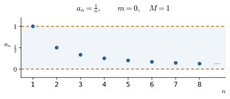{fig-alt="איברי הסדרה אחת חלקי n נמצאים בין שני החסמים הקבועים אפס ואחת, כולל האיבר הראשון ששווה לחסם מלעיל." width="520" fig-align="center"}

גם הבחירה $m=-5$, $M=100$ מתאימה:
$$-5\le0<\frac{1}{n}\le1\le100.$$
**החסמים $-5$ ו $100$ מספיקים באותה מידה להוכחת חסימות.** אין צורך לצמצם את התחום שמצאנו.

:::: fill
בסדרה $b_n=2+\frac1n$, השלימו את האי־שוויון שמתקבל מהוספת $2$ לכל האגפים:

::: {.eqline dir="ltr"}
[$2$]{.blank ans="2"} $\le2+\frac1n\le$ [$3$]{.blank ans="3"}.
:::

כתבו חסם מלעיל לבחירתכם: [$4$]{.blank ans="4" min-answer="3"}.

::: explain
מהאי־שוויון $0\le\frac1n\le1$ מקבלים $2\le2+\frac1n\le3$. לכן $2$ הוא חסם מלרע, ו $3$ הוא חסם מלעיל. כל מספר גדול מ $3$ מתאים גם הוא כחסם מלעיל.
:::
::::
:::::

::: {#box-insight-weak-bound .thminsight title="לצורך חסימה מספיק אי־שוויון חלש"}

מחפשים $a_n\le M$ או $a_n\ge m$. **מותר לאיבר להיות שווה לחסם**; אין צורך להוכיח אי־שוויון ממש, שדורש יותר.

:::

::: {#box-exp-absolute-bound .thminsight title="אפיון שקול לחסימות באמצעות ערך מוחלט"}
סדרה $(a_n)_{n=1}^{\infty}$ חסומה **אם ורק אם קיים מספר קבוע $M\ge0$ כך שלכל $n\ge1$ מתקיים**
$$|a_n|\le M.$$

**כל מספר קבוע $K\ge M$ מתאים באותה מידה: אין צורך למצוא את החסם הקטן ביותר.**
:::

::: {#box-exp-absolute-bound-equivalence .thmexp title="מדוע האפיון שקול לחסימות?"}
אם $|a_n|\le M$ לכל $n\ge1$, אז לפי [פירוש הערך המוחלט כמרחק](01-Introduction.qmd#box-rule-abs-distance),
$$-M\le a_n\le M.$$
לכן הסדרה חסומה מלרע על ידי $-M$ ומלעיל על ידי $M$.

בציור, המרחק של כל איבר מ $0$ הוא לכל היותר $M$, ולכן כל הנקודות ברצועה, כולל שפתה.

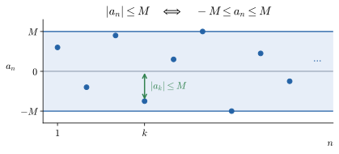{fig-alt="איור סכמטי: כל איברי הסדרה ברצועה בין מינוס M ל M. חץ מאפס לאיבר a_k מסמן את מרחקו מאפס, שהוא לכל היותר M." width="520" fig-align="center"}

בכיוון ההפוך, אם $m\le a_n\le B$ לכל $n\ge1$, נבחר את $M$ להיות הגדול מבין $|m|$ ו $|B|$. אז
$$-M\le m\le a_n\le B\le M,$$
ולכן $|a_n|\le M$ לכל $n\ge1$.

הקטע הכחול $[m,B]$ כלול בקטע הירוק $[-M,M]$: הרחבת התחום שומרת בתוכו את כל האיברים.

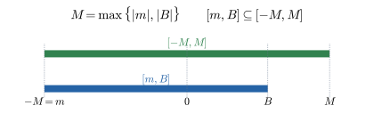{fig-alt="הקטע הכחול בין m ל B כלול בקטע הירוק הסימטרי בין מינוס M ל M. M הוא הגדול מבין הערכים המוחלטים של שני החסמים; באיור הקצה m שווה למינוס M." width="520" fig-align="center"}

:::

::: {#box-exm-absolute-bound .thmexm title="שני חסמים אפשריים לערך המוחלט"}
נתונה הסדרה $a_n=(-1)^n$, עבור $n\ge1$.
לכל $n$ מתקיים $|a_n|=1$, ולכן אפשר לבחור $M=1$ ב[אפיון החסימות באמצעות ערך מוחלט](#box-exp-absolute-bound).
גם $K=10$ מתאים, כי $|a_n|=1\le10$. **אין צורך לבחור את החסם הקטן ביותר.**
הנקודות שעל קווי החסימה עומדות בתנאי, כי האי־שוויון חלש.

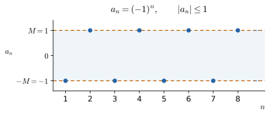{fig-alt="איברי הסדרה מינוס אחת בחזקת n נמצאים על הקווים מינוס אחת ואחת. כולם מקיימים ערך מוחלט קטן מאחת או שווה לה." width="520" fig-align="center"}
:::

:::: {#box-check-bound-comparison .thmchk title="האם אי־שוויון מעביר חסימות לסדרה אחרת?"}
נתונות שתי סדרות $(a_n)_{n=1}^{\infty}$ ו $(b_n)_{n=1}^{\infty}$, והסדרה $(a_n)_{n=1}^{\infty}$ חסומה.

**(א)** נניח ש $b_n<a_n$ לכל $n\ge1$. האם בהכרח גם $(b_n)_{n=1}^{\infty}$ חסומה?

::: {.quiz options="כן|לא" answer="לא"}
לא. למשל, $a_n=1$ ו $b_n=-n$ לכל $n\ge1$. הסדרה $(a_n)$ חסומה, ומתקיים $-n<1$, אבל $(b_n)$ אינה חסומה מלרע. האי־שוויון נותן לסדרה $(b_n)$ חסם מלעיל בלבד.
:::

**(ב)** כעת נניח במקום זאת ש $|b_n|<|a_n|$ לכל $n\ge1$. האם בהכרח גם $(b_n)_{n=1}^{\infty}$ חסומה?

::: {.quiz options="כן|לא" answer="כן"}
כן. לפי [האפיון של חסימות באמצעות ערך מוחלט](#box-exp-absolute-bound), קיים $M\ge0$ כך שלכל $n\ge1$ מתקיים $|a_n|\le M$. לכן
$$|b_n|<|a_n|\le M.$$
אותו $M$ חוסם את הערכים המוחלטים של איברי $(b_n)$, ולכן גם היא חסומה.
:::
::::


:::: {.thmchk title="מה קורה כשהחסמים מתלכדים?"}

::::: fill
**(א)** בסדרה $(a_n)_{n=1}^{\infty}$ מתקיים $|a_n|\le M$ לכל $n\ge1$, ונבחר $M=0$. מהו כל איבר בסדרה?

$a_n=$ [$0$]{.blank ans="0"}

::: explain
ערך מוחלט הוא אי־שלילי, ולכן $0\le|a_n|\le0$ מחייב $a_n=0$. זו הסדרה הקבועה $0,0,0,\ldots$.
:::
:::::

::::: fill
**(ב)** בסדרה $(a_n)_{n=1}^{\infty}$ החסם מלרע והחסם מלעיל שווים לאותו מספר ממשי $M$, כלומר $M\le a_n\le M$ לכל $n\ge1$. מהו כל איבר בסדרה?

$a_n=$ [$M$]{.blank kind="expr" ans="M" vars="M"}

::: explain
מספר שנמצא בין $M$ לבין $M$ חייב להיות $M$ עצמו. לכן זו הסדרה הקבועה $M,M,M,\ldots$.
:::
:::::

::::

::: {#box-exm-one-sided-bound .thmexm title="סדרה חסומה מלרע שאינה חסומה מלעיל"}
נתונה הסדרה $a_n=n$, עבור $n\ge1$.
כל איבריה גדולים מ $1$ או שווים לו, ולכן $1$ הוא חסם מלרע.
אבל לכל חסם מלעיל מוצע $M$, אפשר לבחור אינדקס טבעי $n>M$, ואז $a_n>M$.
לכן הסדרה אינה חסומה מלעיל, וממילא אינה חסומה משני הצדדים.

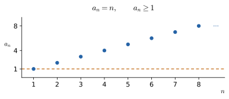{fig-alt="הסדרה a_n=n: כל האיברים מעל החסם מלרע אחת או שווים לו, אך האיברים ממשיכים לגדול מעבר לכל חסם מוצע מלעיל." width="520" fig-align="center"}
:::

::: {#box-sim-unbounded .thmsim title="בודקים חסם מוצע"}

**מטרת הסימולציה להשוות בין סדרות חסומות לסדרות שאינן חסומות.**
בחרו $a_n=n$, $a_n=-n$ או $a_n=(-1)^n$, עבור $n\ge1$, וגררו את החסם המוצע $M$.
בשתי הראשונות נבחר אוטומטית $N=M+1$: גם כשמגדילים את $M$, האיבר $a_N$ חורג מהרצועה ומסומן באדום.
בסדרה $(-1)^n$, כל האיברים נשארים ברצועה כאשר $M\ge1$; נסו גם $M=0$.

<iframe class="widget-frame" src="widgets/ch02/unbounded.html" loading="lazy" title="בדיקת חסם מוצע לסדרות n, מינוס n ומינוס אחת בחזקת n"></iframe>

:::

לצורך הוכחת חסימות מספיק למצוא חסמים כלשהם. לשני החסמים ההדוקים ביותר יש שמות שנשתמש בהם בהמשך לתיאור גבול של סדרה מונוטונית.

::: {#box-def-sup-inf .thmdef title="חסם עליון וחסם תחתון"}
לסדרה $(a_n)_{n=1}^{\infty}$:

- [**חסם עליון — סופרמום (supremum)**]{.term} הוא **החסם מלעיל הקטן ביותר**, אם קיים. מסמנים $\sup_{n\ge1}a_n$.
- [**חסם תחתון — אינפימום (infimum)**]{.term} הוא **החסם מלרע הגדול ביותר**, אם קיים. מסמנים $\inf_{n\ge1}a_n$.
:::

::: {#box-rem-existence-extrema .thmrem title="קיום החסם העליון והתחתון"}
תכונת ״אין חורים״ של המספרים הממשיים מבטיחה שלסדרה חסומה מלעיל קיים חסם עליון, ולסדרה חסומה מלרע קיים חסם תחתון.
**אין צורך למצוא אותם כדי להוכיח חסימות.** חסם מלעיל יכול להיות גדול בהרבה מהסופרמום, וחסם מלרע קטן בהרבה מהאינפימום.
:::

::: {#box-exm-reciprocal-extrema .thmexm title="החסם העליון והתחתון של הסדרה $\frac{1}{n}$"}
בסדרה $a_n=\frac{1}{n}$, עבור $n\ge1$, החסם העליון הוא $1$: כל האיברים קטנים ממנו או שווים לו, והאיבר הראשון שווה לו.
החסם התחתון הוא $0$: כל האיברים חיוביים, ולכל $c>0$ בחירת $n>\frac{1}{c}$ נותנת $a_n<c$.
לכן $\sup_{n\ge1}a_n=1$ ו $\inf_{n\ge1}a_n=0$. החסם התחתון כאן אינו איבר בסדרה.

{fig-alt="הסדרה אחת חלקי n: החסם התחתון הוא אפס והחסם העליון הוא אחת. האיבר הראשון שווה לחסם העליון, והאיברים מתקרבים לאפס בלי להיות שווים לו." width="520" fig-align="center"}
:::

::: {#box-rem-bounded-sets .thmrem title="גם קבוצות יכולות להיות חסומות"}

אפשר להגדיר חסימות גם לקבוצה $A\subseteq\mathbb{R}$. משתמשים באותן הגדרות, עם $x\in A$ במקום איברי הסדרה:

- **חסם מלעיל** הוא מספר $M$ שעבורו $x\le M$ לכל $x\in A$.
- **חסם מלרע** הוא מספר $m$ שעבורו $m\le x$ לכל $x\in A$.

הקבוצה **חסומה** אם קיימים לה חסמים משני הצדדים. ה**חסם העליון**, $\sup A$, הוא החסם מלעיל הקטן ביותר; ה**חסם התחתון**, $\inf A$, הוא החסם מלרע הגדול ביותר. לקבוצה לא ריקה הם קיימים כאשר היא חסומה מהצד המתאים.

:::

::: {#box-exm-open-interval-bounds .thmexm title="חסם עליון ותחתון של קטע פתוח"}
נתונה הקבוצה $A=(0,1)$. לכל $x\in A$ מתקיים $0<x<1$, ולכן $0$ חסם מלרע ו $1$ חסם מלעיל.
אי אפשר להקטין את החסם מלעיל מתחת ל $1$, כי בקטע יש מספרים קרובים ל $1$ כרצוננו. באופן דומה, אי אפשר להגדיל את החסם מלרע מעל $0$.
לכן $\inf A=0$ ו $\sup A=1$, אף ששני המספרים אינם שייכים לקבוצה.

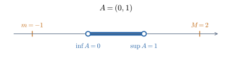{fig-alt="הקבוצה היא הקטע הפתוח מאפס עד אחת. מינוס אחת ושתיים הם חסמים, אך החסמים ההדוקים הם אינפימום אפס וסופרמום אחת, שאינם שייכים לקטע." width="520" fig-align="center"}

:::

:::: {.thmchk title="מה דורש חסם?"}
כל איבר בסדרה קטן מ $5$. מכאן שהסדרה חסומה גם מלעיל וגם מלרע.

::: {.quiz options="נכון|לא נכון" answer="לא נכון"}
זה נותן חסם מלעיל בלבד. למשל, כל איברי הסדרה $-n$ קטנים מ $5$, אבל אין לה חסם מלרע.
:::

אם $5$ הוא חסם מלעיל, גם $20$ הוא חסם מלעיל.

::: {.quiz options="נכון|לא נכון" answer="נכון"}
כל איבר קטן מ $5$ או שווה לו, ולכן גם קטן מ $20$.
:::
::::

### הקשר בין חסימות להתכנסות {#sec-boundedness-convergence .unnumbered}

::: {#box-thm-convergent-bounded .thmthm title="התכנסות גוררת חסימות"}
כל סדרה מתכנסת היא חסומה.
:::

::: {#box-exp-convergent-bounded .thmexp title="מדוע סדרה מתכנסת חסומה?"}
נניח שהסדרה $(a_n)_{n=1}^{\infty}$ מתכנסת אל $L$. נרצה להכניס את **כל** איבריה בין שני קווים אופקיים קבועים.

**הזנב כבר נמצא ברצועה קבועה.** נבחר $\varepsilon>0$ כלשהו. לפי [הגדרת הגבול](#box-def-limit), קיים $N$ שממנו והלאה כל האיברים בין $L-\varepsilon$ ל $L+\varepsilon$. אלה הנקודות הכחולות בציור.

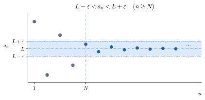{fig-alt="רצועה סביב L מכילה את כל הנקודות הכחולות החל מאינדקס N. חלק מהאיברים הראשונים, באפור, מחוץ לרצועה." width="520" fig-align="center"}

**מרחיבים את הרצועה כדי לכלול גם את ההתחלה.** לפני $N$ יש רק מספר סופי של איברים — הנקודות האפורות. אפשר להזיז את הקו העליון מעל כולם ואת התחתון מתחת לכולם, בלי לאבד את הזנב שכבר בפנים.

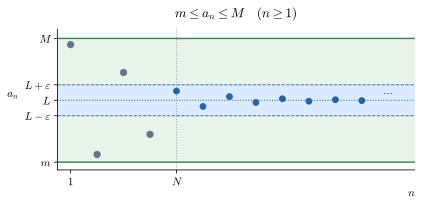{fig-alt="אותם איברים בתוך רצועה רחבה יותר, בין החסם מלרע m לחסם מלעיל M. הרצועה מכילה גם את האיברים הראשונים באפור וגם את כל הזנב בכחול." width="520" fig-align="center"}

קיבלנו שני מספרים קבועים $m,M$ כך ש $m\le a_n\le M$ לכל $n\ge1$. לכן הסדרה [חסומה](#box-def-bounded); אין צורך לבחור את החסמים ההדוקים ביותר.
:::

::: {#box-exm-convergent-bounded-prefix .thmexm title="חוסמים גם את האיברים הראשונים"}
נתונה הסדרה $a_1=-3$, $a_2=5$ ו $a_n=\frac{1}{n}$ לכל $n\ge3$.
היא מתכנסת לאפס לפי [הגבול של $\frac{1}{n}$](#box-thm-standard) ו[הטענה על שינוי מספר סופי של איברים](#box-prp-limit-tail).
בזנב מתקיים $0<a_n\le\frac{1}{3}$. כדי לחסום את **כל** הסדרה, כוללים גם את שני האיברים הראשונים:
$$-3\le a_n\le5\qquad(n\ge1).$$

{fig-alt="שני איברים ראשונים רחוקים מאפס, מינוס שלוש וחמש. הזנב נמצא ברצועה צרה סביב אפס; תחום רחב יותר כולל גם את האיברים הראשונים." width="560" fig-align="center"}
:::

::: {#box-prp-unbounded-divergent .thmprp title="חוסר חסימות שולל התכנסות"}
אם הסדרה $(a_n)_{n=1}^{\infty}$ אינה חסומה, היא אינה מתכנסת למספר ממשי.
:::

::: {#box-exp-unbounded-divergent .thmexp title="מדוע חוסר חסימות מספיק?"}
לפי [המשפט על חסימות של סדרה מתכנסת](#box-thm-convergent-bounded), אילו הסדרה הייתה מתכנסת, היא הייתה חסומה. לכן סדרה שאינה חסומה אינה יכולה להתכנס למספר ממשי.
:::

::: {#box-exm-unbounded-divergent .thmexm title="שלילת התכנסות של $n$ ושל $(-1)^n n$"}
נשתמש ב[חוסר חסימות כדי לשלול התכנסות](#box-prp-unbounded-divergent). בכל הסדרות הבאות $n\ge1$.

**(א)** הסדרה $a_n=n$ אינה חסומה מלעיל. לכל חסם מוצע $M$, אפשר לבחור אינדקס טבעי $n>M$, ואז $a_n>M$. לכן הסדרה אינה מתכנסת.

**(ב)** בסדרה $b_n=(-1)^n n$ האיברים הם
$$-1,2,-3,4,-5,6,\ldots$$
הסימן מתחלף, אבל הערכים המוחלטים הם $|b_n|=n$. הם עולים מעבר לכל חסם, ולכן גם הסדרה הזאת אינה חסומה ואינה מתכנסת.
:::

:::: {#box-check-negative-unbounded .thmchk title="חוסר חסימות מלרע והתכנסות"}
מה אפשר להסיק על הסדרה $c_n=-n$, עבור $n\ge1$, שאינה חסומה מלרע?

::: {.quiz options="היא אינה מתכנסת למספר ממשי|אי אפשר להסיק דבר על התכנסות" answer="היא אינה מתכנסת למספר ממשי"}
חוסר חסימות מצד אחד כבר מספיק: לפי [המשפט על חסימות של סדרה מתכנסת](#box-thm-convergent-bounded), סדרה מתכנסת חייבת להיות חסומה משני הצדדים.
:::
::::

::: {#box-method-unbounded-divergent .thmmethod title="שוללים התכנסות באמצעות חוסר חסימות"}
כדי להראות שסדרה אינה מתכנסת למספר ממשי, **מספיק להראות שאינה חסומה**:

1. מראים שכל חסם מלעיל מוצע נפרץ, או שכל חסם מלרע מוצע נפרץ. אפשר גם להראות שהערכים המוחלטים אינם חסומים.
2. מסיקים שאין התכנסות למספר ממשי לפי [הטענה על סדרה שאינה חסומה](#box-prp-unbounded-divergent).

אין צורך להפריך כל גבול אפשרי בנפרד.
:::

::: {#box-warn-bounded-not-convergent .thmwarn title="טעות נפוצה — חסימות אינה מבטיחה התכנסות"}
**הכיוון ההפוך אינו נכון:** חוסר חסימות שולל התכנסות, אבל מציאת חסמים אינה מוכיחה התכנסות. סדרה חסומה יכולה להמשיך להתנודד בין ערכים שונים.
:::

::: {#box-exm-bounded-divergent .thmexm title="סדרה חסומה שאינה מתכנסת: $(-1)^n$"}
נתונה הסדרה $a_n=(-1)^n$, עבור $n\ge1$:
$$-1,1,-1,1,\ldots$$
לכל $n$ מתקיים $-1\le a_n\le1$, ולכן הסדרה חסומה.
אבל האיברים הזוגיים שווים ל $1$ והאי־זוגיים שווים ל $-1$. אלו שתי תתי־סדרות עם גבולות שונים, ולכן לפי [המשפט על גבולות של תתי־סדרות](#box-thm-subsequence-limit) הסדרה אינה מתכנסת.

{fig-alt="איברי הסדרה מינוס אחת בחזקת n נשארים בין מינוס אחת לאחת, אך ממשיכים להתחלף בין שני הגבהים ואינם מתקרבים למספר אחד." width="520" fig-align="center"}
:::

### חסימות בעזרת אי־שוויונות מוכרים {#sec-bounds-inequalities .unnumbered}

נכיר כמה אי־שוויונות מוכרים ושימושיים להוכחת חסימות. בדומה ל[חישוב גבולות באמצעות פעולות על גבולות מוכרים](#box-exm-limit-scalar), נשתמש כאן בחסמים מוכרים וב[כללי האי־השוויונים](01-Introduction.qmd#box-thm-inequalities) כדי למצוא חסמים לסדרות.

#### סינוס וקוסינוס: מהחסימה המוכרת לסדרה {.unnumbered}

::: {#box-known-sequence-inequalities .thmrule title="חסמי הסינוס והקוסינוס — תזכורת"}
לכל $t\in\mathbb{R}$:

| הפונקציה | חסימה משני הצדדים | כתיבה בערך מוחלט |
|:---:|:---:|:---:|
| $\sin(t)$ | $-1\le\sin(t)\le1$ | $\lvert\sin(t)\rvert\le1$ |
| $\cos(t)$ | $-1\le\cos(t)\le1$ | $\lvert\cos(t)\rvert\le1$ |

אלה החסימות שהתקבלו ממעגל היחידה ב[תכונות הסינוס והקוסינוס, סעיף (ב)](01-Introduction.qmd#box-thm-trig-props).
:::

:::: {#box-exm-bound-shifted-cosine .thmexm title="חסימת הסדרה $2+\cos(n)$"}
נחסום את הסדרה $a_n=2+\cos(n)$, עבור $n\ge1$.

לפי [חסמי הקוסינוס](#box-known-sequence-inequalities),
$$-1\le\cos(n)\le1.$$
נוסיף $2$ לכל שלושת האגפים, בהתאם ל[כללי האי־שוויונים](01-Introduction.qmd#box-thm-inequalities):
$$1\le2+\cos(n)\le3.$$
מצאנו שני מספרים קבועים: $1$ הוא חסם מלרע ו $3$ הוא חסם מלעיל. לכן הסדרה חסומה.

אפשר גם להשתמש ב[אי־שוויון המשולש](01-Introduction.qmd#box-thm-abs-props) וב[חסם הקוסינוס](#box-known-sequence-inequalities):
$$|a_n|=|2+\cos(n)|\le2+|\cos(n)|\le3.$$
לפי [האפיון באמצעות ערך מוחלט](#box-exp-absolute-bound), גם זו דרך להראות שהסדרה חסומה.

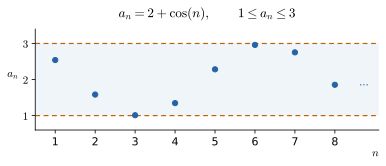{fig-alt="איברי הסדרה שתיים ועוד קוסינוס n נמצאים בין החסמים הקבועים אחת ושלוש." width="480" fig-align="center"}
::::

::: {#box-method-choose-bound .thmmethod title="מוצאים חסימה מתוך אי־שוויון מוכר"}
**המטרה היא למצוא חסם קבוע גדול מספיק וחסם קבוע קטן מספיק, שקל להצדיק. אין צורך בחסמים ההדוקים ביותר.**

1. בוחרים אי־שוויון שמתאים לביטוי שבסדרה.
2. בודקים את תנאיו ומציבים בו את הביטוי המתאים.
3. משתמשים ב[כללי האי־שוויונים](01-Introduction.qmd#box-thm-inequalities) עד שמקבלים $m\le a_n\le M$, כאשר $m,M$ קבועים ואינם תלויים ב $n$. אפשר גם להגיע ישירות לחסימה $|a_n|\le M$ עם $M\ge0$.
:::

::: {#box-rule-bound-operations .thmexp title="איך פועלים על שלושת האגפים?"}
לפי [כללי האי־שוויונים מפרק 1](01-Introduction.qmd#box-thm-inequalities):

| הפעולה בכל האגפים | מה קורה לכיווני האי־שוויון? |
|:---|:---|
| חיבור או חיסור של אותו ביטוי | נשמרים |
| כפל או חילוק בביטוי חיובי | נשמרים |
| כפל או חילוק בביטוי שלילי | מתהפכים |

אסור לחלק באפס.
**מותר גם להרחיב חסימה:** מקטינים את החסם מלרע או מגדילים את החסם מלעיל. זו מסקנה מהחסימה הקודמת, ולא טענה שקולה לה.
:::

::: {#box-exm-divide-bound .thmexm title="חילוק חסמי הקוסינוס בביטוי חיובי"}
נתונה $a_n=\frac{\cos(n)}{n+1}$, עבור $n\ge1$.
לפי [חסמי הקוסינוס](#box-known-sequence-inequalities), $-1\le\cos(n)\le1$.
המכנה $n+1$ חיובי, ולכן לפי [כללי האי־שוויונים](01-Introduction.qmd#box-thm-inequalities) אפשר לחלק בלי להפוך את הכיוונים:
$$-\frac{1}{n+1}\le a_n\le\frac{1}{n+1}.$$
מכיוון ש $n+1\ge2$, נקבל גם את החסמים הקבועים $-\frac{1}{2}\le a_n\le\frac{1}{2}$.
:::

::: {#box-exm-widen-bound .thmexm title="הרחבת חסימה של הקוסינוס"}
נתונה הסדרה $b_n=\cos(n)$, עבור $n\ge1$.
מ[חסמי הקוסינוס](#box-known-sequence-inequalities) נקבל
$$-2\le-1\le b_n\le1\le2.$$
לכן גם $-2\le b_n\le2$ היא חסימה נכונה. היא פחות מדויקת, אך עדיין מוכיחה חסימות.
:::

::::: {#box-exm-bound-operations .thmsolved title="מתרגלים בניית חסימות"}
הגיעו בכל סעיף לחסימה המבוקשת בעזרת עוזר האי־שוויונות. בחרו פעולה, כתבו את התוצאה ובדקו את הצעד. אפשר להיעזר בהצגת התוצאה הצפויה.

**(א)** התחילו מ $-1\le\cos(n)\le1$ והראו כי $3\le4+\cos(n)\le5$.

:::: {.derive vars="n" positive="n" bound-rule="cos" start="-1<=cos(n)<=1"}

::: {.step line="[3]<=4+cos(n)<=[5]" action="add" value="4"}
מחברים $4$ לכל שלושת האגפים.
:::
::::


::: {#prose-exm-bound-operations-1 .lecture-answer .solution-prose title="פתרון במילים"}

כדי לחסום את $4+\cos(n)$, נתחיל מ[חסם הקוסינוס](#box-known-sequence-inequalities), $-1\le\cos(n)\le1$. נוסיף $4$ לכל שלושת האגפים:
$$3\le4+\cos(n)\le5.$$

:::

**(ב)** התחילו מ $-1\le\sin(n)\le1$ וחסמו את $\frac{\sin(n)}{n+1}$.

:::: {.derive vars="n" positive="n" bound-rule="sin" start="-1<=sin(n)<=1"}

::: {.step line="[-1/(n+1)]<=sin(n)/(n+1)<=[1/(n+1)]" action="div" value="n+1"}
מחלקים את כל האגפים ב $n+1$. המכנה חיובי, ולכן הכיוונים נשמרים.
:::
::::


::: {#prose-exm-bound-operations-2 .lecture-answer .solution-prose title="פתרון במילים"}

כדי לחסום את $\frac{\sin(n)}{n+1}$, נתחיל מ[חסם הסינוס](#box-known-sequence-inequalities), $-1\le\sin(n)\le1$. מכיוון ש $n\ge1$, המכנה $n+1$ חיובי. נחלק בו את שלושת האגפים, בלי לשנות את הכיוונים:
$$-\frac{1}{n+1}\le\frac{\sin(n)}{n+1}\le\frac{1}{n+1}.$$

:::

**(ג)** התחילו מ $-1\le\cos(n)\le1$ והראו כי $2\le5-3\cos(n)\le8$.

:::: {.derive vars="n" positive="n" bound-rule="cos" start="-1<=cos(n)<=1"}

::: {.step line="[3]>=-3*cos(n)>=[-3]" action="mul" value="-3"}
כופלים ב $-3$ והופכים את שני הכיוונים.
:::

::: {.step line="[8]>=5-3*cos(n)>=[2]" action="add" value="5"}
מחברים $5$ לכל האגפים. זהו אותו אי־שוויון כמו $2\le5-3\cos(n)\le8$, רק בסדר כתיבה הפוך.
:::
::::


::: {#prose-exm-bound-operations-3 .lecture-answer .solution-prose title="פתרון במילים"}

כדי לחסום את $5-3\cos(n)$, נתחיל מ[חסם הקוסינוס](#box-known-sequence-inequalities), $-1\le\cos(n)\le1$. נכפול ב $-3$ ונהפוך את שני הכיוונים:
$$3\ge-3\cos(n)\ge-3.$$
נוסיף $5$ לכל האגפים:
$$8\ge5-3\cos(n)\ge2.$$
בכתיבה מהחסם מלרע לחסם מלעיל, זו החסימה $2\le5-3\cos(n)\le8$.

:::

**(ד)** הרחיבו את החסימה $-1\le\sin(n)\le1$ לחסימה $-2\le\sin(n)\le2$.

:::: {.derive vars="n" positive="n" bound-rule="sin" start="-1<=sin(n)<=1"}

::: {.step line="[-2]<=sin(n)<=1" action="lowerBound" value="-2" clean="מקטינים את החסם מלרע מ $-1$ ל $-2$; החסימה נשארת נכונה."}
בוחרים ״הקטנת החסם מלרע״ ומחליפים את $-1$ ב $-2$.
:::

::: {.step line="-2<=sin(n)<=[2]" action="upperBound" value="2" clean="מגדילים את החסם מלעיל מ $1$ ל $2$; החסימה נשארת נכונה."}
בוחרים ״הגדלת החסם מלעיל״ ומחליפים את $1$ ב $2$.
:::
::::

::: {#prose-exm-bound-operations-4 .lecture-answer .solution-prose title="פתרון במילים"}

נתונה החסימה $-1\le\sin(n)\le1$. מכיוון ש $-2\le-1$, אפשר להקטין את החסם מלרע:
$$-2\le\sin(n)\le1.$$
מכיוון ש $1\le2$, אפשר גם להגדיל את החסם מלעיל:
$$-2\le\sin(n)\le2.$$
החסימה החדשה נובעת מהחסימה המקורית; היא רחבה יותר, ולכן אינה שקולה לה.

:::

:::::


#### חסימת הסינוס בעזרת הקלט {.unnumbered}

::: {#box-rule-sine-input-bound .thmthm title="הסינוס אינו גדול מהקלט בערך מוחלט"}
לכל $x\in\mathbb{R}$, כאשר הזווית נמדדת ברדיאנים,
$$|\sin(x)|\le|x|.$$
לכל $x>0$ מתקיים גם $\sin(x)<x$.
:::

נשתמש באי־השוויון ללא הוכחה. הוא מועיל במיוחד כשהקלט קטן בערך מוחלט: הוא נותן חסימה קטנה יותר מהחסם $1$.

:::: {#box-exm-sine-input-bound .thmexm title="חסימת הסדרה $n\sin\left(\frac{1}{n}\right)$"}
נחסום את הסדרה $a_n=n\sin\left(\frac{1}{n}\right)$, עבור $n\ge1$.

נציב $x=\frac{1}{n}$ ב[חסימת הסינוס בעזרת הקלט](#box-rule-sine-input-bound):
$$\left|\sin\left(\frac{1}{n}\right)\right|\le\frac{1}{n}.$$
נכפול ב $n>0$. לפי [תכונת הערך המוחלט של מכפלה](01-Introduction.qmd#box-thm-abs-props),
$$|a_n|=n\left|\sin\left(\frac{1}{n}\right)\right|\le1.$$
זהו חסם קבוע, ולכן הסדרה חסומה. שימוש בחסם $|\sin(x)|\le1$ בלבד היה נותן כאן $|a_n|\le n$, שאינו חסם קבוע.

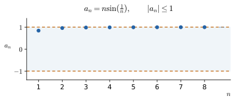{fig-alt="איברי הסדרה n כפול סינוס של אחת חלקי n נשארים בין מינוס אחת לאחת." width="480" fig-align="center"}
::::

::: {#box-rule-trig-comparisons .thmthm title="עוד שתי חסימות טריגונומטריות"}
הזוויות נמדדות ברדיאנים.

| התנאי | האי־שוויון |
|:---:|:---:|
| $0<\lvert x\rvert<\frac{\pi}{2}$ | $\cos(x)<\frac{\sin(x)}{x}<1$ |
| $x\in\mathbb{R}$ | $0\le1-\cos(x)\le\frac{x^2}{2}$ |
:::

נקבל גם את החסימות האלה ללא הוכחה. **בודקים את התנאי לפני שמציבים:** בשורה הראשונה $x=0$ אסור, ויש גם הגבלה על גודל הקלט.

::: {#box-exm-sine-ratio-bound .thmexm title="שתי חסימות לסינוס חלקי הקלט"}
נתונה הסדרה $a_n=\frac{\sin\left(\frac{1}{n}\right)}{\frac{1}{n}}$, עבור $n\ge1$.
הקלט $x=\frac{1}{n}$ מקיים $0<x\le1<\frac{\pi}{2}$, ולכן אפשר להציבו ב[חסימה הטריגונומטרית](#box-rule-trig-comparisons):
$$\cos\left(\frac{1}{n}\right)<a_n<1.$$
[חסם הקוסינוס](#box-known-sequence-inequalities) נותן גם $-1\le\cos\left(\frac{1}{n}\right)$, ולכן $-1<a_n<1$. מצאנו שני חסמים קבועים.
:::

:::: {#box-exm-cosine-small-input .thmexm title="חסימת הסדרה $n^2\left(1-\cos\left(\frac{1}{n}\right)\right)$"}
נחסום את $b_n=n^2\left(1-\cos\left(\frac{1}{n}\right)\right)$, עבור $n\ge1$.

נציב $x=\frac{1}{n}$ ב[חסימה להפרש $1-\cos(x)$](#box-rule-trig-comparisons):
$$0\le1-\cos\left(\frac{1}{n}\right)\le\frac{1}{2n^2}.$$
נכפול ב $n^2>0$:
$$0\le b_n\le\frac{1}{2}.$$
שני החסמים קבועים, ולכן הסדרה חסומה.

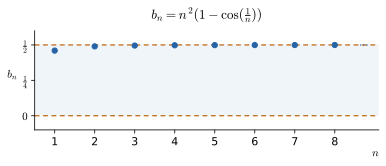{fig-alt="איברי n בריבוע כפול ההפרש בין אחת לקוסינוס של אחת חלקי n נמצאים בין אפס לחצי." width="480" fig-align="center"}
::::

#### הפונקציות הטריגונומטריות ההפוכות {.unnumbered}

בפונקציות הטריגונומטריות ההפוכות משתמשים בטווחי הערכים מתוך [ההגדרה בפרק 1](01-Introduction.qmd#box-def-inverse-trig). **לפני שחוסמים את הערך, בודקים שהביטוי שבתוך הפונקציה שייך לתחום ההגדרה.**

::: {#box-rule-inverse-trig-bounds .thmrule title="חסמי הפונקציות הטריגונומטריות ההפוכות"}
החסימות נובעות מ[הגדרת הפונקציות בפרק 1](01-Introduction.qmd#box-def-inverse-trig).

| הפונקציה | התנאי על הקלט | החסימה |
|:---:|:---:|:---:|
| $\arcsin(x)$ | $-1\le x\le1$ | $-\frac{\pi}{2}\le\arcsin(x)\le\frac{\pi}{2}$ |
| $\arccos(x)$ | $-1\le x\le1$ | $0\le\arccos(x)\le\pi$ |
| $\arctan(x)$ | $x\in\mathbb{R}$ | $-\frac{\pi}{2}<\arctan(x)<\frac{\pi}{2}$ |

:::

:::: {#box-exm-inverse-trig-bounds .thmexm title="חסימת סדרות בעזרת טווחי הפונקציות הטריגונומטריות ההפוכות"}

**(א)** בסדרה $a_n=\arcsin\left(\frac{(-1)^n}{n}\right)$, עבור $n\ge1$, הקלט מקיים
$$\left|\frac{(-1)^n}{n}\right|=\frac{1}{n}\le1.$$
לכן כל האיברים מוגדרים, ו[חסמי $\arcsin$](#box-rule-inverse-trig-bounds) נותנים
$$-\frac{\pi}{2}\le a_n\le\frac{\pi}{2}.$$
כלומר, $|a_n|\le\frac{\pi}{2}$. אפשר לבחור $M=\frac{\pi}{2}$, ואין צורך לחשב כל איבר בנפרד.

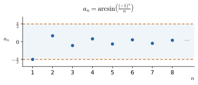{fig-alt="איברי ארקסינוס של מינוס אחת בחזקת n חלקי n נמצאים בין מינוס חצי פאי לחצי פאי; האיבר הראשון על החסם מלרע." width="480" fig-align="center"}

**(ב)** בסדרה $b_n=\arccos\left(\frac{1}{n}\right)$, עבור $n\ge1$, מתקיים
$$0<\frac{1}{n}\le1.$$
הקלט בתחום ההגדרה. לפי [חסמי $\arccos$](#box-rule-inverse-trig-bounds),
$$0\le b_n\le\pi.$$
מכאן $|b_n|\le\pi$, ואפשר לבחור $M=\pi$. **גם חסם שאינו הקטן ביותר מספיק.**

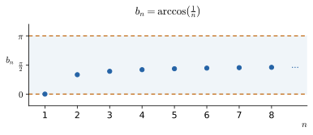{fig-alt="איברי ארקקוסינוס של אחת חלקי n בין אפס לפאי. הקו פאי גבוה מכל הנקודות, והוא חסם תקף אף שאינו הקטן ביותר." width="480" fig-align="center"}

**(ג)** בסדרה $c_n=\arctan(n^2)$, עבור $n\ge1$, כל קלט $n^2$ הוא מספר ממשי. לפי [חסמי $\arctan$](#box-rule-inverse-trig-bounds),
$$-\frac{\pi}{2}<c_n<\frac{\pi}{2}.$$
גם כאשר הקלט גדל בלי גבול, ערכי $\arctan$ נשארים חסומים. בפרט, $|c_n|\le\frac{\pi}{2}$.

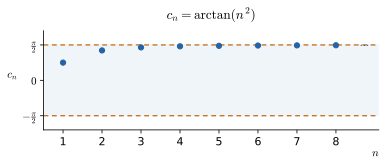{fig-alt="איברי ארקטנגנס של n בריבוע נשארים בין מינוס חצי פאי לחצי פאי, אף שהקלט גדל." width="480" fig-align="center"}

::::

:::: {#box-check-inverse-trig-domain .thmchk title="החסימה אינה מחליפה בדיקת תחום"}
האם $a_n=\arcsin(n)$, לכל $n\ge1$, מגדירה סדרה של מספרים ממשיים?

::: {.quiz options="כן|לא" answer="לא"}
כבר ב $n=2$ מתקבל קלט מחוץ לקטע $[-1,1]$. הביטוי $\arcsin(2)$ אינו מוגדר כמספר ממשי, ולכן אי אפשר להחיל עליו את חסמי $\arcsin$.
:::
::::

#### אי־שוויונות אלגבריים: ריבוע וממוצעים {.unnumbered}

**ריבוע אי־שלילי.**

::: {#box-rule-nonnegative-square .thmrule title="ריבוע אי־שלילי"}
לכל $x\in\mathbb{R}$ מתקיים $x^2\ge0$.
:::

:::: {#box-exm-square-reciprocal-bound .thmexm title="חסימת הסדרה $\frac{1}{n^2+1}$"}
בסדרה $a_n=\frac{1}{n^2+1}$, עבור $n\ge1$, [אי־שליליות הריבוע](#box-rule-nonnegative-square) נותנת $n^2+1\ge1$. לפי [כלל ההופכיים החיוביים](01-Introduction.qmd#box-thm-inequalities),
$$0<a_n=\frac{1}{n^2+1}\le1.$$
לכן הסדרה חסומה.
::::

**אי־שוויון הממוצעים.**

נגדיר את שני הממוצעים כדי לנסח את האי־שוויון ולהשתמש בו לחסימת סדרות.

::: {#box-def-arithmetic-geometric-means .thmdef title="ממוצע חשבוני וממוצע הנדסי"}
יהיו $n\ge1$ מספר טבעי ו $x_1,\ldots,x_n$ מספרים ממשיים. [**הממוצע החשבוני**]{.term} שלהם הוא
$$A=\frac{x_1+\cdots+x_n}{n}.$$

אם $x_1,\ldots,x_n\ge0$, [**הממוצע ההנדסי**]{.term} שלהם הוא
$$G=\sqrt[n]{x_1\cdots x_n}.$$
:::

בממוצע החשבוני מחברים ומחלקים במספר הנתונים. בממוצע ההנדסי כופלים ומוציאים שורש שסדרו כמספר הנתונים.

:::: {#box-exm-arithmetic-geometric-means .thmexm title="חישוב ממוצע חשבוני וממוצע הנדסי"}
**(א)** עבור שני המספרים $1,9$, הממוצע החשבוני הוא
$$A=\frac{1+9}{2}=5.$$
הממוצע ההנדסי הוא
$$G=\sqrt{1\cdot9}=3.$$

**(ב)** עבור שלושת המספרים $1,2,4$, הממוצע החשבוני הוא
$$A=\frac{1+2+4}{3}=\frac{7}{3}.$$
הממוצע ההנדסי הוא
$$G=\sqrt[3]{1\cdot2\cdot4}=2.$$
::::

::::: {#box-check-means .thmchk title="מחשבים ומשווים"}
:::: fill
**(א)** חשבו את שני הממוצעים של $1,4,16$.

::: {.eqline dir="ltr"}
$A=\frac{1+4+16}{3}=$ [$7$]{.blank ans="7"}
:::

::: {.eqline dir="ltr"}
$G=\sqrt[3]{1\cdot4\cdot16}=$ [$4$]{.blank ans="4"}
:::

::: explain
סכום המספרים הוא $21$, ולכן $A=7$. המכפלה היא $64=4^3$, ולכן $G=4$. כאן $G<A$.
:::
::::

:::: fill
**(ב)** חשבו את שני הממוצעים של $0,9$.

::: {.eqline dir="ltr"}
$A=\frac{0+9}{2}=$ [$\frac{9}{2}$]{.blank ans="9/2"}
:::

::: {.eqline dir="ltr"}
$G=\sqrt{0\cdot9}=$ [$0$]{.blank ans="0"}
:::

::: explain
גם $0$ מותר בהגדרת הממוצע ההנדסי: המספרים צריכים להיות אי־שליליים. כאן המכפלה היא $0$, ולכן גם השורש הוא $0$.
:::
::::
:::::

::: {#box-rule-square-amgm .thmthm title="אי־שוויון הממוצעים (AM–GM)"}
לכל מספר טבעי $n\ge1$ ולכל $x_1,\ldots,x_n\ge0$, הממוצע ההנדסי אינו גדול מהממוצע החשבוני:
$$\sqrt[n]{x_1\cdots x_n}\le\frac{x_1+\cdots+x_n}{n}.$$
שוויון מתקיים בדיוק כאשר $x_1=\cdots=x_n$.
:::

::: {#box-insight-amgm-equality .thminsight title="מתי שני הממוצעים שווים?"}
לפי [אי־שוויון הממוצעים](#box-rule-square-amgm), **שוויון מתקיים אם ורק אם כל המספרים שווים זה לזה.** אם לפחות שניים מהמספרים שונים, מתקיים $G<A$.
:::


::: {#box-exm-amgm-equal .thmexm title="ממוצעים של שלושה מספרים שווים"}
נתונים המספרים $2,2,2$. לפי [הגדרות הממוצעים](#box-def-arithmetic-geometric-means),
$$A=\frac{2+2+2}{3}=2,\qquad G=\sqrt[3]{2\cdot2\cdot2}=2.$$
מתקבל $A=G$, בהתאם לתנאי השוויון ב[אי־שוויון הממוצעים](#box-rule-square-amgm).
:::

:::: {#box-exm-amgm-numbers .thmexm title="אי־שוויון הממוצעים במספרים"}
עבור המספרים $6,24$, הממוצע ההנדסי הוא
$$G=\sqrt{6\cdot24}=12.$$
הממוצע החשבוני הוא
$$A=\frac{6+24}{2}=15.$$
ואכן, $12\le15$, בהתאם ל[אי־שוויון הממוצעים](#box-rule-square-amgm).

גם ב[דוגמה שבה חישבנו את הממוצעים של $1,9$ ושל $1,2,4$](#box-exm-arithmetic-geometric-means), הממוצע ההנדסי קטן מהממוצע החשבוני.
::::

:::: {#box-exm-amgm-bound .thmexm title="חוסמים מנה בעזרת אי־שוויון הממוצעים"}
נחסום את הסדרה $a_n=\frac{\sqrt n}{n+1}$, עבור $n\ge1$.

כדי להשוות בין המונה למכנה, נפעיל את [אי־שוויון הממוצעים](#box-rule-square-amgm) על שני המספרים $n$ ו $1$. שניהם חיוביים, ולכן
$$\sqrt n\le\frac{n+1}{2}.$$
נחלק ב $n+1>0$:
$$\frac{\sqrt n}{n+1}\le\frac{1}{2}.$$
המונה והמכנה חיוביים, ולכן
$$0<a_n\le\frac{1}{2}.$$
מכאן $|a_n|\le\frac{1}{2}$. האיבר הראשון שווה לחסם, וזה מותר.

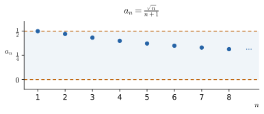{fig-alt="איברי שורש n חלקי n ועוד אחת נמצאים בין אפס לחצי. האיבר הראשון שווה לחצי." width="480" fig-align="center"}
::::

#### חסימות ללוגריתם ולמעריכית {.unnumbered}

::: {#box-term-natural-log .thmterm title="לוגריתם טבעי"}
$\ln(x)=\log_e(x)$ הוא הלוגריתם בבסיס $e$, קבוע שערכו בקירוב $2.71828$. [הגדרת $e$ באמצעות גבול](#box-def-e) תופיע בהמשך.
:::

::: {#box-rule-log-exp-bounds .thmthm title="חסימות ללוגריתם ולמעריכית"}

| התנאי | האי־שוויון |
|:---:|:---:|
| $x>0$ | $1-\frac{1}{x}\le\ln(x)\le x-1$ |
| $x\in\mathbb{R}$ | $e^x\ge1+x$ |

בשורה הראשונה מתקבל שוויון רק ב $x=1$; בשנייה רק ב $x=0$.
:::

נשתמש גם כאן בתוצאות ללא הוכחה. ל[חסימת הלוגריתם](#box-rule-log-exp-bounds) יש צורה נוחה נוספת: מציבים $x=1+t$, ולכן עבור $t>-1$ מתקיים
$$\frac{t}{1+t}\le\ln(1+t)\le t.$$

:::: {#box-exm-logarithm-bound .thmexm title="חסימת הסדרה $n\ln\left(1+\frac{1}{n}\right)$"}
נחסום את $a_n=n\ln\left(1+\frac{1}{n}\right)$, עבור $n\ge1$.

נציב $t=\frac{1}{n}>0$ ב[חסמי הלוגריתם](#box-rule-log-exp-bounds):
$$\frac{1}{n+1}\le\ln\left(1+\frac{1}{n}\right)\le\frac{1}{n}.$$
נכפול ב $n>0$:
$$\frac{n}{n+1}\le a_n\le1.$$
החסם מלרע עדיין תלוי ב $n$, אבל הוא חיובי. נרחיב את החסימה ונקבל שני חסמים קבועים:
$$0\le a_n\le1.$$

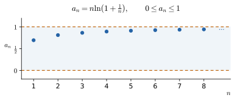{fig-alt="איברי n כפול הלוגריתם הטבעי של אחת ועוד אחת חלקי n נשארים בין אפס לאחת." width="480" fig-align="center"}
::::

::: {#box-exm-exponential-bound .thmexm title="חסימת הסדרה $ne^{-n}$"}
נתונה $a_n=ne^{-n}=\frac{n}{e^n}$, עבור $n\ge1$.
נציב $x=n$ ב[אי־השוויון $e^x\ge1+x$](#box-rule-log-exp-bounds). המונה והמכנים חיוביים, ולכן
$$0<a_n=\frac{n}{e^n}\le\frac{n}{n+1}<1.$$
הסדרה חסומה מלרע על ידי $0$ ומלעיל על ידי $1$.
:::

### חסימות בעזרת אינדוקציה {#sec-bounds-induction .unnumbered}

דרך נוספת להוכיח חסימות היא באמצעות *אינדוקציה* — שיטת הוכחה שנציג כעת.

::: {#box-def-induction .thmdef title="אינדוקציה"}
[**אינדוקציה**]{.term} היא שיטת הוכחה המאפשרת להוכיח טענה עבור כל המספרים הטבעיים, בלי לבדוק כל מספר בנפרד. כדי להוכיח טענה לכל $n\ge1$, מוכיחים שני דברים:

1. **בסיס האינדוקציה:** הטענה נכונה עבור $n=1$.
2. **צעד האינדוקציה:** לכל $n\ge1$, אם הטענה נכונה עבור $n$, היא נכונה גם עבור $n+1$. לצורך הוכחת הצעד מניחים שהטענה נכונה עבור $n$; זו **הנחת האינדוקציה**.

אם שני התנאים מתקיימים, הטענה נכונה לכל $n\ge1$.
:::

::: {#box-exp-induction-domino .thmexp title="מדוע הבסיס והמעבר מספיקים?"}
הבסיס נותן את הטענה עבור $1$. המעבר נותן ממנה את הטענה עבור $2$, ממנה עבור $3$, וכן הלאה. **לכל מספר טבעי מגיעים אחרי מספר סופי של צעדים**, ולכן הבסיס והמעבר מספיקים להוכחת הטענה לכל $n\ge1$.

דמיינו שורה של אבני דומינו עומדות: האבן הראשונה נופלת, וכל אבן שנופלת מפילה את האבן הבאה. לכן השנייה נופלת, אחריה השלישית, וכך הלאה.

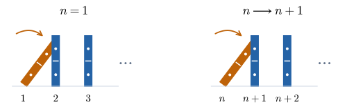{fig-alt="משמאל: האבן הראשונה נופלת לעבר האבן השנייה — בסיס האינדוקציה. מימין: אבן באינדקס n נופלת לעבר האבן באינדקס n+1 — אותו מעבר צריך לעבוד לכל n. הנקודות מציינות שהשורה נמשכת." width="640" fig-align="center"}

**צריך גם התחלה וגם מעבר שעובד בכל צעד.** בלי נפילת האבן הראשונה התהליך אינו מתחיל; אם אבן אינה מפילה את הבאה, התהליך עלול להיעצר.
:::

::: {#box-qa-induction-purpose .thmqa title="לשם מה נשתמש באינדוקציה?"}
נשתמש באינדוקציה כדי להוכיח תכונות של סדרות לכל האינדקסים. למשל, כדי להראות שסדרה $(a_n)_{n=1}^{\infty}$ חסומה בין שני מספרים קבועים $m$ ו $M$, הטענה באינדקס $n$ היא $m\le a_n\le M$. בסדרה רקורסיבית, כלל הרקורסיה מאפשר לקשר בין האיבר $a_n$ לאיבר $a_{n+1}$.
:::

:::: {#box-exm-induction-bound .thmexm title="חוסמים סדרה רקורסיבית באינדוקציה"}
נתונה הסדרה
$$a_1=0,\qquad a_{n+1}=\frac{a_n+2}{2}.$$
נראה כיצד להוכיח ש $0\le a_n\le2$ **לכל** $n\ge1$.

**פתרון.** תחילה נחשב כמה איברים:
$$a_1=0,\qquad a_2=\frac{0+2}{2}=1,$$
$$a_3=\frac{1+2}{2}=\frac{3}{2},\qquad a_4=\frac{\frac{3}{2}+2}{2}=\frac{7}{4}.$$
כל איבר חדש הוא [הממוצע החשבוני](#box-def-arithmetic-geometric-means) של האיבר הקודם ושל $2$. האיברים שחישבנו נמצאים בין $0$ לבין $2$, אבל **בדיקת כמה איברים אינה מוכיחה חסימות של כל הסדרה**. לשם כך נשתמש ב[עקרון האינדוקציה](#box-def-induction).

**מתחילים באיבר הראשון.** מתקיים $a_1=0$, ולכן $0\le a_1\le2$.

**בודקים את המעבר לאיבר הבא.** נניח שעבור אינדקס $n\ge1$ מתקיים $0\le a_n\le2$. נוסיף $2$ לכל האגפים:
$$2\le a_n+2\le4.$$
נחלק ב $2>0$ ונשתמש בהגדרת האיבר הבא:
$$1\le\frac{a_n+2}{2}=a_{n+1}\le2.$$
בפרט, $0\le a_{n+1}\le2$.

**מסיקים לכל האיברים.** הטענה נכונה לאיבר הראשון. המעבר מוכיח אותה לאיבר השני, ממנו לשלישי, וכך הלאה. לכן $0\le a_n\le2$ לכל $n\ge1$, והסדרה חסומה.

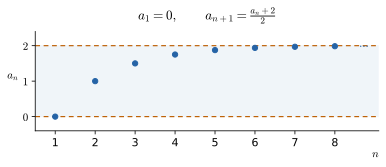{fig-alt="איברי הסדרה שמתחילה באפס וכל איבר בה הוא ממוצע האיבר הקודם ושתיים. כל הנקודות נשארות בקטע מאפס עד שתיים." width="480" fig-align="center"}
::::

::: {#box-method-induction .thmmethod title="בחירת חסמים ובדיקתם באינדוקציה"}
כדי לחסום סדרה רקורסיבית $(a_n)_{n=1}^{\infty}$, מחפשים קטע $[m,M]$ שמכיל את האיבר הראשון ושכלל הרקורסיה משאיר בו גם את האיבר הבא.

1. **מציעים חסמים קבועים.** אם $m,M$ לא נתונים, נעזרים בכלל הרקורסיה ובאיברים הראשונים כדי להציע אותם. החסמים אינם תלויים ב $n$, ואין צורך שיהיו ההדוקים ביותר.
2. **בודקים את האיבר הראשון:** $m\le a_1\le M$.
3. **בודקים שכלל הרקורסיה שומר על החסימה.** מניחים $m\le a_n\le M$ עבור אינדקס $n\ge1$ כלשהו ופועלים לפי נוסחת האיבר הבא. בודקים שהפעולות מותרות — למשל, שהביטוי בשורש אינו שלילי או שהמכנה אינו אפס — ומראים שהתוצאה מקיימת שוב $m\le a_{n+1}\le M$.
4. **מסיקים:** לפי [עקרון האינדוקציה](#box-def-induction), כל איברי הסדרה נמצאים ב $[m,M]$, ולכן הסדרה חסומה.
:::

**בהנחה משתמשים רק באינדקס הנוכחי; את הטענה על כל האינדקסים מקבלים בסוף, מן הבסיס ומצעד האינדוקציה יחד.**

:::: {#box-exm-induction-root-bound .thmexm title="חסימת סדרה רקורסיבית עם שורש"}
נתונה הסדרה $(b_n)_{n=1}^{\infty}$:
$$b_1=1,\qquad b_{n+1}=\sqrt{6+b_n}\quad(n\ge1).$$
נראה ש $0\le b_n\le3$ לכל $n\ge1$, בעזרת [שיטת החסימה באינדוקציה](#box-method-induction).

**בחירת החסמים.** השורש אי־שלילי, ולכן ננסה חסם מלרע $0$. ננסה חסם מלעיל $3$: כאשר $b_n\le3$, הביטוי בשורש אינו גדול מ $6+3=9=3^2$. כעת צריך לבדוק שהבחירה אכן מתאימה לכל האיברים.

**בסיס.** $b_1=1$, ולכן $0\le b_1\le3$.

**מעבר.** נניח ש $0\le b_n\le3$ עבור אינדקס $n\ge1$ כלשהו. לפי [כלל החיבור באי־שוויון](01-Introduction.qmd#box-thm-inequalities),
$$6\le6+b_n\le9.$$
הביטוי בשורש חיובי, ולכן [השורש מוגדר ואי־שלילי](01-Introduction.qmd#box-def-root): $b_{n+1}\ge0$. כמו כן,
$$b_{n+1}^2=6+b_n\le9=3^2.$$
שני המספרים $b_{n+1}$ ו $3$ אי־שליליים, ולכן [השוואת הריבועים](01-Introduction.qmd#box-thm-inequalities) נותנת $b_{n+1}\le3$. קיבלנו
$$0\le b_{n+1}\le3.$$

**מסקנה.** לפי [עקרון האינדוקציה](#box-def-induction), כל האיברים מוגדרים ונמצאים ב $[0,3]$. בפרט, הסדרה חסומה.
::::

### תרגילים {#sec-sequence-bounds-exercises .unnumbered}

#### שימוש באי־שוויונות מוכרים {.unnumbered}

::::: {#box-q-bounds-trig .thmqst title="בונים חסימות שלב אחר שלב"}
בכל הסעיפים $n\ge1$.

**(א)** נתונה $a_n=3-2\cos(n)$. התחילו מ[חסמי הקוסינוס](#box-known-sequence-inequalities) ומצאו חסמים לסדרה.

:::: {.derive vars="n" positive="n" bound-rule="cos" start="-1<=cos(n)<=1"}
::: {.step line="[2]>=-2*cos(n)>=[-2]" action="mul" value="-2"}
כופלים ב $-2$ והופכים את שני הכיוונים.
:::
::: {.step line="[5]>=3-2*cos(n)>=[1]" action="add" value="3"}
מוסיפים $3$ לכל האגפים. מתקבל $1\le a_n\le5$, ובפרט $|a_n|\le5$.
:::
::::

**(ב)** נתונה $b_n=\sin(n)+\cos(n)$. השתמשו ב[אי־שוויון המשולש](01-Introduction.qmd#box-thm-abs-props).

:::: fill
$$|b_n|\le|\sin(n)|+|\cos(n)|.$$
חסמו כל מחובר:

::: {.eqline dir="ltr"}
$|b_n|\le$ [$1$]{.blank ans="1"} $+$ [$1$]{.blank ans="1"} $=$ [$2$]{.blank ans="2"}
:::

::: explain
לפי [חסמי הסינוס והקוסינוס](#box-known-sequence-inequalities), כל אחד מהערכים המוחלטים קטן מ $1$ או שווה לו. לכן $|b_n|\le2$, ומכאן $-2\le b_n\le2$. אין צורך לדעת את ערכם המדויק של הסינוס והקוסינוס.
:::
::::

**(ג)** נתונה $c_n=2+\arcsin\left(\frac{1}{n+1}\right)$.

:::: fill
תחילה בודקים את הקלט. מאחר ש $n+1\ge2$, מתקיים

::: {.eqline dir="ltr"}
$0<\frac{1}{n+1}\le$ [$\frac{1}{2}$]{.blank ans="1/2"}
:::

הקלט ב $[-1,1]$. הוסיפו $2$ ל[חסמי $\arcsin$](#box-rule-inverse-trig-bounds):

::: {.eqline dir="ltr"}
[$2-\frac{\pi}{2}$]{.blank ans="2-pi/2" allow-expression="true"} $\le c_n\le$ [$2+\frac{\pi}{2}$]{.blank ans="2+pi/2" allow-expression="true"}
:::

::: explain
מ[חסמי $\arcsin$](#box-rule-inverse-trig-bounds) מקבלים $-\frac{\pi}{2}\le\arcsin\left(\frac{1}{n+1}\right)\le\frac{\pi}{2}$. מוסיפים $2$ לכל האגפים ומקבלים את החסמים $2-\frac{\pi}{2}$ ו $2+\frac{\pi}{2}$. שניהם קבועים, ולכן הסדרה חסומה.
:::
::::
:::::

::::: {#box-q-bounds-inverse .thmqst title="תחום ההגדרה וטווח הערכים"}
בכל הסעיפים $n\ge1$.

**(א)** נתונה $a_n=\arccos\left(\frac{n-1}{n+1}\right)$.

:::: fill
כתבו את הקלט בצורה שתעזור לבדוק את תחומו:

::: {.eqline dir="ltr"}
$\frac{n-1}{n+1}=1-$ [$\frac{2}{n+1}$]{.blank kind="expr" ans="2/(n+1)" vars="n" positive="n" integer="n"}
:::

מאחר ש $0<\frac{2}{n+1}\le1$, הקלט ב $[0,1)$, ולכן גם ב $[-1,1]$. השתמשו ב[חסמי $\arccos$](#box-rule-inverse-trig-bounds):

::: {.eqline dir="ltr"}
[$0$]{.blank ans="0"} $\le a_n\le$ [$\pi$]{.blank ans="pi" allow-expression="true"}
:::

::: explain
הכתיבה $\frac{n-1}{n+1}=1-\frac{2}{n+1}$ מראה שהקלט בתחום ההגדרה לכל $n\ge1$. לפי [חסמי $\arccos$](#box-rule-inverse-trig-bounds), $0\le a_n\le\pi$, ובפרט $|a_n|\le\pi$.
:::
::::

**(ב)** נתונה $b_n=\arctan(n^2)-\frac{\pi}{2}$. כל $n^2$ הוא קלט מותר. חסרו $\frac{\pi}{2}$ מ[חסמי $\arctan$](#box-rule-inverse-trig-bounds).

:::: fill
::: {.eqline dir="ltr"}
[$-\pi$]{.blank ans="-pi" allow-expression="true"} $< b_n <$ [$0$]{.blank ans="0"}
:::

מכאן אפשר לבחור בחסימה $|b_n|\le M$ את $M=$ [$\pi$]{.blank ans="pi" allow-expression="true"}.

::: explain
מתחילים מ[חסמי $\arctan$](#box-rule-inverse-trig-bounds): $-\frac{\pi}{2}<\arctan(n^2)<\frac{\pi}{2}$. לאחר החיסור מקבלים $-\pi<b_n<0$. לכן $|b_n|<\pi$, ובפרט החסימה החלשה $|b_n|\le\pi$ נכונה.
:::
::::
:::::

::::: {#box-q-bounds-algebra .thmqst title="ריבוע אי־שלילי ואי־שוויון הממוצעים בפעולה"}
בכל הסעיפים $n\ge1$.

**(א)** נחסום את $a_n=\frac{\sqrt n}{n+4}$ באמצעות [אי־שוויון הממוצעים](#box-rule-square-amgm).

:::: fill
כדי לקבל בממוצע החשבוני את $\frac{n+4}{2}$, נציב $u=n$ ו $v=$ [$4$]{.blank ans="4"}. שני המספרים חיוביים.

בממוצע ההנדסי מתקבל

::: {.eqline dir="ltr"}
$\sqrt{uv}=\sqrt{4n}=$ [$2$]{.blank ans="2"} $\sqrt n$
:::

לכן $2\sqrt n\le\frac{n+4}{2}$. נכפול ב $2$ ונקבל

::: {.eqline dir="ltr"}
[$4$]{.blank ans="4"} $\sqrt n\le n+4$
:::

מחלקים ב $4(n+4)>0$. מאחר שגם המונה חיובי,

::: {.eqline dir="ltr"}
$0<a_n\le$ [$\frac{1}{4}$]{.blank ans="1/4"}
:::

::: explain
מציבים $u=n$ ו $v=4$ ב[אי־שוויון הממוצעים](#box-rule-square-amgm) ומקבלים $2\sqrt n\le\frac{n+4}{2}$. מכאן $4\sqrt n\le n+4$, ולכן $0<\frac{\sqrt n}{n+4}\le\frac{1}{4}$. החסם קבוע, ולכן הסדרה חסומה.
:::
::::

**(ב)** נחסום את $b_n=\frac{n}{n^2+1}$ באמצעות [ריבוע אי־שלילי](#box-rule-nonnegative-square): $(n-1)^2\ge0$.

:::: fill
נפתח את הריבוע:

::: {.eqline dir="ltr"}
$n^2-$ [$2$]{.blank ans="2"} $n+1\ge0$
:::

נעביר את האיבר האמצעי לאגף השני:

::: {.eqline dir="ltr"}
$n^2+1\ge$ [$2$]{.blank ans="2"} $n$
:::

נחלק ב $2(n^2+1)>0$. מאחר ש $n>0$, מתקבל

::: {.eqline dir="ltr"}
$0<b_n\le$ [$\frac{1}{2}$]{.blank ans="1/2"}
:::

::: explain
מ[אי־שליליות הריבוע](#box-rule-nonnegative-square) מקבלים $n^2-2n+1\ge0$, ולכן $n^2+1\ge2n$. לאחר החלוקה מתקבל $\frac{1}{2}\ge\frac{n}{n^2+1}>0$. כך מצאנו חסם קבוע גם בלי לחשב גבול.
:::
::::
:::::

#### אינדוקציה {.unnumbered}

::::: {#box-q-induction-bound .thmqst title="מתרגלים את הבסיס ואת המעבר"}
נתונה הסדרה
$$b_1=1,\qquad b_{n+1}=\frac{b_n+3}{2}.$$
הראו בעזרת [אינדוקציה](#box-method-induction) ש $1\le b_n\le3$ לכל $n\ge1$.

:::: fill
**בסיס.** האיבר הראשון הוא $b_1=$ [$1$]{.blank ans="1"}, ולכן הוא בקטע $[1,3]$.

**מעבר.** נניח ש $1\le b_n\le3$. לאחר חיבור $3$ לכל האגפים:

::: {.eqline dir="ltr"}
[$4$]{.blank ans="4"} $\le b_n+3\le$ [$6$]{.blank ans="6"}
:::

לאחר חלוקה ב $2>0$:

::: {.eqline dir="ltr"}
[$2$]{.blank ans="2"} $\le b_{n+1}\le$ [$3$]{.blank ans="3"}
:::

מכאן גם $1\le b_{n+1}\le3$. הבסיס והמעבר מוכיחים שהחסימה נכונה לכל האיברים.

::: explain
מתחילים מ $b_1=1\in[1,3]$. אם $1\le b_n\le3$, אז $4\le b_n+3\le6$, ולכן $2\le b_{n+1}\le3$. הקטע $[2,3]$ נמצא בתוך $[1,3]$, ולכן כלל המעבר משאיר את האיבר הבא בקטע המבוקש. לפי [שיטת האינדוקציה](#box-method-induction), כל איברי הסדרה ב $[1,3]$.
:::
::::
:::::

## מונוטוניות {#sec-monotonicity}

חסימות מתארת את התחום שבו נמצאים האיברים, אבל אינה אומרת אם הם עולים, יורדים או מחליפים כיוון. כעת נבדוק את הכיוון.

::: {#box-def-monotone .thmdef title="סדרה מונוטונית"}
נתונה סדרה $(a_n)_{n=1}^{\infty}$. בכל אחת מההגדרות הבאות נדרש שהאי־שוויון יתקיים **לכל $n\ge1$**.

הסדרה [**עולה**]{.term} אם כל איבר גדול מקודמו או שווה לו:
$$a_n\le a_{n+1}.$$

הסדרה [**יורדת**]{.term} אם כל איבר קטן מקודמו או שווה לו:
$$a_n\ge a_{n+1}.$$

הסדרה [**עולה ממש**]{.term} אם כל איבר גדול מקודמו:
$$a_n<a_{n+1}.$$

הסדרה [**יורדת ממש**]{.term} אם כל איבר קטן מקודמו:
$$a_n>a_{n+1}.$$

סדרה עולה או יורדת נקראת [**מונוטונית**]{.term}. בעלייה ובירידה מותר שוויון; בעלייה ממש ובירידה ממש הוא אינו מותר.
:::

:::: {#box-exm-monotone-strict .thmexm title="סדרה יורדת ממש וסדרה עולה ממש"}
**(א) הסדרה $a_n=\frac{1}{n}$, עבור $n\ge1$.** איבריה הראשונים הם
$$1,\frac{1}{2},\frac{1}{3},\frac{1}{4},\ldots$$
המכנה גדל וחיובי. לפי [כלל ההופכיים](01-Introduction.qmd#box-thm-inequalities), כל איבר קטן מקודמו, ולכן הסדרה **יורדת ממש**.

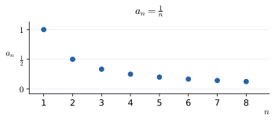{fig-alt="איברי הסדרה אחת חלקי n יורדים ממש: כל נקודה נמוכה מהקודמת. מוצגים האינדקסים אחת עד שמונה, ללא קווים בין הנקודות." width="460" fig-align="center"}

**(ב) הסדרה $b_n=1-\frac{1}{n}$, עבור $n\ge1$.** איבריה הראשונים הם
$$0,\frac{1}{2},\frac{2}{3},\frac{3}{4},\ldots$$
ככל ש $n$ גדל, מחסרים מ $1$ מספר חיובי קטן יותר. לכן כל איבר גדול מקודמו, והסדרה **עולה ממש**.

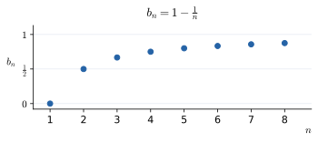{fig-alt="איברי הסדרה אחת פחות אחת חלקי n עולים ממש: כל נקודה גבוהה מהקודמת. מוצגים האינדקסים אחת עד שמונה, ללא קווים בין הנקודות." width="460" fig-align="center"}
::::

:::: {#box-exm-monotone-equal-terms .thmexm title="סדרות מונוטוניות עם איברים עוקבים שווים"}
**(א) סדרה עולה שאינה עולה ממש.** בסדרה $(c_n)_{n=1}^{\infty}$ כל מספר טבעי מופיע פעמיים:
$$c_{2k-1}=c_{2k}=k\qquad(k\ge1).$$
כלומר,
$$1,1,2,2,3,3,4,4,\ldots$$
בכל זוג האיברים שווים, ובמעבר לזוג הבא הערך גדל ב $1$. לכן $c_{n+1}\ge c_n$ לכל $n\ge1$: הסדרה **עולה**. היא **אינה עולה ממש**, כי למשל $c_1=c_2$.

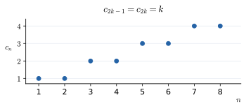{fig-alt="איברי הסדרה אחת, אחת, שתיים, שתיים, שלוש, שלוש וכן הלאה. נקודות עוקבות מופיעות בזוגות באותו גובה, ובין זוג לזוג הגובה עולה." width="460" fig-align="center"}

**(ב) הסדרה הקבועה $d_n=4$, עבור $n\ge1$.** בכל צעד מתקיים $d_{n+1}=d_n=4$, ולכן מתקיימים גם $d_{n+1}\ge d_n$ וגם $d_{n+1}\le d_n$.
הסדרה **גם עולה וגם יורדת**, אבל אינה עולה ממש ואינה יורדת ממש.

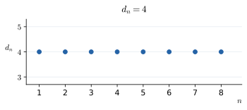{fig-alt="איברי הסדרה הקבועה ארבע. כל הנקודות באותו גובה, ולכן מתקיימים שני כיווני האי־שוויון החלש אך אף אחד משני האי־שוויונות הממשיים." width="460" fig-align="center"}
::::

:::: {.thmchk}
חמשת האיברים הראשונים עולים. האם די בכך כדי לקבוע שהסדרה עולה?

::: {.quiz options="כן|לא" answer="לא"}
ההגדרה דורשת $a_n\le a_{n+1}$ לכל $n$. ייתכן שהאיבר השישי קטן מהחמישי.
:::

הסדרה הקבועה $4,4,4,\ldots$ היא:

::: {.quiz options="עולה בלבד|יורדת בלבד|גם עולה וגם יורדת" answer="גם עולה וגם יורדת"}
כל איבר שווה לקודמו, ולכן שני האי־שוויונות מתקיימים. היא אינה עולה ממש ואינה יורדת ממש.
:::
::::

::: {#box-method-monotone-difference .thmmethod title="בדיקת מונוטוניות: הפרש או מנה"}
**דרך ההפרש.** מחשבים את $a_{n+1}-a_n$ ובודקים את סימנו לכל אינדקס:

- אם $a_{n+1}-a_n\ge0$ לכל $n\ge1$, הסדרה עולה.
- אם $a_{n+1}-a_n\le0$ לכל $n\ge1$, הסדרה יורדת.
- אם $a_{n+1}-a_n>0$ באינדקס אחד ו $a_{n+1}-a_n<0$ באינדקס אחר, הסדרה אינה מונוטונית.

**דרך המנה.** אם כל האיברים חיוביים, אפשר לחשב את $\frac{a_{n+1}}{a_n}$ ולהשוות ל $1$:

- אם $\frac{a_{n+1}}{a_n}\ge1$ לכל $n\ge1$, הסדרה עולה.
- אם $\frac{a_{n+1}}{a_n}\le1$ לכל $n\ge1$, הסדרה יורדת.

את $a_{n+1}-a_n$ משווים ל $0$; את $\frac{a_{n+1}}{a_n}$ משווים ל $1$. תנאי החיוביות נחוץ לדרך המנה כפי שניסחנו אותה כאן.

בשתי הדרכים, את $a_{n+1}$ מקבלים מהצבת $n+1$ במקום $n$ בנוסחה לאיבר הכללי.
:::

::::: {#box-exm-monotone-difference .thmexm title="כותבים את האיבר הבא ומשווים"}
נבדוק את המונוטוניות של $a_n=\frac1n$.

תחילה נכתוב את האיבר הבא:
$$a_{n+1}=\frac1{n+1}.$$
כעת נחסר:
$$\begin{aligned}
a_{n+1}-a_n&=\frac1{n+1}-\frac1n\\
&=\frac{n-(n+1)}{n(n+1)}\\
&=-\frac1{n(n+1)}.
\end{aligned}$$
המכנה חיובי, ולכן ההפרש שלילי לכל $n$. מכאן שהסדרה יורדת ממש.

אפשר להגיע לאותה מסקנה בדרך המנה. האיברים חיוביים, ומתקיים
$$\frac{a_{n+1}}{a_n}=\frac{\frac{1}{n+1}}{\frac{1}{n}}=\frac n{n+1}<1.$$
המונה קטן מהמכנה החיובי בכל אינדקס, ולכן כל איבר קטן מקודמו.
:::::

::::: {.thmchk title="האיבר הבא או תוספת של אחת?"}
נתונה $a_n=2n+3$.

:::: fill
$a_{n+1}=$ [$2(n+1)+3$]{.blank ans="2(n+1)+3" vars="n" positive="n" integer="n" w="15"}.

$a_{n+1}-a_n=$ [$2$]{.blank ans="2"}.

::: explain
מציבים $n+1$ במקום $n$, ולכן $a_{n+1}=2(n+1)+3=2n+5$. האיבר הבא גדול מקודמו ב $2$.
:::
::::

האם תמיד מתקיים $a_{n+1}=a_n+1$?

::: {.quiz options="כן|לא" answer="לא"}
לא. תוספת של אחת לאינדקס מעבירה לאיבר הבא; היא אינה מחייבת שהאיבר עצמו יגדל באחת.
:::
:::::

:::: {#box-exm-converges-with-detours .thmexm title="התכנסות אינה מחייבת התקרבות בכל צעד"}
לפי [הגדרת הגבול](#box-def-limit), כאשר $a_n\to L$ מתקיים $|a_n-L|\to0$: מאינדקס מתאים והלאה כל המרחקים קטנים כרצוננו. **אין צורך שהמרחק יקטן בכל צעד.**

נתבונן בסדרה
$$a_n=1+\frac{2+(-1)^n}{n},\qquad n\ge1.$$
נראה ש **$a_n\to1$, ואילו $|a_n-1|\to0$**, אף שהמרחק גדל בחלק מהצעדים.

האיברים הראשונים הם
$$2,\frac{5}{2},\frac{4}{3},\frac{7}{4},\frac{6}{5},\frac{3}{2},\ldots$$
בכל מעבר מאינדקס אי־זוגי לזוגי הערך גדל ומתרחק מ $1$; במעבר לאינדקס האי־זוגי הבא הוא קטן ומתקרב אליו. לכן הסדרה אינה מונוטונית.

{fig-alt="למעלה: איברי הסדרה אחת ועוד שתיים ועוד מינוס אחת בחזקת n חלקי n, המתכנסת לאחת. למטה: המרחקים של אותם איברים מאחת, השואפים לאפס. בשני הגרפים יש עליות וירידות; הקווים המסומנים הם הגבולות השונים." width="600" fig-align="center"}

כדי לבדוק התכנסות אל $1$, נחשב את המרחק ממנו. המונה $2+(-1)^n$ הוא תמיד $1$ או $3$, ולכן הוא חיובי:
$$|a_n-1|=\left|\frac{2+(-1)^n}{n}\right|=\frac{2+(-1)^n}{n}\le\frac{3}{n}.$$
נבחר $\varepsilon>0$ כלשהו. כדי להבטיח $|a_n-1|<\varepsilon$, מספיק לדרוש
$$\frac{3}{n}<\varepsilon.$$
מכיוון ש $n$ ו $\varepsilon$ חיוביים, הדרישה הזאת שקולה ל
$$n>\frac{3}{\varepsilon}.$$
נבחר אינדקס טבעי $N>\frac{3}{\varepsilon}$. לכל $n\ge N$ מתקיים
$$|a_n-1|\le\frac{3}{n}\le\frac{3}{N}<\varepsilon.$$
כך אפשר לבחור $N$ מתאים לכל $\varepsilon>0$. לפי [הגדרת הגבול](#box-def-limit),
$$\lim_{n\to\infty}\left(1+\frac{2+(-1)^n}{n}\right)=1.$$
ההתרחקויות החוזרות אינן מונעות התכנסות: בכל רצועה סביב $1$, מאינדקס מתאים והלאה כל האיברים נשארים בפנים.
::::

### מונוטוניות וחסימות יחד {.unnumbered}

סדרה חסומה יכולה להמשיך לקפוץ בין שני מספרים, וסדרה עולה יכולה לגדול מעבר לכל חסם. כשיש גם כיוון קבוע וגם חסם מתאים, מתקבלת מסקנה חזקה יותר.

::: {#box-warn-monotone-not-convergent .thmwarn title="טעות נפוצה — מונוטוניות אינה מבטיחה התכנסות"}
**מונוטוניות לבדה אינה מספיקה.** כדי להסיק התכנסות למספר ממשי, לסדרה עולה דרוש חסם מלעיל, ולסדרה יורדת דרוש חסם מלרע.
:::

::: {#box-exm-increasing-unbounded .thmexm title="סדרה עולה שאינה מתכנסת"}
נתונה הסדרה $a_n=n$, עבור $n\ge1$.
מתקיים $a_{n+1}-a_n=1>0$, ולכן היא עולה ממש.
אבל לכל מספר $M$ קיים אינדקס טבעי $n>M$, ואז $a_n>M$.
הסדרה אינה חסומה מלעיל, ולכן [אינה מתכנסת למספר ממשי](#box-thm-convergent-bounded).

{fig-alt="הסדרה a_n=n עולה בכל צעד ועוברת כל חסם מלעיל מוצע." width="440" fig-align="center"}
:::

::: {#box-thm-monotone-bounded .thmthm title="מונוטוניות, חסימות והגבול"}
תהי $(a_n)_{n=1}^{\infty}$ סדרה.

- אם היא עולה, היא מתכנסת למספר ממשי אם ורק אם היא חסומה מלעיל; במקרה זה,
  $$\lim_{n\to\infty}a_n=\sup_{n\ge1}a_n.$$
- אם היא יורדת, היא מתכנסת למספר ממשי אם ורק אם היא חסומה מלרע; במקרה זה,
  $$\lim_{n\to\infty}a_n=\inf_{n\ge1}a_n.$$
:::

::: {#box-exp-monotone-extremum .thmexp title="מדוע הגבול הוא החסם העליון או התחתון?"}
בסדרה עולה וחסומה מלעיל, נסמן ב $S$ את [החסם העליון](#box-def-sup-inf). כל האיברים מקיימים $a_n\le S$.
לכל $\varepsilon>0$, המספר $S-\varepsilon$ אינו חסם מלעיל: אחרת $S$ לא היה החסם מלעיל הקטן ביותר.
לכן קיים איבר $a_N>S-\varepsilon$. מכיוון שהסדרה עולה, לכל $n\ge N$ מתקיים
$$S-\varepsilon<a_N\le a_n\le S.$$
כל האיברים האלה נמצאים ברצועה סביב $S$, ולכן $a_n\to S$ לפי [הגדרת הגבול](#box-def-limit).

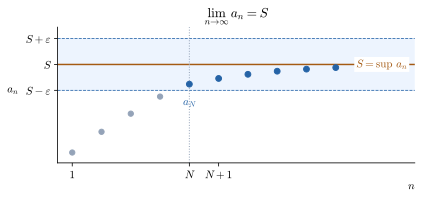{fig-alt="בסדרה עולה, כל האיברים מתחת לסופרמום S. מרגע שאיבר a_N עבר את S פחות אפסילון, כל האיברים שאחריו נשארים בין S פחות אפסילון לבין S." width="520" fig-align="center"}

בסדרה יורדת וחסומה מלרע, נסמן את החסם התחתון ב $I$. המספר $I+\varepsilon$ אינו חסם מלרע, ולכן קיים $a_N<I+\varepsilon$. הירידה מבטיחה שלכל $n\ge N$,
$$I\le a_n\le a_N<I+\varepsilon.$$
מכאן $a_n\to I$ באותו אופן.

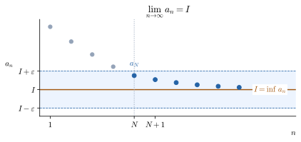{fig-alt="בסדרה יורדת, כל האיברים מעל האינפימום I. מרגע שאיבר a_N ירד מתחת ל I ועוד אפסילון, כל האיברים שאחריו נשארים בין I לבין I ועוד אפסילון." width="520" fig-align="center"}
:::

::: {#box-exm-bound-not-limit .thmexm title="הגבול של סדרה עולה הוא החסם העליון"}
נתונה הסדרה $a_n=1-\frac{1}{n}$, עבור $n\ge1$.
[הראינו שהיא עולה ממש](#box-exm-monotone-strict), וכל איבריה קטנים מ $1$.
כל מספר קטן מ $1$ אינו חסם מלעיל: אם הוא $1-\delta$ עם $\delta>0$, בחירת $n>\frac{1}{\delta}$ נותנת $a_n>1-\delta$.
לכן $\sup_{n\ge1}a_n=1$, ולפי [משפט המונוטוניות והחסימות](#box-thm-monotone-bounded),
$$\lim_{n\to\infty}\left(1-\frac{1}{n}\right)=1.$$
גם $2$ הוא חסם מלעיל, אבל הוא גדול מהחסם העליון ולכן אינו הגבול.

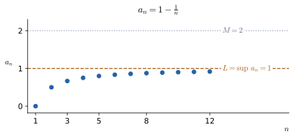{fig-alt="איברי אחת פחות אחת חלקי n עולים אל אחת, הסופרמום והגבול. שתיים היא חסם מלעיל נוסף, אך אינה הגבול." width="560" fig-align="center"}
:::

::: {#box-exm-decreasing-infimum .thmexm title="הגבול של סדרה יורדת הוא החסם התחתון"}
נתונה הסדרה $b_n=1+\frac{1}{n}$, עבור $n\ge1$.
הסדרה יורדת ממש, וכל איבריה גדולים מ $1$.
כל מספר $1+\delta$ עם $\delta>0$ אינו חסם מלרע: כש $n>\frac{1}{\delta}$ מתקיים $b_n<1+\delta$.
לכן $\inf_{n\ge1}b_n=1$, ולפי [משפט המונוטוניות והחסימות](#box-thm-monotone-bounded),
$$\lim_{n\to\infty}\left(1+\frac{1}{n}\right)=1.$$
גם $0$ הוא חסם מלרע, אבל הוא קטן מהחסם התחתון ולכן אינו הגבול.

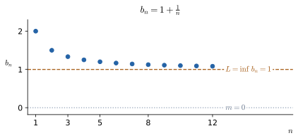{fig-alt="איברי אחת ועוד אחת חלקי n יורדים אל אחת, האינפימום והגבול. אפס הוא חסם מלרע נוסף, אך אינו הגבול." width="520" fig-align="center"}
:::


::: {#box-warn-bounds-versus-limit .thmwarn title="חסם שבחרנו אינו בהכרח הגבול"}
**לסדרה יש חסמים רבים מלעיל ומלרע, ולכן עצם מציאת חסם אינה מזהה את הגבול.**
בסדרה עולה וחסומה מלעיל, הגבול הוא דווקא **החסם העליון — הקטן מבין החסמים מלעיל**.
בסדרה יורדת וחסומה מלרע, הגבול הוא דווקא **החסם התחתון — הגדול מבין החסמים מלרע**.
אלה מסקנות [משפט המונוטוניות והחסימות](#box-thm-monotone-bounded); ללא מונוטוניות, גם החסם העליון והתחתון אינם בהכרח גבולות.
:::

::: {#box-rem-monotone-tail .thmrem title="כאשר רק הזנב מונוטוני"}
אם המונוטוניות והחסם המתאים מתקיימים רק החל מאינדקס $N$, מפעילים את [משפט המונוטוניות והחסימות](#box-thm-monotone-bounded) על הזנב.
הגבול הוא החסם העליון או התחתון **של הזנב**, בהתאם לכיוון המונוטוניות. הוא גם גבול הסדרה כולה, לפי [הטענה על גבול הזנב](#box-prp-tail-limit-equivalence).
:::

::: {#box-exm-monotone-tail-supremum .thmexm title="החסם העליון של הזנב עשוי להיות שונה מזה של הסדרה"}
נתונה הסדרה
$$a_1=3,\qquad a_n=1-\frac{1}{n}\quad(n\ge2).$$
הזנב שמתחיל באינדקס $2$ עולה וחסמו העליון הוא $1$, כפי שמתקבל מאותו חישוב ב[דוגמת הסדרה $1-\frac{1}{n}$](#box-exm-bound-not-limit).
לכן הזנב, וגם הסדרה כולה, מתכנסים ל $1$.
לעומת זאת, החסם העליון של **כל** הסדרה הוא $3$, בגלל האיבר הראשון. הסדרה כולה אינה עולה.
:::

:::: {.thmchk}
סדרה עולה וכל איבריה קטנים מ $5$. מה אפשר להסיק?

::: {.quiz options="היא מתכנסת, אך הגבול לא חייב להיות 5|הגבול שלה הוא בהכרח 5" answer="היא מתכנסת, אך הגבול לא חייב להיות 5"}
למשל, $1-\frac1n$ עולה וקטנה מ $5$, אבל גבולה הוא $1$.
:::

ידוע שסדרה יורדת וחסומה מלעיל. האם שתי התכונות האלה מבטיחות התכנסות?

::: {.quiz options="כן|לא" answer="לא"}
לסדרה יורדת דרוש חסם מלרע. למשל, $a_n=-n$ יורדת וחסומה מלעיל, אבל אינה מתכנסת למספר ממשי.
:::
::::

::: {.thmwarn title="בודקים את שתי ההנחות"}
ל[משפט המונוטוניות והחסימות](#box-thm-monotone-bounded) דרושות גם מונוטוניות וגם חסם בצד המתאים.
[הסדרה $a_n=n$](#box-exm-increasing-unbounded) מראה מדוע מונוטוניות לבדה אינה מספיקה;
[הסדרה $a_n=(-1)^n$](#box-exm-alternating-diverges) מראה מדוע חסימות לבדה אינה מספיקה.
גם הכיוון ההפוך אינו נכון: [התכנסות אינה מחייבת מונוטוניות](#box-exm-converges-with-detours).
:::

::::: {#box-exm-recursive-limit .thmsolved title="סדרה ברקורסיה: התכנסות וחישוב הגבול"}
נתונים
$$a_1=1,\qquad a_{n+1}=\sqrt{2+a_n}.$$
נרצה לדעת אם הסדרה מתכנסת, ואם כן — לאיזה מספר.

נעבור יחד על הטיעון. השלימו את הבדיקות בכל שלב; אפשר לפתוח את ההסבר לאחר ניסיון.

**חסימות באינדוקציה.** נשתמש ב[שיטת האינדוקציה](#box-method-induction).

**בסיס:** $a_1=1$ נמצא ב $[1,2]$.

**מעבר:** נניח ש $1\le a_n\le2$ עבור אינדקס $n\ge1$ כלשהו, ונראה שגם האיבר הבא נמצא בקטע.

:::: fill
לאחר חיבור $2$ לכל האגפים:

::: {.eqline dir="ltr"}
[$3$]{.blank ans="3" w="3"} $\le 2+a_n\le$ [$4$]{.blank ans="4" w="3"}
:::

לאחר הוצאת שורש מכל האגפים:

::: {.eqline dir="ltr"}
[$\sqrt{3}$]{.blank ans="sqrt(3)" allow-expression="true" w="5"} $\le a_{n+1}\le$ [$2$]{.blank ans="2" w="3"}
:::

האם גם האיבר הבא נמצא ב $[1,2]$? [כן]{.blank kind="text" ans="כן" choices="כן|לא"}

::: explain
מחברים $2$ לכל האגפים:
$$1+2\le a_n+2\le2+2,\qquad\text{כלומר}\quad3\le2+a_n\le4.$$
הוצאת שורש שומרת על סדר המספרים האי־שליליים:
$$\sqrt{3}\le\sqrt{2+a_n}\le\sqrt{4}=2.$$
לפי הרקורסיה, $\sqrt{2+a_n}=a_{n+1}$, ומכיוון ש $1<\sqrt{3}$, נקבל
$$1<\sqrt{3}\le a_{n+1}\le2.$$
הבסיס והמעבר מוכיחים, לפי [עקרון האינדוקציה](#box-def-induction), ש $1\le a_n\le2$ לכל $n\ge1$.
:::
::::

**מונוטוניות.** שני איברים עוקבים חיוביים, ולכן אפשר להשוות את הריבועים שלהם. לפי הרקורסיה,
$$\begin{aligned}
a_{n+1}^2-a_n^2&=\left(\sqrt{2+a_n}\right)^2-a_n^2\\
&=2+a_n-a_n^2\\
&=2+2a_n-a_n-a_n^2\\
&=2(1+a_n)-a_n(1+a_n)\\
&=(2-a_n)(a_n+1).
\end{aligned}$$

:::: fill
כבר קיבלנו $1\le a_n\le2$. לכן הגורם $2-a_n$ [אי־שלילי]{.blank kind="text" ans="אי־שלילי" choices="אי־שלילי|שלילי"}, והגורם $a_n+1$ [חיובי]{.blank kind="text" ans="חיובי" choices="חיובי|שלילי"}.

מכאן $a_{n+1}^2$ [גדול או שווה]{.blank kind="text" ans="גדול או שווה" choices="גדול או שווה|קטן"} ל $a_n^2$, ולכן הסדרה [עולה]{.blank kind="text" ans="עולה" choices="עולה|יורדת"}.

החסם הדרוש הוא [מלעיל]{.blank kind="text" ans="מלעיל" choices="מלעיל|מלרע"}, ואפשר לבחור אותו להיות [$2$]{.blank ans="2" min-answer="2" w="4"}.

לפי [](#box-thm-monotone-bounded), הסדרה [מתכנסת]{.blank kind="text" ans="מתכנסת" choices="מתכנסת|אינה מתכנסת"}.

::: explain
מהחסמים מקבלים
$$2-a_n\ge0,\qquad a_n+1\ge2>0.$$
לכן
$$a_{n+1}^2-a_n^2=(2-a_n)(a_n+1)\ge0,$$
ומכאן $a_{n+1}^2\ge a_n^2$. נוציא שורש משני האגפים; מאחר שהאיברים חיוביים,
$$a_{n+1}=\sqrt{a_{n+1}^2}\ge\sqrt{a_n^2}=a_n.$$
הסדרה עולה וחסומה מלעיל על ידי $2$, ולכן מתכנסת לפי [משפט המונוטוניות והחסימות](#box-thm-monotone-bounded).
:::
::::

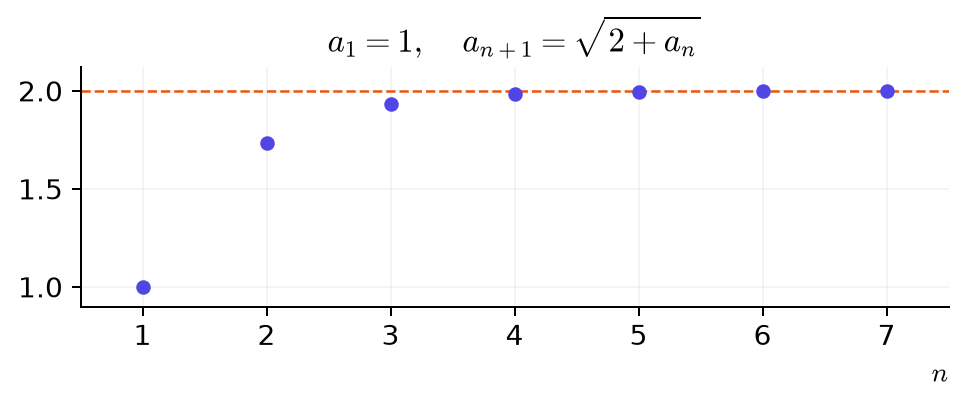{fig-alt="האיברים הראשונים של הסדרה הרקורסיבית מתחילים באחת, עולים ונשארים מתחת לשתיים. גבול הסדרה הוא שתיים." width="500" fig-align="center"}

**חישוב הגבול.** כבר ביססנו שהסדרה מתכנסת בעזרת [משפט המונוטוניות והחסימות](#box-thm-monotone-bounded). **זהו שלב הכרחי לפני שמציבים גבול ברקורסיה.** כעת נסמן את הגבול ב $L$.

גם $a_{n+1}\to L$, לפי [הכלל על גבול הזנב](#box-prp-tail-limit-equivalence).
לפי [משפט המונוטוניות והחסימות](#box-thm-monotone-bounded), $L$ הוא החסם העליון של הסדרה, ולכן $1\le L\le2$.

נכתוב את המעברים במפורש: נציב את הרקורסיה, נעביר את הגבול דרך השורש לפי [כלל השורש](#box-prp-limit-powers), ואז נפריד את הסכום לפי [חשבון גבולות](#box-thm-limit-arithmetic). כלל השורש חל כאן כי $2+L\ge3>0$.
$$\begin{aligned}
L&=\lim_{n\to\infty}a_{n+1}\\
&=\lim_{n\to\infty}\sqrt{2+a_n}\\
&=\sqrt{\lim_{n\to\infty}(2+a_n)}\\
&=\sqrt{\lim_{n\to\infty}2+\lim_{n\to\infty}a_n}.
\end{aligned}$$

:::: fill
נציב $\lim_{n\to\infty}2=2$ ו $\lim_{n\to\infty}a_n=L$. השלימו:

::: {.eqline dir="ltr"}
$L=$ [$\sqrt{2+L}$]{.blank ans="sqrt(2+L)" vars="L" positive="L" w="12"}
:::

נעלה את שני האגפים בריבוע:
$$L^2=\left(\sqrt{2+L}\right)^2=2+L.$$
נחסיר $2+L$ משני האגפים:
$$L^2-L-2=0.$$
נפרק לגורמים:
$$\begin{aligned}
L^2-L-2&=L^2-2L+L-2\\
&=L(L-2)+(L-2)\\
&=(L-2)(L+1).
\end{aligned}$$
לכן
$$(L-2)(L+1)=0.$$
מכפלה שווה לאפס כאשר לפחות אחד הגורמים שווה לאפס: $L-2=0$ או $L+1=0$.
שני המועמדים הם [$-1$]{.blank ans="-1" w="4"} ו [$2$]{.blank ans="2" w="4"} (בסדר עולה).

כל האיברים ב $[1,2]$, ולכן גם $L$ בקטע הזה. הגבול הוא [$2$]{.blank ans="2" w="4"}.

::: explain
הצבת שני הגבולות נותנת $L=\sqrt{2+L}$. לאחר העלאה בריבוע ופירוק לגורמים קיבלנו $L=2$ או $L=-1$.
המועמד $-1$ נפסל כי $L\ge1$. המועמד $2$ נמצא ב $[1,2]$ ומקיים גם את המשוואה המקורית:
$$\sqrt{2+2}=\sqrt{4}=2.$$
כבר ביססנו התכנסות, ורק מועמד אחד אפשרי. לכן $\lim_{n\to\infty}a_n=2$.
:::
::::

:::::

::: {#box-warn-limit-equation .thmwarn title="משוואה לגבול אינה מבטיחה התכנסות"}
אם הסדרה מתכנסת, גבולה חייב לקיים את המשוואה. פתרון המשוואה נותן מועמדים בלבד; כדי לקבוע שאחד מהם הוא הגבול צריך גם לבסס התכנסות.
:::

:::: {.thmchk title="מה צריך לבדוק לפני שמציבים גבול?"}
נתונים $a_1=0$ ו $a_{n+1}=1-a_n$. המשוואה $L=1-L$ נותנת $L=\frac{1}{2}$. האם זהו גבול הסדרה?

::: {.quiz options="כן|לא" answer="לא"}
לא. איברי הסדרה הם $0,1,0,1,\ldots$, ולכן היא אינה מתכנסת. אין כאן גבול שאפשר להציב בכלל הרקורסיה.
:::
::::


### תרגילים {.unnumbered}

::::: {#box-q-bounded-formulas .thmqst title="חסמים פשוטים"}
בכל סעיף מצאו מספר $K$ כך ש $|a_n|\le K$ לכל $n$. אין צורך למצוא את המספר הקטן ביותר.

:::: fill
**(א)** $a_n=4(-1)^n$: אפשר לבחור $K=$ [$4$]{.blank ans="4" min-answer="4"}.

**(ב)** $a_n=\frac2n$: אפשר לבחור $K=$ [$2$]{.blank ans="2" min-answer="2"}.

**(ג)** $a_n=1+\frac1n$: אפשר לבחור $K=$ [$2$]{.blank ans="2" min-answer="2"}.

::: hint
ב (א) חשבו את הערך המוחלט. ב (ב) ו (ג) השתמשו ב $0\le\frac1n\le1$.
:::

::: explain
**(א)** כל הערכים המוחלטים שווים $4$.

**(ב)** מתקיים $0\le\frac2n\le2$.

**(ג)** מתקיים $1\le1+\frac1n\le2$.

בכל סעיף גם מספר גדול מהחסם שמצאנו מתאים.
:::
::::
:::::

::::: {#box-q-monotone-bounded .thmqst title="מונוטוניות, חסם ומסקנה על התכנסות"}
נתונה $a_n=3-\frac1n$. בדקו מונוטוניות בעזרת הפרש או מנה, נמקו חסם מתאים, והסיקו שהסדרה מתכנסת בעזרת שתי התכונות.

:::: {.sequence-investigation formula="3-1/n" model-direction="up" model-side="upper" model-bound="3-1/n<=3" model-gap="1/n" difference="1/(n*(n+1))" ratio="n*(3n+2)/((n+1)*(3n-1))" bound-hint="האיבר מתקבל מחיסור מספר חיובי מ 3. מהו ההפרש בין 3 לבין האיבר?"}

::: model
אפשר לבדוק את ההפרש:
$$\begin{aligned}
a_{n+1}-a_n&=\left(3-\frac1{n+1}\right)-\left(3-\frac1n\right)\\
&=\frac1n-\frac1{n+1}\\
&=\frac1{n(n+1)}>0.
\end{aligned}$$
האינדקס חיובי, ולכן ההפרש חיובי והסדרה עולה.

למציאת חסם נחשב:
$$\begin{aligned}
3-a_n&=3-\left(3-\frac1n\right)\\
&=\frac1n\ge0.
\end{aligned}$$
לכן $a_n\le3$. הסדרה עולה וחסומה מלעיל, ולכן מתכנסת לפי [](#box-thm-monotone-bounded).

אפשר גם להשתמש במנה: האיברים חיוביים, ומתקיים
$$\begin{aligned}
\frac{a_{n+1}}{a_n}&=\frac{n(3n+2)}{(n+1)(3n-1)}\\
&=1+\frac1{(n+1)(3n-1)}>1.
\end{aligned}$$
גם מכאן נובעת העלייה.
:::
::::
:::::

::::: {#box-q-monotone-decreasing .thmqst title="סדרה יורדת וחסם מתאים"}
נתונה $a_n=2+\frac3n$. בדקו מונוטוניות בדרך שתבחרו, נמקו חסם בצד המתאים, והסיקו התכנסות.

:::: {.sequence-investigation formula="2+3/n" model-direction="down" model-side="lower" model-bound="2+3/n>=2" model-gap="3/n" difference="-3/(n*(n+1))" ratio="n*(2n+5)/((n+1)*(2n+3))" bound-hint="ההפרש בין האיבר לבין 2 חיובי. האם 2 הוא חסם מלעיל או מלרע?"}

::: model
$$\begin{aligned}
a_{n+1}-a_n&=\frac3{n+1}-\frac3n\\
&=-\frac3{n(n+1)}<0.
\end{aligned}$$
הסדרה יורדת. נוסף על כך,
$$a_n-2=\frac3n\ge0,$$
ולכן $2$ הוא חסם מלרע. סדרה יורדת וחסומה מלרע מתכנסת.

בדרך המנה אפשר לקבל
$$\frac{a_{n+1}}{a_n}=1-\frac3{(n+1)(2n+3)}<1.$$
מכיוון שכל האיברים חיוביים, גם השוואה זו מראה שהסדרה יורדת.
:::
::::
:::::

::::: {#box-q-monotone-quotient .thmqst title="בוחרים דרך לבדיקה"}
נתונה $a_n=\frac{n}{n+1}$. הראו שהסדרה מונוטונית וחסומה בצד המתאים, והסיקו התכנסות.

:::: {.sequence-investigation setup-required="true" formula="n/(n+1)" model-direction="up" model-side="upper" model-bound="n/(n+1)<=1" model-gap="1/(n+1)" difference="1/((n+1)*(n+2))" ratio="(n+1)^2/(n*(n+2))" bound-hint="השוו את האיבר למספר 1 באמצעות ההפרש ביניהם."}

::: model
$$\begin{aligned}
a_{n+1}-a_n&=\frac{n+1}{n+2}-\frac n{n+1}\\
&=\frac1{(n+1)(n+2)}>0.
\end{aligned}$$
לכן הסדרה עולה. כדי למצוא חסם נחשב
$$1-a_n=1-\frac n{n+1}=\frac1{n+1}\ge0.$$
מכאן $a_n\le1$. הסדרה עולה וחסומה מלעיל, ולכן מתכנסת.

אפשר גם להשוות את המנה ל $1$:
$$\begin{aligned}
\frac{a_{n+1}}{a_n}&=\frac{(n+1)^2}{n(n+2)}\\
&=1+\frac1{n(n+2)}>1.
\end{aligned}$$
האיברים חיוביים, ולכן המנה מראה שהסדרה עולה.
:::
::::
:::::

::::: {#box-q-monotone-tail .thmqst title="כיוון השינוי מתייצב רק בהמשך"}
נתונה הסדרה
$$a_n=\begin{cases}
2,&n=1,\\
-1,&n=2,\\
1-\dfrac1n,&n\ge3.
\end{cases}$$
תחילתה היא $2,-1,\frac23,\frac34,\frac45,\ldots$.

:::: fill
בהתחלה יש [ירידה ואחריה עלייה]{.blank kind="text" ans="ירידה ואחריה עלייה" choices="עלייה ואחריה ירידה|ירידה ואחריה עלייה"}. לכן הסדרה כולה [אינה מונוטונית]{.blank kind="text" ans="אינה מונוטונית" choices="עולה|יורדת|אינה מונוטונית"}.

::: explain
מהאיבר $2$ עוברים אל $-1$, ואחריו אל $\frac23$. שינוי הכיוון בתחילת הסדרה אינו מונע מהזנב להיות מונוטוני.
:::
::::

בדקו בעזרת הפרש או מנה שהזנב המתחיל באינדקס $3$ עולה וחסום מלעיל. מכאן הסיקו שהסדרה מתכנסת. בעוזר עובדים עם הנוסחה $a_n=1-\frac{1}{n}$, התקפה החל מאינדקס $3$; שני האיברים הראשונים אינם מתוארים בנוסחה הזאת.

:::: {.sequence-investigation formula="1-1/n" start-index="3" model-direction="up" model-side="upper" model-bound="1-1/n<=1" model-gap="1/n" difference="1/(n*(n+1))" ratio="n^2/((n+1)*(n-1))" bound-hint="ההפרש בין 1 לבין איבר בזנב הוא חיובי."}
::: model
ההפרש $a_{n+1}-a_n=\frac{1}{n(n+1)}$ חיובי החל מאינדקס $3$. בזנב מתקיים $a_n\le1$, כי $1-a_n=\frac{1}{n}\ge0$. לכן הזנב עולה וחסום מלעיל, ומכאן שהוא מתכנס. גם הסדרה מתכנסת, משום ששני איברים בתחילתה אינם משנים את הגבול.
:::
::::

:::: fill
האם $1$ הוא חסם מלעיל גם לסדרה כולה? [לא]{.blank kind="text" ans="לא" choices="כן|לא"}

חשבו את גבול הזנב בעזרת חשבון הגבולות. זהו גם גבול הסדרה: [$1$]{.blank ans="1" w="4"}.

::: explain
האיבר הראשון הוא $2$, ולכן $1$ אינו חסם מלעיל לכל הסדרה. הוא כן חוסם את הזנב שחקרנו. מחשבון הגבולות מתקבל $1-\frac{1}{n}\to1$; שני האיברים הראשונים אינם משנים זאת.
:::
::::
:::::

::::: {#box-q-monotone-counterexamples .thmqst title="איזו תכונה חסרה?"}
השתמשו בשלוש הסדרות
$$n,\qquad (-1)^n,\qquad\frac{(-1)^n}{n}.$$
בכל סעיף כתבו את הנוסחה של הסדרה המתאימה.

:::: fill
**(א)** סדרה מונוטונית שאינה חסומה: [$n$]{.blank ans="n" vars="n" positive="n" integer="n" w="12"}.

**(ב)** סדרה חסומה שאינה מתכנסת: [$(-1)^n$]{.blank ans="(-1)^n" vars="n" positive="n" integer="n" w="12"}.

**(ג)** סדרה מתכנסת שאינה מונוטונית: [$\frac{(-1)^n}{n}$]{.blank ans="(-1)^n/n" vars="n" positive="n" integer="n" w="12"}.

::: explain
**(א)** $n$ עולה, אך אין לה חסם מלעיל.

**(ב)** $(-1)^n$ נשארת בין $-1$ לבין $1$, אבל שתי תתי־הסדרות לפי זוגיות האינדקס מתכנסות לגבולות שונים.

**(ג)** המרחק של $\frac{(-1)^n}{n}$ מאפס הוא $\frac1n$, ולכן היא מתכנסת לאפס. שלושת איבריה הראשונים הם $-1,\frac{1}{2},-\frac13$: תחילה יש עלייה ואחריה ירידה, ולכן היא אינה מונוטונית.
:::
::::
:::::

::::: {#box-q-first-terms-do-not-decide .thmqst title="מה רואים בהתחלה, ומה קורה בהמשך?"}
נתונה הסדרה
$$a_n=\begin{cases}
100,&n=1,\\
\frac1n,&n\ge2.
\end{cases}$$

:::: fill
הגבול הוא [$0$]{.blank ans="0"}.

כתבו חסם מלעיל לכל איברי הסדרה: [$100$]{.blank ans="100" min-answer="100"}.

האם $1$ הוא חסם מלעיל לכל איברי הסדרה? [לא]{.blank kind="text" ans="לא" w="4" choices="כן|לא"}

::: explain
רק האיבר הראשון שונה מהסדרה $\frac1n$, ולכן הגבול נשאר $0$. אבל חסם צריך להתאים לכל האיברים, כולל האיבר הראשון. לכן כל חסם מלעיל חייב להיות לפחות $100$.
:::
::::
:::::

## כלל הסנדוויץ׳

כדי למצוא גבול, לא תמיד צריך לפשט את הנוסחה לאיבר הכללי. לפעמים אפשר לחסום אותו בין שני ביטויים פשוטים יותר, שאת גבולותיהם אנחנו מכירים.

::: {#box-thm-squeeze .thmthm title="כלל הסנדוויץ׳"}
אם החל מאינדקס מסוים מתקיים
$$b_n\le a_n\le c_n,$$
ושתי הסדרות החיצוניות מתכנסות לאותו מספר,
$$b_n\to L,\qquad c_n\to L,$$
אז גם $a_n\to L$.
:::

::: {#box-exp-squeeze .thmexp title="מדוע החסמים קובעים את הגבול?"}
כששני החסמים קרובים אל $L$, גם כל מספר שביניהם קרוב אל $L$.
:::

:::: {#box-exm-sine-reciprocal-limit .thmexm title="כשהקלט של הסינוס שואף לאפס"}
נחשב את גבול הסדרה $a_n=\sin\left(\frac{1}{n}\right)$, עבור $n\ge1$.

לפי [חסימת הסינוס בעזרת הקלט](#box-rule-sine-input-bound),
$$\left|\sin\left(\frac{1}{n}\right)\right|\le\frac{1}{n}.$$
לפי [הקשר בין ערך מוחלט לאי־שוויון כפול](01-Introduction.qmd#box-rule-abs-distance), זו החסימה
$$-\frac{1}{n}\le\sin\left(\frac{1}{n}\right)\le\frac{1}{n}.$$
מ[הגבולות המוכרים](#box-thm-standard) ומ[חשבון הגבולות](#box-thm-limit-arithmetic) נקבל
$$\lim_{n\to\infty}\left(-\frac{1}{n}\right)=0,\qquad\lim_{n\to\infty}\frac{1}{n}=0.$$
שני החסמים שואפים לאפס. לכן, לפי [כלל הסנדוויץ׳](#box-thm-squeeze),
$$\lim_{n\to\infty}\sin\left(\frac{1}{n}\right)=0.$$

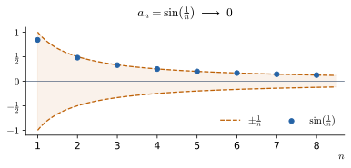{fig-alt="איברי סינוס של אחת חלקי n בין מינוס אחת חלקי n לאחת חלקי n. שני החסמים מתקרבים לאפס, וגם האיברים שביניהם." width="480" fig-align="center"}
::::

::: {#box-rule-positive-reciprocal-bound .thmrule title="חסימת הופכי חיובי"}
אם $0<u\le v$, אז
$$0<\frac1v\le\frac1u.$$
ככל שמחלקים במספר חיובי גדול יותר, המנה קטנה יותר. בחסימות מותר להחליף את הסימן הראשון ב $\le$: גם $0\le\frac1v\le\frac1u$ נכון.
:::

::::: {#box-exm-squeeze .thmsolved title="סינוס חלקי n"}
נחשב את הגבול של $\frac{\sin(n)}{n}$. ערכי הסינוס משתנים, אבל תמיד מתקיים
$$-1\le\sin(n)\le1.$$

בחרו **כללי גבולות ← כלל הסנדוויץ׳**. בתוך הנימוק בחרו את חסמי הסינוס והתחילו את הנימוק. בחרו **פעולות על האגפים ← חילוק**, חלקו ב $n$ וכתבו את שלושת האגפים שהתקבלו. האינדקס $n$ חיובי, ולכן כיוון האי־שוויונות נשמר.

לאחר בדיקת הצעד, העתיקו לשדות החסימות את שני האגפים החיצוניים. מצאו את גבולם המשותף וכתבו אותו כתוצאת צעד הסנדוויץ׳.

:::: {.derive limit="n" start="sin(n)/n"}
::: {.step line="0" action="squeeze" lower="-1/n" upper="1/n" bound-proof="{&quot;rule&quot;:&quot;sin&quot;,&quot;argument&quot;:&quot;n&quot;,&quot;entries&quot;:[{&quot;source&quot;:1,&quot;text&quot;:&quot;-1/n<=sin(n)/n<=1/n&quot;,&quot;actions&quot;:[{&quot;op&quot;:&quot;div&quot;,&quot;value&quot;:&quot;n&quot;}]}]}"}
מחלקים את $-1\le\sin(n)\le1$ ב $n>0$ ומקבלים
$$-\frac1n\le\frac{\sin(n)}{n}\le\frac1n.$$
שני החסמים שואפים לאפס, ולכן גם $\frac{\sin(n)}{n}\to0$.
:::
::::


::: {#prose-exm-squeeze-1 .lecture-answer .solution-prose title="פתרון במילים"}

נחשב את גבול הסדרה $a_n=\frac{\sin(n)}{n}$. לפי חסמי הסינוס מתקיים $-1\le\sin(n)\le1$. נחלק ב $n>0$ ונשמור על הכיוונים:
$$-\frac{1}{n}\le\frac{\sin(n)}{n}\le\frac{1}{n}.$$
שני החסמים, $-\frac{1}{n}$ ו $\frac{1}{n}$, שואפים לאפס. לפי [כלל הסנדוויץ׳](#box-thm-squeeze) גם הסדרה שביניהם מתכנסת לאפס:
$$\lim_{n\to\infty}\frac{\sin(n)}{n}=0.$$

:::

{fig-alt="איברי הסדרה סינוס n חלקי n נמצאים בין מינוס אחד חלקי n לבין אחד חלקי n. שני החסמים מתקרבים לאפס." width="520" fig-align="center"}
:::::

::: {#box-cor-bounded-zero .thmcor title="סדרה חסומה כפול סדרה השואפת לאפס"}
אם $(b_n)$ חסומה ו $a_n\to0$, אז $a_nb_n\to0$.
:::

::: {#box-exp-bounded-zero .thmexp title="מדוע הגורם החסום אינו מונע שאיפה לאפס?"}
הסדרה החסומה אינה חייבת להתכנס. אם $|b_n|\le M$, אז $|a_nb_n|\le M|a_n|$, והאגף הימני שואף לאפס.
:::

::: {#box-exm-cosine-root-limit .thmexm title="גבול הסדרה $\frac{\cos(n)}{\sqrt{n}}$"}
נחשב את גבול הסדרה $c_n=\frac{\cos(n)}{\sqrt{n}}$, עבור $n\ge1$.

לפי [חסמי הקוסינוס](#box-known-sequence-inequalities), $|\cos(n)|\le1$, ולכן הגורם $\cos(n)$ חסום. לפי [הגבולות הבסיסיים](#box-thm-standard), הגורם $\frac{1}{\sqrt{n}}$ שואף לאפס.

לכן, לפי [כלל המכפלה של סדרה חסומה בסדרה השואפת לאפס](#box-cor-bounded-zero),
$$\lim_{n\to\infty}\frac{\cos(n)}{\sqrt{n}}=0.$$
:::

:::: {.thmchk}
ידוע רק ש $0\le a_n\le2$ לכל $n$. האם [כלל הסנדוויץ׳](#box-thm-squeeze) מבטיח שהסדרה מתכנסת?

::: {.quiz options="כן|לא" answer="לא"}
לא. החסמים $0$ ו $2$ אינם מתכנסים לאותו מספר. למשל, $a_n=1+(-1)^n$ מקיימת את החסימות האלה ואינה מתכנסת.
:::

האם מספיק ששתי הסדרות במכפלה יהיו חסומות כדי שהמכפלה תשאף לאפס?

::: {.quiz options="כן|לא" answer="לא"}
לא. למשל, שתי הסדרות הקבועות $a_n=b_n=1$ חסומות, ומכפלתן שווה $1$.
:::
::::

::: {.thmrem title="אין צורך בחסם הטוב ביותר"}
כדי להשתמש בכלל הזה, אין צורך למצוא את החסם הטוב ביותר. אם $|b_n|\le1$, גם החסם $|b_n|\le10$ מספיק: בשני המקרים המכפלה עם סדרה השואפת לאפס תשאף לאפס. כמו בבחירת $N$, מחפשים מספר שמקיים את הדרישה, לא בהכרח את הקטן ביותר.
:::

::::: {#box-q-lim-bounded .thmsolved title="גורם חסום וגורם השואף לאפס"}
חשבו את הגבול של $\frac{3\cos(n)}{n}$. נפריד בין הגורם $3\cos(n)$ לבין $\frac{1}{n}$.

בחרו **כללי גבולות ← סדרה חסומה כפול סדרה השואפת לאפס**. בשדה הגורם החסום כתבו $3\cos(n)$, ובשדה החסם כתבו $3$.

לנימוק בחרו את חסמי הקוסינוס. כפל של שלושת האגפים ב $3$ יראה שהגורם שבחרתם נמצא בין $-3$ לבין $3$. לאחר בדיקת הנימוק, חשבו את גבול הגורם שנותר והסיקו את גבול המכפלה.

:::: {.derive limit="n" start="3*cos(n)/n"}
::: {.step line="0" action="bounded" factor="3*cos(n)" bound="3" bound-proof="{&quot;rule&quot;:&quot;cos&quot;,&quot;argument&quot;:&quot;n&quot;,&quot;entries&quot;:[{&quot;source&quot;:1,&quot;text&quot;:&quot;-3<=3*cos(n)<=3&quot;,&quot;actions&quot;:[{&quot;op&quot;:&quot;mul&quot;,&quot;value&quot;:&quot;3&quot;}]}]}"}
מחסמי הקוסינוס, לאחר כפל ב $3$, מתקבל
$$-3\le3\cos(n)\le3.$$
לכן $|3\cos(n)|\le3$. הגורם $\frac{1}{n}$ שואף לאפס, ומכאן שגבול המכפלה הוא אפס.
:::
::::

:::: fill
האם גם החסם $|3\cos(n)|\le10$ מספיק לשימוש בכלל? [כן]{.blank kind="text" ans="כן" choices="כן|לא"}

::: explain
כן. אין צורך בחסם הקטן ביותר. אם בוחרים $10$ בעוזר, יש לנמק את הרחבת החסימות מ $-3,3$ אל $-10,10$.
:::
::::

::: {#prose-q-lim-bounded-1 .lecture-answer .solution-prose title="פתרון במילים"}

נכתוב את הסדרה $a_n=\frac{3\cos(n)}{n}$ כמכפלה $3\cos(n)\cdot\frac{1}{n}$. כדי לחסום את הגורם הראשון, נכפול את החסימה $-1\le\cos(n)\le1$ ב $3>0$:
$$-3\le3\cos(n)\le3.$$
לכן $|3\cos(n)|\le3$, וזהו גורם חסום. הגורם השני, $\frac{1}{n}$, שואף לאפס. לפי הכלל של [סדרה חסומה כפול סדרה השואפת לאפס](#box-cor-bounded-zero),
$$\lim_{n\to\infty}\frac{3\cos(n)}{n}=0.$$

:::

:::::

::::: {#box-q-squeeze-bounds .thmsolved title="בונים סנדוויץ׳"}
נתונה $a_n=2+\frac{\sin(n)}{n}$. בנו חסימות בעזרת עוזר האי־שוויונות, ואז השתמשו ב[כלל הסנדוויץ׳](#box-thm-squeeze). גם חסמים רחבים יותר מתאימים, אם שניהם שואפים לאותו מספר.

:::: {.derive limit="n" start="2+sin(n)/n"}

::: {.step line="[2]" action="squeeze" lower="2-1/n" upper="2+1/n" bound-proof="{&quot;rule&quot;:&quot;sin&quot;,&quot;argument&quot;:&quot;n&quot;,&quot;entries&quot;:[{&quot;source&quot;:1,&quot;text&quot;:&quot;-1/n<=sin(n)/n<=1/n&quot;,&quot;actions&quot;:[{&quot;op&quot;:&quot;div&quot;,&quot;value&quot;:&quot;n&quot;}]},{&quot;source&quot;:2,&quot;text&quot;:&quot;2-1/n<=2+sin(n)/n<=2+1/n&quot;,&quot;actions&quot;:[{&quot;op&quot;:&quot;add&quot;,&quot;value&quot;:&quot;2&quot;}]}]}"}
מתחילים מ $-1\le\sin(n)\le1$. מחלקים ב $n>0$:
$$-\frac1n\le\frac{\sin(n)}{n}\le\frac1n.$$
מחברים $2$ לכל אגף:
$$2-\frac1n\le2+\frac{\sin(n)}{n}\le2+\frac1n.$$
שתי הסדרות החיצוניות שואפות אל $2$, ולכן גם הסדרה שביניהן שואפת אל $2$.
:::

::: hint
בחרו ״כלל הסנדוויץ׳״. בתוך הנימוק בחרו את חסמי הסינוס, חלקו ב $n$ וחברו $2$. כתבו בשדות החסימות את שני האגפים החיצוניים שקיבלתם.
:::
::::
:::::

::: {#prose-squeeze-bounds .lecture-answer .solution-prose title="פתרון במילים"}
עבור $a_n=2+\frac{\sin(n)}{n}$, כאשר $n\ge1$, נתחיל מ[חסמי הסינוס](#box-known-sequence-inequalities):
$$-1\le\sin(n)\le1.$$
נחלק את שלושת האגפים ב $n>0$, ולכן כיווני האי־שוויון נשמרים:
$$-\frac{1}{n}\le\frac{\sin(n)}{n}\le\frac{1}{n}.$$
נוסיף $2$ לכל אגף:
$$2-\frac{1}{n}\le a_n\le2+\frac{1}{n}.$$
לפי [הגבול של הסדרה ההופכית](#box-thm-standard) ו[חשבון גבולות](#box-thm-limit-arithmetic), שני האגפים החיצוניים שואפים אל $2$. לכן [כלל הסנדוויץ׳](#box-thm-squeeze) נותן
$$\lim_{n\to\infty}\left(2+\frac{\sin(n)}{n}\right)=2.$$
:::


### תרגילים {.unnumbered}

::::: {#box-q-squeeze-independent .thmqst title="כותבים חסימות ומשתמשים בהן"}
חשבו את הגבולות. אפשר להשתמש ב[כלל הסנדוויץ׳](#box-thm-squeeze) או בכלל של [סדרה חסומה כפול סדרה השואפת לאפס](#box-cor-bounded-zero). בחרו חסימה מוכרת ונמקו בעזרת פעולות על האגפים את החסימות שבהן השתמשתם.

**(א)** $\displaystyle\lim_{n\to\infty}\frac{\cos(n)}{n}$

:::: {.derive limit="n" start="cos(n)/n"}

::: {.step line="[0]" action="bounded" factor="cos(n)" bound="1" bound-proof="{&quot;rule&quot;:&quot;cos&quot;,&quot;argument&quot;:&quot;n&quot;,&quot;entries&quot;:[]}"}
מתקיים $|\cos(n)|\le1$, ואילו $\frac1n\to0$. לפי [](#box-cor-bounded-zero), המכפלה שואפת לאפס.
:::

::: hint
אין צורך לחשב את ערכי הקוסינוס. מה אפשר לומר על הערך המוחלט של כולם?
:::
::::

**(ב)** $\displaystyle\lim_{n\to\infty}\left(3-\frac{2\sin(n)}{n}\right)$

:::: {.derive limit="n" start="3-2*sin(n)/n"}

::: {.step line="[3]" action="squeeze" lower="3-2/n" upper="3+2/n" bound-proof="{&quot;rule&quot;:&quot;sin&quot;,&quot;argument&quot;:&quot;n&quot;,&quot;entries&quot;:[{&quot;source&quot;:1,&quot;text&quot;:&quot;2>=-2*sin(n)>=-2&quot;,&quot;actions&quot;:[{&quot;op&quot;:&quot;mul&quot;,&quot;value&quot;:&quot;-2&quot;}]},{&quot;source&quot;:2,&quot;text&quot;:&quot;2/n>=-2*sin(n)/n>=-2/n&quot;,&quot;actions&quot;:[{&quot;op&quot;:&quot;div&quot;,&quot;value&quot;:&quot;n&quot;}]},{&quot;source&quot;:3,&quot;text&quot;:&quot;3+2/n>=3-2*sin(n)/n>=3-2/n&quot;,&quot;actions&quot;:[{&quot;op&quot;:&quot;add&quot;,&quot;value&quot;:&quot;3&quot;}]}]}"}
מתחילים מהחסימה $-1\le\sin(n)\le1$. כופלים ב $-2$ והופכים את כיווני האי־שוויון:
$$2\ge-2\sin(n)\ge-2.$$
מחלקים ב $n>0$ ומחברים $3$:
$$3+\frac2n\ge3-\frac{2\sin(n)}{n}\ge3-\frac2n.$$
שני החסמים שואפים אל $3$, ולכן גם הסדרה שביניהם שואפת אל $3$, לפי [](#box-thm-squeeze).
:::

::: hint
אפשר לבחור רק את הביטוי $\frac{2\sin(n)}{n}$ ולטפל בו תחילה, או לחסום את כל הסדרה משני הצדדים.
:::
::::

**(ג)** $\displaystyle\lim_{n\to\infty}\frac{3+\sin(n)}{n^2}$

:::: {.derive limit="n" start="(3+sin(n))/n^2"}

::: {.step line="[0]" action="squeeze" lower="2/n^2" upper="4/n^2" bound-proof="{&quot;rule&quot;:&quot;sin&quot;,&quot;argument&quot;:&quot;n&quot;,&quot;entries&quot;:[{&quot;source&quot;:1,&quot;text&quot;:&quot;2<=3+sin(n)<=4&quot;,&quot;actions&quot;:[{&quot;op&quot;:&quot;add&quot;,&quot;value&quot;:&quot;3&quot;}]},{&quot;source&quot;:2,&quot;text&quot;:&quot;2/n^2<=(3+sin(n))/n^2<=4/n^2&quot;,&quot;actions&quot;:[{&quot;op&quot;:&quot;div&quot;,&quot;value&quot;:&quot;n^2&quot;}]}]}"}
מתחילים מהחסימה
$$-1\le\sin(n)\le1.$$
מחברים $3$ לכל האגפים:
$$2\le3+\sin(n)\le4.$$
מכאן $|3+\sin(n)|\le4$. המונה חסום, והגורם $\frac1{n^2}$ שואף לאפס. משתמשים ב [](#box-cor-bounded-zero).

אפשר גם לחלק את שלושת האגפים ב $n^2>0$:
$$\frac2{n^2}\le\frac{3+\sin(n)}{n^2}\le\frac4{n^2}.$$
שתי הסדרות החיצוניות שואפות לאפס, ולכן אפשר להשתמש גם ב [](#box-thm-squeeze).
:::

::: hint
התחילו בחסם לסינוס, והוסיפו $3$. גם חסם שאינו הקטן ביותר יכול להתאים.
:::
::::
:::::


## טכניקות לחישוב גבולות

כדי להשתמש בחשבון הגבולות, צריך לזהות בביטוי סדרות שאת גבולותיהן אנחנו מכירים. לפעמים הן מתגלות רק אחרי פישוט אלגברי. נכיר שלוש דרכים שימושיות לכך.

### חלוקה בחזקה הגבוהה במכנה {.unnumbered}

:::: {#box-exm-limit-equal-degree .thmexm title="מנה של פולינומים מאותה מעלה"}
נחשב את גבול הסדרה
$$a_n=\frac{2n^2+3n}{5n^2+1},\qquad n\ge1.$$
**נחלק כל מחובר במונה ובמכנה ב $n^2>0$.** כך נקבל קבועים ומחוברים שגבולותיהם ידועים:
$$a_n=\frac{2+\frac{3}{n}}{5+\frac{1}{n^2}}.$$
לפי [הגבולות הבסיסיים](#box-thm-standard) ו[חשבון גבולות](#box-thm-limit-arithmetic), המונה החדש שואף ל $2$ והמכנה ל $5\ne0$. לכן
$$\begin{aligned}
\lim_{n\to\infty}a_n
&=\lim_{n\to\infty}\frac{2+\frac{3}{n}}{5+\frac{1}{n^2}}\\
&=\frac{2+0}{5+0}\\
&=\frac{2}{5}.
\end{aligned}$$
החלוקה לא שינתה אף איבר בסדרה; היא רק כתבה אותו בצורה שאפשר להפעיל עליה את כלל המנה.

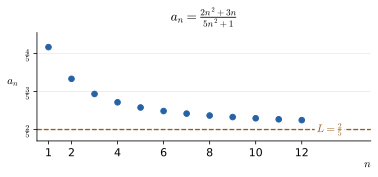{fig-alt="איברי הסדרה שתיים n בריבוע ועוד שלוש n חלקי חמש n בריבוע ועוד אחת מתקרבים לגבול שתי חמישיות. הנקודות הן איברים נפרדים והקו המקווקו מסמן את הגבול." width="480" fig-align="center"}
::::

::: {#box-method-largest-power .thmmethod title="מנה של פולינומים"}
מחלקים כל מחובר במונה ובמכנה באותה חזקה של $n$: בדרך כלל, החזקה הגבוהה ביותר שמופיעה במכנה.

בדוגמאות הבאות החזקה הגבוהה במונה אינה גדולה מזו שבמכנה. לאחר החלוקה נקבל קבועים ומחוברים מהצורה $\frac{c}{n^p}$ עם $p>0$. כשהמונה והמכנה החדשים מתכנסים וגבול המכנה שונה מאפס, משתמשים ב[כלל המנה](#box-thm-limit-arithmetic).
:::

::::: {#box-exm-lim-linear-ratio .thmsolved title="מתחילים במנה פשוטה"}
נחשב את
$$\lim_{n\to\infty}\frac{n+2}{n+4}.$$
המונה והמכנה אינם מתכנסים למספרים ממשיים, ולכן [כלל המנה](#box-thm-limit-arithmetic) עדיין אינו מתאים. נחלק את כל המחוברים ב $n$.

:::: {.derive limit="n" start="(n+2)/(n+4)"}

::: {.step line="(1+2/n)/(1+4/n)" action="divide" value="n" clean="מחלקים את המונה ואת המכנה ב $n>0$."}
בוחרים ״חילוק המונה והמכנה בביטוי״, ומציינים $n$.
:::

::: {.step line="(1+0)/(1+0)" action="arithmetic"}
כעת המונה והמכנה מתכנסים אל $1$. גבול המכנה אינו אפס, ולכן [כלל המנה](#box-thm-limit-arithmetic) חל.
:::

::: {.step line="1" action="compute"}
מחשבים את המנה.
:::
::::

::: {#prose-exm-lim-linear-ratio-1 .lecture-answer .solution-prose title="פתרון במילים"}

בסדרה $a_n=\frac{n+2}{n+4}$ נחלק את המונה ואת המכנה ב $n>0$:
$$a_n=\frac{1+\frac{2}{n}}{1+\frac{4}{n}}.$$
המחוברים $\frac{2}{n}$ ו $\frac{4}{n}$ שואפים לאפס, ולכן המונה והמכנה החדשים שואפים ל $1$. גבול המכנה שונה מאפס, ואפשר להשתמש ב[כלל המנה](#box-thm-limit-arithmetic):
$$\lim_{n\to\infty}a_n=\frac{1+0}{1+0}=1.$$

:::

:::::

::::: {#box-exm-lim-rational .thmsolved title="מחלקים, ורק אז עוברים לגבול"}
חשבו את הגבול
$$\lim_{n\to\infty}\frac{3n^2+1}{n^2+4n}.$$

:::: {.derive limit="n" start="(3n^2+1)/(n^2+4n)"}

::: {.step line="(3+[1/n^2])/(1+[4/n])"}
מחלקים כל מחובר במונה ובמכנה באותה חזקה $n^2$.
:::

::: {.step line="(3+[0])/(1+[0])"}
המחוברים $\frac1{n^2}$ ו $\frac4n$ שואפים לאפס. גבול המכנה הוא $1\ne0$, ולכן אפשר להשתמש ב [](#box-thm-limit-arithmetic).
:::

::: {.step line="[3]"}
מחשבים את המנה.
:::

::: hint
למשל, $\frac{4n}{n^2}=\frac4n$. צריך לחלק כל מחובר, גם את $1$ שבמונה.
:::
::::

::: {#prose-exm-lim-rational-1 .lecture-answer .solution-prose title="פתרון במילים"}

בסדרה $a_n=\frac{3n^2+1}{n^2+4n}$ נחלק כל מחובר במונה ובמכנה ב $n^2>0$:
$$a_n=\frac{3+\frac{1}{n^2}}{1+\frac{4}{n}}.$$
מתקיים $\frac{1}{n^2}\to0$ ו $\frac{4}{n}\to0$. לכן המונה החדש שואף ל $3$, והמכנה החדש שואף ל $1\ne0$. לפי [כלל המנה](#box-thm-limit-arithmetic),
$$\lim_{n\to\infty}a_n=\frac{3+0}{1+0}=3.$$

:::

:::::

:::: {.thmchk}
מה מתקבל מחלוקת $5n+2$ בחזקה $n^2$?

::: fill
[$\frac{5}{n}+\frac{2}{n^2}$]{.blank ans="5/n+2/n^2" vars="n" positive="n" integer="n" w="16"}

::: explain
מחלקים כל מחובר: $\frac{5n+2}{n^2}=\frac5n+\frac2{n^2}$.
:::
:::
::::

:::: {#box-exm-limit-lower-degree .thmexm title="מעלת המונה קטנה ממעלת המכנה"}
נתונה הסדרה
$$b_n=\frac{4n+1}{2n^2+3},\qquad n\ge1.$$
לפי [שיטת החלוקה בחזקה הגבוהה במכנה](#box-method-largest-power), נחלק כל מחובר ב $n^2>0$:
$$b_n=\frac{\frac{4}{n}+\frac{1}{n^2}}{2+\frac{3}{n^2}}.$$
**כאן כל מחובר במונה החדש שואף לאפס.** המכנה שואף ל $2\ne0$. לפי [הגבולות הבסיסיים](#box-thm-standard) ו[כלל המנה](#box-thm-limit-arithmetic),
$$\begin{aligned}
\lim_{n\to\infty}b_n
&=\lim_{n\to\infty}\frac{\frac{4}{n}+\frac{1}{n^2}}{2+\frac{3}{n^2}}\\
&=\frac{0+0}{2+0}\\
&=0.
\end{aligned}$$
::::

### כפל וחילוק בצמוד {.unnumbered}

:::: {#box-exm-limit-scaled-root .thmexm title="גבול הסדרה $n\left(\sqrt{1+\frac{2}{n}}-1\right)$"}
נתונה הסדרה
$$c_n=n\left(\sqrt{1+\frac{2}{n}}-1\right),\qquad n\ge1.$$
ההפרש שבסוגריים שואף לאפס, אבל כופלים אותו ב $n$. לכן אי אפשר להסיק מכך שגם המכפלה שואפת לאפס.

**נכפול ונחלק בסכום $\sqrt{1+\frac{2}{n}}+1$.** הסכום חיובי, ולכן החלוקה מותרת:
$$\begin{aligned}
c_n
&=\frac{n\left(\sqrt{1+\frac{2}{n}}-1\right)\left(\sqrt{1+\frac{2}{n}}+1\right)}{\sqrt{1+\frac{2}{n}}+1}\\
&=\frac{n\left(1+\frac{2}{n}-1\right)}{\sqrt{1+\frac{2}{n}}+1}\\
&=\frac{2}{\sqrt{1+\frac{2}{n}}+1}.
\end{aligned}$$
לפי [הגבולות הבסיסיים](#box-thm-standard), $\frac{2}{n}\to0$. לפי [כלל השורש](#box-prp-limit-powers) ו[חשבון גבולות](#box-thm-limit-arithmetic), המכנה החדש שואף ל $2\ne0$, ולכן
$$\begin{aligned}
\lim_{n\to\infty}c_n
&=\lim_{n\to\infty}\frac{2}{\sqrt{1+\frac{2}{n}}+1}\\
&=\frac{2}{\sqrt{1+0}+1}\\
&=1.
\end{aligned}$$

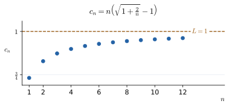{fig-alt="איברי n כפול שורש של אחת ועוד שתיים חלקי n פחות אחת מתקרבים לגבול אחת. המכפלה אינה שואפת לאפס אף שההפרש שבסוגריים שואף לאפס." width="480" fig-align="center"}
::::

::: {#box-method-conjugate .thmmethod title="הפרש של שורשים"}
כשהביטוי כולל הפרש כמו $\sqrt A-\sqrt B$, אפשר לכפול ולחלק בסכום $\sqrt A+\sqrt B$. הסכום נקרא [**הצמוד**]{.term} של ההפרש.

משתמשים בזהות
$$(\sqrt A-\sqrt B)(\sqrt A+\sqrt B)=A-B.$$
הכפל והחילוק באותו ביטוי אינם משנים את הערך, בתנאי שהביטוי הזה שונה מאפס.
:::

::::: {#box-exm-conjugate-algebra .thmsolved title="הצמוד: קודם האלגברה"}
כתבו את $\sqrt{n+1}-\sqrt n$ כמנה שאין במונה שלה הפרש של שורשים. כאן מפשטים את האיבר; בדוגמה הבאה נחשב את גבולו בעזרת [כלל הסנדוויץ׳](#box-thm-squeeze).

:::: {.derive vars="n" positive="n" start="sqrt(n+1)-sqrt(n)"}

::: {.step line="1/(sqrt(n+1)+sqrt(n))" action="conjugate"}
כופלים ומחלקים בצמוד. המונה הוא $(n+1)-n=1$, והמכנה חיובי.
:::
::::

::: {#prose-exm-conjugate-algebra-1 .lecture-answer .solution-prose title="פתרון במילים"}

נפשט את $\sqrt{n+1}-\sqrt{n}$ עבור $n\ge1$. הצמוד $\sqrt{n+1}+\sqrt{n}$ חיובי, ולכן אפשר לכפול ולחלק בו. לפי זהות הפרש הריבועים,
$$\begin{aligned}
\sqrt{n+1}-\sqrt{n}
&=\frac{(\sqrt{n+1}-\sqrt{n})(\sqrt{n+1}+\sqrt{n})}{\sqrt{n+1}+\sqrt{n}}\\
&=\frac{(n+1)-n}{\sqrt{n+1}+\sqrt{n}}\\
&=\frac{1}{\sqrt{n+1}+\sqrt{n}}.
\end{aligned}$$

:::

:::::

::::: {#box-exm-conjugate-squeeze .thmsolved title="הצמוד והסנדוויץ׳ יחד"}
נשלים את החישוב שהתחלנו ב [](#box-exm-conjugate-algebra):
$$a_n=\sqrt{n+1}-\sqrt n=\frac1{\sqrt{n+1}+\sqrt n}.$$
השורשים חיוביים, ולכן $\sqrt n\le\sqrt{n+1}+\sqrt n$. נשתמש בכך כדי לחסום את ההופכי.

:::: {.derive vars="n" positive="n" bound-rule="rootSum" start="sqrt(n)<=sqrt(n+1)+sqrt(n)"}

::: {.step line="0<=1/(sqrt(n+1)+sqrt(n))<=1/sqrt(n)" action="reciprocalBound" clean="מכיוון ש $0<\sqrt n\le\sqrt{n+1}+\sqrt n$, ההופכי חיובי ואינו גדול מ $\frac{1}{\sqrt{n}}$."}
בוחרים ״פעולות על חסמים ← חסימת הופכי של ביטוי חיובי״. מתקבל חסם מלרע $0$ וחסם מלעיל $\frac{1}{\sqrt{n}}$.
:::
::::


::: {#prose-exm-conjugate-squeeze-1 .lecture-answer .solution-prose title="פתרון במילים"}

נחסום את $\frac{1}{\sqrt{n+1}+\sqrt{n}}$ עבור $n\ge1$. מתקיים
$$0<\sqrt{n}\le\sqrt{n+1}+\sqrt{n}.$$
ההופכי של המכנה הגדול יותר קטן יותר, ושני ההופכיים חיוביים. לכן
$$0\le\frac{1}{\sqrt{n+1}+\sqrt{n}}\le\frac{1}{\sqrt{n}}.$$

:::

שני החסמים שואפים לאפס. לכן [כלל הסנדוויץ׳](#box-thm-squeeze) נותן את הגבול:

:::: {.derive limit="n" start="sqrt(n+1)-sqrt(n)"}

::: {.step line="1/(sqrt(n+1)+sqrt(n))" action="conjugate"}
כופלים ומחלקים בצמוד.
:::

::: {.step line="0" action="squeeze" lower="0" upper="1/sqrt(n)" bound-proof="{&quot;rule&quot;:&quot;rootSum&quot;,&quot;argument&quot;:&quot;n&quot;,&quot;entries&quot;:[{&quot;source&quot;:1,&quot;text&quot;:&quot;0<=1/(sqrt(n+1)+sqrt(n))<=1/sqrt(n)&quot;,&quot;actions&quot;:[{&quot;op&quot;:&quot;reciprocalBound&quot;}]}]}" clean="שני החסמים, $0$ ו $\frac{1}{\sqrt{n}}$, שואפים לאפס. לפי [כלל הסנדוויץ׳](#box-thm-squeeze), גם הסדרה שביניהם שואפת לאפס."}
בוחרים ״כלל הסנדוויץ׳״, כותבים את שני החסמים ומנמקים אותם בעזרת ״שורש לעומת סכום שורשים חיוביים״ והפעולה שתרגלנו.
:::
::::

::: {#prose-exm-conjugate-squeeze-2 .lecture-answer .solution-prose title="פתרון במילים"}

נחשב את גבול הסדרה $a_n=\sqrt{n+1}-\sqrt{n}$. כפל וחילוק בצמוד החיובי נותנים
$$a_n=\frac{(n+1)-n}{\sqrt{n+1}+\sqrt{n}}=\frac{1}{\sqrt{n+1}+\sqrt{n}}.$$
מכיוון ש $0<\sqrt{n}\le\sqrt{n+1}+\sqrt{n}$, לפי חסימת הופכי חיובי מתקיים
$$0\le a_n\le\frac{1}{\sqrt{n}}.$$
שני החסמים שואפים לאפס. לפי [כלל הסנדוויץ׳](#box-thm-squeeze),
$$\lim_{n\to\infty}(\sqrt{n+1}-\sqrt{n})=0.$$

:::

:::::

::::: {#box-exm-limit-conjugate .thmsolved title="מסלקים את ההפרש"}
חשבו את הגבול של $\sqrt{n^2+n}-n$. שני הביטויים שבחיסור גדלים ללא גבול, ולכן אי אפשר להשתמש כאן ישירות בכלל החיסור לסדרות המתכנסות למספרים. הכפל בצמוד יעזור לכתוב את אותו ביטוי בצורה שאפשר לחשב את גבולה.

מכיוון ש $n>0$, אפשר לכתוב $n=\sqrt{n^2}$.

:::: {.derive limit="n" start="sqrt(n^2+n)-n"}

::: {.step line="[n]/(sqrt(n^2+n)+n)"}
כופלים ומחלקים בצמוד $\sqrt{n^2+n}+n$. במונה מתקבל $(n^2+n)-n^2=n$.
:::

::: {.step line="1/(sqrt(1+[1/n])+1)"}
מחלקים את המונה ואת המכנה במספר החיובי $n$. בחלוקת השורש מתקבל
$$\frac{\sqrt{n^2+n}}n
=\sqrt{\frac{n^2+n}{n^2}}
=\sqrt{1+\frac1n}.$$
בתוך השורש מחלקים ב $n^2$, כי $n=\sqrt{n^2}$.
:::

::: {.step line="1/(sqrt(1+[0])+1)"}
עוברים לגבול לפי [כלל המנה](#box-thm-limit-arithmetic) ו[כלל השורש](#box-prp-limit-powers).
:::

::: {.step line="[1/2]"}
מחשבים את התוצאה.
:::

::: hint
כפלו וחלקו בצמוד $\sqrt{n^2+n}+n$. במונה השתמשו בזהות של הפרש ריבועים.
:::
::::


::: {#prose-exm-limit-conjugate-1 .lecture-answer .solution-prose title="פתרון במילים"}

בסדרה $a_n=\sqrt{n^2+n}-n$ נכפול ונחלק בצמוד $\sqrt{n^2+n}+n$, שהוא חיובי:
$$a_n=\frac{(n^2+n)-n^2}{\sqrt{n^2+n}+n}=\frac{n}{\sqrt{n^2+n}+n}.$$
נחלק את המונה ואת המכנה ב $n>0$. מכיוון ש $n=\sqrt{n^2}$, מתקיים
$$\frac{\sqrt{n^2+n}}{n}=\sqrt{\frac{n^2+n}{n^2}}=\sqrt{1+\frac{1}{n}}.$$
לכן
$$a_n=\frac{1}{\sqrt{1+\frac{1}{n}}+1}.$$
מתקיים $\frac{1}{n}\to0$, ולפי [כלל השורש](#box-prp-limit-powers) המכנה שואף ל $\sqrt{1}+1=2\ne0$. [כלל המנה](#box-thm-limit-arithmetic) נותן
$$\lim_{n\to\infty}a_n=\frac{1}{\sqrt{1+0}+1}=\frac{1}{2}.$$

:::

ההפרש, ולא גודלם של שני האיברים בנפרד, הוא שמעניין אותנו כאן. הנה כמה ערכים מקורבים של אותה סדרה $a_n=\sqrt{n^2+n}-n$:

| $n$ | $\sqrt{n^2+n}$ בקירוב | $a_n=\sqrt{n^2+n}-n$ בקירוב |
|:---:|:---:|:---:|
| $1$ | $1.4142$ | $0.4142$ |
| $10$ | $10.4881$ | $0.4881$ |
| $100$ | $100.4988$ | $0.4988$ |

כפי שחישבנו, $\displaystyle\lim_{n\to\infty}(\sqrt{n^2+n}-n)=\frac12$. בציור מוצג ההפרש עצמו:

{fig-alt="איברי הסדרה שורש של n בריבוע ועוד n, פחות n, עולים ומתקרבים לחצי. הציור מציג את ההפרש הקטן, ולא את שני הביטויים הגדולים שבחיסור." width="560" fig-align="center"}

:::::

### חזקות עם מעריך n {.unnumbered}

:::: {#box-exm-limit-exponential-quotient .thmexm title="מנה של סכומים והפרשים של חזקות"}
נחשב את גבול הסדרה
$$d_n=\frac{5^n-2^n}{3\cdot5^n+1},\qquad n\ge1.$$
**נחלק כל מחובר ב $5^n>0$.** לפי [חוקי החזקות](01-Introduction.qmd#box-thm-exp-laws),
$$\frac{2^n}{5^n}=\left(\frac{2}{5}\right)^n,\qquad \frac{1}{5^n}=\left(\frac{1}{5}\right)^n.$$
לכן
$$d_n=\frac{1-\left(\frac{2}{5}\right)^n}{3+\left(\frac{1}{5}\right)^n}.$$
שני הבסיסים, $\frac{2}{5}$ ו $\frac{1}{5}$, נמצאים בין $0$ ל $1$. לפי [הגבול של סדרה הנדסית](#box-thm-standard), שתי החזקות שואפות לאפס.

המכנה החדש שואף ל $3\ne0$, ולכן [כלל המנה](#box-thm-limit-arithmetic) נותן
$$\begin{aligned}
\lim_{n\to\infty}d_n
&=\lim_{n\to\infty}\frac{1-\left(\frac{2}{5}\right)^n}{3+\left(\frac{1}{5}\right)^n}\\
&=\frac{1-0}{3+0}\\
&=\frac{1}{3}.
\end{aligned}$$
::::

::::: {#box-exm-limit-exponentials .thmsolved title="מחלקים בחזקה שבמכנה"}
חשבו את הגבול
$$\lim_{n\to\infty}\frac{2^n+3^n}{3^n}.$$

:::: {.derive limit="n" start="(2^n+3^n)/3^n"}

::: {.step line="([2/3])^n+[1]"}
מפרידים את השבר לסכום שני שברים.

חוק החזקות נותן
$$\frac{2^n}{3^n}=\left(\frac23\right)^n.$$
השבר השני הוא $\frac{3^n}{3^n}=1$.
:::

::: {.step line="[0]+1"}
המנה $q=\frac23$ מקיימת $|q|<1$, ולכן החזקה שואפת לאפס.
:::

::: {.step line="[1]"}
מחשבים.
:::
::::

::: {#prose-exm-limit-exponentials-1 .lecture-answer .solution-prose title="פתרון במילים"}

בסדרה $a_n=\frac{2^n+3^n}{3^n}$ נפריד את המנה לסכום ונשתמש בחוק החזקות:
$$a_n=\frac{2^n}{3^n}+\frac{3^n}{3^n}=\left(\frac{2}{3}\right)^n+1.$$
מכיוון ש $\left|\frac{2}{3}\right|<1$, הסדרה ההנדסית $\left(\frac{2}{3}\right)^n$ שואפת לאפס. לפי [כלל החיבור](#box-thm-limit-arithmetic),
$$\lim_{n\to\infty}a_n=0+1=1.$$

:::

:::::

### תרגילים {.unnumbered}

::::: {#box-q-lim-rational .thmqst title="מנות של פולינומים"}
חשבו את הגבולות.

**(א)** $\lim_{n\to\infty}\frac{5n^2-n}{2n^2+7}$

:::: {.derive limit="n" start="(5n^2-n)/(2n^2+7)"}

::: {.step line="(5-[1/n])/(2+[7/n^2])"}
מחלקים את המונה ואת המכנה בחזקה $n^2$.
:::

::: {.step line="(5-[0])/(2+[0])"}
עוברים לגבול. גבול המכנה הוא $2\ne0$.
:::

::: {.step line="[5/2]"}
מחשבים.
:::
::::

**(ב)** $\lim_{n\to\infty}\frac{2n+5}{n^2+1}$

:::: {.derive limit="n" start="(2n+5)/(n^2+1)"}

::: {.step line="([2/n]+[5/n^2])/(1+[1/n^2])"}
מחלקים את המונה ואת המכנה בחזקה $n^2$.
:::

::: {.step line="([0]+[0])/(1+[0])"}
עוברים לגבול.
:::

::: {.step line="[0]"}
מחשבים.
:::
::::
:::::

::::: {#box-q-limit-techniques .thmqst title="צמוד וחזקות"}
חשבו את הגבולות.

**(א)** $\lim_{n\to\infty}(\sqrt{n^2+4n}-n)$

:::: {.derive limit="n" start="sqrt(n^2+4n)-n"}

::: {.step line="[4n]/(sqrt(n^2+4n)+n)"}
כופלים ומחלקים בצמוד.
:::

::: {.step line="4/(sqrt(1+[4/n])+1)"}
מחלקים את המונה ואת המכנה במספר החיובי $n$.
:::

::: {.step line="4/(sqrt(1+[0])+1)"}
עוברים לגבול.
:::

::: {.step line="[2]"}
מחשבים.
:::
::::

**(ב)** $\lim_{n\to\infty}\frac{n+2^n}{2^n}$

:::: {.derive limit="n" start="(n+2^n)/2^n"}

::: {.step line="[n/2^n]+[1]"}
מחלקים כל מחובר במונה בביטוי $2^n$.
:::

::: {.step line="[0]+1"}
משתמשים בגבול $\frac n{2^n}\to0$ מתוך [](#box-thm-standard).
:::

::: {.step line="[1]"}
מחשבים.
:::
::::
:::::

::::: {#box-q-limit-choose-method .thmqst title="בוחרים איך להתחיל"}
חשבו את הגבולות. בכל סעיף בחרו שינוי אלגברי שיאפשר להשתמש בגבולות המוכרים.

**(א)** $\displaystyle\lim_{n\to\infty}\frac{4n+1}{2n-3}$

:::: {.derive limit="n" start="(4n+1)/(2n-3)"}

::: {.step line="(4+[1/n])/(2-[3/n])"}
מחלקים את המונה ואת המכנה ב $n$, לפי [](#box-method-largest-power).
:::

::: {.step line="(4+[0])/(2-[0])"}
גבול המכנה הוא $2$, ולכן אפשר להשתמש ב[כלל המנה](#box-thm-limit-arithmetic).
:::

::: {.step line="[2]"}
מחשבים.
:::

::: hint
מה מתקבל אם מחלקים כל מחובר ב $n$?
:::
::::

**(ב)** $\displaystyle\lim_{n\to\infty}\frac{5^n+2^n}{3\cdot5^n-1}$

:::: {.derive limit="n" start="(5^n+2^n)/(3*5^n-1)"}

::: {.step line="(1+[(2/5)^n])/(3-[1/5^n])"}
מחלקים את המונה ואת המכנה ב $5^n$. חוקי החזקות נותנים $\frac{2^n}{5^n}=(\frac25)^n$.
:::

::: {.step line="(1+[0])/(3-[0])"}
שתי הסדרות המשתנות שואפות לאפס. גבול המכנה הוא $3$.
:::

::: {.step line="[1/3]"}
משתמשים ב[כלל המנה](#box-thm-limit-arithmetic).
:::

::: hint
נסו לחלק בחזקה בעלת הבסיס הגדול יותר.
:::
::::

**(ג)** $\displaystyle\lim_{n\to\infty}(\sqrt{n^2+1}-n)$

:::: {.derive limit="n" start="sqrt(n^2+1)-n"}

::: {.step line="[1]/(sqrt(n^2+1)+n)"}
כופלים ומחלקים בצמוד, לפי [](#box-method-conjugate).
:::

::: {.step line="[1/n]/(sqrt(1+[1/n^2])+1)"}
מחלקים את המונה ואת המכנה ב $n$. מכיוון ש $n>0$, אפשר להכניס את החילוק לתוך השורש כחילוק ב $n^2$.
:::

::: {.step line="[0]/(sqrt(1+[0])+1)"}
משתמשים בחשבון הגבולות וב[כלל השורש](#box-prp-limit-powers).
:::

::: {.step line="[0]"}
מחשבים.
:::

::: hint
אילו היינו כופלים בהפרש ובסכום של אותם שני ביטויים, היינו מקבלים הפרש ריבועים.
:::
::::
:::::


::::: {#box-q-mixed-limit-methods .thmqst title="איזו דרך מתאימה לביטוי?"}
חשבו את הגבולות בעוזר. בחרו בעצמכם את הפעולות: בחלק מהסעיפים אפשר להשתמש מיד בחשבון גבולות, ובאחרים דרוש שינוי אלגברי או נימוק באמצעות חסימות. ייתכנו כמה דרכים נכונות.

**(א)** $\displaystyle\lim_{n\to\infty}\frac{4+\frac{1}{n}}{2+\frac{3}{n}}$

:::: {.derive limit="n" start="(4+1/n)/(2+3/n)"}
::: {.step line="2" action="arithmetic"}
גבולות המונה והמכנה הם $4$ ו $2$. גבול המכנה אינו אפס, ולכן [כלל המנה](#box-thm-limit-arithmetic) נותן $2$.
:::
::::

**(ב)** $\displaystyle\lim_{n\to\infty}\frac{\sin(n)}{n^2}$

:::: {.derive limit="n" start="sin(n)/n^2"}
::: {.step line="0" action="bounded" factor="sin(n)" bound="1" bound-proof="{&quot;rule&quot;:&quot;sin&quot;,&quot;argument&quot;:&quot;n&quot;,&quot;entries&quot;:[]}"}
בוחרים את חסמי הסינוס: $|\sin(n)|\le1$. הגורם $\frac{1}{n^2}$ שואף לאפס, ולכן גבול המכפלה הוא אפס. אין צורך בגבול לסדרה $\sin(n)$ עצמה.
:::
::::

**(ג)** $\displaystyle\lim_{n\to\infty}(\sqrt{n^2+4n}-n)$

:::: {.derive limit="n" start="sqrt(n^2+4n)-n"}
::: {.step line="4n/(sqrt(n^2+4n)+n)" action="conjugate"}
כופלים ומחלקים בצמוד. במונה נשאר $4n$.
:::
::: {.step line="4/(sqrt(1+4/n)+1)" action="divide" value="n"}
מחלקים את המונה והמכנה ב $n>0$. בתוך השורש מתקבל חילוק ב $n^2$.
:::
::: {.step line="2" action="arithmetic"}
גבול המכנה הוא $\sqrt1+1=2$, ולכן גבול המנה הוא $2$.
:::
::::

**(ד)** חשבו כל גבול בנפרד והשוו את התוצאות.

**1. שורש מסדר קבוע**
$$\lim_{n\to\infty}\sqrt{16+\frac{1}{n}}.$$

:::: {.derive limit="n" start="sqrt(16+1/n)" given="n>=1"}
::: {.step line="4" action="arithmetic"}
סדר השורש קבוע. מ[חשבון גבולות](#box-thm-limit-arithmetic) ו[כלל השורש](#box-prp-limit-powers) מתקבל $\sqrt{16+0}=4$.
:::
::::

**2. שורש מסדר משתנה**
$$\lim_{n\to\infty}\sqrt[n]{16}.$$

:::: {.derive limit="n" start="root(n,16)" given="n>=1"}
::: {.step line="1" action="standard"}
כאן סדר השורש גדל והמספר שמתחתיו קבוע. משתמשים ב[גבול המוכר](#box-thm-standard) $\sqrt[n]{a}\to1$ עבור $a>0$, עם $a=16$.
:::
::::
:::::

## גבולות אינסופיים

לא כל סדרה מתקרבת למספר ממשי. נרצה לתאר גם מצב שבו, מאינדקס מתאים והלאה, כל האיברים גדולים מכל סף שנבחר — או קטנים ממנו.

::: {#box-def-infinite-limit .thmdef title="שאיפה לאינסוף ולמינוס אינסוף"}
תהי $(a_n)_{n=1}^{\infty}$ סדרה.

כותבים $a_n\to\infty$ אם **לכל מספר ממשי $M$ קיים אינדקס טבעי $N$ כך שלכל $n\ge N$** מתקיים
$$a_n>M.$$
כותבים $a_n\to-\infty$ אם **לכל מספר ממשי $M$ קיים אינדקס טבעי $N$ כך שלכל $n\ge N$** מתקיים
$$a_n<M.$$
אלה נקראים [**גבולות אינסופיים**]{.term}.
:::

::: {#box-exp-infinite-limit .thmexp title="לעבור כל סף ולהישאר מעבר לו"}
בוחרים קו אופקי בגובה $M$. בשאיפה לאינסוף, אפשר להתקדם עד אינדקס $N$ שממנו והלאה **כל** הנקודות מעל הקו. אם נבחר סף גבוה יותר, ייתכן שנצטרך להתקדם לאינדקס מאוחר יותר.

{fig-alt="איור של שאיפה לאינסוף: קו אופקי M ואינדקס N. כל הנקודות החל מ N נמצאות מעל M, גם כאשר יש ירידה בחלק מהצעדים." width="520" fig-align="center"}

בשאיפה למינוס אינסוף, כל הנקודות החל מאינדקס מתאים נמצאות **מתחת** לקו שבחרנו.

{fig-alt="איור של שאיפה למינוס אינסוף: קו אופקי M ואינדקס N. כל הנקודות החל מ N נמצאות מתחת ל M." width="520" fig-align="center"}

הציורים מציגים סף אחד; [ההגדרה](#box-def-infinite-limit) דורשת זאת **לכל $M$**. אין צורך שהאיברים יעלו או ירדו בכל צעד. זו אינה התכנסות למספר ממשי, ולכן סדרה בעלת גבול אינסופי היא סדרה מתבדרת.
:::

::: {#box-exm-square-infinite .thmexm title="הריבועים עוברים כל סף"}
נתונה הסדרה $a_n=n^2$, עבור $n\ge1$.
כדי להבטיח $a_n>100$, אפשר לבחור $N=11$: לכל $n\ge11$ מתקיים $n^2\ge121>100$.
עבור $M=10000$ אפשר לבחור $N=101$.

שתי הבדיקות האלה הן הדגמה בלבד. **לכל $M\ge0$**, נבחר אינדקס טבעי $N>\sqrt{M}$. אז לכל $n\ge N$,
$$a_n=n^2\ge N^2>M.$$
אם $M<0$, אפשר לבחור $N=1$, כי כל האיברים חיוביים. לכן $a_n\to\infty$ לפי [ההגדרה](#box-def-infinite-limit).
:::

::: {#box-exm-root-infinite .thmexm title="גם השורשים עוברים כל סף"}
נתונה הסדרה $a_n=\sqrt{n}$, עבור $n\ge1$.
עבור $M=2$ צריך $\sqrt{n}>2$, כלומר $n>4$. לכן אפשר לבחור $N=5$.

{fig-alt="איברי שורש n והקו M=2. האיבר הרביעי נמצא על הקו ואינו עומד בדרישה הממשית; כל האיברים החל מ N=5 מעליו." width="520" fig-align="center"}

לכל $M\ge0$ אפשר לבחור $N>M^2$; אז לכל $n\ge N$ מתקיים $\sqrt{n}>M$. עבור $M<0$ כל האיברים כבר מעל הסף.
לכן $\sqrt{n}\to\infty$ לפי [ההגדרה](#box-def-infinite-limit), אף שהעלייה נעשית איטית יותר.
:::

::: {#box-exm-negative-infinite .thmexm title="האיברים יורדים מתחת לכל סף"}
נתונה הסדרה $b_n=-n$, עבור $n\ge1$.
כדי שכל האיברים יהיו קטנים מ $-100$, אפשר לבחור $N=101$.
לכל סף ממשי $M$, נבחר אינדקס טבעי $N>\max\{0,-M\}$. לכל $n\ge N$ מתקיים
$$b_n=-n\le-N<M.$$
לכן $b_n\to-\infty$ לפי [ההגדרה](#box-def-infinite-limit).
:::

::: {#box-warn-unbounded-not-infinite .thmwarn title="חוסר חסימות אינו מבטיח גבול אינסופי"}
**איברים גדולים כרצוננו אינם מספיקים.** בשאיפה לאינסוף, אחרי אינדקס מתאים כל האיברים צריכים להישאר מעל הסף, בלי לחזור מתחתיו.
:::

::: {#box-exm-unbounded-returns-zero .thmexm title="סדרה שאינה חסומה מלעיל וחוזרת לאפס"}
נתונה הסדרה $b_{2k-1}=0$, $b_{2k}=k$ לכל $k\ge1$:
$$0,1,0,2,0,3,\ldots$$
האיברים באינדקסים הזוגיים גדולים כרצוננו, ולכן הסדרה אינה חסומה מלעיל.
אבל עבור $M=1$, אחרי כל אינדקס $N$ עדיין מופיע איבר אי־זוגי השווה לאפס. **לא קיים $N$ שאחריו כל האיברים גדולים מ $1$.** לכן הסדרה אינה שואפת לאינסוף.

{fig-alt="באינדקסים הזוגיים איברים שהולכים וגדלים, ובאי זוגיים אפסים. קו M=1 מראה שהאפסים ממשיכים להפר את הדרישה להישאר מעל הסף." width="520" fig-align="center"}
:::

### מונוטוניות וחזקות {.unnumbered}

::: {#box-cor-monotone-infinite .thmcor title="סדרה מונוטונית ללא חסם מתאים"}
סדרה עולה שאינה חסומה מלעיל שואפת לאינסוף.

סדרה יורדת שאינה חסומה מלרע שואפת למינוס אינסוף.
:::

::: {#box-exp-monotone-infinite .thmexp title="המונוטוניות מבטיחה שלא חוזרים מעבר לסף"}
בסדרה עולה שאינה חסומה מלעיל, לכל $M$ קיים איבר $a_N>M$. מכיוון שהסדרה עולה, לכל $n\ge N$ מתקיים $a_n\ge a_N>M$.
בסדרה יורדת שאינה חסומה מלרע, מוצאים $a_N<M$, וכל הבאים מקיימים $a_n\le a_N<M$.
בשני המקרים מתקבלת בדיוק [הדרישה לגבול אינסופי](#box-def-infinite-limit).
:::

::: {#box-exm-monotone-infinite .thmexm title="מסיקים גבול אינסופי מעלייה וחוסר חסימות"}
נתונה הסדרה $a_n=2n-1$, עבור $n\ge1$.
מתקיים $a_{n+1}-a_n=2>0$, ולכן היא עולה.
לכל חסם מוצע $M$, בחירת $n>\frac{M+1}{2}$ נותנת $a_n>M$, ולכן אינה חסומה מלעיל.
לפי [הכלל לסדרה מונוטונית ללא חסם מתאים](#box-cor-monotone-infinite), $a_n\to\infty$.
:::

:::: {.thmchk}
סדרה אינה מתכנסת למספר ממשי. האם היא חייבת לשאוף לאינסוף או למינוס אינסוף?

::: {.quiz options="כן|לא" answer="לא"}
לא. הסדרה $a_n=(-1)^n$ אינה מתכנסת ואינה שואפת לאף אחד משני האינסופים: היא נשארת בין $-1$ ל $1$.
:::
::::

::: {#box-thm-standard-infinite .thmthm title="גבולות אינסופיים של חזקות"}
לכל $p>0$ מתקיים $n^p\to\infty$.

לכל $q>1$ מתקיים $q^n\to\infty$.

אם $q\le-1$, הסדרה $q^n$ אינה מתכנסת למספר ממשי ואינה שואפת לאינסוף או למינוס אינסוף.
:::

::: {#box-exp-standard-infinite .thmexp title="תפקיד הבסיס והמעריך"}
ב $n^p$ המעריך החיובי קבוע והבסיס גדל; ב $q^n$ הבסיס גדול מ $1$ וכל כפל נוסף מגדיל את האיבר. בשתי המשפחות האיברים עולים ואינם חסומים מלעיל.
כאשר $q\le-1$, הסימנים מתחלפים והערכים המוחלטים אינם קטנים לאפס. לכן האיברים אינם מתקרבים למספר אחד וגם אינם נשארים מעבר לכל סף בכיוון אחד.
:::

::: {#box-exm-infinite-powers .thmexm title="בסיס חיובי ובסיס שלילי בחזקות"}
**(א)** בסדרה $a_n=3^n$ מתקבל $3,9,27,81,\ldots$. הבסיס $3>1$, ולכן $a_n\to\infty$ לפי [הגבולות של חזקות](#box-thm-standard-infinite).

**(ב)** בסדרה $b_n=(-2)^n$ מתקבל $-2,4,-8,16,\ldots$. האיברים הזוגיים חיוביים וגדלים, והאי־זוגיים שליליים וקטנים. אחרי כל אינדקס מופיעים איברים משני צדי $0$, ולכן אין שאיפה לאינסוף או למינוס אינסוף. הערכים המוחלטים $2^n$ אינם חסומים, ולכן גם אין [התכנסות למספר ממשי](#box-thm-convergent-bounded).
:::

### חישוב והשוואה {.unnumbered}

::: {#box-rule-infinite-arithmetic .thmrule title="כללי חישוב בסיסיים עם גבול אינסופי"}
אם $a_n\to\infty$ ו $b_n\to B$ כאשר $B$ מספר ממשי, אז $a_n+b_n\to\infty$.

אם $B>0$, אז $a_nb_n\to\infty$ וגם $\frac{a_n}{b_n}\to\infty$.
אם $B<0$, שתי התוצאות הן $-\infty$.

אם $|a_n|\to\infty$, אז $\frac{1}{a_n}\to0$.
:::

::: {#box-exp-infinite-arithmetic .thmexp title="מדוע הסימן של הגבול הסופי חשוב?"}
כאשר $b_n\to B>0$, מאינדקס מתאים והלאה $b_n$ חיובי, חסום ומרוחק מאפס. לכן כפל או חילוק בו אינם עוצרים את הגדילה של סדרה השואפת לאינסוף.
כאשר $B<0$, כפל או חילוק ב $b_n$ משנים גם את הסימן, ולכן מתקבלת שאיפה למינוס אינסוף.
בהופכי, ככל שהערך המוחלט של המכנה גדל, ערכה המוחלט של המנה קטן; זה מסביר את הגבול $0$.
:::

::: {#box-exm-infinite-arithmetic .thmexm title="חיבור, כפל וחילוק עם גבול אינסופי"}
לכל $n\ge1$ נתונות הסדרות $a_n=n$ ו $b_n=2+\frac{1}{n}$. מתקיים $a_n\to\infty$ ו $b_n\to2>0$.
לפי [כללי החישוב עם גבול אינסופי](#box-rule-infinite-arithmetic),
$$n+2+\frac{1}{n}\to\infty,$$
$$n\left(2+\frac{1}{n}\right)\to\infty,\qquad \frac{n}{2+\frac{1}{n}}\to\infty.$$
אם מחליפים את הגורם השני ב $c_n=-2-\frac{1}{n}\to-2$, הסימן מתהפך:
$$n\left(-2-\frac{1}{n}\right)\to-\infty.$$
לעומת זאת, ההופכי של $a_n=n$ מקיים $\frac{1}{n}\to0$.
:::

::: {#box-warn-infinite-forms .thmwarn title="אינסוף אינו מספר שמציבים בחשבון רגיל"}
הצורות
$$\frac{\infty}{\infty},\qquad\infty-\infty,\qquad0\cdot\infty$$
אינן קובעות גבול. צריך לבדוק את הסדרות עצמן ולפשט או להשתמש בכלל מתאים.
:::

::: {#box-exm-infinite-differences .thmexm title="הפרשים שונים של סדרות השואפות לאינסוף"}
נבחן את הסדרות $a_n=n-n$ ו $b_n=(n+5)-n$, עבור $n\ge1$.
בכל הפרש, שתי הסדרות שמחסרים שואפות לאינסוף. אבל פישוט נותן
$$a_n=0,\qquad b_n=5.$$
אלה סדרות קבועות, ולכן גבולותיהן $0$ ו $5$ בהתאמה. הידיעה ששני האיברים בהפרש שואפים לאינסוף אינה מספיקה למציאת הגבול.
:::

::: {#box-thm-compare .thmthm title="השוואה לאינסוף"}
אם $a_n\ge b_n$ החל מאינדקס מסוים ו $b_n\to\infty$, אז $a_n\to\infty$.

אם $a_n\le b_n$ החל מאינדקס מסוים ו $b_n\to-\infty$, אז $a_n\to-\infty$.
:::

::: {#box-exp-compare-infinite .thmexp title="מעבירים את אותו סף לסדרה השנייה"}
אם $b_n\to\infty$, לכל $M$ כל איברי $b_n$ מאינדקס מתאים והלאה גדולים מ $M$. אם באותו זנב $a_n\ge b_n$, גם $a_n>M$ שם. זו [ההגדרה של שאיפה לאינסוף](#box-def-infinite-limit).
בכיוון השני משתמשים באותה דרך באי־השוויון $a_n\le b_n<M$.
:::

::: {#box-exm-infinite-oscillating .thmexm title="שאיפה לאינסוף ללא מונוטוניות"}
נתונה הסדרה $a_n=n+2(-1)^n$, עבור $n\ge1$. איבריה הראשונים הם
$$-1,4,1,6,3,8,\ldots$$
הירידה מ $4$ ל $1$ והעלייה מ $1$ ל $6$ מראות שהסדרה אינה מונוטונית.
אבל $(-1)^n\ge-1$, ולכן
$$a_n=n+2(-1)^n\ge n-2.$$
לפי [כללי החישוב עם גבול אינסופי](#box-rule-infinite-arithmetic), $n-2\to\infty$.
לכן $a_n\to\infty$ לפי [משפט ההשוואה](#box-thm-compare).
:::

### מכנה ששואף לאפס {.unnumbered}

[מכנה השואף לאפס אינו מאפשר להשתמש בכלל המנה הרגיל](#box-warn-zero-denominator). במקרה של הופכי, הסימן של המכנה נותן את המידע החסר.

::: {#box-rule-reciprocal-zero .thmrule title="הופכי של סדרה השואפת לאפס"}
נניח ש $a_n\to0$.

- אם האיברים חיוביים החל מאינדקס מסוים, אז $\frac{1}{a_n}\to\infty$.
- אם האיברים שליליים החל מאינדקס מסוים, אז $\frac{1}{a_n}\to-\infty$.
:::

::: {#box-exp-reciprocal-zero .thmexp title="הופכי של מספר קטן בערך מוחלט"}
עבור סף $M>0$, אם $0<a_n<\frac{1}{M}$, אז $\frac{1}{a_n}>M$.
כאשר $a_n$ חיובי ושואף לאפס, האי־שוויון הזה מתקיים מאינדקס מתאים והלאה לכל $M>0$; ספים שאינם חיוביים כבר קטנים מההופכי החיובי.
לכן ההופכי שואף לאינסוף. במקרה השלילי מפעילים אותו טיעון על $-a_n$ ומחזירים את סימן המינוס.
:::

::: {#box-exm-reciprocal-sign .thmexm title="סימן המכנה קובע את כיוון השאיפה"}
נתונות $a_n=\frac{1}{n}$ ו $b_n=-\frac{1}{n}$, עבור $n\ge1$. שתי הסדרות שואפות לאפס, לפי [הגבולות הבסיסיים](#box-thm-standard) ו[כפל בקבוע](#box-thm-limit-arithmetic).
אבל $a_n>0$ ו $b_n<0$. לכן, לפי [כלל ההופכי](#box-rule-reciprocal-zero),
$$\frac{1}{a_n}=n\to\infty,\qquad \frac{1}{b_n}=-n\to-\infty.$$
לא מספיק לדעת שהמכנה שואף לאפס; צריך לבדוק גם את סימנו.
:::

:::: {.thmchk}
הסדרה $a_n=\frac{(-1)^n}{n}$ שואפת לאפס. האם ההופכי שלה שואף לאינסוף?

::: {.quiz options="כן|לא" answer="לא"}
ההופכי הוא $(-1)^n n$. הסימן ממשיך להתחלף: האיברים באינדקסים האי־זוגיים שליליים. לכן הסדרה אינה נשארת מעל כל סף. התנאי על הסימן נחוץ.
:::
::::

::::: {#box-exm-compare .thmsolved title="מונה בעל חזקה גבוהה יותר"}
חשבו את הגבול של $\frac{n^2+1}{2n+3}$.

:::: {.derive limit="n" start="(n^2+1)/(2n+3)"}

::: {.step line="(n+[1/n])/(2+[3/n])"}
מחלקים את המונה ואת המכנה במספר $n$.
:::

::: {.step line="[inf]"}
המונה שואף לאינסוף, והמכנה שואף למספר החיובי $2$. לכן המנה שואפת לאינסוף.
:::

::: hint
אין לחלק את שני האינסופים. קודם משנים את צורת הביטוי כך שגבול המכנה יהיה מספר שונה מאפס.
:::
::::

::: {#prose-exm-compare-1 .lecture-answer .solution-prose title="פתרון במילים"}

בסדרה $a_n=\frac{n^2+1}{2n+3}$ נחלק את המונה ואת המכנה ב $n>0$:
$$a_n=\frac{n+\frac{1}{n}}{2+\frac{3}{n}}.$$
במונה החדש מתקיים $n\to\infty$ ו $\frac{1}{n}\to0$, ולכן המונה שואף לאינסוף. המכנה החדש שואף ל $2$, מספר חיובי. לפי [הכלל למנה עם גבול אינסופי](#box-rule-infinite-arithmetic),
$$\lim_{n\to\infty}a_n=\infty.$$

:::

:::::

### המספר e {.unnumbered}

מעריך ששואף לאינסוף אינו מחייב שהחזקה תשאף לאינסוף. בסדרה הבאה גם הבסיס וגם המעריך משתנים, והגבול סופי:
$$a_n=\left(1+\frac1n\right)^n.$$
סדרה זו מתכנסת למספר $e$, שכבר פגשנו בבסיס של הפונקציה המעריכית. נקבל כאן את ההתכנסות ללא הוכחה.

::: {#box-def-e .thmdef title="המספר e"}
הגבול של הסדרה $\left(1+\frac1n\right)^n$ נקרא $e$:
$$\lim_{n\to\infty}\left(1+\frac1n\right)^n=e\approx2.71828.$$
:::

::: {#box-exm-e-terms .thmexm title="איברים בסדרה המגדירה את e"}
נתונה הסדרה $a_n=\left(1+\frac{1}{n}\right)^n$, עבור $n\ge1$. איבריה הראשונים הם
$$a_1=2,\qquad a_2=\frac{9}{4},\qquad a_3=\frac{64}{27}.$$
לפי [הגדרת $e$](#box-def-e), גבולה הוא $e$. הסדרה עולה וחסומה מלעיל על ידי $3$; נקבל גם תכונות אלה ללא הוכחה.

{fig-alt="איברי הסדרה המגדירה את e עולים ומתקרבים למספר e. הקו בגובה שלוש נמצא מעל כל האיברים ואינו הגבול." width="520" fig-align="center"}

הגרף ממחיש את העלייה אל $e$. הקו בגובה $3$ הוא חסם מלעיל נוסף; הוא אינו הגבול. לפי [משפט המונוטוניות והחסימות](#box-thm-monotone-bounded), החסם העליון של הסדרה הוא $e$.
:::

::: {.thmwarn title="הבסיס והמעריך משתנים יחד"}
אמנם $1+\frac1n\to1$, אבל המעריך $n$ אינו קבוע. לכן אי אפשר להחליף את הבסיס ב $1$ ולהסיק שהגבול הוא $1$.
:::

:::: {.thmchk title="האם אפשר להשתמש בכלל החזקה?"}
נתונה הסדרה $a_n=1+\frac1n$, שגבולה $1$. האם מכאן נובע שגם $a_n^n\to1$?

::: {.quiz options="כן|לא" answer="לא"}
המעריך $n$ משתנה. כלל החזקה דורש מעריך קבוע, ואילו כאן הגבול הוא $e$.
:::
::::

### תרגילים {.unnumbered}

::::: {#box-q-e-arithmetic .thmqst title="משתמשים בגבול המגדיר את e"}
חשבו את
$\lim_{n\to\infty}\left(2\left(1+\frac1n\right)^n+\frac1n\right)$

:::: {.derive limit="n" start="2*(1+1/n)^n+1/n"}

::: {.step line="2*[e]+[0]" allow-expression="true"}
משתמשים בהגדרת $e$ ובגבול של $\frac1n$.
:::

::: {.step line="[2e]" allow-expression="true"}
מחשבים את התוצאה המדויקת, בלי להחליף את $e$ בקירוב עשרוני.
:::
::::
:::::

::::: {#box-q-to-infinity .thmqst title="איך הסדרה מתבדרת?"}
ב (א) ו (ב) כתבו את הגבול האינסופי. ב (ג) בדקו אם קיים גבול אינסופי.

:::: fill
**(א)** $n^3\to$ [$\infty$]{.blank ans="inf"}

**(ב)** $-2n\to$ [$-\infty$]{.blank ans="-inf"}

**(ג)** האם $(-2)^n$ שואפת לאינסוף או למינוס אינסוף? [לא]{.blank kind="text" ans="לא" w="4" choices="כן|לא"}

::: explain
**(א)** חזקה חיובית של $n$ שואפת לאינסוף.

**(ב)** האיברים קטנים מכל מספר נתון, החל מאינדקס מתאים.

**(ג)** האיברים מחליפים סימן. תת־הסדרה באינדקסים הזוגיים שואפת לאינסוף, ובאי־זוגיים למינוס אינסוף.
:::
::::
:::::

::::: {#box-q-infinite-computation .thmqst title="מפשטים לפני שמסיקים"}
חשבו את הגבול של $n-n^2$.

:::: {.derive limit="n" start="n-n^2"}

::: {.step line="n^2*([1/n]-1)"}
מוציאים את הגורם המשותף $n^2$.
:::

::: {.step line="[-inf]"}
הגורם הראשון שואף לאינסוף, והשני שואף למספר השלילי $-1$.
:::
::::
:::::

::::: {#box-q-infinite-independent .thmqst title="גבול אינסופי או מספר?"}
חשבו את הגבולות. לפני המעבר לגבול בדקו אם כללי החישוב חלים על צורת הביטוי הנוכחית.

**(א)** $\displaystyle\lim_{n\to\infty}\frac{2n^2+1}{n+4}$

:::: {.derive limit="n" start="(2n^2+1)/(n+4)"}

::: {.step line="(2n+[1/n])/(1+[4/n])"}
מחלקים את המונה ואת המכנה ב $n$.
:::

::: {.step line="[inf]"}
המונה שואף לאינסוף וגבול המכנה הוא $1>0$. משתמשים ב [](#box-rule-infinite-arithmetic).
:::
::::

**(ב)** $\displaystyle\lim_{n\to\infty}(2n-3n^2)$

:::: {.derive limit="n" start="2n-3n^2"}

::: {.step line="n^2*([2/n]-3)"}
מוציאים את הגורם $n^2$.
:::

::: {.step line="[-inf]"}
הגורם הראשון שואף לאינסוף, והשני שואף למספר השלילי $-3$.
:::
::::

**(ג)** $\displaystyle\lim_{n\to\infty}\frac{4}{n}$

:::: {.derive limit="n" start="4/n"}

::: {.step line="[0]"}
המכנה שואף לאינסוף, ולכן ההופכי שלו שואף לאפס. אפשר גם להשתמש בגבול המוכר $\frac1n\to0$ ובכפל בקבוע.
:::
::::

**(ד)** $\displaystyle\lim_{n\to\infty}\frac1{\frac{1}{n}+\frac{1}{n^2}}$

:::: {.derive limit="n" start="1/(1/n+1/n^2)"}

::: {.step line="[inf]"}
המכנה חיובי ושואף לאפס, ולכן ההופכי שלו שואף לאינסוף, לפי [](#box-rule-reciprocal-zero).
:::

::: hint
בדקו גם את גבול המכנה וגם את סימנו. אפשר לחלופין לכתוב את הביטוי כמנה של פולינומים.
:::
::::
:::::

::::: {#box-q-infinite-meaning .thmqst title="לעבור סף ולהישאר מעבר לו"}
נתונה $a_n=2n-1$. מצאו אינדקס $N$ כך שלכל $n\ge N$ יתקיים $a_n>100$.

:::: {.derive vars="n" solve="n" positive="n" integer="n" start="2n-1>100"}

::: {.step line="2n>[101]"}
מחברים $1$ לשני האגפים.
:::

::: {.step line="n>[101/2]"}
מחלקים במספר החיובי $2$.
:::
::::

:::: fill
אפשר לבחור $N=$ [$51$]{.blank ans="51" min-answer="51" integer-answer="true"}.

::: explain
כל אינדקס טבעי $N\ge51$ מתאים. זהו אותו עיקרון של בחירת אינדקס כמו בגבול סופי, אך כעת מבקשים להישאר מעל סף ולא בתוך קטע סביב מספר.
:::
::::
:::::

::: {#box-exm-irrational-power .thmexm .foldable title="חזקה עם מעריך אי־רציונלי"}
בפרק 1 השארנו פתוחה את המשמעות של חזקה כמו $2^{\sqrt2}$. אפשר להגדיר אותה באמצעות גבול.

לוקחים קירובים רציונליים של $\sqrt2$, למשל $1,1.4,1.41,1.414,\ldots$, ומתבוננים בסדרת החזקות
$$2^1,\quad2^{1.4},\quad2^{1.41},\quad2^{1.414},\ldots$$
כל איבר הוא חזקה עם מעריך רציונלי, שכבר הגדרנו. הסדרה מתכנסת, והגבול שלה הוא $2^{\sqrt2}\approx2.665$.

מתקבל אותו גבול מכל סדרת מעריכים רציונליים המתכנסת אל $\sqrt2$.
:::

::: {.foldable title="מילון מונחים — סדרות וגבולות"}
| מונח | פירוש |
|:---|:---|
| איבר ואינדקס | $a_n$ הוא האיבר שבמקום $n$; האינדקס $n$ מציין את מקומו בסדרה. |
| רקורסיה | נתינת איברים ראשונים וכלל לחישוב כל איבר חדש מתוך קודמיו. |
| קירוב ושגיאה | קירוב הוא מספר שבו משתמשים במקום המספר המדויק; השגיאה היא המרחק ביניהם, כלומר הערך המוחלט של ההפרש. |
| צפיפות הרציונליים | בין כל שני מספרים ממשיים שונים יש מספר רציונלי. |
| $\varepsilon$ | מספר חיובי המשמש סף להפרש בערך מוחלט: נדרש $\lvert a_n-L\rvert<\varepsilon$. שוויון אינו מספיק. |
| הערך השלם | לפי [ההגדרה בפרק 1](01-Introduction.qmd#box-def-floor), $\left\lfloor x\right\rfloor\le x<\left\lfloor x\right\rfloor+1$. |
| גבול והתכנסות | לכל $\varepsilon>0$ קיים אינדקס $N$ כך שלכל $n\ge N$ מתקיים $\lvert a_n-L\rvert<\varepsilon$. |
| זנב | כל איברי הסדרה החל מאינדקס מסוים. |
| תת־סדרה | אינסוף איברים שנבחרו מהסדרה, באותו סדר וללא חזרה לאותו אינדקס. |
| חסימות | כל האיברים נמצאים בין שני מספרים קבועים. |
| חסם מלעיל ומלרע | חסם מלעיל גדול מכל איבר או שווה לו; חסם מלרע קטן מכל איבר או שווה לו. |
| חסם עליון ותחתון | החסם העליון (סופרמום) הוא החסם מלעיל הקטן ביותר; החסם התחתון (אינפימום) הוא החסם מלרע הגדול ביותר. |
| אינדוקציה | הוכחה לכל אינדקס טבעי באמצעות בדיקת בסיס והוכחת המעבר מהאינדקס הנוכחי לבא; ראו [שיטה](#box-method-induction). |
| ממוצע חשבוני | סכום המספרים חלקי מספרם; ראו [הגדרה](#box-def-arithmetic-geometric-means). |
| ממוצע הנדסי | עבור $n$ מספרים אי־שליליים, השורש מסדר $n$ של מכפלתם; ראו [הגדרה](#box-def-arithmetic-geometric-means). |
| מונוטוניות | הסדרה עולה לכל אורכה או יורדת לכל אורכה; מותר גם שוויון בין איברים. |
| צורה לא מוגדרת | צירוף גבולות, כמו $\frac00$, שאינו קובע לבדו את הגבול המבוקש. |
| צמוד | בחישוב הפרש שורשים משתמשים בסכום שלהם, ולהפך, כדי לקבל הפרש ריבועים. |
| גבול אינסופי | האיברים עוברים כל גובה ונשארים מעליו, או יורדים מתחת לכל גובה ונשארים מתחתיו. |
:::
