# סדרות וגבולות {chapter="2"}

## סדרות

נתחיל במספר $3$, ובכל צעד נוסיף $2$. כך נקבל
$$3,\ 5,\ 7,\ 9,\ldots$$
הכלל מאפשר להמשיך את הרשימה בלי סוף. לכל מספר ברשימה יש מקום: המספר הראשון הוא $3$, השני הוא $5$, וכן הלאה. רשימה אינסופית ומסודרת כזו נקראת **סדרה**.

::: {#box-def-sequence .thmdef title="סדרה"}
[**סדרה**]{.term} היא רשימה אינסופית ומסודרת של מספרים ממשיים:
$$a_1,\ a_2,\ a_3,\ldots$$
המספר $a_n$ הוא [**האיבר**]{.term} שבמקום $n$.

המספר $n$ נקרא [**האינדקס**]{.term}: הוא מציין את מקומו של האיבר בסדרה.

את הסדרה כולה נסמן $(a_n)_{n=1}^{\infty}$. הסימון מציין שהאינדקס עובר על $1,2,3,\ldots$; לעומת זאת, $a_n$ מציין איבר אחד. בסדרה יש חשיבות לסדר, ומותר לאותו מספר להופיע בכמה מקומות.

במונחים של פרק 1: סדרה היא פונקציה שמתאימה לכל מספר טבעי $n$ את האיבר $a_n$. כאן נתחיל לספור מהאינדקס $1$, אלא אם נאמר אחרת.
:::

::: {#box-exm-seq-index .thmexm title="האינדקס והאיבר"}
בסדרה שבפתיחה:
$$\begin{aligned}
a_1&=3,\\
a_2&=5,\\
a_3&=7.
\end{aligned}$$
בכתיב $a_3=7$, **האינדקס** הוא $3$, ו**האיבר השלישי** הוא $7$.

:::: fill
האיבר הרביעי הוא [$9$]{.blank ans="9"}.

האינדקס של האיבר $5$ הוא [$2$]{.blank ans="2"}.

::: explain
האיבר הרביעי הוא $9$: כלומר $a_4=9$.

האיבר השני הוא $5$: כלומר $a_2=5$.
:::
::::
:::

### דרכי הגדרה של סדרה {.unnumbered}

אי אפשר לרשום רשימה אינסופית במלואה. כדי להגדיר סדרה נותנים כלל שקובע את איבריה. נשתמש בשתי דרכים נפוצות.

:::: {#box-method-sequence .thmdef title="דרכי הגדרה: נוסחה ורקורסיה"}
**נוסחה לאיבר הכללי** מחשבת את $a_n$ ישירות מתוך $n$, בלי לחשב את האיברים שלפניו.

למשל, הנוסחה $a_n=2n+1$ מגדירה את הסדרה שבפתיחה. כדי לחשב את האיבר העשירי מציבים $n=10$:
$$a_{10}=2\cdot10+1=21.$$

::: fill
חשבו את $a_6$: בשדה הראשון כתבו את הביטוי לאחר הצבת האינדקס, ובשני את התוצאה כמספר.

:::: {.sequence-calculations}
$a_6=$ [$2\cdot6+1$]{.blank ans="13" allow-expression="true" form="calculation" w="10" calculation="2*6+1"} $=$ [$13$]{.blank ans="13" w="5"}
::::
:::

בהגדרה באמצעות [**רקורסיה**]{.term} נותנים איבר ראשון, או כמה איברים ראשונים, וכלל לחישוב כל איבר חדש מתוך קודמיו.

למשל, נותנים איבר ראשון:
$$a_1=1,$$
וכלל לחישוב האיבר הבא:
$$a_{n+1}=2a_n.$$
כלומר, מתחילים במספר $1$, ובכל צעד כופלים את האיבר הקודם ב $2$:
$$\begin{aligned}
a_2&=2\cdot1=2,\\
a_3&=2\cdot2=4.
\end{aligned}$$

::: fill
המשיכו באותו אופן: כתבו את החישוב, ואחריו את התוצאה.

:::: {.sequence-calculations}
$a_4=$ [$2\cdot4$]{.blank ans="8" allow-expression="true" form="calculation" w="10" calculation="2*4"} $=$ [$8$]{.blank ans="8" w="5"}

$a_5=$ [$2\cdot8$]{.blank ans="16" allow-expression="true" form="calculation" w="10" calculation="2*8"} $=$ [$16$]{.blank ans="16" w="5"}
::::

::: explain
$$\begin{aligned}
a_4&=2a_3=2\cdot4=8,\\
a_5&=2a_4=2\cdot8=16.
\end{aligned}$$
:::
:::

לאותה סדרה יכולות להיות שתי ההצגות: הסדרה הרקורסיבית בדוגמה מתוארת גם בנוסחה $a_n=2^{n-1}$.
::::

::: {.thmwarn title="כמה איברים ראשונים לא קובעים את ההמשך"}
בסדרה המתחילה באיברים $2,4,8,\ldots$ האיבר הבא יכול להיות $16$ אם כופלים בכל פעם ב $2$, או $14$ אם מוסיפים לפי הסדר $2,4,6,8,\ldots$. שתי האפשרויות מתאימות לשלושת האיברים הנתונים. כדי לדעת איזו סדרה מתוארת, צריך כלל או מידע נוסף.
:::

### שתי דרכים לצייר סדרה {.unnumbered}

נדגים על ששת האיברים הראשונים של $a_n=2n+1$: המספרים $3,5,7,9,11,13,\ldots$.

**במישור:** מסמנים את הנקודות $(n,a_n)$. בציר האופקי מסמנים את האינדקס $n$, ובציר האנכי את האיבר $a_n$.

למשל, האיבר $a_2=5$ נותן את הנקודה $(2,5)$.
הקווים המקווקווים עוזרים לקרוא את השיעורים; הם אינם חלק מהגרף. לא מחברים בין הנקודות: בין האינדקסים $1$ ו $2$ אין אינדקס נוסף בסדרה.

{fig-alt="שש הנקודות אחת שלוש, שתיים חמש, שלוש שבע, ארבע תשע, חמש אחת עשרה ושש שלוש עשרה. כל אינדקס מסומן, וקווים מקווקווים מחברים כל נקודה לשיעוריה בצירים." width="560" fig-align="center"}

**על הישר הממשי:** מסמנים את איברי הסדרה $a_n$ עצמם. למשל, את $a_2$ מסמנים בנקודה $5$, כי האיבר השני הוא $5$.

התוויות מראות איזה איבר מסומן בכל נקודה; המיקום על הישר נקבע לפי **האיבר**, ולא לפי האינדקס.

{fig-alt="על ישר המספרים מסומנים הערכים שלוש, חמש, שבע, תשע, אחת עשרה ושלוש עשרה, ומעליהם בהתאמה a1 עד a6." width="560" fig-align="center"}

:::: {.thmchk}
אם $a_4=-2$, היכן מסמנים אותו בכל ציור?

::: fill
במישור מסמנים את הנקודה [( [$4$]{.blank ans="4" w="3"}, [$-2$]{.blank ans="-2" w="3"} )]{.fill-ltr dir="ltr"}.

על הישר הממשי מסמנים את האיבר בנקודה [$-2$]{.blank ans="-2" w="3"}.

::: explain
במישור זו הנקודה $(4,-2)$; על הישר זו הנקודה $-2$, עם התווית $a_4$.
:::
:::
::::

::::: {#box-def-famous .thmexm title="כמה סדרות מוכרות"}
בכל ציור מופיעים ששת האיברים הראשונים.

**(א) סדרה קבועה:** כל האיברים שווים לאותו מספר, $a_n=c$. למשל, עבור $c=2$ מתקבלת $2,2,2,\ldots$.

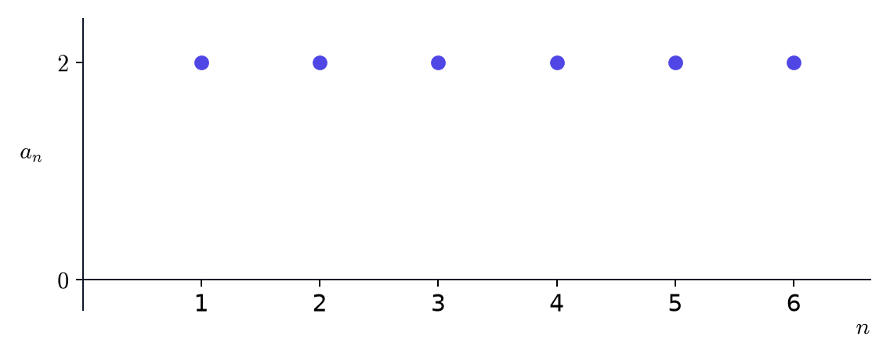{fig-alt="שש נקודות בגובה שתיים, באינדקסים אחת עד שש." width="500" fig-align="center"}

**(ב) הסדרה ההרמונית:** $a_n=\frac1n$, כלומר $1,\frac{1}{2},\frac13,\ldots$.

{fig-alt="שש נקודות של הסדרה אחד חלקי n. כל אינדקס וכל ערך מסומנים." width="500" fig-align="center"}

**(ג) סדרה מתחלפת:** איבר חיובי ואיבר שלילי מופיעים לסירוגין. למשל, $a_n=(-1)^n$ נותנת $-1,1,-1,1,\ldots$.

{fig-alt="באינדקסים האי זוגיים הנקודות בגובה מינוס אחת, ובזוגיים בגובה אחת. כל ששת האינדקסים מסומנים." width="500" fig-align="center"}

על הישר הממשי, איברים בעלי אותו ערך נופלים על אותה נקודה: $a_1,a_3,a_5$ נמצאים כולם ב $-1$, ו $a_2,a_4,a_6$ ב $1$.

**(ד) סדרה חשבונית:** בכל צעד מוסיפים [**הפרש קבוע**]{.term} $d$:
$$a_{n+1}=a_n+d.$$
הנוסחה לאיבר הכללי היא
$$a_n=a_1+(n-1)d.$$
יש $n-1$ צעדים מהאיבר הראשון לאיבר שבמקום $n$.

למשל, $a_1=1$ ו $d=2$ נותנים $1,3,5,7,\ldots$.

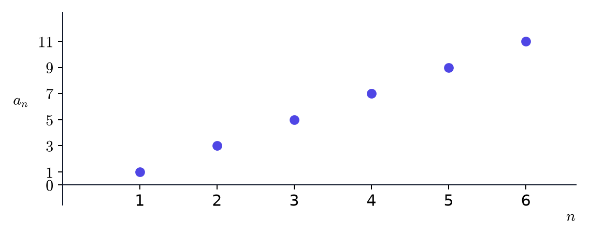{fig-alt="שש הנקודות של הסדרה אחת, שלוש, חמש, שבע, תשע, אחת עשרה. כל אינדקס וכל ערך מסומנים." width="500" fig-align="center"}

**(ה) סדרה הנדסית:** בכל צעד כופלים במספר קבוע $q$, שנקרא [**מנת הסדרה**]{.term}:
$$a_{n+1}=qa_n.$$
כאשר $a_n\ne0$, אפשר לחשב אותו כמנה $q=a_{n+1}/a_n$. כלל הכפל תקף גם כשהאיבר הוא אפס; במקרה הזה אין מחלקים בו.
כאשר $q\ne0$, הנוסחה לאיבר הכללי היא
$$a_n=a_1q^{n-1}.$$
הכפל החוזר מסביר את החזקה $n-1$ בנוסחה.

למשל, $a_1=1$ ו $q=2$ נותנים $1,2,4,8,\ldots$.

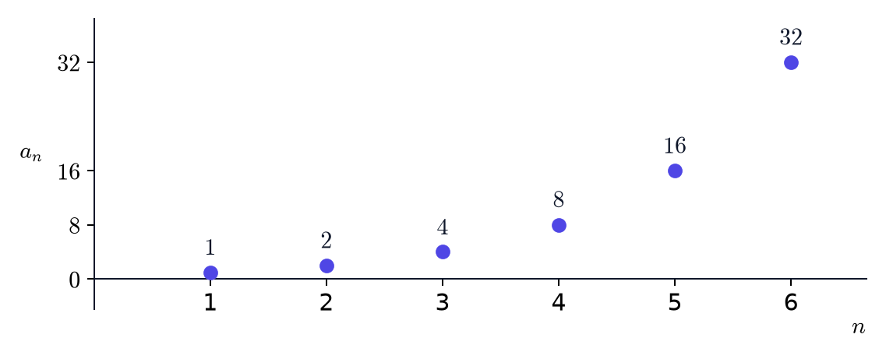{fig-alt="שש הנקודות של הסדרה אחת, שתיים, ארבע, שמונה, שש עשרה ושלושים ושתיים. כל אינדקס וכל ערך מסומנים." width="500" fig-align="center"}

**(ו) סדרת פיבונאצ'י:** מתחילים ב $a_1=a_2=1$, וכל איבר חדש הוא סכום שני קודמיו:
$$a_{n+2}=a_{n+1}+a_n.$$
כך מתקבלת הסדרה $1,1,2,3,5,8,13,\ldots$.

{fig-alt="שש הנקודות של סדרת פיבונאצ'י: אחת, אחת, שתיים, שלוש, חמש ושמונה. שתי הנקודות הראשונות באותו גובה, אך במקומות שונים." width="500" fig-align="center"}
:::::

::::: {#box-exm-seq-terms .thmexm title="מחשבים איברים"}
**(א)** נתונה הסדרה $a_n=\frac{n+1}{n}$. חשבו את האיברים המבוקשים.

:::: fill
בכל שורה כתבו תחילה את הביטוי לאחר הצבת האינדקס, ואחריו את התוצאה.

::: {.sequence-table dir="ltr"}
| האיבר | הצבה בנוסחה | תוצאה |
|:---:|:---:|:---:|
| $a_1$ | [$\frac{1+1}{1}$]{.blank ans="2" allow-expression="true" form="calculation" w="10" calculation="((1+1)/(1))"} | [$2$]{.blank ans="2" w="5"} |
| $a_2$ | [$\frac{2+1}{2}$]{.blank ans="3/2" allow-expression="true" form="calculation" w="10" calculation="((2+1)/(2))"} | [$\frac{3}{2}$]{.blank ans="3/2" w="5"} |
| $a_{10}$ | [$\frac{10+1}{10}$]{.blank ans="11/10" allow-expression="true" form="calculation" w="10" calculation="((10+1)/(10))"} | [$\frac{11}{10}$]{.blank ans="11/10" w="5"} |
:::

::: explain
מציבים בכל פעם את האינדקס במקום $n$:
$$\begin{aligned}
a_1&=\frac{1+1}{1}=2,\\[4pt]
a_2&=\frac{2+1}{2}=\frac{3}{2},\\[4pt]
a_{10}&=\frac{10+1}{10}=\frac{11}{10}.
\end{aligned}$$
:::
::::

**(ב)** השלימו את שמונת האיברים הראשונים של סדרת פיבונאצ'י.

:::: fill

::: {.sequence-inputs}
$a_1=$ [$1$]{.blank ans="1" w="3"}

$a_2=$ [$1$]{.blank ans="1" w="3"}
:::

::: {.sequence-table dir="ltr"}
| האיבר | חישוב | תוצאה |
|:---:|:---:|:---:|
| $a_3$ | [$1+1$]{.blank ans="2" allow-expression="true" form="calculation" w="10" calculation="1+1"} | [$2$]{.blank ans="2" w="5"} |
| $a_4$ | [$1+2$]{.blank ans="3" allow-expression="true" form="calculation" w="10" calculation="1+2"} | [$3$]{.blank ans="3" w="5"} |
| $a_5$ | [$2+3$]{.blank ans="5" allow-expression="true" form="calculation" w="10" calculation="2+3"} | [$5$]{.blank ans="5" w="5"} |
| $a_6$ | [$3+5$]{.blank ans="8" allow-expression="true" form="calculation" w="10" calculation="3+5"} | [$8$]{.blank ans="8" w="5"} |
| $a_7$ | [$5+8$]{.blank ans="13" allow-expression="true" form="calculation" w="10" calculation="5+8"} | [$13$]{.blank ans="13" w="5"} |
| $a_8$ | [$8+13$]{.blank ans="21" allow-expression="true" form="calculation" w="10" calculation="8+13"} | [$21$]{.blank ans="21" w="5"} |
:::

::: hint
שני האיברים הראשונים הם $1$. אחר כך מחברים בכל פעם את שני האיברים הקודמים.
:::

::: explain
$1,1,2,3,5,8,13,21,\ldots$.

למשל, $a_7=a_5+a_6=5+8=13$.
:::
::::

**(ג)** סדרה חשבונית מתחילה באיברים $4,7,10,13,\ldots$.

מצאו את האיבר הראשון ואת ההפרש, וכתבו נוסחה לאיבר הכללי.

:::: fill

::: {.sequence-inputs}
$a_1=$ [$4$]{.blank ans="4" w="3"}

$d=$ [$3$]{.blank ans="3" w="3"}

$a_n=$ [$3n+1$]{.blank id="seq-arithmetic-formula" ans="3n+1" vars="n" positive="n" integer="n" w="10"}
:::

כעת הציבו $n=20$ בנוסחה וחשבו:

::: {.sequence-table dir="ltr"}
| האיבר | הצבה בנוסחה | תוצאה |
|:---:|:---:|:---:|
| $a_{20}$ | [$3\cdot20+1$]{.blank ans="61" allow-expression="true" form="calculation" w="10" calculation="3*20+1" calculation-from="seq-arithmetic-formula" index="20"} | [$61$]{.blank ans="61" w="5"} |
:::

::: hint
בנוסחה $a_n=a_1+(n-1)d$, הציבו את האיבר הראשון ואת ההפרש.
:::

::: explain
$$\begin{aligned}
a_n&=4+3(n-1)=3n+1,\\
a_{20}&=3\cdot20+1=61.
\end{aligned}$$
:::
::::

**(ד)** סדרה הנדסית מתחילה באיברים $3,6,12,24,\ldots$.

מצאו את האיבר הראשון ואת המנה, וכתבו נוסחה לאיבר הכללי.

:::: fill

::: {.sequence-inputs}
$a_1=$ [$3$]{.blank ans="3" w="3"}

$q=$ [$2$]{.blank ans="2" w="3"}

$a_n=$ [$3\cdot2^{n-1}$]{.blank id="seq-geometric-formula" ans="3*2^(n-1)" vars="n" positive="n" integer="n" w="10"}
:::

כעת הציבו $n=6$ בנוסחה וחשבו:

::: {.sequence-table dir="ltr"}
| האיבר | הצבה בנוסחה | תוצאה |
|:---:|:---:|:---:|
| $a_6$ | [$3\cdot2^{6-1}$]{.blank ans="96" allow-expression="true" form="calculation" w="10" calculation="3*2^(6-1)" calculation-from="seq-geometric-formula" index="6"} | [$96$]{.blank ans="96" w="5"} |
:::

::: hint
בנוסחה $a_n=a_1q^{n-1}$, הציבו את האיבר הראשון ואת המנה.
:::

::: explain
$$\begin{aligned}
a_n&=3\cdot2^{n-1},\\
a_6&=3\cdot2^{6-1}=96.
\end{aligned}$$
:::
::::
:::::

::::: {.thmchk}
**(א)** האם הרשימה האינסופית שבה כל האיברים שווים ל $1$ היא סדרה?

:::: {.quiz options="כן|לא" answer="כן"}
איברים באינדקסים שונים יכולים להיות שווים. כתבו נוסחה לאיבר הכללי:

::: fill

:::: {.eqline dir="ltr"}
$a_n=$ [$1$]{.blank ans="1" kind="expr" vars="n" positive="n" integer="n"}
::::
:::
::::

**(ב)** חשבו את האיבר החמישי של $a_n=(-1)^n n$ בשני שלבים.

:::: fill
בשדה הראשון הציבו $n=5$, ובשני כתבו את התוצאה כמספר:

::: {.sequence-calculations}
$a_5=$ [$(-1)^5\cdot5$]{.blank ans="-5" allow-expression="true" form="calculation" w="10" calculation="(-1)^5*5"} $=$ [$-5$]{.blank ans="-5" w="5"}
:::

::: explain
$(-1)^5=-1$, ולכן $(-1)^5\cdot5=-5$.
:::
::::
:::::

### תרגילים {.unnumbered}

::::: {#box-q-seq-terms .thmqst title="איברים מנוסחה"}
חשבו את האיברים המבוקשים. כתבו את ההצבה בנוסחה ואת התוצאה.

:::: fill
**(א)** $a_n=n^2-n$

::: {.sequence-table dir="ltr"}
| האיבר | הצבה בנוסחה | תוצאה |
|:---:|:---:|:---:|
| $a_3$ | [$3^2-3$]{.blank ans="6" allow-expression="true" form="calculation" w="10" calculation="3^2-3"} | [$6$]{.blank ans="6" w="5"} |
:::

**(ב)** $a_n=\frac{(-1)^n}{n}$

::: {.sequence-table dir="ltr"}
| האיבר | הצבה בנוסחה | תוצאה |
|:---:|:---:|:---:|
| $a_4$ | [$\frac{(-1)^4}{4}$]{.blank ans="1/4" allow-expression="true" form="calculation" w="10" calculation="(((-1)^4)/(4))"} | [$\frac{1}{4}$]{.blank ans="1/4" w="5"} |
| $a_5$ | [$\frac{(-1)^5}{5}$]{.blank ans="-1/5" allow-expression="true" form="calculation" w="10" calculation="(((-1)^5)/(5))"} | [$-\frac{1}{5}$]{.blank ans="-1/5" w="5"} |
:::

**(ג)** $a_n=\frac{2^n}{n}$

::: {.sequence-table dir="ltr"}
| האיבר | הצבה בנוסחה | תוצאה |
|:---:|:---:|:---:|
| $a_3$ | [$\frac{2^3}{3}$]{.blank ans="8/3" allow-expression="true" form="calculation" w="10" calculation="((2^3)/(3))"} | [$\frac{8}{3}$]{.blank ans="8/3" w="5"} |
:::

::: explain
**(א)** $a_3=3^2-3=6$.

**(ב)**
$$\begin{aligned}
a_4&=\frac{(-1)^4}{4}=\frac{1}{4},\\[4pt]
a_5&=\frac{(-1)^5}{5}=-\frac{1}{5}.
\end{aligned}$$

**(ג)** $a_3=2^3/3=8/3$.
:::
::::
:::::

::::: {#box-q-seq-recursion .thmqst title="איברים מרקורסיה"}
נתונים $a_1=2$ ו $a_{n+1}=3a_n-1$.

מצאו את $a_2$, $a_3$ ו $a_4$ בעזרת כלל הרקורסיה.

:::: fill

::: {.sequence-table dir="ltr"}
| האיבר | חישוב | תוצאה |
|:---:|:---:|:---:|
| $a_2$ | [$3\cdot2-1$]{.blank ans="5" allow-expression="true" form="calculation" w="10" calculation="3*2-1"} | [$5$]{.blank ans="5" w="5"} |
| $a_3$ | [$3\cdot5-1$]{.blank ans="14" allow-expression="true" form="calculation" w="10" calculation="3*5-1"} | [$14$]{.blank ans="14" w="5"} |
| $a_4$ | [$3\cdot14-1$]{.blank ans="41" allow-expression="true" form="calculation" w="10" calculation="3*14-1"} | [$41$]{.blank ans="41" w="5"} |
:::

::: hint
בכל צעד השתמשו באיבר שחישבתם בצעד הקודם.
:::

::: explain
$$\begin{aligned}
a_2&=3\cdot2-1=5,\\
a_3&=3\cdot5-1=14,\\
a_4&=3\cdot14-1=41.
\end{aligned}$$
:::
::::
:::::

::::: {#box-q-seq-geometric .thmqst title="סדרה הנדסית עם מנה שלילית"}
בסדרה הנדסית נתונים $a_1=2$ ו $q=-3$.

כתבו נוסחה לאיבר הכללי, והשתמשו בה לחישוב האיברים השני עד החמישי.

:::: fill

::: {.sequence-formula dir="ltr"}
$a_n=$ [$2(-3)^{n-1}$]{.blank id="seq-negative-ratio-formula" ans="2*(-3)^(n-1)" vars="n" positive="n" integer="n" w="14"}
:::

::: {.sequence-table dir="ltr"}
| האיבר | הצבה בנוסחה | תוצאה |
|:---:|:---:|:---:|
| $a_2$ | [$2(-3)^{2-1}$]{.blank ans="-6" allow-expression="true" form="calculation" w="10" calculation="2(-3)^(2-1)" calculation-from="seq-negative-ratio-formula" index="2"} | [$-6$]{.blank ans="-6" w="5"} |
| $a_3$ | [$2(-3)^{3-1}$]{.blank ans="18" allow-expression="true" form="calculation" w="10" calculation="2(-3)^(3-1)" calculation-from="seq-negative-ratio-formula" index="3"} | [$18$]{.blank ans="18" w="5"} |
| $a_4$ | [$2(-3)^{4-1}$]{.blank ans="-54" allow-expression="true" form="calculation" w="10" calculation="2(-3)^(4-1)" calculation-from="seq-negative-ratio-formula" index="4"} | [$-54$]{.blank ans="-54" w="5"} |
| $a_5$ | [$2(-3)^{5-1}$]{.blank ans="162" allow-expression="true" form="calculation" w="10" calculation="2(-3)^(5-1)" calculation-from="seq-negative-ratio-formula" index="5"} | [$162$]{.blank ans="162" w="5"} |
:::

::: hint
הציבו את האיבר הראשון ואת המנה בנוסחה $a_n=a_1q^{n-1}$. שימו לב לסוגריים סביב המנה השלילית.
:::

::: explain
הנוסחה היא $a_n=2(-3)^{n-1}$.

$$\begin{aligned}
a_2&=2(-3)^1=-6,\\
a_3&=2(-3)^2=18,\\
a_4&=2(-3)^3=-54,\\
a_5&=2(-3)^4=162.
\end{aligned}$$
סימני האיברים מתחלפים, כי בכל צעד כופלים במספר שלילי.
:::
::::
:::::

::::: {#box-q-seq-formula .thmqst title="נוסחה שמתאימה לאיברים"}
בכל סעיף נתונים ארבעת האיברים הראשונים. מצאו נוסחה לאיבר הכללי המתאימה להם; תיתכן יותר מנוסחה אחת.

:::: fill

::::: {.sequence-formula-item}
**(א)**

$7,12,17,22,\ldots$

::: {.sequence-formula dir="ltr"}
$a_n=$ [$5n+2$]{.blank ans="5n+2" vars="n" check-at="1,2,3,4" w="14"}
:::
:::::

::::: {.sequence-formula-item}
**(ב)**

$1,4,9,16,\ldots$

::: {.sequence-formula dir="ltr"}
$a_n=$ [$n^2$]{.blank ans="n^2" vars="n" check-at="1,2,3,4" w="14"}
:::
:::::

::::: {.sequence-formula-item}
**(ג)**

$\frac{1}{2},\frac14,\frac18,\frac1{16},\ldots$

::: {.sequence-formula dir="ltr"}
$a_n=$ [$\frac{1}{2^n}$]{.blank ans="1/2^n" vars="n" check-at="1,2,3,4" w="14"}
:::
:::::

::: explain
**(א)** אפשר להמשיך כסדרה חשבונית, עם הפרש $5$:
$$a_n=7+5(n-1)=5n+2.$$

**(ב)** האיברים הנתונים הם הריבועים של האינדקסים שלהם:
$$a_n=n^2.$$

**(ג)** אפשר להמשיך כסדרה הנדסית, עם מנה $\frac{1}{2}$:
$$a_n=\frac1{2^n}.$$
:::
::::
:::::

::::: {#box-q-seq-kind .thmqst title="חשבונית, הנדסית או אף אחת מהן?"}
בכל סעיף נתונים כמה איברים ראשונים. בדקו אם אפשר להמשיך אותם לסדרה חשבונית או לסדרה הנדסית.

אם אפשר, מצאו את האיבר הראשון, את ההפרש או המנה, ונוסחה לאיבר הכללי. אחרת, הראו שההפרשים והמנות אינם קבועים.

**(א)** $5,2,-1,-4,\ldots$

:::: {.sequence-classify answer="arithmetic" terms="5,2,-1,-4" formula="8-3n"}

::: hint
בדקו את ההפרשים ואת המנות בין איברים עוקבים. האם הם קבועים?
:::

::: explain
אפשר להמשיך לסדרה **חשבונית**: ההפרש בכל צעד הוא $-3$.
$$a_1=5,\qquad d=-3.$$
הנוסחה לאיבר הכללי היא
$$a_n=5-3(n-1)=8-3n.$$
:::
::::

**(ב)** $2,-6,18,-54,\ldots$

:::: {.sequence-classify answer="geometric" terms="2,-6,18,-54" formula="2*(-3)^(n-1)"}

::: hint
בדקו את ההפרשים ואת המנות בין איברים עוקבים. גם מספר שלילי יכול להיות מנה קבועה.
:::

::: explain
אפשר להמשיך לסדרה **הנדסית**: המנה בכל צעד היא $-3$.
$$a_1=2,\qquad q=-3.$$
הנוסחה לאיבר הכללי היא
$$a_n=2(-3)^{n-1}.$$
:::
::::

**(ג)** $1,2,4,7,11,\ldots$

:::: {.sequence-classify answer="neither" terms="1,2,4,7,11"}

::: hint
די למצוא שני הפרשים שונים כדי לשלול סדרה חשבונית, ושתי מנות שונות כדי לשלול סדרה הנדסית.
:::

::: explain
**אף אחת מהן.** ההפרשים אינם קבועים:
$$a_2-a_1=1,\qquad a_3-a_2=2.$$
גם המנות אינן קבועות:
$$\frac{a_2}{a_1}=2,\qquad\frac{a_4}{a_3}=\frac74.$$
לכן אי אפשר להמשיך את האיברים הנתונים לסדרה חשבונית או הנדסית.
:::
::::
:::::


## גבול של סדרה

### מקירוב לסף השגיאה {.unnumbered}

בפועל, בחישובים רבים משתמשים במספרים קרובים מספיק למספרים המדויקים. יש לכך כמה סיבות. כפי שראינו, לא כל מספר ממשי אפשר לכתוב כמנה של שני שלמים, ואילו את החישובים המספריים נוח לבצע בעזרת מספרים רציונליים. גם מחשבים, שעליהם נשענים חישובים רבים, משתמשים בדרך כלל בייצוג מספרי בעל דיוק מוגבל: לא כל מספר ממשי אפשר לייצג בו בדיוק.

::: {#box-def-approximation-error .thmdef title="קירוב ושגיאה"}

מספר קרוב שבו משתמשים במקום המספר המדויק נקרא [**קירוב**]{.term} שלו.

ה[**שגיאה**]{.term} היא המרחק בין הקירוב למספר המדויק — כלומר, הערך המוחלט של ההפרש ביניהם.

:::

::: {#box-exm-third-approximation .thmexm title="קירובים עשרוניים"}

גם למספר הרציונלי $\frac13$ אין ייצוג עשרוני סופי. אפשר לקרב אותו באמצעות השברים העשרוניים הסופיים
$$0.3,\quad 0.33,\quad 0.333,\quad\ldots$$

:::

::: {#box-qa-approximation-threshold .thmqa title="האם $0.33$ מדויק מספיק?"}

משתמשים ב $0.33$ כקירוב למספר $\frac13$.

**תשובה.** תלוי בדרישת הדיוק. השגיאה היא
$$\left|0.33-\frac13\right|=\frac1{300}.$$
היא קטנה מ $0.01$, אבל גדולה מ $0.001$. כדי לעמוד בדרישה השנייה צריך קירוב מדויק יותר, למשל $0.333$.

:::

נבחר מספר חיובי, שייקרא [**סף השגיאה**]{.term}, ונדרוש שהשגיאה תהיה קטנה ממנו. שגיאה השווה לסף אינה עומדת בדרישה.

::::: {.thmchk title="אותו קירוב, שתי דרישות"}

משתמשים במספר $2.03$ כקירוב למספר $2$.

:::: fill

השגיאה היא [$0.03$]{.blank ans="0.03"}.

::: explain

השגיאה היא המרחק $|2.03-2|=0.03$.

:::

::::

האם השגיאה קטנה מ $0.1$?

::: {.quiz options="כן|לא" answer="כן"}

כן: $0.03<0.1$.

:::

האם השגיאה קטנה מ $0.01$?

::: {.quiz options="כן|לא" answer="לא"}

לא: $0.03>0.01$. אותו מספר יכול להיות קירוב מתאים לדרישה אחת ולא להתאים לדרישה מחמירה יותר.

:::

:::::

:::::: {.thmchk title="קירוב מהצד השני"}

כעת משתמשים במספר $1.96$ כקירוב למספר $2$.

::::: fill

מהי השגיאה? [$0.04$]{.blank ans="0.04" miss="-0.04 :: חישבתם את ההפרש. השגיאה היא המרחק; מה צריך לעשות כדי לקבל אותו?"}

:::: {.after-attempt}

מדוע השגיאה היא $0.04$ ולא $-0.04$?

::: {.quiz options="כי שגיאה היא מרחק: לוקחים את הערך המוחלט של ההפרש|כי הקירוב חייב להיות גדול מהמספר המדויק|כי כל הפרש בין שני מספרים הוא חיובי" answer="כי שגיאה היא מרחק: לוקחים את הערך המוחלט של ההפרש"}

ההפרש הוא $1.96-2=-0.04$, אך השגיאה היא
$$|1.96-2|=|-0.04|=0.04.$$
המינוס מתאר באיזה צד של $2$ נמצא הקירוב. המרחק מתאר כמה רחוק הוא נמצא, ולכן אינו שלילי.

:::

::::

:::::

::::::

::: {#box-prp-rational-approximation .thmprp title="קירוב במספרים רציונליים"}

לכל שני מספרים ממשיים $a<b$ קיים מספר רציונלי $q\in\mathbb{Q}$ כך ש
$$a<q<b.$$
כלומר, בין כל שני מספרים ממשיים שונים יש מספר רציונלי. תכונה זו נקראת [**צפיפות הרציונליים**]{.term}.

לכן אפשר לקרב כל מספר ממשי באמצעות מספרים רציונליים, בכל רמת דיוק שנבקש. למשל, $\pi$ אינו רציונלי, אבל הקירובים העשרוניים הסופיים $3.14$ ו $3.14159$ הם רציונליים.

:::

כאן נרצה לעבוד עם **סדרה של קירובים**, ולא להסתפק בקירוב אחד. לכל סף שגיאה חיובי שנבחר, קטן ככל שיהיה, נרצה להבטיח שאפשר להתקדם בסדרה עד שכל האיברים שמאותו אינדקס והלאה יעמדו בדרישה. מציאת איבר קרוב אחד אינה מספיקה: גם האיברים שבאים אחריו צריכים להישאר קרובים.

לפעמים הכיוון הפוך: נתונה לנו סדרה, ואנחנו עדיין לא יודעים איזה מספר היא מקרבת, ואם היא בכלל מקרבת מספר כלשהו. נרצה להבין מה פירוש ההתקרבות הזאת, ואיך בודקים אותה.

### הגדרת הגבול {.unnumbered}

::: {#box-def-limit .thmdef title="גבול של סדרה"}

הסדרה $(a_n)_{n=1}^{\infty}$ [**מתכנסת**]{.term} למספר $L$ אם לכל $\varepsilon>0$ יש אינדקס טבעי $N$ כך שלכל $n\ge N$ מתקיים
$$|a_n-L|<\varepsilon.$$
המספר $L$ נקרא [**הגבול**]{.term} של הסדרה. כותבים
$$\lim_{n\to\infty}a_n=L.$$
אפשר לכתוב גם $a_n\to L$, ולומר שהסדרה **שואפת** אל $L$. סדרה שאינה מתכנסת למספר ממשי נקראת [**מתבדרת**]{.term}.

:::

נפרש את ההגדרה: $a_n$ הוא האיבר באינדקס $n$, ו $L$ הוא המועמד לגבול. המרחק $|a_n-L|$ הוא השגיאה בפועל; $\varepsilon>0$ הוא סף השגיאה. התנאי אומר שהשגיאה קטנה מהסף, ואפשר לכתוב אותו גם כך:
$$L-\varepsilon<a_n<L+\varepsilon.$$
הקטע הפתוח $(L-\varepsilon,L+\varepsilon)$ נקרא [**סביבת אפסילון**]{.term} של $L$. נקודות הקצה אינן כלולות בו.

{fig-alt="הקטע הפתוח סביב L ברדיוס אפסילון. נקודות הקצה אינן כלולות בו." width="560" fig-align="center"}

::::::: {#box-limit-geometric .thmexp title="פירוש גאומטרי של התכנסות"}

בגרף של סדרה מציירים את הנקודות $(n,a_n)$: האינדקס הוא הקואורדינטה האופקית, והאיבר הוא הגובה. כדי לראות אילו איברים קרובים אל $L$, מציירים שני קווים אופקיים בגבהים $L-\varepsilon$ ו $L+\varepsilon$. השטח שביניהם נקרא **רצועה סביב $L$**. רוחבה האנכי הוא $2\varepsilon$; הקווים שעל שפתה אינם חלק ממנה.

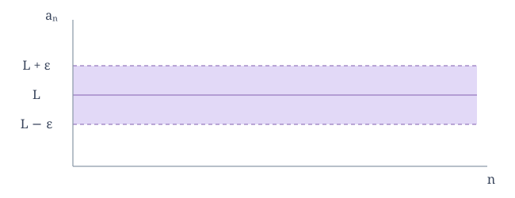{fig-alt="רצועה אופקית בין הגבהים L פחות אפסילון ו L ועוד אפסילון, עם קו אמצע בגובה L. אין בציור איברי סדרה." width="600" fig-align="center"}

**מה נדרש להתכנסות?** לכל $\varepsilon>0$ צריך להיות אינדקס $N$ כך שלכל $n\ge N$, הנקודה $(n,a_n)$ נמצאת ברצועה. כלומר, מאינדקס מסוים כל האיברים נכנסים ונשארים בפנים. אפשר לחשוב על הרצועה כעל ״בית״: לא מספיק לבקר בו; צריך להישאר בו מאינדקס מסוים והלאה.

ברצועה רחבה ייתכן שדי להתקדם מעט. ברצועה צרה ייתכן שצריך להתקדם הרבה מאוד. **צרה ככל שתהיה הרצועה, בסופו של דבר כל האיברים צריכים להישאר בתוכה.** האינדקס $N$ יכול להשתנות כשמשנים את $\varepsilon$.

למשל, ברצועה הרחבה שבציור אפשר לבחור $N=11$: כל האיברים מהאינדקס הזה והלאה בתוכה. עבור הרצועה הצרה יותר צריך להתקדם רחוק יותר; בציור אפשר לבחור $N=101$. בשני המקרים, כל האיברים שמאותו אינדקס והלאה נשארים בפנים.

{fig-alt="שני ציורים להמחשת התכנסות. ברצועה רחבה די להתקדם מעט, ובצרה צריך להתקדם יותר. בשניהם כל האיברים מאינדקס מתאים והלאה נשארים בפנים." width="650" fig-align="center"}

**ועל ישר המספרים?** שם מציירים את האיברים $a_n$ עצמם. הרצועה מוחלפת בקטע הפתוח $(L-\varepsilon,L+\varepsilon)$, כלומר בסביבת אפסילון של $L$. הדרישה אותה דרישה: כל סביבה כזאת מכילה את כל האיברים מאינדקס מתאים והלאה.

באיור הבא, עבור סביבת האפסילון שנבחרה אפשר לבחור $N=5$. מהאיבר $a_5$ והלאה כל האיברים בתוך הסביבה.

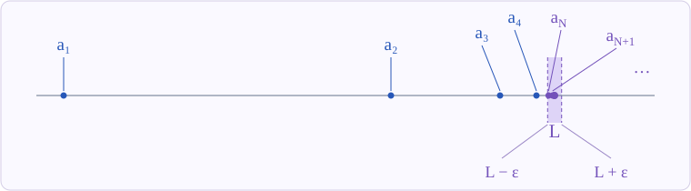{fig-alt="איברי סדרה על ישר המספרים מתקרבים אל L. סביב L מסומנת סביבת אפסילון צרה. מהאיבר a_N ואילך האיברים בתוכה, ובהמשך סימוניהם מתלכדים לעין עם L." width="700" fig-align="center"}

**ברזולוציה הזאת, רק כמה נקודות נבדלות מ $L$ לעין**, אף שיכולים להיות אינסוף ערכים שונים של איברי הסדרה. סימוני האיברים המאוחרים נראים באותו מקום כמו $L$; אין פירוש הדבר שערכיהם שווים לו. הגדלה יכולה לחשוף את ההבדלים, כפי שנראה בסימולציה שבהמשך.

**איך רואים ש $L$ אינו הגבול?** מספיק למצוא רצועה אחת סביבו שעבורה תמיד יש עוד איבר בחוץ, לא משנה כמה רחוק מתקדמים בציר האינדקסים. במילים פשוטות: **האיברים שמחוץ לרצועה אף פעם לא נגמרים.** יש אינסוף איברים כאלה; גם איבר שעל השפה נחשב מחוץ לרצועה.

{fig-alt="רצועה סביב L ונקודות שחוזרות ויוצאות ממנה. גם בהמשך, מעבר לאינדקסים המצוירים, ממשיכים להופיע איברים מחוץ לרצועה." width="600" fig-align="center"}

כך שוללים את המועמד $L$. ייתכן שהסדרה מתכנסת למספר אחר; כדי להראות שאינה מתכנסת כלל צריך לשלול כל מועמד.

:::::::

::::: {#box-sim-limit-microscope .thmsim title="מיקרוסקופ לקירובים של פאי"}

ניקח את הקירובים העשרוניים של $\pi$: מתחילים ב $3$, ובכל צעד משאירים עוד ספרה אחרי הנקודה. כל האיברים שנשתמש בהם מופיעים בראש הסימולציה.

התבוננו באיברים לפי סדרם: מאיבר מסוים והלאה כולם בתוך סביבת האפסילון המסומנת. בחרו $\varepsilon=1/10000$: הסביבה כעת צרה כל כך, שבהגדלה ההתחלתית האיברים שבתוכה נראים באותו מקום כמו $\pi$.

עכשיו לחצו על **הגדילו פי 10**, פעם או פעמיים, כאילו אתם מביטים דרך מיקרוסקופ. נקודות שנראו כמו נקודה אחת נפרדות. האיברים וסף השגיאה לא השתנו — רק היכולת שלנו לראות את ההבדלים. המספרים הסגולים הם הקירובים שעדיין אינם נבדלים מ $\pi$ לעין בהגדלה הנוכחית.

```{=html}
<iframe class="widget-frame" src="widgets/ch02/microscope.html" loading="lazy" title="מיקרוסקופ: קירובים עשרוניים של פאי בהגדלה"></iframe>
```

:::::

### ארבע דוגמאות בסיסיות {.unnumbered}

ארבע הדוגמאות הבאות ממחישות איך משתמשים בהגדרת הגבול כדי להראות שסדרה מתכנסת למספר נתון, או להראות שאינה מתכנסת אליו.

::::: {#box-exm-constant-limit .thmexm title="כל האיברים שווים לגבול"}

בסדרה הקבועה $a_n=4$, נבדוק שהמספר $4$ הוא הגבול.

כדי להשתמש בהגדרת הגבול, נפתח במילים **״יהי $\varepsilon>0$״**. פירושן: ניקח מספר חיובי כלשהו, בלי לקבוע לו ערך מסוים. הטיעון צריך לעבוד לכל בחירה כזאת.

עלינו למצוא **אינדקס טבעי $N$** כך שהשגיאה תהיה קטנה מהסף **לכל $n\ge N$**.

נבחר $N=1$. לכל $n\ge1$ מתקיים
$$|a_n-4|=|4-4|=0<\varepsilon.$$
כלומר, כל האיברים עומדים בדרישה כבר מהראשון. הבחירה הזאת עובדת לכל $\varepsilon>0$, ולכן לפי ההגדרה
$$\lim_{n\to\infty}4=4.$$
אותו חישוב עובד לכל סדרה קבועה $a_n=C$: בוחרים $N=1$ ומקבלים $|a_n-C|=0<\varepsilon$ לכל $n\ge1$. לכן סדרה שכל איבריה שווים $C$ מתכנסת אל $C$.

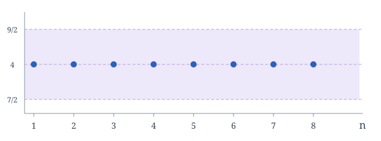{fig-alt="כל האיברים של הסדרה הקבועה ארבע נמצאים בגובה ארבע, בתוך כל רצועה חיובית סביב ארבע." width="520" fig-align="center"}

:::: fill

בסדרה $a_n=4$, השגיאה ביחס ל $4$ היא [$0$]{.blank ans="0"}.
עבור $\varepsilon=\frac1{10000}$, אפשר לבחור $N=$ [$1$]{.blank ans="1" min-answer="1" integer-answer="true"}.

::: explain

השגיאה אפס בכל אינדקס, ולכן כל אינדקס טבעי מתאים.

:::

::::

אם נקטין את $\varepsilon$, האם נצטרך להגדיל את $N$?

::: {.quiz options="כן|לא" answer="לא"}

אותו $N$ עדיין מתאים: השגיאה אפס וקטנה מכל מספר חיובי. סף השגיאה חייב להיות חיובי; השגיאה בפועל יכולה להיות אפס.

:::

:::::

::: {#box-method-limit-proof .thmmethod title="תבנית להוכחת גבול לפי ההגדרה"}

כדי להראות שסדרה $(a_n)_{n=1}^{\infty}$ מתכנסת למספר $L$, עובדים כך:

1. **״יהי $\varepsilon>0$״.** לוקחים סף שגיאה חיובי כלשהו. אין קובעים לו ערך מסוים, כי צריך לטפל בכל סף שגיאה חיובי.
2. **בוחרים אינדקס טבעי $N$** שיתאים לסף הזה. מותר שהבחירה תהיה תלויה ב $\varepsilon$.
3. **לוקחים אינדקס כלשהו $n\ge N$**, ומראים שמתקיים
   $$|a_n-L|<\varepsilon.$$
   צריך להסביר מדוע האי־שוויון מתקיים לכל אינדקס כזה, ולא רק עבור $n=N$.
4. **מסיקים לפי ההגדרה:** לכל $\varepsilon>0$ מצאנו $N$ מתאים, ולכן $a_n\to L$.

:::

::::: {#box-exm-one-over-n .thmexm title="אף איבר אינו שווה לגבול"}

נבדוק שהסדרה
$$a_n=\frac1n$$
מתכנסת אל $0$. איבריה הראשונים הם
$$1,\frac{1}{2},\frac13,\frac14,\ldots$$
השגיאה של האיבר $a_n$ היא
$$\left|\frac1n-0\right|=\frac1n.$$
כדי להתחיל לבדוק את הטענה, נבחר סף שגיאה קבוע, למשל $\varepsilon=\frac1{10}$. האם יש אינדקס שממנו והלאה השגיאה של כל האיברים קטנה מהסף הזה?

אם לא היה אינדקס כזה, כבר היינו יודעים ש $0$ אינו הגבול. אם נמצא אינדקס מתאים, עדיין נצטרך להראות שאפשר לעשות זאת לכל סף שגיאה חיובי.

נפתור את האי־שוויון המתאים. מכיוון ש $n>0$, מותר לכפול בו בלי לשנות את כיוון האי־שוויון:
$$\begin{aligned}
\frac1n&<\frac1{10},\\
1&<\frac n{10},\\
10&<n.
\end{aligned}$$
קיבלנו תנאי על האינדקס המשתנה $n$. כעת בוחרים אינדקס טבעי $N$ שממנו כל האינדקסים מקיימים אותו.

| הבחירה | האיברים שמתחילים בה | האם היא מתאימה? |
|:---:|:---|:---|
| $N=10$ | כוללים את $a_{10}=\frac1{10}$, שעל שפת הסביבה | לא: נדרש מרחק **קטן** מאפסילון |
| $N=11$ | כולם באינדקסים גדולים מ $10$ | כן |
| $N=20$ | גם הם כולם באינדקסים גדולים מ $10$ | כן; אין חובה לבחור את האינדקס הקטן ביותר |

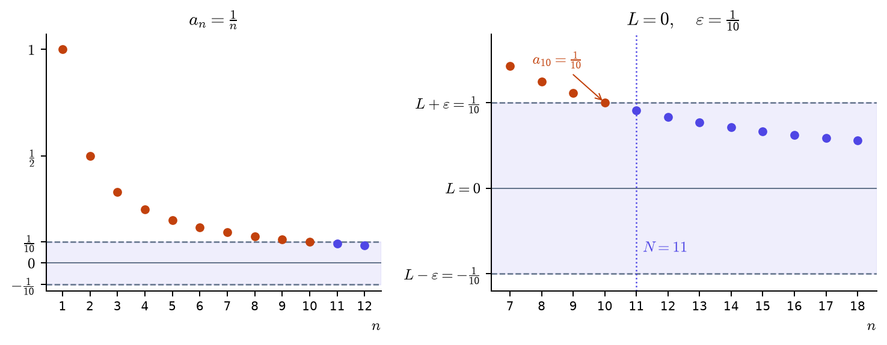{fig-alt="האיבר באינדקס עשר נמצא על שפת רצועת השגיאה; כל האיברים מהאינדקס אחת עשרה ואילך נמצאים בתוכה." width="650" fig-align="center"}

:::: fill

עבור שגיאה קטנה מ $\frac1{1000}$, החישוב נותן $n>$ [$1000$]{.blank ans="1000"}.
אפשר לבחור $N=$ [$1001$]{.blank ans="1001" min-answer="1001" integer-answer="true"}.

::: explain

כל אינדקס טבעי גדול מ $1000$ מתאים. האינדקס $11$, שהתאים לסף השגיאה הקודם, כבר אינו מספיק.

:::

::::

הבדיקות האלה לבדן אינן מספיקות: בהגדרה נדרש **כל** $\varepsilon>0$. כעת נוכיח שהבחירה אפשרית לכל סף שגיאה.

**יהי $\varepsilon>0$**. נרצה למצוא **אינדקס טבעי $N$** שעבורו **לכל $n\ge N$** יתקיים $|a_n-0|<\varepsilon$. מאחר שהשגיאה היא $1/n$, הדרישה שקולה ל
$$\frac1n<\varepsilon\quad\Longleftrightarrow\quad n>\frac1\varepsilon.$$

::: {#box-def-integer-part}

**כדי לכתוב בחירה מפורשת של $N$**, נשתמש בשיטה נפוצה המבוססת על פונקציית הערך השלם.

נזכיר כי לפי [הגדרת הערך השלם](01-Introduction.qmd#box-def-floor), $\lfloor x\rfloor$ הוא **השלם הגדול ביותר שקטן או שווה ל $x$**. לכן $\lfloor x\rfloor+1$ הוא שלם שגדול מ $x$, ולמעשה **השלם הקטן ביותר שגדול ממנו**:
$$\lfloor x\rfloor\le x<\lfloor x\rfloor+1.$$

אצלנו $x=1/\varepsilon$, ולכן **נבחר**
$$N=\left\lfloor\frac1\varepsilon\right\rfloor+1.$$

{fig-alt="מספר x בין שני שלמים עוקבים. השלם שמשמאל הוא הערך השלם של x; הוספת אחת נותנת את השלם הקטן ביותר שגדול מ x." width="560" fig-align="center"}

:::

לפי האי־שוויון שהסברנו, $N>1/\varepsilon>0$, ולכן $N$ טבעי. במספרים חיוביים, ככל שהמכנה גדול יותר השבר קטן יותר, ולכן
$$\frac1N<\frac1{1/\varepsilon}=\varepsilon.$$
כעת ניקח **אינדקס כלשהו $n\ge N$**. המכנה גדול לפחות כמו $N$, ולכן
$$|a_n-0|=\frac1n\le\frac1N<\varepsilon.$$
מצאנו $N$ מתאים לסף השגיאה שבחרנו, והראינו שהדרישה מתקיימת **לכל $n\ge N$**. מכיוון ש $\varepsilon>0$ היה כלשהו, הטיעון עובד לכל סף שגיאה חיובי. לכן לפי הגדרת הגבול
$$\frac1n\longrightarrow0.$$

:::::

::::: {#box-method-integer-above .thmmethod title="השלם הקטן ביותר שגדול ממספר נתון"}

כדי למצוא את השלם הקטן ביותר $m$ שגדול ממש ממספר ממשי $x$, מחשבים את הערך השלם של $x$ ומוסיפים $1$:
$$m=\lfloor x\rfloor+1.$$
כש $x\ge0$, המספר שמתקבל טבעי. בבחירת האינדקס $N$ בהגדרת הגבול אין חובה לבחור את הקטן ביותר: גם כל אינדקס טבעי גדול יותר מתאים.

למשל, עבור $x=\frac{21}{2}$ מחשבים תחילה
$$\left\lfloor\frac{21}{2}\right\rfloor=10.$$
מוסיפים $1$ ומקבלים $11$, שהוא השלם הקטן ביותר שגדול מ $\frac{21}{2}$.

:::: fill

מהו השלם הקטן ביותר שגדול ממש מ $\frac{17}{4}$? [$5$]{.blank ans="5" integer-answer="true"}.

::: explain

הערך השלם הוא $\lfloor17/4\rfloor=4$. מוסיפים $1$ ומקבלים $5$. שלמים גדולים יותר גם גדולים מ $\frac{17}{4}$, אבל $5$ הוא הקטן ביותר מביניהם.

:::

::::

:::::

::: {#box-insight-epsilon-index .thminsight title="האינדקס יכול להיות תלוי בסף השגיאה"}

**קודם בוחרים $\varepsilon$, ורק אחר כך בוחרים $N$ שמתאים לו.** ספי שגיאה שונים עשויים לדרוש אינדקסים שונים. בסדרה $a_n=1/n$ בחרנו $N=\lfloor1/\varepsilon\rfloor+1$, ולכן הקטנת הסף עשויה לדרוש אינדקס גדול יותר. בסדרה הקבועה $a_n=4$, לעומת זאת, אותו $N=1$ מתאים לכל סף שגיאה חיובי.

:::

:::: {#box-sim-error-band .thmsim title="סף השגיאה ובחירת האינדקס"}

בסדרה $a_n=1/n$, שהתכנסותה אל $0$ הוכחה בדוגמה, בחרו $\varepsilon$. הבחירה $N=\lfloor1/\varepsilon\rfloor+1$ תחושב ותופיע אוטומטית. אפשר גם להקליד אינדקס אחר ולבדוק אותו. הרצועה מראה את דרישת הדיוק; הקו האנכי מסמן מהיכן בודקים את כל האיברים.

```{=html}
<iframe class="widget-frame" src="widgets/ch02/error-band.html?case=reciprocal" loading="lazy" title="אחת חלקי n: סף השגיאה, האינדקס והאיברים"></iframe>
```
עבור $\varepsilon=1/10$, הקלידו $N=10$ ובדקו אותו, ואחר כך נסו $N=11$. הקטינו את סף השגיאה וראו כיצד האינדקס המחושב משתנה. הבדיקה נעזרת בנוסחה ומתייחסת גם לכל האיברים שמעבר לציור.

::::


:::: {.thmchk title="האינדקס והגבול"}

האם בסדרה $\frac1n$ יש איבר השווה בדיוק לגבול $0$?

::: {.quiz options="כן|לא" answer="לא"}

כל האיברים חיוביים. התכנסות דורשת קרבה בכל דיוק, ולא פגיעה מדויקת בגבול.

:::

בסדרה $a_n=\frac1n$, נדרוש שהמרחק מאפס יהיה קטן מ $\frac{2}{21}$. הדרישה שקולה ל
$$\frac1n<\frac{2}{21}\quad\Longleftrightarrow\quad n>\frac{21}{2}.$$
האם כל האיברים החל מאינדקס $11$ עומדים בדרישה הזאת?

::: {.quiz options="כן|לא" answer="כן"}

כן. כל $n\ge11$ מקיים $n>\frac{21}{2}$, ולכן לכל האיברים האלה השגיאה קטנה מ $\frac{2}{21}$. אפשר לבחור $N=11$: צריך מספר טבעי הגדול מהסף $\frac{21}{2}$, ולא להוסיף אחת לסף באופן אוטומטי.

:::

::::

::::: {#box-exm-alternating-converges .thmexm title="מתקרבים משני הצדדים"}

נבדוק את המועמד $L=0$ עבור
$$a_n=\frac{(-1)^n}{n}.$$
איבריה הראשונים הם
$$-1,\frac{1}{2},-\frac13,\frac14,\ldots$$
באינדקסים אי־זוגיים האיברים קטנים מהגבול $0$, ובזוגיים הם גדולים ממנו. לזה הכוונה ב״משני הצדדים״: פעם מתחת לגבול ופעם מעליו. נבדוק את המרחק ממנו:
$$\left|\frac{(-1)^n}{n}-0\right|=\frac1n.$$
אלה בדיוק המרחקים מאפס של איברי הסדרה $1/n$. לכן, לכל $\varepsilon>0$, בוחרים $N>\frac1\varepsilon$, ומקבלים שגם הסדרה $(-1)^n/n$ מתכנסת לאפס.

האם התכנסות מחייבת להישאר באותו צד של הגבול?

::: {.quiz options="כן|לא" answer="לא"}

הסדרה הזאת מתכנסת לאפס אף שהיא מחליפה צד בכל צעד. הדרישה עוסקת במרחק, לא בכיוון.

:::

:::::

:::: {#box-sim-alternating-decay .thmsim title="סף השגיאה בהתקרבות משני הצדדים"}

בסדרה $a_n=(-1)^n/n$, שהוכחנו כי היא מתכנסת לאפס, בחרו $\varepsilon$. האינדקס $N=\lfloor1/\varepsilon\rfloor+1$ יופיע אוטומטית; אפשר להקליד אינדקס אחר ולבדוק אותו. שימו לב: האיברים מחליפים צד, אך מאינדקס מתאים כולם נשארים בתוך הרצועה.

```{=html}
<iframe class="widget-frame" src="widgets/ch02/error-band.html?case=alternating-decay" loading="lazy" title="סימן מתחלף ומרחק קטן: התכנסות משני הצדדים"></iframe>
```

::::

:::::: {#box-exm-alternating-diverges .thmexm title="סדרה שאינה מתכנסת"}

נראה שהסדרה
$$a_n=(-1)^n,\qquad -1,1,-1,1,\ldots$$
אינה מתכנסת. נתחיל בניסיונות לבחור גבול, ונראה מדוע בדיקה עבור סף שגיאה אחד עלולה להטעות.

**ניסיון ראשון: $L=1$.** עבור $\varepsilon=5/2$ כל האיברים בתוך הסביבה. נראה מבטיח, אבל נקטין ל $\varepsilon=1/2$: כל ההופעות של $-1$ בחוץ, משום שמרחקן מ $1$ הוא $2$. הן חוזרות אחרי כל אינדקס שנבחר. לכן $1$ אינו הגבול.

**ניסיון שני: $L=-1$.** שוב, $\varepsilon=5/2$ מכניס את כל האיברים לסביבה. אבל עבור $\varepsilon=1/2$, כל ההופעות של $1$ בחוץ. לכן גם $-1$ אינו הגבול.

**אולי האמצע, $L=0$?** עבור $\varepsilon=3/2$ כולם בפנים. עבור $\varepsilon=1/2$ כולם בחוץ: מרחקו של כל איבר מאפס הוא $1$.


**ומה לגבי מספר אחר $L$?** אם $L\ne1$, המרחק $d=|L-1|$ חיובי. נבחר $\varepsilon=d/4$. הסביבה סביב $L$ מגיעה לכיוון $1$ רק רבע מהמרחק ביניהם, ולכן $1$ מחוץ לה. כל האיברים באינדקסים הזוגיים שווים $1$, כך שיש אינסוף איברים בחוץ. את המועמד $L=1$ כבר שללנו בניסיון הראשון. לכן אין לסדרה גבול.

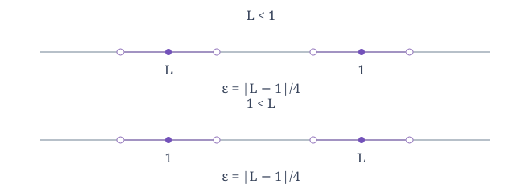{fig-alt="שני מספרים שונים L ואחת, במרחק d זה מזה. שתי סביבות ברדיוס d חלקי ארבע נפרדות, ובפרט הסביבה סביב L אינה כוללת את אחת." width="600" fig-align="center"}

אם $L$ שונה גם מ $1$ וגם מ $-1$, אפשר לצמצם עוד: נבחר רבע מהמרחק אל הקרוב מביניהם. אז אף איבר בסדרה אינו בסביבה. לעומת זאת, סביב $L=1$ או $L=-1$ תמיד יישארו בפנים האיברים השווים למרכז. אין צורך להוציא את כולם; אינסוף איברים בחוץ כבר מספיקים.

**ננסח זאת גם בעזרת אי־שוויון המשולש.** המרחק בין $1$ ל $-1$ הוא $2$. לפי [אי־שוויון המשולש](01-Introduction.qmd#box-thm-abs-props), לכל מועמד $L$ מתקיים
$$\begin{aligned}
2=|1-(-1)|
&=|(1-L)+(L+1)|\\
&\le |1-L|+|L+1|\\
&=|1-L|+|-1-L|.
\end{aligned}$$
לכן **לפחות אחד משני המרחקים מ $L$ גדול או שווה ל $1$**: אילו שניהם היו קטנים מ $1$, סכומם היה קטן מ $2$. זהו הניסוח החשבוני של הרעיון הגאומטרי: $L$ לא יכול להיות קרוב כרצוננו לשני מספרים שמרחקם זה מזה קבוע.

נבחר $\varepsilon=1/2$. הערך שמרחקו מ $L$ לפחות $1$ מופיע שוב ושוב בסדרה $a_n=(-1)^n$. לכן **לכל אינדקס טבעי $N$ יש $n\ge N$** שעבורו
$$|a_n-L|\ge1>\varepsilon.$$
אין אינדקס שממנו כל האיברים נשארים בסביבה הזאת. לכן $L$ אינו גבול, ומכיוון שהטיעון חל על כל $L$, הסדרה אינה מתכנסת.

::::::

::::: {#box-prp-neighborhood-separation .thmmethod title="מפרידים בין שני מספרים שונים"}

השתמשנו ברעיון הבא: לשני מספרים $a<b$ יש מרחק חיובי $b-a$. אם נבחר
$$\varepsilon=\frac{b-a}{4},$$
הסביבות $(a-\varepsilon,a+\varepsilon)$ ו $(b-\varepsilon,b+\varepsilon)$ אינן חופפות.

כל סביבה נמשכת רק רבע מהדרך אל המרכז האחר, ולכן נשאר ביניהן רווח:
$$a+\varepsilon<b-\varepsilon.$$
הבחירה עובדת לכל שני מספרים שונים, קרובים ככל שיהיו. לא צריך למצוא את הרדיוס הגדול ביותר שמתאים; רבע מהמרחק תמיד מספיק.

:::: fill

עבור $a=2$ ו $b=6$, המרחק הוא [$4$]{.blank ans="4"}, ולפי השיטה אפשר לבחור $\varepsilon=$ [$1$]{.blank ans="1"}.

::: explain

רבע מהמרחק הוא $1$. הסביבות הן $(1,3)$ ו $(5,7)$, ואין מספר שנמצא בשתיהן.

:::

::::

:::::

::::: {#box-sim-epsilon-challenge .thmsim title="מצמצמים את הרצועה ובודקים את הטענה"}

בכל לשונית נבדוק מועמד לגבול הסדרה $a_n=(-1)^n$. צמצמו את הרצועה עד שתראו ערך שחוזר מחוץ לה. בלשונית האחרונה אפשר לבחור מועמד משלכם.

```{=html}
<iframe class="widget-frame" src="widgets/ch02/epsilon-game.html" loading="lazy" title="שוללים מועמד לגבול באמצעות רצועה צרה"></iframe>
```

:::::


::::: {.thmchk title="פגענו ביעד. האם זה מספיק?"}

**(א)** בסדרה $a_n=n$ מתקיים $a_3=3$. האם מכאן שהגבול הוא $3$?

באיור נבחר סף השגיאה $\varepsilon=1$.

{fig-alt="הסדרה a_n=n פוגעת בערך שלוש באינדקס שלוש. האיברים מאינדקס ארבע והלאה נמצאים על השפה או מחוץ לרצועה שבין שתיים לארבע, וממשיכים להתרחק." width="560" fig-align="center"}

::: {.quiz options="כן|לא" answer="לא"}

לא. למשל, עבור $\varepsilon=1$ צריך שכל האיברים מאינדקס מסוים יהיו בקטע $(2,4)$. אבל כל האיברים באינדקסים $4,5,6,\ldots$ נמצאים על השפה או מחוץ לקטע. הפגיעה באינדקס $3$ אינה עוזרת בהמשך.

:::

**(ב)** בסדרה
$$4,4,4,7,7,7,\ldots$$
כל האיברים מאינדקס $4$ והלאה שווים $7$. האם הסדרה מתכנסת אל $4$?

באיור נבחר סף השגיאה $\varepsilon=1$.

{fig-alt="שלושת האיברים הראשונים שווים ארבע ונמצאים במרכז הרצועה שבין שלוש לחמש. כל האיברים מאינדקס ארבע והלאה שווים שבע ונמצאים מחוץ לרצועה." width="560" fig-align="center"}

::: {.quiz options="כן|לא" answer="לא"}

לא. שלוש פגיעות ב $4$ אינן מספיקות: בהמשך השגיאה ביחס ל $4$ היא תמיד $3$. עבור $\varepsilon=1$ אין אינדקס שממנו הדרישה מתקיימת תמיד.

:::

**(ג)** האם אינסוף איברים השווים ל $L$ מבטיחים שהסדרה מתכנסת אל $L$? הסתכלו בסדרה שמתחלפת בין שני מספרים קבועים $L<M$:
$$L,M,L,M,L,M,\ldots$$

באיור נבחר סף שגיאה $0<\varepsilon<M-L$.

{fig-alt="באינדקסים האי־זוגיים האיברים שווים L, ובזוגיים הם שווים M. כל ההופעות של M נמצאות מחוץ לסביבה הצרה של L, והן ממשיכות להופיע באינדקסים גדולים כרצוננו." width="560" fig-align="center"}

::: {.quiz options="כן|לא" answer="לא"}

לא. בסף השגיאה שנבחר, כל איבר השווה $M$ נמצא מחוץ לסביבה של $L$, ואיברים כאלה מופיעים אחרי כל אינדקס שנבחר. הסדרה פוגעת ב $L$ אינסוף פעמים, אבל אינה נשארת קרובה אליו.

:::

**(ד)** לעומת זאת, נבחן את הסדרה
$$7,7,7,4,4,4,\ldots$$
כל האיברים מאינדקס $4$ והלאה שווים $4$. האם עכשיו הגבול הוא $4$?

באיור נבחר סף השגיאה $\varepsilon=1$.

{fig-alt="שלושת האיברים הראשונים שווים שבע ונמצאים מחוץ לרצועה סביב ארבע. כל האיברים מאינדקס ארבע והלאה שווים ארבע, במרכז הרצועה, ונשארים שם." width="560" fig-align="center"}

::: {.quiz options="כן|לא" answer="כן"}

כן. בוחרים $N=4$. כל האיברים שממנו והלאה שווים $4$, ולכן שגיאתם אפס, לכל סף שגיאה חיובי.

:::

:::::

::::: {.thmanalogy title="רצועה רחבה יכולה להטעות"}

בסדרה $a_n=(-1)^n$, הרצועה סביב $0$ עם $\varepsilon=3/2$ מכילה את כל האיברים. כשמקטינים ל $\varepsilon=1/2$, כולם בחוץ. ההצלחה ברצועה הרחבה אינה מספיקה: צריך לעמוד גם בדרישות הדיוק הקטנות יותר.

אם רצועה מסוימת כבר משאירה אינסוף איברים בחוץ, כל רצועה צרה יותר סביב אותו $L$ משאירה אותם בחוץ. הרחבה יכולה להחזיר חלק מהם או את כולם פנימה; היא אינה חייבת לעשות זאת.

ידוע ש $L$ אינו גבול הסדרה. בודקים סביבו את ספי השגיאה $1,1/2,1/3,\ldots$. האם מובטח שנגיע לסף שעבורו יש אינסוף איברים בחוץ?

::: {.quiz options="כן|לא" answer="כן"}

כן. יש סף שגיאה חיובי שבו הדרישה נכשלת. בסופו של דבר $1/k$ קטן מהסף הזה, וכל האיברים שהיו בחוץ עדיין בחוץ. לעומת זאת, הצלחה במספר סופי של בדיקות אינה מוכיחה ש $L$ הוא הגבול. כישלון פירושו אינסוף איברים בחוץ, ולא איבר חריג יחיד.

:::

:::::

:::: {.thmchk title="מה קורה כשמשנים את רוחב הרצועה?"}

נתונה סדרה ומספר $L$. עבור סף מסוים $\varepsilon_0>0$ יש אינסוף איברים מחוץ לרצועה סביב $L$.

האם גם עבור $\varepsilon=\varepsilon_0/2$ יש אינסוף איברים בחוץ?

::: {.quiz options="כן|לא" answer="כן"}

כן. הרצועה החדשה מוכלת בקודמת, ולכן כל איבר שהיה בחוץ נשאר בחוץ.

:::

האם גם עבור $\varepsilon=2\varepsilon_0$ חייבים להיות אינסוף איברים בחוץ?

::: {.quiz options="כן|לא" answer="לא"}

לא בהכרח. למשל, בסדרה $(-1)^n$ סביב $L=0$, עבור $\varepsilon_0=3/4$ כולם בחוץ, ועבור $2\varepsilon_0=3/2$ כולם בפנים. אם נתחיל במקום זאת ב $\varepsilon_0=1/4$, גם לאחר ההכפלה כולם יישארו בחוץ.

:::

::::

::::: {#box-exm-count-occurrences .thmexm title="סופרים איברים, לא ערכים שונים"}

נתונה הסדרה
$$1,1,1,\frac32,2,2,2,\ldots$$
כל האיברים מאינדקס $5$ והלאה שווים $2$. עבור $L=2$ ו $\varepsilon=\frac14$, הסביבה היא $(\frac74,\frac94)$.

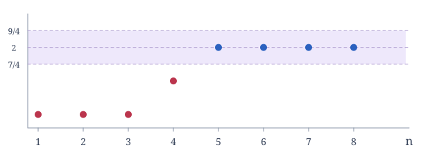{fig-alt="אינדקסים אחת שתיים ושלוש מכילים את הערך אחת, אינדקס ארבע את שלוש חלקי שתיים. ארבעת האיברים בחוץ; כל האיברים מאינדקס חמש בתוך הרצועה סביב שתיים." width="560" fig-align="center"}

:::: fill

כמה **איברים** מחוץ לסביבה? [$4$]{.blank ans="4" miss="2 :: יש שני ערכים שונים בחוץ, אבל כמה אינדקסים מתאימים להם? כל הופעה נספרת."}

בחרו אינדקס שממנו כל האיברים בסביבה: $N=$ [$5$]{.blank ans="5" min-answer="5" integer-answer="true"}.

::: explain

שלוש ההופעות של $1$ וההופעה של $\frac32$ הן ארבעה איברים. כל האיברים מאינדקס $5$ והלאה שווים $2$, ולכן אותו $N=5$ מתאים גם לכל אפסילון קטן יותר.

:::

::::

:::::

::: {.thmkey title="רק מספר סופי של חריגים"}

בסדרה המתכנסת אל $L$, לכל $\varepsilon>0$ יש רק מספר סופי של איברים מחוץ לסביבה. כולם באינדקסים שלפני $N$; מאינדקס $N$ והלאה אין עוד חריגים. על ישר המספרים כמה איברים יכולים להופיע באותה נקודה, ולכן בספירה צריך לזכור את האינדקסים שלהם.

:::

### זנב של סדרה {.unnumbered}

::: {#box-def-sequence-tail .thmdef title="זנב של סדרה"}

בסדרה $(a_n)_{n=1}^{\infty}$, ה[**זנב**]{.term} שמתחיל באינדקס $N$ הוא סדרת כל האיברים מאינדקס זה והלאה, לפי סדרם:
$$a_N,a_{N+1},a_{N+2},\ldots$$
כוללים את האיבר $a_N$ עצמו ואת **כל** האיברים שאחריו; אין דילוגים בין האיברים.

:::

באיור בחרנו $N=4$: משאירים בחוץ את שלושת האיברים הראשונים, והזנב הוא $a_4,a_5,a_6,\ldots$.

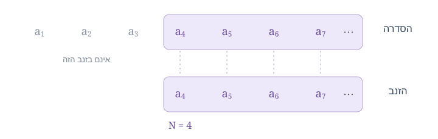{fig-alt="בשורה העליונה הסדרה a1,a2,a3,a4,a5,a6 והלאה. בשורה התחתונה הזנב שמתחיל באינדקס ארבע: a4,a5,a6 והלאה. האיבר a4 כלול; האיברים a1,a2,a3 אינם חלק מהזנב הזה." width="600" fig-align="center"}

::: {#box-prp-tail-is-sequence .thmprp title="הזנב הוא בעצמו סדרה"}

נתונה סדרה $(a_n)_{n=1}^{\infty}$. **כל זנב שלה הוא בעצמו סדרה:** אפשר להתחיל לספור את איבריו מחדש מהאינדקס $1$.

נקבע מספר שלם $k\ge0$. אחרי שמשמיטים את $k$ האיברים הראשונים, מקבלים את הסדרה
$$\bigl(a_{n+k}\bigr)_{n=1}^{\infty}.$$
אפשר לסמן אותה $(b_n)_{n=1}^{\infty}$, כאשר
$$b_n=a_{n+k}.$$
**המספר $k$ קבוע**, ואילו $n=1,2,3,\ldots$ סופר את איברי הסדרה החדשה. האיברים עצמם וסדרם אינם משתנים; רק האינדקסים מתחילים מחדש.

למשל, כש $k=3$, הזנב מתחיל באיבר $a_4$, ומתקיים
$$\begin{aligned}
b_1&=a_4,\\
b_2&=a_5,\\
b_3&=a_6,\quad\ldots
\end{aligned}$$
באופן כללי, הזנב שמתחיל באיבר $a_N$ מתקבל בבחירה $k=N-1$.

:::

::: {#box-prp-limit-tail .thmprp title="שינוי של מספר סופי של איברים"}

שינוי של מספר סופי של איברים אינו משנה את הגבול או את עצם ההתכנסות.

:::

למשל, אם נחליף את שלושת האיברים הראשונים של $\frac1n$ במספרים $100$, $-1000$ ו $7$, הזנב נשאר אותו זנב. כשבוחרים $N$ אפשר להתקדם מעבר לאיברים ששינינו, ולכן הגבול נשאר $0$.

```{=html}
<iframe class="widget-frame" src="widgets/ch02/tail.html" loading="lazy" title="בחירת זנב ושינוי האיברים שלפניו"></iframe>
```

:::: {.thmchk}

שינינו את מיליון האיברים הראשונים של סדרה המתכנסת אל $2$. האם הגבול יכול להשתנות?

::: {.quiz options="כן|לא" answer="לא"}

מיליון הוא עדיין מספר סופי. אפשר לבחור את תחילת הזנב אחרי כל האיברים ששונו.

:::

נבחן את הסדרה $a_n=n$, את המועמד $L=3$ ואת סף השגיאה $\varepsilon=1$. הדרישה היא שהאיברים יהיו בקטע $(2,4)$.

האיבר $a_3=3$ נמצא בתוך הקטע. האם $N=3$ מבטיח שכל האיברים מאינדקס זה והלאה יהיו בקטע?

::: {.quiz options="כן|לא" answer="לא"}

לא. כבר האיבר הבא, $a_4=4$, נמצא על שפת הקטע ואינו בתוכו. האיברים $a_5=5,a_6=6,\ldots$ נמצאים מחוץ לקטע ומתרחקים ממנו. צריך שהדרישה תתקיים לכל $n\ge N$; בדיקת האיבר $a_N$ לבדו אינה מספיקה.

:::

::::

::::: {.thmchk title="שתי סדרות שמסכימות בהמשך"}

נתונות שתי סדרות $(a_n)$ ו $(b_n)$ כך שלכל $n\ge5$ מתקיים $a_n=b_n$. ארבעת האיברים הראשונים שלהן יכולים להיות שונים. קבעו אילו טענות נכונות.

:::: fill

אם $(a_n)$ מתכנסת, גם $(b_n)$ מתכנסת. [נכון]{.blank kind="text" ans="נכון" choices="נכון|לא נכון"}

אם $(a_n)$ אינה מתכנסת למספר ממשי, גם $(b_n)$ אינה מתכנסת למספר ממשי. [נכון]{.blank kind="text" ans="נכון" choices="נכון|לא נכון"}

ייתכן שאחת מתכנסת והשנייה אינה מתכנסת. [לא נכון]{.blank kind="text" ans="לא נכון" choices="נכון|לא נכון"}

אם שתיהן מתכנסות, הגבולות שווים. [נכון]{.blank kind="text" ans="נכון" choices="נכון|לא נכון"}

ייתכן ששתיהן מתכנסות לגבולות שונים. [לא נכון]{.blank kind="text" ans="לא נכון" choices="נכון|לא נכון"}

::: explain

הסדרות נבדלות לכל היותר בארבעה איברים. לכל סף שגיאה אפשר להתחיל לבדוק מעבר לאיברים האלה, ומאותו מקום בודקים בדיוק אותם מספרים בשתי הסדרות. לכן הן מתכנסות יחד, ואם הן מתכנסות — לאותו גבול.

:::

::::

:::::

::::: {#box-q-shifted-sequence .thmexm title="אותם איברים, אינדקסים אחרים"}

נחזור לסדרה $a_n=1/n$, ש[כבר הוכחנו כי היא מתכנסת לאפס](#box-exm-one-over-n). נקבע מספר שלם $k\ge0$ ונגדיר
$$b_n=\frac1{n+k}=a_{n+k}.$$
כפי שראינו ב [טענה על הזנב כסדרה](#box-prp-tail-is-sequence), זו הסדרה שמתקבלת מהשמטת $k$ האיברים הראשונים של $(a_n)_{n=1}^{\infty}$.

למשל, כש $k=3$,
$$\begin{aligned}
b_1&=a_4=\frac14,\\
b_2&=a_5=\frac15,\\
b_3&=a_6=\frac16,\quad\ldots
\end{aligned}$$

**(א)** האם גם $b_n\to0$?

::: {.quiz options="כן|לא" answer="כן"}

כן. לכל סף שגיאה $\varepsilon>0$, כל איברי הסדרה $a_n=1/n$ מאינדקס מתאים והלאה קרובים לאפס. גם איברי הזנב מגיעים לאותו חלק של הסדרה ונשארים בו. השמטת האיברים הראשונים אינה משנה את הגבול, ולכן
$$\lim_{n\to\infty}\frac1{n+k}=0.$$

:::

**(ב)** עבור סף שגיאה נתון $\varepsilon>0$, ידוע ש $1/n<\varepsilon$ לכל $n\ge20$. נבחר $k=3$, כלומר $b_n=1/(n+3)$. מאיזה אינדקס בסדרה $(b_n)_{n=1}^{\infty}$ מובטחת אותה דרישה?

:::: fill

אפשר לבחור $N_b=$ [$17$]{.blank ans="17" min-answer="17" integer-answer="true"}.

::: explain

לכל $n\ge17$ מתקיים $n+3\ge20$, ולכן
$$|b_n-0|=\frac1{n+3}<\varepsilon.$$
גם אינדקס מאוחר יותר מתאים.

:::

::::

**(ג)** נחזור למספר שלם קבוע $k\ge0$ ולסדרה $b_n=1/(n+k)$. ידוע ש $1/n<\varepsilon$ לכל $n\ge N$. איזה תנאי מתאר בדיוק את כל האינדקסים $n$ שעבורם $b_n$ נלקח מהחלק הזה של הסדרה המקורית?

::: {.quiz options="$n+k\ge N$|$n+k\le N$|$n+k=N$" answer="$n+k\ge N$"}

צריך שהאינדקס המקורי $n+k$ יגיע לפחות ל $N$. אפשר לבחור $N_b=N-k$ אם הוא חיובי. אם $N-k\le1$, אפשר להתחיל ב $N_b=1$. בכל מקרה, גם הבחירה $N_b=N$ מספיקה; אין חובה להתחיל מוקדם ככל האפשר.

:::

:::::

:::: {#box-check-prepend-terms .thmchk title="מוסיפים איברים בתחילת הסדרה"}

נתונה סדרה $(a_n)_{n=1}^{\infty}$ המתכנסת אל $L$. מוסיפים לפניה $100$ מספרים ממשיים כלשהם, ואחריהם משאירים את כל איברי הסדרה המקורית באותו סדר. נסמן את הסדרה שהתקבלה ב $(b_n)_{n=1}^{\infty}$.

האם גם הסדרה החדשה מתכנסת אל אותו גבול $L$?

::: {.quiz options="כן|לא" answer="כן"}

כן. האיבר $a_1$ מופיע כעת באינדקס $101$, ובאופן כללי
$$b_{n+100}=a_n.$$
אם עבור סף שגיאה $\varepsilon>0$ כל איברי הסדרה המקורית מאינדקס $N$ והלאה קרובים ל $L$ במרחק קטן מ $\varepsilon$, אותה דרישה מתקיימת בסדרה החדשה מאינדקס $N+100$ והלאה. לכן הוספת $100$ איברים בתחילת הסדרה אינה משנה את הגבול, בלי קשר לערכים שהוספנו.

:::

::::

### למה הגבול יחיד? {.unnumbered}

::: {#box-thm-limit-unique .thmthm title="יחידות הגבול"}

לסדרה מתכנסת יש גבול אחד בלבד.

:::

כפי שראינו ב [שיטה להפרדת שני מספרים](#box-prp-neighborhood-separation), אפשר לצייר סביב שני מספרים שונים $L_1,L_2$ סביבות שאין ביניהן חפיפה.

אם $a_n\to L_1$, אז מאינדקס מתאים והלאה כל האיברים בסביבה שבחרנו סביב $L_1$. אף אחד מהם אינו יכול להיות גם בסביבה הנפרדת של $L_2$. לכן בסביבה הזאת של $L_2$ הדרישה נכשלת: מאותו אינדקס כל האיברים בחוץ. מכאן ש $L_2$ אינו גבול. אותו הסבר עובד גם בהחלפת התפקידים.

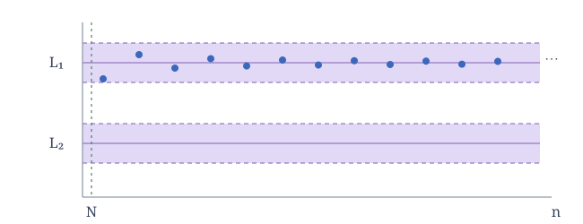{fig-alt="שתי רצועות נפרדות סביב L1 ו L2. מאינדקס N והלאה כל האיברים ברצועה סביב L1, ולכן כולם מחוץ לרצועה סביב L2." width="600" fig-align="center"}

::: {.thmanalogy title="ליד איזה יעד נשארים?"}

יוצאים מפתח תקווה ורוצים להישאר קרובים גם לחיפה וגם לנהריה. כשדורשים קרבה גדולה מספיק, אי אפשר להישאר ליד שני היעדים יחד. אותו הדבר קורה אפילו עם שני יעדים קרובים, כמו רחוב סומסום $1$ ורחוב סומסום $2$: אפשר לבחור סביבם אזורים קטנים שאינם חופפים, ואז להישאר רק באחד מהם.

:::

:::: {.thmchk title="שתי סביבות נפרדות"}

כל איברי הסדרה החל מאינדקס $20$ נמצאים בקטע $(1,2)$. האם ייתכן שמאינדקס $30$ והלאה כולם נמצאים גם בקטע $(4,5)$?

::: {.quiz options="כן|לא" answer="לא"}

לא. למשל, האיבר באינדקס $30$ היה צריך להיות בשני הקטעים, ואין מספר שנמצא בשניהם. גם האיברים שאחריו אינם יכולים לקיים את שתי הדרישות יחד.

:::

::::

### שתי התנהגויות באותה סדרה {.unnumbered}

::: {#box-def-subsequence .thmdef title="תת־סדרה"}

בוחרים אינדקסים טבעיים $n_1,n_2,n_3,\ldots$, כך שבכל בחירה מתקדמים לאינדקס גדול יותר:
$$n_{k+1}>n_k.$$
האיברים שנבחרו הם
$$a_{n_1},a_{n_2},a_{n_3},\ldots$$
זוהי [**תת־סדרה**]{.term} של $(a_n)_{n=1}^{\infty}$, ומסמנים אותה $(a_{n_k})_{k=1}^{\infty}$.

האינדקס $k$ סופר את האיברים בתת־הסדרה; $n_k$ הוא האינדקס של האיבר שנבחר בסדרה המקורית.

אפשר לחשוב על הבחירה כעל קפיצות בין איברי הסדרה: קופצים תמיד **קדימה, לפחות אינדקס אחד בכל צעד**. אפשר לעבור לאיבר הבא, ואפשר לדלג על כמה איברים. אסור לחזור לאחור או להישאר באותו אינדקס.

למשל, אם בוחרים $n_k=2k$, מקבלים את האיברים באינדקסים הזוגיים:
$$a_2,a_4,a_6,\ldots$$

{fig-alt="האינדקסים המקוריים אחת עד שמונה. נבחרים האיברים באינדקסים שתיים, ארבע, שש ושמונה; הם האיבר הראשון, השני, השלישי והרביעי בתת הסדרה." width="560" fig-align="center"}

:::

::: {#box-exm-subsequence-choice .thmexm title="מהי תת־סדרה ומה לא?"}

נבחן את הסדרה
$$1,2,3,4,5,6,\ldots$$
הסדרה
$$2,4,6,\ldots$$
היא תת־סדרה שלה: בחרנו איברים מהסדרה המקורית ושמרנו על הסדר שבו הם מופיעים.

לעומת זאת, הסדרה
$$2,1,3,4,5,6,\ldots$$
אינה תת־סדרה שלה. אלה אותם מספרים, אבל הסדר השתנה: אחרי שבחרנו את האיבר $2$, אי אפשר לחזור לאינדקס של האיבר $1$.

**כל סדרה היא תת־סדרה של עצמה.** אין חובה לדלג על איברים: בוחרים $n_k=k$, ומקבלים את כל האיברים באותו סדר.

באיור מוצגות שתי דרכי בחירה בסדרה כלשהי $(a_n)$:

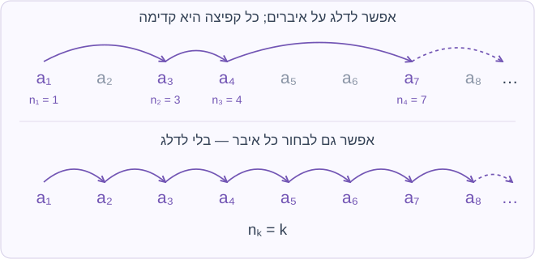{fig-alt="בשורה הראשונה בוחרים את האיברים באינדקסים אחת, שלוש, ארבע ושבע: כל הקפיצות קדימה, וחלקן מדלגות על איברים. בשורה השנייה בוחרים את כל האיברים, וקופצים בכל פעם לאינדקס הבא. כך מתקבלת הסדרה עצמה." width="600" fig-align="center"}

:::

:::: {.thmchk title="מה מותר לבחור?"}

האם $1,1,2,3,4,\ldots$ היא תת־סדרה של $1,2,3,4,\ldots$?

::: {.quiz options="כן|לא" answer="לא"}

לא. המספר $1$ מופיע בסדרה המקורית פעם אחת בלבד, ואי אפשר לבחור את אותו אינדקס פעמיים. ערכים שווים יכולים להופיע בתת־סדרה רק אם הם מופיעים באינדקסים שונים בסדרה המקורית.

:::

::::

::: {#box-thm-subsequence-limit .thmthm title="הגבול של תת־סדרה"}

אם סדרה מתכנסת אל $L$, כל תת־סדרה שלה מתכנסת גם היא אל $L$.

לכן, אם שתי תתי־סדרות מתכנסות למספרים שונים, הסדרה המקורית אינה מתכנסת.

:::

בחירת חלק מהאיברים אינה משנה את העובדה שכל האיברים מאינדקס מסוים והלאה קרובים לגבול. לכן תת־סדרה של סדרה מתכנסת אינה יכולה להוביל לגבול אחר.

:::: {#box-sim-subsequence .thmsim title="בוחרים חלק מהאיברים"}

נחזור לסדרה $a_n=\frac1n$, ש[כבר הוכחנו כי היא מתכנסת אל $0$](#box-exm-one-over-n). הפעם נבחר מתוכה תת־סדרה ונראה מה משתנה בציור.

בחרו תת־סדרה. בתצוגה המשותפת, האיברים שנבחרו מופיעים בצבע אחר באינדקסים המקוריים $n_k$. בתצוגת תת־הסדרה בלבד, האיברים נשארים באותם גבהים, אבל ציר האינדקסים הוא $k=1,2,3,\ldots$.

```{=html}
<iframe class="widget-frame" src="widgets/ch02/subsequences.html" loading="lazy" title="סדרה ותת־סדרה על אותו גרף ובנפרד"></iframe>
```
מאינדקס מסוים והלאה כל איברי הסדרה המקורית נמצאים ברצועה. גם האיברים שנבחרים מאותו אינדקס והלאה נמצאים בה. הבחירה יכולה לדלג קדימה, אבל אינה יכולה לחזור לאיברים המוקדמים שמחוץ לרצועה.

::::

::::: {#box-exm-no-limit .thmexm title="קודם בוחרים אינדקסים, ואז מציבים"}

נחזור אל $a_n=(-1)^n$. נבחר את האינדקסים הזוגיים בסדרה המקורית:
$$n_1=2,\quad n_2=4,\quad n_3=6,\quad\ldots$$
כלומר, הנוסחה לאינדקס שנבחר היא
$$n_k=2k.$$
רק עכשיו מציבים אותו בנוסחת האיבר:
$$a_{n_k}=(-1)^{n_k}=(-1)^{2k}=1.$$

| האינדקס בתת־הסדרה $k$ | האינדקס המקורי שנבחר $n_k=2k$ | האיבר שנבחר $a_{n_k}$ |
|:---:|:---:|:---:|
| $1$ | $2$ | $a_2=1$ |
| $2$ | $4$ | $a_4=1$ |
| $3$ | $6$ | $a_6=1$ |

לבחירה השנייה ניתן שם אחר: $m_k$ הוא האינדקס האי־זוגי שנבחר במקום $k$.
$$m_1=1,\quad m_2=3,\quad m_3=5,\quad\ldots$$
כלומר $m_k=2k-1$, ולכן
$$a_{m_k}=(-1)^{m_k}=(-1)^{2k-1}=-1.$$
קיבלנו שתי סדרות קבועות: הראשונה מתכנסת אל $1$, והשנייה אל $-1$. לפי [המשפט על תתי־סדרות](#box-thm-subsequence-limit), זו דרך נוספת להראות שהסדרה המקורית אינה מתכנסת.

{fig-alt="האיברים באינדקסים הזוגיים בגובה אחת, ובאי־זוגיים בגובה מינוס אחת." width="500" fig-align="center"}

:::: fill

בבחירה $n_k=2k$, כאשר $k=3$, האינדקס המקורי הוא $n_3=$ [$6$]{.blank ans="6"}.
האיבר שנבחר הוא $a_{n_3}=$ [$1$]{.blank ans="1"}.

::: explain

האינדקס $3$ סופר את הבחירות; הבחירה השלישית היא האיבר באינדקס $6$ של הסדרה המקורית, שערכו $1$.

:::

::::

:::::

:::: {.thmchk title="תת־סדרה אחת אינה מספיקה"}

בסדרה $(-1)^n$ יש תת־סדרה המתכנסת אל $1$. האם נובע מכך שהסדרה כולה מתכנסת?

::: {.quiz options="כן|לא" answer="לא"}

לא. תת־הסדרה משאירה בחוץ את האיברים השווים $-1$, והם ממשיכים להופיע. צריך לבדוק גם מה קורה לאיברים שלא בחרנו.

:::

::::

::::: {#box-exm-distance-editor .thmexm title="מציבים את האיבר בעוזר הפתרון"}

נתון $a_n=1+\frac2n$. נתרגל את התנאי $|a_n-1|<\frac14$.

תחילה בחרו **פישוט והחלפה ← הצבה לפי הגדרת הסדרה**, והקלידו $a_n$. בצעד הבא בחרו **פישוט האגפים**: המספרים $1$ ו $-1$ מתבטלים, ו $2/n$ חיובי. אחר כך כופלים במספרים חיוביים דרך **פעולות על האגפים ← כפל**.

:::: {.derive vars="n" solve="n" positive="n" sequence-name="a" sequence-formula="1+2/n" start="abs(a_n-1)<1/4"}

::: {.step line="abs(1+2/n-1)<1/4" action="sequence" value="a_n"}

מציבים את הגדרת האיבר.

:::

::: {.step line="2/n<1/4" action="simplify"}

מפשטים את המרחק; $n$ חיובי.

:::

::: {.step line="2<n/4" action="mul" value="n"}

כופלים ב $n$.

:::

::: {.step line="8<n" action="mul" value="4"}

כופלים ב $4$. לכן אפשר לבחור $N=9$.

:::

::::

:::::

### תרגילים {.unnumbered}

::::: {#box-q-epsilon-solve .thmqst title="מהאי־שוויון לבחירת אינדקס"}

הראו שהסדרה $a_n=\frac2{n+1}$ מתכנסת אל $0$.

**(א)** מצאו אינדקס שממנו השגיאה קטנה מ $1/50$.

:::: {.derive vars="n" solve="n" positive="n" start="2/(n+1)<1/50"}

::: {.step line="2<(n+1)/50" action="mul" value="n+1"}

כופלים ב $n+1>0$.

:::

::: {.step line="100<n+1" action="mul" value="50"}

כופלים ב $50$.

:::

::: {.step line="99<n" action="sub" value="1"}

מחסרים $1$.

:::

::::

:::: fill

אפשר לבחור $N=$ [$100$]{.blank ans="100" min-answer="100" integer-answer="true"}.

::: explain

כל $n\ge100$ מקיים $n>99$, ולכן השגיאה קטנה מ $1/50$.

:::

::::

**(ב)** הראו שהדרישה מתקיימת לכל $\varepsilon>0$.

:::: {.derive vars="n,ε" solve="n" positive="n,ε" start="2/(n+1)<ε"}

::: {.step line="2<(n+1)*ε" action="mul" value="n+1"}

כופלים ב $n+1>0$.

:::

::: {.step line="2/ε<n+1" action="div" value="ε"}

מחלקים בסף השגיאה החיובי.

:::

::: {.step line="2/ε-1<n" action="sub" value="1"}

מחסרים $1$ משני האגפים.

:::

::::

האם הבחירה $N=\lfloor2/\varepsilon\rfloor+1$ מספיקה, גם אם אינה המוקדמת ביותר?

::: {.quiz options="כן|לא" answer="כן"}

כן. זהו מספר טבעי הגדול מ $2/\varepsilon$, ובפרט גדול מ $2/\varepsilon-1$. לכן כל $n\ge N$ מקיים את הדרישה. הבחירה אפשרית לכל סף חיובי, ולכן הגבול הוא $0$.

:::

:::::

::::: {#box-q-error-place .thmqst title="קירוב למספר שאינו אפס"}

הראו שהסדרה $a_n=1+\frac2n$ מתכנסת אל $1$.

**(א) סף שגיאה מספרי.** מצאו אינדקס $N$ שממנו והלאה השגיאה קטנה מ $\frac1{100}$.

לפי [הגדרת הגבול](#box-def-limit), מחפשים $N$ שממנו והלאה מתקיים
$$|a_n-1|<\frac{1}{100}.$$

:::: {.derive vars="n" solve="n" positive="n" integer="n" sequence-name="a" sequence-formula="1+2/n" start="abs(a_n-1)<1/100"}

::: {.step line="abs(1+2/n-1)<1/100" action="sequence" value="a_n"}

מציבים את הנוסחה של $a_n$ בתנאי על המרחק.

:::

::: {.step line="2/n<1/100" action="simplify"}

מפשטים בתוך הערך המוחלט. מכיוון ש $n>0$, הביטוי $2/n$ חיובי והערך המוחלט שלו הוא עצמו.

:::

::: {.step line="2<n/100" action="mul" value="n"}

כופלים במספר החיובי $n$.

:::

::: {.step line="200<n" action="mul" value="100"}

כופלים ב $100$.

:::

::: hint

התחילו מהמרחק מ $1$, ולא מהאיבר $a_n$ עצמו.

:::

::::

:::: fill

אפשר לבחור $N=$ [$201$]{.blank ans="201" min-answer="201" integer-answer="true"}.

::: explain

מצאנו $n>200$. כל אינדקס טבעי $N\ge201$ מבטיח שהדרישה תתקיים ממנו והלאה.

:::

::::

**(ב) סף שגיאה כללי.** כעת הוכיחו את ההתכנסות לכל $\varepsilon>0$. פתרו את האי־שוויון $|a_n-1|<\varepsilon$ בעוזר הפתרון, ואז כתבו בחירה מתאימה של $N$. האינדקס $n$ וסף השגיאה $\varepsilon$ חיוביים.

:::: {.derive vars="n,ε" solve="n" positive="n,ε" integer="n" sequence-name="a" sequence-formula="1+2/n" start="abs(a_n-1)<ε"}

::: {.step line="abs(1+2/n-1)<ε" action="sequence" value="a_n"}

מציבים את הגדרת האיבר.

:::

::: {.step line="2/n<ε" action="simplify"}

מפשטים את השגיאה; $n$ חיובי.

:::

::: {.step line="2<n*ε" action="mul" value="n"}

כופלים ב $n>0$, ולכן כיוון האי־שוויון נשמר.

:::

::: {.step line="2/ε<n" action="div" value="ε"}

מחלקים ב $\varepsilon>0$, ולכן כיוון האי־שוויון נשמר.

:::

::: {.step line="n>2/ε" action="swap"}

מחליפים את סדר האגפים וכותבים את האינדקס משמאל.

:::

::: hint

הפעולות הן אותן פעולות שבסעיף (א). במקום לחלק במספר קבוע, אפשר לחלק ב $\varepsilon$, כי נתון שהוא חיובי.

:::

::::

:::: fill

כתבו את הבחירה לפי [השיטה לבחירת מספר שלם גדול יותר](#box-method-integer-above): $N=$ [$\lfloor2/\varepsilon\rfloor+1$]{.blank ans="floor(2/ε)+1" vars="ε" positive="ε" kind="expr"}.

::: explain

הבחירה $N=\lfloor2/\varepsilon\rfloor+1$ היא מספר טבעי הגדול מ $2/\varepsilon$. לכן, לכל $n\ge N$,
$$|a_n-1|=\frac2n\le\frac2N<\varepsilon.$$
הבחירה אפשרית לכל $\varepsilon>0$, ולכן לפי ההגדרה הסדרה מתכנסת אל $1$. גם אינדקס טבעי גדול יותר היה מתאים.

:::

::::

:::::

::::: {#box-q-reject-candidate .thmqst title="מועמד לא מתאים, אבל יש גבול"}

בסדרה $a_n=1+\frac2n$ כבר הראינו שהגבול הוא $1$. כעת הראו שהמספר $0$ אינו הגבול.

:::: fill

המרחק של האיבר $a_n$ מאפס הוא [$1+\frac{2}{n}$]{.blank ans="1+2/n" vars="n" positive="n" integer="n"}.

מכיוון ש $n>0$, האם המרחק הזה גדול מ $1$ בכל אינדקס? [כן]{.blank kind="text" ans="כן" choices="כן|לא"}

::: explain

המרחק הוא $|1+2/n|=1+2/n$. המחובר $2/n$ חיובי, ולכן המרחק גדול מ $1$ בכל אינדקס.

:::

::::

נבחר $\varepsilon=1$. האם יש אינדקס שממנו כל האיברים נמצאים בסביבה $(-1,1)$?

::: {.quiz options="כן|לא" answer="לא"}

לא. כל האיברים גדולים מ $1$, ולכן שום זנב אינו בתוך הסביבה. מצאנו סף שגיאה שעבורו דרישת ההגדרה נכשלת בכל בחירה של $N$.

:::

מה הראינו?

::: {.quiz options="המספר 0 אינו הגבול|אין לסדרה גבול כלל|הגבול חייב להיות גדול מכל האיברים" answer="המספר 0 אינו הגבול"}

שללנו מועמד אחד. לא שללנו התכנסות: הסדרה הזאת מתכנסת אל $1$, כפי שהראינו בתרגיל הקודם.

:::

:::::

::::: {#box-q-error-below .thmqst title="קירוב מהצד השני"}

הראו שהסדרה $a_n=3-\frac4n$ מתכנסת אל $3$. תחילה מצאו אינדקס $N$ שממנו והלאה השגיאה קטנה מ $\frac1{20}$, ואחר כך עברו לסף שגיאה כללי.

זהו התנאי מתוך [הגדרת הגבול](#box-def-limit): לכל $\varepsilon>0$ צריך למצוא אינדקס $N$ כך שלכל $n\ge N$ מתקיים
$$
|a_n-L|<\varepsilon.
$$
בתרגיל הזה נתונים $L=3$ ו $\varepsilon=\frac{1}{20}$, ולכן מחפשים $N$ שממנו והלאה מתקיים
$$
|a_n-3|<\frac{1}{20}.
$$
כתבו את התנאי בעוזר הפתרון. אחר כך הציבו את הנוסחה של $a_n$ ופתרו את האי־שוויון.

:::: {.derive vars="n" solve="n" positive="n" integer="n" student-setup="distance" sequence-name="a" sequence-formula="3-4/n" start="abs(a_n-3)<1/20"}

::: {.step line="abs(3-4/n-3)<1/20" action="sequence" value="a_n"}

מציבים את הנוסחה של $a_n$ בתנאי על המרחק.

:::

::: {.step line="abs([-4/n])<1/20"}

מפשטים את הביטוי בתוך הערך המוחלט.

:::

::: {.step line="[4/n]<1/20"}

מכיוון ש $n>0$, הביטוי $-\frac4n$ שלילי. הערך המוחלט שלו הוא $\frac4n$.

:::

::: {.step line="4<[n/20]"}

כופלים במספר החיובי $n$.

:::

::: {.step line="n>[80]"}

כופלים ב $20$ וכותבים את האינדקס משמאל.

:::

::: hint

גם כשהאיבר קטן מ $3$, השגיאה אינה שלילית: היא מרחק.

:::

::::

:::: fill

אפשר לבחור $N=$ [$81$]{.blank ans="81" min-answer="81" integer-answer="true"}.

::: explain

האי־שוויון שקול ל $n>80$, ולכן כל אינדקס טבעי $N\ge81$ מתאים.

:::

::::

כעת נבחר סף שגיאה כללי $\varepsilon>0$. איזו בחירה מבטיחה את הדרישה לכל $n\ge N$?

::: {.quiz options="$N>4/\varepsilon$|$N>4\varepsilon$|אותו אינדקס קבוע לכל אפסילון" answer="$N>4/\varepsilon$"}

השגיאה היא $4/n$, ולכן הדרישה שקולה ל $n>4/\varepsilon$. לכל אפסילון חיובי אפשר לבחור אינדקס טבעי גדול מהסף הזה. כך מראים שהמועמד הנתון הוא הגבול; הבדיקה המספרית לבדה לא הספיקה.

:::

:::::

::::: {#box-q-limit-meaning .thmqst title="מה קובעת ההגדרה?"}

ענו על השאלות. בסעיף (ג) בחרו גם נימוק.

:::: fill

**(א)** עבור $a_n=\frac1n$ ו $\varepsilon=\frac{1}{10}$, האם $N=10$ מתאים ביחס לגבול $0$? [לא]{.blank kind="text" ans="לא" w="4" choices="כן|לא"}

ומה לגבי $N=100$? [כן]{.blank kind="text" ans="כן" w="4" choices="כן|לא"}

**(ב)** החלפנו את מאה האיברים הראשונים של $\frac1n$ במספר $1000$. האם עדיין מתקיים שהסדרה מתכנסת אל $0$? [כן]{.blank kind="text" ans="כן" choices="כן|לא"}.

**(ג)** בסדרה $(-1)^n$, יש אינסוף איברים השווים $1$. האם היא מתכנסת אל $1$? [לא]{.blank kind="text" ans="לא" w="4" choices="כן|לא"}

המרחק מ $1$ של כל איבר באינדקס אי־זוגי הוא [$2$]{.blank ans="2"}.

איזו עובדה מראה שאין לסדרה גבול?

::: {.quiz options="כל האיברים נמצאים בין שני מספרים קבועים|שתי תתי־סדרות מתכנסות לגבולות שונים|יש בסדרה איברים חיוביים ואיברים שליליים" answer="שתי תתי־סדרות מתכנסות לגבולות שונים"}

באינדקסים הזוגיים מתקבלת תת־סדרה קבועה שגבולה $1$, ובאי־זוגיים מתקבלת תת־סדרה קבועה שגבולה $-1$. לפי [המשפט על גבולות של תתי־סדרות](#box-thm-subsequence-limit), הגבולות השונים מראים שהסדרה אינה מתכנסת.

:::

**(ד)** מאה האיברים הראשונים של סדרה נמצאים במרחק קטן מ $\frac{1}{1000}$ מהמספר $5$. האם מכך בלבד אפשר להסיק שהגבול הוא $5$? [לא]{.blank kind="text" ans="לא" w="4" choices="כן|לא"}

::: explain

**(א)** באינדקס $10$ השגיאה שווה ל $\frac{1}{10}$, ואילו החל מאינדקס $100$ היא לכל היותר $\frac{1}{100}$.

**(ב)** שינוי של מספר סופי של איברים אינו משנה את הגבול.

**(ג)** האיברים באינדקסים האי־זוגיים שווים $-1$, ולכן המרחק שלהם מ $1$ הוא $|-1-1|=2$. הם מונעים התכנסות אל $1$.

**(ד)** לא נתון דבר על האיברים הבאים. למשל, כולם יכולים להיות שווים לאפס.

:::

::::

:::::

::::: {#box-q-even-odd .thmqst title="זוגיים ואי־זוגיים"}

נתונה $a_n=2+(-1)^n$. מצאו את שתי תתי־הסדרות וקבעו אם הסדרה מתכנסת.

:::: fill

::: {.sequence-table dir="ltr"}

| הבחירה | האינדקס המקורי שנבחר | הצבה באיבר, לפני פישוט | האיבר לאחר פישוט | הגבול |
|:---:|:---:|:---:|:---:|:---:|
| זוגיים: $2,4,6,\ldots$; $n_k$ | [$2k$]{.blank ans="2k" vars="k" positive="k" integer="k"} | [$2+(-1)^{2k}$]{.blank ans="2+(-1)^(2k)" vars="k" positive="k" integer="k" form="calculation" calculation="2+(-1)^(2k)"} | [$3$]{.blank ans="3"} | [$3$]{.blank ans="3"} |
| אי־זוגיים: $1,3,5,\ldots$; $m_k$ | [$2k-1$]{.blank ans="2k-1" vars="k" positive="k" integer="k"} | [$2+(-1)^{2k-1}$]{.blank ans="2+(-1)^(2k-1)" vars="k" positive="k" integer="k" form="calculation" calculation="2+(-1)^(2k-1)"} | [$1$]{.blank ans="1"} | [$1$]{.blank ans="1"} |

:::

האם $(a_n)$ מתכנסת? [לא]{.blank kind="text" ans="לא" w="4" choices="כן|לא"}

מה הנימוק?

::: {.quiz options="שתי תתי־הסדרות מתכנסות לגבולות שונים|בסדרה מופיעים שני ערכים שונים|כל האיברים נמצאים בין שני מספרים קבועים" answer="שתי תתי־הסדרות מתכנסות לגבולות שונים"}

לפי [המשפט על גבולות של תתי־סדרות](#box-thm-subsequence-limit), אילו הסדרה הייתה מתכנסת, שתי תתי־הסדרות היו מתכנסות לאותו גבול. כאן הגבולות שונים, ולכן הסדרה אינה מתכנסת.

:::

::: hint

הציבו $2k$ במקום $n$ עבור האינדקסים הזוגיים, ו $2k-1$ עבור האינדקסים האי־זוגיים.

:::

::: explain

באינדקסים הזוגיים מתקבל $3$, ובאי־זוגיים מתקבל $1$. הגבולות שונים, ולכן הסדרה אינה מתכנסת.

:::

::::

:::::

::::: {#box-q-alternating-error .thmqst title="סימן מתחלף ומרחק קטן"}

נתונה $a_n=\frac{2(-1)^n}{n+1}$. בדקו את המרחק מאפס.

:::: fill

כתבו את המרחק מאפס לאחר פישוט: [$\frac{2}{n+1}$]{.blank ans="2/(n+1)" vars="n" positive="n" integer="n"}.

האם המרחק שמצאתם מאפשר להראות שהסדרה מתכנסת אל $0$? [כן]{.blank kind="text" ans="כן" choices="כן|לא"}

עבור שגיאה קטנה מ $\frac{1}{100}$, אפשר לבחור $N=$ [$200$]{.blank ans="200" min-answer="200" integer-answer="true"}.

::: hint

הערך המוחלט של $(-1)^n$ הוא $1$, גם כשהסימן של האיבר שלילי.

:::

::: explain

המרחק מאפס הוא $\frac2{n+1}$, וכבר ראינו שהוא נעשה קטן מכל סף שגיאה. לכן הסדרה מתכנסת לאפס. לשגיאה קטנה מ $\frac{1}{100}$ מספיק לבחור אינדקס טבעי גדול מ $199$.

:::

::::

עבור $\varepsilon>0$ כללי, איזו בחירה מבטיחה שכל האיברים שמאינדקס $N$ והלאה קרובים לאפס?

::: {.quiz options="$N>2/\varepsilon-1$|$N>\varepsilon$|$N=200$ לכל אפסילון" answer="$N>2/\varepsilon-1$"}

המרחק הוא $2/(n+1)$, ולכן בוחרים אינדקס טבעי $N>2/\varepsilon-1$. זה אפשרי לכל אפסילון חיובי, וזו ההצדקה להתכנסות אל $0$.

:::

:::::

::::: {#box-q-decimal-decay .thmqst title="התכנסות מהירה: משתמשים בלוגריתם"}

הראו שהסדרה $a_n=1/10^n$ מתכנסת אל $0$. הכתיבה $10^{-n}$ מתארת אותו איבר.

**(א)** מצאו אינדקס שממנו השגיאה קטנה מ $1/1000$. אפשר להשתמש בלוגריתם בבסיס $10$, כפי שראינו בפרק 1.

:::: {.derive vars="n" solve="n" positive="n" start="10^(-n)<1/1000"}

::: {.step line="log_10(10^(-n))<log_10(1/1000)" action="log" value="10" clean="מפעילים לוגריתם בבסיס $10$ על שני האגפים. האגפים חיוביים והבסיס גדול מאחת, ולכן הכיוון נשמר."}

בוחרים ״לוגריתם בבסיס״, עם בסיס $10$. שני האגפים חיוביים, והבסיס גדול מאחת, ולכן הכיוון נשמר.

:::

::: {.step line="-n<-3" action="simplify"}

משתמשים ב $\log_{10}(10^{-n})=-n$ וב $1/1000=10^{-3}$.

:::

::: {.step line="n>3" action="div" value="-1"}

מחלקים ב $-1$ והופכים את כיוון האי־שוויון.

:::

::::

:::: fill

אפשר לבחור $N=$ [$4$]{.blank ans="4" min-answer="4" integer-answer="true"}.

::: explain

האיבר השלישי שווה בדיוק לסף השגיאה. כל האיברים מאינדקס $4$ והלאה קטנים ממנו.

:::

::::

**(ב)** כעת נטפל בסף כללי $0<\varepsilon<1$. עבור $\varepsilon\ge1$ הדרישה כבר מתקיימת מהאיבר הראשון, כי $1/10^n\le1/10<1$.

:::: {.derive vars="n,ε" solve="n" positive="n,ε" start="10^(-n)<ε"}

::: {.step line="log_10(10^(-n))<log_10(ε)" action="log" value="10"}

מפעילים לוגריתם בבסיס $10$ על שני האגפים החיוביים.

:::

::: {.step line="-n<log_10(ε)" action="simplify"}

מפשטים את הלוגריתם של החזקה.

:::

::: {.step line="n>-log_10(ε)" action="div" value="-1"}

מחלקים ב $-1$ והופכים את הכיוון.

:::

::::

:::: fill

עבור $0<\varepsilon<1$, כתבו בחירה לפי שיטת הערך השלם:
$N=$ [$\lfloor-\log_{10}(\varepsilon)\rfloor+1$]{.blank ans="floor(-log_10(ε))+1" vars="ε" positive="ε" w="19"}.

::: explain

כש $0<\varepsilon<1$, המספר $-\log_{10}\varepsilon$ חיובי. הבחירה נותנת מספר טבעי גדול ממנו. לכן כל $n\ge N$ מקיים $10^{-n}<\varepsilon$. יחד עם המקרה $\varepsilon\ge1$, קיבלנו את הדרישה לכל סף שגיאה חיובי.

:::

::::

:::::

::::: {#box-q-three-subsequences .thmqst title="שלוש תתי־סדרות קבועות"}

נתונה הסדרה שבה שלושת הערכים חוזרים שוב ושוב:
$$2,-1,4,2,-1,4,2,-1,4,\ldots$$
נבחר בנפרד את האינדקסים $1,4,7,\ldots$, את האינדקסים $2,5,8,\ldots$ ואת האינדקסים $3,6,9,\ldots$.

:::: fill

בבחירה הראשונה, $n_k=$ [$3k-2$]{.blank ans="3k-2" vars="k" positive="k" integer="k" w="9"}, ולכן $a_{n_k}=$ [$2$]{.blank ans="2" w="3"}.

בבחירה השנייה, $m_k=$ [$3k-1$]{.blank ans="3k-1" vars="k" positive="k" integer="k" w="9"}, ולכן $a_{m_k}=$ [$-1$]{.blank ans="-1" w="3"}.

בבחירה השלישית, $p_k=$ [$3k$]{.blank ans="3k" vars="k" positive="k" integer="k" w="9"}, ולכן $a_{p_k}=$ [$4$]{.blank ans="4" w="3"}.

הגבולות, באותו סדר, הם [$2$]{.blank ans="2" w="3"}, [$-1$]{.blank ans="-1" w="3"}, [$4$]{.blank ans="4" w="3"}.

::: explain

כל בחירה נותנת סדרה קבועה, ולכן הגבול שלה הוא האיבר הקבוע.

:::

::::

האם הסדרה המקורית מתכנסת?

::: {.quiz options="כן|לא" answer="לא"}

לא. לסדרה מתכנסת כל תתי־הסדרות מתכנסות לאותו גבול. כאן הגבולות שונים; למעשה, כבר שתי הבחירות הראשונות מספיקות לשלול התכנסות.

:::

:::::

::::: {#box-q-interleaved-zero .thmqst title="קופצת לאפס ובחזרה — האם היא מתכנסת?"}

נתונה הסדרה
$$1,0,\frac12,0,\frac13,0,\frac14,0,\ldots$$
כל איבר זוגי שווה לאפס. באינדקסים האי־זוגיים מופיעים, לפי הסדר, $1,1/2,1/3,\ldots$.

**(א) מזהים את שתי הבחירות.**

:::: fill

$a_{2k}=$ [$0$]{.blank ans="0" w="3"}, ואילו $a_{2k-1}=$ [$1/k$]{.blank ans="1/k" vars="k" positive="k" integer="k" w="8"}.

גבול האיברים הזוגיים הוא [$0$]{.blank ans="0" w="3"}, וגבול האיברים האי־זוגיים הוא [$0$]{.blank ans="0" w="3"}.

::: explain

באינדקסים הזוגיים מתקבלת הסדרה הקבועה אפס; באי־זוגיים מתקבלת הסדרה $1/k$. לשתיהן גבול אפס.

:::

::::

האם עצם המעברים מאפס למספר חיובי מוכיח שהסדרה אינה מתכנסת?

::: {.quiz options="כן|לא" answer="לא"}

לא. גם המספרים החיוביים הולכים ומתקרבים לאפס. נבדוק כעת שהשגיאה קטנה מכל סף, עבור כל האיברים מאינדקס מתאים.

:::

**(ב) מראים שהגבול הוא $0$.** יהי $\varepsilon>0$. האיברים הזוגיים כבר עומדים בדרישה, כי שגיאתם אפס. לאיבר האי־זוגי באינדקס $2k-1$ נדרוש $1/k<\varepsilon$. פתרו את התנאי על $k$:

:::: {.derive vars="k,ε" solve="k" positive="k,ε" start="1/k<ε"}

::: {.step line="1<k*ε" action="mul" value="k"}

כופלים ב $k>0$.

:::

::: {.step line="1/ε<k" action="div" value="ε"}

מחלקים ב $\varepsilon>0$.

:::

::::

נבחר $K=\lfloor1/\varepsilon\rfloor+1$. כך כל איבר אי־זוגי שמספרו בבחירה הוא $k\ge K$ עומד בדרישה. עכשיו צריך לחזור לאינדקסים של הסדרה המקורית.

איזו בחירה מבטיחה שכל איברי הסדרה המקורית שמאינדקס $N$ והלאה עומדים בדרישה?

::: {.quiz options="$N=2K-1$|$N=1$ לכל אפסילון" answer="$N=2K-1$"}

בוחרים $N=2K-1$. כל אינדקס אי־זוגי $n\ge N$ הוא מהצורה $2k-1$ עם $k\ge K$, ולכן השגיאה שלו קטנה מאפסילון. כל אינדקס זוגי נותן אפס. שתי האפשרויות מכסות את כל האינדקסים, ולכן הסדרה מתכנסת אל $0$.

:::

:::::


## גבולות מוכרים וחשבון גבולות

בחישוב לפי ההגדרה חיפשנו בכל פעם אינדקס המתאים לסף השגיאה שבחרנו. לא צריך לחזור על העבודה הזאת בכל תרגיל: אפשר להיעזר בגבולות שכבר ידועים ולשלב אותם בעזרת כללי חישוב.

נכיר כמה סדרות שימושיות ואת גבולותיהן. את התוצאות נקבל ללא הוכחה; נלמד לזהות מתי הן מתאימות ואיך משתמשים בהן.

### סדרות מוכרות {.unnumbered}

סדרה קבועה מתכנסת לקבוע שלה: $c\to c$. הטבלה הבאה מרכזת את משפחות הגבולות הבסיסיות שבהן נשתמש. גבולות שמתקבלים מהן בחיבור, בכפל או בחילוק נחשב בעזרת הכללים, ולא נרשום כעובדות נוספות לזכירה.

::: {#box-thm-standard .thmthm title="גבולות בסיסיים"}
| הסדרה | הגבול | התנאים |
|:---:|:---:|:---|
| $\frac1{n^p}$ | $0$ | $p>0$ |
| $q^n$ | $0$ | $|q|<1$ |
| $\sqrt[n]{a}$ | $1$ | $a>0$ קבוע |
| $\sqrt[n]{n}$ | $1$ | |
| $\frac{n^p}{q^n}$ | $0$ | $p>0$, $q>1$ |

הפרמטרים $p$, $q$ ו $a$ קבועים; האינדקס $n$ הוא שמשתנה.
:::

::::: {#box-exm-standard-illustrations .thmexm title="הגבולות הבסיסיים בתמונות"}
**חזקות ששואפות לאפס.** עבור $p>0$ מתקיים
$$\frac1{n^p}\longrightarrow0.$$
המכנה גדל וההופכי שלו קטן לאפס. זה כולל גם שורשים: $\frac1{\sqrt n}=\frac1{n^{1/2}}$. בציור רואים את המקרים $p=\frac{1}{2}$, $p=1$ ו $p=2$.

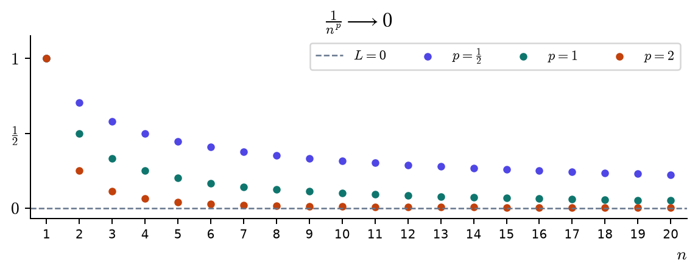{fig-alt="איברי שלוש הסדרות אחת חלקי שורש n, אחת חלקי n ואחת חלקי n בריבוע מתקרבים לאפס בקצבים שונים." width="540" fig-align="center"}

**סדרה הנדסית.** עבור $|q|<1$ מתקיים
$$q^n\longrightarrow0.$$
בכל צעד הערך המוחלט מוכפל ב $|q|$. כש $q<0$, גם הסימן מתחלף. שנו את $q$ בסימולציה: השוו בין $q=\frac{1}{2}$ לבין $q=-\frac{1}{2}$, ואחר כך בדקו מה קורה כשהתנאי $|q|<1$ אינו מתקיים.

```{=html}
<iframe class="widget-frame" src="widgets/ch02/known-limits.html?case=geometric" loading="lazy" title="חזקות של בסיס קבוע: השפעת הבסיס על ההתכנסות"></iframe>
```

**שורש מסדר הולך וגדל של מספר קבוע.** עבור $a>0$ קבוע מתקיים
$$\sqrt[n]{a}\longrightarrow1.$$
חשוב להבחין בין $\sqrt n$, שבו המספר מתחת לשורש גדל, לבין $\sqrt[n]{a}$, שבו $a$ קבוע וסדר השורש גדל. למשל,
$$\sqrt{16}=4,$$
$$\sqrt[4]{16}=2,$$
$$\sqrt[8]{16}=\sqrt2\approx1.414.$$
בסימולציה בחרו מספר גדול מ $1$, ואחריו מספר שבין $0$ ל $1$. מאיזה צד מתקרבים אל $1$ בכל מקרה?

```{=html}
<iframe class="widget-frame" src="widgets/ch02/known-limits.html?case=roots" loading="lazy" title="שורשים מסדר הולך וגדל של מספר קבוע"></iframe>
```

**שורש של האינדקס עצמו.** גם כשהמספר שמתחת לשורש הוא $n$, מתקיים
$$\sqrt[n]{n}\longrightarrow1.$$

{fig-alt="איברי הסדרה שורש מסדר n של n: האיבר הראשון שווה אחת; בהמשך האיברים גדולים מאחת ומתקרבים אליה." width="540" fig-align="center"}

**השוואה בין שתי חזקות.** עבור $p>0$ ו $q>1$ מתקיים
$$\frac{n^p}{q^n}\longrightarrow0.$$
ב $n^p$ המעריך קבוע, וב $q^n$ הבסיס קבוע. אומרים ש $q^n$ גדלה מהר יותר משום שהמנה שואפת לאפס. למשל,
$$\frac{n}{2^n}\longrightarrow0.$$
בסימולציה שנו את המעריך והבסיס. המנה אינה חייבת לקטון כבר באיברים הראשונים; הגדילו את מספר האיברים המוצגים כדי לבדוק מה קורה בהמשך.

```{=html}
<iframe class="widget-frame" src="widgets/ch02/known-limits.html?case=ratio" loading="lazy" title="חזקה של האינדקס חלקי סדרה הנדסית"></iframe>
```
:::::

::::: {#box-exm-standard .thmexm title="מזהים את הסדרה המוכרת"}
התאימו כל סדרה לאחת הצורות שבטבלה וחשבו את גבולה.

:::: fill
**(א)** $\left(-\frac{1}{2}\right)^n$

המנה הקבועה בין איברים עוקבים היא $q=$ [$-\frac{1}{2}$]{.blank ans="-1/2"}.

הערך המוחלט שלה הוא $|q|=$ [$\frac{1}{2}$]{.blank ans="1/2"}. האם מתקיים $|q|<1$? [כן]{.blank kind="text" ans="כן" choices="כן|לא"}

לכן הגבול הוא [$0$]{.blank ans="0"}.

**(ב)** $\frac1{\sqrt n}$

נכתוב $\sqrt n=n^p$, כאשר $p=$ [$\frac{1}{2}$]{.blank ans="1/2"}.

האם $p>0$? [כן]{.blank kind="text" ans="כן" choices="כן|לא"}

הגבול הוא [$0$]{.blank ans="0"}.

**(ג)** $\frac{n^3}{2^n}$

המעריך הקבוע הוא $p=$ [$3$]{.blank ans="3"}.

הבסיס הקבוע הוא $q=$ [$2$]{.blank ans="2"}.

האם מתקיימים $p>0$ ו $q>1$? [כן]{.blank kind="text" ans="כן" choices="כן|לא"}

הגבול הוא [$0$]{.blank ans="0"}.

::: explain
**(א)** הערך המוחלט של המנה הוא $\frac{1}{2}<1$. הסימן מתחלף, אך האיברים מתקרבים לאפס.

**(ב)** משתמשים בגבול של $\frac1{n^p}$ עבור $p=\frac{1}{2}$.

**(ג)** משתמשים בגבול של $\frac{n^p}{q^n}$, עם $p=3$ ו $q=2>1$.
:::
::::
:::::

:::: {.thmchk}
מהכלל עבור $q^n$ נובע שגם $(-1)^n\to0$.

::: {.quiz options="נכון|לא נכון" answer="לא נכון"}
כאן $|q|=1$, ולכן התנאי $|q|<1$ אינו מתקיים. כבר ראינו שסדרה זו אינה מתכנסת.
:::

מה קורה ל $\frac1{n^p}$ כאשר $p=0$?

::: {.quiz options="$0$|$1$" answer="$1$"}
כל האיברים שווים $1$. לכן התנאי $p>0$ נחוץ.
:::
::::

::::: {#box-q-geometric-conditions .thmchk title="האם מותר להשתמש בכלל?"}
המנה $q$ היא המספר הקבוע שבו כופלים כדי לעבור מאיבר לאיבר הבא. התנאי $|q|<1$ שייך לכלל ההתכנסות לאפס; הוא אינו חלק מההגדרה של סדרה הנדסית.

:::: fill

::: {.sequence-table dir="ltr"}
| הסדרה | $q$ | $|q|$ | האם מתקיים $|q|<1$? |
|:---:|:---:|:---:|:---:|
| $(-\frac{1}{2})^n$ | [$-\frac{1}{2}$]{.blank ans="-1/2"} | [$\frac{1}{2}$]{.blank ans="1/2"} | [כן]{.blank kind="text" ans="כן" choices="כן\|לא"} |
| $(-1)^n$ | [$-1$]{.blank ans="-1"} | [$1$]{.blank ans="1"} | [לא]{.blank kind="text" ans="לא" choices="כן\|לא"} |
| $(-3)^n$ | [$-3$]{.blank ans="-3"} | [$3$]{.blank ans="3"} | [לא]{.blank kind="text" ans="לא" choices="כן\|לא"} |
| $1^n$ | [$1$]{.blank ans="1"} | [$1$]{.blank ans="1"} | [לא]{.blank kind="text" ans="לא" choices="כן\|לא"} |
:::

::: explain
רק בשורה הראשונה הכלל נותן גבול אפס. המספר $-3$ קטן מ $1$, אבל הערך המוחלט שלו גדול מ $1$: בודקים את הערך המוחלט, ולא רק את הסימן.
:::
::::

אם התנאי של הכלל אינו מתקיים, האם אפשר להסיק שאין גבול?

::: {.quiz options="כן|לא" answer="לא"}
לא. למשל, $1^n$ היא סדרה קבועה וגבולה $1$, אף שהכלל להתכנסות של $q^n$ לאפס אינו חל. ״הכלל אינו חל״ אומר שצריך נימוק אחר; זו אינה מסקנה על התכנסות הסדרה.
:::
:::::

### פעולות על סדרות מתכנסות {.unnumbered}

חשבון הגבולות מאפשר להחליף את סדר הפעולות: במקום לבצע פעולה על איברי הסדרות ואז לקחת גבול, אפשר קודם לקחת את הגבולות ואז לבצע עליהם את אותה פעולה. השוויונות הבאים אומרים ששתי הדרכים נותנות אותה תוצאה, בתנאים המצוינים בכל כלל.

::: {#box-thm-limit-arithmetic .thmthm title="חשבון גבולות"}
נניח שלשתי הסדרות יש גבולות סופיים: $\lim_{n\to\infty}a_n=A$ ו $\lim_{n\to\infty}b_n=B$. אז
$$\lim_{n\to\infty}(a_n+b_n)=\lim_{n\to\infty}a_n+\lim_{n\to\infty}b_n=A+B,$$
$$\lim_{n\to\infty}(a_n-b_n)=\lim_{n\to\infty}a_n-\lim_{n\to\infty}b_n=A-B,$$
$$\lim_{n\to\infty}(a_nb_n)=\left(\lim_{n\to\infty}a_n\right)\left(\lim_{n\to\infty}b_n\right)=AB.$$
אם נוסף על כך $B\ne0$, אז
$$\lim_{n\to\infty}\frac{a_n}{b_n}=\frac{\lim_{n\to\infty}a_n}{\lim_{n\to\infty}b_n}=\frac AB.$$
לכל קבוע ממשי $c$, כפל בקבוע עובר גם הוא מחוץ לגבול:
$$\lim_{n\to\infty}(ca_n)=c\lim_{n\to\infty}a_n=cA.$$
אפשר לקרוא את השוויונות בשני הכיוונים: **להוציא פעולה מחוץ לגבול או להכניס אותה לתוכו**. התנאים נשארים אותם תנאים.
הסדרות והמנות צריכות להיות מוגדרות, לפחות החל מאינדקס מסוים.
:::

::: {#box-prp-limit-powers .thmprp title="חזקות קבועות ושורשים"}
אם $a_n\to A$, אז לכל מספר טבעי חיובי וקבוע $k$,
$$\lim_{n\to\infty}a_n^k=\left(\lim_{n\to\infty}a_n\right)^k=A^k.$$

אם האיברים אי־שליליים, הכלל נכון לכל **מעריך ממשי חיובי וקבוע** $p$:
$$\lim_{n\to\infty}a_n^p=\left(\lim_{n\to\infty}a_n\right)^p=A^p.$$
בפרט, לשורש מסדר טבעי קבוע $k\ge2$,
$$\lim_{n\to\infty}\sqrt[k]{a_n}=\sqrt[k]{\lim_{n\to\infty}a_n}=\sqrt[k]{A}.$$
בסדר שורש זוגי נדרשים איברים אי־שליליים, לפחות החל מאינדקס מסוים. בסדר שורש אי־זוגי הכלל נכון גם לאיברים ולגבול שליליים.

אם $A>0$, הכלל נכון גם למעריכים ממשיים שליליים; אז האיברים חיוביים לפחות החל מאינדקס מסוים.
:::

הרעיון הוא שאם שני איברים מספיק קרובים לשני מספרים, גם סכומם ומכפלתם קרובים לסכום ולמכפלה של אותם מספרים. בחילוק צריך להיזהר: כשהמכנה קרוב לאפס, אפילו שינוי קטן בו יכול לשנות מאוד את המנה. לכן כלל המנה דורש שגבול המכנה יהיה שונה מאפס.

אפשר להשתמש בכללים כמה פעמים באותו חישוב. למשל, מוציאים את הקבוע $2$ ישירות:
$$\lim_{n\to\infty}\frac2n
=2\lim_{n\to\infty}\frac1n
=2\cdot0=0.$$
הוצאת הקבוע אינה מחשבת עדיין את הגבול של $1/n$; היא משאירה גבול פשוט יותר לחישוב.

::::: {#box-exm-limit-actions .thmexm title="מתרגלים את הפעולות בעוזר"}
**גבול מוכר.** התחילו מהגבול של הסדרה הקבועה $3$. בחרו **כללי גבולות ← גבול מוכר**, כתבו את התוצאה ובדקו את הצעד.

:::: {.derive limit="n" start="lim(3)"}

::: {.step line="3" action="standard"}
גבול הסדרה הקבועה הוא $3$.
:::
::::

**הוצאת פעולה מחוץ לגבול.** כעת עבדו עם $3+\frac1n$. תחילה בחרו **כללי גבולות ← הוצאת פעולה מחוץ לגבול**. לאחר מכן בחרו בכל פעם גבול אחד בתוך השורה והשתמשו ב **גבול מוכר**. לבסוף בחרו **חישוב מספרי ← חישוב התוצאה**.

:::: {.derive limit="n" start="3+1/n"}

::: {.step line="lim(3)+lim(1/n)" action="limitOut"}
מוציאים את החיבור מחוץ לגבול.
:::

::: {.step line="3+lim(1/n)" action="standard" before="lim(3)" clean="גבול הסדרה הקבועה $3$ הוא $3$."}
בוחרים את הגבול של $3$ בלבד.
:::

::: {.step line="3+0" action="standard" before="lim(1/n)" clean="הגבול של $1/n$ הוא $0$."}
בוחרים את הגבול של $1/n$ בלבד.
:::

::: {.step line="3" action="compute"}
מחשבים את הסכום.
:::
::::
:::::

::::: {#box-exm-compact-limit-action .thmexm title="אותו חישוב, בצעד מרוכז"}
נחזור במכוון לאותה סדרה, $a_n=3+\frac1n$, כדי להשוות בין שתי דרכי כתיבה בעוזר.

ב [](#box-exm-limit-actions) הוצאנו את החיבור מחוץ לגבול וחישבנו כל גבול בנפרד. הפעולה **כללי גבולות ← חשבון גבולות** משלבת את כללי החשבון עם הגבולות המוכרים בצעד אחד:
$$\lim_{n\to\infty}\left(3+\frac1n\right)=3+0=3.$$

בחרו את הפעולה הזאת וכתבו את התוצאה. גם הדרך המפורטת נשארת אפשרית. בשתי הדרכים חייבים להתקיים תנאי הכללים; למשל, בחילוק גבול המכנה צריך להיות שונה מאפס.

:::: {.derive limit="n" start="3+1/n"}
::: {.step line="3" action="arithmetic"}
גבול הסדרה הקבועה הוא $3$, גבול $1/n$ הוא $0$, וכלל החיבור נותן $3$.
:::
::::
:::::

::::: {#box-exm-limit-arithmetic .thmexm title="מחשבים בעזרת הגבולות המוכרים"}
חשבו את הגבול של $3+\frac2n$.

:::: {.derive limit="n" start="3+2/n"}

::: {.step line="3+2*(1/n)" action="simplify"}
כותבים $\frac2n=2\cdot\frac1n$ כדי לזהות את הגבול המוכר.
:::

::: {.step line="lim(3)+lim(2*(1/n))" action="limitOut"}
מוציאים את החיבור מחוץ לגבול לפי [](#box-thm-limit-arithmetic).
:::

::: {.step line="3+lim(2*(1/n))" action="standard" before="lim(3)"}
גבול של סדרה קבועה הוא הקבוע עצמו.
:::

::: {.step line="3+2*lim(1/n)" action="limitOut" before="lim(2*(1/n))"}
מוציאים את הקבוע $2$ מחוץ לגבול. הגבול של $1/n$ נשאר לחישוב.
:::

::: {.step line="3+2*0" action="standard" before="lim(1/n)"}
משתמשים בגבול המוכר $\lim_{n\to\infty}\frac1n=0$.
:::

::: {.step line="3" action="compute"}
מחשבים את התוצאה.
:::

::: hint
אפשר להוציא את החיבור, ואחריו את הכפל, מחוץ לגבול. בכל שלב בחרו את הגבול שעליו עובדים.
:::
::::
:::::

::::: {#box-exm-standard-or-arithmetic .thmexm title="גבול מוכר וגבול שמחשבים ממנו"}
**(א)** חשבו את גבול הסדרה $\left(\frac23\right)^n$. בעוזר הפתרון בחרו ״גבול מוכר״.

:::: {.derive limit="n" start="(2/3)^n"}

::: {.step line="[0]"}
זו הסדרה $q^n$ עם $q=\frac23$, ולכן משתמשים ישירות ב [](#box-thm-standard).
:::
::::

**(ב)** חשבו את גבול הסדרה $\frac5n$. נזהה את $\frac1n$ בתוך המכפלה, ואז נשתמש בחשבון הגבולות.

:::: {.derive limit="n" start="5/n"}

::: {.step line="5*(1/n)" action="simplify"}
כותבים את השבר כמכפלה בקבוע.
:::

::: {.step line="5*lim(1/n)" action="limitOut"}
מוציאים את הקבוע $5$ מחוץ לגבול.
:::

::: {.step line="5*0" action="standard" before="lim(1/n)"}
משתמשים בגבול של $1/n$.
:::

::: {.step line="0" action="compute"}
מחשבים. אין צורך לזכור את הגבול הזה כעובדה נפרדת.
:::
::::
:::::

למשל, לפי [כלל השורש](#box-prp-limit-powers), $\sqrt{4+\frac1n}\to2$. כלל החזקה דורש מעריך קבוע; אי אפשר להשתמש בו כשהמעריך משתנה עם $n$.

::::: {#box-exm-root-limit-equalities .thmexm title="מוציאים פעולות מחוץ לגבול"}
נחשב את גבול הסדרה $a_n=\sqrt{9+4/n}$. הביטוי מתחת לשורש חיובי. תחילה נוציא בכל צעד פעולה אחת מחוץ לגבול. אחר כך נחשב את הגבולות שנותרו ואת התוצאה:
$$\begin{aligned}
\lim_{n\to\infty}a_n
&=\lim_{n\to\infty}\sqrt{9+\frac4n}\\
&=\sqrt{\lim_{n\to\infty}\left(9+\frac4n\right)}\\
&=\sqrt{\lim_{n\to\infty}9+\lim_{n\to\infty}\frac4n}\\
&=\sqrt{\lim_{n\to\infty}9+4\lim_{n\to\infty}\frac1n}\\
&=\sqrt{9+4\cdot0}\\
&=\sqrt9=3.
\end{aligned}$$
תחילה משתמשים בכלל השורש, אחריו בכלל החיבור, ולבסוף בכפל בקבוע. הגבולות שנותרו מוכרים: גבול הסדרה הקבועה $9$ הוא $9$, וגבול $1/n$ הוא $0$.

בעוזר בחרו **כללי גבולות ← הוצאת פעולה מחוץ לגבול**. כשיש כמה גבולות בשורה, בחרו את הגבול שעליו רוצים לפעול.

:::: {.derive limit="n" start="lim(sqrt(9+4/n))"}

::: {.step line="sqrt(lim(9+4/n))" action="limitOut"}
מוציאים את השורש מחוץ לגבול לפי [](#box-prp-limit-powers).
:::

::: {.step line="sqrt(lim(9)+lim(4/n))" action="limitOut" before="lim(9+4/n)" clean="לפי כלל החיבור, גבול הסכום הוא סכום הגבולות."}
בוחרים את הגבול שבתוך השורש ומוציאים את החיבור, לפי [](#box-thm-limit-arithmetic).
:::

::: {.step line="sqrt(lim(9)+4*lim(1/n))" action="limitOut" before="lim(4/n)" clean="מוציאים את הקבוע $4$ מחוץ לגבול."}
בוחרים את הגבול של $4/n$ ומוציאים את הקבוע $4$.
:::

::: {.step line="sqrt(9+4*lim(1/n))" action="standard" before="lim(9)" clean="גבול הסדרה הקבועה $9$ הוא $9$."}
בוחרים את הגבול של הסדרה הקבועה $9$ ומשתמשים ב ״גבול מוכר״.
:::

::: {.step line="sqrt(9+4*0)" action="standard" before="lim(1/n)" clean="הגבול של $1/n$ הוא $0$."}
בוחרים את הגבול של $1/n$ ומשתמשים ב ״גבול מוכר״.
:::

::: {.step line="sqrt(9)" action="compute" before="9+4*0" clean="מחשבים את הביטוי שבתוך השורש: $9+4\cdot0=9$."}
בוחרים את הביטוי שבתוך השורש ומשתמשים ב ״חישוב התוצאה״.
:::

::: {.step line="3" action="compute"}
מחשבים את השורש.
:::
::::
:::::

::: {#box-prp-limit-order .thmprp title="אי־שוויונות במעבר לגבול"}
אם $a_n\le b_n$ החל מאינדקס מסוים, ושתי הסדרות מתכנסות אל $A$ ואל $B$ בהתאמה, אז $A\le B$.
:::

גם אם בכל איבר מתקיים אי־שוויון ממש, בגבול יכול להתקבל שוויון. למשל, $\frac1n>0$ לכל $n$, אך הגבול הוא $0$.

::: {.thmwarn title="כשגבול המכנה הוא אפס"}
אם גם המונה וגם המכנה שואפים לאפס, כלל המנה אינו קובע את הגבול. למשל,
$$\frac{1/n}{1/n}=1,$$
$$\frac{2/n}{1/n}=2.$$
בשתי הדוגמאות גבולות המונה והמכנה הם אפס, אבל גבולות המנות שונים. הסימון $\frac00$ נקרא [**צורה לא מוגדרת**]{.term}: הוא מצביע על כך שצריך לפשט את הביטוי או להשתמש בכלל אחר, ולא על תשובה.
:::

### תרגילים {.unnumbered}

::::: {#box-q-standard-limits .thmqst title="גבולות מוכרים"}
בכל סעיף זהו את המשפחה, בדקו את תנאיה וחשבו את הגבול.

:::: fill
**(א)** $a_n=\left(\frac{3}{4}\right)^n$

$q=$ [$\frac{3}{4}$]{.blank ans="3/4"}. האם $|q|<1$? [כן]{.blank kind="text" ans="כן" choices="כן|לא"}

הגבול: [$0$]{.blank ans="0"}

הגבול המוכר שבו השתמשתם: [סדרה הנדסית]{.blank kind="text" ans="סדרה הנדסית" choices="סדרה הנדסית|שורש של מספר קבוע|שורש של האינדקס|חזקה חלקי סדרה הנדסית"}.

**(ב)** $a_n=\sqrt[n]{5}$

האם המספר שמתחת לשורש קבוע וחיובי? [כן]{.blank kind="text" ans="כן" choices="כן|לא"}

הגבול: [$1$]{.blank ans="1"}

הגבול המוכר שבו השתמשתם: [שורש של מספר קבוע]{.blank kind="text" ans="שורש של מספר קבוע" choices="סדרה הנדסית|שורש של מספר קבוע|שורש של האינדקס|חזקה חלקי סדרה הנדסית"}.

**(ג)** $a_n=\frac{n^2}{2^n}$

$p=$ [$2$]{.blank ans="2"}, $q=$ [$2$]{.blank ans="2"}. האם $p>0$ ו $q>1$? [כן]{.blank kind="text" ans="כן" choices="כן|לא"}

הגבול: [$0$]{.blank ans="0"}

הגבול המוכר שבו השתמשתם: [חזקה חלקי סדרה הנדסית]{.blank kind="text" ans="חזקה חלקי סדרה הנדסית" choices="סדרה הנדסית|שורש של מספר קבוע|שורש של האינדקס|חזקה חלקי סדרה הנדסית"}.

**(ד)** $\sqrt[n]{n}\to$ [$1$]{.blank ans="1"}

הגבול המוכר שבו השתמשתם: [שורש של האינדקס]{.blank kind="text" ans="שורש של האינדקס" choices="סדרה הנדסית|שורש של מספר קבוע|שורש של האינדקס|חזקה חלקי סדרה הנדסית"}.

::: explain
**(א)** משתמשים ב $q^n\to0$ עבור $q=\frac{3}{4}$, המקיים $|q|<1$.

**(ב)** משתמשים ב $\sqrt[n]{a}\to1$ עבור המספר הקבוע $a=5>0$.

**(ג)** משתמשים ב $\frac{n^p}{q^n}\to0$ עבור $p=2>0$ ו $q=2>1$.

**(ד)** משתמשים ישירות בגבול $\sqrt[n]{n}\to1$.

כל ארבעת הגבולות מופיעים ב [](#box-thm-standard).
:::
::::
:::::

::::: {#box-q-e-limits .thmqst title="משלבים כללי חישוב"}
חשבו את הגבול. אפשר להיעזר בעוזר הפתרון ולכתוב את שלבי החישוב.

$\lim_{n\to\infty}\frac{2+1/n}{5-1/n}$

:::: {.derive limit="n" start="(2+1/n)/(5-1/n)"}

::: {.step line="(2+[0])/(5-[0])"}
הסדרה $\frac1n$ שואפת לאפס, וגבול המכנה הוא $5\ne0$.
:::

::: {.step line="[2/5]"}
מחשבים את המנה.
:::
::::


:::::

::::: {#box-q-limit-arithmetic-first .thmqst title="אותם כללים, חישוב עצמאי"}
חשבו את $\displaystyle\lim_{n\to\infty}\left(4+\frac5n\right)$. בחרו בעצמכם את הפעולות ואת החלקים שעליהם תפעלו.

:::: {.derive limit="n" start="4+5/n"}

::: {.step line="4+5*(1/n)" action="simplify"}
מזהים את המכפלה בקבוע.
:::

::: {.step line="lim(4)+lim(5*(1/n))" action="limitOut"}
מוציאים חיבור מחוץ לגבול.
:::

::: {.step line="4+lim(5*(1/n))" action="standard" before="lim(4)"}
משתמשים בגבול של הסדרה הקבועה.
:::

::: {.step line="4+5*lim(1/n)" action="limitOut" before="lim(5*(1/n))"}
מוציאים את הקבוע $5$ מחוץ לגבול.
:::

::: {.step line="4+5*0" action="standard" before="lim(1/n)"}
מחשבים את הגבול של $1/n$.
:::

::: {.step line="4" action="compute"}
מחשבים את התוצאה.
:::
::::
:::::

::::: {#box-q-limit-arithmetic-independent .thmqst title="בונים חישוב בעזרת הכללים"}
חשבו את הגבולות. בחרו בעצמכם את שלבי החישוב ואת הכללים המתאימים.

**(א)** $\displaystyle\lim_{n\to\infty}\left(5-\frac3n+\frac2{n^2}\right)$

:::: {.derive limit="n" start="5-3/n+2/n^2"}

::: {.step line="5-[0]+[0]"}
הסדרות $\frac3n$ ו $\frac2{n^2}$ שואפות לאפס. משתמשים בחיבור ובחיסור לפי [](#box-thm-limit-arithmetic).
:::

::: {.step line="[5]"}
מחשבים את התוצאה.
:::
::::

**(ב)** $\displaystyle\lim_{n\to\infty}\frac{3-2/n}{4+1/n^2}$

:::: {.derive limit="n" start="(3-2/n)/(4+1/n^2)"}

::: {.step line="(3-[0])/(4+[0])"}
גבול המכנה הוא $4$, ולכן מותר להשתמש בכלל המנה מתוך [](#box-thm-limit-arithmetic).
:::

::: {.step line="[3/4]"}
מחשבים את המנה.
:::
::::

**(ג)** $\displaystyle\lim_{n\to\infty}\sqrt{9+\frac4n}$

:::: {.derive limit="n" start="sqrt(9+4/n)"}

::: {.step line="sqrt(9+[0])"}
הביטוי מתחת לשורש חיובי ושואף אל $9$. משתמשים ב [](#box-prp-limit-powers).
:::

::: {.step line="[3]"}
מחשבים את השורש.
:::
::::

**(ד)** $\displaystyle\lim_{n\to\infty}\left(\left(\frac25\right)^n+\frac{n^2}{3^n}\right)$

:::: {.derive limit="n" start="(2/5)^n+n^2/3^n"}

::: {.step line="[0]+[0]"}
שתי הסדרות מופיעות ב [](#box-thm-standard). לאחר זיהוי גבולותיהן משתמשים בכלל החיבור.
:::

::: {.step line="[0]"}
מחשבים את הסכום.
:::
::::
:::::

::::: {#box-q-limit-rules-conditions .thmqst title="האם מותר להשתמש בכלל?"}
בכל סעיף בחרו כן או לא.

:::: fill
**(א)** המונה שואף ל $2$ והמכנה שואף ל $3$. האם כלל המנה נותן גבול $\frac23$? [כן]{.blank kind="text" ans="כן" w="4" choices="כן|לא"}

**(ב)** המונה והמכנה שואפים לאפס. האם מכאן נובע שגם המנה שואפת לאפס? [לא]{.blank kind="text" ans="לא" w="4" choices="כן|לא"}

::: explain
**(א)** גבול המכנה שונה מאפס, ולכן כלל המנה חל.

**(ב)** למשל, המנה $\frac{1/n}{1/n}$ שווה תמיד $1$.
:::
::::
:::::


## חסימות, מונוטוניות וקיום של גבול

כדי לבדוק התכנסות לפי ההגדרה, צריך למצוא אינדקס מתאים לכל סף שגיאה. לפעמים אפשר להבטיח שהסדרה מתכנסת עוד לפני שמחשבים את גבולה. נכיר שתי תכונות שעוזרות בכך: איברים שנשארים בתחום מוגבל, והתקדמות בכיוון אחד.

### חסימות {.unnumbered}

::: {#box-def-bounded .thmdef title="סדרה חסומה"}
סדרה [**חסומה מלמעלה**]{.term} אם יש מספר קבוע $M$ כך שכל איבר קטן ממנו או שווה לו:
$$a_n\le M.$$
המספר $M$ נקרא **חסם עליון** של הסדרה.

סדרה [**חסומה מלמטה**]{.term} אם יש מספר קבוע $m$ כך שכל איבר גדול ממנו או שווה לו:
$$m\le a_n.$$
המספר $m$ נקרא **חסם תחתון** של הסדרה.

סדרה היא [**חסומה**]{.term} אם היא חסומה גם מלמעלה וגם מלמטה. כלומר, כל איבריה נמצאים בין שני מספרים קבועים:
$$m\le a_n\le M.$$
:::

::::: {#box-exm-sequence-bounds .thmexm title="אילו מספרים יכולים לשמש חסמים?"}
בסדרה $a_n=\frac1n$ מתקיים
$$0\le\frac1n\le1.$$
לכן $0$ הוא חסם תחתון ו $1$ הוא חסם עליון. אין צורך שחסם יהיה איבר בסדרה: $0$ אינו אחד האיברים.

גם $-5$ הוא חסם תחתון, וגם $10$ הוא חסם עליון. הם מתאימים משום שכל האיברים ביניהם.

:::: fill
בסדרה $b_n=2+\frac1n$, השלימו את האי־שוויון שמתקבל מהוספת $2$ לכל האגפים:

::: {.eqline dir="ltr"}
[$2$]{.blank ans="2"} $\le2+\frac1n\le$ [$3$]{.blank ans="3"}.
:::

כתבו חסם עליון לבחירתכם: [$4$]{.blank ans="4" min-answer="3"}.

::: explain
מהאי־שוויון $0\le\frac1n\le1$ מקבלים $2\le2+\frac1n\le3$. לכן $2$ הוא חסם תחתון, ו $3$ הוא חסם עליון. כל מספר גדול מ $3$ מתאים גם הוא כחסם עליון.
:::
::::
:::::

**לצורך חסימה מספיק אי־שוויון חלש:** מחפשים $a_n\le M$ או $a_n\ge m$. מותר לאיבר להיות שווה לחסם; אין צורך להוכיח אי־שוויון ממש, שדורש יותר.

אפשר לתאר חסימות גם בעזרת המרחק מאפס: יש מספר $K\ge0$ כך ש $|a_n|\le K$ לכל $n$. למשל, עבור $(-1)^n$ אפשר לבחור $K=1$.

לעומת זאת, הסדרה $a_n=n$ חסומה מלמטה על ידי $1$, אבל אינה חסומה מלמעלה: כל מספר שנבחר כחסם ייעקף כשנבחר אינדקס גדול ממנו. לכן היא אינה סדרה חסומה.

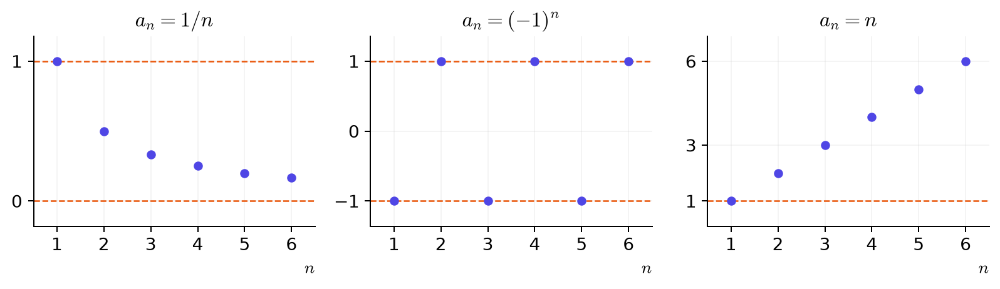{fig-alt="שתי הסדרות הראשונות חסומות משני הצדדים. הסדרה n חסומה מלמטה בלבד. הקווים המקווקווים מסמנים חסמים." width="620" fig-align="center"}

:::: {.thmchk title="מה דורש חסם?"}
כל איבר בסדרה קטן מ $5$. מכאן שהסדרה חסומה גם מלמעלה וגם מלמטה.

::: {.quiz options="נכון|לא נכון" answer="לא נכון"}
זה נותן חסם עליון בלבד. למשל, כל איברי הסדרה $-n$ קטנים מ $5$, אבל אין לה חסם תחתון.
:::

אם $5$ הוא חסם עליון, גם $20$ הוא חסם עליון.

::: {.quiz options="נכון|לא נכון" answer="נכון"}
כל איבר קטן מ $5$ או שווה לו, ולכן גם קטן מ $20$.
:::
::::

::: {#box-thm-convergent-bounded .thmthm title="התכנסות גוררת חסימות"}
כל סדרה מתכנסת היא חסומה.
:::

מאינדקס מסוים האיברים נשארים בתחום קטן סביב הגבול. לפניו יש רק מספר סופי של איברים, ואפשר להרחיב את התחום כך שיכלול גם אותם. עם זאת, חסימות לבדה אינה מבטיחה התכנסות: $(-1)^n$ נשארת בין $-1$ לבין $1$ ואינה מתכנסת.

למשל, בסדרה שבה $a_1=-3$, $a_2=5$ ו $a_n=1/n$ לכל $n\ge3$, הזנב קרוב לאפס. כדי לחסום את **כל** הסדרה כוללים גם את שני האיברים הראשונים: $-3\le a_n\le5$.

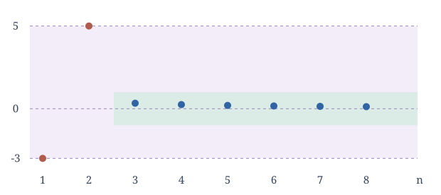{fig-alt="שני איברים ראשונים רחוקים מאפס, מינוס שלוש וחמש. הזנב נמצא ברצועה צרה סביב אפס; תחום רחב יותר כולל גם את האיברים הראשונים." width="560" fig-align="center"}

::::: {#box-exm-unbounded-divergent .thmexm title="חוסר חסימות שולל התכנסות"}
ממשפט [](#box-thm-convergent-bounded) נובעת דרך קצרה לשלול התכנסות: **אם סדרה אינה חסומה, היא אינה מתכנסת למספר ממשי.**

**(א)** הסדרה $a_n=n$ אינה חסומה מלמעלה. לכל חסם מוצע $M$, אפשר לבחור אינדקס טבעי $n>M$, ואז $a_n>M$. לכן הסדרה אינה מתכנסת.

**(ב)** בסדרה $b_n=(-1)^n n$ האיברים הם
$$-1,2,-3,4,-5,6,\ldots$$
הסימן מתחלף, אבל הערכים המוחלטים הם $|b_n|=n$. הם עולים מעבר לכל חסם, ולכן גם הסדרה הזאת אינה חסומה ואינה מתכנסת.

מה אפשר להסיק על $c_n=-n$, שאינה חסומה מלמטה?

::: {.quiz options="היא אינה מתכנסת למספר ממשי|אי אפשר להסיק דבר על התכנסות" answer="היא אינה מתכנסת למספר ממשי"}
חוסר חסימות מצד אחד כבר מספיק: סדרה מתכנסת חייבת להיות חסומה משני הצדדים.
:::
:::::

### מונוטוניות {.unnumbered}

חסימות מתארת את התחום שבו נמצאים האיברים, אבל אינה אומרת אם הם עולים, יורדים או מחליפים כיוון. כעת נבדוק את הכיוון.

::: {#box-def-monotone .thmdef title="סדרה מונוטונית"}
סדרה היא [**עולה**]{.term} אם כל איבר גדול מקודמו או שווה לו:
$$a_n\le a_{n+1}.$$

סדרה היא [**יורדת**]{.term} אם כל איבר קטן מקודמו או שווה לו:
$$a_n\ge a_{n+1}.$$

סדרה עולה או יורדת נקראת [**מונוטונית**]{.term}.

בהגדרות האלה מותר שוויון. כאשר $a_n<a_{n+1}$ לכל $n$, אומרים **עולה ממש**; כאשר $a_n>a_{n+1}$ לכל $n$, אומרים **יורדת ממש**.
:::

למשל, $\frac1n$ יורדת ממש, ו $1-\frac1n$ עולה ממש: ככל ש $n$ גדל, מחסרים מ $1$ מספר חיובי קטן יותר. סדרה קבועה היא גם עולה וגם יורדת לפי ההגדרות האלה.

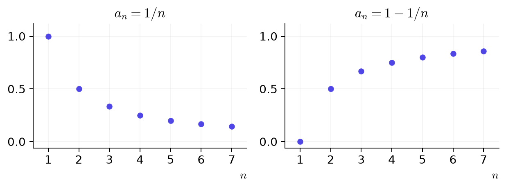{fig-alt="הסדרה אחת חלקי n יורדת, והסדרה אחת פחות אחת חלקי n עולה. כל נקודה מייצגת איבר; אין מחברים בין הנקודות." width="560" fig-align="center"}

:::: {.thmchk}
חמשת האיברים הראשונים עולים. האם די בכך כדי לקבוע שהסדרה עולה?

::: {.quiz options="כן|לא" answer="לא"}
ההגדרה דורשת $a_n\le a_{n+1}$ לכל $n$. ייתכן שהאיבר השישי קטן מהחמישי.
:::

הסדרה הקבועה $4,4,4,\ldots$ היא:

::: {.quiz options="עולה בלבד|יורדת בלבד|גם עולה וגם יורדת" answer="גם עולה וגם יורדת"}
כל איבר שווה לקודמו, ולכן שני האי־שוויונות מתקיימים. היא אינה עולה ממש ואינה יורדת ממש.
:::
::::

::: {#box-method-monotone-difference .thmmethod title="בדיקת מונוטוניות: הפרש או מנה"}
**דרך ההפרש.** מחשבים את $a_{n+1}-a_n$ ובודקים את סימנו לכל אינדקס:

- אם ההפרש תמיד אי־שלילי, הסדרה עולה.
- אם ההפרש תמיד אי־חיובי, הסדרה יורדת.
- אם יש צעד שבו ההפרש חיובי וצעד שבו הוא שלילי, הסדרה אינה מונוטונית.

**דרך המנה.** אם כל האיברים חיוביים, אפשר לחשב את $\frac{a_{n+1}}{a_n}$ ולהשוות ל $1$:

- אם המנה גדולה מ $1$ או שווה לו בכל האינדקסים, הסדרה עולה.
- אם המנה קטנה מ $1$ או שווה לו בכל האינדקסים, הסדרה יורדת.

בדרך ההפרש משווים ל $0$; בדרך המנה משווים ל $1$. תנאי החיוביות נחוץ לדרך המנה כפי שניסחנו אותה כאן.

בשתי הדרכים, את $a_{n+1}$ מקבלים מהצבת $n+1$ במקום $n$ בנוסחה לאיבר הכללי.
:::

::::: {#box-exm-monotone-difference .thmexm title="כותבים את האיבר הבא ומשווים"}
נבדוק את המונוטוניות של $a_n=\frac1n$.

תחילה נכתוב את האיבר הבא:
$$a_{n+1}=\frac1{n+1}.$$
כעת נחסר:
$$\begin{aligned}
a_{n+1}-a_n&=\frac1{n+1}-\frac1n\\
&=\frac{n-(n+1)}{n(n+1)}\\
&=-\frac1{n(n+1)}.
\end{aligned}$$
המכנה חיובי, ולכן ההפרש שלילי לכל $n$. מכאן שהסדרה יורדת ממש.

אפשר להגיע לאותה מסקנה בדרך המנה. האיברים חיוביים, ומתקיים
$$\frac{a_{n+1}}{a_n}=\frac{1/(n+1)}{1/n}=\frac n{n+1}<1.$$
המונה קטן מהמכנה החיובי בכל אינדקס, ולכן כל איבר קטן מקודמו.
:::::

::::: {.thmchk title="האיבר הבא או תוספת של אחת?"}
נתונה $a_n=2n+3$.

:::: fill
$a_{n+1}=$ [$2(n+1)+3$]{.blank ans="2(n+1)+3" vars="n" positive="n" integer="n" w="15"}.

$a_{n+1}-a_n=$ [$2$]{.blank ans="2"}.

::: explain
מציבים $n+1$ במקום $n$, ולכן $a_{n+1}=2(n+1)+3=2n+5$. האיבר הבא גדול מקודמו ב $2$.
:::
::::

האם תמיד מתקיים $a_{n+1}=a_n+1$?

::: {.quiz options="כן|לא" answer="לא"}
לא. תוספת של אחת לאינדקס מעבירה לאיבר הבא; היא אינה מחייבת שהאיבר עצמו יגדל באחת.
:::
:::::

:::: {#box-exm-converges-with-detours .thmexm title="התכנסות אינה מחייבת התקרבות בכל צעד"}
כדור שקופץ מעל הקרקע יכול לעלות שוב אחרי כל פגיעה, ובכל זאת גובה הקפיצות הולך וקטן. בדומה לכך, מרחקי איברי סדרה מן הגבול אינם חייבים לקטון בכל צעד: לא נדרש ש $|a_{n+1}-L|\le|a_n-L|$. נבדוק את הסדרה
$$a_n=\frac{2+(-1)^n}{n}.$$
נראה שהיא מתכנסת אל $0$, אף שהשגיאה אינה הולכת וקטנה בכל צעד.

האיברים הראשונים הם
$$1,\frac32,\frac13,\frac{3}{4},\frac15,\frac{1}{2},\ldots$$
בכל מעבר מאינדקס אי־זוגי לזוגי מתרחקים קצת מאפס.

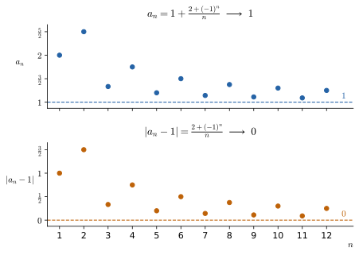{fig-alt="שנים עשר האיברים הראשונים של הסדרה שתיים ועוד מינוס אחת בחזקת n, חלקי n. בכל מעבר מאינדקס אי־זוגי לזוגי הערך גדל, אך כל האיברים מתקרבים לגבול אפס." width="600" fig-align="center"}

כדי לבדוק התכנסות אל $0$, נחשב את השגיאה. המונה הוא תמיד $1$ או $3$, ולכן
$$|a_n-0|=\frac{2+(-1)^n}{n}\le\frac3n.$$
נבחר סף שגיאה כלשהו $\varepsilon>0$. כדי להבטיח שגיאה קטנה ממנו, מספיק לדרוש
$$\frac3n<\varepsilon.$$
מכיוון ש $n$ ו $\varepsilon$ חיוביים, הדרישה הזאת שקולה ל
$$n>\frac3\varepsilon.$$
נבחר אינדקס טבעי $N>\frac3\varepsilon$. לכל $n\ge N$ מתקיים
$$|a_n-0|\le\frac3n\le\frac3N<\varepsilon.$$
כך אפשר לבחור $N$ מתאים לכל סף שגיאה חיובי. לפי הגדרת הגבול,
$$\lim_{n\to\infty}\frac{2+(-1)^n}{n}=0.$$
ההתרחקויות החוזרות אינן מונעות התכנסות: בכל רצועה סביב $0$, מאינדקס מתאים והלאה כל האיברים נשארים בפנים.
::::

### מונוטוניות וחסימות יחד {.unnumbered}

סדרה חסומה יכולה להמשיך לקפוץ בין שני מספרים, וסדרה עולה יכולה לגדול מעבר לכל חסם. כשיש גם כיוון קבוע וגם חסם מתאים, מתקבלת מסקנה חזקה יותר.

::: {#box-thm-monotone-bounded .thmthm title="מונוטונית וחסומה מתכנסת"}
סדרה עולה מתכנסת למספר ממשי אם ורק אם היא חסומה מלמעלה.

סדרה יורדת מתכנסת למספר ממשי אם ורק אם היא חסומה מלמטה.

בפרט, כל סדרה מונוטונית וחסומה מתכנסת.
:::

אפשר לחשוב על איברי סדרה עולה כעל נקודות שמתקדמות ימינה על הישר או נשארות במקומן, בלי לחזור שמאלה. החסם העליון אינו מאפשר להן להתקדם מעבר לו. המשפט מבטיח שבמצב הזה הן מתקרבות למספר מסוים, אבל לא בהכרח לחסם שבחרנו.

::: {#box-exm-bound-not-limit .thmexm title="חסם אינו בהכרח הגבול"}
הסדרה $a_n=1-\frac1n$ עולה. גם $1$ וגם $2$ הם חסמים עליונים שלה, אבל הגבול הוא $1$:
$$\lim_{n\to\infty}\left(1-\frac1n\right)=1.$$

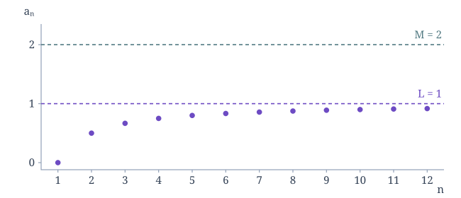{fig-alt="איברי הסדרה אחת פחות אחד חלקי n עולים ומתקרבים לקו בגובה אחת. הקו בגובה שתיים הוא חסם עליון נוסף, רחוק יותר, שאליו האיברים אינם מתקרבים." width="560" fig-align="center"}
:::


גם אם המונוטוניות והחסם המתאים מתקיימים רק החל מאינדקס $N$, אפשר להפעיל את המשפט על הזנב. אם הזנב מתכנס, גם הסדרה מתכנסת; מספר סופי של איברים בתחילתה אינו משנה זאת. במקרה כזה אומרים שהסדרה עולה או יורדת **החל מאותו אינדקס**, ולא בהכרח מתחילתה.

:::: {.thmchk}
סדרה עולה וכל איבריה קטנים מ $5$. מה אפשר להסיק?

::: {.quiz options="היא מתכנסת, אך הגבול לא חייב להיות 5|הגבול שלה הוא בהכרח 5" answer="היא מתכנסת, אך הגבול לא חייב להיות 5"}
למשל, $1-\frac1n$ עולה וקטנה מ $5$, אבל גבולה הוא $1$.
:::

ידוע שסדרה יורדת וחסומה מלמעלה. האם שתי התכונות האלה מבטיחות התכנסות?

::: {.quiz options="כן|לא" answer="לא"}
לסדרה יורדת דרוש חסם תחתון. למשל, $a_n=-n$ יורדת וחסומה מלמעלה, אבל אינה מתכנסת למספר ממשי.
:::
::::

::: {.thmwarn title="מה המשפט אינו אומר"}
מונוטוניות לבדה אינה מספיקה: $a_n=n$ עולה ואינה מתכנסת למספר ממשי.

חסימות לבדה אינה מספיקה: $(-1)^n$ חסומה ואינה מתכנסת.

התכנסות אינה מחייבת מונוטוניות: $\frac{(-1)^n}{n}$ מתכנסת לאפס, אף שכיוון השינוי מתחלף. ראינו שהמרחק מאפס הוא $\frac1n$.
:::

::::: {#box-exm-recursive-limit .thmexm title="סדרה ברקורסיה: התכנסות וחישוב הגבול"}
נתונים
$$a_1=1,\qquad a_{n+1}=\sqrt{2+a_n}.$$
נרצה לדעת אם הסדרה מתכנסת, ואם כן — לאיזה מספר.

נעבור יחד על הטיעון. השלימו את הבדיקות בכל שלב; אפשר לפתוח את ההסבר לאחר ניסיון.

**חסימות.** האיבר הראשון נמצא ב $[1,2]$. כדי לראות שכלל הרקורסיה משאיר את האיברים בקטע, נניח ש $1\le a_n\le2$ ונבדוק את האיבר הבא.

:::: fill
לאחר חיבור $2$ לכל האגפים:

::: {.eqline dir="ltr"}
[$3$]{.blank ans="3" w="3"} $\le 2+a_n\le$ [$4$]{.blank ans="4" w="3"}
:::

לאחר הוצאת שורש מכל האגפים:

::: {.eqline dir="ltr"}
[$\sqrt{3}$]{.blank ans="sqrt(3)" allow-expression="true" w="5"} $\le a_{n+1}\le$ [$2$]{.blank ans="2" w="3"}
:::

האם גם האיבר הבא נמצא ב $[1,2]$? [כן]{.blank kind="text" ans="כן" choices="כן|לא"}

::: explain
מחברים $2$ ומקבלים $3\le2+a_n\le4$. הוצאת שורש שומרת על סדר המספרים האי־שליליים, ולכן
$$1<\sqrt3\le a_{n+1}\le2.$$
מתחילים מאיבר שנמצא ב $[1,2]$, והכלל משאיר כל איבר חדש בתוכו. לכן כל איברי הסדרה בקטע הזה.
:::
::::

**מונוטוניות.** שני איברים עוקבים חיוביים, ולכן אפשר להשוות את הריבועים שלהם. לפי הרקורסיה,
$$\begin{aligned}
a_{n+1}^2-a_n^2&=2+a_n-a_n^2\\
&=(2-a_n)(a_n+1).
\end{aligned}$$

:::: fill
כבר קיבלנו $1\le a_n\le2$. לכן הגורם $2-a_n$ [אי־שלילי]{.blank kind="text" ans="אי־שלילי" choices="אי־שלילי|שלילי"}, והגורם $a_n+1$ [חיובי]{.blank kind="text" ans="חיובי" choices="חיובי|שלילי"}.

מכאן $a_{n+1}^2$ [גדול או שווה]{.blank kind="text" ans="גדול או שווה" choices="גדול או שווה|קטן"} ל $a_n^2$, ולכן הסדרה [עולה]{.blank kind="text" ans="עולה" choices="עולה|יורדת"}.

החסם הדרוש הוא [עליון]{.blank kind="text" ans="עליון" choices="עליון|תחתון"}, ואפשר לבחור אותו להיות [$2$]{.blank ans="2" min-answer="2" w="4"}.

לפי [](#box-thm-monotone-bounded), הסדרה [מתכנסת]{.blank kind="text" ans="מתכנסת" choices="מתכנסת|אינה מתכנסת"}.

::: explain
מכפלת שני הגורמים אי־שלילית, ולכן $a_{n+1}^2\ge a_n^2$. האיברים חיוביים, ומכאן $a_{n+1}\ge a_n$. הסדרה עולה וחסומה מלמעלה, ולכן מתכנסת.
:::
::::

{fig-alt="האיברים הראשונים של הסדרה הרקורסיבית מתחילים באחת, עולים ונשארים מתחת לשתיים. גבול הסדרה הוא שתיים." width="500" fig-align="center"}

**חישוב הגבול.** עכשיו, כשידוע שהסדרה מתכנסת, נסמן את גבולה ב $L$. גם $a_{n+1}\to L$: השמטת האיבר הראשון אינה משנה את הגבול. נשתמש בכללי החיבור והשורש מתוך [](#box-thm-limit-arithmetic) ו [](#box-prp-limit-powers):

:::: fill
השלימו את האגף הימני במשוואה שמתקבלת מהעברת גבול ברקורסיה:

::: {.eqline dir="ltr"}
$L=$ [$\sqrt{2+L}$]{.blank ans="sqrt(2+L)" vars="L" positive="L" w="12"}
:::

נעלה בריבוע, נעביר אגפים ונפרק לגורמים:
$$L^2=2+L,$$
$$L^2-L-2=0,$$
$$(L-2)(L+1)=0.$$
שני המועמדים הם [$-1$]{.blank ans="-1" w="4"} ו [$2$]{.blank ans="2" w="4"} (בסדר עולה).

כל האיברים ב $[1,2]$, ולכן גם $L$ בקטע הזה. הגבול הוא [$2$]{.blank ans="2" w="4"}.

::: explain
לאחר שביססנו התכנסות, מציבים את הגבול בשני צדי הרקורסיה ומקבלים $L=\sqrt{2+L}$. פתרון המשוואה לאחר העלאה בריבוע נותן שני מועמדים, אבל רק $2$ נמצא ב $[1,2]$ ומקיים את המשוואה המקורית.
:::
::::

::: {.thmwarn title="משוואה לגבול אינה מבטיחה התכנסות"}
אם הסדרה מתכנסת, גבולה חייב לקיים את המשוואה. פתרון המשוואה נותן מועמדים בלבד; כדי לקבוע שאחד מהם הוא הגבול צריך גם לבסס התכנסות.
:::
:::::

:::: {.thmchk title="מה צריך לבדוק לפני שמציבים גבול?"}
נתונים $a_1=0$ ו $a_{n+1}=1-a_n$. המשוואה $L=1-L$ נותנת $L=\frac{1}{2}$. האם זהו גבול הסדרה?

::: {.quiz options="כן|לא" answer="לא"}
לא. איברי הסדרה הם $0,1,0,1,\ldots$, ולכן היא אינה מתכנסת. אין כאן גבול שאפשר להציב בכלל הרקורסיה.
:::
::::


### תרגילים {.unnumbered}

::::: {#box-q-bounded-formulas .thmqst title="חסמים פשוטים"}
בכל סעיף מצאו מספר $K$ כך ש $|a_n|\le K$ לכל $n$. אין צורך למצוא את המספר הקטן ביותר.

:::: fill
**(א)** $a_n=4(-1)^n$: אפשר לבחור $K=$ [$4$]{.blank ans="4" min-answer="4"}.

**(ב)** $a_n=\frac2n$: אפשר לבחור $K=$ [$2$]{.blank ans="2" min-answer="2"}.

**(ג)** $a_n=1+\frac1n$: אפשר לבחור $K=$ [$2$]{.blank ans="2" min-answer="2"}.

::: hint
ב (א) חשבו את הערך המוחלט. ב (ב) ו (ג) השתמשו ב $0\le\frac1n\le1$.
:::

::: explain
**(א)** כל הערכים המוחלטים שווים $4$.

**(ב)** מתקיים $0\le\frac2n\le2$.

**(ג)** מתקיים $1\le1+\frac1n\le2$.

בכל סעיף גם מספר גדול מהחסם שמצאנו מתאים.
:::
::::
:::::

::::: {#box-q-monotone-bounded .thmqst title="מונוטוניות, חסם ומסקנה על התכנסות"}
נתונה $a_n=3-\frac1n$. בדקו מונוטוניות בעזרת הפרש או מנה, נמקו חסם מתאים, והסיקו שהסדרה מתכנסת בעזרת שתי התכונות.

:::: {.sequence-investigation formula="3-1/n" model-direction="up" model-side="upper" model-bound="3-1/n<=3" model-gap="1/n" difference="1/(n*(n+1))" ratio="n*(3n+2)/((n+1)*(3n-1))" bound-hint="האיבר מתקבל מחיסור מספר חיובי מ 3. מהו ההפרש בין 3 לבין האיבר?"}

::: model
אפשר לבדוק את ההפרש:
$$\begin{aligned}
a_{n+1}-a_n&=\left(3-\frac1{n+1}\right)-\left(3-\frac1n\right)\\
&=\frac1n-\frac1{n+1}\\
&=\frac1{n(n+1)}>0.
\end{aligned}$$
האינדקס חיובי, ולכן ההפרש חיובי והסדרה עולה.

למציאת חסם נחשב:
$$\begin{aligned}
3-a_n&=3-\left(3-\frac1n\right)\\
&=\frac1n\ge0.
\end{aligned}$$
לכן $a_n\le3$. הסדרה עולה וחסומה מלמעלה, ולכן מתכנסת לפי [](#box-thm-monotone-bounded).

אפשר גם להשתמש במנה: האיברים חיוביים, ומתקיים
$$\begin{aligned}
\frac{a_{n+1}}{a_n}&=\frac{n(3n+2)}{(n+1)(3n-1)}\\
&=1+\frac1{(n+1)(3n-1)}>1.
\end{aligned}$$
גם מכאן נובעת העלייה.
:::
::::
:::::

::::: {#box-q-monotone-decreasing .thmqst title="סדרה יורדת וחסם מתאים"}
נתונה $a_n=2+\frac3n$. בדקו מונוטוניות בדרך שתבחרו, נמקו חסם בצד המתאים, והסיקו התכנסות.

:::: {.sequence-investigation formula="2+3/n" model-direction="down" model-side="lower" model-bound="2+3/n>=2" model-gap="3/n" difference="-3/(n*(n+1))" ratio="n*(2n+5)/((n+1)*(2n+3))" bound-hint="ההפרש בין האיבר לבין 2 חיובי. האם 2 הוא חסם עליון או תחתון?"}

::: model
$$\begin{aligned}
a_{n+1}-a_n&=\frac3{n+1}-\frac3n\\
&=-\frac3{n(n+1)}<0.
\end{aligned}$$
הסדרה יורדת. נוסף על כך,
$$a_n-2=\frac3n\ge0,$$
ולכן $2$ הוא חסם תחתון. סדרה יורדת וחסומה מלמטה מתכנסת.

בדרך המנה אפשר לקבל
$$\frac{a_{n+1}}{a_n}=1-\frac3{(n+1)(2n+3)}<1.$$
מכיוון שכל האיברים חיוביים, גם השוואה זו מראה שהסדרה יורדת.
:::
::::
:::::

::::: {#box-q-monotone-quotient .thmqst title="בוחרים דרך לבדיקה"}
נתונה $a_n=\frac{n}{n+1}$. הראו שהסדרה מונוטונית וחסומה בצד המתאים, והסיקו התכנסות.

:::: {.sequence-investigation setup-required="true" formula="n/(n+1)" model-direction="up" model-side="upper" model-bound="n/(n+1)<=1" model-gap="1/(n+1)" difference="1/((n+1)*(n+2))" ratio="(n+1)^2/(n*(n+2))" bound-hint="השוו את האיבר למספר 1 באמצעות ההפרש ביניהם."}

::: model
$$\begin{aligned}
a_{n+1}-a_n&=\frac{n+1}{n+2}-\frac n{n+1}\\
&=\frac1{(n+1)(n+2)}>0.
\end{aligned}$$
לכן הסדרה עולה. כדי למצוא חסם נחשב
$$1-a_n=1-\frac n{n+1}=\frac1{n+1}\ge0.$$
מכאן $a_n\le1$. הסדרה עולה וחסומה מלמעלה, ולכן מתכנסת.

אפשר גם להשוות את המנה ל $1$:
$$\begin{aligned}
\frac{a_{n+1}}{a_n}&=\frac{(n+1)^2}{n(n+2)}\\
&=1+\frac1{n(n+2)}>1.
\end{aligned}$$
האיברים חיוביים, ולכן המנה מראה שהסדרה עולה.
:::
::::
:::::

::::: {#box-q-monotone-tail .thmqst title="כיוון השינוי מתייצב רק בהמשך"}
נתונה הסדרה
$$a_n=\begin{cases}
2,&n=1,\\
-1,&n=2,\\
1-\dfrac1n,&n\ge3.
\end{cases}$$
תחילתה היא $2,-1,\frac23,\frac34,\frac45,\ldots$.

:::: fill
בהתחלה יש [ירידה ואחריה עלייה]{.blank kind="text" ans="ירידה ואחריה עלייה" choices="עלייה ואחריה ירידה|ירידה ואחריה עלייה"}. לכן הסדרה כולה [אינה מונוטונית]{.blank kind="text" ans="אינה מונוטונית" choices="עולה|יורדת|אינה מונוטונית"}.

::: explain
מהאיבר $2$ עוברים אל $-1$, ואחריו אל $\frac23$. שינוי הכיוון בתחילת הסדרה אינו מונע מהזנב להיות מונוטוני.
:::
::::

בדקו בעזרת הפרש או מנה שהזנב המתחיל באינדקס $3$ עולה וחסום מלמעלה. מכאן הסיקו שהסדרה מתכנסת. בעוזר עובדים עם הנוסחה $a_n=1-1/n$, התקפה החל מאינדקס $3$; שני האיברים הראשונים אינם מתוארים בנוסחה הזאת.

:::: {.sequence-investigation formula="1-1/n" start-index="3" model-direction="up" model-side="upper" model-bound="1-1/n<=1" model-gap="1/n" difference="1/(n*(n+1))" ratio="n^2/((n+1)*(n-1))" bound-hint="ההפרש בין 1 לבין איבר בזנב הוא חיובי."}
::: model
ההפרש $a_{n+1}-a_n=1/(n(n+1))$ חיובי החל מאינדקס $3$. בזנב מתקיים $a_n\le1$, כי $1-a_n=1/n\ge0$. לכן הזנב עולה וחסום מלמעלה, ומכאן שהוא מתכנס. גם הסדרה מתכנסת, משום ששני איברים בתחילתה אינם משנים את הגבול.
:::
::::

:::: fill
האם $1$ הוא חסם עליון גם לסדרה כולה? [לא]{.blank kind="text" ans="לא" choices="כן|לא"}

חשבו את גבול הזנב בעזרת חשבון הגבולות. זהו גם גבול הסדרה: [$1$]{.blank ans="1" w="4"}.

::: explain
האיבר הראשון הוא $2$, ולכן $1$ אינו חסם עליון לכל הסדרה. הוא כן חוסם את הזנב שחקרנו. מחשבון הגבולות מתקבל $1-1/n\to1$; שני האיברים הראשונים אינם משנים זאת.
:::
::::
:::::

::::: {#box-q-monotone-counterexamples .thmqst title="איזו תכונה חסרה?"}
השתמשו בשלוש הסדרות
$$n,\qquad (-1)^n,\qquad\frac{(-1)^n}{n}.$$
בכל סעיף כתבו את הנוסחה של הסדרה המתאימה.

:::: fill
**(א)** סדרה מונוטונית שאינה חסומה: [$n$]{.blank ans="n" vars="n" positive="n" integer="n" w="12"}.

**(ב)** סדרה חסומה שאינה מתכנסת: [$(-1)^n$]{.blank ans="(-1)^n" vars="n" positive="n" integer="n" w="12"}.

**(ג)** סדרה מתכנסת שאינה מונוטונית: [$\frac{(-1)^n}{n}$]{.blank ans="(-1)^n/n" vars="n" positive="n" integer="n" w="12"}.

::: explain
**(א)** $n$ עולה, אך אין לה חסם עליון.

**(ב)** $(-1)^n$ נשארת בין $-1$ לבין $1$, אבל שתי תתי־הסדרות לפי זוגיות האינדקס מתכנסות לגבולות שונים.

**(ג)** המרחק של $\frac{(-1)^n}{n}$ מאפס הוא $\frac1n$, ולכן היא מתכנסת לאפס. שלושת איבריה הראשונים הם $-1,\frac{1}{2},-\frac13$: תחילה יש עלייה ואחריה ירידה, ולכן היא אינה מונוטונית.
:::
::::
:::::

::::: {#box-q-first-terms-do-not-decide .thmqst title="מה רואים בהתחלה, ומה קורה בהמשך?"}
נתונה הסדרה
$$a_n=\begin{cases}
100,&n=1,\\
\frac1n,&n\ge2.
\end{cases}$$

:::: fill
הגבול הוא [$0$]{.blank ans="0"}.

כתבו חסם עליון לכל איברי הסדרה: [$100$]{.blank ans="100" min-answer="100"}.

האם $1$ הוא חסם עליון לכל איברי הסדרה? [לא]{.blank kind="text" ans="לא" w="4" choices="כן|לא"}

::: explain
רק האיבר הראשון שונה מהסדרה $\frac1n$, ולכן הגבול נשאר $0$. אבל חסם צריך להתאים לכל האיברים, כולל האיבר הראשון. לכן כל חסם עליון חייב להיות לפחות $100$.
:::
::::
:::::

## חסימות וכלל הסנדוויץ׳

כדי למצוא גבול, לא תמיד צריך לפשט את הנוסחה לאיבר הכללי. לפעמים אפשר לחסום אותו בין שני ביטויים פשוטים יותר, שאת גבולותיהם אנחנו מכירים.

### אי־שוויונות שימושיים {.unnumbered}

כדי לבנות חסימה מתחילים מאי־שוויון ידוע ופועלים על האגפים, כמו בפרק 1. נרכז כאן את העובדות שנצטרך.

::: {#box-known-sequence-inequalities .thmrule title="חסימות מוכרות"}
לכל מספר ממשי $t$ מתקיים
$$-1\le\sin t\le1,$$
$$-1\le\cos t\le1.$$
במונחי ערך מוחלט, אלה אותן חסימות: $|\sin t|\le1$ ו $|\cos t|\le1$.

גם $(-1)^n$ נמצא בין $-1$ לבין $1$; הערך המוחלט שלו הוא בדיוק $1$.

האינדקסים בפרק מתחילים ב $1$. לכן $n\ge1$, ובפרט $n$ ו $n^2$ חיוביים.
:::

לחסימת סכום אפשר להיעזר גם באי־שוויון המשולש מתוך [תכונות הערך המוחלט בפרק 1](01-Introduction.qmd#box-thm-abs-props):
$$|u+v|\le|u|+|v|.$$
למשל,
$$|2+\cos n|\le2+|\cos n|\le3.$$
אותה חסימה מתקבלת גם מחיבור $2$ לכל האגפים של $-1\le\cos n\le1$:
$$1\le2+\cos n\le3.$$
גם מכאן נובע $|2+\cos n|\le3$. בדרך הזאת אפשר להשתמש בעוזר האי־שוויונות שלהלן.

::: {#box-rule-bound-operations .thmmethod title="בונים חסימות בעזרת פעולות על האגפים"}
אפשר לחבר או לחסר אותו ביטוי בכל האגפים. בכפל או בחילוק בביטוי חיובי שומרים על כיוון האי־שוויון; בביטוי שלילי הופכים את כל הכיוונים. אסור לחלק באפס.

אפשר גם להרחיב חסימה: להקטין את החסם התחתון או להגדיל את העליון. למשל, מ $-1\le\cos n\le1$ נובע גם $-2\le\cos n\le2$. אלה חסמים פחות הדוקים, אך עדיין נכונים.
:::

::::: {#box-exm-bound-operations .thmexm title="מתרגלים בניית חסימות"}
הגיעו בכל סעיף לחסימה המבוקשת בעזרת עוזר האי־שוויונות. בחרו פעולה, כתבו את התוצאה ובדקו את הצעד. אפשר להיעזר בהצגת התוצאה הצפויה.

**(א)** התחילו מ $-1\le\cos n\le1$ והראו כי $3\le4+\cos n\le5$.

:::: {.derive vars="n" positive="n" bound-rule="cos" start="-1<=cos(n)<=1"}

::: {.step line="[3]<=4+cos(n)<=[5]" action="add" value="4"}
מחברים $4$ לכל שלושת האגפים.
:::
::::

**(ב)** התחילו מ $-1\le\sin n\le1$ וחסמו את $\frac{\sin n}{n+1}$.

:::: {.derive vars="n" positive="n" bound-rule="sin" start="-1<=sin(n)<=1"}

::: {.step line="[-1/(n+1)]<=sin(n)/(n+1)<=[1/(n+1)]" action="div" value="n+1"}
מחלקים את כל האגפים ב $n+1$. המכנה חיובי, ולכן הכיוונים נשמרים.
:::
::::

**(ג)** התחילו מ $-1\le\cos n\le1$ והראו כי $2\le5-3\cos n\le8$.

:::: {.derive vars="n" positive="n" bound-rule="cos" start="-1<=cos(n)<=1"}

::: {.step line="[3]>=-3*cos(n)>=[-3]" action="mul" value="-3"}
כופלים ב $-3$ והופכים את שני הכיוונים.
:::

::: {.step line="[8]>=5-3*cos(n)>=[2]" action="add" value="5"}
מחברים $5$ לכל האגפים. זהו אותו אי־שוויון כמו $2\le5-3\cos n\le8$, רק בסדר כתיבה הפוך.
:::
::::

**(ד)** הרחיבו את החסימה $-1\le\sin n\le1$ לחסימה $-2\le\sin n\le2$.

:::: {.derive vars="n" positive="n" bound-rule="sin" start="-1<=sin(n)<=1"}

::: {.step line="[-2]<=sin(n)<=1" action="lowerBound" value="-2" clean="מקטינים את החסם התחתון מ $-1$ ל $-2$; החסימה נשארת נכונה."}
בוחרים ״הקטנת החסם התחתון״ ומחליפים את $-1$ ב $-2$.
:::

::: {.step line="-2<=sin(n)<=[2]" action="upperBound" value="2" clean="מגדילים את החסם העליון מ $1$ ל $2$; החסימה נשארת נכונה."}
בוחרים ״הגדלת החסם העליון״ ומחליפים את $1$ ב $2$.
:::
::::
:::::

### כלל הסנדוויץ׳ {.unnumbered}

::: {#box-thm-squeeze .thmthm title="כלל הסנדוויץ׳"}
אם החל מאינדקס מסוים מתקיים
$$b_n\le a_n\le c_n,$$
ושתי הסדרות החיצוניות מתכנסות לאותו מספר,
$$b_n\to L,\qquad c_n\to L,$$
אז גם $a_n\to L$.
:::

כששני החסמים קרובים אל $L$, גם כל מספר שביניהם קרוב אל $L$.

::: {#box-rule-positive-reciprocal-bound .thmrule title="חסימת הופכי חיובי"}
אם $0<u\le v$, אז
$$0<\frac1v\le\frac1u.$$
ככל שמחלקים במספר חיובי גדול יותר, המנה קטנה יותר. בחסימות מותר להחליף את הסימן הראשון ב $\le$: גם $0\le\frac1v\le\frac1u$ נכון.
:::

::::: {#box-exm-squeeze .thmexm title="סינוס חלקי n"}
נחשב את הגבול של $\frac{\sin n}{n}$. ערכי הסינוס משתנים, אבל תמיד מתקיים
$$-1\le\sin n\le1.$$

בחרו **כללי גבולות ← כלל הסנדוויץ׳**. בתוך הנימוק בחרו את חסמי הסינוס והתחילו את הנימוק. בחרו **פעולות על האגפים ← חילוק**, חלקו ב $n$ וכתבו את שלושת האגפים שהתקבלו. האינדקס $n$ חיובי, ולכן כיוון האי־שוויונות נשמר.

לאחר בדיקת הצעד, העתיקו לשדות החסימות את שני האגפים החיצוניים. מצאו את גבולם המשותף וכתבו אותו כתוצאת צעד הסנדוויץ׳.

:::: {.derive limit="n" start="sin(n)/n"}
::: {.step line="0" action="squeeze" lower="-1/n" upper="1/n" bound-proof="{&quot;rule&quot;:&quot;sin&quot;,&quot;argument&quot;:&quot;n&quot;,&quot;entries&quot;:[{&quot;source&quot;:1,&quot;text&quot;:&quot;-1/n<=sin(n)/n<=1/n&quot;,&quot;actions&quot;:[{&quot;op&quot;:&quot;div&quot;,&quot;value&quot;:&quot;n&quot;}]}]}"}
מחלקים את $-1\le\sin n\le1$ ב $n>0$ ומקבלים
$$-\frac1n\le\frac{\sin n}{n}\le\frac1n.$$
שני החסמים שואפים לאפס, ולכן גם $\sin(n)/n\to0$.
:::
::::

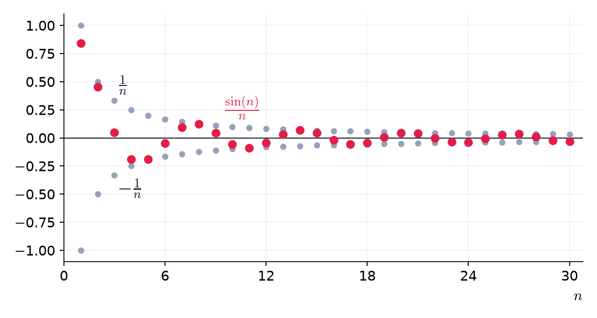{fig-alt="איברי הסדרה סינוס n חלקי n נמצאים בין מינוס אחד חלקי n לבין אחד חלקי n. שני החסמים מתקרבים לאפס." width="520" fig-align="center"}
:::::

::: {#box-cor-bounded-zero .thmcor title="סדרה חסומה כפול סדרה השואפת לאפס"}
אם $(b_n)$ חסומה ו $a_n\to0$, אז $a_nb_n\to0$.
:::

הסדרה החסומה אינה חייבת להתכנס. אם $|b_n|\le M$, אז $|a_nb_n|\le M|a_n|$, והאגף הימני שואף לאפס. למשל,
$$\frac{\cos n}{\sqrt n}\to0,$$
כי $|\cos n|\le1$ ו $\frac1{\sqrt n}\to0$.

:::: {.thmchk}
ידוע רק ש $0\le a_n\le2$ לכל $n$. האם כלל הסנדוויץ׳ מבטיח שהסדרה מתכנסת?

::: {.quiz options="כן|לא" answer="לא"}
לא. החסמים $0$ ו $2$ אינם מתכנסים לאותו מספר. למשל, $a_n=1+(-1)^n$ מקיימת את החסימות האלה ואינה מתכנסת.
:::

האם מספיק ששתי הסדרות במכפלה יהיו חסומות כדי שהמכפלה תשאף לאפס?

::: {.quiz options="כן|לא" answer="לא"}
לא. למשל, שתי הסדרות הקבועות $a_n=b_n=1$ חסומות, ומכפלתן שווה $1$.
:::
::::

::: {.thmrem title="אין צורך בחסם הטוב ביותר"}
כדי להשתמש בכלל הזה, אין צורך למצוא את החסם הטוב ביותר. אם $|b_n|\le1$, גם החסם $|b_n|\le10$ מספיק: בשני המקרים המכפלה עם סדרה השואפת לאפס תשאף לאפס. כמו בבחירת $N$, מחפשים מספר שמקיים את הדרישה, לא בהכרח את הקטן ביותר.
:::

::::: {#box-q-lim-bounded .thmexm title="גורם חסום וגורם השואף לאפס"}
חשבו את הגבול של $\frac{3\cos n}{n}$. נפריד בין הגורם $3\cos n$ לבין $1/n$.

בחרו **כללי גבולות ← סדרה חסומה כפול סדרה השואפת לאפס**. בשדה הגורם החסום כתבו $3\cos n$, ובשדה החסם כתבו $3$.

לנימוק בחרו את חסמי הקוסינוס. כפל של שלושת האגפים ב $3$ יראה שהגורם שבחרתם נמצא בין $-3$ לבין $3$. לאחר בדיקת הנימוק, חשבו את גבול הגורם שנותר והסיקו את גבול המכפלה.

:::: {.derive limit="n" start="3*cos(n)/n"}
::: {.step line="0" action="bounded" factor="3*cos(n)" bound="3" bound-proof="{&quot;rule&quot;:&quot;cos&quot;,&quot;argument&quot;:&quot;n&quot;,&quot;entries&quot;:[{&quot;source&quot;:1,&quot;text&quot;:&quot;-3<=3*cos(n)<=3&quot;,&quot;actions&quot;:[{&quot;op&quot;:&quot;mul&quot;,&quot;value&quot;:&quot;3&quot;}]}]}"}
מחסמי הקוסינוס, לאחר כפל ב $3$, מתקבל
$$-3\le3\cos n\le3.$$
לכן $|3\cos n|\le3$. הגורם $1/n$ שואף לאפס, ומכאן שגבול המכפלה הוא אפס.
:::
::::

:::: fill
האם גם החסם $|3\cos n|\le10$ מספיק לשימוש בכלל? [כן]{.blank kind="text" ans="כן" choices="כן|לא"}

::: explain
כן. אין צורך בחסם הקטן ביותר. אם בוחרים $10$ בעוזר, יש לנמק את הרחבת החסימות מ $-3,3$ אל $-10,10$.
:::
::::
:::::

::::: {#box-q-squeeze-bounds .thmchk title="בונים סנדוויץ׳"}
נתונה $a_n=2+\frac{\sin n}{n}$. בנו חסימות בעזרת עוזר האי־שוויונות, ואז השתמשו בכלל הסנדוויץ׳. גם חסמים רחבים יותר מתאימים, אם שניהם שואפים לאותו מספר.

:::: {.derive limit="n" start="2+sin(n)/n"}

::: {.step line="[2]" action="squeeze" lower="2-1/n" upper="2+1/n" bound-proof="{&quot;rule&quot;:&quot;sin&quot;,&quot;argument&quot;:&quot;n&quot;,&quot;entries&quot;:[{&quot;source&quot;:1,&quot;text&quot;:&quot;-1/n<=sin(n)/n<=1/n&quot;,&quot;actions&quot;:[{&quot;op&quot;:&quot;div&quot;,&quot;value&quot;:&quot;n&quot;}]},{&quot;source&quot;:2,&quot;text&quot;:&quot;2-1/n<=2+sin(n)/n<=2+1/n&quot;,&quot;actions&quot;:[{&quot;op&quot;:&quot;add&quot;,&quot;value&quot;:&quot;2&quot;}]}]}"}
מתחילים מ $-1\le\sin n\le1$. מחלקים ב $n>0$:
$$-\frac1n\le\frac{\sin n}{n}\le\frac1n.$$
מחברים $2$ לכל אגף:
$$2-\frac1n\le2+\frac{\sin n}{n}\le2+\frac1n.$$
שתי הסדרות החיצוניות שואפות אל $2$, ולכן גם הסדרה שביניהן שואפת אל $2$.
:::

::: hint
בחרו ״כלל הסנדוויץ׳״. בתוך הנימוק בחרו את חסמי הסינוס, חלקו ב $n$ וחברו $2$. כתבו בשדות החסימות את שני האגפים החיצוניים שקיבלתם.
:::
::::
:::::

### תרגילים {.unnumbered}

::::: {#box-q-squeeze-independent .thmqst title="כותבים חסימות ומשתמשים בהן"}
חשבו את הגבולות. אפשר להשתמש בכלל הסנדוויץ׳ או בכלל של סדרה חסומה כפול סדרה השואפת לאפס. בחרו חסימה מוכרת ונמקו בעזרת פעולות על האגפים את החסימות שבהן השתמשתם.

**(א)** $\displaystyle\lim_{n\to\infty}\frac{\cos n}{n}$

:::: {.derive limit="n" start="cos(n)/n"}

::: {.step line="[0]" action="bounded" factor="cos(n)" bound="1" bound-proof="{&quot;rule&quot;:&quot;cos&quot;,&quot;argument&quot;:&quot;n&quot;,&quot;entries&quot;:[]}"}
מתקיים $|\cos n|\le1$, ואילו $\frac1n\to0$. לפי [](#box-cor-bounded-zero), המכפלה שואפת לאפס.
:::

::: hint
אין צורך לחשב את ערכי הקוסינוס. מה אפשר לומר על הערך המוחלט של כולם?
:::
::::

**(ב)** $\displaystyle\lim_{n\to\infty}\left(3-\frac{2\sin n}{n}\right)$

:::: {.derive limit="n" start="3-2*sin(n)/n"}

::: {.step line="[3]" action="squeeze" lower="3-2/n" upper="3+2/n" bound-proof="{&quot;rule&quot;:&quot;sin&quot;,&quot;argument&quot;:&quot;n&quot;,&quot;entries&quot;:[{&quot;source&quot;:1,&quot;text&quot;:&quot;2>=-2*sin(n)>=-2&quot;,&quot;actions&quot;:[{&quot;op&quot;:&quot;mul&quot;,&quot;value&quot;:&quot;-2&quot;}]},{&quot;source&quot;:2,&quot;text&quot;:&quot;2/n>=-2*sin(n)/n>=-2/n&quot;,&quot;actions&quot;:[{&quot;op&quot;:&quot;div&quot;,&quot;value&quot;:&quot;n&quot;}]},{&quot;source&quot;:3,&quot;text&quot;:&quot;3+2/n>=3-2*sin(n)/n>=3-2/n&quot;,&quot;actions&quot;:[{&quot;op&quot;:&quot;add&quot;,&quot;value&quot;:&quot;3&quot;}]}]}"}
מתחילים מהחסימה $-1\le\sin n\le1$. כופלים ב $-2$ והופכים את כיווני האי־שוויון:
$$2\ge-2\sin n\ge-2.$$
מחלקים ב $n>0$ ומחברים $3$:
$$3+\frac2n\ge3-\frac{2\sin n}{n}\ge3-\frac2n.$$
שני החסמים שואפים אל $3$, ולכן גם הסדרה שביניהם שואפת אל $3$, לפי [](#box-thm-squeeze).
:::

::: hint
אפשר לבחור רק את הביטוי $\frac{2\sin n}{n}$ ולטפל בו תחילה, או לחסום את כל הסדרה משני הצדדים.
:::
::::

**(ג)** $\displaystyle\lim_{n\to\infty}\frac{3+\sin n}{n^2}$

:::: {.derive limit="n" start="(3+sin(n))/n^2"}

::: {.step line="[0]" action="squeeze" lower="2/n^2" upper="4/n^2" bound-proof="{&quot;rule&quot;:&quot;sin&quot;,&quot;argument&quot;:&quot;n&quot;,&quot;entries&quot;:[{&quot;source&quot;:1,&quot;text&quot;:&quot;2<=3+sin(n)<=4&quot;,&quot;actions&quot;:[{&quot;op&quot;:&quot;add&quot;,&quot;value&quot;:&quot;3&quot;}]},{&quot;source&quot;:2,&quot;text&quot;:&quot;2/n^2<=(3+sin(n))/n^2<=4/n^2&quot;,&quot;actions&quot;:[{&quot;op&quot;:&quot;div&quot;,&quot;value&quot;:&quot;n^2&quot;}]}]}"}
מתחילים מהחסימה
$$-1\le\sin n\le1.$$
מחברים $3$ לכל האגפים:
$$2\le3+\sin n\le4.$$
מכאן $|3+\sin n|\le4$. המונה חסום, והגורם $\frac1{n^2}$ שואף לאפס. משתמשים ב [](#box-cor-bounded-zero).

אפשר גם לחלק את שלושת האגפים ב $n^2>0$:
$$\frac2{n^2}\le\frac{3+\sin n}{n^2}\le\frac4{n^2}.$$
שתי הסדרות החיצוניות שואפות לאפס, ולכן אפשר להשתמש גם ב [](#box-thm-squeeze).
:::

::: hint
התחילו בחסם לסינוס, והוסיפו $3$. גם חסם שאינו הקטן ביותר יכול להתאים.
:::
::::
:::::


## טכניקות לחישוב גבולות

כדי להשתמש בחשבון הגבולות, צריך לזהות בביטוי סדרות שאת גבולותיהן אנחנו מכירים. לפעמים הן מתגלות רק אחרי פישוט אלגברי. נכיר שלוש דרכים שימושיות לכך.

### חלוקה בחזקה הגבוהה במכנה {.unnumbered}

::: {#box-method-largest-power .thmmethod title="מנה של פולינומים"}
מחלקים כל מחובר במונה ובמכנה באותה חזקה של $n$: בדרך כלל, החזקה הגבוהה ביותר שמופיעה במכנה.

בדוגמאות הבאות החזקה הגבוהה במונה אינה גדולה מזו שבמכנה. לאחר החלוקה נקבל קבועים ומחוברים מהצורה $\frac{c}{n^p}$ עם $p>0$. כשהמונה והמכנה החדשים מתכנסים וגבול המכנה שונה מאפס, משתמשים בכלל המנה.
:::

::::: {#box-exm-lim-linear-ratio .thmexm title="מתחילים במנה פשוטה"}
נחשב את
$$\lim_{n\to\infty}\frac{n+2}{n+4}.$$
המונה והמכנה אינם מתכנסים למספרים ממשיים, ולכן כלל המנה עדיין אינו מתאים. נחלק את כל המחוברים ב $n$.

:::: {.derive limit="n" start="(n+2)/(n+4)"}

::: {.step line="(1+2/n)/(1+4/n)" action="divide" value="n" clean="מחלקים את המונה ואת המכנה ב $n>0$."}
בוחרים ״חילוק המונה והמכנה בביטוי״, ומציינים $n$.
:::

::: {.step line="(1+0)/(1+0)" action="arithmetic"}
כעת המונה והמכנה מתכנסים אל $1$. גבול המכנה אינו אפס, ולכן כלל המנה חל.
:::

::: {.step line="1" action="compute"}
מחשבים את המנה.
:::
::::
:::::

::::: {#box-exm-lim-rational .thmexm title="מחלקים, ורק אז עוברים לגבול"}
חשבו את הגבול
$$\lim_{n\to\infty}\frac{3n^2+1}{n^2+4n}.$$

:::: {.derive limit="n" start="(3n^2+1)/(n^2+4n)"}

::: {.step line="(3+[1/n^2])/(1+[4/n])"}
מחלקים כל מחובר במונה ובמכנה באותה חזקה $n^2$.
:::

::: {.step line="(3+[0])/(1+[0])"}
המחוברים $\frac1{n^2}$ ו $\frac4n$ שואפים לאפס. גבול המכנה הוא $1\ne0$, ולכן אפשר להשתמש ב [](#box-thm-limit-arithmetic).
:::

::: {.step line="[3]"}
מחשבים את המנה.
:::

::: hint
למשל, $\frac{4n}{n^2}=\frac4n$. צריך לחלק כל מחובר, גם את $1$ שבמונה.
:::
::::
:::::

:::: {.thmchk}
מה מתקבל מחלוקת $5n+2$ בחזקה $n^2$?

::: fill
[$\frac{5}{n}+\frac{2}{n^2}$]{.blank ans="5/n+2/n^2" vars="n" positive="n" integer="n" w="16"}

::: explain
מחלקים כל מחובר: $\frac{5n+2}{n^2}=\frac5n+\frac2{n^2}$.
:::
:::
::::

### כפל וחילוק בצמוד {.unnumbered}

::: {#box-method-conjugate .thmmethod title="הפרש של שורשים"}
כשהביטוי כולל הפרש כמו $\sqrt A-\sqrt B$, אפשר לכפול ולחלק בסכום $\sqrt A+\sqrt B$. הסכום נקרא [**הצמוד**]{.term} של ההפרש.

משתמשים בזהות
$$(\sqrt A-\sqrt B)(\sqrt A+\sqrt B)=A-B.$$
הכפל והחילוק באותו ביטוי אינם משנים את הערך, בתנאי שהביטוי הזה שונה מאפס.
:::

::::: {#box-exm-conjugate-algebra .thmexm title="הצמוד: קודם האלגברה"}
כתבו את $\sqrt{n+1}-\sqrt n$ כמנה שאין במונה שלה הפרש של שורשים. כאן מפשטים את האיבר; בדוגמה הבאה נחשב את גבולו בעזרת כלל הסנדוויץ׳.

:::: {.derive vars="n" positive="n" start="sqrt(n+1)-sqrt(n)"}

::: {.step line="1/(sqrt(n+1)+sqrt(n))" action="conjugate"}
כופלים ומחלקים בצמוד. המונה הוא $(n+1)-n=1$, והמכנה חיובי.
:::
::::
:::::

::::: {#box-exm-conjugate-squeeze .thmexm title="הצמוד והסנדוויץ׳ יחד"}
נשלים את החישוב שהתחלנו ב [](#box-exm-conjugate-algebra):
$$a_n=\sqrt{n+1}-\sqrt n=\frac1{\sqrt{n+1}+\sqrt n}.$$
השורשים חיוביים, ולכן $\sqrt n\le\sqrt{n+1}+\sqrt n$. נשתמש בכך כדי לחסום את ההופכי.

:::: {.derive vars="n" positive="n" bound-rule="rootSum" start="sqrt(n)<=sqrt(n+1)+sqrt(n)"}

::: {.step line="0<=1/(sqrt(n+1)+sqrt(n))<=1/sqrt(n)" action="reciprocalBound" clean="מכיוון ש $0<\sqrt n\le\sqrt{n+1}+\sqrt n$, ההופכי חיובי ואינו גדול מ $1/\sqrt n$."}
בוחרים ״פעולות על חסמים ← חסימת הופכי של ביטוי חיובי״. מתקבלת חסימה מלמטה באפס ומלמעלה ב $1/\sqrt n$.
:::
::::

שני החסמים שואפים לאפס. לכן כלל הסנדוויץ׳ נותן את הגבול:

:::: {.derive limit="n" start="sqrt(n+1)-sqrt(n)"}

::: {.step line="1/(sqrt(n+1)+sqrt(n))" action="conjugate"}
כופלים ומחלקים בצמוד.
:::

::: {.step line="0" action="squeeze" lower="0" upper="1/sqrt(n)" bound-proof="{&quot;rule&quot;:&quot;rootSum&quot;,&quot;argument&quot;:&quot;n&quot;,&quot;entries&quot;:[{&quot;source&quot;:1,&quot;text&quot;:&quot;0<=1/(sqrt(n+1)+sqrt(n))<=1/sqrt(n)&quot;,&quot;actions&quot;:[{&quot;op&quot;:&quot;reciprocalBound&quot;}]}]}" clean="שני החסמים, $0$ ו $1/\sqrt n$, שואפים לאפס. לפי כלל הסנדוויץ׳, גם הסדרה שביניהם שואפת לאפס."}
בוחרים ״כלל הסנדוויץ׳״, כותבים את שני החסמים ומנמקים אותם בעזרת ״שורש לעומת סכום שורשים חיוביים״ והפעולה שתרגלנו.
:::
::::
:::::

::::: {#box-exm-limit-conjugate .thmexm title="מסלקים את ההפרש"}
חשבו את הגבול של $\sqrt{n^2+n}-n$. שני הביטויים שבחיסור גדלים ללא גבול, ולכן אי אפשר להשתמש כאן ישירות בכלל החיסור לסדרות המתכנסות למספרים. הכפל בצמוד יעזור לכתוב את אותו ביטוי בצורה שאפשר לחשב את גבולה.

מכיוון ש $n>0$, אפשר לכתוב $n=\sqrt{n^2}$.

:::: {.derive limit="n" start="sqrt(n^2+n)-n"}

::: {.step line="[n]/(sqrt(n^2+n)+n)"}
כופלים ומחלקים בצמוד $\sqrt{n^2+n}+n$. במונה מתקבל $(n^2+n)-n^2=n$.
:::

::: {.step line="1/(sqrt(1+[1/n])+1)"}
מחלקים את המונה ואת המכנה במספר החיובי $n$. בחלוקת השורש מתקבל
$$\frac{\sqrt{n^2+n}}n
=\sqrt{\frac{n^2+n}{n^2}}
=\sqrt{1+\frac1n}.$$
בתוך השורש מחלקים ב $n^2$, כי $n=\sqrt{n^2}$.
:::

::: {.step line="1/(sqrt(1+[0])+1)"}
עוברים לגבול לפי כללי המנה והשורש.
:::

::: {.step line="[1/2]"}
מחשבים את התוצאה.
:::

::: hint
כפלו וחלקו בצמוד $\sqrt{n^2+n}+n$. במונה השתמשו בזהות של הפרש ריבועים.
:::
::::

ההפרש, ולא גודלם של שני האיברים בנפרד, הוא שמעניין אותנו כאן. הנה כמה ערכים מקורבים של אותה סדרה $a_n=\sqrt{n^2+n}-n$:

| $n$ | $\sqrt{n^2+n}$ בקירוב | $a_n=\sqrt{n^2+n}-n$ בקירוב |
|:---:|:---:|:---:|
| $1$ | $1.4142$ | $0.4142$ |
| $10$ | $10.4881$ | $0.4881$ |
| $100$ | $100.4988$ | $0.4988$ |

כפי שחישבנו, $\displaystyle\lim_{n\to\infty}(\sqrt{n^2+n}-n)=\frac12$. בציור מוצג ההפרש עצמו:

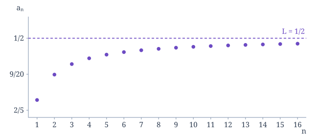{fig-alt="איברי הסדרה שורש של n בריבוע ועוד n, פחות n, עולים ומתקרבים לחצי. הציור מציג את ההפרש הקטן, ולא את שני הביטויים הגדולים שבחיסור." width="560" fig-align="center"}

:::::

### חזקות עם מעריך n {.unnumbered}

::::: {#box-exm-limit-exponentials .thmexm title="מחלקים בחזקה שבמכנה"}
חשבו את הגבול
$$\lim_{n\to\infty}\frac{2^n+3^n}{3^n}.$$

:::: {.derive limit="n" start="(2^n+3^n)/3^n"}

::: {.step line="([2/3])^n+[1]"}
מפרידים את השבר לסכום שני שברים.

חוק החזקות נותן
$$\frac{2^n}{3^n}=\left(\frac23\right)^n.$$
השבר השני הוא $\frac{3^n}{3^n}=1$.
:::

::: {.step line="[0]+1"}
המנה $q=\frac23$ מקיימת $|q|<1$, ולכן החזקה שואפת לאפס.
:::

::: {.step line="[1]"}
מחשבים.
:::
::::
:::::

### תרגילים {.unnumbered}

::::: {#box-q-lim-rational .thmqst title="מנות של פולינומים"}
חשבו את הגבולות.

**(א)** $\lim_{n\to\infty}\frac{5n^2-n}{2n^2+7}$

:::: {.derive limit="n" start="(5n^2-n)/(2n^2+7)"}

::: {.step line="(5-[1/n])/(2+[7/n^2])"}
מחלקים את המונה ואת המכנה בחזקה $n^2$.
:::

::: {.step line="(5-[0])/(2+[0])"}
עוברים לגבול. גבול המכנה הוא $2\ne0$.
:::

::: {.step line="[5/2]"}
מחשבים.
:::
::::

**(ב)** $\lim_{n\to\infty}\frac{2n+5}{n^2+1}$

:::: {.derive limit="n" start="(2n+5)/(n^2+1)"}

::: {.step line="([2/n]+[5/n^2])/(1+[1/n^2])"}
מחלקים את המונה ואת המכנה בחזקה $n^2$.
:::

::: {.step line="([0]+[0])/(1+[0])"}
עוברים לגבול.
:::

::: {.step line="[0]"}
מחשבים.
:::
::::
:::::

::::: {#box-q-limit-techniques .thmqst title="צמוד וחזקות"}
חשבו את הגבולות.

**(א)** $\lim_{n\to\infty}(\sqrt{n^2+4n}-n)$

:::: {.derive limit="n" start="sqrt(n^2+4n)-n"}

::: {.step line="[4n]/(sqrt(n^2+4n)+n)"}
כופלים ומחלקים בצמוד.
:::

::: {.step line="4/(sqrt(1+[4/n])+1)"}
מחלקים את המונה ואת המכנה במספר החיובי $n$.
:::

::: {.step line="4/(sqrt(1+[0])+1)"}
עוברים לגבול.
:::

::: {.step line="[2]"}
מחשבים.
:::
::::

**(ב)** $\lim_{n\to\infty}\frac{n+2^n}{2^n}$

:::: {.derive limit="n" start="(n+2^n)/2^n"}

::: {.step line="[n/2^n]+[1]"}
מחלקים כל מחובר במונה בביטוי $2^n$.
:::

::: {.step line="[0]+1"}
משתמשים בגבול $\frac n{2^n}\to0$ מתוך [](#box-thm-standard).
:::

::: {.step line="[1]"}
מחשבים.
:::
::::
:::::

::::: {#box-q-limit-choose-method .thmqst title="בוחרים איך להתחיל"}
חשבו את הגבולות. בכל סעיף בחרו שינוי אלגברי שיאפשר להשתמש בגבולות המוכרים.

**(א)** $\displaystyle\lim_{n\to\infty}\frac{4n+1}{2n-3}$

:::: {.derive limit="n" start="(4n+1)/(2n-3)"}

::: {.step line="(4+[1/n])/(2-[3/n])"}
מחלקים את המונה ואת המכנה ב $n$, לפי [](#box-method-largest-power).
:::

::: {.step line="(4+[0])/(2-[0])"}
גבול המכנה הוא $2$, ולכן אפשר להשתמש בכלל המנה.
:::

::: {.step line="[2]"}
מחשבים.
:::

::: hint
מה מתקבל אם מחלקים כל מחובר ב $n$?
:::
::::

**(ב)** $\displaystyle\lim_{n\to\infty}\frac{5^n+2^n}{3\cdot5^n-1}$

:::: {.derive limit="n" start="(5^n+2^n)/(3*5^n-1)"}

::: {.step line="(1+[(2/5)^n])/(3-[1/5^n])"}
מחלקים את המונה ואת המכנה ב $5^n$. חוקי החזקות נותנים $\frac{2^n}{5^n}=(\frac25)^n$.
:::

::: {.step line="(1+[0])/(3-[0])"}
שתי הסדרות המשתנות שואפות לאפס. גבול המכנה הוא $3$.
:::

::: {.step line="[1/3]"}
משתמשים בכלל המנה.
:::

::: hint
נסו לחלק בחזקה בעלת הבסיס הגדול יותר.
:::
::::

**(ג)** $\displaystyle\lim_{n\to\infty}(\sqrt{n^2+1}-n)$

:::: {.derive limit="n" start="sqrt(n^2+1)-n"}

::: {.step line="[1]/(sqrt(n^2+1)+n)"}
כופלים ומחלקים בצמוד, לפי [](#box-method-conjugate).
:::

::: {.step line="[1/n]/(sqrt(1+[1/n^2])+1)"}
מחלקים את המונה ואת המכנה ב $n$. מכיוון ש $n>0$, אפשר להכניס את החילוק לתוך השורש כחילוק ב $n^2$.
:::

::: {.step line="[0]/(sqrt(1+[0])+1)"}
משתמשים בחשבון הגבולות ובכלל השורש.
:::

::: {.step line="[0]"}
מחשבים.
:::

::: hint
אילו היינו כופלים בהפרש ובסכום של אותם שני ביטויים, היינו מקבלים הפרש ריבועים.
:::
::::
:::::


::::: {#box-q-mixed-limit-methods .thmqst title="איזו דרך מתאימה לביטוי?"}
חשבו את הגבולות בעוזר. בחרו בעצמכם את הפעולות: בחלק מהסעיפים אפשר להשתמש מיד בחשבון גבולות, ובאחרים דרוש שינוי אלגברי או נימוק באמצעות חסימות. ייתכנו כמה דרכים נכונות.

**(א)** $\displaystyle\lim_{n\to\infty}\frac{4+1/n}{2+3/n}$

:::: {.derive limit="n" start="(4+1/n)/(2+3/n)"}
::: {.step line="2" action="arithmetic"}
גבולות המונה והמכנה הם $4$ ו $2$. גבול המכנה אינו אפס, ולכן כלל המנה נותן $2$.
:::
::::

**(ב)** $\displaystyle\lim_{n\to\infty}\frac{\sin n}{n^2}$

:::: {.derive limit="n" start="sin(n)/n^2"}
::: {.step line="0" action="bounded" factor="sin(n)" bound="1" bound-proof="{&quot;rule&quot;:&quot;sin&quot;,&quot;argument&quot;:&quot;n&quot;,&quot;entries&quot;:[]}"}
בוחרים את חסמי הסינוס: $|\sin n|\le1$. הגורם $1/n^2$ שואף לאפס, ולכן גבול המכפלה הוא אפס. אין צורך בגבול לסדרה $\sin n$ עצמה.
:::
::::

**(ג)** $\displaystyle\lim_{n\to\infty}(\sqrt{n^2+4n}-n)$

:::: {.derive limit="n" start="sqrt(n^2+4n)-n"}
::: {.step line="4n/(sqrt(n^2+4n)+n)" action="conjugate"}
כופלים ומחלקים בצמוד. במונה נשאר $4n$.
:::
::: {.step line="4/(sqrt(1+4/n)+1)" action="divide" value="n"}
מחלקים את המונה והמכנה ב $n>0$. בתוך השורש מתקבל חילוק ב $n^2$.
:::
::: {.step line="2" action="arithmetic"}
גבול המכנה הוא $\sqrt1+1=2$, ולכן גבול המנה הוא $2$.
:::
::::

**(ד)** השוו בין שני גבולות:
$$\lim_{n\to\infty}\sqrt{16+\frac1n},\qquad \lim_{n\to\infty}\sqrt[n]{16}.$$

:::: {.derive limit="n" start="sqrt(16+1/n)"}
::: {.step line="4" action="arithmetic"}
סדר השורש קבוע. מחשבון גבולות וכלל השורש מתקבל $\sqrt{16+0}=4$.
:::
::::

:::: {.derive limit="n" start="root(n,16)"}
::: {.step line="1" action="standard"}
כאן סדר השורש גדל והמספר שמתחתיו קבוע. משתמשים בגבול המוכר $\sqrt[n]{a}\to1$ עבור $a>0$.
:::
::::
:::::

## גבולות אינסופיים

עד כאן שאלנו אם איברי הסדרה מתקרבים למספר ממשי. בסדרה $a_n=n^2$ קורה דבר אחר: האיברים עוברים כל גובה שנבחר, ונשארים מעליו בהמשך. למשל, כל האיברים החל מהאינדקס $11$ גדולים מ $100$, וכל האיברים החל מהאינדקס $101$ גדולים מ $10000$.

בגבול סופי ביקשנו להישאר בתוך קטע קטן סביב מספר. כאן נבקש להישאר מעל כל סף, גדול ככל שנבחר אותו.

::: {#box-def-infinite-limit .thmdef title="שאיפה לאינסוף ולמינוס אינסוף"}
כותבים $a_n\to\infty$ אם לכל מספר ממשי $M$ יש אינדקס טבעי $N$ כך שלכל $n\ge N$ מתקיים
$$a_n>M.$$

כותבים $a_n\to-\infty$ אם לכל מספר ממשי $M$ יש אינדקס טבעי $N$ כך שלכל $n\ge N$ מתקיים
$$a_n<M.$$
:::

אלה נקראים [**גבולות אינסופיים**]{.term}. אין כאן התקרבות למספר ממשי: הסדרה נשארת לבסוף מעל כל סף שנבחר, או מתחת לכל סף שנבחר. לכן, לפי ההגדרה שלנו, סדרות כאלה מתבדרות. אין דרישה שהן יעלו או ירדו בכל צעד.

בציור משמאל מופיעה הסדרה $\sqrt n$, שגם היא שואפת לאינסוף. מימין מופיעה סדרה בעלת איברים גדולים כרצוננו, אך היא חוזרת לאפס שוב ושוב.

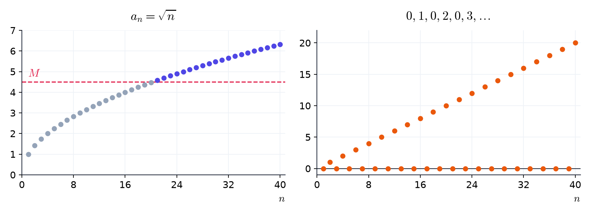{fig-alt="משמאל סדרת שורש n עוברת גובה נתון ונשארת מעליו. מימין איברים הולכים וגדלים לסירוגין עם אפסים, ולכן הסדרה אינה נשארת מעל כל גובה." width="560" fig-align="center"}

::: {.thmwarn title="לעבור גובה אינו מספיק"}
הסדרה $0,1,0,2,0,3,\ldots$ אינה חסומה, אבל אינה שואפת לאינסוף: אחרי כל איבר חיובי מופיע שוב $0$. כדי לשאוף לאינסוף צריך גם **להישאר** מעל כל גובה שנבחר.
:::

::: {#box-cor-monotone-infinite .thmcor title="סדרה מונוטונית ללא חסם מתאים"}
סדרה עולה שאינה חסומה מלמעלה שואפת לאינסוף.

סדרה יורדת שאינה חסומה מלמטה שואפת למינוס אינסוף.
:::

בסדרה עולה, אחרי שאיבר עבר סף מסוים, כל האיברים הבאים גדולים ממנו או שווים לו. אם אין חסם עליון, היא תעבור כל סף שנבחר. זהו ההבדל בינה לבין הסדרה שחוזרת לאפס.

:::: {.thmchk}
סדרה אינה מתכנסת למספר ממשי. האם היא חייבת לשאוף לאינסוף או למינוס אינסוף?

::: {.quiz options="כן|לא" answer="לא"}
לא. הסדרה $(-1)^n$ אינה מתכנסת ואינה שואפת לאף אחד משני האינסופים.
:::
::::

::: {#box-thm-standard-infinite .thmthm title="דוגמאות בסיסיות"}
לכל $p>0$ מתקיים
$$n^p\to\infty.$$

לכל $q>1$ מתקיים
$$q^n\to\infty.$$

אם $q\le-1$, הסדרה $q^n$ אינה מתכנסת ואינה שואפת לאינסוף או למינוס אינסוף.
:::

כאשר $q=-1$, האיברים מתחלפים בין $-1$ לבין $1$. כאשר $q<-1$, הערכים המוחלטים גדלים ללא גבול והסימנים מתחלפים. זאת בניגוד למקרה $-1<q<0$, שבו הערכים המוחלטים קטנים לאפס.

::: {#box-rule-infinite-arithmetic .thmrule title="כללי חישוב בסיסיים עם גבול אינסופי"}
אם $a_n\to\infty$ ו $b_n\to B$ כאשר $B$ מספר ממשי, אז $a_n+b_n\to\infty$.

אם $B>0$, אז $a_nb_n\to\infty$ וגם $\frac{a_n}{b_n}\to\infty$.
אם $B<0$, שתי התוצאות הן $-\infty$.

אם $|a_n|\to\infty$, אז $\frac1{a_n}\to0$.
:::

אם הסדרה הראשונה שואפת למינוס אינסוף, אפשר להוציא ממנה סימן מינוס ולהשתמש באותם כללים. למשל, $-n=-(n)$ שואפת למינוס אינסוף.

אין להתייחס לאינסוף כאל מספר רגיל. בפרט, הצורות
$$\frac{\infty}{\infty},\qquad\infty-\infty,\qquad0\cdot\infty$$
אינן קובעות גבול. למשל, $n-n=0$, ואילו $(n+5)-n=5$: בשני המקרים מחסרים שתי סדרות השואפות לאינסוף.

::: {#box-thm-compare .thmthm title="השוואה לאינסוף"}
אם $a_n\ge b_n$ החל מאינדקס מסוים ו $b_n\to\infty$, אז $a_n\to\infty$.

באופן דומה, אם $a_n\le b_n$ החל מאינדקס מסוים ו $b_n\to-\infty$, אז $a_n\to-\infty$.
:::

למשל, נבחן את הסדרה $a_n=n+2(-1)^n$. איבריה הראשונים הם
$$-1,\ 4,\ 1,\ 6,\ldots$$
הסדרה אינה מונוטונית, אבל לכל $n$ מתקיים
$$n+2(-1)^n\ge n-2.$$
מכיוון ש $n-2\to\infty$, גם $a_n\to\infty$. האיברים יכולים לרדת בחלק מהצעדים ועדיין להישאר, מאינדקס מתאים והלאה, מעל כל סף שנבחר.

### מכנה ששואף לאפס {.unnumbered}

כבר ראינו שמכנה השואף לאפס אינו מאפשר להשתמש בכלל המנה הרגיל. במקרה של הופכי, הסימן של המכנה נותן את המידע החסר.

::: {#box-rule-reciprocal-zero .thmrule title="הופכי של סדרה השואפת לאפס"}
נניח ש $a_n\to0$.

- אם האיברים חיוביים החל מאינדקס מסוים, אז $\frac1{a_n}\to\infty$.
- אם האיברים שליליים החל מאינדקס מסוים, אז $\frac1{a_n}\to-\infty$.
:::

למשל, $\frac1n$ חיובית ושואפת לאפס. ההופכי שלה הוא $n$, השואף לאינסוף. לעומת זאת, ההופכי של $-\frac1n$ הוא $-n$, השואף למינוס אינסוף.

:::: {.thmchk}
הסדרה $a_n=\frac{(-1)^n}{n}$ שואפת לאפס. האם ההופכי שלה שואף לאינסוף?

::: {.quiz options="כן|לא" answer="לא"}
ההופכי הוא $(-1)^n n$. הסימן ממשיך להתחלף: האיברים באינדקסים האי־זוגיים שליליים. לכן הסדרה אינה נשארת מעל כל סף. התנאי על הסימן נחוץ.
:::
::::

::::: {#box-exm-compare .thmexm title="מונה בעל חזקה גבוהה יותר"}
חשבו את הגבול של $\frac{n^2+1}{2n+3}$.

:::: {.derive limit="n" start="(n^2+1)/(2n+3)"}

::: {.step line="(n+[1/n])/(2+[3/n])"}
מחלקים את המונה ואת המכנה במספר $n$.
:::

::: {.step line="[inf]"}
המונה שואף לאינסוף, והמכנה שואף למספר החיובי $2$. לכן המנה שואפת לאינסוף.
:::

::: hint
אין לחלק את שני האינסופים. קודם משנים את צורת הביטוי כך שגבול המכנה יהיה מספר שונה מאפס.
:::
::::
:::::

### המספר e {.unnumbered}

מעריך ששואף לאינסוף אינו מחייב שהחזקה תשאף לאינסוף. בסדרה הבאה גם הבסיס וגם המעריך משתנים, והגבול סופי:
$$a_n=\left(1+\frac1n\right)^n.$$
סדרה זו מתכנסת למספר $e$, שכבר פגשנו בבסיס של הפונקציה המעריכית. נקבל כאן את ההתכנסות ללא הוכחה.

::: {#box-def-e .thmdef title="המספר e"}
הגבול של הסדרה $\left(1+\frac1n\right)^n$ נקרא $e$:
$$\lim_{n\to\infty}\left(1+\frac1n\right)^n=e\approx2.71828.$$
:::

{fig-alt="איברי הסדרה המגדירה את e עולים ומתקרבים למספר e. הקו בגובה שלוש נמצא מעל כל האיברים ואינו הגבול." width="520" fig-align="center"}

הגרף ממחיש שהאיברים עולים ומתקרבים אל $e$. הקו בגובה $3$ נמצא מעל כולם; הוא אינו הגבול.

::: {.thmwarn title="הבסיס והמעריך משתנים יחד"}
אמנם $1+\frac1n\to1$, אבל המעריך $n$ אינו קבוע. לכן אי אפשר להחליף את הבסיס ב $1$ ולהסיק שהגבול הוא $1$.
:::

:::: {.thmchk title="האם אפשר להשתמש בכלל החזקה?"}
נתונה הסדרה $a_n=1+\frac1n$, שגבולה $1$. האם מכאן נובע שגם $a_n^n\to1$?

::: {.quiz options="כן|לא" answer="לא"}
המעריך $n$ משתנה. כלל החזקה דורש מעריך קבוע, ואילו כאן הגבול הוא $e$.
:::
::::

### תרגילים {.unnumbered}

::::: {#box-q-e-arithmetic .thmqst title="משתמשים בגבול המגדיר את e"}
חשבו את
$\lim_{n\to\infty}\left(2\left(1+\frac1n\right)^n+\frac1n\right)$

:::: {.derive limit="n" start="2*(1+1/n)^n+1/n"}

::: {.step line="2*[e]+[0]" allow-expression="true"}
משתמשים בהגדרת $e$ ובגבול של $\frac1n$.
:::

::: {.step line="[2e]" allow-expression="true"}
מחשבים את התוצאה המדויקת, בלי להחליף את $e$ בקירוב עשרוני.
:::
::::
:::::

::::: {#box-q-to-infinity .thmqst title="איך הסדרה מתבדרת?"}
ב (א) ו (ב) כתבו את הגבול האינסופי. ב (ג) בדקו אם קיים גבול אינסופי.

:::: fill
**(א)** $n^3\to$ [$\infty$]{.blank ans="inf"}

**(ב)** $-2n\to$ [$-\infty$]{.blank ans="-inf"}

**(ג)** האם $(-2)^n$ שואפת לאינסוף או למינוס אינסוף? [לא]{.blank kind="text" ans="לא" w="4" choices="כן|לא"}

::: explain
**(א)** חזקה חיובית של $n$ שואפת לאינסוף.

**(ב)** האיברים קטנים מכל מספר נתון, החל מאינדקס מתאים.

**(ג)** האיברים מחליפים סימן. תת־הסדרה באינדקסים הזוגיים שואפת לאינסוף, ובאי־זוגיים למינוס אינסוף.
:::
::::
:::::

::::: {#box-q-infinite-computation .thmqst title="מפשטים לפני שמסיקים"}
חשבו את הגבול של $n-n^2$.

:::: {.derive limit="n" start="n-n^2"}

::: {.step line="n^2*([1/n]-1)"}
מוציאים את הגורם המשותף $n^2$.
:::

::: {.step line="[-inf]"}
הגורם הראשון שואף לאינסוף, והשני שואף למספר השלילי $-1$.
:::
::::
:::::

::::: {#box-q-infinite-independent .thmqst title="גבול אינסופי או מספר?"}
חשבו את הגבולות. לפני המעבר לגבול בדקו אם כללי החישוב חלים על צורת הביטוי הנוכחית.

**(א)** $\displaystyle\lim_{n\to\infty}\frac{2n^2+1}{n+4}$

:::: {.derive limit="n" start="(2n^2+1)/(n+4)"}

::: {.step line="(2n+[1/n])/(1+[4/n])"}
מחלקים את המונה ואת המכנה ב $n$.
:::

::: {.step line="[inf]"}
המונה שואף לאינסוף וגבול המכנה הוא $1>0$. משתמשים ב [](#box-rule-infinite-arithmetic).
:::
::::

**(ב)** $\displaystyle\lim_{n\to\infty}(2n-3n^2)$

:::: {.derive limit="n" start="2n-3n^2"}

::: {.step line="n^2*([2/n]-3)"}
מוציאים את הגורם $n^2$.
:::

::: {.step line="[-inf]"}
הגורם הראשון שואף לאינסוף, והשני שואף למספר השלילי $-3$.
:::
::::

**(ג)** $\displaystyle\lim_{n\to\infty}\frac{4}{n}$

:::: {.derive limit="n" start="4/n"}

::: {.step line="[0]"}
המכנה שואף לאינסוף, ולכן ההופכי שלו שואף לאפס. אפשר גם להשתמש בגבול המוכר $\frac1n\to0$ ובכפל בקבוע.
:::
::::

**(ד)** $\displaystyle\lim_{n\to\infty}\frac1{1/n+1/n^2}$

:::: {.derive limit="n" start="1/(1/n+1/n^2)"}

::: {.step line="[inf]"}
המכנה חיובי ושואף לאפס, ולכן ההופכי שלו שואף לאינסוף, לפי [](#box-rule-reciprocal-zero).
:::

::: hint
בדקו גם את גבול המכנה וגם את סימנו. אפשר לחלופין לכתוב את הביטוי כמנה של פולינומים.
:::
::::
:::::

::::: {#box-q-infinite-meaning .thmqst title="לעבור סף ולהישאר מעבר לו"}
נתונה $a_n=2n-1$. מצאו אינדקס $N$ כך שלכל $n\ge N$ יתקיים $a_n>100$.

:::: {.derive vars="n" solve="n" positive="n" integer="n" start="2n-1>100"}

::: {.step line="2n>[101]"}
מחברים $1$ לשני האגפים.
:::

::: {.step line="n>[101/2]"}
מחלקים במספר החיובי $2$.
:::
::::

:::: fill
אפשר לבחור $N=$ [$51$]{.blank ans="51" min-answer="51" integer-answer="true"}.

::: explain
כל אינדקס טבעי $N\ge51$ מתאים. זהו אותו עיקרון של בחירת אינדקס כמו בגבול סופי, אך כעת מבקשים להישאר מעל סף ולא בתוך קטע סביב מספר.
:::
::::
:::::

::: {.foldable title="חזקה עם מעריך אי־רציונלי"}
בפרק 1 השארנו פתוחה את המשמעות של חזקה כמו $2^{\sqrt2}$. אפשר להגדיר אותה באמצעות גבול.

לוקחים קירובים רציונליים של $\sqrt2$, למשל $1,1.4,1.41,1.414,\ldots$, ומתבוננים בסדרת החזקות
$$2^1,\quad2^{1.4},\quad2^{1.41},\quad2^{1.414},\ldots$$
כל איבר הוא חזקה עם מעריך רציונלי, שכבר הגדרנו. הסדרה מתכנסת, והגבול שלה הוא $2^{\sqrt2}\approx2.665$.

מתקבל אותו גבול מכל סדרת מעריכים רציונליים המתכנסת אל $\sqrt2$.
:::

::: {.foldable title="מילון מונחים — סדרות וגבולות"}
| מונח | פירוש |
|:---|:---|
| איבר ואינדקס | $a_n$ הוא האיבר שבמקום $n$; האינדקס $n$ מציין את מקומו בסדרה. |
| רקורסיה | נתינת איברים ראשונים וכלל לחישוב כל איבר חדש מתוך קודמיו. |
| קירוב ושגיאה | קירוב הוא מספר שבו משתמשים במקום המספר המדויק; השגיאה היא המרחק ביניהם, כלומר הערך המוחלט של ההפרש. |
| צפיפות הרציונליים | בין כל שני מספרים ממשיים שונים יש מספר רציונלי. |
| סף השגיאה | מספר חיובי $\varepsilon$ שהשגיאה נדרשת להיות קטנה ממנו. שוויון לסף אינו מספיק. |
| הערך השלם | לפי [ההגדרה בפרק 1](01-Introduction.qmd#box-def-floor), $\lfloor x\rfloor\le x<\lfloor x\rfloor+1$. |
| גבול והתכנסות | לכל סף שגיאה חיובי, כל האיברים החל מאינדקס מתאים קרובים לגבול בשגיאה קטנה מסף השגיאה שנבחר. |
| זנב | כל איברי הסדרה החל מאינדקס מסוים. |
| תת־סדרה | אינסוף איברים שנבחרו מהסדרה, באותו סדר וללא חזרה לאותו אינדקס. |
| חסימות | כל האיברים נמצאים בין שני מספרים קבועים. |
| חסם עליון ותחתון | חסם עליון גדול מכל איבר או שווה לו; חסם תחתון קטן מכל איבר או שווה לו. |
| מונוטוניות | הסדרה עולה לכל אורכה או יורדת לכל אורכה; מותר גם שוויון בין איברים. |
| צורה לא מוגדרת | צירוף גבולות, כמו $\frac00$, שאינו קובע לבדו את הגבול המבוקש. |
| צמוד | בחישוב הפרש שורשים משתמשים בסכום שלהם, ולהפך, כדי לקבל הפרש ריבועים. |
| גבול אינסופי | האיברים עוברים כל גובה ונשארים מעליו, או יורדים מתחת לכל גובה ונשארים מתחתיו. |
:::
